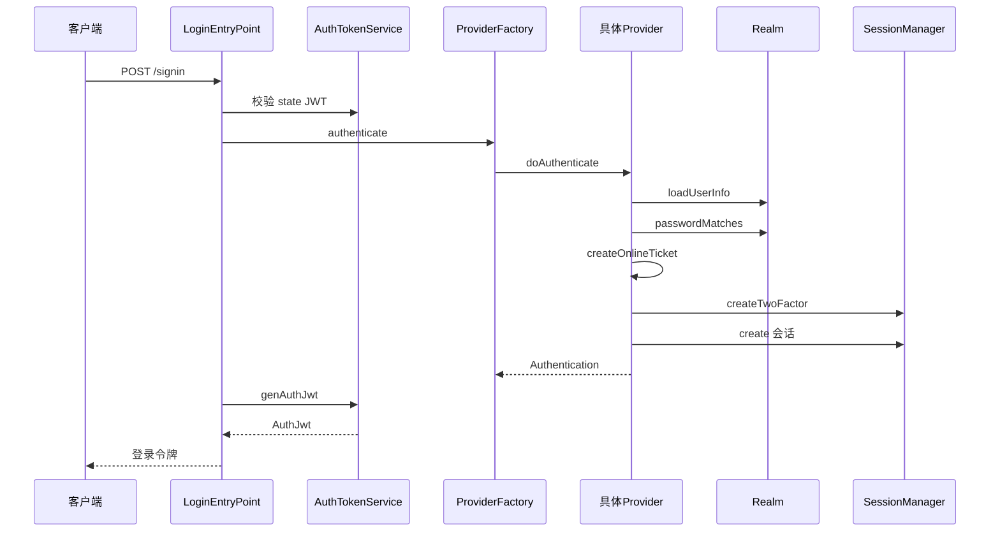
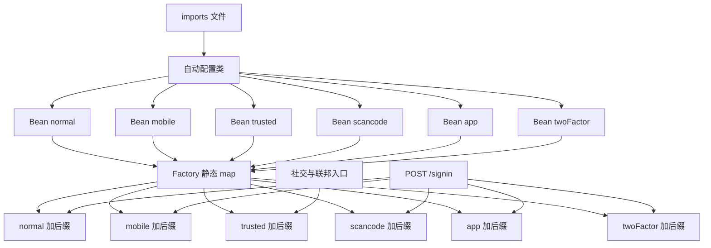
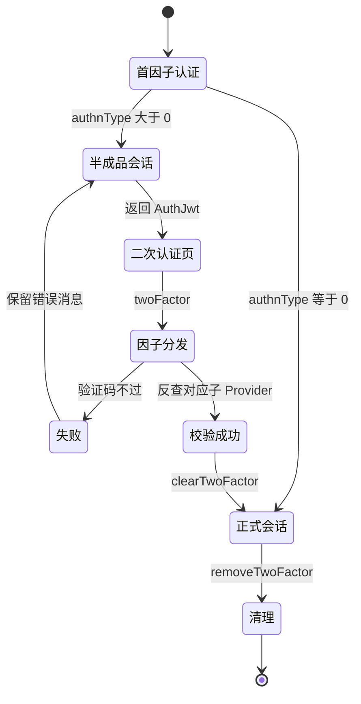

> 解读基线：MaxKey `4.1.12`（`3a3a5c765`）。

## 模块定位与它消灭的根因

认证碎片化的根因不是「认证方式多」，而是**每种方式的差异被错误地放进了主流程**。典型退化形态是登录服务里出现 `if (type == SMS) ... else if (type == TOTP) ...`：差异维度（凭据从哪来、怎么校验）与不变维度（查用户、判状态、发会话、记审计）纠缠在一起，于是「新增一种认证方式」等于改动主流程。MaxKey 的解法是把不变部分上提到抽象基类、把可变部分下沉为可插拔实现，再用一个字符串键把两者接起来。

`createOnlineTicket` 就是这个「不变模板」的全部——它一次性完成建会话、建身份、取权限、取可访问应用、组装令牌、落 `SessionManager`，因此「登录成功后系统处于什么状态」永远只有一处定义（[maxkey-authentications/maxkey-authentication-provider/src/main/java/org/dromara/maxkey/authn/provider/AbstractAuthenticationProvider.java:121-169]()）。
<!-- anchor: public UsernamePasswordAuthenticationToken createOnlineTicket(LoginCredential … return authenticationToken; -->

认证核心的产物是内部身份对象 `SignPrincipal` 与会话 `Session`：协议层（OAuth2/SAML/CAS/JWT）只消费它们，从不关心凭据形态。去掉这一层，每个协议适配器都要各自实现口令校验、密码策略、登录审计与会话创建。模块分三个 Gradle 子模块，其中两个 provider 模块是**互斥依赖**：管理控制台只依赖 `-mgt` 变体，用户门户只依赖默认变体（[maxkey-webs/maxkey-web-mgt/build.gradle:49-50]()）。
<!-- anchor: implementation project(":maxkey-authentications:maxkey-authentication-core") … implementation project(":maxkey-authentications:maxkey-authentication-provider -->
这不是洁癖：两个模块存在**完全同名同包**的类，同时进同一 classpath 必然冲突，代价在「关键设计决策」展开。

## 设计思路

### Provider 工厂与 authType 字符串路由
工厂本体只是一个静态 map 加一次 get，路由键由 `authType + PROVIDER_SUFFIX` 拼出，Provider 则在注册时以 `getProviderName()` 提交自己的名字（[maxkey-authentications/maxkey-authentication-provider/src/main/java/org/dromara/maxkey/authn/provider/AuthenticationProviderFactory.java:25-35]()）。
<!-- anchor: private  static ConcurrentHashMap<String,AbstractAuthenticationProvider> … return provider == null ? null : provider.doAuthenticate(authentication); -->
约定是 `PROVIDER_SUFFIX` 为常量、各 Provider 返回 `"<authType>" + PROVIDER_SUFFIX`，口令 Provider 即返回 `"normal" + PROVIDER_SUFFIX`，两边靠人工保持一致（[maxkey-authentications/maxkey-authentication-provider/src/main/java/org/dromara/maxkey/authn/provider/AbstractAuthenticationProvider.java:58-73]()）。
<!-- anchor: public static String PROVIDER_SUFFIX = "AuthenticationProvider"; … public static final  String APP         = "app"; -->

注册没有任何扫描、SPI 或条件注解，而是构造器注入后逐行手工登记；顺序上 2FA 被最后登记，且它自身也是一个 Provider（键为 `twoFactorAuthenticationProvider`），说明**二次认证在架构上被建模成又一种认证方式**，而非主流程分支（[maxkey-authentications/maxkey-authentication-provider/src/main/java/org/dromara/maxkey/autoconfigure/AuthnProviderAutoConfiguration.java:57-75]()）。
<!-- anchor: AbstractAuthenticationProvider authenticationProvider( … return authenticationProvider; -->

### 两条通道：常规入口与 trusted 入口

工厂暴露两个语义不同的入口。常规入口按 `authType` 查表；`authenticate(credential, trusted)` 则**完全忽略 authType**，恒定取 `trusted` Provider（[maxkey-authentications/maxkey-authentication-provider/src/main/java/org/dromara/maxkey/authn/provider/AuthenticationProviderFactory.java:39-41]()）。
<!-- anchor: public Authentication authenticate(LoginCredential authentication,boolean trus … return provider.doAuthenticate(authentication); -->
可信 Provider 的实现印证了「风险移除」的含义：只按用户名加载用户、密码位置传空串，然后直接签发会话，被注释掉的 `passwordPolicyValid` 与 `applyPasswordPolicy` 是显式痕迹（[maxkey-authentications/maxkey-authentication-provider/src/main/java/org/dromara/maxkey/authn/provider/impl/TrustedAuthenticationProvider.java:59-69]()）。
<!-- anchor: public Authentication doAuthenticate(LoginCredential loginCredential) { … Authentication authentication = createOnlineTicket(loginCredential,loadeduserI -->

这条通道把本系统降级为「只发会话」的角色，因此**上游就是全部的安全边界**。全仓有 12 处以上调用方，外部签名 JWT 校验通过即换会话是其中一例（[maxkey-authentications/maxkey-authentication-provider/src/main/java/org/dromara/maxkey/authn/support/jwt/HttpJwtEntryPoint.java:63-70]()）。
<!-- anchor: SignedJWT signedJWT = jwtLoginService.jwtTokenValidation(jwt); … AuthJwt authJwt = authTokenService.genAuthJwt(authentication); -->

**但这里有一处必须点出的实现缺陷**：该重载忽略 `trusted` 参数的值，且 `providers.get(...)` 之后**没有 null 检查**就解引用。任何调用方传 `false` 也会走可信通道；若某个装配漏注册 trusted Provider，此处直接 NPE 而非给出「trusted 未注册」的明确错误。另一个入口的 `equalsIgnoreCase("trusted")` 守卫与其后 map 的大小写敏感 get 也不一致。

### Provider 与 Realm 的两层分工

Provider 管「凭据以何种形态到达、如何被验证、验证后补什么动作」，面向请求；Realm 管「用户从哪张表或哪个目录查出来、口令按什么算法比对、权限从哪来」，面向数据源。抽象 Realm 承接的是与凭据形态无关的数据访问契约——查用户、按用户授权、按授权查可访问应用、写登录审计（[maxkey-authentications/maxkey-authentication-provider/src/main/java/org/dromara/maxkey/authn/realm/AbstractAuthenticationRealm.java:105-116]()）。
<!-- anchor: public List<GrantedAuthority> grantAuthority(UserInfo userInfo) { … return loginService.queryAuthorizedApps(grantedAuthoritys); -->

拆两层的收益在「本地口令 + LDAP 双源」上体现得最清楚：本地哈希比对失败且该租户开了 LDAP 支持时，委托 LDAP realm 校验，成功则把口令**回写本地库**，后续走本地快路径（[maxkey-authentications/maxkey-authentication-provider/src/main/java/org/dromara/maxkey/authn/realm/jdbc/JdbcAuthenticationRealm.java:111-120]()）。
<!-- anchor: LdapAuthenticationRealm ldapRealm = ldapAuthenticationRealmService.getByInstId … userInfoService.changePassword(changePassword, false); -->
这是典型的迁移期双写：LDAP 仍是权威源，本地库逐步缓存口令。若只有一层，这种按租户、按数据源动态切换的逻辑就会污染每一个 Provider。

### LDAP/AD Realm 的按租户装配与绑定策略
LDAP realm 不是启动期单例，而是按租户标识从配置库动态装配并按产品字段二选一构造 AD 或标准 LDAP 服务（[maxkey-authentications/maxkey-authentication-provider/src/main/java/org/dromara/maxkey/authn/realm/ldap/LdapAuthenticationRealmService.java:46-56]()）。
<!-- anchor: public LdapAuthenticationRealm getByInstId(String instId) { … if(ldapContext.getProduct().equalsIgnoreCase("ActiveDirectory") -->
配置里的绑定口令用 `PasswordReciprocal` 可逆解密后使用，即**可逆存储而非不可逆哈希**，配置库泄露等价于目录服务账号泄露。绑定策略上两者差异关键：标准 LDAP 是「先查后绑」两阶段，先用过滤器搜出用户 DN 再以该 DN 加口令重新建连，查询成功只证明对象存在、建连成功才证明凭据正确（[maxkey-authentications/maxkey-authentication-provider/src/main/java/org/dromara/maxkey/authn/realm/ldap/StandardLdapServer.java:50-58]()）。
<!-- anchor: public boolean authenticate(String username, String password) { … .search(ldapUtils.getBaseDN(), queryFilter, constraints); -->
AD 则是「直绑」一阶段，把域账号直接交给 AD 做 bind，不预先查询（[maxkey-authentications/maxkey-authentication-provider/src/main/java/org/dromara/maxkey/authn/realm/ldap/ActiveDirectoryServer.java:45-57]()）。
<!-- anchor: public boolean authenticate(String username, String password) { … return true; -->

### 各 Provider 的实现差异
口令 Provider 是唯一做了完整守卫链的实现：验证码、空口令、空用户名、查用户、存在性、密码策略、状态、口令比对、策略后置（[maxkey-authentications/maxkey-authentication-provider/src/main/java/org/dromara/maxkey/authn/provider/impl/NormalAuthenticationProvider.java:77-100]()）。
<!-- anchor: if(this.applicationConfig.getLoginConfig().isCaptcha()) { … authenticationToken = createOnlineTicket(loginCredential,userInfo); -->
短信登录的最大特点是**凭据字段复用**——把手机号拷进用户名、把短信验证码拷进口令位，从而复用同一条查用户与建会话路径。扫码登录则是唯一一个**凭据不是秘密而是票据状态**的 Provider：把二维码票据可逆解码当用户名传入，取出手机端会话标识，再直接借用手机端会话里的身份对象给 PC 端发新会话，身份在两端之间「搬运」而非重新校验（[maxkey-authentications/maxkey-authentication-provider/src/main/java/org/dromara/maxkey/authn/provider/impl/ScanCodeAuthenticationProvider.java:73-91]()）。
<!-- anchor: String encodeTicket = PasswordReciprocal.getInstance().decoder(loginCredential … authenticationToken = createOnlineTicket(loginCredential,userInfo); -->
社交账号没有独立 Provider：回调先以短信验证码确认手机号归属、写映射表，再构造凭据走 trusted 通道（[maxkey-webs/maxkey-web-maxkey/src/main/java/org/dromara/maxkey/web/controller/LoginEntryPoint.java:174-206]()）。
<!-- anchor: @PostMapping(value={"/signin/bindusersocials"}) … Authentication  authentication = authenticationProvider.authenticate(loginCred -->
Passkey 则**完全绕开本模块的工厂**：它在 `maxkey-starter-passkey` 自建 REST 端点，并手工复制了一份 `createOnlineTicket`，源码注释直接自陈「参考 AbstractAuthenticationProvider.createOnlineTicket 方法」（[maxkey-starter/maxkey-starter-passkey/src/main/java/org/dromara/maxkey/passkey/endpoint/PasskeyAuthenticationEndpoint.java:87-90]()）。
<!-- anchor: private UsernamePasswordAuthenticationToken createOnlineTicket(UserInfo userIn … LoginCredential loginCredential = new LoginCredential(); -->

### 双因素如何挂在首因子之后

关键设计是**首因子不直接建正式会话，而是先建半成品会话**：模板在「认证方式为 normal 且用户配置了因子编号」时把编号写进身份对象，并存进一个独立的 twoFactor 命名空间（[maxkey-authentications/maxkey-authentication-provider/src/main/java/org/dromara/maxkey/authn/provider/AbstractAuthenticationProvider.java:156-160]()）。
<!-- anchor: if(credential.getAuthType().equalsIgnoreCase(AuthType.NORMAL) … this.sessionManager.createTwoFactor(session.getId(), session); -->
两个命名空间在存储层是物理隔离的 `Cache`，普通会话按有效期过期、半成品固定 10 分钟，互不覆盖（[maxkey-authentications/maxkey-authentication-core/src/main/java/org/dromara/maxkey/authn/session/impl/InMemorySessionManager.java:61-64]()）。
<!-- anchor: sessionTwoFactorStore = Caffeine.newBuilder() … .build(); -->
二次校验本身是一个分发器：用令牌解析出会话标识、取半成品会话、从身份对象的因子编号反查子 Provider，成功后清空标记、把会话转正、删除半成品并写审计（[maxkey-authentications/maxkey-authentication-provider/src/main/java/org/dromara/maxkey/authn/provider/twofactor/TwoFactorAuthenticationProvider.java:76-112]()）。
<!-- anchor: public Authentication doAuthenticate(LoginCredential credential) { … twoFactorAuth = authenticationProvider.doTwoFactorAuthenticate( -->
因子编号来自用户表的 `authnType` 列，取值决定走 TOTP、邮件还是短信，常量集中定义（[maxkey-commons/maxkey-common/src/main/java/org/dromara/maxkey/constants/ConstsTwoFactor.java:30-43]()）。
<!-- anchor: public static final int NONE                 = 0; … public static final int SMS                 = 3; -->

## 关键数据结构

**`LoginCredential` 是所有认证方式的统一入参**，其字段承载关系解释了「为什么能共用一个 Provider 接口」：用户名与口令既承载口令登录也承载扫码票据与 APP 登录；手机号与动态码承载短信登录；验证码与 state 承载图形/算术验证码及其防重放绑定；`authType` 是唯一路由键；`jwtToken` 用于二次认证阶段定位半成品会话；租户标识与结果码是审计字段（[maxkey-authentications/maxkey-authentication-core/src/main/java/org/dromara/maxkey/authn/LoginCredential.java:27-46]()）。
<!-- anchor: public class LoginCredential  implements Authentication { … String instId; -->

**`SignPrincipal` 是认证结果的身份载体**，内嵌用户对象、租户与用户标识、会话号、因子编号、角色集合，以及 `grantedAuthorityApps`——**以「应用注册项」为粒度的可访问应用清单**（[maxkey-authentications/maxkey-authentication-core/src/main/java/org/dromara/maxkey/authn/SignPrincipal.java:29-44]()）。
<!-- anchor: public class SignPrincipal implements  UserDetails { … List<GrantedAuthority> grantedAuthorityApps; -->
它的存在是「以应用注册项为中心」这一全局哲学在认证层的落点：认证成功的同时即把「这个身份能访问哪些应用」算好放进 principal，协议层无需再查。

需要纠正一处常见误读：`AccountsStrategy` 不是认证策略，而是**应用账号开通策略**。其字段为应用标识、过滤条件、组织列表、后缀、创建方式等，语义是「按组织与过滤条件，为哪些用户在哪个应用里开账号」（[maxkey-entity/src/main/java/org/dromara/maxkey/entity/AccountsStrategy.java:44-74]()）。
<!-- anchor: private String id; … Date modifiedDate; -->
它的真实消费方是账号开通服务而非登录选路（[maxkey-persistence/src/main/java/org/dromara/maxkey/persistence/service/impl/AccountsServiceImpl.java:111-111]()）。
<!-- anchor:        for( AccountsStrategy strategy : accountsStrategyService.query( -->
真正决定「某人走哪种认证」的是用户表的认证方式列与全局登录开关（验证码、MFA、Kerberos、记住我）。

## 核心流程

### 登录请求全链路

入口即 `POST /signin`，它先校验 state 令牌再交由工厂（[maxkey-webs/maxkey-web-maxkey/src/main/java/org/dromara/maxkey/web/controller/LoginEntryPoint.java:221-230]()）。
<!-- anchor: @PostMapping(value={"/signin"}, produces = {MediaType.APPLICATION_JSON_VALUE}) … AuthJwt authJwt = authTokenService.genAuthJwt(authentication); -->

### Provider 注册与 authType 路由表

前端提交的字面量必须与 Provider 名严格对齐，二次认证页提交的 `authType` 就是 `twoFactor`（[maxkey-web-frontend/maxkey-web-app/src/app/routes/passport/tfa/tfa.component.ts:181-181]()）。
<!-- anchor:         authType: 'twoFactor', -->

### 双因素二次校验

会话超时与令牌失效两个分支都回落到空结果，前端据此提示重新登录。

## 与其他模块的协同

协议层只把认证结果当输入：SAML 收到断言后构造凭据走 trusted 通道换本地会话，而非重新校验口令（[maxkey-protocols/maxkey-protocol-saml-2.0/src/main/java/org/dromara/maxkey/authz/saml20/consumer/endpoint/ConsumerEndpoint.java:197-197]()）。
<!-- anchor:         Authentication  authentication = authenticationProvider.authenticate( -->
会话层是三级存储：Caffeine 内存为一级，Redis 为二级（仅在 `persistence=REDIS` 时启用），数据库记录会话状态。管理端则是一条刻意裁剪的分支：`-mgt` 系列只注册 normal、mobile、trusted 三个 Provider，**没有 2FA、没有扫码、没有 APP 登录**（[maxkey-authentications/maxkey-authentication-provider-mgt/src/main/java/org/dromara/maxkey/autoconfigure/AuthnProviderAutoConfiguration.java:43-51]()）。
<!-- anchor: AbstractAuthenticationProvider authenticationProvider( … authenticationProvider.addAuthenticationProvider(trustedAuthenticationProvider -->
这正是管理控制台与用户门户登录能力不一致的原因，也让「同一个口令 Provider 维护两份」成为必须付出的代价。

## 关键设计决策

### 决策一：静态 map 加字符串路由，而非 Spring 按类型注入
**选择**：工厂持有静态 map，键是 `authType + PROVIDER_SUFFIX` 约定，注册靠自动配置逐行调用。**收益**：路由是一次哈希查找；新增认证方式只需写一个 Provider、加一行注册、前端换一个 authType，主流程零改动；工厂是普通 Java 类，不依赖 Spring 上下文，可在拦截器与过滤器中直接使用。**代价**：`providers` 是静态可变状态，多应用上下文互相污染、无法按 profile 隔离；`getProviderName()` 与查询键靠人工保证一致，编译器不校验，大小写或笔误的后果是工厂**静默返回 null**，调用方只能从会话属性里猜原因。若改为按 bean 名注入，可获得启动期校验，但键会变成 bean 名，仍需一层到 authType 的映射，且两个模块的同名类冲突会立刻暴露。

### 决策二：Provider 与 Realm 拆两层，而非合并
**选择**：Provider 只管凭据形态与验证流程，数据访问与口令比对全部下沉到 Realm。**收益**：实证收益是「一个 Provider 横跨多个凭据域」——口令 Provider 完全不感知自己面对的是本地口令还是 LDAP 口令，双源回退与回写完全封装在 Realm 内；反向复用同样成立，Normal、Mfa、App 三个 Provider 共享同一个 Realm 实例。**代价**：Realm 的职责会膨胀，它还要做浏览器 User-Agent 解析与登录历史组装，这既不是凭据校验也不是纯数据访问，使该类的变更原因变得混杂。

### 决策三：trusted 通道的安全边界
**选择**：用一个布尔重载把「上游已认证」的语义编码进 API，而不是给每个联邦入口各写一套建会话代码。**收益**：十余个入口（Basic、Kerberos、JWT、HTTP Header、WS-Federation、CAS、SAML、社交、RememberMe）复用同一条建会话路径，权限、可访问应用、审计、记住我语义天然一致。**代价**：安全责任完全外移到调用方——任何能在上游伪造用户名的环节都会直接升级为任意用户登录。其中风险最高的是 `/jwt/trust` 分支：它用**本系统自己签发的 JWT** 的 subject 直接换登录态，等价于把任何一枚历史令牌都变成登录凭据（[maxkey-authentications/maxkey-authentication-provider/src/main/java/org/dromara/maxkey/authn/support/jwt/HttpJwtEntryPoint.java:85-97]()）。
<!-- anchor: @RequestMapping(value={"/jwt/trust"}, produces = … return new Message<>(authJwt); -->

## 亮点

**`createOnlineTicket` 的单点收敛**是「新增认证方式不改主流程」真正成立的原因，所有 Provider 的差异都被推到「怎么拿到一个用户对象」这一步。**二次认证被建模为又一个 Provider**而非主流程分支：它有自己的 authType 与注册键，与首因子共用同一条工厂路由，前端只需换一个 authType，而半成品会话的独立命名空间让「未完成二次校验的会话」无法被误当作正式会话。**Realm 按租户动态装配加 Caffeine 缓存**使 LDAP 的多域、AD/LDAP 混合、账号映射开关等租户级差异无需重启即生效。**验证码的一次性语义**把 state 绑定与一次性取用合成一次操作，天然防重放。

## 问题与安全注意点

**`statusValid` 对锁定用户只记录不拦截（高危）**：该方法对锁定与非激活用户仅写审计日志，随后**无条件 `return true`**，不抛异常；而口令 Provider 在其之后才做口令比对，因此管理员手工锁定的用户只要口令正确仍可登录（[maxkey-authentications/maxkey-authentication-provider/src/main/java/org/dromara/maxkey/authn/provider/AbstractAuthenticationProvider.java:254-272]()）。
<!-- anchor: protected boolean statusValid(LoginCredential loginCredential , UserInfo userI … return true; -->
锁定语义实际由另一条机制分担——失败次数达到策略阈值时由密码策略校验抛异常并锁定用户，两套机制分裂是明确的设计缺陷（[maxkey-persistence/src/main/java/org/dromara/maxkey/persistence/service/impl/LoginServiceImpl.java:140-159]()）。
<!-- anchor: if (userInfo.getBadPasswordCount() >= passwordPolicy.getAttempts() && … WebContext.getI18nValue("login.error.attempts", -->

**扫码登录缺失确认态，构成中间人面**：`ScanCodeService` 定义了五个状态常量，但全仓检索显示 `CONFIRMED`、`CONFIRM`、`CANCELED`、`CANCEL` 以及 `getConfirmKey()` 在定义处之外**零引用**，状态机实际只跑「未扫 → 已扫」两态；叠加 `createTicket()` 不接收任何浏览器会话或设备绑定参数（[maxkey-authentications/maxkey-authentication-provider/src/main/java/org/dromara/maxkey/authn/provider/scancode/ScanCodeService.java:46-84]()）。
<!-- anchor: public static class STATE { … return ticket; -->
而生成二维码的端点本身也不携带任何鉴权语义（[maxkey-webs/maxkey-web-maxkey/src/main/java/org/dromara/maxkey/web/controller/LoginScanCodeEndpoint.java:78-88]()）。
<!-- anchor: public Message<HashMap<String,String>> genScanCode() { … return new Message<>(Message.SUCCESS, codeMap); -->
合起来就是典型的 QRLJacking 面：扫码即授权，没有独立的「确认登录」二次确认，攻击者可以把自助生成的二维码投放给受害者，受害者用已登录的手机扫码即把身份交给了攻击者正在轮询的票据。此外票据在传输前用 `PasswordReciprocal`（对称可逆）编解码，提供的是混淆而非完整性，防篡改靠的是服务端查不到即失效。

**两个 provider 模块是复制式分叉**：身份基类（288 行与 262 行）、工厂、口令 Provider、JDBC Realm、LDAP Realm 及其服务与两个 LDAP 服务实现，在默认模块与 `-mgt` 中**同名同包并存**，经 diff 确认多数逐字节相同，仅身份基类因剥离 2FA 相关代码而分叉（[maxkey-authentications/maxkey-authentication-provider-mgt/src/main/java/org/dromara/maxkey/authn/provider/AuthenticationProviderFactory.java:25-25]()）。
<!-- anchor:     private  static ConcurrentHashMap<String,AbstractAuthenticationProvider> -->
后果有三：任何口令校验、锁定策略、审计修复都必须在两个模块各改一次，漏改的那份恰是权限最高的管理控制台；同名同包直接排除了两个模块同时上 classpath 的可能，「门户与控制台同进程」将是一处硬性重构点；`-mgt` 系列缺失 2FA、扫码与 APP 登录，能力差异被固化在依赖里而非配置里。

**Passkey 的手工副本使认证核心的策略变更失效**：其建会话逻辑是核心模板的复制品，副本里还把授权集合就地追加了管理员角色、管理员判定写了两遍。这意味着核心侧任何会话策略或权限计算的调整都不会自动作用于 Passkey 路径，Passkey 成为一条需要单独审计的旁路。

**未注册的孤儿与失效常量**：`MfaAuthenticationProvider` 实现了完整的「口令加 TOTP 同请求提交」逻辑，但自动配置只注册了六个 Provider，`mfa` 这个 authType 无人认领，容易被误认为存在两条 MFA 路径；`AuthType` 中的 `tfa` 同样没有任何注册方，而 `normal`、`mobile` 甚至没有对应常量，直接以字符串字面量写在各自的 `getProviderName()` 里，进一步放大了「约定靠人工核对」的脆弱性。

**口令错误信息存在枚举泄露**：口令比对失败时按失败次数是否超过阈值的一半，分别返回带计数的提示或通用提示，并在阈值处直接锁定账号，带有计数的那条提示会把剩余尝试次数回显给攻击者。
