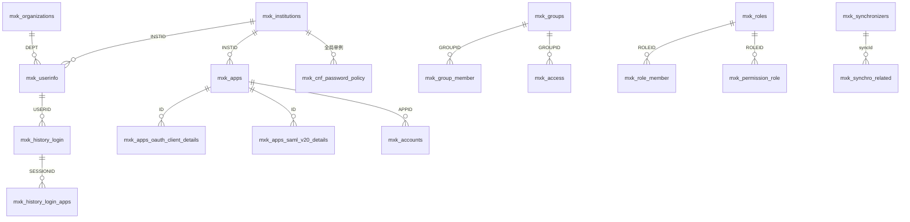
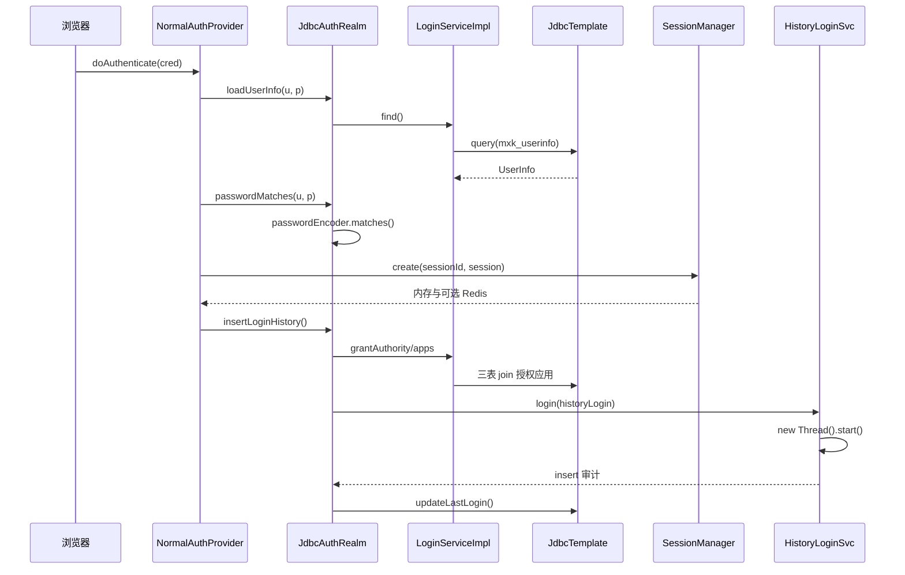

> 解读基线：MaxKey `4.1.12`（`3a3a5c765`）。

## 判断：应用为中心，外键为零

MaxKey 的库表结构是一张应用主表 `mxk_apps` 加六张协议明细表，再横向铺一个 `INSTID` 租户列。三个决定值得先记住：**引用完整性不靠数据库**、**协议差异靠拆表而非 JSON 列**、**Schema 演进靠按版本发全量脚本**。`mxk_userinfo` 的建表语句里只有 `PRIMARY KEY`、`UNIQUE KEY`、`KEY` 三种约束，没有任何 `FOREIGN KEY` 子句（[sql/v4.1.11/maxkey.sql:1549-1656]()），而脚本本身是 mysqldump 全量快照——每张表前都有 `DROP TABLE IF EXISTS`，紧随其后才是 `CREATE TABLE`（[sql/v4.1.11/maxkey.sql:22-25]()）。
<!-- anchor: CREATE TABLE `mxk_userinfo` ( … ) ENGINE=InnoDB DEFAULT CHARSET=utf8mb3 COMMENT='USER INFO DEFINE'; -->
<!-- anchor: DROP TABLE IF EXISTS `mxk_access`; … CREATE TABLE `mxk_access` ( -->

## 实体关系总览

六个实体簇：租户与组织、应用与协议明细、RBAC、历史审计、同步、配置与凭据。图中关系标签即真实关联列名。

读图三处要点。其一，`INSTID` 是唯一的横切租户列，但它**不是外键**，且各表写法不一致——`mxk_apps` 是 `NOT NULL`，`mxk_history_login` 与 `mxk_permission` 是 `DEFAULT NULL`（[sql/v4.1.11/maxkey.sql:93-131]()）。其二，六张 `mxk_apps_*_details` 与 `mxk_apps` 是「同 ID 一档」，靠 `mxk_apps.PROTOCOL` 这个字符串在应用层分发，没有任何 CHECK 或 FK 兜底。其三，RBAC 不是单一模型：`mxk_access`（组→应用）、`mxk_permission`（组/角色→资源）、`mxk_permission_role`（角色→资源）三张表并存，其中只有 `mxk_access` 有真正的联合唯一键（[sql/v4.1.11/maxkey.sql:25-33]()）。
<!-- anchor: CREATE TABLE `mxk_apps` ( … ) ENGINE=InnoDB DEFAULT CHARSET=utf8mb3 COMMENT='应用表'; -->
<!-- anchor: CREATE TABLE `mxk_access` ( … ) ENGINE=InnoDB DEFAULT CHARSET=utf8mb3; -->

## 存储选型
### 为什么是 MyBatis，而不是 JPA/Hibernate

依赖里只有 MyBatis 三件套与 Dromara 自研的 MyBatis 增强层，没有任何 ORM 引擎；`hibernate-validator` 只是 Bean Validation，不是 ORM（[build.gradle:345-348]()）。版本为 `mybatis 3.5.19` 与 `mybatis-jpa-extra 3.3.10`（[gradle.properties:111-113]()）。
<!-- anchor: implementation group: 'org.mybatis', name: 'mybatis', version: "${mybatisVersion … implementation group: 'org.dromara.mybatis-jpa-extra', name: 'mybatis-jpa-extra- -->
<!-- anchor: mybatisVersion                  =3.5.19 … mybatisjpaextraVersion          =3.3.10 -->
`mybatis-jpa-extra` 提供 `JpaServiceImpl<Mapper, Entity>` 这层「像 JPA 一样 CRUD、底下仍是 MyBatis」的薄封装（[maxkey-persistence/src/main/java/org/dromara/maxkey/persistence/service/impl/HistoryLoginServiceImpl.java:31-32]()）。
<!-- anchor: @Repository … public class HistoryLoginServiceImpl  extends JpaServiceImpl<HistoryLoginMapper, -->

取舍在于：IAM 需要「登录一次到底查了哪几张表」可审计，ORM 的隐式级联与一级缓存在这里都是负债，而 MyBatis 让 SQL 完全可见可调。

### 协议明细为什么拆六张表

`mxk_apps` 已经有一个 `EXTENDATTR varchar(4000)` 当伪 JSON 逃生舱，但协议专属字段仍被拆到独立表，因为**约束强度**是 JSON 列给不了的：OAuth 明细里 `subject varchar(45) DEFAULT 'username'`、`UserInfoResponse varchar(45) DEFAULT 'Normal'` 这类「默认值即业务策略」的列，必须落在真实列上（[sql/v4.1.11/maxkey.sql:275-301]()）。代价同样真实：加一个协议参数要同时改建表 SQL、实体类与三份方言 Mapper XML。这种「新老两代并存」在同一份脚本里可见——`sync_job_config_field` 是全库唯一的 `bigint AUTO_INCREMENT` 主键加 `utf8mb4_0900_ai_ci`，其余 43 张都是 `varchar(45)` 主键加 `utf8mb3`（[sql/v4.1.11/maxkey.sql:1687-1703]()）。
<!-- anchor: CREATE TABLE `mxk_apps_oauth_client_details` ( … ) ENGINE=InnoDB DEFAULT CHARSET=utf8mb3 COMMENT='oauth_client_details'; -->
<!-- anchor: CREATE TABLE `sync_job_config_field` ( … ) ENGINE=InnoDB AUTO_INCREMENT=214 DEFAULT CHARSET=utf8mb4 COLLATE=utf8mb4_0900_ -->

### 方言支持的真相：机制健在，内容名存实亡

机制很干净：靠 `mybatis.dialect` 变量切换 Mapper XML 目录，而不是 MyBatis 的 `databaseId`，三个 Web 模块默认值都是 `mysql`（[maxkey-webs/maxkey-web-maxkey/src/main/resources/application-maxkey.properties:128-130]()）。MySQL 版命名空间是新包名（[maxkey-persistence/src/main/resources/org/dromara/maxkey/persistence/mapper/xml/mysql/AppsMapper.xml:3-3]()）。
<!-- anchor: mybatis.dialect                                 =mysql … mybatis.mapper-locations                        =classpath*:/org/dromara/maxkey/ -->
<!-- anchor: <mapper namespace="org.dromara.maxkey.persistence.mapper.AppsMapper"> … <mapper namespace="org.dromara.maxkey.persistence.mapper.AppsMapper"> -->
而非 MySQL 方言目录大面积停留旧包名：PostgreSQL 版（[maxkey-persistence/src/main/resources/org/dromara/maxkey/persistence/mapper/xml/postgresql/HistoryLoginMapper.xml:3-3]()）与瀚高版（[maxkey-persistence/src/main/resources/org/dromara/maxkey/persistence/mapper/xml/highgo/AppsMapper.xml:3-3]()）都是 `org.maxkey.*`。
<!-- anchor: <mapper namespace="org.maxkey.persistence.mapper.HistoryLoginMapper"> … <mapper namespace="org.maxkey.persistence.mapper.HistoryLoginMapper"> -->
<!-- anchor: <mapper namespace="org.maxkey.persistence.mapper.AppsMapper"> … <mapper namespace="org.maxkey.persistence.mapper.AppsMapper"> -->

实测覆盖：`postgresql/` 32 个文件有 31 个、`highgo/` 26 个文件全部使用旧命名空间，而该旧包名下**一个 Java 接口都不存在**；MyBatis 靠命名空间全限定名绑定接口，故这两套目录一旦启用必然绑定失败。此外 `sql/` 下只有 MySQL 脚本，没有任何分方言脚本，但官方文档宣称金仓与达梦「完全兼容」（[summer-ospp/2025/doc_ossp/maxkey-docs/maxkey-docs/docs/overview/history.md:30-31]()）。
<!-- anchor: * 02月，金仓数据库管理系统 KingbaseES V7、V8完全兼容 … * 03月，与达梦数据库管理系统V8能够相互兼容，系统运行稳定。 -->

### 边界：会话不在 MySQL，而是「两层存储 + 一个 DB 状态位」

`SessionManagerImpl` 的类注释写明了三层职责：Level 1 进程内 Caffeine、Level 2 Redis、Level 3 会话状态位入库（[maxkey-authentications/maxkey-authentication-core/src/main/java/org/dromara/maxkey/authn/session/impl/SessionManagerImpl.java:41-44]()）。触发条件在构造器里：Level 1 **无条件永远启用**，Level 2 仅在 `persistence` 等于 Redis 常量时才挂上（[maxkey-authentications/maxkey-authentication-core/src/main/java/org/dromara/maxkey/authn/session/impl/SessionManagerImpl.java:69-94]()）。
<!-- anchor: * SessionManager … * user session status in database -->
<!-- anchor: private boolean isRedis = false; … redisSessionManager.create(sessionId, session); -->

开关默认值是 0（纯进程内），所以开箱部署是单节点、会话不共享，要集群必须显式开启 Redis（[maxkey-webs/maxkey-web-maxkey/src/main/resources/application-maxkey.properties:45-46]()）。这个分层的副作用是：会话内容在内存/Redis 易失，而 `ONLINE` 是 MySQL 持久位，节点异常退出后在线状态会残留。对照之下 Remember-Me 令牌同样有 TTL 却直接进库，说明这里没有统一的「状态放哪」判据（[maxkey-authentications/maxkey-authentication-provider/src/main/java/org/dromara/maxkey/authn/support/rememberme/JdbcRemeberMeManager.java:36-48]()）。
<!-- anchor: #InMemory 0 , Redis 2 … maxkey.server.persistence                       =${SERVER_PERSISTENCE:0} -->
<!-- anchor: "insert into  mxk_remember_me(id, userid,username,lastlogintime,expirationtime)v … private final JdbcTemplate jdbcTemplate; -->

## 核心表设计
### mxk_userinfo：身份主档，也是全库最宽的表

承载身份属性、密码与登录状态机，是所有审计与凭据表的逻辑外键终点（[sql/v4.1.11/maxkey.sql:1549-1656]()）。
<!-- anchor: CREATE TABLE `mxk_userinfo` ( … ) ENGINE=InnoDB DEFAULT CHARSET=utf8mb3 COMMENT='USER INFO DEFINE'; -->
| 字段 | 类型 | 约束（主/外键、索引、非空、默认） | 说明 |
|---|---|---|---|
| `ID` | varchar(45) | 主键、非空 | 字符串主键而非自增，便于与外部系统 ID 混用；45 字符同时限制了长度 |
| `USERNAME` | varchar(100) | 唯一键 `USERNAME_UNIQUE`、非空 | 全库唯一的业务唯一键；登录也按 `mobile`/`email` 查，但这两列无索引 |
| `PASSWORD` / `DECIPHERABLE` | varchar(500) | 均非空 | 单向口令与可逆口令并存，后者供需回传明文口令的旧应用 |
| `ONLINE` | tinyint unsigned | 默认 `0` | 在线标志放在 MySQL 而非 Redis，与上一节的会话边界不一致，崩溃后会残留 |

### mxk_apps：全系统的中心

应用注册项承载协议选择、适配器、API 凭据与可见性（[sql/v4.1.11/maxkey.sql:93-131]()）。
<!-- anchor: CREATE TABLE `mxk_apps` ( … ) ENGINE=InnoDB DEFAULT CHARSET=utf8mb3 COMMENT='应用表'; -->
| 字段 | 类型 | 约束（主/外键、索引、非空、默认） | 说明 |
|---|---|---|---|
| `ID` | varchar(45) | 主键、非空 | 同一 ID 被复用为六张明细表主键，形成「同号一档」 |
| `LOGINURL` | varchar(300) | 非空、`CHARACTER SET cp850` | 列级字符集与表级 `utf8mb3` 冲突，极可能是 dump 导出的字符集泄漏 |
| `PROTOCOL` | varchar(300) | 默认 NULL、无索引 | 决定运行时加载哪张明细表，却在查询路径上无索引 |
| `STATUS` | tinyint unsigned | 默认 NULL | 新建不显式赋值即为 NULL，而鉴权查询带 `status = 1`，易「建了却不可见」 |

### mxk_institutions：租户边界与品牌化

多租户主表，同时承担域名解析、标题、Logo 等品牌配置（[sql/v4.1.11/maxkey.sql:914-946]()）。
<!-- anchor: CREATE TABLE `mxk_institutions` ( … ) ENGINE=InnoDB DEFAULT CHARSET=utf8mb3 COMMENT='institutions机构表，存放租户信息multi-ten -->
| 字段 | 类型 | 约束（主/外键、索引、非空、默认） | 说明 |
|---|---|---|---|
| `ID` | varchar(45) | 主键、非空 | 默认租户取值为 `1`，代码在 instId 为空时硬编码回落该值 |
| `DOMAIN` | varchar(200) | 唯一键 `DOMAIN_UNIQUE` | 租户识别键，登录页按访问域名反查；本库少数真正的唯一键之一 |
| `CONSOLEDOMAIN` | varchar(45) | 默认 NULL、无唯一约束 | 与 `DOMAIN` 语义对称却无唯一约束，是租户解析歧义源 |
| `captcha` | varchar(45) | 默认 `'NONE,TEXT,ARITHMETIC'` | 默认值是合法取值列表本身而非其中一个值，正确性依赖应用层解析 |

### mxk_roles：角色定义，从用户组克隆而来

定义静态、动态与应用账号三类角色，`FILTERS` 让动态组用 SQL 片段表达成员条件（[sql/v4.1.11/maxkey.sql:1313-1332]()）。
<!-- anchor: CREATE TABLE `mxk_roles` ( … ) ENGINE=InnoDB DEFAULT CHARSET=utf8mb3 COMMENT='groups'; -->
| 字段 | 类型 | 约束（主/外键、索引、非空、默认） | 说明 |
|---|---|---|---|
| `ID` / `ROLECODE` | varchar(45) | 主键 / 无唯一约束 | 种子数据里两者常同值，说明无独立编码体系 |
| `category` | varchar(20) | 默认 NULL | `dynamic`/`static`/应用账号组；本表唯一小写列名 |
| `FILTERS` | text | 默认 NULL | 存 SQL 片段，本质是把查询当配置存，存在注入面与版本耦合 |
| `RESUMETIME` / `SUSPENDTIME` | varchar(45) | 默认 NULL | 以字符串存时间（只有时分），无法跨天表达 |
| 表注释 | — | `COMMENT='groups'` | 本表复制自 `mxk_groups` 且未改注释，是角色/用户组一体化的化石证据 |

### mxk_permission：授权映射，整张表没有主键

把 `groupid` 与 `resourceid` 关联，属「组授权时代」的映射表（[sql/v4.1.11/maxkey.sql:1125-1134]()）。
<!-- anchor: CREATE TABLE `mxk_permission` ( … ) ENGINE=InnoDB DEFAULT CHARSET=utf8mb3; -->
| 字段 | 类型 | 约束（主/外键、索引、非空、默认） | 说明 |
|---|---|---|---|
| `id` | varchar(50) | 非空，但**全表无 `PRIMARY KEY`** | 本库唯一「有 id 列却无主键」的表，同一组合同可无限重复插入 |
| `groupid` | varchar(50) | 默认 NULL、无索引 | 同列可能指向 `mxk_groups.ID` 或 `mxk_roles.ID`，多态外键，FK 无法表达 |
| `resourceid` | varchar(50) | 默认 NULL、无索引 | 指向 `mxk_resources.id`，与下一张表职责重叠的根源 |
| `CREATEDBY/DATE` | varchar(45)/datetime | 默认 NULL / `CURRENT_TIMESTAMP` | 无 `MODIFIED*` 列，不支持修改语义，只能删后重插 |

### mxk_permission_role：授权映射，有主键

把 `roleid` 与 `resourceid` 关联，属「角色授权时代」的映射表（[sql/v4.1.11/maxkey.sql:1154-1164]()）。
<!-- anchor: CREATE TABLE `mxk_permission_role` ( … ) ENGINE=InnoDB DEFAULT CHARSET=utf8mb3; -->
| 字段 | 类型 | 约束（主/外键、索引、非空、默认） | 说明 |
|---|---|---|---|
| `id` | varchar(50) | 主键、非空 | 与 `mxk_permission` 的第一处不对称；但代理键仍挡不住重复授权 |
| `roleid` | varchar(50) | 默认 NULL、无索引 | 只指向角色，不像 `groupid` 那样多态，是比前者更新的证据 |
| `resourceid` / `appid` | varchar(50) | 默认 NULL、无索引 | 资源与应用维度，同样都无索引 |
| `INSTID` | varchar(45) | 默认 NULL、无索引 | 租户列可空且无索引 |

### mxk_history_login：登录审计主表

每次登录尝试落一行，同时充当在线会话列表的数据源（[sql/v4.1.11/maxkey.sql:746-771]()）。
<!-- anchor: CREATE TABLE `mxk_history_login` ( … ) ENGINE=InnoDB DEFAULT CHARSET=utf8mb3 COMMENT='history_login'; -->
| 字段 | 类型 | 约束（主/外键、索引、非空、默认） | 说明 |
|---|---|---|---|
| `USERID` / `USERNAME` | varchar(45) / varchar(200) | 均非空 | 用户名冗余存，保证用户删除后审计仍可读 |
| `SESSIONID` | varchar(45) | 默认 NULL、无索引 | 与 Redis 会话 ID 对应，但此处无索引，按会话回溯应用访问只能扫表 |
| `SESSIONSTATUS` | int | 默认 `1` | 在线状态位，失败记录写 7；魔法数字，语义只在代码里 |
| `LOGOUTTIME` | datetime | 非空、默认 `'1970-01-01 00:00:00'` | 用 Unix epoch 哨兵表示「尚未注销」，与 userinfo 的 `2020-01-01` 哨兵不一致 |

### mxk_synchronizers：四类同步源的统一配置表

LDAP、MSAD、API、DB 四类身份源用同一张表描述，是配置而非硬编码的极致体现（[sql/v4.1.11/maxkey.sql:1459-1490]()）。
<!-- anchor: CREATE TABLE `mxk_synchronizers` ( … ) ENGINE=InnoDB DEFAULT CHARSET=utf8mb3 COMMENT='同步器'; -->
| 字段 | 类型 | 约束（主/外键、索引、非空、默认） | 说明 |
|---|---|---|---|
| `service` | varchar(45) | 默认 NULL | 存 Spring bean 名，是「按配置选实现」的关键；与 `sourcetype` 双写易不一致 |
| `driverclass` | varchar(400) | 默认 NULL | 仅 DB 型使用。为单一类型在共用表上开列，是一张表装四类的必然代价 |
| `principal` / `credentials` | varchar(200) / varchar(500) | 默认 NULL | 绑定账号与口令；同步需要明文绑定，故实为可逆存储 |
| `userfilters` / `orgFilters` | varchar(4000) | 默认 NULL | 同一列承载 LDAP 过滤器与 SQL 语句两种查询语言 |

### mxk_synchro_related：外部对象与本地对象的映射账本

记住外部系统 ID 对应哪个本地对象，让增量同步能判断新增、改名与移动（[sql/v4.1.11/maxkey.sql:1424-1439]()）。
<!-- anchor: CREATE TABLE `mxk_synchro_related` ( … ) ENGINE=InnoDB DEFAULT CHARSET=utf8mb3; -->
| 字段 | 类型 | 约束（主/外键、索引、非空、默认） | 说明 |
|---|---|---|---|
| `id` | varchar(45) | 主键、非空 | 主键即本地对象 ID，一个本地对象只能有一行映射 |
| `objectid` / `objecttype` | varchar(45) | 默认 NULL | 本地对象 ID 的副本与类型枚举（`UserInfo`/`Organization`），无 CHECK |
| `originId` | varchar(1000) | 默认 NULL | 外部系统 ID 主位，1000 长度是给 LDAP DN 之类的长键留的余量 |
| `originId2` / `originId3` | varchar(200) | 默认 NULL | 第二、三级外部键，等于用固定列数硬编码外部层级深度 |

### mxk_apps_oauth_client_details：协议明细表的代表

OAuth/OIDC 客户端注册参数，`CLIENT_ID` 即 `mxk_apps.ID`（[sql/v4.1.11/maxkey.sql:275-301]()）。
<!-- anchor: CREATE TABLE `mxk_apps_oauth_client_details` ( … ) ENGINE=InnoDB DEFAULT CHARSET=utf8mb3 COMMENT='oauth_client_details'; -->
| 字段 | 类型 | 约束（主/外键、索引、非空、默认） | 说明 |
|---|---|---|---|
| `CLIENT_ID` | varchar(45) | 主键、非空 | 与 `mxk_apps.ID` 同值；命名借自 Spring Security OAuth，45 长度限制自定义空间 |
| `CLIENT_SECRET` | varchar(500) | 默认 NULL、可为空 | 公共客户端合法为空，`PKCE` 列即为此存在 |
| `AUTHORIZED_GRANT_TYPES` / `SCOPE` | varchar(256) | 默认 NULL | 逗号分隔多值列而非常规关联表，查询靠模糊匹配，无法用索引 |
| `ADDITIONAL_INFORMATION` | varchar(4096) | 默认 NULL | 当 JSON 用的大列，是「单表加 JSON 列」方案在 OAuth 表内的局部残留 |
| `subject` / `UserInfoResponse` | varchar(45) | 默认 `'username'` / `'Normal'` | 默认值即业务策略，是拆表换来约束强度的直接体现 |

## Schema 演进策略

`sql/README.md` 明文规定三条约定：SQL 版本命名 `v[x.y.z]`、只保留最近 3 个版本其余归档到 `olderVersions`、没有对应版本时用最近 SQL 版本（[sql/README.md:1-7]()）。
<!-- anchor: ## MaxKey对应SQL版本 … 如果没有最新版本对应的SQL版本，请用最近SQL版本。 -->

选全量脚本而非增量 migration，本质是为「私有化内网交付 + 重种子数据」服务。脚本内置演示用户与几十个预置应用模板，`mxk_apps` 的单条种子 INSERT 长达 90 万字符；若改用增量变更集，这些种子要么无法随版本演进，要么得拆成几百个 INSERT。`olderVersions` 的滚动归档（现存 v3.3.3 至 v4.1.4）说明旧版本仍是可交付物，同时把支持成本显式划了边界：只保证最近三版可直接取用。

代价同样清楚。对新建实例，一条 SQL 建库含开箱数据，体验一流；对存量升级，策略把责任推给运维——没有版本表、没有校验和、没有回滚脚本，运维必须自己 diff 两版脚本的 DDL 段再手写 `ALTER`。最危险的情形是「结构变了但忘了发新 SQL 目录」：使用者会拿旧结构跑新代码，错误要到运行期才以 `Unknown column` 暴露，且没有 CI 门禁能发现。`4.1.12` 恰好属于安全情形——它没有任何 schema 变化，三条独立证据一致：`sql/` 下不存在 `v4.1.12` 目录、`git diff 4.1.11 4.1.12 -- sql/` 输出为空、`git ls-tree 4.1.12 sql/` 显示其内容与 4.1.11 完全一致。于是 README 的第三条规则被精确命中：4.1.12 的使用者应当去用 `sql/v4.1.11/maxkey.sql`。

## 读写路径

以「登录一次」为例，数据从 `mxk_userinfo` 读出、最终写入 `mxk_history_login`。

**读侧三处全部走裸 JdbcTemplate，而不是 MyBatis。** 用户主档查询用内联 SQL 常量加手写 `RowMapper`（[maxkey-persistence/src/main/java/org/dromara/maxkey/persistence/service/impl/LoginServiceImpl.java:101-109]()）。用户所属组与可授权应用也都是内联 SQL 常量，其中应用查询用三表隐式连接（[maxkey-persistence/src/main/java/org/dromara/maxkey/persistence/service/impl/LoginServiceImpl.java:55-68]()）。
<!-- anchor: public List<UserInfo> findByUsername(String username, String password) { … public List<UserInfo> findByUsernameOrMobile(String username, String password) { -->
<!-- anchor: private static final String LOGIN_USERINFO_UPDATE_STATEMENT = "update mxk_userin … private static final String DEFAULT_MYAPPS_SELECT_STATEMENT = "select distinct a -->

这里有一处值得注意的写法：`queryAuthorizedApps` 用字符串格式化把组 ID 直接拼进 SQL。组 ID 来自数据库而非用户输入，当下不构成注入，但它是字符串拼接 SQL 的活样本（[maxkey-persistence/src/main/java/org/dromara/maxkey/persistence/service/impl/LoginServiceImpl.java:312-327]()）。`grantAuthority` 另外无条件授予三个内置角色，再叠加数据库里的组（[maxkey-persistence/src/main/java/org/dromara/maxkey/persistence/service/impl/LoginServiceImpl.java:347-365]()）。
<!-- anchor: public List<GrantedAuthority> queryAuthorizedApps(List<GrantedAuthority> granted … return listAuthorizedApps; -->
<!-- anchor: public List<GrantedAuthority> grantAuthority(UserInfo userInfo) { … return grantedAuthority; -->

**写侧分两条通道。** 同步写用原地自增更新计数与在线标志，并发登录下这是唯一安全的方式；失败路径同样写审计（[maxkey-authentications/maxkey-authentication-provider/src/main/java/org/dromara/maxkey/authn/realm/jdbc/JdbcAuthenticationRealm.java:128-143]()）。
<!-- anchor: if (!passwordMatches) { … return passwordMatches; -->

异步写审计则把 insert 甩到裸线程上：`insertLoginHistory` 组装完审计对象后交给服务层（[maxkey-authentications/maxkey-authentication-provider/src/main/java/org/dromara/maxkey/authn/realm/AbstractAuthenticationRealm.java:128-165]()），而服务层直接 `new Thread(...).start()`，没有任何线程池、上限或拒绝策略（[maxkey-persistence/src/main/java/org/dromara/maxkey/persistence/service/impl/HistoryLoginServiceImpl.java:44-45]()）。
<!-- anchor: public boolean insertLoginHistory(UserInfo userInfo, String type, String provide … historyLoginService.login(historyLogin); -->
<!-- anchor: //Thread insert … new Thread(new HistoryLoginRunnable(this,historyLogin)).start(); -->

**高频读有缓存，但只在进程内 Caffeine，且覆盖不均。** 应用明细缓存 30 分钟（[maxkey-persistence/src/main/java/org/dromara/maxkey/persistence/service/impl/AppsServiceImpl.java:41-43]()），租户缓存 60 分钟并用域名、控制台域名、ID 三个键指向同一对象（[maxkey-persistence/src/main/java/org/dromara/maxkey/persistence/service/impl/InstitutionsServiceImpl.java:40-42]()），而用户信息完全不缓存——这是有意的：IAM 必须保证改密与禁用立即生效。代价是多实例部署下各节点缓存各自过期，没有失效广播。
<!-- anchor: protected static final   Cache<String, Apps> detailsCacheStore = … .expireAfterWrite(30, TimeUnit.MINUTES) -->
<!-- anchor: protected static final Cache<String, Institutions> institutionsStore = … .expireAfterWrite(60, TimeUnit.MINUTES) -->

## 边界与代价

**其一，缓存键不一致导致缓存永不命中。** `AppsServiceImpl.put()` 写入键是 `appId + "_detail"`，读取键也是它，但未命中回填时用了裸 `appId`，且 `put()` 在全仓没有任何调用点（[maxkey-persistence/src/main/java/org/dromara/maxkey/persistence/service/impl/AppsServiceImpl.java:63-81]()）。
<!-- anchor: detailsCacheStore.put(appId + DETAIL_SUFFIX, appDetails); … return appDetails; -->

三个键对不上，这个 30 分钟的缓存实际上从不命中，每次取应用明细都会回落到数据库。修法只需统一后缀，但这类缺陷不会报错，只会安静地把缓存变成纯开销。**其二，零外键把完整性责任全部上移。** 全库没有任何 `FOREIGN KEY` 约束，也没有一条 `ALTER TABLE`；租户列 `INSTID` 在各表间可空性不一致，`mxk_permission` 更是连主键都没有。脏数据没有库层兜底，只能靠应用层自律——这正是 MaxKey 二次开发时最容易踩空的地方。
