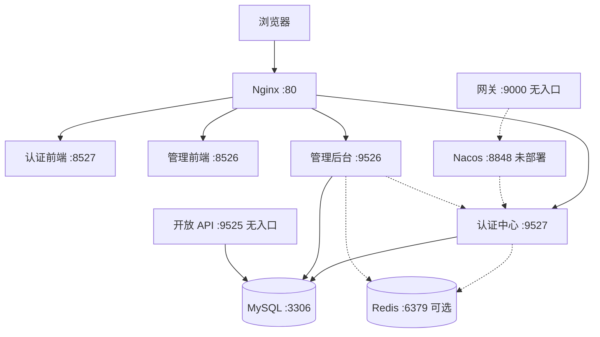

> 解读基线：MaxKey `4.1.12`（`3a3a5c765`）。

## 部署形态：四个后端应用与两个单页前端

MaxKey 的后端不是一个单体 jar，而是四个各自能独立启动的应用。认证中心监听 9527、context-path 为 `/sign`（[maxkey-webs/maxkey-web-maxkey/src/main/resources/application-maxkey.properties:19-27]()）。
<!-- anchor: server.port                                     =${SERVER_PORT:9527} … server.servlet.context-path                     =/sign -->
管理端监听 9526、context-path 为 `/maxkey-mgt-api`（[maxkey-webs/maxkey-web-mgt/src/main/resources/application-maxkey-mgt.properties:19-21]()）。
<!-- anchor: server.port                                     =${SERVER_PORT:9526} … server.servlet.context-path                     =/maxkey-mgt-api -->
开放 API 监听 9525、context-path 为 `/maxkey-openapi`（[maxkey-webs/maxkey-web-openapi/src/main/resources/application-maxkey-openapi.properties:19-21]()）。
<!-- anchor: server.port                                     =${SERVER_PORT:9525} … server.servlet.context-path                     =/maxkey-openapi -->
网关监听 9000，是四个应用里唯一的响应式应用（[maxkey-webs/maxkey-gataway/src/main/resources/application.yml:5-6]()）。
<!-- anchor: server: …   port: 9000 -->
注意目录名就是这个拼写：`gataway`，仓库内没有名为 `gateway` 的模块。

两个前端是独立的 Angular 单页应用，认证前端镜像内的 Nginx 监听 8527（[maxkey-web-frontend/maxkey-web-app/nginx.conf:3-3]()）。
<!-- anchor:     listen       8527; -->
管理前端镜像内的 Nginx 监听 8526（[maxkey-web-frontend/maxkey-web-mgt-app/nginx.conf:3-3]()）。
<!-- anchor:     listen       8526; -->

按这份清单，运行形态是这样的：

图中 `A3`、`A4` 没有入边，这不是画图时的省略，而是仓库的真实状态：**开放 API 与网关是部署孤儿**。

## 为什么拆成四个应用

拆分的依据是流量性质，而不是资源类型。认证中心依赖了几乎全部协议实现——CAS、OAuth2、OIDC、SAML2、JWT、表单、令牌、passkey 等九个模块（[maxkey-webs/maxkey-web-maxkey/build.gradle:42-61]()）。
<!-- anchor:    	implementation project(":maxkey-starter:maxkey-starter-captcha") … 	implementation project(":maxkey-protocols:maxkey-protocol-jwt") -->
管理端只依赖三个协议模块，却独占了七个身份同步器——钉钉、企业微信、飞书、LDAP、AD、北森、JDBC（[maxkey-webs/maxkey-web-mgt/build.gradle:52-63]()）。
<!-- anchor: 	implementation project(":maxkey-protocols:maxkey-protocol-authorize") …    	implementation project(":maxkey-synchronizers:maxkey-synchronizer-dingtalk") -->
一个是面向匿名公网的高频认证入口，一个是面向管理员的低频配置面，二者的攻击面、流量模型与发布节奏都不同，拆开的收益在这里。

代价同样真实，而且集中体现在**编排没有跟上拆分**：

- Compose 里只有 6 个服务：MySQL、两个后端、两个前端，外加 Nginx（[deployment/docker/docker-compose.yml:6-8]()）。
<!-- anchor: services: …     image: mysql:8.4.2 -->
- 安装脚本拉取的镜像恰好是四个：两个后端加两个前端（[deployment/docker/maxkey_docker_install.sh:11-20]()）。
<!-- anchor: docker pull maxkeytop/maxkey:latest … docker pull maxkeytop/maxkey-mgt-frontend:latest -->
- Nginx 的完整路由面只有三条（[deployment/docker/docker-nginx/default.conf:10-13]()）。
<!-- anchor:     location / { …         try_files $uri $uri/ /index.html; -->

也就是说，开放 API（9525）与网关（9000）虽然各自有 `bootJar` 任务、有 Dockerfile，却**没有任何编排、反代或启停脚本覆盖它们**。网关的路由甚至写的是服务发现式上游 `lb://maxkey` 与 `lb://maxkey-mgt`（[maxkey-webs/maxkey-gataway/src/main/resources/application.yml:14-25]()）。
<!-- anchor:         - id: maxkeys_route …             - Path=/maxkey-mgt-api/** -->
而服务发现的开关默认是关的（[maxkey-webs/maxkey-web-maxkey/src/main/resources/bootstrap.properties:12-16]()）。
<!-- anchor: spring.cloud.nacos.config.enabled               =${NACOS_CONFIG_ENABLED:false} … spring.cloud.nacos.discovery.enabled            =${NACOS_DISCOVERY_ENABLED:false -->
两者叠加的结论很直接：**按仓库默认配置启动网关，它解析不出任何上游**。

Kubernetes 一侧同样是留白。`deployment/k8s/helm/` 下只有一个文本文件，内容是两行 Helm 的宣传语，没有任何 Chart、values 或模板（[deployment/k8s/helm/helm.txt:1-2]()）。
<!-- anchor: Helm is the best way to find, share, and use software built for Kubernetes. … Helm helps you manage Kubernetes applications — Helm Charts help you define, ins -->

## 首次部署要跨过的三道坎

### 建库：一份会清空全库的脚本

初始化入口是一段很短的 SQL：建库之后 `source` 最近版本的脚本（[deployment/docker/docker-mysql/docker-entrypoint-initdb.d/init.sql:1-5]()）。
<!-- anchor: create database if not exists  `maxkey` /*!40100 DEFAULT CHARACTER SET utf8mb4 C … source /docker-entrypoint-initdb.d/latest/maxkey.sql   ; -->
被 source 的脚本是 `mysqldump` 的默认产物，**每一张表前面都跟着一条 `DROP TABLE IF EXISTS`**（[sql/v4.1.11/maxkey.sql:22-25]()）。
<!-- anchor: DROP TABLE IF EXISTS `mxk_access`; … CREATE TABLE `mxk_access` ( -->
全文件共 44 组 `DROP TABLE` 与 `CREATE TABLE` 成对出现。于是这份「初始化脚本」同时是「销毁脚本」：**在已有数据的库上执行它，等于清库重建**。

更麻烦的是没有替代品。仓库里**没有版本间的迁移脚本，也没有只含结构的 DDL**——结构和数据自 4.1.9 起被合并进同一个 `maxkey.sql`，ReleaseNotes 记录了这次合并（[ReleaseNotes.txt:111-111]()）。
<!-- anchor:     *(MAXKEY-250515) sql文件数据结构和数据合并成一个问题maxkey.sql -->
版本目录的取舍规则写在 SQL 目录说明里：只保留最近几个版本，若没有对应版本就沿用最近的（[sql/README.md:7-7]()）。
<!-- anchor: 如果没有最新版本对应的SQL版本，请用最近SQL版本。 -->
这解释了为什么 4.1.12 基线里存放的是 `v4.1.11` 的脚本。运维含义是：**升级路径只能靠人工比对 DDL**，没有工具替你算差集。

### 默认口令：明文前缀绕过了 bcrypt

种子数据里存在默认管理员。`mxk_userinfo` 的第一条记录是 `admin`，口令字段的取值是 `{plain}maxkey`（[sql/v4.1.11/maxkey.sql:1665-1665]()）。
<!-- anchor: INSERT INTO `mxk_userinfo` VALUES ('1','admin','{plain}maxkey','',0,'15618726256 -->
`{plain}` 不是注释，而是**编码器前缀**：口令校验匹配到该前缀时，直接截掉前缀返回原文（[maxkey-commons/maxkey-crypto/src/main/java/org/dromara/maxkey/crypto/password/DesedeEncoder.java:62-63]()）。
<!-- anchor:         }else if(encodedPasswordString.startsWith(PLAIN)) { …             return encodedPasswordString.substring(PREFFIX_LENGTH); -->
这意味着默认口令就是 `maxkey`，而且它**绕过了配置里指定的 bcrypt 编码器**（[maxkey-webs/maxkey-web-maxkey/src/main/resources/application-maxkey.properties:59-59]()）。
<!-- anchor: maxkey.crypto.password.encoder                  =bcrypt -->
紧跟默认管理员之后的，是 11 条 `{bcrypt}` 演示账号（[sql/v4.1.11/maxkey.sql:1666-1676]()）。
<!-- anchor: INSERT INTO `mxk_userinfo` VALUES ('622227747934179405','zhouy','{bcrypt}$2a$10$ … INSERT INTO `mxk_userinfo` VALUES ('684052745233104896','liubang','{bcrypt}$2a$1 -->
再往后，7 条身份同步器种子配置里也带着绑定好的目录服务口令（[sql/v4.1.11/maxkey.sql:1499-1499]()）。
<!-- anchor: INSERT INTO `mxk_synchronizers` VALUES ('1','标准LDAP服务','ldapSynchronizerService' -->
演示数据与生产 schema 装在同一份脚本里，**首次登录后必须手工清理**。

### 配置：三份 profile 的复制粘贴

配置分层是「共享基座 + 应用专属 profile」：`application.properties` 用 `spring.profiles.active` 指向专属文件，并允许环境变量覆盖（[maxkey-webs/maxkey-web-maxkey/src/main/resources/application.properties:30-30]()）。
<!-- anchor: spring.profiles.active                      =${SERVER_PROFILES:maxkey} -->
绝大多数条目都写成 `${ENV:默认值}`，但**并非全部**：JWT 签名密钥就是一段硬编码字面量，没有 `${...}` 外壳（[maxkey-webs/maxkey-web-maxkey/src/main/resources/application-maxkey.properties:52-52]()）。
<!-- anchor: maxkey.auth.jwt.secret                          =7heM-14BtxjyKPuH3ITIm7q2-ps5MuB -->
这个遗漏有实际后果——**该密钥无法用环境变量覆盖**，多实例部署时只能改文件，而它在三份 profile 里各出现一次，改一次要改三处。

其余可覆盖项走的是标准套路，例如数据源（[maxkey-webs/maxkey-web-maxkey/src/main/resources/application-maxkey.properties:114-116]()）。
<!-- anchor: spring.datasource.username                      =${DATABASE_USER:root} … spring.datasource.url                           =jdbc:mysql://${DATABASE_HOST:lo -->

这里需要澄清一个常见的误传：名为 `maxkey-starter-properties` 的模块**在 4.1.12 中并不存在**。`settings.gradle` 只 include 了 8 个 starter——captcha、ip2location、otp、sms、social、web、web-static、passkey（[settings.gradle:34-41]()）。
<!-- anchor: include ('maxkey-starter:maxkey-starter-captcha') … include ('maxkey-starter:maxkey-starter-passkey') -->
所谓「通用配置」实际是靠三份 profile 文件彼此复制粘贴维护的，**没有独立的 properties 抽取层**。这正好解释了上一条 JWT 密钥在三处重复的问题。

## 容器化：Compose 与 shell 脚本的双轨

Compose 路径是声明式的。MySQL 服务通过环境变量接收库名与口令，认证中心通过环境变量接收库地址并映射 9527（[deployment/docker/docker-compose.yml:41-47]()）。
<!-- anchor:       - DATABASE_HOST=maxkey-mysql …       - "9527:9527" -->
另一条路径是五个 shell 脚本，用 `docker run` 逐个起容器，MySQL 这条只挂卷、不注入额外变量（[deployment/docker/maxkey_docker_start.sh:3-12]()）。
<!-- anchor: docker run -p 3306:3306   \ … -d maxkeytop/mysql:latest -->
两套并存本身就是运维负担：Compose 可 `down`、可版本化、可复现；脚本路径则是 install/start/stop/rm/clear 五个动作各维护一份容器名清单，改一个容器名要同步改五处。

### Nginx 在托管什么

容器化部署里 Nginx 是唯一入口，它做两件事。第一件是托管 SPA 并对前端路由做兜底，`try_files` 把找不到的路径交还给 `index.html`（[deployment/docker/docker-nginx/default.conf:10-13]()）。
<!-- anchor:     location / { …         try_files $uri $uri/ /index.html; -->
第二件是按前缀反代后端，`/sign/` 交给认证中心（[deployment/docker/docker-nginx/default.conf:18-19]()）。
<!-- anchor: 	location /sign/ { … 		proxy_pass http://maxkey:9527/sign/; -->
管理端接口则走 `/maxkey-mgt-api/` 前缀（[deployment/docker/docker-nginx/default.conf:28-29]()）。
<!-- anchor: 	location /maxkey-mgt-api/ { … 		proxy_pass http://maxkey-mgt:9526/maxkey-mgt-api/; -->
设计后果是：**前端产物的路由前缀与后端 context-path 被 Nginx 硬绑定**，改一处必须同时改 Nginx、profile 与前端构建参数。

## 前端 SPA 的构建与地址固化

前端不是在运行期配置地址，而是在构建期把产物烘焙进镜像。发布脚本先切到前端目录执行 `ng build --base-href /maxkey/`，紧接着用该目录的 Dockerfile 构建镜像并推送（[release_frontend_docker.bat:12-21]()）。
<!-- anchor: cd ./maxkey-web-frontend/maxkey-web-app … call docker push %MXK_REPOSITORY%/maxkey-frontend -->
管理前端走同一套流程，只是路由前缀换成 `/maxkey-mgt/`（[release_frontend_docker.bat:30-35]()）。
<!-- anchor: cd ./maxkey-web-frontend/maxkey-web-mgt-app … call docker build -f Dockerfile -t %MXK_REPOSITORY%/maxkey-mgt-frontend  . -->
关键在于**接口地址是编译期常量而非运行期变量**：生产环境写的是相对路径 `/sign/`（[maxkey-web-frontend/maxkey-web-app/src/environments/environment.prod.ts:23-23]()）。
<!-- anchor:     baseUrl: '/sign/', -->
开发环境写的则是写死的绝对地址 `http://localhost:9527/sign/`（[maxkey-web-frontend/maxkey-web-app/src/environments/environment.ts:31-31]()）。
<!-- anchor:     baseUrl: 'http://localhost:9527/sign/', -->
由此推出运维约束：**改动后端域名或反代前缀，必须重建并重新发布前端镜像**，改配置重启是不够的。相对路径的设计也是生产镜像能挂到任意域名下的前提。

## 运维要点

### 日志

日志框架不是 Spring Boot 默认的 logback，而是 log4j2——仓库里每个应用都只有 `log4j2.xml`，没有 `logback*.xml`。配置定义了滚动文件输出，落在**进程工作目录下的相对路径** `logs/maxkey.log`，按天或超过 128MB 切分并压缩归档，最多保留 15 个（[maxkey-webs/maxkey-web-maxkey/src/main/resources/log4j2.xml:9-18]()）。
<!-- anchor: 		<RollingFile name="RollingFile" fileName="logs/maxkey.log"    filePattern="log … 		     <DefaultRolloverStrategy max="15"/> -->
相对路径意味着**日志落点取决于容器工作目录**，在容器里要么靠卷挂载固定，要么日志随容器一起消失。

### 健康检查与可观测性

actuator 端点默认整体关闭（[maxkey-webs/maxkey-web-maxkey/src/main/resources/application-maxkey.properties:269-269]()）。
<!-- anchor: management.endpoints.enabled-by-default=false -->
这是 4.1.11 修掉未授权访问漏洞时留下的默认值，安全性上是对的，但它同时意味着**开箱状态下没有任何现成的存活探针端点**。

镜像层面也印证了这点：启动命令固定为「先睡 60 秒再拉起 Java 进程」，JVM 堆上下限也在这里写死（[maxkey-webs/maxkey-web-maxkey/Dockerfile:15-17]()）。
<!-- anchor: ENV TZ=Asia/Shanghai JAVA_OPTS="-Xms256m -Xmx2048m -Djava.security.egd=file:/dev … CMD sleep 60; java -jar maxkey-boot.jar $JAVA_OPTS -->
用固定睡眠回避数据库就绪竞态是一种务实但粗糙的取舍——**库慢于 60 秒则启动即失败，快于 60 秒则白等**，且它不提供任何「是否真的健康」的信息。

可观测性的依赖其实是备齐的：指标导出器已在根构建引入（[build.gradle:384-384]()）。
<!-- anchor:         implementation group: 'io.micrometer', name: 'micrometer-registry-promet -->
Spring Boot Admin 的客户端依赖也在（[build.gradle:252-254]()）。
<!-- anchor:         //spring-boot-admin …         implementation group: 'de.codecentric', name: 'spring-boot-admin-starter -->
但仓库内没有任何对应的服务端部署配置，属于「依赖已备、默认未启用」。

### 会话存储与水平扩容

会话持久化由 `maxkey.server.persistence` 控制，默认值是 0，即 InMemory（[maxkey-webs/maxkey-web-maxkey/src/main/resources/application-maxkey.properties:45-46]()）。
<!-- anchor: #InMemory 0 , Redis 2                … maxkey.server.persistence                       =${SERVER_PERSISTENCE:0} -->
代码里对应的分支是显式的：只有取值为 Redis 时才装配 Redis 实现，否则回落到内存实现（[maxkey-starter/maxkey-starter-web/src/main/java/org/dromara/maxkey/autoconfigure/ApplicationAutoConfiguration.java:169-176]()）。
<!-- anchor:     MomentaryService momentaryService( …             momentaryService = new InMemoryMomentaryService(); -->
Redis 连接池又是惰性创建的，属性仍沿用 `spring.redis.*` 这套旧命名（[maxkey-starter/maxkey-starter-web/src/main/java/org/dromara/maxkey/autoconfigure/RedisAutoConfiguration.java:47-56]()）。
<!-- anchor:     RedisConnectionFactory redisConnFactory( …             @Value("${spring.redis.lettuce.pool.max-active:-1}") -->
这组默认值解释了 Compose 为什么**没有 Redis 服务**：单机部署不需要它。代价是**默认配置下的认证中心无法水平扩容**——会话在进程内存里，多副本之间互不可见；要扩容就必须先打开 Redis 持久化并自行补上 Redis 编排。

### 打包与发布产物

对外产物是带 `bootJar` 的可执行 jar，归档名固定为 `maxkey-boot`（[maxkey-webs/maxkey-web-maxkey/build.gradle:15-19]()）。
<!-- anchor: bootJar { …     mainClass = 'org.dromara.maxkey.MaxKeyApplication' -->
根构建里有一个把产物集中拷贝到发布目录的任务，只挑选 `*-boot-*.jar`（[build.gradle:445-451]()）。
<!-- anchor:     tasks.register("buildRelease",Copy) { …         include '*-boot-*.jar' -->

### 一处已经失效的构建脚本

`build_cnf.gradle` 是死文件。它定义的 `clearBuild` 任务会删除各应用的 `build.gradle`（[build_cnf.gradle:28-33]()）。
<!-- anchor: task clearBuild(){ … 	delete "$rootDir/maxkey-webs/maxkey-web-openapi/build.gradle"	 -->
但它依赖的四个配置生成脚本在 4.1.12 里**全部不存在**，所以它既无法完成清理后的重建，误执行还会先删掉构建文件。ReleaseNotes 记录了这次移除：不再保留 `build_*.gradle`，只保留 `*_boot.jar` 的打包方式（[ReleaseNotes.txt:3-3]()）。
<!-- anchor:     *(MAXKEY-260602) remove build_*.gradle，保留*_boot.jar打包方式 -->
**这段脚本应当被删除**，留着只会误导后来者。

## 设计取舍与遗留问题

值得肯定的是取舍方向一致：所有「重型依赖」——Nacos 配置中心、服务发现、Redis 会话、actuator、监控服务端——**默认全部关闭**，换来的是单机开箱即用：一台机器、两个 jar、一个 MySQL，就能跑起完整的 SSO。profile 分层与 `${ENV:默认值}` 的写法也让容器化覆盖变得直接。

问题则集中在「默认值之外没人管」：

- **部署覆盖不完整**。四个应用里有两个没有任何编排入口，网关按默认配置甚至解析不出上游，K8s 目录只是空占位。
- **初始化脚本不可重入**。44 组 `DROP+CREATE` 加上数据与结构合并，使它只能用于全新库，而仓库不提供迁移脚本。
- **默认口令是明文的**。`{plain}` 前缀会绕过 bcrypt，演示账号又与生产 schema 混在一起，首次上线必须记得清理。
- **可观测性留白**。actuator 关闭，镜像用 `sleep 60` 代替健康检查。

这些都不是难以修复的缺陷，而是**「默认给人快速试用」与「默认给人安全生产」两种取向之间没有做完的过渡**：仓库提供了全部开关，却没有提供一份把开关拨到生产档的清单。README 的安装章节只有四行外链跳转，端口、账号、编排方式一概不记载（[README.md:134-140]()）。
<!-- anchor: # Install … | Docker   | <a href="https://www.maxkey.top/zh/about/download.html"  target="_b -->
