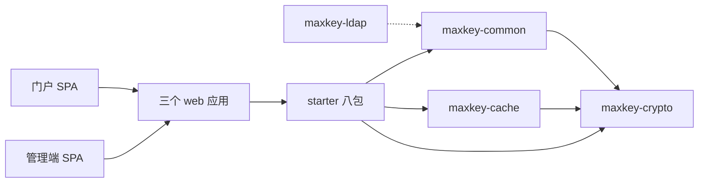
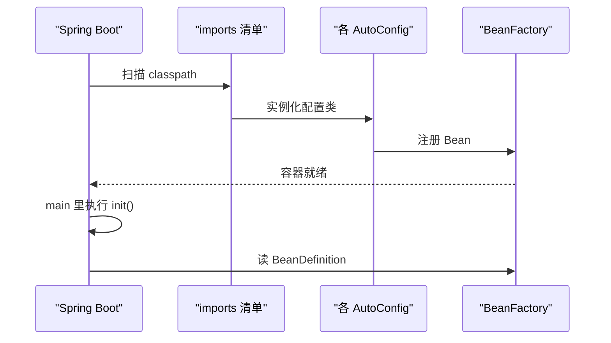

> 解读基线：MaxKey `4.1.12`（`3a3a5c765`）。

## 分层的意图：五类横切关注点全部下沉

MaxKey 把密钥与算法、通用契约、短时缓存、外部目录、可插拔能力这五类横切关注点，从协议模块整体抽出，下沉到 `maxkey-commons/*` 与 `maxkey-starter/*`。8 个协议模块（CAS、SAML、OAuth、JWT、FormBased、TokenBased、ExtendAPI、Authorize）与 3 套认证 realm 因此只写协议语义，不碰密码学与连接细节。

分层方向是对的，完成度不均。加密层做到了「集中」但没做到「现代化」；starter 只买到应用级裁剪，没买到能力级开关；网关名义上是安全边界，实际只是一个可选的转发层。

## 依赖方向与改动半径

下图只画编译期依赖边。它解释了一个运维事实：crypto 是唯一的密码学叶子，因此也是全仓改动半径最大的模块。

证据在依赖声明里：crypto 的依赖块只有一行本地 jar，不引用任何兄弟模块（[maxkey-commons/maxkey-crypto/build.gradle:4-5]()）。
<!-- anchor: //local jars … implementation fileTree(dir: '../maxkey-lib/', include: '*/*.jar') -->
ldap 与 crypto 一样只有本地 jar，用 JNDI 而非 Spring LDAP，两者是平行的叶子（[maxkey-commons/maxkey-ldap/build.gradle:4-5]()）。
<!-- anchor: //local jars … implementation fileTree(dir: '../maxkey-lib/', include: '*/*.jar') -->
common 只多一行对 crypto 的 `project` 依赖，是整棵依赖树的分水岭（[maxkey-commons/maxkey-common/build.gradle:4-7]()）。
<!-- anchor: implementation project(":maxkey-commons:maxkey-crypto") … implementation fileTree(dir: '../maxkey-lib/', include: '*/*.jar') -->
而 cache 的两个实现都建立在 crypto 与 common 提供的序列化之上。

## 加密层：把算法选择从协议里搬出来

`maxkey-crypto` 解决的根本问题不是「提供加密函数」，而是消除协议模块各自实现密码学的动机。模块内部按职责再分：对称加密、非对称加密、摘要、口令编码器族、密钥库读写、X.509 证书、Nimbus JOSE 封装。其中 `jose/` 与 `jwt/` 是给 nimbus-jose-jwt 的薄封装，`password/` 与 `cert/` 是自研或移植实现。

最值得照搬的是口令编码器的表驱动设计：`DelegatingPasswordEncoder` 一次性注册 12 种编码器，默认编码器由 `maxkey.crypto.password.encoder:bcrypt` 决定（[maxkey-starter/maxkey-starter-web/src/main/java/org/dromara/maxkey/autoconfigure/ApplicationAutoConfiguration.java:74-105]()）。
<!-- anchor: PasswordEncoder passwordEncoder( … return passwordEncoder; -->
数据库里存的是 `{id}hash` 形式，算法可逐用户迁移，不需要改代码——「算法升级」因此从代码改造变成数据迁移。代价是历史包袱同表共存：`md4`、`md5`、`plain` 这些已不安全的编码器仍在注册表内。

国密的真实覆盖度必须澄清，它远低于「信创」预期。SM2 与 SM4 在 `src/main` 里零命中，签名与密钥类型枚举只支持国际算法（[maxkey-commons/maxkey-crypto/src/main/java/org/dromara/maxkey/crypto/KeyPairType.java:31-37]()）。
<!-- anchor: public enum KeyPairType { … ECDSA; -->
RSA 的默认密钥长度也停在 1024 位（[maxkey-commons/maxkey-crypto/src/main/java/org/dromara/maxkey/crypto/RSAUtils.java:43-49]()）。
<!-- anchor: public static final String         KEY_ALGORTHM         =     "RSA"; … public static final int         PEM_ARRAY_SIZE        =     64; -->
SM3 是唯一真实存在的国密算法，而且只有摘要与 HMAC 两种形态（[maxkey-commons/maxkey-crypto/src/main/java/org/dromara/maxkey/crypto/SM3.java:38-43]()）。
<!-- anchor: public static byte[] encode(byte[] simple) { … return hash; -->
两种形态都只是对 BouncyCastle 的薄封装（[maxkey-commons/maxkey-crypto/src/main/java/org/dromara/maxkey/crypto/SM3.java:69-77]()）。
<!-- anchor: public static byte[] hmac(byte[] key, byte[] simple) { … return result; -->
更有意思的是，仓库里唯一以 SM4 命名的测试实际上测的是 MD4（[maxkey-commons/maxkey-crypto/src/test/java/org/maxkey/crypto/password/SM4PasswordEncoderTest.java:24-26]()）。
<!-- anchor: public static void main(String[] args) { … System.out.println(sm4.encode("maxkeypassword")); -->
挂进编码器表的 SM3 更是一个无盐、无迭代的裸摘要，`matches` 用 `equals` 做字符串比较（[maxkey-commons/maxkey-crypto/src/main/java/org/dromara/maxkey/crypto/password/SM3PasswordEncoder.java:26-35]()）。
<!-- anchor: @Override … return encodedPassword.equals(cipher); -->
也就是说，4.1.12 提供的是「可用于口令存储的可选哈希」；CAS、SAML、OAuth、JWT 这些对外协议没有任何一处使用国密算法签验。

对称加密另有一处硬编码默认密钥：`defaultKey` 是 48 字符字面量，派生方式是「口令 + defaultKey」后按算法要求长度截断（[maxkey-commons/maxkey-crypto/src/main/java/org/dromara/maxkey/crypto/ReciprocalUtils.java:49-55]()）。
<!-- anchor: private static final String defaultKey = "l0JqT7NvIzP9oRaG4kFc1QmD_bWu3x8E5yS2h6 … public static final String AES = "AES"; -->
固定盐加截断，熵完全由调用方口令贡献。

## 契约层与外部状态：common、cache、ldap

`maxkey-common` 有 103 个 java 文件，但它作为契约层真正导出的语义只有三类。第一类是数据库与前端共用的取值域：协议名字典把 `Basic`、`SAML_v2.0`、`CAS`、`JWT`、`OAuth_v2.0`、`OpenID_Connect_v1.0` 等固化为常量（[maxkey-commons/maxkey-common/src/main/java/org/dromara/maxkey/constants/ConstsProtocols.java:27-47]()）。
<!-- anchor: public static final String BASIC                 = "Basic"; … public static final String OPEN_ID_CONNECT10     = "OpenID_Connect_v1.0"; -->
这是 `apps.protocol` 字段的取值域，协议分发与前端应用类型展示都读它；同类的还有 JWT claim 名与响应码，后者是全部 REST 接口与前端的耦合点。第二类是缓存与序列化约定，见下。第三类是 ID 生成策略名。

缓存侧用一个三方法接口把「外部状态的高频小对象读写」抽象掉，刻意不做 TTL、不做批量、不做前缀扫描——它服务的是验证码、OTP token、社交登录 state 这类短时数据（[maxkey-commons/maxkey-cache/src/main/java/org/dromara/maxkey/persistence/cache/MomentaryService.java:20-26]()）。
<!-- anchor: public interface MomentaryService { … public  Object remove(String sessionId , String name); -->
两个实现走完全不同的存储语义：内存版用 Caffeine，5 分钟写入过期加 20 万条容量上限（[maxkey-commons/maxkey-cache/src/main/java/org/dromara/maxkey/persistence/cache/InMemoryMomentaryService.java:31-35]()）。
<!-- anchor: protected  static  Cache<String, Object> momentaryStore = … .build(); -->
Redis 版用 `validitySeconds = 60 * 5` 与固定前缀 `mxk:momentary:`（[maxkey-commons/maxkey-cache/src/main/java/org/dromara/maxkey/persistence/cache/RedisMomentaryService.java:29-33]()）。
<!-- anchor: protected int validitySeconds = 60 * 5; //default 5 minutes. … public static  final String PREFIX = "mxk:momentary:"; -->
选择由一个 `persistence` 整数在启动时二选一，这是「集群 vs 单机」的排他选择，不是可组合的缓存分层（[maxkey-starter/maxkey-starter-web/src/main/java/org/dromara/maxkey/autoconfigure/ApplicationAutoConfiguration.java:169-176]()）。
<!-- anchor: MomentaryService momentaryService( … momentaryService = new InMemoryMomentaryService(); -->

代价是所有缓存值都必须可串行化，而 `RedisConnection` 把 Java 原生序列化固化成了协议（[maxkey-commons/maxkey-cache/src/main/java/org/dromara/maxkey/persistence/redis/RedisConnection.java:61-62]()）。
<!-- anchor: if(value instanceof Serializable) { … set(key, ObjectTransformer.serialize((Serializable)value)); -->
底层走 `SerializationUtils`，用的是 `ObjectOutputStream`（[maxkey-commons/maxkey-common/src/main/java/org/dromara/maxkey/util/SerializationUtils.java:24-31]()）。
<!-- anchor: public static byte[] serialize(Object state) { … return bos.toByteArray(); -->
于是 Redis 里躺的是 Java 序列化流的 Hex 编码：不可跨语言读、类结构升级容易反序列化失败，并且一旦 Redis 被写入恶意字节，读取侧就是标准的 Java 反序列化攻击面。这是基础设施层最值得重构的一处。

LDAP 侧的契约把「目录方言」提升到了常量层，因为它被认证 realm 与同步连接器两拨完全不同的调用方共用（[maxkey-commons/maxkey-ldap/src/main/java/org/dromara/maxkey/ldap/LdapUtils.java:41-51]()）。
<!-- anchor: public class Product{ … public static final  String propertyTrustStorePassword = "trustStorePassword"; -->
共享的是命名规则与连接参数解析，而不是连接生命周期——这是「共享一层薄封装」而非「共享一个服务」。

## starter：装配搬到 classpath，裁剪留在 Gradle

`maxkey-starter/*` 在 4.1.12 只有 8 个子模块：captcha、ip2location、otp、passkey、sms、social、web、web-static（[settings.gradle:33-41]()）。
<!-- anchor: //maxkey-starter … include ('maxkey-starter:maxkey-starter-passkey') -->
它们一律以 Spring Boot 3 的 `AutoConfiguration.imports` 注册，`maxkey-starter-web` 的 6 行清单就是整个基础设施装配的入口（[maxkey-starter/maxkey-starter-web/src/main/resources/META-INF/spring/org.springframework.boot.autoconfigure.AutoConfiguration.imports:1-6]()）。
<!-- anchor: org.dromara.maxkey.autoconfigure.ApplicationAutoConfiguration … org.dromara.maxkey.autoconfigure.SwaggerAutoConfiguration -->

但条件装配这一半几乎没有落地。8 个 starter 的全部 java 里，`@Conditional*` 只命中 4 处，其余 `@Bean` 全部无条件注册。唯一那个属性开关还是半坏的：`@ConditionalOnProperty` 读 `maxkey.passkey.enabled`（[maxkey-starter/maxkey-starter-passkey/src/main/java/org/dromara/maxkey/passkey/autoconfigure/PasskeyAutoConfiguration.java:36-41]()）。
<!-- anchor: @Configuration … public class PasskeyAutoConfiguration { -->
而配置类绑定的前缀是 `maxkey.login.passkey`（[maxkey-starter/maxkey-starter-passkey/src/main/java/org/dromara/maxkey/passkey/config/PasskeyProperties.java:24-25]()）。
<!-- anchor: @ConfigurationProperties(prefix = "maxkey.login.passkey") … public class PasskeyProperties { -->
因此设 `maxkey.login.passkey.enabled=false` 关不掉 passkey，只能改另一个前缀。同类「假开关」还有两处：Swagger 靠 `return null` 返回 NullBean，Bean 定义依然存在（[maxkey-starter/maxkey-starter-web/src/main/java/org/dromara/maxkey/autoconfigure/SwaggerAutoConfiguration.java:68-73]()）。
<!-- anchor: if(enable) { … return null; -->
MvcSecurity 则把 `spring.security.enabled` 的分支写在方法体内，两个 Bean 恒被创建。

真正的裁剪手段是 Gradle 的 `implementation project(...)`，而且这套裁剪是真实生效的：用户门户引入全部 8 个 starter（[maxkey-webs/maxkey-web-maxkey/build.gradle:42-49]()）。
<!-- anchor: implementation project(":maxkey-starter:maxkey-starter-captcha") … implementation project(":maxkey-starter:maxkey-starter-web-static") -->
管理端不含 passkey 与 social（[maxkey-webs/maxkey-web-mgt/build.gradle:42-47]()）。
<!-- anchor: implementation project(":maxkey-starter:maxkey-starter-captcha") … implementation project(":maxkey-starter:maxkey-starter-web-static") -->
网关只依赖 common 与 web-static，一个 AutoConfiguration 都不引入（[maxkey-webs/maxkey-gataway/build.gradle:8-9]()）。
<!-- anchor: implementation project(":maxkey-commons:maxkey-common") … implementation project(":maxkey-starter:maxkey-starter-web-static") -->
结论是：裁剪发生在构建期，而不是运行期。想出故障时临时关掉短信 OTP，改 properties 没用，只能重新打包。

## 网关：名义上的安全边界

`maxkey-gataway`（目录名如此，`build.gradle` 的 description 却是 `maxkey-gateway`）只有 4 个 java 文件，其中两个名义上存在、实质上不工作。

`AuthAndLogFilter` 的名字承诺了鉴权与日志，实现只有一行透传（[maxkey-webs/maxkey-gataway/src/main/java/org/dromara/maxkey/gateway/filter/AuthAndLogFilter.java:35-42]()）。
<!-- anchor: public Mono<Void> filter(ServerWebExchange exchange, GatewayFilterChain chain) { … return -20; -->
真正的 `filter` 方法是 `return chain.filter(exchange.mutate().build())`，`getOrder()` 里只有一句 `logger.trace`。网关侧不存在任何 token 校验、session 查询或访问日志——这与它的依赖一致：没有 persistence、没有 cache，物理上没有鉴权能力。

动态路由则整个是死代码：`NacosDynamicRouteService` 的类体被块注释包住，连 `package` 都在注释里（[maxkey-webs/maxkey-gataway/src/main/java/org/dromara/maxkey/gateway/route/NacosDynamicRouteService.java:19-139]()）。
<!-- anchor: package org.gateway.route; … this.applicationEventPublisher = applicationEventPublisher; -->
注释里保留了一个完整设计（从 Nacos 读 dataId、映射为路由、监听变更后发布刷新事件），但没有任何可执行版本；而且内部 `import javax.annotation.PostConstruct` 在 Boot 3 下即使解注释也无法编译。

真正在工作的只有两条静态路由与一个悬空的 fallback（[maxkey-webs/maxkey-gataway/src/main/resources/application.yml:11-25]()）。
<!-- anchor: gateway: … - Path=/maxkey-mgt-api/** -->
`FallbackController` 返回 `{code:1, message:"服务异常"}` 且 HTTP 状态码是 200，而它只在另一段被注释掉的 hystrix 配置里被引用（[maxkey-webs/maxkey-gataway/src/main/java/org/dromara/maxkey/gateway/controller/FallbackController.java:26-33]()）。
<!-- anchor: @RestController … return map; -->
两个 SPA 都可以直连后端而不经过网关，因此网关不是链路必经节点。

## 前端：两个 SPA 与同一套 token 契约

`maxkey-web-app`（门户）与 `maxkey-web-mgt-app`（管理端）是同一套 ng-alain 13.4.0 脚手架的双生体，都停在 Angular 13.3（[maxkey-web-frontend/maxkey-web-app/package.json:47-47]()）。
<!-- anchor: "@angular/core": "~13.3.0", … "@angular/core": "~13.3.0", -->
对于一个 2024–2026 仍在发版的 IAM 产品，前端框架落后主版本 4 代。

认证态是三处并存的，由 `AuthnService.auth()` 一次性写入：token 走 `@delon/auth` 的 `ITokenService`（默认落 `localStorage` 键 `_token`），同时 token 与 ticket 又被写进 Cookie（[maxkey-web-frontend/maxkey-web-app/src/app/service/authn.service.ts:113-121]()）。
<!-- anchor: this.cookieService.set(CONSTS.CONGRESS, authJwt.token, { path: '/' }); … this.tokenService.get()?.expired; -->
`congress` cookie 带的是 token、`online_ticket` 带的是 ticket，两者都只给了 `path` 或 `domain`，没有 `HttpOnly`、没有 `Secure`、没有 `SameSite`；而 `localStorage` 天然无法被 `HttpOnly` 保护。同一份凭据的暴露面因此被放大了三倍。

请求携带走两条通路。应用自己的拦截器设置 `Authorization: Bearer <token>`，并额外附上 `hostname` 与 `AuthServer: MaxKey`（[maxkey-web-frontend/maxkey-web-app/src/app/core/net/default.interceptor.ts:264-276]()）。
<!-- anchor: private getAdditionalHeaders(headers?: HttpHeaders): { [name: string]: string }  … return res; -->
同时 `HTTP_INTERCEPTORS` 里还注册了 `@delon/auth` 自带的 `SimpleInterceptor`（[maxkey-web-frontend/maxkey-web-app/src/app/app.module.ts:76-77]()）。
<!-- anchor: { provide: HTTP_INTERCEPTORS, useClass: SimpleInterceptor, multi: true }, … { provide: HTTP_INTERCEPTORS, useClass: DefaultInterceptor, multi: true } -->
第二条是 Cookie 通路，供后端 `AuthorizationUtils.authenticateWithCookie` 使用——SSO 协议端点不读 Bearer，读的是 Cookie，这是跨应用免登的关键。

最有价值的跨语言契约藏在登录跳转里。后端在未认证时把用户重定向到前端登录页，`redirect_uri` 是 base64url 编码而不是 URL 编码（[maxkey-webs/maxkey-web-maxkey/src/main/java/org/dromara/maxkey/web/interceptor/SingleSignOnInterceptor.java:72-77]()）。
<!-- anchor: String loginUrl = applicationConfig.getFrontendUri() + "/#/passport/login?redire … response.sendRedirect(String.format(loginUrl,base64RequestUrl)); -->
前端严格镜像这个约定：用 `CryptoJS.enc.Base64url` 解码后存 `localStorage`（[maxkey-web-frontend/maxkey-web-app/src/app/service/authn.service.ts:47-49]()）。
<!-- anchor: this.redirect_uri = CryptoJS.enc.Base64url.parse(redirect_uri).toString(CryptoJS … localStorage.setItem(CONSTS.REDIRECT_URI, this.redirect_uri); -->
登录成功后取出该值执行整页 `location.href` 回跳（[maxkey-web-frontend/maxkey-web-app/src/app/service/authn.service.ts:175-182]()）。
<!-- anchor: if (localStorage.getItem(CONSTS.REDIRECT_URI) != null) { … location.href = this.redirect_uri; -->
这是一条「后端编码方式 + 前端解码库 + 存储键名」三者必须同时正确才能工作的隐式契约，且没有任何版本协商。

由于 URL 用 hash 路由，如果后端送来一个没有 `#` 的 `/passport/login?...`，Angular Router 根本解析不出 `queryParams`。项目用一个 44 行的裸 JS 补丁兜住这个缺口：页面加载时若 `top.location.href` 不含 `#`，就原子串插入 `/#`（[maxkey-web-frontend/maxkey-web-app/src/assets/transform.js:27-42]()）。
<!-- anchor: function locationTransform(transPath){ … locationTransform(transPaths[i]); -->
这是「后端拼 hash URL + 前端兜底改写」的双保险，也说明这条约定曾经被踩坏过。

路由保护只用库里的 `SimpleGuard` 做整体拦截，它只看 token 是否存在，不看权限（[maxkey-web-frontend/maxkey-web-app/src/app/routes/routes-routing.module.ts:30-32]()）。
<!-- anchor: component: LayoutBasicComponent, … canActivateChild: [SimpleGuard], -->
细粒度权限由页面内按 `authorities` 判断，直接读 `localStorage` 里的 token 对象——前端 ACL 只提供体验，不提供安全。另有一处确凿缺陷：403/404/500 分支里唯一一行跳转被注释掉了，这三类错误目前只弹通知（[maxkey-web-frontend/maxkey-web-app/src/app/core/net/default.interceptor.ts:246-250]()）。
<!-- anchor: case 403: … break; -->

两个 SPA 的维护风险也在显现。它们的 `app.module.ts` 与 300 行拦截器逐字节相同，但管理端已经开始漂移：它的 `setRedirectUri` 是全仓无调用方的死代码，解码时还丢了 `.toString(CryptoJS.enc.Utf8)`（[maxkey-web-frontend/maxkey-web-mgt-app/src/app/service/authn.service.ts:44-45]()）。
<!-- anchor: this.redirect_uri = CryptoJS.enc.Base64url.parse(redirect_uri).toString(); … localStorage.setItem('redirect_uri', this.redirect_uri); -->
也就是说，门户的 SSO 回跳在管理端根本不存在，只剩一段解不对的实现。

## 运行时启动链

装配的时序不在业务代码里，而在 `AutoConfiguration.imports` 这份 classpath 清单里。

容器起来之后，`main()` 并没有直接结束，而是显式 new 了一个 `InitializeContext` 并执行 `init()`（[maxkey-webs/maxkey-web-maxkey/src/main/java/org/dromara/maxkey/MaxKeyApplication.java:44-52]()）。
<!-- anchor: _logger.info("Start MaxKey Application ..."); … _logger.info("MaxKey started."); -->
`init()` 做四件事：把容器塞进静态上下文、初始化自研的 MyBatis-JPA 桥、快照 Environment 属性、读 `DatabaseMetaData` 把 productName 写入静态字段——这是达梦、人大金仓等信创数据库方言适配的注入点（[maxkey-commons/maxkey-core/src/main/java/org/dromara/maxkey/web/InitializeContext.java:52-64]()）。
<!-- anchor: public void init() { … showLicense(); -->
把它放在 main 而不是 `ApplicationRunner` 里，好处是顺序确定，代价是 `ApplicationRunner` 与 `CommandLineRunner` 语义被绕过。

认证行为的真正决定者是 `MaxKeyConfig`，它本身也是一个 `@AutoConfiguration`。里面有一个精确的设计判断：会话清理定时任务只在内存持久化模式下注册（[maxkey-webs/maxkey-web-maxkey/src/main/java/org/dromara/maxkey/autoconfigure/MaxKeyConfig.java:106-120]()）。
<!-- anchor: String sessionListenerAdapter( … return "sessionListenerAdapter"; -->
内存持久化意味着单机，可以用本地 Quartz 清扫；一旦换成 Redis 或 JDBC 集群，就必须改用分布式清扫，所以这里主动不注册。

## 小结

MaxKey 的分层骨架在同类国产 IAM 里少见地清晰：一个语义只在一个地方定义，协议模块不碰密码学，应用的依赖图由 Gradle 显式声明。真正需要补的是下沉的完成度——让 starter 的条件装配配得上它的 imports 清单，让网关对得起 `AuthAndLogFilter` 这个名字，让加密层从「集中」走到「现代化」。
