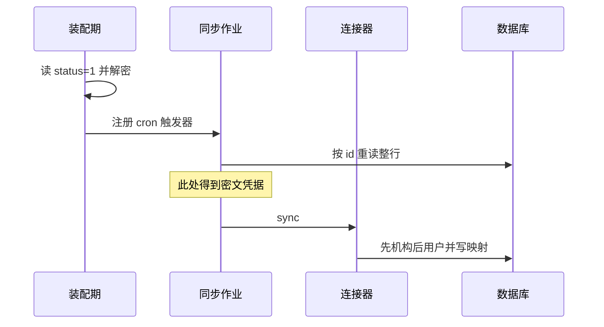
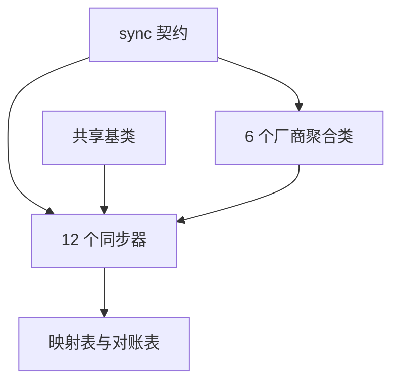
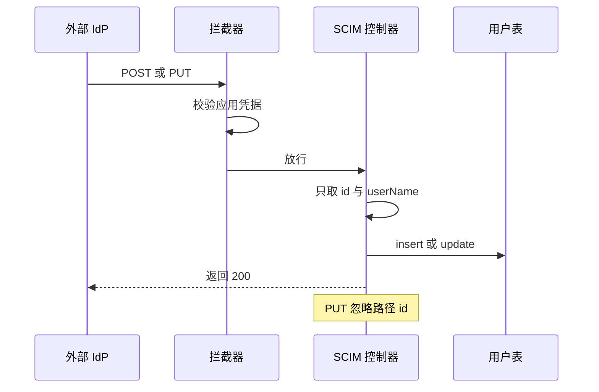

> 解读基线：MaxKey `4.1.12`（`3a3a5c765`）。

## 根因：三种异构性同时压在一个模块上

MaxKey 的权威身份库是自身的 `mxk_userinfo` 与 `mxk_organizations`。这个模块负责把外部世界的变化喂进这套表：既从 AD/LDAP 目录和钉钉、飞书、企微协同平台**拉取**，也接收标准 **SCIM 2.0 推送**。去掉它，MaxKey 剩下的只是一个需要人工维护的本地账号库——SSO 协议层照样能把已存在的账号联邦出去，但账号本身永远进不来。

难点在于它必须同时吸收几组正交的异构性，而每一组的收敛手段完全不同（[README.md:90-90]()）。
<!-- anchor: 4. Identity Lifecycle management, support SCIM 2 , and The out of the box connec … 4. Identity Lifecycle management, support SCIM 2 , and The out of the box connec -->

| 异构维度 | 具体表现 | 收敛手段 |
|---|---|---|
| 传输协议 | JNDI/LDAP、厂商 HTTP OpenAPI、厂商 SDK、原生 JDBC | 不收敛，各自实现 |
| 字段命名 | `sAMAccountName` / `userid` / `user_id` / SQL 列名 | 配置表 + 反射装配 |
| 身份标识 | DN、deptId、open_id、unionid、自增主键 | 外部标识投影表 |
| 变更语义 | 无任何变更流 API，只有全量枚举 | 不做增量，靠查外部 ID 判存 |

关键判断是：**这个模块没有做增量同步**。代码里没有任何 watermark、CDC 或 delta token 的痕迹，每次 `sync()` 都是对配置范围的一次全量枚举。最能说明问题的是 `Synchronizers` 实体里那个名为「同步时间范围（单位天）」的字段——它在仓储层被读出来之后，全仓库再无任何消费点（[maxkey-entity/src/main/java/org/dromara/maxkey/entity/Synchronizers.java:57-57]()）。
<!-- anchor: Integer syncStartTime; … Integer syncStartTime; -->

## 并不存在模板方法：被固定的只有装配

一个常见的误读是把 `AbstractSynchronizerService` 当成模板方法骨架。实际读下来必须纠正：**它没有定义任何 `sync()` 骨架、没有任何抽象钩子或 `final` 流程，甚至不实现同步接口**（[maxkey-synchronizers/maxkey-synchronizer/src/main/java/org/dromara/maxkey/synchronizer/AbstractSynchronizerService.java:37-52]()）。
<!-- anchor: public abstract class AbstractSynchronizerService { … protected Synchronizers synchronizer; -->
真正的对外契约只有两个方法，它是本模块唯一被统一的东西（[maxkey-synchronizers/maxkey-synchronizer/src/main/java/org/dromara/maxkey/synchronizer/ISynchronizerService.java:22-26]()）。
<!-- anchor: public interface ISynchronizerService { … public void setSynchronizer(Synchronizers synchronizer); -->

```java
public interface ISynchronizerService {
    public void sync() throws Exception ;
    public void setSynchronizer(Synchronizers synchronizer);
}
```

基类实际提供的是三样**与同步流程无关的共享设施**：一是 5 个注入的仓储服务，子类因此不必各自声明依赖；二是 `synchronizer` 作业上下文字段，这是子类读取 `providerUrl/principal/credentials/userFilters` 的唯一入口（[maxkey-synchronizers/maxkey-synchronizer/src/main/java/org/dromara/maxkey/synchronizer/AbstractSynchronizerService.java:41-52]()）。
<!-- anchor: @Autowired … protected Synchronizers synchronizer; -->
三是机构路径索引构建器，它把组织表读成 `HashMap<namePath, Organizations>`。这段逻辑与协议无关、却高度 MaxKey 特有，放基类是合理的；但它的副作用需要点出——建索引这个看似只读的动作会顺手执行一次组织更新，对订阅身份变更主题的消费者会带来非预期事件（[maxkey-synchronizers/maxkey-synchronizer/src/main/java/org/dromara/maxkey/synchronizer/AbstractSynchronizerService.java:105-121]()）。
<!-- anchor: public void push(HashMap<String,Organizations> orgsNamePathMap, … return; -->
还有第四个共享点：为协同平台补一条社交账号关联，按 `instid + userid + socialuserid + provider` 去重后插入，这是钉钉/企微/飞书免密登录能复用同一账号的前提（[maxkey-synchronizers/maxkey-synchronizer/src/main/java/org/dromara/maxkey/synchronizer/AbstractSynchronizerService.java:85-102]()）。
<!-- anchor: public void socialsAssociate(SynchroRelated synchroRelated,String provider) { … socialsAssociatesService.insert(socialsAssociate); -->
**为什么这样拆，收益与代价。** 收益是尊重现实：LDAP/AD 需要保留按层级排序、父先子后建组织的两阶段形状，JDBC 需要保留一条 SQL 一把梭，强行抽象统一的分页或游标契约会让两种来源都别扭。代价则构成本模块最大的技术债——**「查存在 → 插入或更新 → 记关系」这段真正的核心逻辑被复制了 12 次**，复制随即产生分叉：字段映射写了却从不调用、历史记录漏写、删除语义只有一家实现。

由此可以给出「新增一个来源」的真实成本：不是只写一个类，而是**三个类（聚合类 + 用户同步器 + 机构同步器）+ 一张字段映射表配置 + 一行把 `service` 列指向新 Bean 名的数据库记录**。`service` 列是插件注册表，作业运行时凭这个字符串从 Spring 容器取 Bean（[maxkey-synchronizers/maxkey-synchronizer/src/main/java/org/dromara/maxkey/synchronizer/SynchronizerJob.java:61-63]()）。
<!-- anchor: ISynchronizerService service = (ISynchronizerService)WebContext.getBean(synchron … service.sync(); -->
顺带解释一个反直觉现象：表名是 `mxk_synchronizers`、模块目录叫 `maxkey-synchronizers`，而代码里另有一套 `Connectors` 实体——它只有管理后台 CRUD，没有任何运行时引擎，README 的「out of the box connector」措辞在 4.1.12 上指向的是前者，而非这张表的能力（[maxkey-entity/src/main/java/org/dromara/maxkey/entity/Connectors.java:32-33]()）。
<!-- anchor: @Table(name = "MXK_CONNECTORS") … public class Connectors extends JpaEntity implements Serializable { -->

## 调度入口：Bean 名注册表与一条凭据缺陷

定时触发由自动配置类在 Spring 启动时一次性完成：用 `JdbcTemplate` 手写 `RowMapper` 把 `status='1'` 的作业行映射成实体，再为每个合法 cron 表达式注册 Quartz 的 `JobDetail` 与 `CronTrigger`（[maxkey-synchronizers/maxkey-synchronizer/src/main/java/org/dromara/maxkey/autoconfigure/SynchronizerAutoConfiguration.java:49-60]()）。
<!-- anchor: public static final String SYNCHRONIZERS_SELECT_STATEMENT = "select * from mxk_s … List<Synchronizers> synchronizerList = querySynchronizers(jdbcTemplate); -->



手动触发走管理后台的同步端点，它与定时路径共用同一条 `setSynchronizer + sync` 装配线（[maxkey-webs/maxkey-web-mgt/src/main/java/org/dromara/maxkey/web/config/controller/SynchronizersController.java:120-123]()）。
<!-- anchor: ISynchronizerService synchronizerService = WebContext.getBean(synchronizer.getSe … synchronizerService.sync(); -->
**两条路径的唯一差别，暴露了一处真实缺陷。** 定时作业在运行时按 id 从数据库**重读整行**，覆盖掉 JobDataMap 里那份已解密的配置（[maxkey-synchronizers/maxkey-synchronizer/src/main/java/org/dromara/maxkey/synchronizer/SynchronizerJob.java:75-80]()）。
<!-- anchor: Synchronizers jobSynchronizer = (Synchronizers)context.getMergedJobDataMap().get … Synchronizers synchronizer = synchronizersService.get(jobSynchronizer.getId()); -->
而重读所依赖的仓储实现是一个空的 `JpaServiceImpl` 子类，**没有任何解密逻辑**（[maxkey-persistence/src/main/java/org/dromara/maxkey/persistence/service/impl/SynchronizersServiceImpl.java:28-30]()）。
<!-- anchor: @Repository … static final  Logger _logger = LoggerFactory.getLogger(SynchronizersServiceImpl. -->
解密只发生在两处：装配期的凭据解码，以及手动触发前的显式解码（[maxkey-synchronizers/maxkey-synchronizer/src/main/java/org/dromara/maxkey/autoconfigure/SynchronizerAutoConfiguration.java:108-109]()）。
<!-- anchor: synchronizer.setCredentials( … PasswordReciprocal.getInstance().decoder(rs.getString("credentials"))); -->
于是得到一个反直觉且难排查的结论：**手动触发拿到的是明文凭据，定时作业拿到的是密文凭据**。定时路径的连接器会拿密文去连 AD、去换 access_token。重读本身是对的（支撑配置热更新），错在它没有复用一个会解密的读取方法。

并发保护同样是弱的：去重状态是一个以作业 id 为键的静态 `HashMap`，单实例下能防自我并发，但多副本部署下完全失效，且非线程安全（[maxkey-synchronizers/maxkey-synchronizer/src/main/java/org/dromara/maxkey/synchronizer/SynchronizerJob.java:41-55]()）。
<!-- anchor: private static HashMap<String,Integer> jobStatus = new HashMap<>(); … jobStatus.put(synchronizer.getId(),  JOBSTATUS.RUNNING) ; -->

## 字段映射：配置表加反射，以及它在哪里失效

映射表结构极简，只有作业 id、对象类型、目标字段、源字段四列（[sql/v4.1.11/maxkey.sql:1687-1703]()）。
<!-- anchor: CREATE TABLE `sync_job_config_field` ( … ) ENGINE=InnoDB AUTO_INCREMENT=214 DEFAULT CHARSET=utf8mb4 COLLATE=utf8mb4_0900_ -->
一次按作业 id 全量加载，装配侧则是纯反射：以目标字段的 getter 返回类型决定 setter 签名与类型转换（[maxkey-synchronizers/maxkey-synchronizer/src/main/java/org/dromara/maxkey/synchronizer/utils/FieldUtil.java:34-37]()）。
<!-- anchor: String setterMethodName = "set" + Character.toUpperCase(fieldName.charAt(0)) + f … Class<?> fieldType = getterMethod.getReturnType(); -->
类型转换承担了跨类型语义，其中两条是业务语义而非类型语义：布尔转 1/0，日期转 `yyyy-MM-dd`。转换失败时抛 `IllegalArgumentException`，而各连接器的 catch 子句只覆盖三个反射异常，**并未覆盖这个运行时异常**，因此一条类型不兼容的映射会中断整个同步作业，而不是跳过该字段（[maxkey-synchronizers/maxkey-synchronizer/src/main/java/org/dromara/maxkey/synchronizer/utils/FieldUtil.java:64-97]()）。
<!-- anchor: public static Object convertValueToFieldType(Object value, Class<?> fieldType) { … throw new IllegalArgumentException("Unsupported field type: " + fieldType); -->
**为什么用配置表而不是代码硬编码**，种子数据给了最有说服力的答案：同一份连接器代码，靠映射表里不同作业 id 的行就能表达钉钉、飞书、企微、LDAP/AD 与 JDBC 的字段词汇表，全部 209 行映射记录集中在一行 INSERT 里（[sql/v4.1.11/maxkey.sql:1712-1712]()）。
<!-- anchor: INSERT INTO `sync_job_config_field` VALUES (1,3,NULL,'1','username',NULL,'userid … INSERT INTO `sync_job_config_field` VALUES (1,3,NULL,'1','username',NULL,'userid -->
代价同样真实。映射是**运行时字符串契约，没有任何校验**：源字段找不到时静默跳过，一个拼错的源字段表现为「某个属性永远不同步」，没有日志也没有告警。而且总有一批字段映射不进去——飞书在映射循环之后另有一段硬编码补丁，处理用户名缺省以及 id、租户、用户类型等无法由配置表达的属性（[maxkey-synchronizers/maxkey-synchronizer-feishu/src/main/java/org/dromara/maxkey/synchronizer/feishu/FeishuUsersService.java:177-182]()）。
<!-- anchor: if(userInfo.getUsername() == null){ … userInfo.setUserType("EMPLOYEE"); -->
全模块对「配置即契约」风险最清醒的一处应对在企微：组织同步先反查哪个本地字段映射到了企微部门 id，找不到就抛异常终止作业，代码注释写明关键字段不能依赖映射关系（[maxkey-synchronizers/maxkey-synchronizer-workweixin/src/main/java/org/dromara/maxkey/synchronizer/workweixin/WorkweixinOrganizationService.java:68-70]()）。
<!-- anchor: Map<String, String> fieldMap = getFieldMap(Long.parseLong(synchronizer.getId())) … String targetIdField = getLocalFieldMappingByWx(fieldMap, "id"); -->
**最大的问题在这里：字段映射在三个连接器上是死代码。** 代码里同时存在两套构建路径——一套走字段映射，一套硬编码。LDAP 用户同步调用的是硬编码分支，而带字段映射的构建器虽然写好了却从未被 `sync()` 调用（[maxkey-synchronizers/maxkey-synchronizer-ldap/src/main/java/org/dromara/maxkey/synchronizer/ldap/LdapUsersService.java:90-90]()、[maxkey-synchronizers/maxkey-synchronizer-ldap/src/main/java/org/dromara/maxkey/synchronizer/ldap/LdapUsersService.java:224-224]()）。
<!-- anchor: UserInfo userInfo  = buildUserInfo(attributeMap,sr.getName(),sr.getNameInNamespa … UserInfo userInfo  = buildUserInfo(attributeMap,sr.getName(),sr.getNameInNamespa -->
<!-- anchor: public UserInfo buildUserInfoByFieldMap(HashMap<String,Attribute> attributeMap,S … public UserInfo buildUserInfoByFieldMap(HashMap<String,Attribute> attributeMap,S -->
同样的分叉在 AD 与 JDBC 上重复出现，用户侧与机构侧各一份，合计六处；JDBC 更彻底，除了未被调用的映射构建器，`static` 块里还另有一份 60 项的硬编码列名清单（[maxkey-synchronizers/maxkey-synchronizer-jdbc/src/main/java/org/dromara/maxkey/synchronizer/jdbc/JdbcUsersService.java:80-80]()、[maxkey-synchronizers/maxkey-synchronizer-jdbc/src/main/java/org/dromara/maxkey/synchronizer/jdbc/JdbcUsersService.java:173-173]()）。
<!-- anchor: UserInfo user = buildUserInfo(rs); … UserInfo user = buildUserInfo(rs); -->
<!-- anchor: public UserInfo buildUserInfoByFieldMap(ResultSet rs) throws SQLException, Invoc … public UserInfo buildUserInfoByFieldMap(ResultSet rs) throws SQLException, Invoc -->
后果是具体的：映射表里为 LDAP、AD、JDBC 配好的那批种子数据，在 4.1.12 的代码路径上完全不被消费——管理员在界面上改这三个连接器的属性映射不会有任何效果。

## 增量与幂等：一张外部标识投影表

幂等不靠去重键，而靠一张**外部标识 ↔ 本地标识**的索引表。它表达了一个三元组：谁、什么类型、来自哪个作业与哪个外部 ID，`originId` 列宽 1000，说明设计者预期外部标识可能很长（[maxkey-entity/src/main/java/org/dromara/maxkey/entity/SynchroRelated.java:48-72]()）。
<!-- anchor: protected String objectId; … protected String syncTime; -->

```java
public SynchroRelated findByOriginId(Synchronizers synchronizer,String originId,String classType) {
    return findOne("instid = ? and syncId = ? and originid = ? and objecttype = ? ",
```
[maxkey-persistence/src/main/java/org/dromara/maxkey/persistence/service/impl/SynchroRelatedServiceImpl.java:48-49]()
<!-- anchor: public SynchroRelated findByOriginId(Synchronizers synchronizer,String originId, … return findOne("instid = ? and syncId = ? and originid = ? and objecttype = ? ", -->
**为什么非它不可**：LDAP 的稳定标识是 DN，钉钉是 deptId/userid，飞书是 open_id/user_id，本地主键是 MaxKey 自己生成的随机 id。没有这张表，「这个 AD 用户」与「那个本地账号行」之间就没有可判定的对应关系，第 N 次同步只能靠用户名猜——而用户名恰恰是可变的、可重复的。

**但它的更新语义是冻结的。** 关系一旦建立，后续只更新时间戳，本地对象 id 与外部名称都是写入即冻结（[maxkey-persistence/src/main/java/org/dromara/maxkey/persistence/service/impl/SynchroRelatedServiceImpl.java:54-63]()）。
<!-- anchor: public void updateSynchroRelated(Synchronizers synchronizer,SynchroRelated synch … updateSyncTime(synchroRelated); -->
本地用户若被删除后以新 id 重建，映射就会指向一个不存在的 id。企微用户同步因此显式地把旧 id 抢回来赋给新对象，这是绕开冻结语义的补丁，而不是修正它（[maxkey-synchronizers/maxkey-synchronizer-workweixin/src/main/java/org/dromara/maxkey/synchronizer/workweixin/WorkweixinUsersService.java:130-137]()）。
<!-- anchor: maxkeyUserNew.setId(userSyncRecord.getObjectId()); … continue; -->
另一个隐患是这张表只有主键、没有业务唯一约束，并发或重跑可能产生重复映射行，而查询在命中多行时的行为未定义（[sql/v4.1.11/maxkey.sql:1424-1439]()）。
<!-- anchor: CREATE TABLE `mxk_synchro_related` ( … ) ENGINE=InnoDB DEFAULT CHARSET=utf8mb3; -->
**逐字段比对被写好了却从未启用。** 工具类里有完整的反射比较实现，语义正是「要不要写库」的判断依据，但全仓库零调用点，结果是每次同步对每条记录都无条件更新（[maxkey-synchronizers/maxkey-synchronizer/src/main/java/org/dromara/maxkey/synchronizer/utils/FieldUtil.java:100-126]()）。
<!-- anchor: public static boolean areFieldsEqual(Object obj1, Object obj2) { … return true; -->
**删除的传播只有一家做了，而它是全模块最成熟的一段。** 没有任何连接器删除本地账号，企微用集合差集实现「外部消失」：把本作业全部用户映射装进 Map，遍历中逐个移除，剩下的就是本次未返回的历史用户，再置为禁用与离职态（[maxkey-synchronizers/maxkey-synchronizer-workweixin/src/main/java/org/dromara/maxkey/synchronizer/workweixin/WorkweixinUsersService.java:338-357]()）。
<!-- anchor: private void disableMissingUsers(Map<String, SynchroRelated> _userRelationHistor … _logger.info("[同步微信用户] 用户 {} (originId={}) 已标记为禁用，userState=WITHDRAWN。", localUs -->
**关键是它前面那道闸门**：任何一个部门拉取失败都会跳过整个禁用流程。没有这道闸，一次 API 抖动就会批量误禁员工账号——这是破坏性操作应有的默认姿态，也是其余连接器缺失的部分，它们既不删除也不禁用，离职账号会永久留在用户表里（[maxkey-synchronizers/maxkey-synchronizer-workweixin/src/main/java/org/dromara/maxkey/synchronizer/workweixin/WorkweixinUsersService.java:172-177]()）。
<!-- anchor: if (fetchFailed) { … disableMissingUsers(userRelationHistoryMap); -->
**HTTP 连接器的幂等锚点是用户名，而它们不检查同名冲突。** 飞书与钉钉直接调用保存方法，而该方法的判重键只有用户名加租户，命中即覆盖本地账号的部门与状态（[maxkey-persistence/src/main/java/org/dromara/maxkey/persistence/service/impl/UserInfoServiceImpl.java:137-145]()）。
<!-- anchor: public void saveOrUpdate(UserInfo userInfo) { … update(userInfo); -->
企微专门写了多场景判定并明确拒绝关联手工创建的账号，正是为了堵这个洞（[maxkey-synchronizers/maxkey-synchronizer-workweixin/src/main/java/org/dromara/maxkey/synchronizer/workweixin/WorkweixinUsersService.java:108-141]()）。
<!-- anchor: // 现在需要进行一些场景判断 , 大致应该是分成了4种情况 … maxkeyUserNew.setId(maxkeyUserNew.generateId()); // 使用一个新的Id -->

## 连接器家族：差异在哪一层被吸收

**统一层只有一层，就是那个两方法的同步接口。** 之下是厂商聚合层，每个来源一个薄类，做「取凭据、换 token 或建连接、先机构后用户」；再之下是 12 个具体同步器，各自实现 `sync()`。类声明可以印证这个结构：6 个聚合类只实现接口，12 个具体同步器同时继承基类并实现接口，而基类与接口之间没有任何关系（[maxkey-synchronizers/maxkey-synchronizer/src/main/java/org/dromara/maxkey/synchronizer/AbstractSynchronizerService.java:37-37]()）。
<!-- anchor: public abstract class AbstractSynchronizerService { … public abstract class AbstractSynchronizerService { -->



图中 `sync 契约` 与 `共享基类` 之间没有边，这正是关键结构事实：多态调用链完全依赖各子类自带的 `sync` 方法，基类不参与。

**「先机构后用户」是业务不变量**（用户需要部门已存在），它在 6 个聚合类里被逐字重复，从未提升为基类契约。这是「没有模板方法」最直接的代价：一个顺序约束被复制了 6 遍。

**token 获取的失败是静默的。** 三个 token 服务都是「拼 URL → 请求 → 反序列化 → 失败返回空串」，调用方不检查空 token 就直接发起后续请求，表现为批量鉴权失败而不是一条明确错误（[maxkey-synchronizers/maxkey-synchronizer-feishu/src/main/java/org/dromara/maxkey/synchronizer/feishu/FeishuAccessTokenService.java:50-62]()）。
<!-- anchor: public String requestToken() { … return ""; -->
**HTTP 侧唯一被抽象出来的东西是响应信封**：一个共享的响应基类统一了五个可能的错误字段位，飞书与企微的响应包装都继承它，但飞书的用户分页数据类没有继承，一致性并不彻底（[maxkey-synchronizers/maxkey-synchronizer/src/main/java/org/dromara/maxkey/synchronizer/entity/ResponseData.java:20-30]()）。
<!-- anchor: public class ResponseData { … return errcode; -->
**两处必须点出的行为缺陷。** 第一，**分页字段声明了却从未使用**：飞书的分页数据类都带 `has_more` 与 `page_token`，而用户接口的 URL 固定 `page_size=50`（[maxkey-synchronizers/maxkey-synchronizer-feishu/src/main/java/org/dromara/maxkey/synchronizer/feishu/FeishuUsersService.java:53-53]()）。
<!-- anchor: static String USERS_URL="https://open.feishu.cn/open-apis/contact/v3/users/find_ … static String USERS_URL="https://open.feishu.cn/open-apis/contact/v3/users/find_ -->
子部门接口同样固定 50，且全模块对这两个分页 getter 的检索在实体目录之外零命中（[maxkey-synchronizers/maxkey-synchronizer-feishu/src/main/java/org/dromara/maxkey/synchronizer/feishu/FeishuOrganizationService.java:58-58]()）。
<!-- anchor: static String DEPTS_URL = "https://open.feishu.cn/open-apis/contact/v3/departmen … static String DEPTS_URL = "https://open.feishu.cn/open-apis/contact/v3/departmen -->
这意味着**单个部门超过 50 人时，第 51 人之后的用户会被静默丢弃**；同理，某部门子部门超过 50 个时，其余子部门整棵子树都不会被遍历。这不是性能问题，而是数据完整性问题。

第二，**组织遍历靠异常退出**：循环条件用的是队列的 `element()`，它在队列为空时抛 `NoSuchElementException`，该异常正是循环的唯一正常出口，被一条专门的 catch 捕获后记为调试日志（[maxkey-synchronizers/maxkey-synchronizer-feishu/src/main/java/org/dromara/maxkey/synchronizer/feishu/FeishuOrganizationService.java:77-77]()）。
<!-- anchor: while(deptsQueue.element() != null) { … while(deptsQueue.element() != null) { -->
钉钉组织同步用的是同一个形状。这一写法可用，但把「遍历结束」编码成了异常，任何真实空指针或并发问题都会被这条 catch 一并吞掉。

## SCIM 2.0：方向相反的第二条供给路径

连接器是 MaxKey 去外面拉，SCIM 是外部 IdP 往 MaxKey 推。两者在数据层汇合于同一批表，但在代码上**没有任何共享**：SCIM 完全不经过同步接口，也不写外部标识投影表。

模块只有 4 个控制器，**没有 `/Schemas`、`/ResourceTypes`、`/Bulk`、`/Me`**，严格按 RFC 7644 做发现流程的客户端会在第一步失败（[maxkey-web-apis/maxkey-web-api-scim/src/main/java/org/dromara/maxkey/web/apis/identity/scim/ScimUserController.java:68-69]()）。
<!-- anchor: @RequestMapping(value = "/api/idm/SCIM/v2/Users") … public class ScimUserController { -->



**资源映射是单向富、反向贫的。** 正向展开约 20 个 SCIM 属性，反向只剩两个字段（[maxkey-web-apis/maxkey-web-api-scim/src/main/java/org/dromara/maxkey/web/apis/identity/scim/ScimUserController.java:230-234]()）。
<!-- anchor: public UserInfo scimUser2UserInfo(ScimUser scimUser) { … return userInfo; -->

机构是唯一反向映射有实质内容的，双向共 13 个字段；组映射回本地则只保留显示名（[maxkey-web-apis/maxkey-web-api-scim/src/main/java/org/dromara/maxkey/web/apis/identity/scim/ScimOrganizationController.java:169-183]()）。
<!-- anchor: public Organizations scimOrg2Org(ScimOrganization     scimOrg) { … return org; -->
**能力声明与实现存在系统性偏差。** `patch`、`bulk`、`etag` 声明为不支持，与实现一致；但声明支持过滤与排序，而实现并不支持（[maxkey-web-apis/maxkey-web-api-scim/src/main/java/org/dromara/maxkey/web/apis/identity/scim/ScimServiceProviderConfigController.java:46-51]()）。
<!-- anchor: public final Supported patch = new Supported(false); … public final Supported etag = new Supported(false); -->
根因是一个 Unicode 连字：参数类的字段名用了连字 `filter`（U+FB01）而不是 `filter`，因此查询串里的过滤条件**永远不会绑定到这个属性**，搜索退化为无条件分页读取（[maxkey-web-apis/maxkey-web-api-scim/src/main/java/org/dromara/maxkey/web/apis/identity/scim/resources/ScimParameters.java:25-25]()）。
<!-- anchor: String filter; … String filter; -->
这是最典型的「声明即谎言」：只按 filter 拉增量的 IdP 会拿到全量页。同理，`attributes` 参数被多个方法签名接受却从未使用，属性裁剪未实现。

**REST 语义上还有三处偏离**：PUT 忽略路径里的 id 而完全信任请求体，DELETE 返回 200 而非 204，且 PUT 复用了 POST 的反向映射函数，导致两者语义无法区分（[maxkey-web-apis/maxkey-web-api-scim/src/main/java/org/dromara/maxkey/web/apis/identity/scim/ScimUserController.java:96-111]()）。
<!-- anchor: @RequestMapping(value = "/{id}", method = RequestMethod.PUT) … userInfoService.delete(id); -->
鉴权由开放 API 的拦截器统一承担，支持应用密钥的 Basic 与 OAuth2 Bearer 两种凭据，与能力文档的声明相符（[maxkey-webs/maxkey-web-openapi/src/main/java/org/dromara/maxkey/autoconfigure/MaxKeyOpenApiMvcConfig.java:94-97]()）。
<!-- anchor: registry.addInterceptor(restApiPermissionAdapter) … .addPathPatterns("/api/idm/scim/**") -->

## 关键数据结构

**作业定义**承载了整条装配线所需的全部输入：来源类型、cron 表达式、作为 Bean 名的 `service` 列、连接地址与凭据、目录过滤器、域、SSL 开关，以及那个已经废止的同步时间范围字段（[maxkey-entity/src/main/java/org/dromara/maxkey/entity/Synchronizers.java:41-99]()）。
<!-- anchor: String id; … private String instId; -->
**映射配置**是四列极简结构加对象类型的 1/2 区分，外加名称与描述列用于界面展示（[maxkey-entity/src/main/java/org/dromara/maxkey/entity/SyncJobConfigField.java:47-95]()）。
<!-- anchor: private Long id; … private String description; -->
**SCIM 用户模型**继承通用资源基类，企业扩展挂在带注解的字段上，除多值属性外还包含行业标准的组织与分组两个字符串列表（[maxkey-web-apis/maxkey-web-api-scim/src/main/java/org/dromara/maxkey/web/apis/identity/scim/resources/ScimUser.java:33-74]()）。
<!-- anchor: public static final String SCHEMA = "urn:ietf:params:scim:schemas:core:2.0:User" … private  List<String> group; -->

## 与其他模块的协同

同步器自身没有独立的 Mapper 或 SQL 映射文件，仓储全部来自持久层模块，实体来自实体模块，唯一新增的查询是映射表的按作业读取。SCIM 侧依赖更薄：只有公共模块、实体模块与持久层，**不依赖协议模块，也不依赖同步器模块**——两条供给路径在编译期就是隔离的（[maxkey-web-apis/maxkey-web-api-scim/build.gradle:9-11]()）。
<!-- anchor: implementation project(":maxkey-commons:maxkey-common") … implementation project(":maxkey-persistence") -->
更重要的是它们与认证模块共享账号与组织数据：同步写入的用户表与组织表，正是登录态、会话与单点登录读取的那批表。因此**一次同步误写会直接改变登录与授权结果**，这也是本模块所有风险的放大系数所在。

## 关键设计决策

**决策一 · 只给设施、不给流程。** 选择「基类只提供共享设施，流程留给 12 个子类，扩展点放在数据库字符串列」，代价是核心对账逻辑复制 12 份并已产生分叉。替代方案是把 `sync()` 提为模板方法，固定「建连接、遍历、映射、对账、写库、记历史、关连接」，只留两个钩子。当时的取舍可能是对的——来源形状差异确实大，硬套钩子契约会让多数子类写退化实现；但代价必须被承认，最具体的表现就是那六个从未被调用的映射构建器。

**决策二 · 两条供给路径互不感知。** SCIM 是标准且支持增量语义，理论上可取代部分连接器；但 AD/LDAP 域控与协同平台并不提供 SCIM 服务端，保留拉取式是必要选择。真正的问题不是「保留」，而是**两条路零共享**：同一个外部身份若同时经两条路径进入，MaxKey 无法判定为同一人。替代方案是让 SCIM 也写外部标识投影表，以外部 id 作 `originId`，代价是扩展 SCIM 契约但换来统一对账。

**决策三 · 冲突默认静默覆盖。** 同名冲突有三种裁决：覆盖本地、跳过、报错待人工。默认是第一种且不告警——保存方法只按用户名加租户查，命中即更新，不比对手机号或工号做二次确认。企微是唯一实施「跳过并告警」的，更新时还用字段白名单排除 id、密码、租户与用户类型。风险方向很明确：当外部用户名恰好与本地管理员账号同名时，默认策略会覆盖其部门与状态，字段白名单是唯一的兜底。

## 值得借鉴与需要警惕

**值得借鉴的四点**：把「外部标识投影」独立成表，而不是把外部 ID 塞进业务表字段——因为同一对象在外部可能有多个 ID，投影表预留了三个槽位；企微的「失败即中止破坏性操作」闸门，凡做删除或禁用传播的系统都该抄这段，部分成功时必须放弃收敛；对「配置即契约」的不信任补丁，把配置错误从静默数据损坏转化为显式失败；以及用 Bean 名注册表把「新增一个来源」的成本降到部署一个 Bean 加插一行配置，无需改调度器。
**需要警惕的五点，按严重度排序**：其一，**定时路径使用密文凭据**而手动触发正常，属功能性缺陷且极难排查；其二，**六个字段映射构建器是死代码**，LDAP、AD、JDBC 的界面映射配置完全无效，与产品承诺不符；其三，**删除与离职不传播**（企微除外）触及 IAM 场景的账号安全底线，同时**同名静默覆盖**会改写本地账号；其四，**分页参数未实现导致的静默数据丢失**在规模稍大的租户上即会触发，且没有任何日志；其五，**SCIM 契约缺口**——过滤永不生效、发现端点缺失、反向映射只有两个字段，影响与第三方 IdP 的互操作，属「补全或收窄承诺」的选择题。
