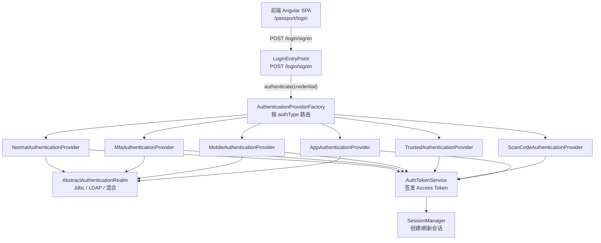
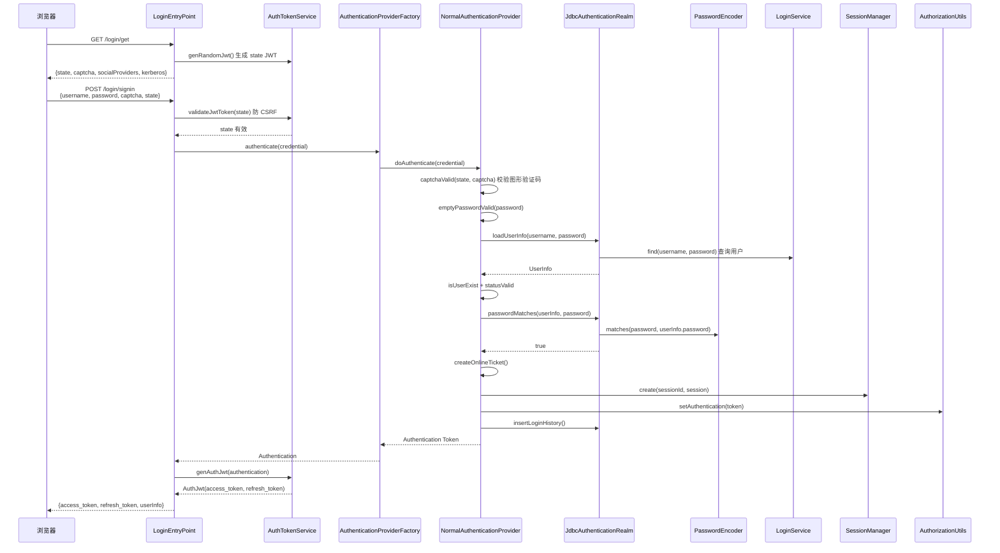
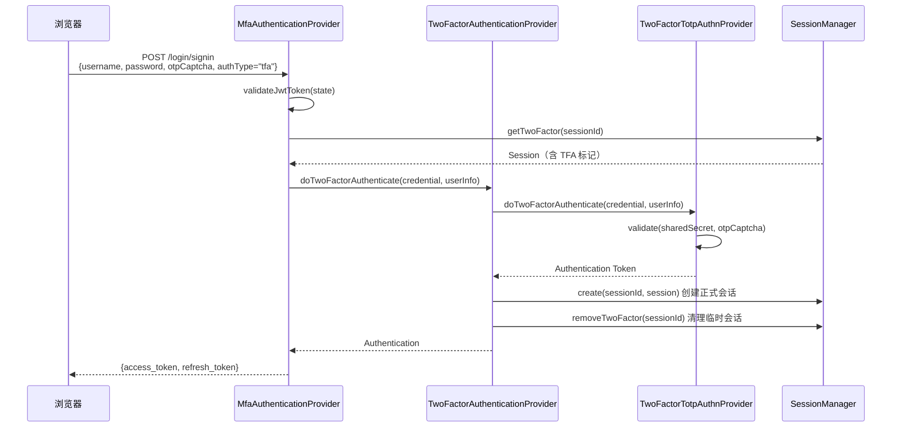
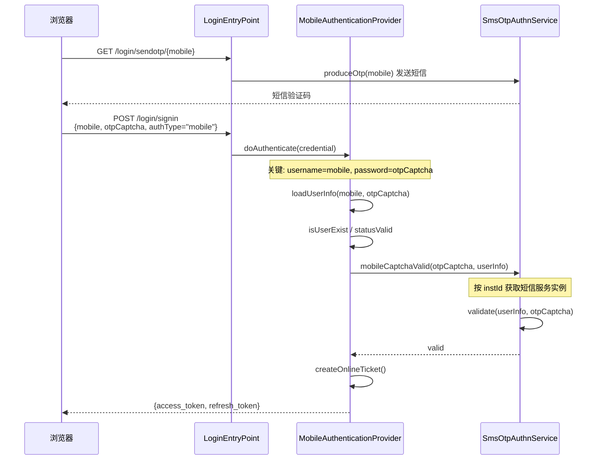
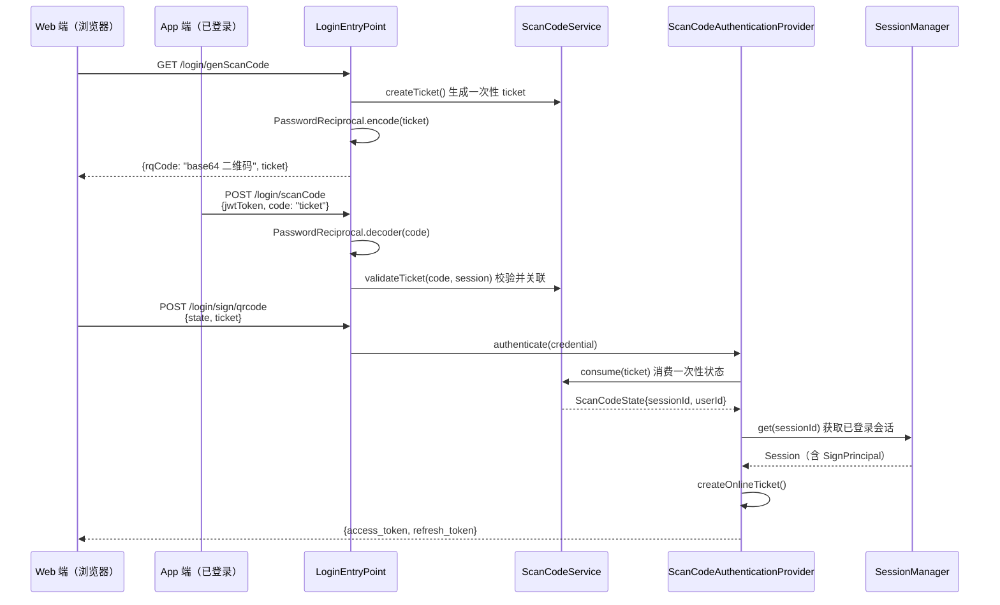
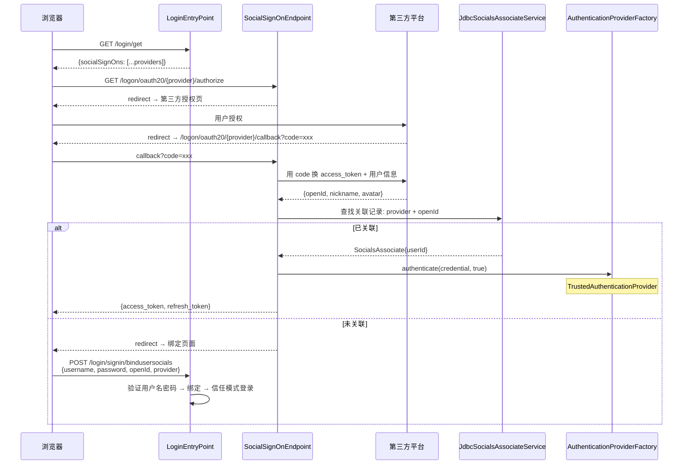
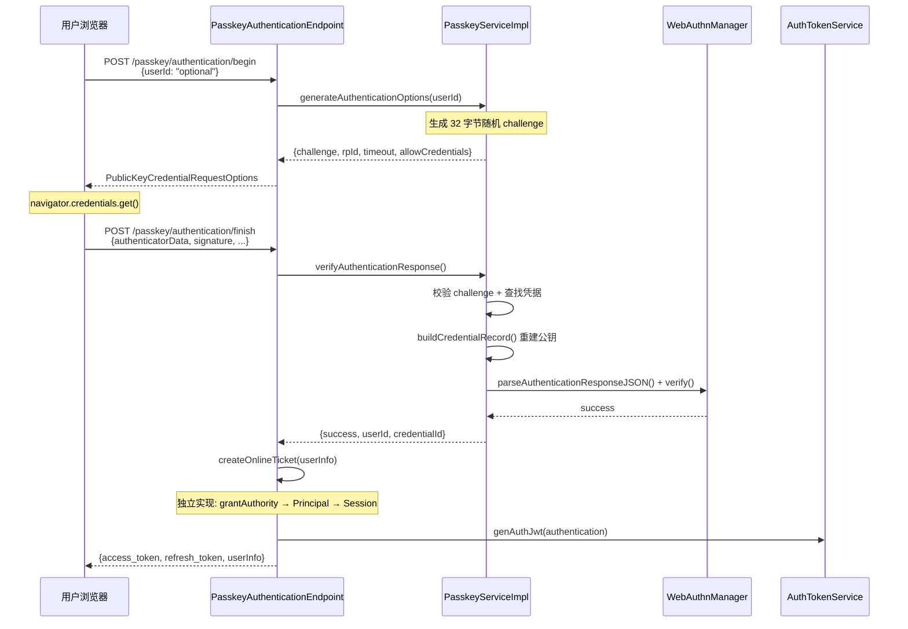
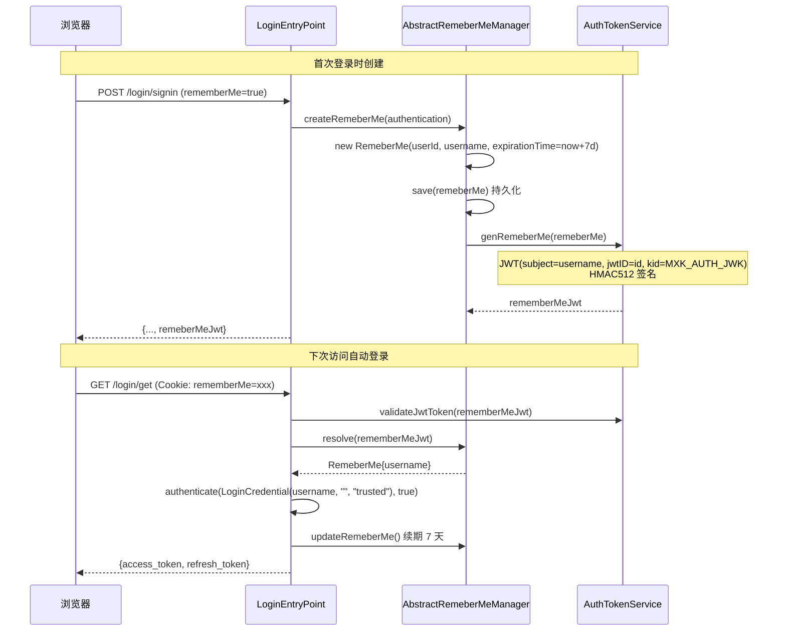
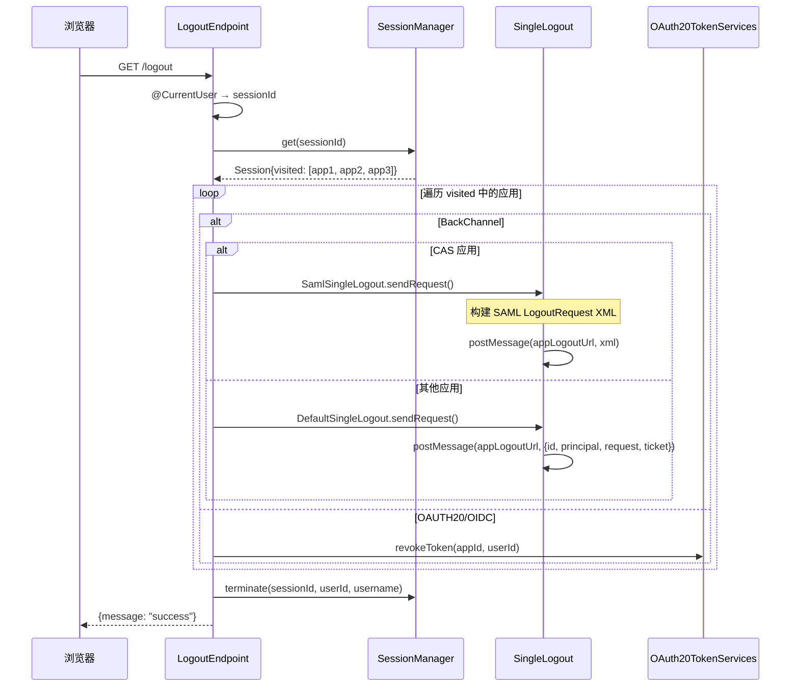
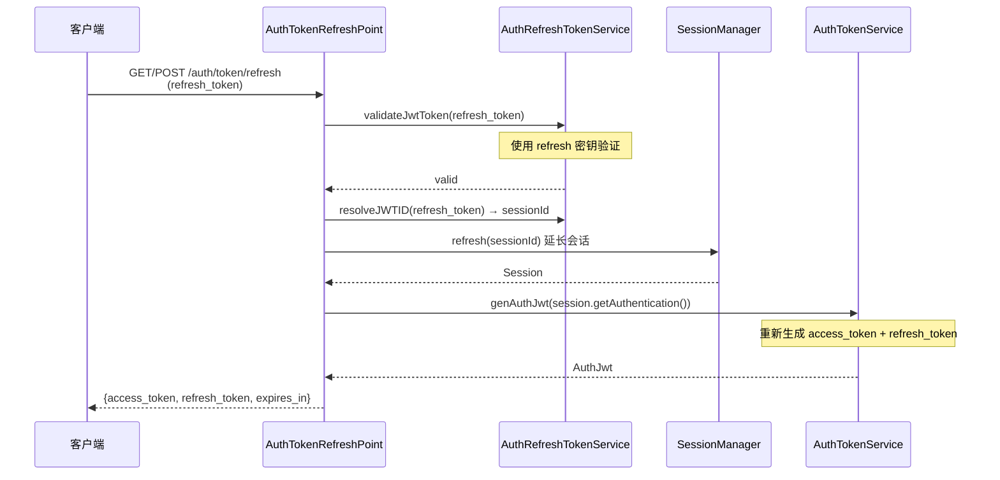

# MaxKey 登录/登出流程详细分析

> 本文档深度分析 MaxKey 的登录、登出、Token 刷新全链路流程，覆盖所有认证方式。配套架构概览请先阅读 [MaxKey 项目解读](README.md)。

## 第一部分：登录体系总览

MaxKey 的登录入口为 `LoginEntryPoint`（`maxkey-web-maxkey` 模块），它是一个 Spring MVC `@RestController`，路径前缀 `/login`。所有认证请求最终由 `AbstractAuthenticationProvider` 的子类处理，由 `AuthenticationProviderFactory` 按 `authType` 动态路由。

### 核心组件关系



### 认证提供者路由

`AuthenticationProviderFactory` 使用 `ConcurrentHashMap` 存储所有 Provider：

```java
private static ConcurrentHashMap<String, AbstractAuthenticationProvider> providers
    = new ConcurrentHashMap<>();

// 路由逻辑
Authentication authenticate(LoginCredential credential) {
    if (credential.getAuthType().equals("trusted")) return null;
    AbstractAuthenticationProvider provider = providers.get(
        credential.getAuthType() + PROVIDER_SUFFIX);
    return provider != null ? provider.doAuthenticate(credential) : null;
}
```

| authType | Provider 类 | 密码验证 | 附加验证 |
|----------|------------|---------|---------|
| `normal` | NormalAuthenticationProvider | 密码匹配 | 图形验证码（可选） |
| `tfa` | MfaAuthenticationProvider | 密码匹配 | TOTP OTP |
| `mobile` | MobileAuthenticationProvider | 无 | 短信验证码 |
| `trusted` | TrustedAuthenticationProvider | 无 | 无 |
| `scancode` | ScanCodeAuthenticationProvider | 无 | 二维码票据 |
| `app` | AppAuthenticationProvider | 密码匹配 | 图形验证码（可选） |

---

## 第二部分：用户名密码登录

### 完整时序



### 步骤详解

**Step 1: 登录页面初始化（`GET /login/get`）**

`LoginEntryPoint.get()` 方法（行 80-132）：

```
1. 生成 state JWT: authTokenService.genRandomJwt()
   → 一个无 subject 的随机 JWT，用于 CSRF 防护
2. 检查 Remember Me Cookie: 若存在则 validateJwtToken → resolve
3. 加载登录配置: 验证码开关、Kerberos 配置、社交登录提供商列表
4. 构建 WebAuthn/Passkey 配置参数 (rpId, uv, timeout)
5. 返回: {state, captcha, socialSignOns, kerberos, passkeyConfig}
```

**Step 2: 用户提交凭据（`POST /login/signin`）**

`LoginEntryPoint.signin()` 方法（行 222-253）：

```
1. 验证 CSRF state: authTokenService.validateJwtToken(credential.getState())
2. 调用认证: authenticationProvider.authenticate(credential)
   → AuthenticationProviderFactory.authenticate()
   → providers.get("normalAuthenticationProvider").doAuthenticate(credential)
3. 认证成功: authTokenService.genAuthJwt(authentication) 生成 JWT
4. 记住我: 若 remeberMe == true → remeberMeManager.createRemeberMe()
5. 返回 AuthJwt（含 access_token, refresh_token, 用户信息）
```

**Step 3: 密码验证详细流程**

`NormalAuthenticationProvider.doAuthenticate()` 行 69-123：

```
1. captchaValid(state, captcha)     → 若启用验证码，先验证图形验证码
2. emptyPasswordValid(password)     → 密码非空校验
3. emptyUsernameValid(username)     → 用户名非空校验
4. loadUserInfo(username, password) → 通过 Realm 加载用户
5. isUserExist(credential, userInfo) → 用户存在校验
6. passwordPolicyValid(userInfo)    → 密码过期/强度策略校验
7. statusValid(credential, userInfo) → 锁定/禁用/过期状态校验
8. passwordMatches(userInfo, password) → 密码匹配
9. applyPasswordPolicy(userInfo)    → 重置错误计数等
10. createOnlineTicket(credential, userInfo) → 创建在线票据
11. insertLoginHistory(userInfo, ...) → 记录登录审计
```

**Step 4: 密码匹配（`JdbcAuthenticationRealm.passwordMatches()`）**

`JdbcAuthenticationRealm` 行 100-152：

```
1. passwordEncoder.matches(password, userInfo.getPassword())
   → 支持: BCrypt / SM3 / SHA-256 / MD4 / LDAP-SHA / MD5
2. 若 JDBC 匹配失败且配置了 LDAP:
   → ldapAuthenticationRealmService.getByInstId(instId)
   → ldapRealm.passwordMatches(userInfo, password) LDAP bind 认证
   → 若 LDAP 成功: encode(password) + changePassword() 回写密码到 JDBC
3. 最终失败: plusBadPasswordCount() 错误计数+1 → BadCredentialsException
```

**Step 5: 创建在线票据（`createOnlineTicket()`）**

`AbstractAuthenticationProvider.createOnlineTicket()` 行 121-170：

```
1. new Session() 创建 Session → 自动生成 sessionId
2. new SignPrincipal(userInfo, session) 创建认证主体
3. authenticationRealm.grantAuthority(userInfo) 加载角色权限
4. 检查是否为 ROLE_ADMINISTRATORS
5. authenticationRealm.queryAuthorizedApps(grantedAuthoritys)
6. new UsernamePasswordAuthenticationToken(principal, "PASSWORD", grantedAuthoritys)
7. session.setAuthentication(authenticationToken)
8. 若 authType == NORMAL 且启用了 MFA:
   → sessionManager.createTwoFactor() 创建临时 2FA 会话
   → AuthJwt.twoFactor 字段标记需要二次认证
9. 否则: sessionManager.create(sessionId, session)
10. AuthorizationUtils.setAuthentication(authenticationToken)
```

> **关于 getPassword() 的说明：** `createOnlineTicket()` 中的 `"PASSWORD"` 是 `UsernamePasswordAuthenticationToken` 构造方法中 `credentials` 参数的占位值（非原始密码）。`LoginCredential.toString()` 中密码被显式替换为 `"********"`（行 249）。实际密码只在 `passwordEncoder.matches()` 比对时短暂存在，比对完成后即被 GC 回收。

---

## 第三部分：双因素认证

双因素认证采用**两阶段**设计：第一阶段验证用户名密码并创建临时 2FA 会话，第二阶段验证 OTP 后创建正式会话。

### 第一阶段：用户名密码验证

与普通登录流程一致，但 `createOnlineTicket()` 中检测到用户启用了 MFA 后，不创建正式 Session：

```
createOnlineTicket():
  if authType == NORMAL && userInfo.authnType > NONE:
    sessionManager.createTwoFactor(session)  → 存入 Redis/内存，有效期 10 分钟
    返回 AuthJwt.twoFactor = {authType: "TOTP"|"SMS"|"EMAIL"}
```

前端检测到 `twoFactor` 字段后，跳转到二次认证页面。

### 第二阶段：OTP 验证



### 三种 2FA 子 Provider

| Provider | OTP 类型 | 校验服务 | 验证方式 |
|----------|---------|---------|---------|
| TwoFactorTotpAuthenticationProvider | TOTP 时间令牌 | `tfaOtpAuthn.validate(sharedSecret, captcha)` | Google Authenticator 类应用 |
| TwoFactorMobileAuthenticationProvider | 短信验证码 | `smsOtpAuthn.validate(validUserInfo, captcha)` | 腾讯云/阿里云/网易云信 |
| TwoFactorEmailAuthenticationProvider | 邮件验证码 | `mailOtpAuthn.validate(validUserInfo, captcha)` | SMTP 发送 |

每个子 Provider 的 `doTwoFactorAuthenticate()` 流程一致：验证 OTP → 创建简单的 `UsernamePasswordAuthenticationToken(username, "TOTP"|"mobile"|"email")` → 返回给 `TwoFactorAuthenticationProvider` 完成 Session 创建。

**`MfaAuthenticationProvider.doAuthenticate()` 核心流程（行 63-119）：**

```
1. emptyPasswordValid / emptyUsernameValid
2. loadUserInfo(username, password) 加载用户
3. isUserExist / statusValid
4. mfacaptchaValid(otpCaptcha, userInfo)  → OTP 校验
5. passwordPolicyValid / passwordMatches  → 密码策略+匹配
6. createOnlineTicket()  → 创建正式票据
7. insertLoginHistory()
```

---

## 第四部分：手机验证码登录

手机验证码登录的核心特征是**不验证密码**，用短信验证码替代。



**关键设计（`MobileAuthenticationProvider` 行 81-83）：**

```java
loginCredential.setUsername(loginCredential.getMobile());      // 手机号作为用户名
loginCredential.setPassword(loginCredential.getOtpCaptcha());  // 验证码作为密码
```

这个转换让 `loadUserInfo()` 正常执行——用户名（手机号）找到用户，密码（验证码）由 `mobileCaptchaValid()` 独立校验，跳过 `passwordMatches()`。

---

## 第五部分：扫码登录

扫码登录的核心思想是**通过已登录 App 的会话，向 Web 端传递身份**。



**`ScanCodeAuthenticationProvider.doAuthenticate()` 行 69-97：**

```
1. PasswordReciprocal.decoder(username) → 解密 ticket
2. scanCodeService.consume(encodeTicket) → 消费一次性状态
3. sessionManager.get(scanCodeState.getSessionId()) → 获取已登录会话
4. 从 Session 提取 SignPrincipal → UserInfo
5. isUserExist / statusValid → 校验身份
6. createOnlineTicket() → 创建新会话
```

> ticket 通过对称加密传输，一次性消费后作废，确保安全。

---

## 第六部分：社交登录

MaxKey 支持微信开放平台、QQ 互联、钉钉、飞书、企业微信及通用 OAuth 2.0 提供商。配置存储在 `mxk_socials_provider` 表。



**社交账号绑定流程（`LoginEntryPoint.bindusersocials()` 行 176-202）：**

```
1. 验证 CSRF state
2. 发送短信验证码到手机 → 校验 otpCaptcha
3. socialsAssociatesService.insert(SocialsAssociate{provider, openId, userId})
4. 执行信任模式认证 → 返回 AuthJwt
```

社交登录最终通过 `TrustedAuthenticationProvider` 完成，跳过密码验证，仅检查用户存在性和状态。

---

## 第七部分：Kerberos / AD 域认证

通过 Spring 拦截器 `HttpKerberosEntryPoint` 对 `/login` 路径拦截：

```
HttpKerberosEntryPoint.preHandle():
  1. 检查 enable、已认证、token 为空 → 任一满足则放行
  2. 新建 HTTP Session
  3. kerberosService.getKerberosProxys() 获取代理配置
  4. 遍历匹配 kerberosUserDomain
  5. ReciprocalUtils.aesDecoder(kerberosTokenString) 解密 token
  6. JSON 反序列化为 KerberosToken
  7. 校验 notOnOrAfter 过期时间
  8. authenticate(LoginCredential(username, "", KERBEROS), true)
  9. return true 放行
```

Kerberos Token 通过 AES 对称加密传输，使用信任模式完成登录。配置示例：

```
maxkey.login.kerberos.enabled = true
kerberos.proxies[].kerberosUserDomain = "COMPANY.COM"
kerberos.proxies[].kerberosHttpDomain  = "*.company.com"
```

---

## 第八部分：Passkey / WebAuthn 无密码登录

Passkey 登录完全独立于主流程，通过 REST API `/passkey/authentication/begin|finish|status` 实现。

### 注册流程概要

```
POST /passkey/registration/begin
  → generateRegistrationOptions(): 生成 challenge + RP 信息 + 用户信息
  → 返回 PublicKeyCredentialCreationOptions (JSON)

浏览器调用 navigator.credentials.create()

POST /passkey/registration/finish {clientDataJSON, attestationObject}
  → verifyRegistrationResponse():
    1. 校验 challenge 状态+过期
    2. 校验 origin（RP 配置匹配）
    3. 检查用户凭据数（上限 maxPasskeys=5）
    4. webAuthnManager.parseRegistrationResponseJSON() + verify()
    5. 保存 credentialId + 公钥到 DB
    6. challenge 标记 status=1（已使用）
```

### 认证流程



**`PasskeyAuthenticationEndpoint.createOnlineTicket()` 行 87-152** 是独立于 `AbstractAuthenticationProvider` 的完整实现：

```
1. new LoginCredential(username, "", "normal")
2. authenticationRealm.grantAuthority(userInfo)
3. new SignPrincipal(userInfo) → UsernamePasswordAuthenticationToken
4. sessionManager.create(sessionId, session)
5. AuthorizationUtils.setAuthentication(authToken)
```

### Passkey 安全机制

| 机制 | 说明 |
|------|------|
| Challenge | 32 字节随机数，使用后标记 status=1，不可重复使用 |
| Challenge 过期 | 配置 `maxkey.login.passkey.challenge.expire`，默认 5 分钟 |
| Origin 校验 | 验证 clientDataJSON 中的 origin 与 RP 配置匹配 |
| 用户验证 (UV) | 支持 required/preferred/discouraged |
| 凭据上限 | 每用户最多 5 个 Passkey（`maxPasskeys=5`） |
| 签名计数 | 每次认证后递增，检测凭据克隆 |
| 会话过期 | Passkey 认证状态在 HttpSession 中保存，30 分钟过期 |

---

## 第九部分：其他认证入口

### JWT Header 认证

`HttpJwtEntryPoint` 拦截器：从 `Authorization: Bearer {jwt}` 提取 token → `AuthorizationUtils.authenticate()` → `doJwtAuthenticate()` 解析 sessionId → 恢复 Session。

### HTTP Basic 认证

`BasicEntryPoint` 拦截器：Base64 解码 `username:password` → 构造 `LoginCredential(username, password, "normal")` → 标准密码验证。

### App 端认证

`AppAuthenticationProvider` 与 `NormalAuthenticationProvider` 一致，增加了前置图形验证码校验（`authTokenService.validateCaptcha(state, captcha)`）。

### 信任模式（Trusted Authentication）

`TrustedAuthenticationProvider` 跳过密码验证，仅检查用户存在和状态有效性，用于 RememberMe、社交登录、Kerberos 等已由外部认证的场景。

---

## 第十部分：Remember Me 机制

通过 JWT Cookie 实现，默认 7 天有效期。



**持久化实现：**

| 实现类 | 存储方式 |
|--------|---------|
| JdbcRemeberMeManager | 数据库表 `mxk_remeber_me` |
| InMemoryRemeberMeManager | 内存 Map |

---

## 第十一部分：登出流程

### 普通登出（`GET /logout`）



**`LogoutEndpoint.logout()` 核心逻辑（行 72-111）：**

```
1. sessionManager.get(sessionId) → Session
2. for each visited app in session.visited:
     if LogoutType.BACK_CHANNEL:
       if CAS app: SamlSingleLogout.sendRequest()
       else:        DefaultSingleLogout.sendRequest()
     if OAUTH20/OIDC: oauth20TokenServices.revokeToken()
3. sessionManager.terminate(sessionId, userId, username)
```

### SingleLogout 协议差异

| 类型 | 发送内容 | 目标 |
|------|---------|------|
| DefaultSingleLogout | JSON: `{id, principal, request="logoutRequest", ticket}` | POST 到 `visited.logoutUrl` |
| SamlSingleLogout | SAML XML: `<samlp:LogoutRequest><NameID>...</NameID><SessionIndex>...</SessionIndex></samlp:LogoutRequest>` | POST 到 `visited.logoutUrl` |

### 强制登出（`GET /force/logout`）

```
LogoutEndpoint.forceLogout() 行 114-129:
  1. request.getSession().invalidate() → 直接销毁 HTTP Session
  2. redirect 到 {frontendUri}/#/passport/logout?redirect_uri=xxx
```

### 登出通道

| 通道 | 方式 | 说明 |
|------|------|------|
| 前端通道 (Front Channel) | 浏览器重定向 | 各应用登出 URL 逐一重定向，依赖 Cookie |
| 后端通道 (Back Channel) | 服务器 HTTP POST | MaxKey 直接向应用发登出请求 |

---

## 第十二部分：Token 刷新流程



**双密钥机制：**

| Token 类型 | 密钥来源 | 签发服务 |
|-----------|---------|---------|
| `access_token` | `authJwkConfig.getSecret()` | AuthTokenService |
| `refresh_token` | `authJwkConfig.getRefreshSecret()` | AuthRefreshTokenService |

Access Token 和 Refresh Token 使用不同的 HMAC512 密钥签名，降低单一密钥泄露的爆破面。Refresh Token 刷新后，旧的 Refresh Token 仍然有效直到过期（未实现轮换机制）。

---

## 第十三部分：认证方式对比速查

| 认证方式 | 密码验证 | 附加验证 | Session 创建 | 认证入口 |
|---------|---------|---------|-------------|---------|
| 用户名密码 | 密码匹配 (BCrypt/SM3等) | 图形验证码（可选） | createOnlineTicket() | POST /login/signin |
| 双因素 TOTP | 密码匹配 + TOTP | TOTP OTP | createTwoFactor() → create() | POST /login/signin (authType=tfa) |
| 双因素 SMS | 密码匹配 + 短信 | 短信验证码 | createTwoFactor() → create() | POST /login/signin (authType=tfa) |
| 双因素 Email | 密码匹配 + 邮件 | 邮件验证码 | createTwoFactor() → create() | POST /login/signin (authType=tfa) |
| 手机验证码 | 无（跳过） | 短信验证码 | createOnlineTicket() | POST /login/signin (authType=mobile) |
| 扫码登录 | 无（跳过） | 二维码票据 | createOnlineTicket() | POST /login/sign/qrcode |
| 社交登录 | 无（跳过） | OAuth 授权码 | Trusted 模式 | /logon/oauth20/{provider}/callback |
| Kerberos | 无（跳过） | Kerberos Token | Trusted 模式 | HttpKerberosEntryPoint 拦截器 |
| Passkey | 无 | WebAuthn 签名验证 | 独立 createOnlineTicket() | /passkey/authentication/finish |
| JWT Header | 无 | JWT 签名验证 | Session 恢复 | HttpJwtEntryPoint 拦截器 |
| HTTP Basic | 密码匹配 | 无 | createOnlineTicket() | BasicEntryPoint 拦截器 |
| Remember Me | 无（跳过） | JWT Cookie | Trusted 模式 | GET /login/get |

---

## 第十四部分：安全要点

### 密码安全

- 密码从不在 Authentication 对象中持久化，`LoginCredential.toString()` 替换为 `"********"`
- Token 中 `credentials` 字段使用 `"PASSWORD"` 占位字符串，非原始密码
- 支持的编码器：BCrypt、SM3（国密）、SHA-256、MD4、LDAP-SHA、MD5

### CSRF 防护

- 登录前生成随机 state JWT，提交时回传验证
- `authTokenService.validateJwtToken(credential.getState())` 优先于认证逻辑执行

### 认证状态管理（三种方式）

| 方式 | 入口 | 操作 |
|------|------|------|
| Cookie | `AuthorizationUtils.authenticateWithCookie()` | 读取 `congress` cookie → JWT 验证 |
| HTTP Header | `AuthorizationUtils.authenticate()` | 读取 `Authorization: Bearer` → JWT 验证 |
| HTTP Session | `AuthorizationUtils.getAuthentication()` | 从 `request.getSession()` 读取 |

### 审计

每次登录/登出均记录到 `mxk_history_login` 表，包含：IP 地址、地理位置、User-Agent、时间戳、成功/失败原因。

---

## 第十五部分：总结

MaxKey 的认证体系是一个设计精良的**策略模式 + 工厂模式**实现：

1. **`LoginCredential`** 作为统一凭证对象，承载所有认证方式的输入（username/password/otp/code/provider 等）
2. **`AuthenticationProviderFactory`** 根据 `authType` 字段路由到具体 Provider，新增认证方式只需注册一个 Provider
3. **`AbstractAuthenticationProvider.createOnlineTicket()`** 是所有认证成功的统一出口，确保 Session/Token/Authority 创建逻辑一致
4. **Realm 工厂**支持 JDBC 和 LDAP 混用，LDAP 认证成功后自动回写密码
5. **Token 双密钥**（access/refresh 分离签名）降低了安全爆破面

> **仓库：** [github.com/dromara/MaxKey](https://github.com/dromara/MaxKey) | **相关文档：** [MaxKey 项目解读](README.md)
