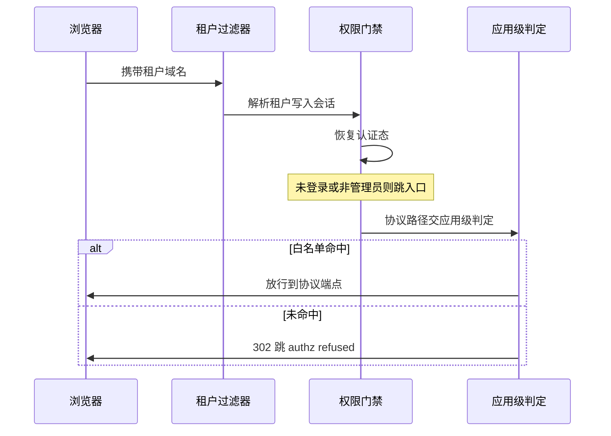
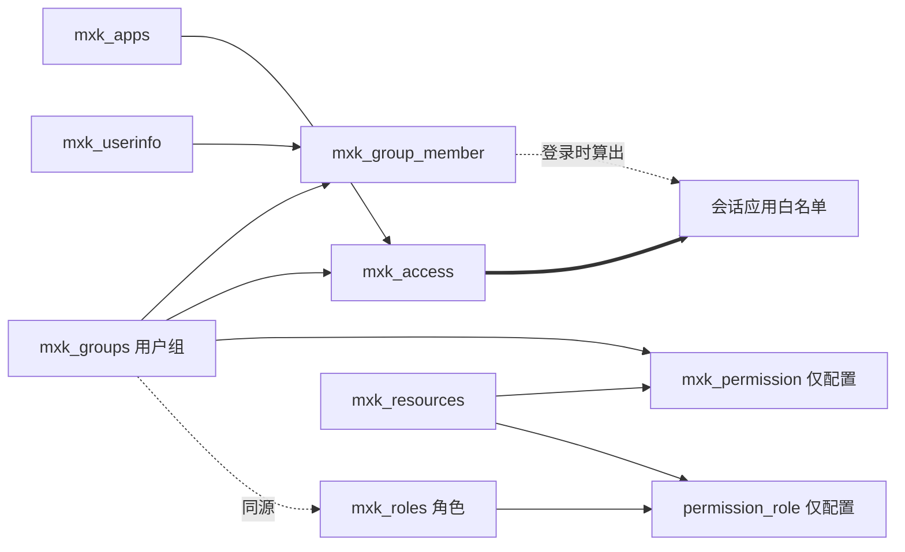
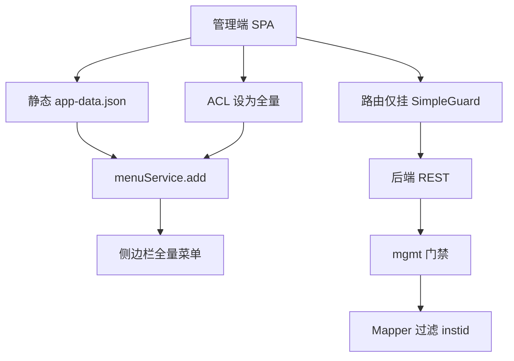

> 解读基线：MaxKey `4.1.12`（`3a3a5c765`）。

## 定位：租户轴、应用轴、资源轴的唯一交点
SSO 只回答**你是谁**，本模块回答**你能进哪个应用、能点哪个菜单、能看哪些数据**。去掉它，SSO 就退化成"全网通行证"——协议端点的放行判定只有一句话：当前用户的应用白名单里有没有这个 App（[maxkey-webs/maxkey-web-maxkey/src/main/java/org/dromara/maxkey/web/interceptor/SingleSignOnInterceptor.java:117-126]()）。
<!-- anchor: SignPrincipal principal = AuthorizationUtils.getPrincipal(); … return false; -->

它也是租户概念的落点：机构表的建表注释写着"存放租户信息 multi-tenancy"，44 张业务表里 36 张携带 `INSTID`（[sql/v4.1.11/maxkey.sql:914-946]()）。
<!-- anchor: CREATE TABLE `mxk_institutions` ( … ) ENGINE=InnoDB DEFAULT CHARSET=utf8mb3 COMMENT='institutions机构表，存放租户信息multi-ten -->

因此它是一个三维交点：**租户轴（Inst）乘应用轴（App）乘资源轴（Resource）**，认证模块只负责产出这个交点的载体 `SignPrincipal`。

## 根因：一套部署要同时承载多类主体与多层权限
| 诉求 | 根因 | MaxKey 的表达方式 |
|---|---|---|
| 集团下多企业独立管理 | 各企业有自己的用户与组织，但不想各起一套实例 | `Inst` 作租户边界，共享表加 `instId` 行级过滤 |
| 企业下部门数据隔离 | 部门是组织树节点，不是部署单元 | `mxk_organizations` 树加动态角色 `orgIdsList`/`filters` |
| 用户能进哪些应用 | 应用数远大于用户数，逐用户授权不现实 | 组（`mxk_groups`）与应用（`mxk_access`）多对多 |

核心取舍是**用"少量宽表加一个租户列"换运维成本**，而不是用"每租户一套 schema"换隔离强度；代价是所有查询都必须自觉带上 `instId`，这既是本模块最大的亮点，也是最大的风险源。

## 租户边界：`mxk_institutions.id` 加全链路行级过滤
44 张表中 36 张带 `INSTID` 列，未带的 8 张全部是配置型或临时型表（`mxk_apps_adapters`、`mxk_cnf_password_policy`、`mxk_file_upload`、`mxk_register`、`mxk_remember_me` 等），关键业务表均为 `NOT NULL`（[sql/v4.1.11/maxkey.sql:25-33]()）。
<!-- anchor: CREATE TABLE `mxk_access` ( … ) ENGINE=InnoDB DEFAULT CHARSET=utf8mb3; -->

`instId` 由 MyBatis 字段自动填充器在 insert 时从当前 `SignPrincipal` 取出写入，业务代码无须手工赋值（[maxkey-authentications/maxkey-authentication-core/src/main/java/org/dromara/maxkey/authn/web/PersistFieldAutoFillHandler.java:27-35]()）。
<!-- anchor: @Component … this.setFieldValue(metaObject , "instId", principal.getInstId()); -->

这是共享表方案能否长期成立的关键前提：把"租户不能忘"从人的自觉降级为框架的默认行为。

管理端控制器统一用 `@CurrentUser UserInfo` 注入操作者，再把 `currentUser.getInstId()` 写回查询条件——**租户作用域来自登录者本身，而不是客户端可传的租户选择参数**（[maxkey-webs/maxkey-web-mgt/src/main/java/org/dromara/maxkey/web/permissions/controller/RolesController.java:63-68]()）。
<!-- anchor: @GetMapping(value = { "/fetch" }, produces = {MediaType.APPLICATION_JSON_VAL … role.setInstId(currentUser.getInstId()); -->

写读分离、两处都要正确，而**写入是自动的、读取是手工的**，因此越权只可能出现在"读"这一侧。租户识别本身按 `hostname` 头、`host` 头、配置的 `domainName` 的优先级解析，截掉端口后塞进 Session 供后续查询复用，而不是切换数据源。

机构查询同时匹配 `id`、`domain`、`consoledomain` 三列，即一个租户可同时拥有用户门户与控制台两个域名；域名查不到时回落到硬编码的 `DEFAULT_INSTID = "1"`，实现单租户开箱即用。

## 两套并行的 RBAC，只有一套真正生效
代码里有两条互不相交的授权链，`mxk_roles` 与 `mxk_groups` 是**同构的孪生表**，而不是"角色包含组"的层级关系。

### 运行时生效的那一套：组到应用
`grantAuthority()` 把用户的**组**翻译成 Spring Security 的 `GrantedAuthority`，其中 `groupcode` 以 `ROLE_` 开头的组被额外注入为角色（[maxkey-persistence/src/main/java/org/dromara/maxkey/persistence/service/impl/LoginServiceImpl.java:347-365]()）。
<!-- anchor: public List<GrantedAuthority> grantAuthority(UserInfo userInfo) { … return grantedAuthority; -->

也就是说，**运行时的"角色"就是 `mxk_groups` 中 `groupcode` 以 `ROLE_` 开头的组**，`mxk_roles` 完全没有参与。应用白名单同样是"应用乘访问授权乘组"三表连接算出来的，并把 `ROLE_ALL_USER` 作为隐式第一条授权，使"全员可见应用"不必逐租户配置（[maxkey-persistence/src/main/java/org/dromara/maxkey/persistence/service/impl/LoginServiceImpl.java:312-327]()）。
<!-- anchor: public List<GrantedAuthority> queryAuthorizedApps(List<GrantedAuthority> granted … return listAuthorizedApps; -->

这条 SQL **不含 `instId` 条件**，隔离是隐式达成的：`mxk_groups` 与 `mxk_access` 都带 `instId`，而组 ID 已是租户内唯一的，跨租户串组被 ID 空间隔开——属隐式隔离，是复核时的重点。

### 只做台账的那一套：角色到资源动作
`mxk_roles`、`mxk_permission`、`mxk_permission_role`、`mxk_resources` 四张表构成完整的经典 RBAC，并有完整的增删改管理接口。但全仓检索下来，**没有任何运行时消费者读这四张表做判定**：拦截器不查 `mxk_permission`，管理端也不按资源判定。它记录的是"某组或某角色在某应用下拥有某资源"这一事实，等着下游应用或未来版本去消费。关键旁证是 `mxk_roles` 的建表注释直接写着 `'groups'`，它们是从 `mxk_groups` 复制演化而来的语义重命名（[sql/v4.1.11/maxkey.sql:1313-1332]()）。
<!-- anchor: CREATE TABLE `mxk_roles` ( … ) ENGINE=InnoDB DEFAULT CHARSET=utf8mb3 COMMENT='groups'; -->

`category = dynamic` 的角色不带静态成员，而是保存 `filters`（过滤条件 SQL 片段）与 `orgIdsList`（机构列表），刷新时反查出成员写进 `mxk_role_member`，成员 `type` 记为 `USER-DYNAMIC`，拼接前会做 SQL 注入检查（[maxkey-persistence/src/main/java/org/dromara/maxkey/persistence/service/impl/RolesServiceImpl.java:65-99]()）。
<!-- anchor: public void refreshDynamicRoles(Roles dynamicRole){ … roleMemberService.addDynamicRoleMember(dynamicRole); -->

这是"部门数据隔离"从硬编码规则变成可配置项的落点，但它是**配置出来的行为**，不是默认强制的行为。

## 应用级授权：算一次、存会话、按 ID 判成员
登录成功后 `createOnlineTicket()` 一次性算出可访问应用列表塞进 principal（[maxkey-authentications/maxkey-authentication-provider-mgt/src/main/java/org/dromara/maxkey/authn/provider/AbstractAuthenticationProvider.java:120-133]()）。
<!-- anchor: SignPrincipal principal = new SignPrincipal(userInfo,session); … principal.setGrantedAuthorityApps(authenticationRealm.queryAuthorizedApps(grantedAuthoritys)); -->

消费侧先从 URL 反解目标应用（CAS 走 service 参数、OAuth 走 `client_id`、其余协议取 URL 末段），再用 `contains(new SimpleGrantedAuthority(app.getId()))` 做集合成员判定，未命中则 302 到 `/authz/refused`。这是**白名单加 ID 等值**模型：判定是纯内存操作，代价是快照无法即时反映授权回收。

快照随 principal 存进 Session，Redis 实现默认有效期 30 分钟，这决定了**授权变更的生效延迟上限等于会话剩余寿命**（[maxkey-authentications/maxkey-authentication-core/src/main/java/org/dromara/maxkey/authn/session/impl/RedisSessionManager.java:36-36]()）。
<!-- anchor: protected int validitySeconds = 60 * 30; //default 30 minutes. … protected int validitySeconds = 60 * 30; //default 30 minutes. -->

顺带一处口径不一致：`Apps` 定义了 `VISIBLE`（`HIDDEN`、`ALL`、`INTERNET`、`INTRANET`），前端表单也提供这四个选项，但检索 `VISIBLE.` 与 `getVisible()` 的调用点，**Java 业务侧无任何消费者**，真正的可见范围完全由 `mxk_access` 决定（[maxkey-entity/src/main/java/org/dromara/maxkey/entity/apps/Apps.java:51-55]()）。
<!-- anchor: public static final class VISIBLE { … public static final int INTRANET = 3; -->

## 操作级鉴权：`PermissionInterceptor` 只是一道粗门禁
`preHandle` 的全部逻辑只有两步：恢复认证态，取不到 principal 就 forward 到 `/auth/entrypoint`；若 `mgmt == true` 且 `!principal.isRoleAdministrators()`，同样 forward 到入口页（[maxkey-authentications/maxkey-authentication-core/src/main/java/org/dromara/maxkey/authn/web/interceptor/PermissionInterceptor.java:61-82]()）。
<!-- anchor: public boolean preHandle(HttpServletRequest request,HttpServletResponse response, Object handler) … return true; -->

**没有注解解析、没有 URL 到权限码的映射、没有 `@PreAuthorize`**——全仓检索 `hasPermission`、`isPermitted`、`@PreAuthorize`，产品代码中零命中。`mgmt` 开关由管理端 MVC 配置一次性打开，统一挂到 `/permissions/**`、`/users/**`、`/config/**`、`/historys/**` 等全部管理路径上（[maxkey-webs/maxkey-web-mgt/src/main/java/org/dromara/maxkey/autoconfigure/MaxKeyMgtMvcConfig.java:51-53]()）。
<!-- anchor: permissionInterceptor.setMgmt(true); … registry.addInterceptor(permissionInterceptor) -->

失败语义值得注意：管理端未登录或非管理员是服务端 forward 到入口页并 `return false`，**不返回 401 或 403**；协议层无应用授权才是 302 到 `/authz/refused`。结论是它只提供**垂直门禁（是不是管理员）**，不含垂直细分，也不含水平数据范围——`ROLE_ADMINISTRATORS` 是进管理端的钥匙，一旦持有即拥有该租户管理端的全部接口。

## 数据权限与功能权限的分离程度
| 维度 | 是否分离 | 落地位置 |
|---|---|---|
| 租户数据隔离 | 是，独立成层 | 拦截器解析租户、控制器 `@CurrentUser` 赋值、mapper `where instid` |
| 应用级功能权限 | 是，独立成层 | `grantedAuthorityApps` 白名单加应用级拦截器 |
| 管理端功能权限 | 否 | 单一 `mgmt` 布尔位加 `roleAdministrators`，无按资源或操作的判定 |
| 机构部门级数据权限 | 有建模，未定位到强制过滤 | 组织树与 `Roles.orgIdsList` 存在，但列表查询只按 `instId` 过滤 |

隔离能成立的前提是租户作用域取自服务端会话：`@CurrentUser` 的注入源是 Session 中的 `Authentication`，无法被请求参数覆盖（[maxkey-authentications/maxkey-authentication-core/src/main/java/org/dromara/maxkey/authn/web/AuthorizationUtils.java:144-145]()）。
<!-- anchor: public static SignPrincipal getPrincipal(Authentication authentication) { … return authentication == null ? null : (SignPrincipal) authentication.getPrincipal(); -->

## 审计链路：登录、访问应用、操作三段留痕
**登录史** `mxk_history_login` 记录会话、登录结果、IP 与地理定位四元组、浏览器与平台、登录登出时间，并带 `instId`；地理字段由 IP 定位组件填充，支持 Ip2region 或 GeoIP2 离线库二选一（[maxkey-entity/src/main/java/org/dromara/maxkey/entity/history/HistoryLogin.java:44-80]()）。
<!-- anchor: private static final long serialVersionUID = -1321470643357719383L; … String platform; -->

**应用访问史** `mxk_history_login_apps` 在每次成功访问时写一条会话加应用的记录，构成"谁在哪个会话访问过哪些应用"的追溯链；**操作日志** `mxk_history_system_logs` 记录对象类型、动作、结果与**原对象 JSON 快照**，`instId` 取自操作者（[maxkey-persistence/src/main/java/org/dromara/maxkey/persistence/service/impl/HistorySystemLogsServiceImpl.java:86-93]()）。
<!-- anchor: systemLog.setMessageAction(action); … systemLog.setExecuteTime(new Date()); -->

## 关键数据结构
`mxk_institutions.id` 既是主键也是 `instId` 的取值域，另有 `domain`（唯一，门户域名）、`consoleDomain`、`frontTitle`、`logo`、`defaultUri`：把**品牌、登录入口、默认落地页**内聚到机构行，多租户因此不需要多套前端（[maxkey-entity/src/main/java/org/dromara/maxkey/entity/Institutions.java:69-81]()）。
<!-- anchor: @Column … private String defaultUri; -->

`Roles` 的 `category` 三值（`dynamic`、`static`、`app`）是理解角色表的关键：同一张表同时扮演静态角色、动态用户组与应用账号组（[maxkey-entity/src/main/java/org/dromara/maxkey/entity/permissions/Roles.java:62-89]()）。
<!-- anchor: @Column … private String instName; -->

`Permission` 用 `appId` 加 `groupId` 加 `resourceId` 表达"某组在某应用下拥有某资源"，`PermissionRole` 是同结构的角色版本；授权删除是 `status = 9` 的 UPDATE 而非 DELETE（[maxkey-persistence/src/main/resources/org/dromara/maxkey/persistence/mapper/xml/mysql/PermissionMapper.xml:33-40]()）。
<!-- anchor: <update id="deleteGroupPrivileges" parameterType="java.util.List"> … </update> -->

`mxk_permission` 的建表语句**没有定义 PRIMARY KEY**，而同一文件里 `mxk_permission_role`、`mxk_access`、`mxk_role_member` 都定义了，库层没有唯一性兜底（[sql/v4.1.11/maxkey.sql:1125-1134]()）。
<!-- anchor: CREATE TABLE `mxk_permission` ( … ) ENGINE=InnoDB DEFAULT CHARSET=utf8mb3; -->

`Resources` 用 `parentId` 自关联成树，**"菜单"只是 `resourceType = MENU` 的一种资源**，与服务端保护目标共用一张表；但 `resourceType` 的取值只定义在前端下拉框里，Java 侧没有枚举常量，服务端无法校验也无法据此判定（[maxkey-web-frontend/maxkey-web-mgt-app/src/app/routes/permissions/resources/resource-editer/resource-editer.component.html:25-33]()）。
<!-- anchor: <nz-select [(ngModel)]="form.model.resourceType" [ngModelOptions]="{ standalone: true }" name="resourceType" id="resourceType"> … <nz-option nzValue="OTHER" nzLabel="{{ 'mxk.resources.resourceType.OTHER' | i18n }}"></nz-option> -->

## 一次受保护资源的鉴权链路

两道闸串联但职责不同：门禁管"有没有登录、是不是管理员"，应用级判定管"能不能访问这个 App"。**整条链路没有任何一处读 `mxk_permission`**，这就是配置态 RBAC 与运行时判定之间断层的可视化证据。

## 授权模型全景：两条链的差异

链 A 的边（`mxk_access`）在登录时被物化成会话白名单，是快照式的，也是唯一被运行时消费的一条；链 B 的边只存在于数据库，没有任何运行时消费者。虚线边表示 `mxk_groups` 与 `mxk_roles` 名不同而结构同源。

## 前端菜单与权限的下发方式

`aclService.setFull(true)` 显式授予全量 ACL，菜单来自打包进 SPA 的静态 `app-data.json`，路由层 `SimpleGuard` 之外没有任何 `acl` 数据或权限守卫（[maxkey-web-frontend/maxkey-web-mgt-app/src/app/core/startup/startup.service.ts:68-70]()）。
<!-- anchor: this.aclService.setFull(true); … this.menuService.add(appData.menu); -->

因此**前端不构成权限边界**：真正的边界只有后端的两处（门禁与行级过滤），前端显隐只影响体验，把菜单可见性当作权限控制会得到"看着没有、实际能调"的错觉（路由侧同样只有登录态守卫，见 [maxkey-web-frontend/maxkey-web-mgt-app/src/app/routes/routes-routing.module.ts:33-34]()）。
<!-- anchor: canActivate: [SimpleGuard], … canActivateChild: [SimpleGuard], -->

## 与其他模块的协同
- **认证模块**产出的 `SignPrincipal` 里，`instId`、`grantedAuthority`、`grantedAuthorityApps`、`roleAdministrators` 就是本模块全部判定的输入，它随 `Authentication` 双向序列化进 Session（[maxkey-authentications/maxkey-authentication-provider-mgt/src/main/java/org/dromara/maxkey/authn/provider/AbstractAuthenticationProvider.java:148-156]()）。
<!-- anchor: session.setAuthentication(authenticationToken); … return authenticationToken; -->
- **协议层**六类端点在应用级拦截器统一收口，读的是同一个白名单；OAuth2 另一条登录路径 `OAuth2UserDetailsService` 自行补齐了同样的 principal 字段，属平行实现，两处需同步维护（[maxkey-protocols/maxkey-protocol-oauth-2.0/src/main/java/org/dromara/maxkey/authz/oauth2/provider/OAuth2UserDetailsService.java:60-66]()）。
<!-- anchor: principal.setRoleAdministrators(true); … principal.setGrantedAuthorityApps(grantedAuthoritys); -->
- **`maxkey-starter-web`** 是租户上下文的唯一来源且不属于任何控制器，绕过 Session 的调用（开放 API、SCIM 同步）不会自动获得租户上下文；**`maxkey-persistence`** 则承载了全部落地，写入自动、读取手工。

## 关键设计决策与代价
### 共享表加行级过滤，而不是每租户一套 schema
收益是一张机构表就是全部租户目录，新增租户是一次 INSERT，跨租户统计与动态角色全量刷新都变平凡；代价是隔离强度依赖每一处查询的自觉性，本模块已定位到多处漏写 `instId` 的端点。替代方案是每租户独立 schema，隔离由数据库层强制，但租户数会线性放大 DDL 维护成本，且现有硬编码 SQL 常量全部要改成动态表名，改动面远超收益。

### 授权快照存会话，而不是每次查库
收益是应用判定退化成纯内存的 `List.contains`，SSO 这种高频路径零数据库开销；代价是授权回收有延迟，最长约等于会话有效期（Redis 默认 30 分钟），且未定位到白名单的主动失效入口。折中方案是在授权变更时按 `instId` 批量失效该租户会话，这是本模块最值得优先补齐的一处。

### 配置态 RBAC 与管理端门禁分离
收益是资源树加权限三元组是面向被保护应用的通用模型，资源树又天然表达菜单层级，一套数据两用；代价是 MaxKey 自身不消费它，于是"看起来有细粒度 RBAC，实际上是台账"。替代方案是把 `resourceUrl` 与 `permission` 接入拦截器做成 URL 到权限码的映射，即可把台账变成强制边界。

## 风险：跨租户读写的具体入口
- **R1 角色详情越权读**：`/get/{id}` 直接调 `rolesService.get(id)`，没有 `instId` 条件，A 租户管理员可读到 B 租户的角色详情（[maxkey-webs/maxkey-web-mgt/src/main/java/org/dromara/maxkey/web/permissions/controller/RolesController.java:84-87]()）。
<!-- anchor: @GetMapping(value = { "/get/{id}" }, produces = {MediaType.APPLICATION_JSON_ … return new Message<>(role); -->
- **R2 角色批量删除越权**：`/delete` 走 `deleteBatch(ids)`，只排除了 `ROLE_ALL_USER` 等三个魔法 ID，未按 `instId` 约束（[maxkey-webs/maxkey-web-mgt/src/main/java/org/dromara/maxkey/web/permissions/controller/RolesController.java:135-139]()）。
<!-- anchor: @DeleteMapping(value={"/delete"}, produces = {MediaType.APPLICATION_JSON_VAL … if (rolesService.deleteBatch(ids)) { -->
- **R3 用户详情与删除越权**：`/get/{id}` 直接调 `userInfoService.get(id)`，`/delete` 走 `deleteBatch(ids)`，两者都无租户条件（[maxkey-webs/maxkey-web-mgt/src/main/java/org/dromara/maxkey/web/idm/controller/UserInfoController.java:100-102]()）。
<!-- anchor: @GetMapping(value = { "/get/{id}" }, produces = {MediaType.APPLICATION_JSON_ … UserInfo userInfo=userInfoService.get(id); -->
- **R3 续**：同一个文件的删除接口重复了同一问题（[maxkey-webs/maxkey-web-mgt/src/main/java/org/dromara/maxkey/web/idm/controller/UserInfoController.java:167-170]()）。
<!-- anchor: public Message<?> delete(@RequestParam List<String> ids,@CurrentUser UserInf … if (userInfoService.deleteBatch(ids)) { -->
- **R4 资源删除越权**：`/delete` 同样只取 `ids`，未按 `instId` 约束（[maxkey-webs/maxkey-web-mgt/src/main/java/org/dromara/maxkey/web/permissions/controller/ResourcesController.java:125-127]()）。
<!-- anchor: public Message<?> delete(@RequestParam List<String> ids,@CurrentUser UserInf … if (resourcesService.deleteBatch(ids)) { -->

四个入口的共同形态是：**列表页正确地按 `instId` 过滤了，但按主键操作的详情与删除接口漏了最后一道条件**。在共享表模型下，这等价于一个已登录的租户管理员可以读写任意其他租户的角色、用户与资源。

## 风险：其余结构性问题
- **垂直越权**：没有资源级判定，任意 `ROLE_ADMINISTRATORS` 都能调用全部管理接口，包括机构配置、密码策略与会话强退。
- **隐式隔离的脆弱性**：应用白名单 SQL 不含 `instId`，隔离完全依赖组 ID 在租户内唯一；一旦出现跨租户复制组 ID 的场景（数据导入、租户克隆、同步器写入），隔离即失效。
- **配置误导与弱约束**：`Apps.visible` 有 UI 无消费者，`resourceType` 无服务端枚举约束，这类字段会让人误判配置已生效，也会让未来基于它的判定不可信。

## 核对仓库宣传口径
| 宣传口径 | 核对结论 |
|---|---|
| "提供 RBAC 权限管理和资源管理" | 部分成立：四张表与完整 CRUD 界面俱在，作为管理能力成立；但无运行时强制点，权限管理未转化为权限控制 |
| "多租户，支持集团下多企业独立管理或企业下不同部门数据隔离" | 成立但有前提：租户级隔离证据充分；部门隔离依赖动态角色的 `orgIdsList` 与 `filters` 配置，不是开箱即用的强制行为 |
| "Ip2region 或 GeoLite2 地理库、安全审计、全生命周期审计与追溯" | 成立：两种离线库可配置切换，登录史、应用访问史、操作日志三表齐备 |
