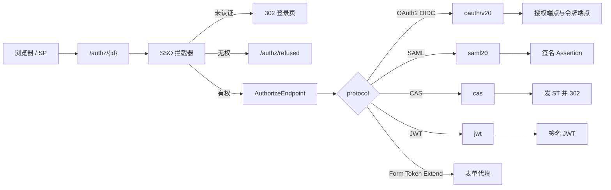
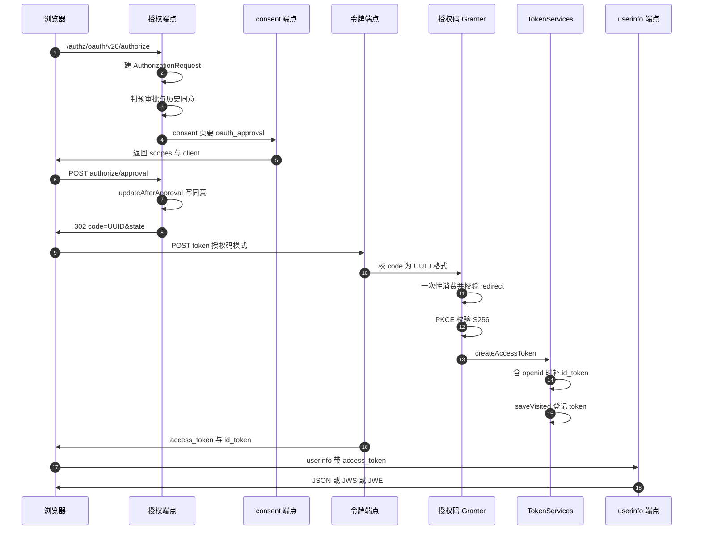

> 解读基线：MaxKey `4.1.12`（`3a3a5c765`）。

## 关注面定位：出口侧的协议翻译器

MaxKey 的认证核心只认一种身份：会话里的 `SignPrincipal`（内含 `UserInfo`）。而它要对接的每一个第三方系统只认自己那一套协议。协议适配层就是这两者之间唯一的出口侧翻译器——认证完成后，由它把内部身份渲染成对方能验签、能解析的报文。端点取到身份后做的第一件事，就是把它从 `SignPrincipal` 展开成协议视角的 `userInfo`（[maxkey-protocols/maxkey-protocol-authorize/src/main/java/org/dromara/maxkey/authz/endpoint/adapter/AbstractAuthorizeAdapter.java:130-132]()）。
<!-- anchor: public void setPrincipal(SignPrincipal principal) { … this.userInfo = principal.getUserInfo(); -->

这一层同时承担两件容易被混为一谈的事：**认证**（判断"你是谁"，由 `maxkey-authentications` 负责）与**授权凭证发放**（把"你是谁"翻译成"某协议认可的凭证"，由本模块负责）。模块内部并不做统一的授权判定：能否访问某个应用交给 web 层的单点拦截器，本次请求能拿到哪些 scope 或属性交给各协议端点。这个分工是理解本模块所有代码的前提。

## 根因：协议碎片化，出口必须收敛

根因不是"协议很多"，而是协议之间没有任何公共抽象。OAuth2 的产物是可被 introspection 的不透明串或 JWT；SAML 2.0 的产物是必须 XML-DSig 签名的断言；CAS 的产物是一次性票据加文本/XML 校验响应；FormBased 的产物是"替用户向目标站点 POST 一次表单"这种**行为**而非数据；ExtendApi 的产物是按某厂商约定拼出的签名 URL。它们连响应类型都不一致（token / XML / 表单提交 / 302 / Cookie），因此无法用统一的 `ProtocolHandler` 接口抹平。

MaxKey 的选择是**保留每种协议的固有形态，只在最上层做入口收敛和身份注入**。这个选择直接决定了两条结构特征：全部协议共用一个入口 `/authz/{id}`；每种协议各自保留端点、数据模型与适配器基类。

## 单入口 `/authz/{id}`：注册项即路由表

`AuthorizeEndpoint` 是唯一的对外入口，签名只有 `(HttpServletRequest, @PathVariable String id)`：先取应用注册项，再按 `app.getProtocol()` 分发出七条真实出口，最后把 `ModelAndView` 抛给 Spring MVC（[maxkey-protocols/maxkey-protocol-authorize/src/main/java/org/dromara/maxkey/authz/endpoint/AuthorizeEndpoint.java:56-85]()）。
<!-- anchor: public ModelAndView authorize(HttpServletRequest request,@PathVariable String id … return modelAndView; -->

分发本身是一串扁平的 `if/else`：`Extend_API`、`Form_Based`、`OAuth_v2.0`、`OpenID_Connect_v1.0`、`SAML_v2.0`、`Token_Based`、`CAS`、`JWT` 各对应一个 `WebContext.forward`，而 `OAuth_v2.1` 与 `Basic` 只做 `WebContext.redirect(app.getLoginUrl())`。最后两个分支值得单独指出：**它们把登录地址完全交给管理员在应用注册项里手填，框架不再拼装**—— OAuth 2.1 在这条路径上没有自己的端点，`Basic` 更没有——这是"中央 switch"式分发的语义漏洞：新增一个没有专属端点的协议时，只能靠约定去裸跳转。

同一个基类还承担了超出"协议"范畴的**凭证绑定**：`getAccounts(app, userInfo)` 依据 `app.getCredential()` 在 `USER_DEFINED`（查 `mxk_accounts` 并解密用户自设密码）、`SHARED`（应用级共享账号）、`SYSTEM`（按 `systemUserAttr` 从用户属性派生用户名）、`NONE`（用户名当密码）之间分支（[maxkey-protocols/maxkey-protocol-authorize/src/main/java/org/dromara/maxkey/authz/endpoint/AuthorizeBaseEndpoint.java:80-102]()）。这说明本模块的边界比"协议翻译"更宽，它同时是**以应用为中心的凭证编排器**，FormBased／ExtendApi／TokenBased 这些代填型协议都依赖它。
<!-- anchor: if(loadApp.getCredential().equalsIgnoreCase(Apps.CREDENTIALS.USER_DEFINED)){ … return account; -->

### 每个协议端点的共同骨架

抛开协议差异，各端点几乎都是同一套五步：取注册项、取协议明细、把 `adapter`/`isAdapter` 回填到明细对象、按需用反射实例化管理员配置的适配器、`setPrincipal` 后依次调用 `generateInfo()` →（可选）`sign()`／`encrypt()` → `authorize(modelAndView)`。JWT 端点是最干净的样板，最后一步把组装好的视图直接返回（[maxkey-protocols/maxkey-protocol-jwt/src/main/java/org/dromara/maxkey/authz/jwt/endpoint/JwtAuthorizeEndpoint.java:98-102]()）。
<!-- anchor: adapter.generateInfo(); … adapter.encrypt(null, jwtDetails.getAlgorithmKey(), jwtDetails.getAlgorithm()); -->

## OAuth2：不是自研，是 Spring Security OAuth 的私有分支

这是本模块最需要说清的血缘问题：OAuth2 部分是把 Spring Security OAuth（含 spring-security-jwt）整体 fork 进仓库后改名、裁剪、局部重写的私栈——不是自研实现，也不是"依赖上游库"。

两条相互独立的证据。其一是**许可证头与作者署名未被清除**：`AuthorizationEndpoint` 保留 `Copyright 2002-2011 the original author or authors` 与 `@author Dave Syer`（[maxkey-protocols/maxkey-protocol-oauth-2.0/src/main/java/org/dromara/maxkey/authz/oauth2/provider/endpoint/AuthorizationEndpoint.java:2-92]()）；`DefaultTokenServices` 保留 `Copyright 2008 Web Cohesion` 与 Ryan Heaton、Luke Taylor、Dave Syer 的署名（[maxkey-protocols/maxkey-protocol-oauth-2.0/src/main/java/org/dromara/maxkey/authz/oauth2/provider/token/DefaultTokenServices.java:2-62]()）。
<!-- anchor: * Copyright 2002-2011 the original author or authors. … * @author Crystal.sea 2022-04-14 -->
<!-- anchor: * Copyright 2008 Web Cohesion … * @author Dave Syer -->

其二是**包结构与上游 1:1 对应**：`provider/endpoint`、`provider/token`、`provider/code`、`provider/approval`、`provider/implicit`、`jwt` 下的编解码与签名工具。其三是**端点注册方式被整体换掉**：上游由 `@FrameworkEndpoint` 加 Spring Security 过滤器链驱动，这里全部改成普通 `@Controller`，并为令牌端点单独注册一个过滤器 Bean 来补客户端 Basic 认证（[maxkey-protocols/maxkey-protocol-oauth-2.0/src/main/java/org/dromara/maxkey/autoconfigure/Oauth20AutoConfiguration.java:83-92]()）。
<!-- anchor: FilterRegistrationBean<Filter> tokenEndpointAuthenticationFilter() { … return registration; -->

### fork 的代价，与它换来的收益

代价的第一项是**安全补丁责任自担**。`DefaultRedirectResolver` 仍在使用被上游后续版本重写掉的宽松匹配语义（[maxkey-protocols/maxkey-protocol-oauth-2.0/src/main/java/org/dromara/maxkey/authz/oauth2/provider/endpoint/DefaultRedirectResolver.java:112-137]()）：在 `matchSubdomains` 默认为真时以 `requested.endsWith(registered)` 判断主机，注册 `https://example.com` 会匹配 `https://evilexample.com`；路径侧则接受任意前缀匹配。授权码换令牌时还会用另一套更松的规则复查一次（[maxkey-protocols/maxkey-protocol-oauth-2.0/src/main/java/org/dromara/maxkey/authz/oauth2/provider/code/AuthorizationCodeTokenGranter.java:94-115]()），那里只做 `startsWith` 前缀比较，不解析主机。
<!-- anchor: protected boolean redirectMatches(String requestedRedirect, String redirectUri)  … return registered.equals(requested); -->
<!-- anchor: Set<String> redirectUris = client.getRegisteredRedirectUri(); … throw new RedirectMismatchException("Redirect URI mismatch."); -->

代价的第二项是**令牌值被降级为 UUID**。令牌端点显式要求授权码是 UUID 格式，否则抛 `InvalidRequestException`（[maxkey-protocols/maxkey-protocol-oauth-2.0/src/main/java/org/dromara/maxkey/authz/oauth2/provider/endpoint/TokenEndpoint.java:169-178]()）；userinfo 端点同样先用 UUID 正则校验 access_token。这意味着 OAuth2 的"令牌"本质上是一个随机串加一次存储查表，安全性完全依赖存储边界，而不是密码学。
<!-- anchor: token = getTokenGranter().grant(tokenRequest.getGrantType(), tokenRequest); … return getResponse(token); -->

代价的第三项是**技术栈分裂**：同一份代码里并存 Spring Security 的认证体系与 MaxKey 自己的会话体系，桥接点零散到要靠类型判断兜底。例如取 clientId 时要同时处理 `OAuth2Authentication` 与用户名密码令牌两种 principal（[maxkey-protocols/maxkey-protocol-oauth-2.0/src/main/java/org/dromara/maxkey/authz/oauth2/provider/endpoint/TokenEndpoint.java:186-217]()）。
<!-- anchor: protected String getClientId(Authentication principal) { … return clientId; -->

收益同样明确：细粒度扩展点全部可控。PKCE 就是直接改在授权码 granter 里的，`S256` 走 URL 安全摘要，校验失败抛异常（[maxkey-protocols/maxkey-protocol-oauth-2.0/src/main/java/org/dromara/maxkey/authz/oauth2/provider/code/AuthorizationCodeTokenGranter.java:141-145]()）。
<!-- anchor: codeVerifier = DigestUtils.digestBase64Url(codeVerifier,DigestUtils.Algorithm.SH … throw new OAuth2Exception("code_verifier not match."); -->

客户端模型则落在 MaxKey 自己的表上：`JdbcClientDetailsService` 用 JdbcTemplate 直读 OAuth 客户端明细表，并用 Caffeine 做本地缓存（[maxkey-protocols/maxkey-protocol-oauth-2.0/src/main/java/org/dromara/maxkey/authz/oauth2/provider/client/JdbcClientDetailsService.java:61-65]()）。于是"应用注册项"与"OAuth client"是靠这张表保持同步的两套并行模型。
<!-- anchor: protected static final   Cache<String, ClientDetails> detailsCache = … .build(); -->

### OIDC：id_token 与 discovery 各自拼装

`id_token` 的生成在 `OIDCIdTokenEnhancer#enhance`：只有 scope 含 `openid` 才增强；`sub` 取认证名、`exp` 跟随 access token、`iss` 取 client 明细、`aud` 取 clientId，`nonce` 从请求原样透传，`at_hash` 只在响应类型含 token 时计算（[maxkey-protocols/maxkey-protocol-oauth-2.0/src/main/java/org/dromara/maxkey/authz/oidc/idtoken/OIDCIdTokenEnhancer.java:83-159]()）。签名同样按客户端决定：`kid` 为 `clientId + "_sig"`，算法与密钥来自 client 明细；`signature` 为空或 `none` 时退回 JWE 加密路径，两者都没有则不产出 id_token，只留下一个未赋值的字符串变量。
<!-- anchor: if (request.getScope().contains(ID_TOKEN_SCOPE)) {//Enhance for OpenID Connect … idTokenString = idToken.serialize(); -->

discovery 文档走的是另一条路：它由上下文路径拼出授权、令牌与 introspection 端点，userinfo 与 end_session 端点写死，无 `client_id` 时给一套只支持 `RS256` 的默认值，方法体从参数解析一路拼到返回（[maxkey-protocols/maxkey-protocol-oauth-2.0/src/main/java/org/dromara/maxkey/authz/oauth2/provider/wellknown/endpoint/OpenidConfigurationEndpoint.java:66-272]()）。而 JWKS 端点的内容是把 client 明细中的公钥字符串拼成 `{"keys":[...]}` 交给密钥库对象序列化（[maxkey-protocols/maxkey-protocol-oauth-2.0/src/main/java/org/dromara/maxkey/authz/oauth2/provider/endpoint/OauthJwksEndpoint.java:91-97]()）——即 JWKS 是"从数据库字符串里拼出来的"，不读真实密钥库。
<!-- anchor: public OpenidConfiguration  configurationMetadata(String instId,String clientId, … return openidConfig; -->
<!-- anchor: if(!StringUtils.hasText(jwkSetString)) { … JWKSetKeyStore jwkSetKeyStore = new JWKSetKeyStore("{\"keys\": [" + jwkSetString -->

这带来一个**配置面与实现面脱节**的一致性风险：`maxkey.oidc.metadata.*` 只驱动 discovery 的默认分支，`iss` 在带 client 时来自 per-client 字段，而被注入到增强器里的 `providerMetadata` 在 `enhance()` 中一次都没用到（[maxkey-protocols/maxkey-protocol-oauth-2.0/src/main/java/org/dromara/maxkey/authz/oidc/idtoken/OIDCIdTokenEnhancer.java:68-77]()）。上游客户端做 discovery 后校验 `id_token.iss`，两者差异会在集成期才暴露。
<!-- anchor: private OIDCProviderMetadata providerMetadata; … this.clientDetailsService = clientDetailsService; -->

userinfo 与 id_token 是两套独立的 claims 构造：前者按 scope 分块填 profile/email/phone/address，并固定塞入机构与在线票据（即 `SignPrincipal` 的 sessionId），响应形态由 client 明细的 `userInfoResponse` 决定（[maxkey-protocols/maxkey-protocol-oauth-2.0/src/main/java/org/dromara/maxkey/authz/oauth2/provider/userinfo/endpoint/UserInfoOIDCEndpoint.java:112-177]()）。值得注意的是 `email_verified` 与 `phone_number_verified` 被硬编码为 `false`，且这里的邮箱取 `workEmail`，与其他协议里 `getEmail()` 的语义并不一致。
<!-- anchor: oAuth2Authentication = oauth20tokenServices.loadAuthentication(access_token); … jwtClaimsSetBuilder.claim("phone_number_verified", false); -->

## 关键数据结构

### Apps 与协议明细表：一个基类加多张明细表

`Apps` 是统一的"应用注册项"基类，承载所有协议共用的字段：登录地址、协议名、凭证模式与凭证、登出地址、适配器开关与适配器类名（[maxkey-entity/src/main/java/org/dromara/maxkey/entity/apps/Apps.java:71-148]()）。各协议明细实体全部继承 `Apps`，只追加协议私有字段：OAuth2 明细带 clientId、clientSecret、scope、回调白名单、签名与加密算法、PKCE 开关；SAML 明细带 entityId、ACS 地址、nameidFormat、绑定方式、加密开关与密钥库；CAS 明细带 service、回调与有效期。
<!-- anchor: private String loginUrl; … private String adapter; -->

设计后果有两面。好处是**任何取明细的服务都顺带拿到注册项全字段**，各协议端点可直接使用 `adapter`、`logoutType` 等属性，这正是"五步骨架"能写得这么短的原因；坏处是同一个应用要写两张表（主表加 OAuth 专用表），而协议明细与 OAuth2 栈里的 `ClientDetails` 是两套并行模型，一致性只能靠写入侧保证；再加上 OAuth 客户端明细的独立 Caffeine 缓存与注册项自身的缓存之间没有失效联动，修改注册项后 OAuth 客户端行为可能滞后于管理界面。

### 可变请求与不可变快照

授权阶段的一次性载体是 `AuthorizationRequest`：`state`、`responseTypes`、`approved`、`redirectUri`、`codeChallenge` 都是可变字段，审批参数用不可修改视图包装，`codeChallengeMethod` 默认 `S256`（[maxkey-protocols/maxkey-protocol-oauth-2.0/src/main/java/org/dromara/maxkey/authz/oauth2/provider/AuthorizationRequest.java:64-167]()）。它由 `createOAuth2Request()` 转换成持久化的只读快照 `OAuth2Request`，随认证态一起进令牌存储。
<!-- anchor: private Map<String, String> approvalParameters = Collections.unmodifiableMap(new … return new OAuth2Request(getRequestParameters(), getClientId(), getAuthorities() -->

这个"可变请求 / 不可变快照"的切分是同意流程能安全落地的前提：授权请求先被创建并做四步校验（响应类型白名单、client_id 非空、redirect_uri 解析、scope 校验），校验通过后进入是否跳过同意页的判断（[maxkey-protocols/maxkey-protocol-oauth-2.0/src/main/java/org/dromara/maxkey/authz/oauth2/provider/endpoint/AuthorizationEndpoint.java:149-219]()），然后被暂存到短期服务里等待用户确认，approve 端点再从暂存区取回原始请求，用户提交的参数无法篡改它。
<!-- anchor: AuthorizationRequest authorizationRequest = getOAuth2RequestFactory().createAuth … return getUserApprovalPageResponse(model, authorizationRequest, (Authentication) -->

### CAS 票据层次：保留了 Apereo CAS 的形状，内部是空壳

这套层次是直接搬来的，但继承下来的行为大多是占位实现。`TicketGrantingTicketImpl.grantServiceTicket` 忽略全部入参直接构造票据（[maxkey-protocols/maxkey-protocol-cas/src/main/java/org/dromara/maxkey/authz/cas/ticket/TicketGrantingTicketImpl.java:135-195]()），其服务列表、代理票据、根票据、链式认证等访问器一律返回 `null` 或 `false`；`ServiceTicketImpl` 的取服务方法返回 `null`，有效性判断因此只会对 `null` 调用匹配（[maxkey-protocols/maxkey-protocol-cas/src/main/java/org/dromara/maxkey/authz/cas/ticket/ServiceTicketImpl.java:92-119]()）。
<!-- anchor: public synchronized ServiceTicket grantServiceTicket(final String id, final Serv … return null; -->
<!-- anchor: public boolean isValidFor(final Service serviceToValidate) { … return null; -->

真正生效的只有**票据 ID 生成加存储**：消费票据通过删除实现一次性语义，票据不存在即抛异常（[maxkey-protocols/maxkey-protocol-cas/src/main/java/org/dromara/maxkey/authz/cas/ticket/RandomServiceTicketServices.java:88-93]()）。也就是说 TGT 复用、代理链这些 CAS 语义在 MaxKey 中事实上不存在，只有 Service Ticket 的一次性被保留。
<!-- anchor: public Ticket consumeTicket(String ticketId) throws Exception{ … return ticket; -->

## 核心流程

### 总览：一个入口，七条出口

### OAuth2 授权码全链路

与认证核心耦合最紧的一处是访问登记：只有 principal 是 `SignPrincipal` 时才登记，登记内容为应用、会话 ID、access token 与 refresh token（[maxkey-protocols/maxkey-protocol-oauth-2.0/src/main/java/org/dromara/maxkey/authz/oauth2/provider/token/DefaultTokenServices.java:95-109]()）。它使得登出时能按会话批量撤销令牌，是跨协议单点登出的数据基础。
<!-- anchor: private void saveVisited(OAuth2Authentication authentication, OAuth2AccessToken  … sessionManager.visited(principal.getSessionId(), visited); -->

### SAML 断言生成与签名

SP-Init 与 IdP-Init 两条入口最后都汇聚到同一个断言端点：前者从真实 AuthnRequest 取 ID 与 ACS 地址，后者用空对象占位（[maxkey-protocols/maxkey-protocol-saml-2.0/src/main/java/org/dromara/maxkey/authz/saml20/provider/endpoint/SingleSignOnEndpoint.java:106-158]()）；选择响应绑定时按 SP 配置在简单签名 POST 与 POST 之间切换。IdP-Init 分支直接塞入一个空的请求信息对象，于是下游生成主体确认数据时 `inResponseTo` 为 `null`（[maxkey-protocols/maxkey-protocol-saml-2.0/src/main/java/org/dromara/maxkey/authz/saml20/provider/endpoint/IdpInitEndpoint.java:118-118]()）。
<!-- anchor: extractSaml20Detail(extractBindingAdapter,appId); … if(binding.endsWith("PostSimpleSign")){ -->
<!-- anchor: bindingAdapter.setAuthnRequestInfo(new AuthnRequestInfo()); -->

断言端点从会话取回绑定适配器，组装属性（固定写入在线票据即会话 ID）后生成响应并由适配器直接写回（[maxkey-protocols/maxkey-protocol-saml-2.0/src/main/java/org/dromara/maxkey/authz/saml20/provider/endpoint/AssertionEndpoint.java:67-98]()）。断言主体的组装集中在生成器：按 SP 配置的 nameidFormat 生成 Subject，再拼 Issuer、认证语句、属性语句、条件与 ID（[maxkey-protocols/maxkey-protocol-saml-2.0/src/main/java/org/dromara/maxkey/authz/saml20/provider/xml/AssertionGenerator.java:77-123]()）。
<!-- anchor: bindingAdapter = (BindingAdapter) request.getSession().getAttribute( … bindingAdapter.sendSAMLMessage(authResponse, endpoint, request,response); -->
<!-- anchor: public Assertion generateAssertion( … assertion.setConditions(conditions); -->

nameidFormat 支持持久化、瞬态、邮箱、Windows 域名限定名以及若干自定义格式（[maxkey-protocols/maxkey-protocol-saml-2.0/src/main/java/org/dromara/maxkey/authz/saml20/provider/xml/SubjectGenerator.java:52-98]()）。需要加密时用 AES128 内容加密配合 RSA 1.5 密钥传输，用 SP 的证书包裹断言（[maxkey-protocols/maxkey-protocol-saml-2.0/src/main/java/org/dromara/maxkey/authz/saml20/provider/xml/AuthnResponseGenerator.java:73-103]()）。
<!-- anchor: String nameIdValue = userInfo.getUsername(); … NameID nameID = builderNameID(nameIdValue,assertionConsumerURL,nameIDType); -->
<!-- anchor: Assertion assertion = assertionGenerator.generateAssertion( … EncryptedAssertion encryptedAssertion = encrypter.encrypt(assertion); -->

### CAS 校验：发票与三种响应

发票侧先按 `service` 反查应用明细，再把明细参数与本次请求参数合并，转发到内部授权端点（[maxkey-protocols/maxkey-protocol-cas/src/main/java/org/dromara/maxkey/authz/cas/endpoint/CasAuthorizeEndpoint.java:64-127]()）；该端点构造 Service Ticket 并入库，票据有效期来自 CAS 明细，只有退化为 back-channel 登出时才把票据登记到会话。
<!-- anchor: AppsCasDetails  casDetails = casDetailsService.get(queryService , true); … String ticket = ticketServices.createTicket(serviceTicket,casDetails.getExpires( -->

校验侧提供 CAS 1.0、2.0 与 3.0 三套响应。2.0 的流程是：校验票据前缀后一次性消费，取回票据中的认证态（[maxkey-protocols/maxkey-protocol-cas/src/main/java/org/dromara/maxkey/authz/cas/endpoint/validate/Cas20AuthorizeEndpoint.java:188-224]()）；随后按适配器配置反射实例化自定义适配器、注入响应构造器、由适配器填充属性。默认适配器把展示名、姓名、职务、部门等字段做 base64 前缀编码以规避中文与特殊字符问题，并写入在线票据（[maxkey-protocols/maxkey-protocol-cas/src/main/java/org/dromara/maxkey/authz/cas/adapter/CasDefaultAdapter.java:49-51]()）。
<!-- anchor: if(ticket.startsWith(CasConstants.PREFIX.SERVICE_TICKET_PREFIX)) { … adapter.generateInfo(); -->
<!-- anchor: String user = getValueByUserAttr(userInfo,((AppsCasDetails)this.app).getCasUser( … serviceResponseBuilder.success().setUser(user); -->

响应本身是**手工拼字符串**：XML 分支用 `StringBuilder` 逐个 append 出服务响应、认证成功、用户与属性节点，不做 XML 转义（[maxkey-protocols/maxkey-protocol-cas/src/main/java/org/dromara/maxkey/authz/cas/response/ServiceResponseBuilder.java:52-92]()）。
<!-- anchor: public String  serviceResponseXmlBuilder() { … return responseResult.toString(); -->

## 安全边界

最硬的一条判断是**CAS Service Ticket 与 `service` 不绑定**。校验端点只消费票据、不比对请求里的 `service` 是否等于发票时的 service，CAS 规范要求的非法服务分支并不存在（[maxkey-protocols/maxkey-protocol-cas/src/main/java/org/dromara/maxkey/authz/cas/endpoint/validate/Cas20AuthorizeEndpoint.java:188-190]()）。而本可用于此判定的有效性方法在整个仓库里没有任何调用者，其实现本身也是拿 `null` 去比较（[maxkey-protocols/maxkey-protocol-cas/src/main/java/org/dromara/maxkey/authz/cas/ticket/ServiceTicketImpl.java:91-94]()）。后果是：任何拿到 ST 的中间方都能用它向任意 `service` 换取用户身份。
<!-- anchor: if(ticket.startsWith(CasConstants.PREFIX.SERVICE_TICKET_PREFIX)) { … storedTicket = ticketServices.consumeTicket(ticket); -->
<!-- anchor: @Override … return serviceToValidate.matches(this.service); -->

第二条是**SAML 签名校验只在 POST 绑定启用**。信任解析器仅在绑定名为 post 时才把签名安全策略规则加入委托（[maxkey-protocols/maxkey-protocol-saml-2.0/src/main/java/org/dromara/maxkey/authz/saml/common/TrustResolver.java:73-97]()），而重定向绑定适配器传入的是 Redirect（[maxkey-protocols/maxkey-protocol-saml-2.0/src/main/java/org/dromara/maxkey/authz/saml20/binding/impl/ExtractRedirectBindingAdapter.java:45-55]()）。
<!-- anchor: SecurityPolicyDelegate securityPolicyDelegate = new SecurityPolicyDelegate(); … staticSecurityPolicyResolver = new StaticSecurityPolicyResolver(securityPolicyDe -->
<!-- anchor: @Override … this.securityPolicyResolver = trustResolver.getStaticSecurityPolicyResolver(); -->

于是该规则的"未签名即拒绝"分支不会生效（[maxkey-protocols/maxkey-protocol-saml-2.0/src/main/java/org/dromara/maxkey/authz/saml/common/SignatureSecurityPolicyRule.java:79-97]()）。
<!-- anchor: @Override … checkMessageSignature(messageContext, samlMessage); -->

第三条是**校验通过不等于签名有效**。SAML 校验套件只顺序调用 schema 与 spec 两个 OpenSAML 校验器，不含签名验证（[maxkey-protocols/maxkey-protocol-saml-2.0/src/main/java/org/dromara/maxkey/authz/saml20/xml/SAML2ValidatorSuite.java:27-32]()）。
<!-- anchor: public void validate(XMLObject xmlObject) throws ValidationException { … specValidator.validate(xmlObject); -->

第四条是**断言签名失败被静默吞掉**。签名整段包在捕获异常的日志语句里，方法照常返回断言（[maxkey-protocols/maxkey-protocol-saml-2.0/src/main/java/org/dromara/maxkey/authz/saml20/provider/xml/AssertionGenerator.java:210-221]()）。若算法或证书配置有误，MaxKey 会持续发出未签名断言，只在日志留一行 info。同一处映射表还显式放行了签名侧的 MD5 变体（[maxkey-protocols/maxkey-protocol-saml-2.0/src/main/java/org/dromara/maxkey/authz/saml20/provider/xml/AssertionGenerator.java:158-160]()）。
<!-- anchor: assertion.setSignature(signature); … return assertion; -->
<!-- anchor: }else if(saml20Details.getSignature().equalsIgnoreCase("RSAwithMD5"))  { … config.registerSignatureAlgorithmURI(saml20Details.getSignature(), SignatureCons -->

第五条是 **OAuth2 令牌验证端点未做调用方认证**。introspection 端点实现了 Basic 客户端认证方法，但主流程从不调用它，任何 HTTP 客户端都能用任意令牌串换取是否有效与用户名（[maxkey-protocols/maxkey-protocol-oauth-2.0/src/main/java/org/dromara/maxkey/authz/oauth2/provider/endpoint/IntrospectEndpoint.java:65-90]()）。
<!-- anchor: public void introspect(HttpServletRequest request, HttpServletResponse response) … httpResponseAdapter.write(response,JsonUtils.gsonToString(introspection),"json") -->

第六条是**代填型协议的弱签名与无随机数**。ExtendApi 的默认签名是明文密钥加时间戳的 MD5 组合，密钥直接取自注册项字段，同一把密钥长期复用（[maxkey-protocols/maxkey-protocol-extendapi/src/main/java/org/dromara/maxkey/authz/exapi/endpoint/adapter/ExtendApiTimestampSignAdapter.java:59-93]()）。
<!-- anchor: public ModelAndView authorize(ModelAndView modelAndView) { … return modelAndView; -->

此外还有两处协议语义上的松动：授权成功与失败的跳转都会把请求里的 `state` 原样回传，防 CSRF 的责任完全交给客户端，服务端既不生成也不比对；成功跳转还会把授权请求里的 `service` 参数一并塞进回调 query，源码注释写明这是为 CAS 准备的（[maxkey-protocols/maxkey-protocol-oauth-2.0/src/main/java/org/dromara/maxkey/authz/oauth2/provider/endpoint/AuthorizationEndpoint.java:403-424]()）。
<!-- anchor: // Successful Redirect … return append(authorizationRequest.getRedirectUri(), query, false); -->

最严重的一处功能缺口是 **SP 侧不可用**：SAML 消费端把消息上下文初始化为 `null` 且解码逻辑被整段注释，随后立刻解引用该变量，任何访问该端点的请求都会空指针（[maxkey-protocols/maxkey-protocol-saml-2.0/src/main/java/org/dromara/maxkey/authz/saml20/consumer/endpoint/ConsumerEndpoint.java:141-154]()）。换言之，MaxKey 目前只能作为 IdP，无法作为 SP 接入第三方 IdP。
<!-- anchor: SAMLMessageContext messageContext=null; … + messageContext.getInboundMessageIssuer()); -->

## 设计取舍

**为什么 fork 而不是依赖 Spring Authorization Server。** 最大的需求冲突是客户端模型：MaxKey 的应用注册项是一张宽表加多张明细表，OAuth client 只是其中一种形态，换成上游那套客户端对象就意味着引入第二套客户端真源并维护双向同步；而 OIDC 的 per-client 签名与加密算法是注册项上的字段，自持栈能直接在令牌增强器里读取。代价则是安全补丁责任自担、协议一致性无法跟随上游，且要长期维护一份已停止演进的 Spring Security OAuth 分支。以"应用注册项为单一真源"的哲学衡量，fork 在模型一致性上更自洽，在长期维护上更昂贵——这是把模型统一排在框架寿命之前的取舍。

**为什么单入口而不是每协议独立入口。** 单入口让"应用登录地址"只有一个 URL 模板，协议切换不改对接方；认证态恢复、未登录跳转与权限判定只需在一条路径上实现。代价是入口侧出现了一个协议名到路径的中央 switch，新增协议必须改这个类，且协议特有的前置参数无法在入口声明——CAS 用 `service` 而非 `id` 定位应用，于是入口之外的拦截器必须硬编码 URI 前缀匹配来反推应用 ID（[maxkey-webs/maxkey-web-maxkey/src/main/java/org/dromara/maxkey/web/interceptor/SingleSignOnInterceptor.java:112-114]()）。若改为每协议独立入口，注册项就不再是路由的唯一真源，权限判定也要复制多份。
<!-- anchor: if(app == null) { … return true; -->

**为什么拆多张明细表而不是单表 JSON 列。** 拆表的收益是字段可被 SQL 直接查询与索引、每种协议的字段演进互不干扰、明细实体继承注册项从而免去二次查表；代价是"一个应用写两张表"的同步成本、OAuth 明细与客户端对象两套并行模型，以及多处缓存各自失效导致的行为滞后。单表加 JSON 列能把"一个应用一行"做实、缓存只需一处失效，但会失去字段级索引与强类型校验。MaxKey 选了查询友好与迁移可控，把同步成本摊给了写入侧。

## 与其他模块的接口

本模块不恢复认证态、也不判定应用权限：拦截器先按 Cookie 恢复认证态，未认证则把原始 URL 做 base64url 编码后跳转到前端登录页（[maxkey-webs/maxkey-web-maxkey/src/main/java/org/dromara/maxkey/web/interceptor/SingleSignOnInterceptor.java:63-78]()），权限判定则基于 principal 上挂载的授权应用集合。
<!-- anchor: @Override … return false; -->

单点登出的投递器在本模块，调度在 web 层：抽象基类只留一个抽象方法与一条 HTTP POST 出口（[maxkey-protocols/maxkey-protocol-authorize/src/main/java/org/dromara/maxkey/authz/singlelogout/SingleLogout.java:31-35]()）。web 层的登出端点负责遍历已访问应用、对 CAS 复用 SAML 登出器、对 OAuth2 系列撤销令牌并终止会话（[maxkey-webs/maxkey-web-maxkey/src/main/java/org/dromara/maxkey/web/controller/LogoutEndpoint.java:74-110]()）——登记分散在各协议端点，投递集中在协议层，时机交给 web 层。
<!-- anchor: public abstract void sendRequest(Authentication authentication,VisitedDto visite … (new HttpRequestAdapter()).post(url , paramMap); -->
<!-- anchor: public  Message<String> logout(@CurrentUser UserInfo currentUser){ … return new Message<String>(); -->
