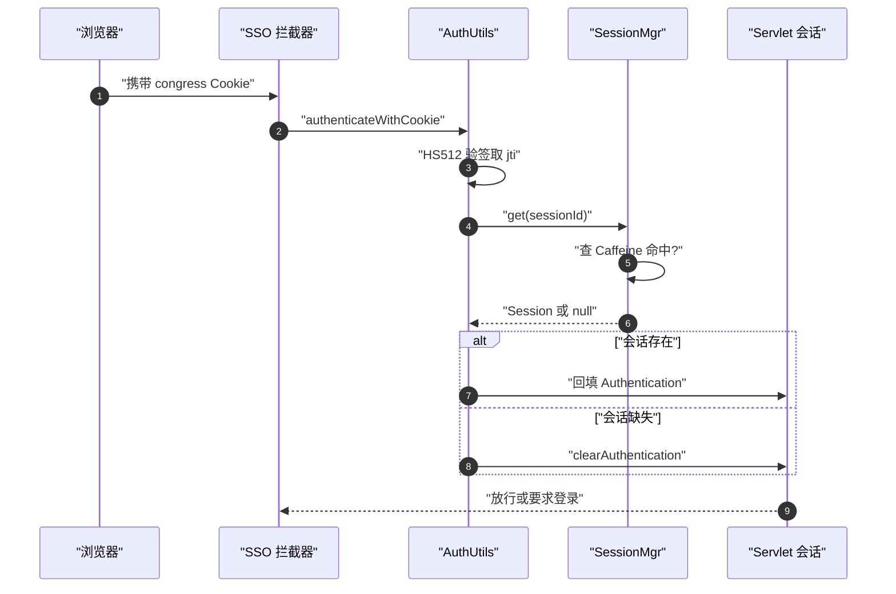
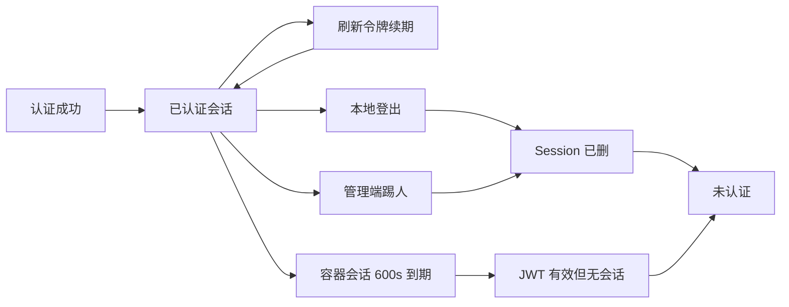

> 解读基线：MaxKey `4.1.12`（`3a3a5c765`）。

## 这一层的位置：认证之后、协议之前

认证中心把"用户是谁"算出来之后，需要有人把它**存住、续期，并在别人问起时答得出来**——这就是会话与令牌层。它对外的契约窄到只有 12 个方法，却决定了三件事：认证态能否跨请求续存、MaxKey 能否水平扩容、登出能否真正生效（[maxkey-authentications/maxkey-authentication-core/src/main/java/org/dromara/maxkey/authn/session/SessionManager.java:27-49]()）。
<!-- anchor: public  void create(String sessionId, Session session); … public  Session getTwoFactor(String sessionId); -->

它的下游是全部协议适配层：CAS、OAuth2/OIDC、SAML 都不自己保存登录态，而是在每个请求上向这一层"取身份"（[maxkey-protocols/maxkey-protocol-authorize/src/main/java/org/dromara/maxkey/authz/endpoint/OnlineSessionEndpoint.java:41-43]()）。管理端"在线会话"列表与踢人按钮，则是这一层在数据库里的投影视图（[maxkey-webs/maxkey-web-maxkey/src/main/java/org/dromara/maxkey/web/access/controller/LoginSessionController.java:82-95]()）。
<!-- anchor: public String ticketValidate(@RequestParam(required = true) String ticket) { … return session == null ? "" : session.getId(); -->
<!-- anchor: public Message<HistoryLogin> terminate(@RequestParam List<String> ids,@CurrentUs … currentUser.getUsername()); -->

理解这一层的钥匙是一句话：**MaxKey 里同时存在三种认证态，它们的时间尺度与权威性都不一样。**

## 根因：10 分钟容器会话装不下 30 分钟认证会话

会话设计里最容易被忽略的一个数字是 Servlet 容器会话的超时——MaxKey 配的是 **600 秒**（[maxkey-webs/maxkey-web-maxkey/src/main/resources/application-maxkey.properties:25-25]()），而 MaxKey 自己的认证会话默认是 **1800 秒**，且这个值只写在注解的默认值里、properties 中并不出现（[maxkey-authentications/maxkey-authentication-core/src/main/java/org/dromara/maxkey/autoconfigure/SessionAutoConfiguration.java:46-54]()）。
<!-- anchor: server.servlet.session.timeout                  =${SERVLET_SESSION_TIMEOUT:600} … server.servlet.session.timeout                  =${SERVLET_SESSION_TIMEOUT:600} -->
<!-- anchor: SessionManager sessionManager( … persistence, jdbcTemplate, redisConnFactory,timeout); -->

这 3 倍落差是整个模块的**根因**，而不是一个可以调平的配置：

- 容器会话太短。它是 `HttpSession` 层的 `SecurityContext` 载体，只适合当"进程内的一次性缓存"，一旦把它当权威源，用户每 10 分钟就会莫名其妙掉线。
- 认证会话必须更长。用户感知的"登录有效期"由它决定，且它还得承载权限、二次认证中间态、访问过哪些应用等一堆容器会话装不下的东西。

MaxKey 的解法是把两者**分职**：容器会话管"这个请求这 10 分钟内的身份回填"，MaxKey 会话管"这个人登录了多久、有什么权限"，而 JWT Cookie 负责把两者串起来。**代价是失效不再自动传导**——容器会话过期不会反向清理 MaxKey 会话，这一条在后面的安全边界里会变成具体缺口。

## 三种认证态：权威源只有一个

MaxKey 的"认证态"分布在三个地方，各自回答不同的问题：

**容器侧的 SecurityContext。** 每个请求进来时，认证态先被塞进 `HttpSession` 关联的 `SecurityContext`（[maxkey-authentications/maxkey-authentication-core/src/main/java/org/dromara/maxkey/authn/web/SessionSecurityContextHolderStrategy.java:44-57]()）。它的生命周期最短（600 秒），作用是让同一请求链路上的代码不必反复回源。
<!-- anchor: public SecurityContext getContext() { … return ctx; -->

**服务端的 MaxKey 会话。** 这是**唯一的权威源**。它以 `Session` 对象形式持有 `SignPrincipal`，并用一个 `visited` 映射记录"这个会话访问过哪些应用"（[maxkey-authentications/maxkey-authentication-core/src/main/java/org/dromara/maxkey/authn/session/Session.java:33-43]()）。权限变更、踢人、单点登出，最终都是对它的操作。**浏览器侧的 JWT Cookie。** 它**不是**一个自包含的凭证，而是**一把被签名的会话句柄**——这一点值得单列一节展开。
<!-- anchor: public String id; … Map<String , VisitedDto> visited = new HashMap<>(); -->

三者之间靠"取不到就重建、重建不了就要求登录"的降级链衔接，任何一环缺失都不会导致致命错误，只会让用户重新认证。

## SessionManager：L1 Caffeine + L2 Redis + DB 状态位

`SessionManagerImpl` 是这一层最关键的一个类，常见误解是"内存模式或 Redis 模式二选一"。读构造器会发现它是**组合器**：无论哪种模式都先建 `InMemorySessionManager`，只有在持久化为 Redis 时**再叠加**一层 Redis（[maxkey-authentications/maxkey-authentication-core/src/main/java/org/dromara/maxkey/authn/session/impl/SessionManagerImpl.java:73-86]()）。也就是说 Redis 模式是 **L1 + L2 两级**，内存模式是退化成只有 L1。
<!-- anchor: public SessionManagerImpl(int persistence, … _logger.debug("RedisSessionManager"); -->

两级之间的读写规则并不对称，这是设计上刻意的一处取舍：

- **读路径不回填**：`get()` 先查内存，未命中且启用 Redis 才查 Redis，**查到也不写回内存**（[maxkey-authentications/maxkey-authentication-core/src/main/java/org/dromara/maxkey/authn/session/impl/SessionManagerImpl.java:108-113]()）。
<!-- anchor: public Session get(String sessionId) { … return session; -->
- **续期路径回填**：`refresh()` 在 Redis 命中后会 `create` 一次进内存，把 L1 补上（[maxkey-authentications/maxkey-authentication-core/src/main/java/org/dromara/maxkey/authn/session/impl/SessionManagerImpl.java:117-126]()）。
<!-- anchor: public Session refresh(String sessionId, LocalDateTime refreshTime) { … return session; -->

这个不对称的后果是：**来自其他节点的会话，在本节点第一次访问时总是要打一次 Redis**，只有等它发生续期才会进入本地缓存。对多节点部署这是用"少一次写"换"多一次读"，属于合理但需要知道的行为。

两级的过期语义也不一样：Caffeine 用 `expireAfterWrite`（写入即重置 TTL，滑动过期靠"每次续期都重写"实现，不是 `expireAfterAccess`）（[maxkey-authentications/maxkey-authentication-core/src/main/java/org/dromara/maxkey/authn/session/impl/InMemorySessionManager.java:49-58]()）；Redis 侧同样是写入时 `setex`，并在写入前把 `expiredTime` 算好（[maxkey-authentications/maxkey-authentication-core/src/main/java/org/dromara/maxkey/authn/session/impl/RedisSessionManager.java:74-83]()）。
<!-- anchor: sessionStore = … .build(); -->
<!-- anchor: public void create(String sessionId, Session session) { … _logger.trace("close conn successful ."); -->

**默认是单机。** `maxkey.server.persistence` 默认值为 `0`，即 InMemory（[maxkey-webs/maxkey-web-maxkey/src/main/resources/application-maxkey.properties:46-46]()）。README 常被读成"Redis 做分布式 Session、Caffeine 做单机 Session，二选一"，但代码事实是**两级叠加 + 默认单机**，多节点部署必须显式改为 `2`，否则每个节点各存一份会话，踢人和登出都会只在一个节点生效。
<!-- anchor: maxkey.server.persistence                       =${SERVER_PERSISTENCE:0} … maxkey.server.persistence                       =${SERVER_PERSISTENCE:0} -->

二次认证中间态则**不参与双写**，它走独立的 `sessionTwoFactorStore`（[maxkey-authentications/maxkey-authentication-core/src/main/java/org/dromara/maxkey/authn/session/impl/InMemorySessionManager.java:61-64]()），与正式会话物理隔离，避免"半认证"被误当成已认证。真正必须双写的只有 `visited()`——因为单点登出要靠它跨节点可见（[maxkey-authentications/maxkey-authentication-core/src/main/java/org/dromara/maxkey/authn/session/impl/SessionManagerImpl.java:204-207]()）。
<!-- anchor: sessionTwoFactorStore = Caffeine.newBuilder() … .build(); -->
<!-- anchor: public void visited(String sessionId, VisitedDto visited) { … redisSessionManager.visited(sessionId,visited); -->

## AuthJwt：被签名的 sessionId 句柄，载荷里没有权限

这是本模块最值得借鉴的一点：**MaxKey 的 JWT 不是无状态凭证，而是"服务端会话的句柄"。** 签发时把 `jti` 设成 sessionId，验签成功后拿 `jti` 去会话存储里换回整个 `Session`（[maxkey-authentications/maxkey-authentication-core/src/main/java/org/dromara/maxkey/authn/web/AuthorizationUtils.java:83-93]()）。
<!-- anchor: if(authTokenService.validateJwtToken(authorization)) { … clearAuthentication(); -->

由此得到两个性质：

- **它可以被无状态地验签，但撤销是有状态的**——删掉服务端会话，JWT 立刻失效，无需等它自然过期，也不需要维护"吊销名单"。
- **权限不在 JWT 里**。载荷只带身份与时间字段（[maxkey-authentications/maxkey-authentication-core/src/main/java/org/dromara/maxkey/authn/jwt/AuthJwt.java:43-68]()），授权信息始终从服务端会话读（[maxkey-authentications/maxkey-authentication-core/src/main/java/org/dromara/maxkey/authn/jwt/AuthJwt.java:92-110]()）。因此改权限、降级、踢人都是即时生效的。
<!-- anchor: private String ticket; … private List<String> authorities; -->
<!-- anchor: public AuthJwt(String token, Authentication  authentication,int expiresIn,String … this.authorities.add(grantedAuthority.getAuthority()); -->

代价是每次请求都要回源查会话——**这是"可撤销"换来的必然开销**，MaxKey 用 L1 Caffeine 把它压到一次哈希查找。

签名算法是 **HMAC-SHA512**（HS512），密钥来自 `AuthJwkConfig` 的 `secret` 属性（[maxkey-commons/maxkey-crypto/src/main/java/org/dromara/maxkey/crypto/jwt/Hmac512Service.java:46-54]()、[maxkey-commons/maxkey-core/src/main/java/org/dromara/maxkey/configuration/AuthJwkConfig.java:28-41]()）。
<!-- anchor: public Hmac512Service(String secretString) throws JOSEException { … verifier = new MACVerifier(octKey); -->
<!-- anchor: @Value("${maxkey.auth.jwt.expires:28800}") … String     issuer; -->
access token 与 refresh token 各由一个 service 用各自的密钥签发（[maxkey-authentications/maxkey-authentication-core/src/main/java/org/dromara/maxkey/authn/jwt/AuthTokenService.java:57-57]()、[maxkey-authentications/maxkey-authentication-core/src/main/java/org/dromara/maxkey/authn/jwt/AuthRefreshTokenService.java:33-36]()）。
<!-- anchor: this.hmac512Service = new Hmac512Service(authJwkConfig.getSecret()); … this.hmac512Service = new Hmac512Service(authJwkConfig.getSecret()); -->
<!-- anchor: public AuthRefreshTokenService(AuthJwkConfig authJwkConfig) throws JOSEException … this.hmac512Service = new Hmac512Service(authJwkConfig.getRefreshSecret()); -->
验签侧则挂在 AuthJwtService 上（[maxkey-authentications/maxkey-authentication-core/src/main/java/org/dromara/maxkey/authn/jwt/AuthJwtService.java:57-69]()）。
<!-- anchor: JWTClaimsSet jwtClaims =new  JWTClaimsSet.Builder() … return signedJWT(jwtClaims); -->

**但这两个密钥在默认配置里是同一个字面量**——`maxkey.auth.jwt.secret` 与 `maxkey.auth.jwt.refresh.secret` 的值逐字相同，且都是硬编码默认值（[maxkey-webs/maxkey-web-maxkey/src/main/resources/application-maxkey.properties:51-56]()）。这不是"配置疏忽"级别的细节，而是后面"令牌类型混淆"的成因。
<!-- anchor: maxkey.auth.jwt.expires                         =${SERVER_EXPIRES:600} … maxkey.auth.jwt.issuer                          =${maxkey.server.uri} -->

## 续期：双令牌轮换与滑动过期

一次认证成功会同时签出 access 与 refresh 两个令牌，刷新时**两者都换新**（[maxkey-authentications/maxkey-authentication-core/src/main/java/org/dromara/maxkey/authn/jwt/AuthTokenService.java:66-77]()）。刷新入口是一个前置切面，读请求里的 refresh token、换发新令牌并写回 Cookie（[maxkey-authentications/maxkey-authentication-core/src/main/java/org/dromara/maxkey/authn/web/AuthTokenRefreshPoint.java:65-71]()）。
<!-- anchor: public AuthJwt genAuthJwt(Authentication authentication) { … return null; -->
<!-- anchor: String sessionId = refreshTokenService.resolveJWTID(refreshToken); … return new Message<AuthJwt>(authJwt).buildResponse(); -->

配置上有一条硬约束：refresh 的有效期**必须大于 access 的两倍**（properties 里的注释原文即 `#must > jwt expire * 2`，默认 access 600s、refresh 1800s）（[maxkey-webs/maxkey-web-maxkey/src/main/resources/application-maxkey.properties:51-56]()）。这个约束的存在说明刷新是"临期换发"而不是"到期续命"。
<!-- anchor: maxkey.auth.jwt.expires                         =${SERVER_EXPIRES:600} … maxkey.auth.jwt.issuer                          =${maxkey.server.uri} -->

## Congress：同信任域内的一次性交接票据

Congress 是 MaxKey 自己的一套轻量交接机制，用于**跨域/跨应用传递一次认证结果**。它与 OAuth 令牌的关系常被误解为重复建设，实际职责不同：Congress 票据是**一次性的**——取出即删除，且 TTL 只有 3 分钟（[maxkey-authentications/maxkey-authentication-core/src/main/java/org/dromara/maxkey/authn/jwt/RedisCongressService.java:29-33]()、[maxkey-authentications/maxkey-authentication-core/src/main/java/org/dromara/maxkey/authn/jwt/RedisCongressService.java:80-85]()）。
<!-- anchor: protected int validitySeconds = 60 * 3; //default 3 minutes. … public static final String PREFIX = "redis:congress:"; -->
<!-- anchor: public AuthJwt consume(String congress) { … return authJwt; -->
它承载的是一个完整的 `AuthJwt`，所以能直接完成"拿着票据就等于登录"（[maxkey-authentications/maxkey-authentication-core/src/main/java/org/dromara/maxkey/authn/jwt/AuthTokenService.java:105-116]()）。它与 OAuth 授权码最像，但**缺少 PKCE 那一层保护**：没有 code_challenge 这类绑定，票据本身就是全部凭证。因此它的安全边界完全落在"票据不泄露"上，而 cookie 的写出方式（见安全边界一节）恰好削弱了这一点。
<!-- anchor: public String createCongress(Authentication  authentication) { … return congress; -->

模式切换与 SessionManager 一致，由 `persistence` 决定用 Redis 还是内存实现（[maxkey-authentications/maxkey-authentication-core/src/main/java/org/dromara/maxkey/autoconfigure/TokenAutoConfiguration.java:43-61]()、[maxkey-authentications/maxkey-authentication-core/src/main/java/org/dromara/maxkey/authn/jwt/InMemoryCongressService.java:31-35]()）。
<!-- anchor: AuthTokenService authTokenService( … refreshTokenService -->
<!-- anchor: protected  static  Cache<String, AuthJwt> congressStore = … .build(); -->

## remember-me：独立于三态的长期凭据

记住我是**三态之外**的第四条路径，它不依赖会话，而是把长期凭据单独存一张表，登录时按 cookie 反查（[maxkey-authentications/maxkey-authentication-provider/src/main/java/org/dromara/maxkey/authn/support/rememberme/AbstractRemeberMeManager.java:60-75]()）。命中后的行为值得注意：它**先把有效期顺延再放行**，也就是凭据会自刷新（[maxkey-webs/maxkey-web-maxkey/src/main/java/org/dromara/maxkey/web/controller/LoginEntryPoint.java:113-127]()）。
<!-- anchor: HttpServletRequest request, HttpServletResponse response) { … return null; -->
<!-- anchor: public Message<?> get(@RequestParam(value = "remember_me", required = false) Str … return new Message<AuthJwt>(authJwt); -->

存储实现是 JDBC（[maxkey-authentications/maxkey-authentication-provider/src/main/java/org/dromara/maxkey/authn/support/rememberme/JdbcRemeberMeManager.java:35-46]()），配置项 `maxkey.login.remeberme.validity` 默认值 `0` 是"不改默认"的哨兵值而非"0 天"（[maxkey-webs/maxkey-web-maxkey/src/main/resources/application-maxkey.properties:78-80]()）。
<!-- anchor: private static final String DEFAULT_DEFAULT_INSERT_STATEMENT = … "update mxk_remember_me  set  lastlogintime = ? , expirationtime = ?  where id = -->
<!-- anchor: maxkey.login.remeberme                          =${LOGIN_REMEBERME:true} … maxkey.login.remeberme.validity                 =0 -->

这里有一处**死代码**：`RemeberMeManagerFactory` 试图按持久化类型分派实现，但 JDBC 分支的实现行被注释掉了，工厂实际不可用（[maxkey-authentications/maxkey-authentication-provider/src/main/java/org/dromara/maxkey/authn/support/rememberme/RemeberMeManagerFactory.java:35-45]()）；真正生效的 Bean 在自动配置里直接构造（[maxkey-authentications/maxkey-authentication-provider/src/main/java/org/dromara/maxkey/autoconfigure/AuthnProviderAutoConfiguration.java:162-170]()）。**读发布文档时要注意：声称"按 persistence 切换 remember-me 存储"的说法与代码不符。**
<!-- anchor: AbstractRemeberMeManager remeberMeService = null; … return remeberMeService; -->
<!-- anchor: AbstractRemeberMeManager remeberMeManager( … jdbcTemplate,applicationConfig,authTokenService,validity); -->

## 单点登出：一个抽象吃下所有协议

单点登出的难点在于"每个应用被登出的方式都不一样"：CAS 走 ticket、OAuth 走 token 撤销、SAML 走 LogoutRequest。MaxKey 用一层抽象把差异收进子类（[maxkey-protocols/maxkey-protocol-authorize/src/main/java/org/dromara/maxkey/authz/singlelogout/SingleLogout.java:31-35]()），具体实现按协议分派（[maxkey-protocols/maxkey-protocol-authorize/src/main/java/org/dromara/maxkey/authz/singlelogout/SamlSingleLogout.java:46-56]()）。
<!-- anchor: public abstract void sendRequest(Authentication authentication,VisitedDto visite … (new HttpRequestAdapter()).post(url , paramMap); -->
<!-- anchor: public void sendRequest(Authentication authentication,VisitedDto visited) { … postMessage(visited.getLogoutUrl(),logoutParameters); -->

编排所需的"要通知哪些应用"来自会话里的 `visited` 映射，而 `VisitedDto` 被设计成**协议无关的字段包**：CAS 放 ticket、OAuth 放 access token、SAML 放 SessionIndex，登出时各取所需（[maxkey-authentications/maxkey-authentication-core/src/main/java/org/dromara/maxkey/authn/session/VisitedDto.java:35-60]()）。这是"新增协议只需加一个子类"的关键。
<!-- anchor: String appId; … String logoutUrl; -->

值得注意的是**哪些协议会写 visited 并不一致**：CAS 只在 back-channel 登出时才登记，OAuth 则无条件登记 token 以便日后撤销（[maxkey-protocols/maxkey-protocol-cas/src/main/java/org/dromara/maxkey/authz/cas/endpoint/CasAuthorizeEndpoint.java:131-134]()、[maxkey-protocols/maxkey-protocol-oauth-2.0/src/main/java/org/dromara/maxkey/authz/oauth2/provider/token/DefaultTokenServices.java:96-109]()）。这类"按协议各自决定"的细节，是协议层与状态层之间唯一的耦合面。
<!-- anchor: String sessionId = AuthorizationUtils.getPrincipal().getSessionId(); … _logger.debug("App CAS LogoutType BACK_CHANNEL ... "); -->
<!-- anchor: //存储oauth、oidc等的token,用户退出时清除 … sessionManager.visited(principal.getSessionId(), visited); -->

踢人与登出的落库动作集中在 `terminate`：更新用户在线位、登记历史登录状态、并清掉 L1/L2 会话（[maxkey-authentications/maxkey-authentication-core/src/main/java/org/dromara/maxkey/authn/session/impl/SessionManagerImpl.java:175-180]()）。管理端登出接口暴露同一条路（[maxkey-webs/maxkey-web-maxkey/src/main/java/org/dromara/maxkey/web/controller/LogoutEndpoint.java:74-107]()）。
<!-- anchor: public void terminate(String sessionId, String userId, String username) { … this.remove(sessionId); -->
<!-- anchor: public  Message<String> logout(@CurrentUser UserInfo currentUser){ … currentUser.getId(), -->
强制登出接口则是另一条路（[maxkey-webs/maxkey-web-maxkey/src/main/java/org/dromara/maxkey/web/controller/LogoutEndpoint.java:114-128]()）。
<!-- anchor: @GetMapping({"/force/logout"}) … return modelAndView; -->

## 核心流程

**恢复链路。** 请求带着 Cookie 进来后，验签→取 jti→查会话→回填身份，任何一步失败就降级为未认证：

拦截器负责在未认证时把原始请求编码进登录跳转（[maxkey-webs/maxkey-web-maxkey/src/main/java/org/dromara/maxkey/web/interceptor/SingleSignOnInterceptor.java:65-78]()），并在已认证时刷新续期（[maxkey-authentications/maxkey-authentication-core/src/main/java/org/dromara/maxkey/authn/web/AuthorizationUtils.java:131-136]()）。
<!-- anchor: HttpServletResponse response, Object handler) … return false; -->
<!-- anchor: public static  boolean isAuthenticated() { … return ! isAuthenticated(); -->

**生命周期。** 认证态在"已认证/待二认证/已登出/被踢/已过期"之间迁移，两条"外部终止"路径最终都收敛到"会话被删"：

## 关键设计决策

**决策一：JWT 只做句柄，不做声明容器。** 换来了即时撤销与权限实时生效，代价是每请求回源。替代方案（把权限塞进 JWT）会让"改权限要等令牌过期"变成无法接受的运维问题，在 IAM 场景下不可选。

**决策二：Servlet 会话与 MaxKey 会话双写，且依赖是单向的。** 容器会话是缓存，MaxKey 会话是权威源；容器侧失效**不会**反向清理权威源（[maxkey-authentications/maxkey-authentication-core/src/main/java/org/dromara/maxkey/authn/web/HttpSessionListenerAdapter.java:55-61]()）。单节点下这个方向性没问题，多节点下就变成前面说的踢人不彻底。
<!-- anchor: public void sessionDestroyed(HttpSessionEvent sessionEvent) { … if(principal instanceof SignPrincipal && ((SignPrincipal)principal).getUserInfo( -->

**决策三：单机默认、Redis 可选，而不是默认分布式。** 这让开箱体验最好（零外部依赖），但把"多节点必须改配置"变成了一条容易踩的部署前提。同类产品更常见的是默认要求外部存储。**决策四：会话清理交给定时任务而非容器事件。** 过期会话靠 `SessionListenerAdapter` 周期扫描落库清理（[maxkey-authentications/maxkey-authentication-core/src/main/java/org/dromara/maxkey/authn/listener/SessionListenerAdapter.java:49-63]()），容器销毁事件只做日志。这个任务在管理端无条件注册，在认证端则只在内存模式下注册（[maxkey-webs/maxkey-web-maxkey/src/main/java/org/dromara/maxkey/autoconfigure/MaxKeyConfig.java:107-120]()）——**Redis 模式下认证端没有周期清理**，属于需要复核的边界。
<!-- anchor: if(sessionManager != null) { … login.getUsername()); -->
<!-- anchor: Scheduler scheduler, … return "sessionListenerAdapter"; -->

## 安全边界与已知缺口

**access 与 refresh 同密钥，存在令牌类型混淆。** 两个 secret 在默认配置里逐字相同（[maxkey-webs/maxkey-web-maxkey/src/main/resources/application-maxkey.properties:51-56]()），且都是硬编码默认值。后果有二：未改默认密钥的部署可被自签 JWT；**refresh token 能通过 access 的验签**（同算法、同密钥，而 refresh 有效期更长），因为载荷里没有 `typ`/audience 之类可用于区分类型的声明（[maxkey-authentications/maxkey-authentication-core/src/main/java/org/dromara/maxkey/authn/jwt/AuthJwt.java:43-68]()）。
<!-- anchor: maxkey.auth.jwt.expires                         =${SERVER_EXPIRES:600} … maxkey.auth.jwt.issuer                          =${maxkey.server.uri} -->
<!-- anchor: private String ticket; … private List<String> authorities; -->
验签失败的兜底返回也值得一看（[maxkey-authentications/maxkey-authentication-core/src/main/java/org/dromara/maxkey/authn/jwt/AuthJwtService.java:124-139]()）。建议至少换成两个独立密钥。
<!-- anchor: if(StringUtils.isNotBlank(authToken) && authToken.length() > 20) { … return false; -->

**congress Cookie 由前端 JavaScript 写入。** 前端直接 `cookieService.set` 写 Cookie（[maxkey-web-frontend/maxkey-web-app/src/app/service/authn.service.ts:113-114]()），常量名也定义在前端（[maxkey-web-frontend/maxkey-web-app/src/app/shared/consts.ts:24-25]()）。
<!-- anchor: this.cookieService.set(CONSTS.CONGRESS, authJwt.token, { path: '/' }); … this.cookieService.set(CONSTS.ONLINE_TICKET, authJwt.ticket, { domain: this.getS -->
<!-- anchor: CONGRESS: 'congress', … TWO_FACTOR_DATA: 'two_factor_data', -->
JS 写的 Cookie **天然拿不到 HttpOnly**，代码里也未见 Secure/SameSite 设置；服务端确有统一的 Cookie 工具，但并未用于 congress（[maxkey-commons/maxkey-core/src/main/java/org/dromara/maxkey/web/WebContext.java:375-393]()）。这意味着任何 XSS 都能直接读走 JWT 与 sessionId。
<!-- anchor: // new一个Cookie对象,键值对为参数 … response.addCookie(cookie); // addCookie后，如果已经存在相同名字的cookie，则最新的覆盖旧的cookie -->

**强制下线在多节点下不彻底。** 踢人只删 MaxKey 会话；若被踢用户在**另一个节点**上还有一个未过期的容器会话，该节点的 `isNotAuthenticated()` 为 true，整段恢复逻辑被跳过，用户可继续使用直至容器会话到期（[maxkey-authentications/maxkey-authentication-core/src/main/java/org/dromara/maxkey/authn/web/AuthorizationUtils.java:83-93]()）。单节点部署无此问题。
<!-- anchor: if(authTokenService.validateJwtToken(authorization)) { … clearAuthentication(); -->

**`LogoutType.FRONT_CHANNEL` 已定义但未实现。** 常量声明了 front-channel（[maxkey-protocols/maxkey-protocol-authorize/src/main/java/org/dromara/maxkey/authz/singlelogout/LogoutType.java:25-33]()），但登出循环只处理 back-channel，front-channel 分支不存在——配置了 front-channel 单点登出的应用实际不会被通知。
<!-- anchor: public static int NONE              = 0; … public static  int FRONT_CHANNEL    = 2; -->

**强制登出接口不删权威源。** `/force/logout` 只做容器会话失效（[maxkey-webs/maxkey-web-maxkey/src/main/java/org/dromara/maxkey/web/controller/LogoutEndpoint.java:114-128]()），不删 MaxKey 会话、不通知任何应用，等价于"只清浏览器侧"。
<!-- anchor: @GetMapping({"/force/logout"}) … return modelAndView; -->

**remember-me 的过期时间只写不读。** 查询语句取回了行，但写入的 `expirationtime` 列从不参与校验（[maxkey-authentications/maxkey-authentication-provider/src/main/java/org/dromara/maxkey/authn/support/rememberme/JdbcRemeberMeManager.java:93-106]()）；建表脚本里该列的类型与 JDBC 写入方式也需要实测（[deployment/docker/docker-mysql/docker-entrypoint-initdb.d/latest/maxkey.sql:1216-1223]()）。
<!-- anchor: List<RemeberMe> listRemeberMe = jdbcTemplate.query(DEFAULT_DEFAULT_SELECT_STATEM … return (listRemeberMe.size() > 0) ? listRemeberMe.get(0) : null; -->
<!-- anchor: CREATE TABLE `mxk_remember_me` ( … ) ENGINE=InnoDB DEFAULT CHARSET=utf8mb3; -->

**Redis 反序列化无兜底。** 反序列化失败会向上冒泡而不是降级为"未认证"，可能表现为 500（[maxkey-commons/maxkey-cache/src/main/java/org/dromara/maxkey/persistence/redis/RedisConnection.java:109-117]()）。另一个量级上的边界是内存模式的容量上限——它是硬编码常量而非配置项，超大实例需要关注（[maxkey-authentications/maxkey-authentication-core/src/main/java/org/dromara/maxkey/authn/session/impl/InMemorySessionManager.java:49-58]()）。
<!-- anchor: public  <T> T getObject(String key){ … return null; -->
<!-- anchor: sessionStore = … .build(); -->
