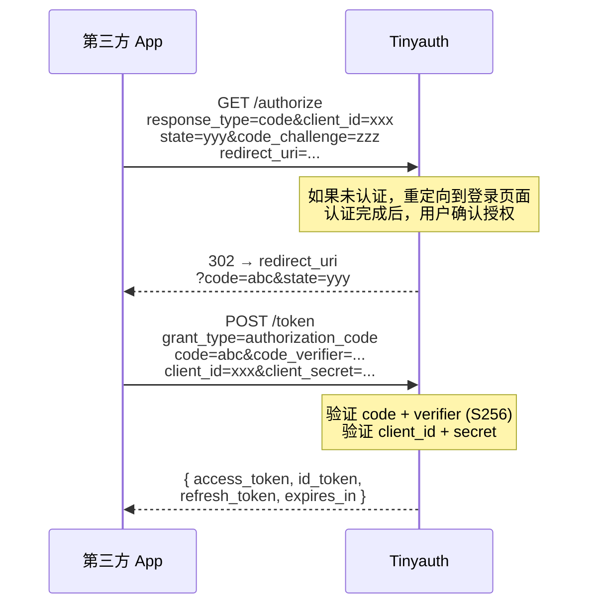

# Tinyauth — 最小认证授权服务器解读

> **GitHub:** [github.com/tinyauthapp/tinyauth](https://github.com/tinyauthapp/tinyauth)

## 第一部分：快速概览

### 这是什么

Tinyauth 是一个轻量级的认证与授权服务器，采用 **ForwardAuth** 模式与反向代理配合工作。当用户请求到达反向代理时，代理将认证子请求转发给 Tinyauth，后者验证会话并返回允许/拒绝决定。

### 解决的痛点

多服务统一认证入口的需求由来已久。传统方案要么太重（Keycloak 的 Java 全家桶），要么太简单（Basic Auth），要么面向特定代理绑定（Traefik 的 BasicAuth Middleware）。Tinyauth 在中型场景下找到平衡点：**轻量、多代理支持、多认证源、可扩展的 ACL**。

### 适用场景

- 家庭实验室 / 自托管服务的统一登录入口
- 企业内部工具（Jenkins、Grafana、Wiki 等）的统一认证
- Docker Compose / Kubernetes 集群中保护多个 Web 服务
- 需要 OIDC 兼容的第三方应用集成认证

### 核心能力清单

| 能力 | 说明 |
|------|------|
| 认证方式 | 本地（密码 + TOTP）、LDAP、OAuth2（Google/GitHub/自定义）、Tailscale、Basic Auth |
| 授权控制 | 策略引擎，支持用户/组/IP/路径级 ACL |
| OIDC 提供者 | 完整实现（授权码+PKCE、刷新令牌、RS256 签名、UserInfo） |
| 代理集成 | Traefik / Caddy / Envoy / Nginx ForwardAuth |
| 动态发现 | Docker 标签 / K8s Ingress 注解自动提取 ACL |
| 部署 | SQLite / PostgreSQL / 内存、TCP / Unix Socket / Tailscale Funnel |
| 管理 CLI | 用户创建/验证、TOTP 生成、OIDC 客户端管理、健康检查 |
| 前端 | React + TypeScript SPA，支持 i18n 和暗色主题 |

### 技术栈一览

| 层面 | 技术 |
|------|------|
| 语言 | Go 1.26 |
| HTTP 框架 | Gin |
| 数据库 | SQLite (modernc), PostgreSQL (pgx), 内存, sqlc 代码生成 |
| OAuth2 | golang.org/x/oauth2 |
| OIDC/JWT | go-jose/go-jose v4 (RS256) |
| LDAP | go-ldap/ldap v3 |
| 容器 | Docker Engine API, k8s.io/client-go |
| Tailscale | tsnet |
| 优雅关闭 | Ding (层级关闭管理器) |
| 前端 | React 19 + TypeScript 6 + Vite 8 + Tailwind 4 |
| 日志 | rs/zerolog, 自包装三流日志 (HTTP/App/Audit) |

---

## 第二部分：架构深读

### 启动流程

```
配置加载 (文件→标志→环境变量)
  │
  ▼
信号上下文 (SIGINT/SIGTERM 捕获)
  │
  ▼
Ding 初始化 (4 级关闭: 次要→正常→主要→关键)
  │
  ▼
日志设置 (3 流独立控制)
  │
  ▼
运行时计算 (AppURL 解析, UUID, Cookie 域)
  │
  ▼
用户加载 (环境变量 + 用户文件)
  │
  ▼
OAuth 配置 (提供者注册, 白名单, 密钥)
  │
  ▼
数据库设置 (驱动选择 → 迁移)
  │
  ▼
服务初始化 (LDAP → 标签提供者 → Tailscale → ACL → 策略 → OAuth → 认证 → OIDC)
  │
  ▼
路由注册 (Gin 路由 + 中间件)
  │
  ▼
后台任务 (数据库清理 + 分析心跳)
  │
  ▼
监听器启动 (TCP / Socket / Tailscale, 可并发)
```

整个启动流程集中在 `internal/bootstrap/` 下的四个文件中，按职责分离清晰：

| 文件 | 职责 |
|------|------|
| `app_bootstrap.go` | 编排整个启动流程（主控逻辑） |
| `db_bootstrap.go` | 数据库驱动选择 + 迁移执行 |
| `service_bootstrap.go` | 所有服务的依赖注入和初始化（48 行完成全部组装） |
| `router_bootstrap.go` | Gin 引擎配置 + 路由注册 + 监听器启动 |

### 请求链路

以 Traefik ForwardAuth 为例，一次完整的认证请求链路：

```
用户浏览器 → Traefik
  │ X-Forwarded-Host: app.example.com
  │ X-Forwarded-Uri: /api/data
  │ X-Forwarded-Proto: https
  │
  ▼
GET /api/auth/traefik → ProxyController
  │
  ├── 1. 解析代理上下文 (proxy type, host, path, proto, method, isBrowser)
  ├── 2. 通过 Host 查询对应应用的 ACL 配置 (静态 + 动态标签)
  ├── 3. 策略引擎按顺序评估:
  │     ├── RuleIPBypassed  → IP 是否在放行名单？
  │     ├── RuleAuthEnabled → 该路径是否不需认证？
  │     ├── RuleIPAllowed   → IP 是否允许访问？
  │     └── (如果已认证)
  │         ├── RuleUserAllowed → 用户是否允许？
  │         ├── RuleOAuthGroup  → OAuth 组是否符合？
  │         └── RuleLDAPGroup   → LDAP 组是否符合？
  │
  ├── 全部通过 → 200 + Headers (Remote-User, Remote-Email, Remote-Name, Remote-Groups)
  └── 拒绝 → 401/403 → 浏览器重定向到登录页，API 客户端返回 JSON
```

### 目录结构与模块映射

```
tinyauth/
├── cmd/tinyauth/          # CLI 入口：服务器 + 管理命令
├── internal/
│   ├── bootstrap/         # 启动编排（依赖组装 + 生命周期）
│   ├── controller/        # HTTP 处理层（8 个控制器）
│   ├── middleware/        # Gin 中间件（上下文、UI、日志）
│   ├── model/             # 数据结构（配置、运行时、用户上下文）
│   ├── repository/        # 数据访问层（Store 接口 + 3 种实现）
│   ├── service/           # 业务逻辑（8 个服务）
│   ├── test/              # 测试辅助
│   └── utils/             # 工具包（配置加载、日志、安全、标签）
├── frontend/              # React SPA
├── sql/                   # 原始 SQL 查询（sqlc 输入）
└── gen/                   # 代码生成（配置文档、环境变量模板）
```

---

## 第三部分：认证体系设计

### 5 种认证方式

#### 本地认证

最简单的认证方式。用户凭据以 `username:bcrypt_hash` 格式存储在配置文件或环境变量中。

关键实现点：

- 密码使用 `golang.org/x/crypto/bcrypt` 哈希，不存储明文
- 登录成功后创建 **Session** 并写入 Cookie，Session 数据持久化到数据库
- 支持 **TOTP** 双因素认证，通过 `pquerna/otp` 库生成密钥，CLI 命令 `tinyauth totp generate` 管理
- **速率限制**：基于内存中的登录尝试记录（`MaxLoginAttemptRecords=256`），每个账户超出 `LoginMaxRetries`（默认 3）后锁定直到 `LoginTimeout`（默认 300s）过期；当记录数达到上限时触发**全局 lockdown**，所有账户暂时不可登录
- 支持 `SessionMaxLifetime` 配置，设置 Session 的绝对过期时间（从创建算起），相比 `SessionExpiry`（滑动过期）提供更强的安全边界
- 配置文件支持 `UserAttributes`，可为每个用户设置完整的 OIDC 声明（姓名、地址、电话等）

```go
// auth_service.go 中的登录逻辑
type LoginAttempt struct {
    Count     int
    FirstTry  time.Time
    LockUntil time.Time
}

const MaxLoginAttemptRecords = 256

// 每次登录检查：
// 1. 记录数达到 MaxLoginAttemptRecords → 全局 lockdown，拒绝所有登录
// 2. 尝试次数 > LoginMaxRetries 且 LockUntil > now → 拒绝
// 3. 已过锁定时间 → 重置计数
// 4. bcrypt.CompareHashAndPassword 验证密码
// 5. 成功 → 创建 Session，放入数据库，设置 Cookie
```

#### LDAP 认证

两步认证流程：

1. **服务账户绑定**：使用配置的 `BindDN` + `BindPassword` 连接到 LDAP 服务器
2. **用户搜索**：使用 `searchFilter`（默认 `(uid=%s)`）查找用户 DN
3. **用户绑定验证**：使用用户 DN + 密码进行第二次绑定认证
4. **组缓存**：获取用户的 LDAP 组成员关系，缓存在内存中（`GroupCacheTTL`，默认 900s/15 分钟），避免频繁查询

支持 mTLS（双向 TLS）连接，通过 `authCert` / `authKey` 配置客户端证书。

```go
// ldap_service.go
// 后台 goroutine: 每 10 秒一次心跳
// 断线自动重连: 心跳失败 → 关闭连接 → 下次请求触发重新连接
```

#### OAuth2 认证

内置 Google、GitHub 的预设配置，也支持自定义 OAuth2 提供者。

授权码流程 + PKCE：

```
1. 用户点击"用 Google 登录"
2. GET /api/oauth/url/google → 生成 state + PKCE verifier → 存储到 OAuthPendingSession
3. 重定向到 Google 授权页
4. 用户授权后回调到 /api/oauth/callback/google
5. 验证 state → 用 code + verifier 换取 token → 用 token 获取 userinfo
6. 检查邮箱域名白名单 → 创建 Session Cookie
7. 如果是 OIDC 请求，重定向到 /authorize 继续 OIDC 流程
8. 否则携带 redirect_uri 重定向回原应用
```

一个值得关注的细节：Tinyauth 在存储 OAuth 挂起会话时使用内存 Map（`sync.RWMutex` 保护），限制最大 256 个同时挂起会话，超过时自动清理最早的 16 个。这种有上限的内存结构避免了资源耗尽，代码简洁有效。

邮箱域名白名单支持 **Provider 级别**配置，不同 OAuth 提供者可设置各自的允许域名，而非全局统一。白名单校验通过**策略引擎**执行（`OAuthGroupRule`），与其他授权规则一致的评估路径。

```go
const MaxOAuthPendingSessions = 256
const OAuthCleanupCount = 16
```

#### Tailscale 认证

利用 `tsnet` 库将 Tinyauth 直接加入 Tailscale 网络。认证原理：

- `ContextMiddleware` 读取每个请求的 `Tailscale-User` 头（tsnet 自动设置）
- 基于 Tailscale 身份直接创建 Session，无需额外密码
- 支持 Ephemeral 节点模式和 Tailscale Funnel 公网暴露
- **限制**：不接收 tagged 设备（共享节点）的认证，仅允许普通用户节点

#### Basic Auth 兼容

对于非浏览器客户端（curl、API 脚本等），ContextMiddleware 会解析 `Authorization: Basic` 头，将其映射到本地用户认证，复用同一套 Session 机制。

### 会话管理

```go
// repository/models.go
type Session struct {
    ID          string    // UUID
    Username    string
    Email       string
    Name        string
    Provider    string    // local / oauth / ldap / tailscale
    TOTPPending bool
    OAuthGroups string
    Expiry      time.Time
    CreatedAt   time.Time
}
```

- Cookie 名：`tinyauth-session`（可配置）
- 安全属性：`HttpOnly` + `Secure`（可选）+ `SameSite`
- 子域名支持：开启后 Cookie Domain 设置为 `.example.com`，允许同一实例保护多个子域
- **双重过期机制**：`SessionExpiry`（滑动过期，默认 24h，每次请求刷新）+ `SessionMaxLifetime`（绝对过期，从创建算起，默认不启用）
- 后台清理：定期删除过期 Session

---

## 第四部分：授权与策略引擎

### 策略引擎设计

策略引擎采用 **可插拔规则 + 回退策略** 模式，是项目中最有设计感的组件之一。

```go
// policy_engine.go
type Effect int
const (
    EffectAbstain Effect = iota  // 规则无意见 → 回退到默认策略
    EffectAllow                  // 允许
    EffectDeny                   // 拒绝
)

type Rule interface {
    Evaluate(ctx *ACLContext) Effect  // 每个规则实现这个接口
}

type PolicyEngine struct {
    rules  map[RuleName]Rule
    policy Policy  // "allow" 或 "deny"
}
```

**评估逻辑：**
```
Rule.Evaluate(ctx) → EffectAbstain → 回退到默认策略 (allow/deny)
                   → EffectAllow   → 允许
                   → EffectDeny    → 拒绝
```

这种三值逻辑（Allow/Deny/Abstain）让规则可以表达"这不归我管"，从而优雅地组合多个不同职责的规则。

### 规则类型

| 规则 | 评估时机 | 职责 |
|------|----------|------|
| `RuleIPBypassed` | 最先（认证前） | 放行 IP 完全不经过认证 |
| `RuleAuthEnabled` | 次先（认证前） | 根据请求路径决定是否需要认证 |
| `RuleIPAllowed` | 认证前 | 全局 + 应用级 IP 黑白名单 |
| `RuleUserAllowed` | 认证后 | 用户白名单/黑名单 |
| `RuleOAuthGroup` | 认证后 | OAuth 组成员校验 |
| `RuleLDAPGroup` | 认证后 | LDAP 组成员校验 |

### Allow vs Deny 策略

Deny 策略已从概念描述升级为**可配置项**，通过 `ACLsConfig.Policy` 字段控制：

- **Allow 策略（默认，`policy: "allow"`）**：默认允许访问。适用于内部信任网络，只需阻挡特定用户/路径。
- **Deny 策略（`policy: "deny"`）**：默认拒绝访问。适用于对外服务，需显式配置每个允许访问的用户。

注意实现中一个务实的决定：LDAP/OAuth 组和 IP 规则**不受 Deny 策略影响**，始终默认允许。代码注释解释了原因：

```go
// access_controls_rules.go:
// 不能强制用户在 Deny 策略下也必须配置 LDAP/OAuth 组；
// 而且大多数部署在 Docker bridge 网络下难以获取真实客户端 IP，
// 所以组和 IP 校验默认允许。
```

此外，IP 绕过支持**全局配置**（`auth.ip.bypass`），与应用级 `ACLs[*].IP.Bypass` 合并评估，使基础设施组件（如监控、健康检查）可以全局免认证。

### ACL 配置结构

一个应用的完整 ACL 配置模型：

```go
type App struct {
    Config   AppConfig   // domain
    Users    AppUsers    // allow, block
    OAuth    AppOAuth    // whitelist, groups
    IP       AppIP       // allow, block, bypass (支持 CIDR)
    Response AppResponse // headers, basicAuth
    Path     AppPath     // allow, block (正则匹配)
    LDAP     AppLDAP     // groups
}
```

### 动态标签发现

Tinyauth 可以从容器运行时自动提取 ACL 配置：

| 平台 | 标签格式示例 |
|------|-------------|
| Docker | `tinyauth.domain=app.example.com` `tinyauth.allow=admin` |
| Kubernetes | Ingress 注解 `tinyauth.io/allow: admin` |

标签提供者模式：`auto`（自动检测运行环境）、`docker`、`kubernetes`、`none`（禁用）。

---

## 第五部分：OIDC 提供者实现

Tinyauth 完整实现了 OpenID Connect 提供者，这是项目中复杂度最高的模块。

### 端点与流程

| 端点 | 方法 | 参数 | 说明 |
|------|------|------|------|
| `/.well-known/openid-configuration` | GET | - | OIDC 发现文档 |
| `/.well-known/jwks.json` | GET | - | 公开 RS256 公钥 |
| `/api/oidc/authorize` | POST | response_type, client_id, redirect_uri, scope, state, code_challenge | 授权码请求 |
| `/api/oidc/token` | POST | grant_type, code, redirect_uri, code_verifier, refresh_token | 令牌交换 |
| `/api/oidc/userinfo` | GET/POST | access_token | 用户信息 |

### 授权码 + PKCE 流程



### 安全性实现

- **授权码一次性使用**：code 使用后立即删除，防止重放
- **PKCE 强制使用**：code_challenge 结合 S256 验证，防止授权码拦截攻击
- **客户端认证**：支持 `client_secret_basic`（HTTP Basic）和 `client_secret_post`（POST body）
- **重定向 URI 校验**：必须与注册的 trustedRedirectUris 精确匹配
- **ID Token 签名**：RS256（RSA-SHA256），私钥加密签名，公钥在 JWKS 端点公开

### 密钥管理

OIDC 密钥对通过 CLI 生成：

```
openssl genpkey -algorithm RSA -out tinyauth_oidc_key -pkeyopt rsa_keygen_bits:2048
openssl rsa -pubout -in tinyauth_oidc_key -out tinyauth_oidc_key.pub
```

运行时加载私钥用于签名，公钥通过 `/.well-known/jwks.json` 公开供第三方验证。

### ID Token 声明

```go
type ClaimSet struct {
    Iss, Aud, Sub string   // 签发者、受众、用户标识
    Iat, Exp      int64    // 签发/过期时间
    Name, GivenName, FamilyName, MiddleName, Nickname string
    Profile, Picture, Website string
    Gender, Birthdate, Zoneinfo, Locale string
    PhoneNumber string
    Address     AddressClaim
    Groups      []string
}
```

---

## 第六部分：存储层抽象

### Store 接口

```go
type Store interface {
    // Session
    CreateSession(ctx context.Context, session Session) error
    GetSession(ctx context.Context, id string) (Session, error)
    DeleteSession(ctx context.Context, id string) error
    CleanupSessions(ctx context.Context) error

    // OIDC
    CreateOidcCode(ctx context.Context, code OidcCode) error
    GetOidcCode(ctx context.Context, code string) (OidcCode, error)
    DeleteOidcCode(ctx context.Context, code string) error
    // ... Token, UserInfo 等
}
```

### 三种实现对比

| 驱动 | 实现方式 | 适用场景 | 持久化 |
|------|----------|----------|--------|
| **Memory** | `sync.RWMutex` 保护的 `map[string]T` | 开发/测试 | 否 |
| **SQLite** | sqlc 生成 + modernc.org/sqlite（纯 Go，无 CGO） | 单实例生产 | 是 |
| **PostgreSQL** | sqlc 生成 + pgx v5 | 高可用生产 | 是 |

三种实现共享同一套 **sqlc 生成的查询代码**——SQLite 和 PostgreSQL 使用独立的 SQL 文件（`sql/sqlite/` vs `sql/postgres/`），通过 sqlc 配置生成类型安全的 Go 代码。Memory 实现则是手写的。

PostgreSQL 实现的目录结构：

```
sql/postgres/                    # SQL 源文件
├── session_schemas.sql          # 会话表 DDL
├── session_queries.sql          # 会话 CRUD 查询
├── oidc_schemas.sql             # OIDC 表 DDL
└── oidc_queries.sql             # OIDC 授权码/令牌/UserInfo 查询

internal/repository/postgres/    # 生成的 Go 代码 + Store 适配
├── db.go                        # 数据库连接与事务管理
├── models.go                    # 表结构映射
├── session_queries.sql.go       # 会话查询方法（sqlc 生成，176 行）
├── oidc_queries.sql.go          # OIDC 查询方法（sqlc 生成，581 行）
├── store.go                     # Store 接口实现（209 行）
└── generate.go                  # sqlc 代码生成指令
```

sqlc 配置通过根目录的 `sqlc.yml` 统一管理，定义了 SQLite 和 PostgreSQL 两个生成目标，共享同一套输出目录结构。

sqlc 的使用是项目中的一个亮点：用 SQL 文件定义查询，自动生成 Go 代码，保证了 SQL 层的类型安全，同时保留了 SQL 的灵活性和可读性。

---

## 第七部分：反向代理集成设计

### 多协议适配

```go
type AuthModuleType int
const (
    AuthRequest AuthModuleType = iota  // Nginx: X-Original-URL
    ExtAuthz                            // Envoy: gRPC/HTTP ExtAuthz
    ForwardAuth                         // Traefik/Caddy/Envoy回退: X-Forwarded-*
)
```

### 代理特定行为

```
Traefik → ForwardAuth  → 依赖 X-Forwarded-*
Caddy   → ForwardAuth  → 依赖 X-Forwarded-*
Envoy   → ExtAuthz     → 先尝试 ExtAuthz（请求头解析）
        → ForwardAuth  → 回退到 ForwardAuth
Nginx   → AuthRequest  → 依赖 X-Original-URL
        → ForwardAuth  → 回退到 ForwardAuth
```

Envoy 和 Nginx 都有回退机制：先尝试原生模式，如果必要头不存在则回退到 ForwardAuth。这提高了兼容性。

### 浏览器 vs 非浏览器响应

一个有意思的设计：Tinyauth 会根据 User-Agent 判断请求来源，**浏览器请求重定向到登录页**，**API 请求返回 JSON**：

```go
var BrowserUserAgentRegex = regexp.MustCompile("Chrome|Gecko|AppleWebKit|Opera|Edge")

func useBrowserResponse(proxyCtx ProxyContext) bool {
    if proxyCtx.ProxyType == Nginx {
        return false  // Nginx 必须返回非浏览器响应
    }
    return proxyCtx.IsBrowser
}
```

Nginx 特殊处理：因为 Nginx AuthRequest 模块要求返回 401（带 `X-Tinyauth-Location` 头）而非 302 重定向，所以即使浏览器请求也返回非浏览器格式。

### 传递的用户信息头

认证通过后，Tinyauth 向后端服务传递以下请求头：

| 请求头 | 来源 |
|--------|------|
| `Remote-User` | 用户名或邮箱前缀 |
| `Remote-Name` | 显示名或自动生成 |
| `Remote-Email` | 用户邮箱 |
| `Remote-Groups` | LDAP/OAuth 组（逗号分隔） |
| `Remote-Sub` | OAuth 用户唯一标识 |
| `Authorization` | 透传或自定义 Basic Auth |

---

## 第八部分：部署灵活性设计

### 三种监听模式

| 模式 | 配置 | 场景 |
|------|------|------|
| TCP | `server.address:port` | 标准 HTTP 场景 |
| Unix Socket | `server.socketPath` | 与 Nginx 同主机部署，性能更好 |
| Tailscale Funnel | `tailscale.enabled` | 无需公网 IP，通过 Tailscale 网络暴露 |

**并发监听**：设置 `server.concurrentListenersEnabled: true` 可同时启动 TCP + Unix Socket。

### 三种日志流

```go
type LogStreams struct {
    HTTP  LogStreamConfig  // HTTP 请求日志
    App   LogStreamConfig  // 应用日志（调试、错误）
    Audit LogStreamConfig  // 审计日志（登录成功/失败、登出）
}
```

审计日志默认关闭，启用后记录每次认证事件，包括提供者、客户端 IP、成功/失败原因。

### 配置加载链

```
配置文件 (.yaml) → CLI 标志 → 环境变量 (TINYAUTH_ 前缀)
```

后加载覆盖前加载。配置文件（YAML）已成为**稳定特性**，统一管理所有配置项。配置结构使用 Go 结构体标签 `yaml` + `description`，并通过代码生成器 `gen/` 自动输出 `.env.example` 和 Markdown 配置参考，保持文档与代码同步。

---

## 第九部分：设计模式与代码亮点

### 策略模式（Policy Engine）

整个授权系统基于策略模式（Strategy Pattern）。每个规则（Rule）是一个独立的策略实现，PolicyEngine 负责编排评估过程。这种设计让新增规则变得非常简单：实现 `Rule` 接口 → `RegisterRule` 注册即可。

```go
// 新增一个规则只需要：
type MyRule struct { Log *logger.Logger }
func (r *MyRule) Evaluate(ctx *ACLContext) Effect {
    // 自定义逻辑
    return EffectAllow
}
engine.RegisterRule("rule-my-rule", &MyRule{})
```

### 适配器模式（存储层）

Store 接口统一了三种数据库的访问方式。控制器和服务层只依赖 `Store` 接口，不关心底层是 SQLite、PostgreSQL 还是内存。启动时通过依赖注入选择具体实现。

### 依赖注入与启动编排

`service_bootstrap.go` 使用工厂函数模式，按依赖顺序初始化所有服务：

```go
func initServices(...) {
    ldapService := service.NewLDAPService(...)          // 无依赖
    dockerService := service.NewDockerService(...)      // 无依赖
    k8sService := service.NewKubernetesService(...)    // 无依赖
    tailscaleService := service.NewTailscaleService(...)// 无依赖
    accessControls := service.NewAccessControlsService( // 依赖标签提供者
        log, config, dockerService, k8sService,
    )
    authService := service.NewAuthService(              // 依赖 Store + LDAP + 其他
        log, config, runtime, store, ldapService, oauthBroker,
    )
    policyEngine, _ := service.NewPolicyEngine(config, log)
    // 注册规则
    policyEngine.RegisterRule(service.RuleUserAllowed, &service.UserAllowedRule{...})
    // ...
    oidcService := service.NewOIDCService(              // 依赖 Store
        log, config, runtime, store,
    )
}
```

初始化顺序巧妙反映了依赖关系：无依赖的先建（LDAP/Docker/K8s），有依赖的后建（ACL/认证/OIDC）。

### Ding 层级关闭管理

使用 `steveiliop56/ding` 库管理协程生命周期，分为 4 个关闭级别：

```
次要 (Minor)     → 非关键协程
正常 (Normal)    → 常规协程
主要 (Major)     → 重要协程
关键 (Critical)  → 核心协程
```

SIGTERM 时按从次要到关键顺序逐步关闭，确保干净的资源释放。

---

## 第十部分：同类项目对比

| 方面 | Tinyauth | Authelia | oauth2-proxy | Keycloak |
|------|----------|----------|--------------|----------|
| **语言** | Go | Go | Go | Java |
| **体积** | ~20MB 单二进制 | ~30MB 单二进制 | ~20MB 单二进制 | ~300MB+ JVM |
| **部署复杂度** | 低（单二进制+配置） | 中（需 Redis/DB） | 低 | 高（需数据库） |
| **认证源** | 本地/LDAP/OAuth2/Tailscale | 本地/LDAP/OAuth2 | OAuth2/OIDC | LDAP/SAML/OIDC/Social |
| **ACL 粒度** | 用户/组/IP/路径，静态+动态标签 | 用户/组/IP/2FA | 邮箱/域 | 完整的 RBAC |
| **OIDC 提供者** | ✅ 完整实现 | ❌ | ❌ | ✅ 原生 |
| **代理集成** | Traefik/Caddy/Envoy/Nginx | Traefik/Nginx/Caddy | 所有支持 ForwardAuth 的 | 需适配层 |
| **动态标签发现** | ✅ Docker/K8s | ❌ | ❌ | ❌ |
| **配置方式** | 文件/环境变量/标志 | 文件 | 标志/环境变量 | 管理控制台/API |
| **学习曲线** | 低 | 中 | 低 | 高 |

**Tinyauth 的差异化优势：**

1. 支持同时作为**认证消费者**（ForwardAuth）和**认证提供者**（OIDC）
2. **Docker/K8s 标签自动发现**ACL 规则，在容器化环境中配置极简
3. **Tailscale 原生集成**，无需公网暴露即可安全认证
4. 代码量小、架构简洁，适合作为 Go 后端参考项目

**Tinyauth 的局限性：**

1. 不支持 SAML 企业认证
2. 没有管理 API/UI（用户管理需 CLI 或重启）
3. 缺少 WebAuthn/FIDO2 现代认证
4. 大规模部署下 SQLite 会成为瓶颈（但支持 PostgreSQL）

---

## 第十一部分：总结与评价

Tinyauth 是一个设计务实、实现干净的认证授权项目。它在"足够好用"和"保持简单"之间取得了很好的平衡。

**最值得学习的设计决策：**

1. **ForwardAuth 模式** — 认证逻辑与业务解耦，通过反向代理实现无侵入集成
2. **策略引擎的三值逻辑** — Allow/Deny/Abstain 让规则组合变得优雅
3. **Store 接口抽象** — 一次接口设计，三种实现随意切换
4. **动态标签发现** — 在容器化环境中将配置融入基础设施
5. **OIDC 完整实现** — 在轻量级项目中完整支持 OIDC 协议，代码仅 853 行

对于希望学习 Go 后端架构、认证系统设计、或需要为个人/团队服务搭建统一认证入口的开发者，Tinyauth 是一个值得深入研究的项目。

> **仓库：** [github.com/tinyauthapp/tinyauth](https://github.com/tinyauthapp/tinyauth) | **网站：** [tinyauth.app](https://tinyauth.app)

---

*本项目解读目录下后续可扩展各维度的独立分析文档，例如：[架构深度分析](01-arch.md)、[认证体系设计](02-auth-design.md) 等。*
