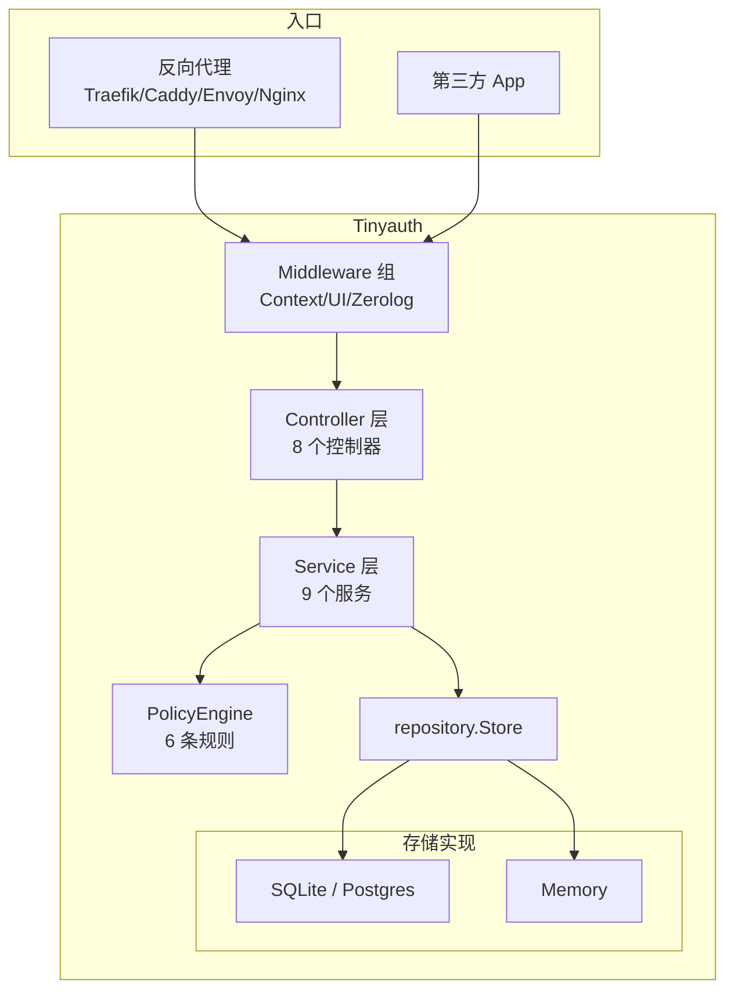
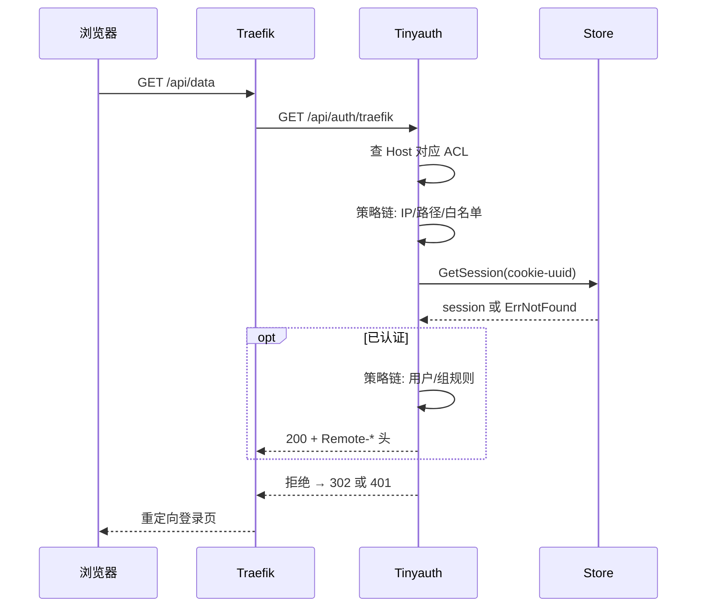

# Tinyauth — 最小认证授权服务器解读

> **GitHub:** [github.com/tinyauthapp/tinyauth](https://github.com/tinyauthapp/tinyauth) · **网站:** [tinyauth.app](https://tinyauth.app)
>
> 本解读按实际代码（v5.1.3）全量重写，真源引用均经程序重定位。
>
> 本解读按认证授权服务器类型规格 + 数据模型规范产出，按关注面拆分多篇子文档。

## 根因

**Tinyauth 解决"家庭实验室 / 自托管环境下，多个 Web 服务需要一个统一、轻量、可被反向代理接入的认证入口"这个根本问题。** 它同时扮演两个角色：作为反向代理的认证消费者（ForwardAuth 中间件），以及作为第三方的认证提供者（OpenID Certified™ Basic OP）。全篇的锚是——所有身份（本地 / LDAP / OAuth / Tailscale）最终汇入同一张会话表与同一个 Session Cookie。

## 概览

Tinyauth 是开箱即起、单二进制的认证授权服务器，定位在"Keycloak 太重、Basic Auth 太弱"之间的平衡点：足够轻（纯 Go 无 CGO，可直接跑），又能覆盖多代理、多认证源、可扩展 ACL 的日常自托管需求。

**适用场景**：家庭实验室统一登录、企业内部工具（Jenkins/Grafana/Wiki）统一认证、Docker Compose / Kubernetes 集群保护多个服务、需要 OIDC 兼容登录的第三方应用接入。

### 核心能力清单

| 能力 | 说明 |
|------|------|
| 认证方式 | 本地（密码 + TOTP）、LDAP、OAuth2（Google/GitHub/自定义）、Tailscale、Basic Auth |
| 授权控制 | 策略引擎（三值 Allow/Deny/Abstain），用户/组/IP/路径级 ACL，静态 + 动态标签 |
| OIDC 提供者 | OpenID Certified™ Basic OP，授权码 + PKCE、刷新令牌、RS256、UserInfo、pairwise sub |
| OAuth 接入 | Broker + extractor 可插拔体系，内置 GitHub/Google 预设，差异被提取器隔离 |
| 代理集成 | Traefik / Caddy / Envoy / Nginx ForwardAuth |
| 动态发现 | Docker 标签 / K8s Ingress 注解自动提取 ACL |
| 部署 | SQLite（纯 Go 无 CGO）/ PostgreSQL / 内存，迁移自动执行 |
| 管理 CLI | 用户创建/验证、TOTP 生成、OIDC 客户端管理、健康检查 |
| 前端 | React 19 + TypeScript SPA，i18n 与暗色主题 |

### 技术栈一览

| 层面 | 技术 |
|------|------|
| 语言 | Go |
| HTTP 框架 | Gin |
| 数据库 | SQLite (modernc，无 CGO)、PostgreSQL (pgx)、Memory；sqlc + golang-migrate |
| OAuth2 | golang.org/x/oauth2 |
| OIDC/JWT | go-jose v4 (RS256)、golang-jwt |
| LDAP | go-ldap/ldap v3 |
| 容器 | Docker Engine API、k8s.io/client-go |
| Tailscale | tsnet |
| 生命周期 | Ding（分层优雅关闭）、go.uber.org/dig（DI） |
| 前端 | React 19 + TypeScript + Vite 8 + Tailwind 4 |

## 架构总览

分层清晰的 Go 服务端：由 `bootstrap` 用 DI 组装，`controller` 收 HTTP、`service` 落业务、`repository` 管存储、`middleware` 做横切。



> **注意**：controller 8 个、**service 是 9 个**（v5.1.3 新增 `oauth_broker_service`）。service 8 个的描述已过时，详见下文导读表。

### 目录结构

```
tinyauth/
├── cmd/tinyauth/          # CLI 入口：服务器 + 管理命令
├── internal/
│   ├── bootstrap/         # 启动编排（DI 组装 + 生命周期 + 存储/策略装配）
│   ├── controller/        # HTTP 处理层（8 个控制器）
│   ├── middleware/        # Gin 中间件（上下文、UI、日志）
│   ├── model/             # 数据结构（配置、运行时、用户上下文）
│   ├── repository/        # Store 接口 + 3 种实现 + sqlc 生成代码
│   ├── service/           # 业务逻辑（9 个服务，含策略引擎/OAuth broker/OIDC）
│   ├── test/              # 测试辅助
│   └── utils/             # 工具包（配置加载、日志、安全、标签）
├── internal/assets/migrations/  # golang-migrate 版本化迁移（sqlite/postgres）
├── frontend/              # React SPA
├── sql/                   # sqlc 输入（sqlite/postgres 的 schema + 查询）
└── gen/                   # 代码生成（sqlc-wrapper、配置文档、环境变量模板）
```

## 子文档索引

本解读按关注面拆分为多篇。主 README 承载概览与导读，深度内容在各子文档：

- [`auth-flow.md`](auth-flow.md) — **统一登录 / 登出全流程**：授权码 + PKCE、SSO 登录、统一登出，详细到每个接口与参数（多张时序图）
- [`oauth-broker.md`](oauth-broker.md) — OAuth Broker 架构：prest/预设、per-provider extractor、bridge mode
- [`policy-engine.md`](policy-engine.md) — 策略引擎：三值效果、6 条规则、静态 + 动态 ACL、路径正则语义
- [`oidc-provider.md`](oidc-provider.md) — OIDC 提供者内核：参数校验、令牌存取、pairwise sub、密钥与 JWKS、scope 过滤
- [`data-model.md`](data-model.md) — 存储层：Store 接口、三实现、sqlc 双引擎、schema 演进

## 核心模块导读与启动/请求链路

### 启动流程

```
配置加载 (文件→标志→环境变量)
  → 信号上下文 (SIGINT/SIGTERM 捕获)
  → Ding 初始化 (4 级关闭: 次要→正常→主要→关键)
  → 日志设置 (3 流独立控制)
  → 运行时计算 (AppURL 解析, UUID, Cookie 域)
  → 用户加载 (环境变量 + 用户文件)
  → OAuth 配置 (broker + preset 装配)
  → 数据库设置 (驱动选择 → golang-migrate 自动迁移)
  → 服务初始化 (LDAP → 标签提供者 → Tailscale → ACL → PolicyEngine → OAuth → Auth → OIDC)
  → 路由注册 (Gin 路由 + 中间件)
  → 后台任务 (会话清理 + 分析心跳)
  → 监听器启动 (TCP / Unix Socket / Tailscale Funnel, 可并发)
```

集群整理在 `internal/bootstrap/` 多文件，按职责分离（app/db/service/router 各一）。

### 核心请求链路

以 Traefik ForwardAuth 为例，一次完整认证请求：



### 核心模块导读表

| 模块 | 职责 | 深度文档 |
|------|------|----------|
| ProxyController | 多代理 ForwardAuth 适配（`/api/auth/:proxy`） | [`auth-flow.md`](auth-flow.md) 端点总览 |
| OIDCController / OIDCService | OIDC 提供者，authorize/token/userinfo | [`oidc-provider.md`](oidc-provider.md) |
| OAuthBrokerService | 多 OAuth 提供者管理 + extractor | [`oauth-broker.md`](oauth-broker.md) |
| AuthService | 登录/登出/会话管理（本地/LDAP/OAuth/Tailscale） | [`auth-flow.md`](auth-flow.md) |
| PolicyEngine + 6 规则 | 授权裁决 | [`policy-engine.md`](policy-engine.md) |
| repository.Store | 会话/令牌存储抽象 | [`data-model.md`](data-model.md) |
| AccessControlsService | ACL 静态 + 动态发现装配 | [`policy-engine.md`](policy-engine.md) |

### 认证方式与代理集成概述

**5 种认证方式**（核心逻辑在 `AuthService` 与各 provider）：
- **本地**：bcrypt 密码哈希，TOTP 双因素（`pquerna/otp`），内存登录速率限制（账户锁定 + 全局 lockdown）、会话双过期。
- **LDAP**：服务账户绑定 → 用户 DN 搜索 → 用户绑定验证，组缓存（默认 900s），支持 mTLS 与心跳重连。
- **OAuth2**：见 [`oauth-broker.md`](oauth-broker.md)——broker 管理多提供者、挂起会话（上限 256）承载 state/PKCE、邮箱白名单经策略引擎执行。
- **Tailscale**：`tsnet` 入网，读 `Tailscale-User` 头直接建会话，支持 Funnel。
- **Basic Auth**：`context_middleware` 解析 `Authorization: Basic` 映射到本地用户，复用会话。

各方式完整时序见 [`auth-flow.md`](auth-flow.md)。

**代理集成**（`proxy_controller.go` 的多协议适配）：Traefik/Caddy → `ForwardAuth`；Envoy → [`ExtAuthz`, `ForwardAuth`]；Nginx → [`AuthRequest`, `ForwardAuth`]，后两者带头缺失时的回退。浏览器响应重定向、API 响应 401 + `x-tinyauth-location`（[internal/controller/proxy_controller.go:480-489]()、`349`）。

### 部署形态

- 单二进制；Docker（`Dockerfile` / `Dockerfile.distroless`）/ docker-compose 示例；K8s Ingress + Docker 标签动态发现。
- 监听三种：TCP、Unix Socket、Tailscale Funnel，可并发启用。
- **日志三流**：HTTP / App / Audit，审计默认关，记录登录成功/失败/登出，含 provider、client IP、原因。
- **配置加载链**：`.yaml` 文件 → CLI 标志 → 环境变量（`TINYAUTH_`），后覆盖先；配置结构用 yaml + description 标签，`gen/` 自动同步 `.env.example` 与 Markdown 参考。
- 配置含 experimental 开关（如 [`oauth-broker.md`](oauth-broker.md) 的 OAuth bridge mode）。

## 设计亮点

- **OAuth 可插拔（broker + extractor）**：把"多提供者管理"和"userinfo 差异"解耦，见 [`oauth-broker.md`](oauth-broker.md)。
- **策略引擎三值逻辑**：Allow/Deny/Abstain 让规则可组合、易扩展，见 [`policy-engine.md`](policy-engine.md)。
- **OIDC 完整实现但克制**：OpenID Certified™ 的同时保持单 service 收敛，token 只存哈希、pairwise sub、ID token 含 claims 的务实取舍，见 [`oidc-provider.md`](oidc-provider.md)。
- **存储三层抽象**：接口 + sqlc 代码生成 + 版本化迁移，Memory 驱动保测试体验，见 [`data-model.md`](data-model.md)。
- **ForwardAuth 多代理**：同一条逻辑以 302 或 401+location 双形态响应浏览器与 API。

## 同类项目对比

| 方面 | Tinyauth | Authelia | oauth2-proxy | Keycloak |
|------|----------|----------|--------------|----------|
| 语言 / 体积 | Go / ~20MB 单二进制 | Go | Go | Java / 300MB+ |
| 部署复杂度 | 低（单二进制 + 迁移自动） | 中（需 Redis/DB） | 低 | 高（需 DB + 控制台） |
| 认证源 | 本地/LDAP/OAuth2/Tailscale | 本地/LDAP/OAuth2 | OAuth2/OIDC | LDAP/SAML/OIDC/Social |
| ACL 粒度 | 用户/组/IP/路径，静态+动态 | 用户/组/IP/2FA | 邮箱/域 | 完整 RBAC |
| OIDC 提供者 | ✅ 完整（OpenID Certified™） | ❌ | ❌ | ✅ 原生 |
| 动态标签发现 | ✅ Docker/K8s | ❌ | ❌ | ❌ |
| 学习曲线 | 低 | 中 | 低 | 高 |

**差异化优势**：同时是认证消费者与提供者；Docker/K8s 标签自动发现；Tailscale 原生集成；纯 Go 无 CGO 部署极简。**局限**：无 SAML；无管理 API/UI；无 WebAuthn；单实例下 SQLite 是容量上限（可切 Postgres）。

## 不足 / 风险

- OAuth 挂起会话在内存，**多副本不共享**（回调可能丢），实际约束为单实例或有会话亲和。
- ID token 含 userinfo claims 属非规范兼容做法；`auth_time` 未持久化导致刷新后新 ID token 缺 `auth_time`（源码留 TODO）。
- OAuth bridge mode 为 experimental，切换 username 格式会破坏既有会话与 `Remote-User` 头，需显式启用。
- username 变更 / OAuth 挂起小抖动的错误大多以 `/error` 前端页兜底，排障时依赖审计日志。

## 可借鉴的设计

1. **存储接口 + sqlc + 版本化迁移三件套**：类型安全 + 可执行演进 + 无 CGO 交叉编译，见 [`data-model.md`](data-model.md)。
2. **broker + extractor 隔离第三方差异**：多外部集成统一入口、差异封装成可替换单点，见 [`oauth-broker.md`](oauth-broker.md)。
3. **三值规则引擎**：Abstain 回退默认策略，规则可独立注册组合，见 [`policy-engine.md`](policy-engine.md)。
4. **一次性授权码 + 哈希存储 + use-once 双保险**：为"重放防护"设两层防御，见 [`oidc-provider.md`](oidc-provider.md)。
5. **token 只存哈希**：DB 泄露也无法还原登录凭证。

## 总结

Tinyauth 用它"小而完整"的取舍证明：一个认证服务器不必堆满企业版功能也能把协议做好（OpenID Certified™）。它的价值不止于开箱即用，更在于——想学 Go 后端的分层、想抄一个干净的可插拔集成设计、想理解 OAuth/OIDC 握手到底发生了什么，这个仓库都是极佳的参考标本。

> **仓库：** [github.com/tinyauthapp/tinyauth](https://github.com/tinyauthapp/tinyauth) | **网站：** [tinyauth.app](https://tinyauth.app)
