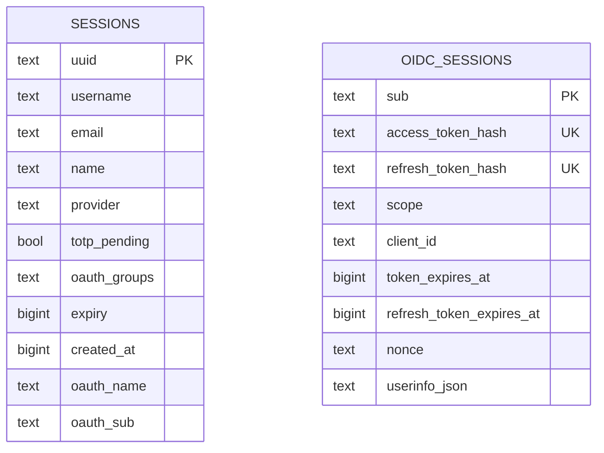
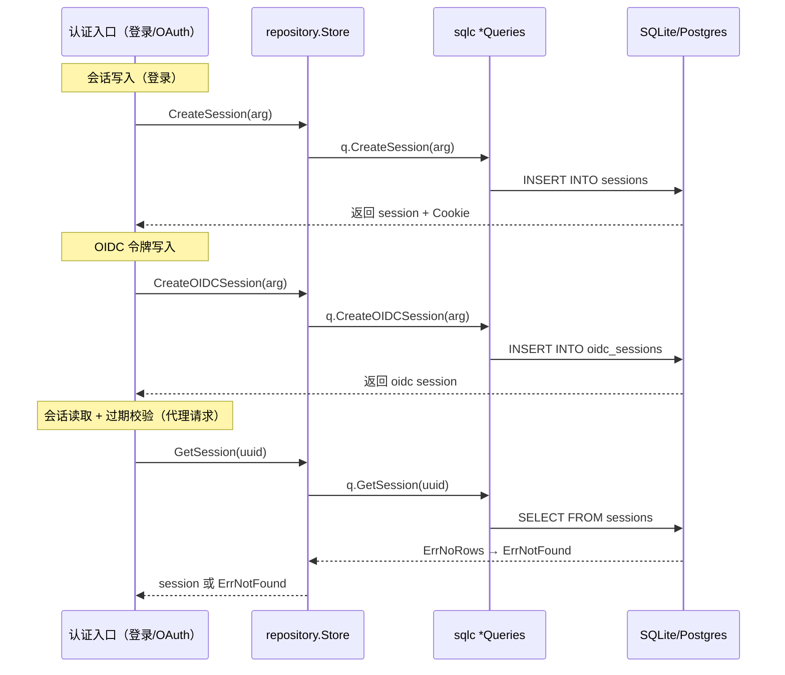

# Tinyauth 数据模型深读

Tinyauth 的持久化只关心**两类实体**：登录会话（`sessions`）与 OIDC 令牌会话（`oidc_sessions`）。这反映出它的定位——一个轻量认证服务器**不做业务数据**，数据库只是身份的短期状态。但恰恰因为简单，它的存储抽象做得非常干净：一个 `Store` 接口、三种实现、一套程序化生成 + 版本化迁移的双轨，很值得拆开看。

> **根因锚点**：认证服务器的存储需求是"小但关键"——会话数据量不大，但必须可靠、可迁移、可切换后端。Tinyauth 用「接口（`repository.Store`）+ 三种驱动 + sqlc 代码生成 + golang-migrate 迁移」把这件小事做到类型安全且可演进，同时保住"内存驱动也能跑测试"的开发体验。

## 实体关系总览

`oidc_sessions` 与 `sessions` 在**业务上无外键关联**（OIDC 令牌会话由 `sub` 标识，与登录会话的 `provider=oidc` 记录相互独立）——这正是"认证消费者"（登录会话）与"认证提供者"（OIDC 令牌）在存储层各管各的体现。

- **`sessions`**：登录态的持久化（本地 / LDAP / OAuth / Tailscale 用户共用同一张表，靠 `provider` 区分来源）。
- **`oidc_sessions`**：OIDC access/refresh token 的存储，`sub` 为 pairwise subject，token 只存 **SHA-256 哈希**；`userinfo_json` 是个 JSON blob，存换取时的用户声明快照（用于刷新时重建 ID token）。

## 存储选型与理由

Tinyauth 是三驱动可切换，`SetupStore` 按 `database.driver` 选择：`memory`、`sqlite`（默认）、`postgres`（[internal/bootstrap/db_bootstrap.go:23-32]()）。

| 驱动 | 底层 | 场景 | 特点 |
|------|------|------|------|
| SQLite | `modernc.org/sqlite`（纯 Go，**无 CGO**）| 默认、单实例生产 | 零外部依赖，编译期直出 |
| PostgreSQL | `pgx` | 高可用生产 | 多副本、可热迁移 |
| Memory | `sync.RWMutex` + map | 测试 / 开发 | 无持久化，初始化即空 |

选型的核心取舍在**纯 Go 无 CGO**：SQLite 用 `modernc.org/sqlite`（非 mattn 的 cgo 版本），让单二进制交叉编译零门槛，是"最小服务器"定位的直接支撑。代码里还留了一句耐人寻味的注释——"if the sqlite connection starts being a bottleneck"，暗示单连接 SQLite 是刻意的简单选择，真要瓶颈再上 Postgres（[internal/bootstrap/db_bootstrap.go:57-57]()）。默认 `sqlite` 空值时也回落到 SQLite（[internal/bootstrap/db_bootstrap.go:27-27]()）。

## 核心表设计

### sessions（登录会话）

`provider` 区分来源（local/ldap/oauth/tailscale），`totp_pending` 标记"密码已过、待 TOTP"的第二段登录状态，`oauth_groups` / `oauth_name` / `oauth_sub` 存 OAuth 用户的组与身份溯源（[internal/repository/models.go:6-18]()）。

| 字段 | 类型 | 约束 | 说明 |
|------|------|------|------|
| `uuid` | TEXT | PK, UNIQUE | 会话主键，也是 Cookie 值 |
| `username` | TEXT | NOT NULL | 登录名 |
| `email` | TEXT | NOT NULL | 邮箱 |
| `name` | TEXT | NOT NULL | 显示名 |
| `provider` | TEXT | NOT NULL | local/ldap/oauth/tailscale |
| `totp_pending` | BOOLEAN | NOT NULL | 第二段 TOTP 待验证 |
| `oauth_groups` | TEXT | NOT NULL DEFAULT '' | OAuth 组（逗号分隔） |
| `expiry` | BIGINT | NOT NULL | 滑动过期时间戳 |
| `created_at` | BIGINT | NOT NULL | 创建时间（绝对过期基线） |
| `oauth_name` | TEXT | NOT NULL DEFAULT '' | OAuth 提供者名 |
| `oauth_sub` | TEXT | NOT NULL DEFAULT '' | OAuth 用户唯一标识 |

索引：`idx_sessions_expiry`（`sessions.expiry`），支撑过期会话的批量清理（`000001_init_postgres.up.sql`）。

### oidc_sessions（OIDC 令牌会话）

`sub` 为 pairwise subject（每客户端不同，见 [`oidc-provider.md`](oidc-provider.md)），access/refresh token 都以哈希存储，`userinfo_json` 是换取时的用户声明快照（[internal/repository/models.go:20-30]()）。

| 字段 | 类型 | 约束 | 说明 |
|------|------|------|------|
| `sub` | TEXT | PK, UNIQUE | pairwise subject |
| `access_token_hash` | TEXT | UNIQUE | access token 的 SHA-256 |
| `refresh_token_hash` | TEXT | UNIQUE | refresh token 的 SHA-256 |
| `scope` | TEXT | NOT NULL | 授权的 scope |
| `client_id` | TEXT | NOT NULL | 归属的 OIDC client |
| `token_expires_at` | BIGINT | NOT NULL | access 过期 |
| `refresh_token_expires_at` | BIGINT | NOT NULL | refresh 过期（2 倍于 access） |
| `nonce` | TEXT | NOT NULL DEFAULT '' | 回放防护 |
| `userinfo_json` | TEXT | NOT NULL | 用户声明 JSON 快照 |

> **token 只存哈希**是本文最值得记的安全设计：DB 泄露也无法还原 access/refresh token，攻击者只能拿到无用的哈希。

## Schema 演进策略

Tinyauth 不用裸 DDL，而用 **`golang-migrate` 的版本化迁移** + `embed` 内嵌到 `internal/assets/migrations/{sqlite,postgres}/`，启动时自动 up（[internal/bootstrap/db_bootstrap.go:60-72]()）。每个引擎一套迁移，且**演进并不对齐**：

- **SQLite**（与项目同频演进，10 个版本）：`sessions` 逐版本加列（`000004_created_at`、`000009_oidc_userinfo_profile`、`000010_oidc_rework` 等）；
- **PostgreSQL**（后接入，2 个版本）：直接在 `000001` 建出最终态，仅 `000002_oidc_rework` 跟进 OIDC。

最有代表性的一次演进是 **`000010_oidc_rework`**：作者选择"nuke + merge into one table"，把 OIDC 从三张表（`oidc_tokens` / `oidc_userinfo` / `oidc_codes`）**合并成一张 `oidc_sessions`**，注释直白承认这会登出所有 OIDC 用户、但认为"没多大关系"（`000010_oidc_rework.up.sql`）。这体现的权衡是：认证会话本就是**可牺牲的短命状态**，用一次用户重新登录的代价换取 schema 的大幅简化，对登录服务器是划算的。

> 双轨并存的说明：`sql/sqlite/*_schemas.sql` 是 **sqlc 的输入**（一次性声明所有列，供代码生成查询的类型），`internal/assets/migrations/` 是**运行时建库**（逐步演进）。二者职责不同、都会保持到最终态一致（`sqlc.yml:3-6`）。

## 读写路径

`Store` 接口统一了读写入口（[internal/repository/store.go:14-29]()）。会话的读写两条关键链路：

驱动间的差异靠一个**薄转换层**抹平：sqlite/postgres 都用 `cmd/gen/sqlc-wrapper` 生成的 `Store`，把 sqlc 的 `*Queries` 包一层，并通过 `errorMap` 把 SQL 层的 `sql.ErrNoRows` 映射成统一的 `repository.ErrNotFound`（[internal/repository/sqlite/store.go:22-40]()）。Memory 驱动则直接 `sync.RWMutex` 读写两个 map（`repository/memory/store.go`）。上层（AuthService / OIDCService）只依赖 `Store` 接口，完全不感知后端。

过期清理是异步的：登录会话在主流程里按需删（`GetSession` 检过期即删，见 [`sso_flow.md`](sso_flow.md)），OIDC 会话由 30 分钟定时 goroutine `DeleteExpiredOIDCSessions` 批量清理（[internal/service/oidc_service.go:801-838]()）。

## 与其它子文档衔接

- 会话过期、登出、重建的完整时序 → [`sso_flow.md`](sso_flow.md)
- `oidc_sessions` 的令牌哈希/生命周期语义 → [`oidc-provider.md`](oidc-provider.md)
- session 的 `provider`、`oauth_groups` 如何参与授权 → [`policy-engine.md`](policy-engine.md)
