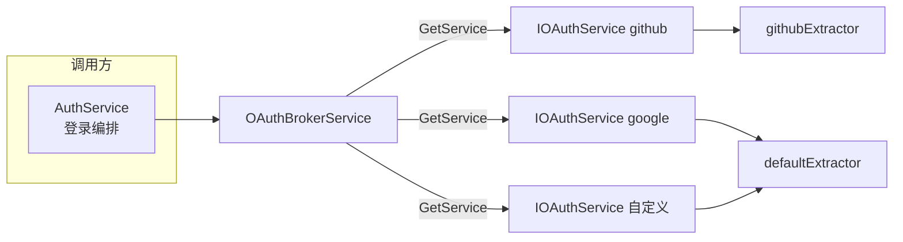
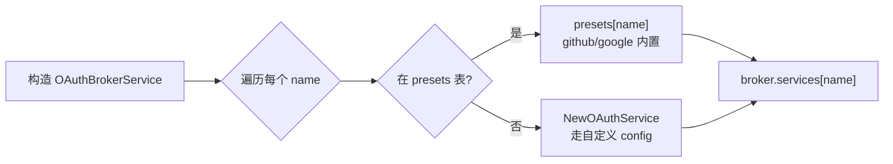
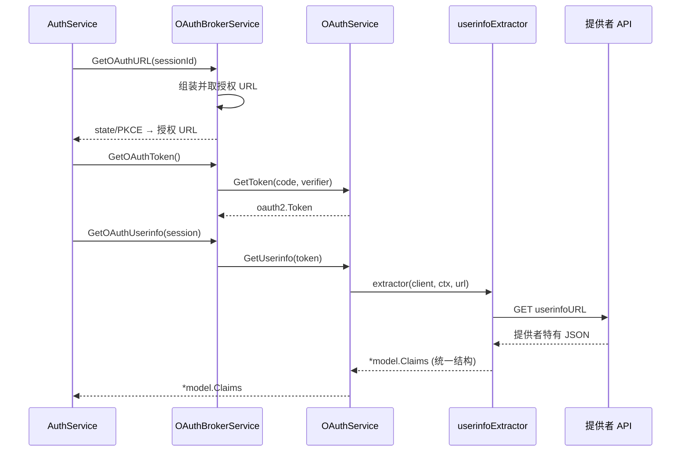

# Tinyauth OAuth Broker 架构深读

OAuth 是 Tinyauth 的认证方式之一：让用户用第三方账号（Google / GitHub / 自定义提供者）登录。这一关注面在真实源码里已经**从"单个 OAuth2 provider"演进为一个 broker + extractor 的可插拔体系**——本文拆解这套设计：一个 `OAuthBrokerService` 如何管理多个 `IOAuthService`、预设（preset）如何免配置开箱即用、不同提供者的 userinfo 差异又如何被"提取器"隔离。

> **根因锚点**：OAuth 登录的难点不在"走一遍授权码流程"，而在**每个提供者的 userinfo 返回格式不一致**（Google 的 `/userinfo` 直接给 OIDC Claims；GitHub 的 `/user` 不返回 email，必须再到 `/user/emails` 拉一次）。要同时支持多个提供者而不让调用方感知差异，就需要 broker（统一入口） + extractor（差异隔离）两层抽象。Tinyauth 的这套实现正是为此而生。

## Broker 的职责与装配

`OAuthBrokerService` 在建服务时遍历配置里的所有 `OAuthProviders`，对每个名字做一次"预设命中"判断：命中 `presets` 表的用对应的工厂函数，未命中的用通用 `NewOAuthService` 走自定义配置（[internal/service/oauth_broker_service.go:46-64]()）。

- **预设表**：`presets` 是一张从名字到工厂函数的 map，`github` / `google` 两个名字命中（[internal/service/oauth_broker_service.go:33-36]()）。这样用户只要配置 `oauthProviders.github.clientId`，无需手写 endpoint/scope 就能跑通。
- **统一接口**：所有服务都实现 `IOAuthService`，而 broker 只暴露 `GetConfiguredServices()`（已排序名字）与 `GetService(name)` 两个查询入口（[internal/service/oauth_broker_service.go:66-78]()）。调用方（AuthService）不感知某提供者来自 preset 还是自定义。

## 一个 OAuthService 的构成

单个 `OAuthService` 封装了 `golang.org/x/oauth2` 的 `Config`，外加一个可替换的"userinfo 提取器"。关键的灵活性在 `userinfoExtractor` 字段——它是 `OAuthUserinfoExtractor` 函数类型，默认 `defaultExtractor`（直接把 userinfo 端点的 JSON 反序列化成 `Claims`），但允许被 `WithUserinfoExtractor(...)` 覆写（[internal/service/oauth_service.go:13-21]()、`54-57`）。

提取器拿到的是 `*model.Claims`——**统一的结构体**。无论底层是 GitHub 的两段式拉取还是 Google 的一发即得，上层拿到的都是 `Email/Name/PreferredUsername/Sub/Groups` 这类一致的字段。差异被完全封装在提取器内部。

## 预设与提取器

| 提供者 | Scope | userinfo 提取器 | 特殊性 |
|--------|-------|----------------|--------|
| Google | `openid email profile` | `defaultExtractor` | 直接把 `https://openidconnect.googleapis.com/v1/userinfo` 的 OIDC Claims 反序列化（[internal/service/oauth_presets.go:10-17]()） |
| GitHub | `read:user user:email` | `githubExtractor` | `/user` 不含 email，需二次请求 `/user/emails`，从 verified/primary email 里挑；`sub` 用数字 id，`preferred_username` 用 login（[internal/service/oauth_extractors.go:28-75]()） |
| 自定义 | 用户配置 | `defaultExtractor` | 提供者需返回 OIDC 兼容的 Claims JSON |

GitHub 提取器是"差异隔离"的典型：它内部做两次 HTTP 请求、处理 email 缺主选备的逻辑，但对上层完全透明（[internal/service/oauth_extractors.go:28-75]()）。选哪个提取器在**装配时**决定：GitHub preset 在工厂里用 `.WithUserinfoExtractor(githubExtractor)` 接线（[internal/service/oauth_presets.go:19-25]()）。

## OAuth bridge mode（新格式）

`Experimental.OAuthBridgeEnabled` 是 experimental 开关，改变 OAuth（以及 Tailscale）用户向 session 的 **username / name 映射格式**（[internal/model/config.go:241-243]()）。

| 开关 | username | name |
|------|----------|------|
| 关闭（旧） | OAuth `preferred_username`，否则 email 的 `@` 替换为 `_`（如 `alice_example.com`） | 提供者 `name`，否则 `首字大写(@前) (@后)` 如 `Alice (example.com)` |
| 开启（新）| OAuth `preferred_username`，否则 email 前缀（`@` 前部分）| 提供者 `name`，否则 `Capitalize(username)` |

核心实现集中在 `createOAuthUserInfo`，bridge 分支与非 bridge 分支各走一套兜底逻辑（[internal/controller/oauth_controller.go:346-394]()）。本质差异是：**新格式的 username 直接取邮箱前缀**（更干净、更像"用户名"），旧格式保留完整邮箱但把 `@` 换成 `_`。对希望 username 就是登录名的场景，bridge 模式更友好。该模式同样作用于 Tailscale 登录的 username 生成（[internal/middleware/context_middleware.go:346-354]()）。

> **为何是 experimental**：username 一旦改变会直接影响已存在的会话、以及向后端透传的 `Remote-User` 头。切换格式等于一次可能破坏既有状态的迁移，所以 Tinyauth 把它封装成开关而非默认行为，让用户显式确认并择机切换。这与"配置可能经常变化"的版本态度一致（README 也提示升级前要读 release notes）。

## 与认证流程的衔接

OAuth 的完整登录时序（挂起会话、回调校验、邮箱白名单、回跳）在 [`auth-flow.md`](auth-flow.md) 的「OAuth 登录的挂起会话」章节展开。本文聚焦的是其"后台结构"：**broker 决定用哪个提供者、preset 决定默认参数、extractor 决定怎么读 userinfo**，三者装配完成后，上层登录编排（`AuthService`）就只跟 `IOAuthService` 接口打交道，不需要为每个提供者写特判。

## 与其它子文档衔接

- OAuth 登录的端到端时序与 hooks → [`auth-flow.md`](auth-flow.md)
- 会话/用户上下文中 OAuth 组如何参与授权 → [`policy-engine.md`](policy-engine.md)
- OAuth provider 配置的存储形态 → [`data-model.md`](data-model.md)
