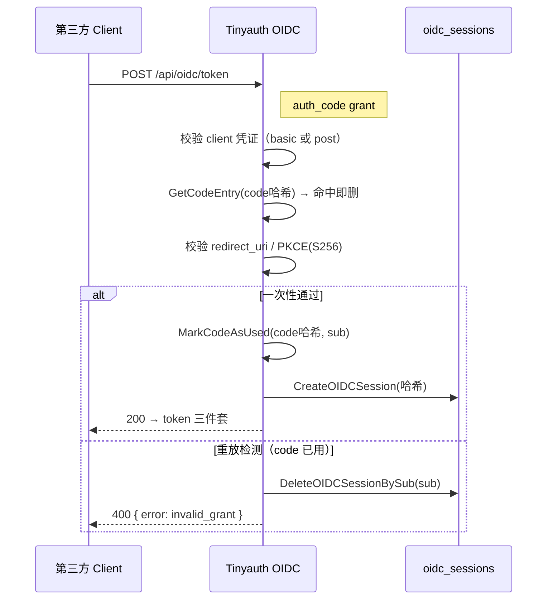

# Tinyauth OIDC 提供者实现深读（OpenID Certified™）

Tinyauth 不仅消费认证（ForwardAuth），还**自身就是 OpenID Connect 提供者**（OpenID Certified™ Basic OP，v5.1.0 起）。本文拆解 OIDC 服务器的内核实现：发现文档、授权参数校验、令牌生成、`sub` 派生、密钥与 JWKS、按 scope 过滤的 userinfo。它与 [`auth-flow.md`](auth-flow.md)（端到端时序）互补——本文讲"这个提供者端点的内部怎么算出来的"。

> **根因锚点**：做 OIDC 提供者的难点不只是"跑通授权码流程"，而是**在保持协议正确性的同时控制实现体积**。Tinyauth 用一个 `OIDCService` 类收敛令牌端点涉及的全部状态机与密码学（授权码、ID token、access/refresh token、JWKS），并把 `sessions`/`oidc_sessions` 的持久化委托给 sqlc 生成的 Store——这正是"认证提供者"与"认证消费者"在存储层汇合的地方（见 [`data-model.md`](data-model.md)）。

## 能力面板（来自 discover 端点）

`OIDCService` 直接暴露的能力数组，同时向外广播在 `/.well-known/openid-configuration`（[internal/service/oidc_service.go:26-29]()）：

| 能力 | 值 | 说明 |
|------|-----|------|
| scopes | `openid profile email phone address groups` | 非标准但完整声明集 |
| response types | `code` | 仅授权码 Flow |
| grant types | `authorization_code refresh_token` | 支持刷新 |
| subject types | `pairwise` | `sub` 每客户端不同（见下） |
| ID token 签名 | `RS256` | RSA-SHA256 |
| 客户端认证 | `client_secret_basic client_secret_post` | token 端点支持两种 |

`pairwise` subject 类型是本文的一个重要设计点：**同一用户对不同的 client 具有不同的 `sub`**，由 `CreateSub(userContext, clientId)` 派生——`sub = UUID(username + ":" + clientId)`（[internal/service/oidc_service.go:876-878]()）。这样第三方应用无法凭 `sub` 关联到"这是同一个真人"，契合隐私最小化。

## 授权参数校验（fail-closed）

`/authorize` 在重定向前做完整参数校验（[internal/service/oidc_service.go:380-425]()）：client 必须存在、`redirect_uri` 必须**精确命中**该 client 的 `TrustedRedirectURIs`、scope 非空、response type 属于 `code`、PKCE challenge method 只能是 `S256` 或 `plain`。任何一项不过即返回 `invalid_request`/`invalid_scope`/`unsupported_response_type` 等符码。

> 与 OAuth 回调的域名白名单（[`oauth-broker.md`](oauth-broker.md)）不同，OIDC 的 redirect_uri 是**每个 client 白名单式的精确匹配**，不靠域名推断——因为 OIDC client 是可信注册实体，trustedRedirectUris 显式列出即可，更严格也更不易被操纵。

## 授权码：一次性 + 哈希存储

授权码本身走"生成 → 存哈希 → 用后即删 + 双保险防重放"：

1. `CreateCode` 生成 32 位随机 code，`sub` 同源派生，code 以 `Hash(code)` 存缓存（TTL 1 分钟）（[internal/service/oidc_service.go:429-456]()）；
2. token 端点 `GetCodeEntry` 从缓存读到 code 后**立即删除**（一次性），并校验归属 client（[internal/service/oidc_service.go:503-528]()）；
3. **双保险**：`IsCodeUsed` 记录曾用过的 code 哈希（TTL 2 分钟），若一条 code 被再次提交，说明存在重放攻击——Tinyauth 直接 `invalid_grant` 并**删除该 sub 的所有会话**（[internal/controller/oidc_controller.go:416-431]()）。

## 令牌：不透明 access token + 哈希存储

Tinyauth 的 access token 是 `GenerateString(32)` 的**不透明字符串，不是 JWT**。它只在用户信息端点使用，且数据库里存的是 `Hash(accessToken)`——DB 泄露也还原不出令牌（[internal/service/oidc_service.go:600-651]()）。ID token 才是签名的 JWT。

| 令牌 | 形态 | 数据库存储 | 有效期 |
|------|------|-----------|--------|
| `access_token` | 32 位不透明串 | `access_token_hash` | `SessionExpiry` |
| `refresh_token` | 32 位不透明串 | `refresh_token_hash` | `SessionExpiry × 2` |
| `id_token` | RS256 签名 JWT | 不入库 | `SessionExpiry` |

refresh 令牌生命周期是 access 的两倍（[internal/service/oidc_service.go:600-615]()），且**refresh 只能换新令牌，不能访问 userinfo**——comment 明确约束。

### ID token：RS256 + 派生 kid

ID token 签名用 go-jose，`kid` 是 **public key PKCS1 DER 的 SHA-256**，`jku` 指向 `/.well-known/jwks.json`（[internal/service/oidc_service.go:530-546]()）。同一公钥在 ID token 与 JWKS 端点使用**同源推导的 kid**（`GetJWK` 用同样的 hasher，[internal/service/oidc_service.go:839-858]()），保证第三方能按 kid 找到对应公钥。

> **非规范但务实的取舍**：ID token 里**包含了 userinfo claims**（name/email/groups…）。这是注释里明说的"spec 不该这样"，但因为主流应用只看 ID token 而不是去调 userinfo 端点,为兼容性 Tinyauth 选择在 ID token 里带上（[internal/service/oidc_service.go:66-76]()）。代价是 refresh 时必须用 DB 里存的 userinfo JSON 重建 ID token（[internal/service/oidc_service.go:656-670]()），也带来一个已知局限：`auth_time` 未落库，刷新后的新 ID token 不含 `auth_time`（代码里留了 TODO，[internal/service/oidc_service.go:665-667]()）。

## userinfo：scope 驱动的字段过滤

`CompileUserinfo` 按请求的 scope 决定返回哪些声明（[internal/service/oidc_service.go:750-795]()）——`profile` 开名字系列、`email` 开 email、`groups` 开组、`phone` 开电话、`address` 开地址，未请求的 scope 对应字段一律不返回。这符合 OIDC 的最小权限原则：第三方拿到的永远是"它申请过的那些字段"。

userinfo 端点按 Bearer token 查 `oidc_sessions` 里的哈希、反解 `userinfo_json` 后返回（[internal/service/oidc_service.go:723-750]() 附近的 `GetSessionByToken`）。

## 密钥与证书管理

OIDC 的 RSA 密钥对**首次启动自动生成**，路径来自 config：私钥不存在时 `rsa.GenerateKey(rand.Reader, 2048)` 生成并以 PKCS1+DER+PEM 写入（文件 0600、目录 0700），公钥同理写入 0644；支持 PKCS1 与 PKIX（`PUBLIC KEY`）两种公钥格式加载（[internal/service/oidc_service.go:216-304]()）。启动时还做**私钥-公钥配对校验**（`N`/`E` 比较），防止配错。issuer 强制要求 `https`（[internal/service/oidc_service.go:184-195]()）。

## 会话状态机（OIDC 视角）

OIDC 会话生命周期由 `oidc_sessions` 表 + 一个 30 分钟定时清理 goroutine 维护：过期（令牌与 refresh 都超时）即删（[internal/service/oidc_service.go:801-838]()）。授权时会先 `DeleteOldSession` 删掉同一 `sub` 的旧会话（防止并发登录串扰），再建新会话——"只保留一个有效 OIDC 会话"。

## 与其它子文档衔接

- 授权码/token/userinfo 端点的**端到端时序与 hooks** → [`auth-flow.md`](auth-flow.md)
- 密钥配置、client secret 从文件加载 → [`data-model.md`](data-model.md)
- `oidc_sessions` 表的字段与读写路径 → [`data-model.md`](data-model.md)
