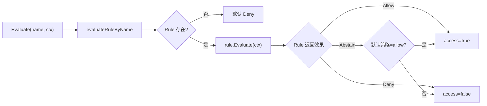
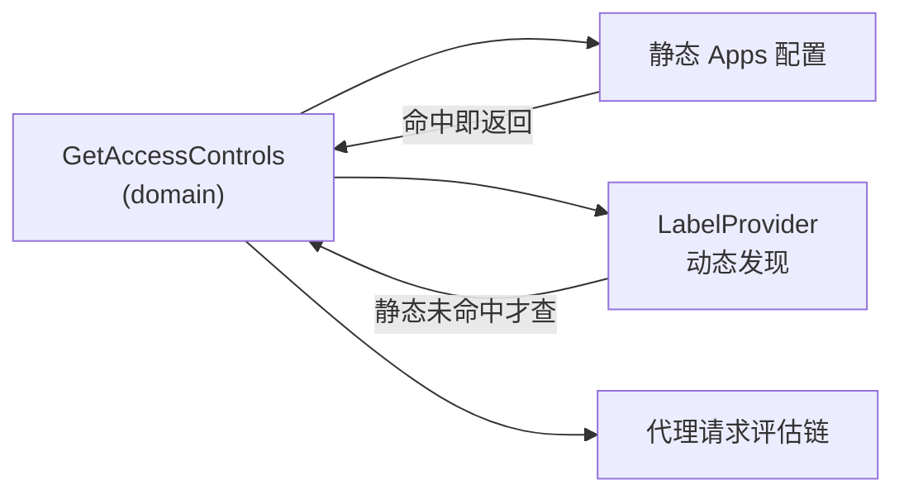

# Tinyauth 策略引擎与 ACL 深读

策略引擎是 Tinyauth **授权**的核心——认证通过之后，"这个用户能不能访问这个应用、这个路径、这个 IP"由它裁决。它用一个**三值（Allow / Deny / Abstain）+ 回退策略**的规则模式，把 IP、用户、组、路径、认证开关这几件完全不同的事统一成一个可组合的评估链。

> **根因锚点**：授权规则天然复杂（IP 黑白名单、用户名单、OAuth/LDAP 组、路径正则、是否需要认证）。若用 if-else 堆叠，每加一类判定都要改核心路径；Tinyauth 用「规则 = 独立策略实现，引擎 = 唯一编排点」的方式，让"要不要认证""IP 允不允许""用户允不允许"各归各的规则对象，互不干扰又按序组合。

## 三值效果的规则模型

`Rule` 只有一个方法：`Evaluate(ctx *ACLContext) Effect`，返回三值之一（[internal/service/policy_engine.go:19-37]()）：

| Effect | 含义 |
|--------|------|
| `EffectAllow` | 允许访问 |
| `EffectDeny` | 拒绝访问 |
| `EffectAbstain` | 本规则不裁决（这不归我管），**回退到默认策略** |

关键在 `Abstain`：它让规则能表达"我没有意见"，从而把裁决权交还给引擎的默认策略。`effectToAccess` 处理这个回退——Abstain 时按 `Engine.policy`（`allow`/`deny`，全局配置）决定（[internal/service/policy_engine.go:88-98]()）。

一个值得强调的细节：**未注册的规则名，`evaluateRuleByName` 直接返回 `Deny`**，不理会全局 allow/deny 策略（[internal/service/policy_engine.go:77-86]()）。这是 fail-closed 的保险——任何未装配的规则一律不放行。

## 六条规则的职责与评估顺序

`setupPolicyEngine` 在启动时用依赖注入注册全部 6 条规则（[internal/bootstrap/service_bootstrap.go:146-170]()）。它们在代理请求链路里按特定顺序被逐个触达：

| 规则名 | 常量 | 职责 | 评估时机 |
|--------|------|------|----------|
| `rule-ip-bypassed` | `RuleIPBypassed` | 匹配到的 IP 直通，完全跳过认证 | 最先 |
| `rule-auth-enabled` | `RuleAuthEnabled` | 判定当前路径是否**需要**认证 | 次先 |
| `rule-ip-allowed` | `RuleIPAllowed` | IP 允许/拒绝 | 认证前 |
| `rule-user-allowed` | `RuleUserAllowed` | 用户名/邮箱 允许/拒绝 | 认证后 |
| `rule-oauth-group` | `RuleOAuthGroup` | OAuth 组校验 | 认证后 |
| `rule-ldap-group` | `RuleLDAPGroup` | LDAP 组校验 | 认证后 |

代理控制器按 [internal/controller/proxy_controller.go:120-305]() 的顺序贯穿这几条：先问 `RuleIPBypassed`（IP 本身免认证）、再 `RuleAuthEnabled`（该 URL 免认证）、`RuleIPAllowed`（IP 拒绝），全都通过且已登录时才评估用户/组规则。

### IP 规则：全局 + 应用级合并

`RuleIPBypassed` 与 `RuleIPAllowed` 都做**全局配置（`auth.ip.*`）与应用级（`ACLs[].IP.*`）的合并**——先走 block/bypass 列表、再走 allow 列表；有 allow 列表时未命中即拒绝，无 allow 列表则默认放行（[internal/service/access_controls_rules.go:222-267]()）。这样基础设施组件（监控、健康检查）可以走全局 bypass 免认证，业务路径则按应用独立配置。

### 路径规则的语义（易混淆点）

`RuleAuthEnabled` 处理的是 URL 路径正则，但返回值的语义很容易被误解：**`Allow` 表示"这条路径不需要认证"，`Deny` 表示"这条路径需要认证"**。它首先检查 `Path.Block`（命中 = 启用认证，即配置对该路径强制登录），未命中再检查 `Path.Allow`（命中 = 关闭认证）。两者都未命中也不命中任何正则时返回 `Deny` = 需要认证（[internal/service/access_controls_rules.go:183-215]()）。

> config 里对这两个字段的注释写得很清楚：`path.allow` = "Disable authentication for only paths that match"、`path.block` = "Enable authentication for only paths that match"（[internal/model/config.go:334-337]()）。所以设计意图是**用正则描述例外路径**：`block` 说哪些必须登录，`allow` 说哪些免登录，其余默认走全局策略。

### 组规则与 Deny 策略的特例

`RuleLDAPGroup` 与 `RuleOAuthGroup` 有一个"看似反直觉"的设计——**即使全局策略是 `deny`，组规则也默认放行**。文件头注释解释了原因：不能因为用了 deny 策略就逼用户必须配置组；且多数实例跑在 Docker bridge 网络下拿不准真实 IP（[internal/service/access_controls_rules.go:13-17]()）。因此组不为空才检查成员，组为空或非该类用户视为通过（[internal/service/access_controls_rules.go:100-138]()、`140-177`）。

## ACL 配置：静态 + 动态合并

每个应用（一个受保护子域）对应一个 `App` 结构，承载该应用的全部授权参数。它由 config 与标签发现共同供给（[internal/model/config.go:289-337]()）：

`GetAccessControls` 的合并规则是**静态优先**：先在 config 的 `apps` 里按 domain 匹配，命中直接返回；未命中才查 label provider（如 Docker 标签 / K8s Ingress 注解）（[internal/service/access_controls_service.go:100-121]()）。这保证了"显式配置覆盖自动发现"。

匹配本身容忍两类：按 `config.domain` 精确校验匹配，或按"名字 + `.`"前缀匹配子域（`getACLs`，含多实例同名时用最后一个的告警，[internal/service/access_controls_service.go:40-87]()）。

### LabelProvider 抽象

`LabelProvider` 是一个 `Lookup` 接口（[internal/service/access_controls_service.go:17-19]()），让 Docker 与 Kubernetes 两种运行时以同一方式注入。启动时 `getLabelProvider` 按 `labelProvider` 配置（`auto` / `docker` / `kubernetes` / `none`）选择，运行环境不可用时优雅降级并告警（[internal/bootstrap/service_bootstrap.go:72-145]()）。

## 在代理链路的落位

策略引擎的评估结果决定代理控制器的响应。认证通过的请求会返回 200 并附带 `Remote-User`/`Remote-Email`/`Remote-Groups`/`Remote-Sub` 等头供后端使用（[internal/controller/proxy_controller.go:263-278]()，详见 [`sso_flow.md`](sso_flow.md)）。被拒绝时按 `useBrowserResponse` 决定 302（浏览器）或 JSON + `x-tinyauth-location`（API）。

## 与其它子文档衔接

- 代理链路如何按顺序触达各规则 → [`sso_flow.md`](sso_flow.md)
- 规则中用到的用户/组来自哪些认证源 → [`oauth-broker.md`](oauth-broker.md)
- `App` ACL 结构在 config 中的形态与演进 → [`data-model.md`](data-model.md)
