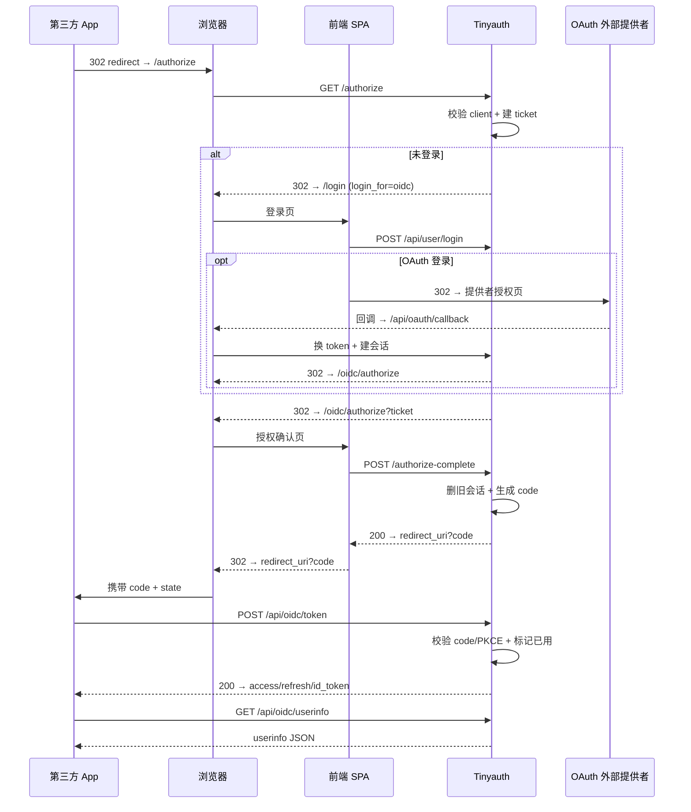
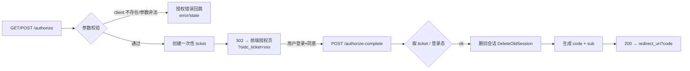
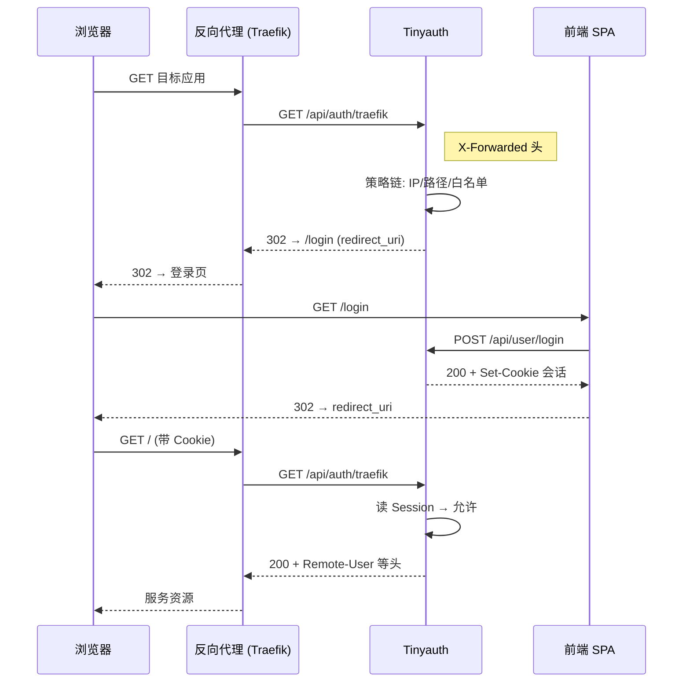
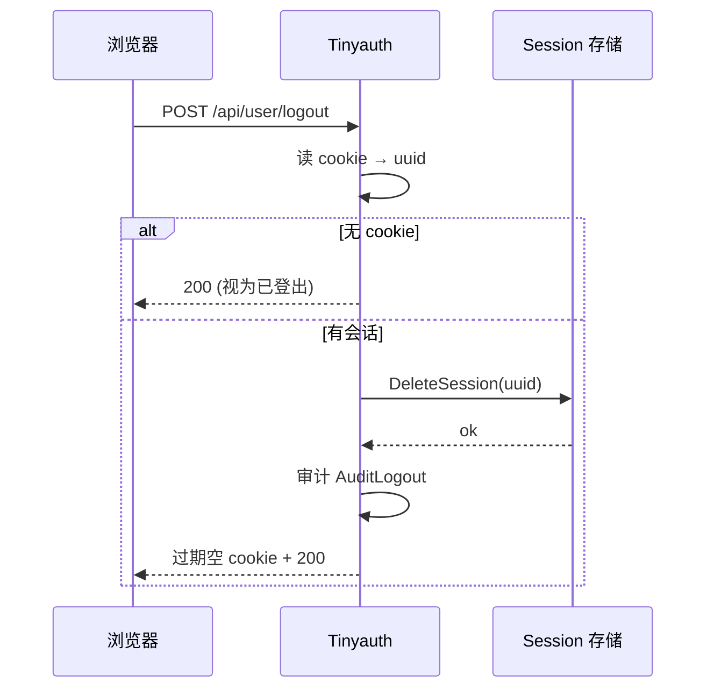
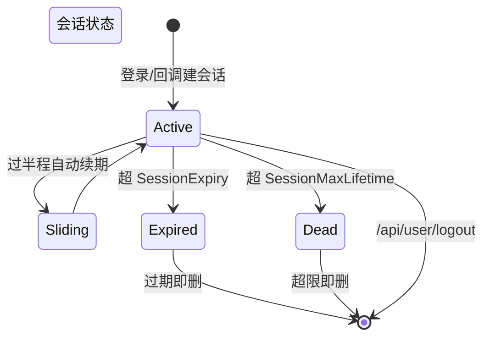
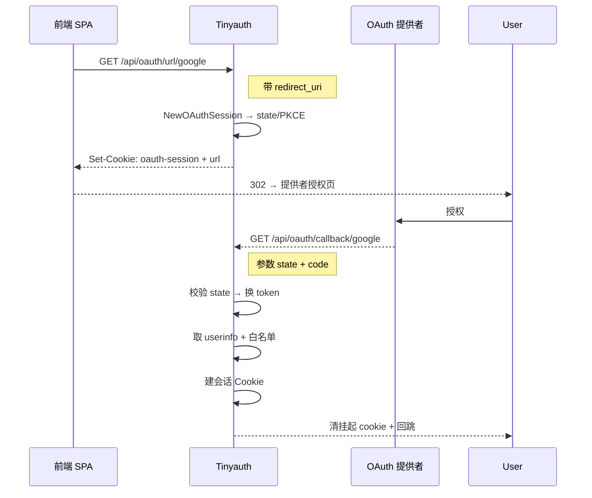

# Tinyauth 统一登录 / 登出（SSO & OIDC）流程深读

本文从**流程编排视角**拆解 Tinyauth 做"认证服务器"时的完整会话旅程：从一次被反向代理拦截的请求，到登录、授权、拿到令牌、访问资源，再到登出清理。它与 [`oidc-provider.md`](oidc-provider.md)（聚焦 OIDC 内核实现）和 [`oauth-broker.md`](oauth-broker.md)（聚焦 OAuth 外部登录源）互补：本文只关心"每个步骤调用哪个接口、传什么参数、流转如何回到原应用"。

> **根因锚点**：Tinyauth 既要当反向代理的认证消费者（ForwardAuth），又要当第三方的认证提供者（OIDC）。这两条身份线在"会话"上相遇——所有入口（本地登录 / OAuth 回调 / Tailscale / 代理校验）最终都收敛到同一张 `sessions` 表 + 同一个 Session Cookie。本文拆的就是这个"多入口 → 单会话 → 统一登出"的收敛过程。

## 端点总览

以 `{AppURL}` 为 issuer（服务器 `AppURL` 的协议 + host，见 [`oidc-provider.md`](oidc-provider.md)），路由分三组挂载：`mainRouterGroup`（根级）、`apiRouterGroup`（`/api` 前缀）、`wellKnown`（`/.well-known`）。

| 接口 | 方法 | 触发方 | 作用 |
|------|------|--------|------|
| `{issuer}/authorize` | GET/POST | 外部 OIDC 客户端 | 授权码请求入口，参数校验后**重定向到前端授权页**，不直接发码 |
| `{issuer}/api/oidc/authorize-complete` | POST | 前端 | 用户登录 + 同意后调用，真正创建授权码与替换会话 |
| `{issuer}/api/oidc/token` | POST | 外部客户端 | 授权码 / 刷新令牌换 access token |
| `{issuer}/api/oidc/userinfo` | GET/POST | 外部客户端 | 按 access token 返回用户声明 |
| `{issuer}/api/user/login` | POST | 前端 | 本地 / LDAP 密码登录（含 TOTP 两段式） |
| `{issuer}/api/user/totp` | POST | 前端 | TOTP 验证（登录的第二段） |
| `{issuer}/api/user/logout` | POST | 前端 | **统一登出**：删会话 + 清 Cookie |
| `{issuer}/api/user/tailscale` | POST | 前端 | Tailscale 身份换取会话 |
| `{issuer}/api/oauth/url/:provider` | GET | 前端 | 拿到某 OAuth 提供者的授权 URL（挂起会话） |
| `{issuer}/api/oauth/callback/:provider` | GET | 外部 OAuth 提供者 | 回调：换 token → 取 userinfo → 建会话 → 回跳 |
| `{issuer}/api/auth/traefik` | GET | 反向代理 | 代理认证校验（请求链路口） |
| `{issuer}/.well-known/openid-configuration` | GET | 外部客户端 | OIDC 发现文档 |
| `{issuer}/.well-known/jwks.json` | GET | 外部客户端 | RS256 公钥集 |
| `{issuer}/.well-known/webfinger` | GET | 外部客户端 | resource 解析 |

> 端点路径的两段式设计值得注意：`/authorize` 挂在**根级**（`mainRouterGroup`），而 `/api/oidc/*` 挂在 `/api` 下。这是为了让 `authorization_endpoint`、`token_endpoint`、`userinfo_endpoint` 在 discovery 文档中各就各位——授权端点刻意暴露在 `/authorize`（供浏览器直跳），令牌/用户信息端点走 `/api` 前缀（[internal/controller/oidc_controller.go:103-110]()、[internal/controller/well_known_controller.go:80-81]()）。

## 授权码 + PKCE 全流程

这是"第三方 App 通过 Tinyauth 登录"的完整时序。核心是 `/authorize` 与 `/api/oidc/authorize-complete` 的**分离**：

- `/authorize` 只做校验、建一次性 `ticket`、重定向到前端**授权/登录页**——它不产生代码，也不做破坏性动作；
- 真正建码、替换旧会话的是由前端调用的 `/api/oidc/authorize-complete`。

### 授权码 + PKCE 接口明细

下表给出授权码流程涉及接口的**请求 / 响应契约与错误码**（字段名与源码对齐）。

**authorization endpoint — `GET/POST {issuer}/authorize`**（[internal/controller/oidc_controller.go:103-104]()）

| 请求参数 | 类型 | 说明 |
|----------|------|------|
| `response_type` | string | 必须为 `code` |
| `client_id` | string | 注册的客户端 ID |
| `redirect_uri` | string | 必须精确命中该 client 的 `trustedRedirectUris` |
| `scope` | string | 空格分隔，支持 openid/profile/email/phone/address/groups |
| `state` | string | 回显到 redirect_uri，用于防 CSRF |
| `code_challenge` + `code_challenge_method` | string | PKCE，method 仅 `S256` 或 `plain` |

行为：校验 client / 参数合法后**不返回 code**，而是 302 到前端授权页 `?oidc_ticket=<一次性ticket>&oidc_scope=&oidc_name=`。参数非法时按 OIDC 规范在 callback/error 上带 `error`/`state` 回跳。

**token endpoint — `POST {issuer}/api/oidc/token`**（路由 [internal/controller/oidc_controller.go:107-110](), 处理器 [internal/controller/oidc_controller.go:375-543]()）

| 参数 | 说明 |
|------|------|
| `grant_type` | `authorization_code` 或 `refresh_token`，其他返回 `unsupported_grant_type` |
| `code` / `code_verifier` | 授权码流程下提交；`code_verifier` 需经 S256 校验 |
| `refresh_token` | 刷新流程下提交 |
| client 凭证 | 支持 `client_secret_post`（表单）或 `client_secret_basic`（HTTP Basic）；两者皆缺返回 `invalid_client` + `WWW-Authenticate: Basic` |

成功 200（`cache-control: no-store`）：`{ access_token, token_type:"Bearer", expires_in, refresh_token, id_token, scope }`。失败 400：`{ error, error_description }`，常见 `invalid_request` / `invalid_client` / `invalid_grant` / `unsupported_grant_type`。code 重放、redirect_uri 不匹配、PKCE 失败均返回 `invalid_grant`（并视重放删除会话）。

**userinfo endpoint — `GET/POST {issuer}/api/oidc/userinfo`**（路由 [internal/controller/oidc_controller.go:109-110](), 处理器 [internal/controller/oidc_controller.go:546-594]()）

`Authorization: Bearer <access_token>`（或 POST body `access_token`）。200 返回按 scope 过滤的声明 JSON（`sub`/`name`/`email`/`groups`…）；无 / 失效 token 返回 401。

`login_for` 返回值的去向是关键分支：前端拿到 200 后把 `redirect_uri`（含 `code`/`state`）原样交回给浏览器，由浏览器继续往第三方 App 走，Tinyauth 本身不跳转（[internal/controller/oidc_controller.go:344-371]()）。

### 授权端点与完成端点职责分离

`authorize` 主流程的注释直接说明了设计意图——它只做参数校验、ticket 创建、重定向到前端同意页，**不做破坏性动作**（如登出旧会话，[internal/controller/oidc_controller.go:115-117]()）。这带来两个好处：

1. **同意页与代码生成解耦**：用户还没确认就绝不会产生授权码，把"确认"这一步从服务端挪到了前端交互流程；
2. **可重入**：授权请求可以被多次改写、刷新而不会留下残留状态。

### ticket 的生命周期

`ticket` 是一次性授权请求的凭证，由 `CreateAuthorizeRequestTicket`、`GetAuthorizeRequestByTicket`、`DeleteAuthorizeRequestTicket` 三个方法围成完整的生命周期，`/authorize-complete` 用后即删。它把"外部授权请求"和"前端交互"之间最脆弱的一段（跨多个页面跳转）绑定起来，防止协议层的中途篡改（[internal/service/oidc_service.go:901-923]()）。

## SSO 登录：代理拦截 → 登录页 → 回跳

当用户从未登录访问被 Tinyauth 保护的应用时，经过反向代理的请求被 `/api/auth/traefik` 拦截。若策略链要求认证且无会话，代理控制器返回 **302 重定向到登录页**，并把回跳地址藏在 `redirect_uri` 查询参数里：

回跳参数由 `RedirectQuery{RedirectURI, LoginFor:FrontendLoginForApp}` 编码，登录成功前端据此回到原地址（[internal/controller/proxy_controller.go:283-285]()）。整个"重定向到登录页"的决策收敛在一处：`AppURL` 下的 `/login` 前端路由（[internal/controller/proxy_controller.go:294-294]()）。

### 浏览器 vs 非浏览器的拒绝响应

代理请求的响应格式由 `useBrowserResponse` 决定：浏览器纯跳 302，**API / 命令行客户端收到 401 + `x-tinyauth-location` 头**（由调用方自行跟随）。Nginx 因 `auth_request` 语义特殊处理，始终返回非浏览器响应。这保证无头客户端也能用同一套会话流程（[internal/controller/proxy_controller.go:349-349]()）。

## 统一登出

Tinyauth 的登出**收敛到一个接口** `POST /api/user/logout`。它做三件事：从 Cookie 取会话 UUID → 删库里的 session → 下发一个立刻过期的空 Cookie。

实现上 `DeleteSession` 返回一个 `MaxAge:-1, Expires:time.Now()` 的 Cookie，等价于让浏览器立刻丢弃（[internal/service/auth_service.go:451-469]()）。登出前会读取会话并记录审计事件（是谁、从哪个 provider 登录的），无 cookie 时也返回成功而非报错（[internal/controller/user_controller.go:224-268]()）。

> **没有独立的 `end_session` / RP-Initiated Logout 端点**。Tinyauth 是 OpenID **Basic** OP，当前规范（Basic OP 配置档）不要求 `end_session_endpoint`。因此"退出"只停用本机的会话 Cookie，不向第三方 app 广播登出——第三方应用需各自处理其持有的 access token 过期。

### 会话的演进（滑动过期 + 绝对上限）

会话有两个过期维度并存（详见 [`data-model.md`](data-model.md)）：

- **滑动过期**：`SessionExpiry`（默认 24h）。每次请求若已过半程则自动续期（`RefreshSession` 在 `expiry - now <= half` 时刷新，[internal/service/auth_service.go:397-449]()）；
- **绝对上限**：`SessionMaxLifetime`（可选），从 `created_at` 起算，超限即删。

`GetSession` 取会话时做两级判断：超最大寿命或已过期都直接物理删除并返回错误（[internal/service/auth_service.go:471-505]()）。

## OAuth 登录的挂起会话（pending session）

OAuth 登录与本地登录的不同在于：它需要一个**带状态的往返**（跳到外部提供者再回来）。Tinyauth 用内存中的"挂起会话"管理这段状态——`/api/oauth/url/:provider` 创建挂起会话并下发一个专用的 OAuth Session Cookie，回调 `/api/oauth/callback/:provider` 用该 Cookie 找回状态并完成换取。

挂起会话是**有上限的内存结构**：`MaxOAuthPendingSessions=256`，达到上限时清理最早的 16 个，防止资源耗尽（[internal/service/auth_service.go:28-29]()）。回跳路径是 `login_for` 的下一个分支：若本就是从 OIDC `/authorize` 进来的（`login_for=oidc`），则把原授权参数原样还原、继续走 OIDC 授权流程；否则回到应用（[internal/controller/oauth_controller.go:261-278]()）。

> 这个"挂起状态放哪"的设计取舍：OAuth 的 state/verifier 不进数据库、只放内存，换来的是极低的写放大与无需清理的临时记录；代价是**多实例部署下不共享挂起会话**（会丢回跳），因此 OAuth 登录路径约定为单实例或绑定会话亲和。Tinyauth 本就定位单实例轻量认证，这个取舍是自洽的。

## 安全要点

| 环节 | 机制 | 源码定位 |
|------|------|----------|
| 授权码防重放 | code 明文不进库，存哈希（`Hash`）；换取时 `MarkCodeAsUsed` 记 2 分钟，发现复用即 `invalid_grant` 并删对应会话 | [internal/service/oidc_service.go:880-895]() |
| PKCE | 默认 S256；`code_challenge_method` 非 S256 时降级 plain 并告警 | [internal/service/oidc_service.go:860-874]() |
| 回调 state | OAuth 回调强校验 state 与挂起会话一致，不匹配即拒绝 | [internal/controller/oauth_controller.go:122-268]() |
| 回跳安全 | 非 OIDC 的 `redirect_uri` 用域名校验器过滤，未通过即忽略 | [internal/controller/oauth_controller.go:322-343]() |
| 会话 Cookie | `HttpOnly + SameSite=Lax + Path=/`，可选 `Secure`、子域共享 | [internal/service/auth_service.go:392-393]() |
| 令牌端点缓存 | 响应头 `cache-control: no-store` + `pragma: no-cache` | [internal/controller/oidc_controller.go:540-541]() |

## 与其它子文档衔接

- 授权码 / ID Token 的具体生成与声明 → [`oidc-provider.md`](oidc-provider.md)
- OAuth 提供者如何注册、userinfo 如何提取 → [`oauth-broker.md`](oauth-broker.md)
- 会话/授权码的存储结构与存储选型 → [`data-model.md`](data-model.md)
- 代理请求的策略链（IP/用户/组判断）→ [`policy-engine.md`](policy-engine.md)
