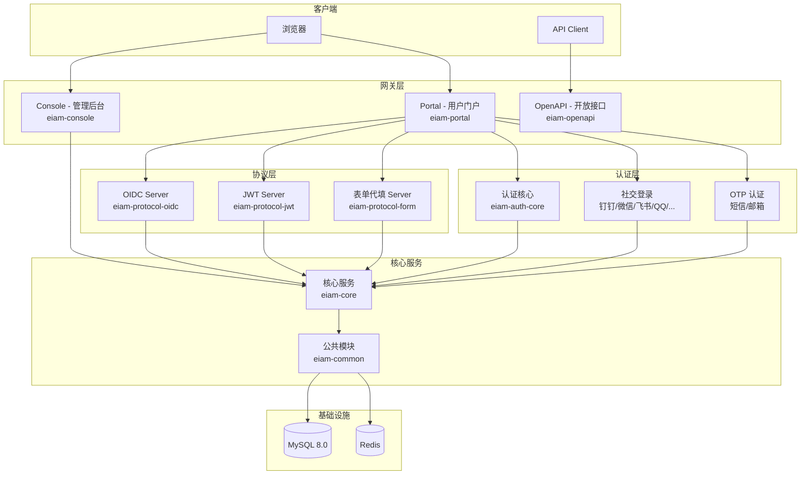
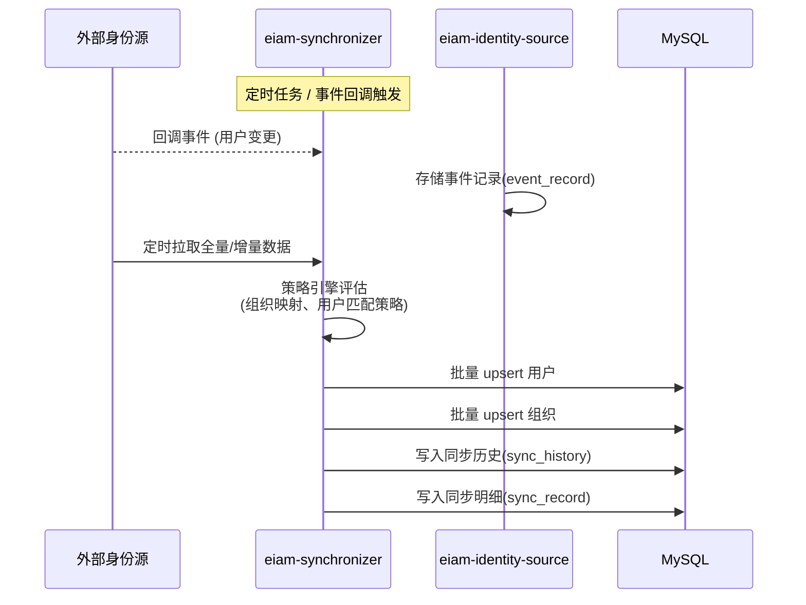
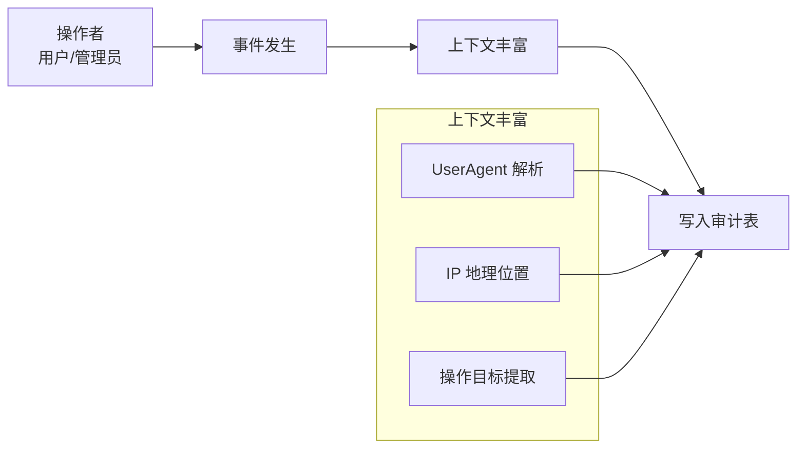

# TOPIAM — 企业级 IAM / IDaaS 身份管理平台解读

> **GitHub:** [github.com/topiam/eiam](https://github.com/topiam/eiam)

## 第一部分：快速概览

### 这是什么

TOPIAM（Top Identity and Access Management）是一款开源的企业级身份管理与访问控制平台，提供从用户管理、认证、授权到审计的完整 IAM/IDaaS 能力。系统支持 OIDC、OAuth2、SAML2、JWT、CAS、表单代填等主流认证协议，并能够集成钉钉、企业微信、飞书、LDAP、AD 等多种身份源，实现用户全生命周期管理与数据同步。

### 解决的痛点

企业内部应用繁多，每个应用独立维护一套用户体系，导致用户需要记住多套账号密码，IT 管理员需要分别在每个系统中管理权限和人员变更。TOPIAM 提供统一身份入口，实现"一个账号、一次认证、多点通行"，将认证与授权能力从业务应用中剥离，集中管理。

与 Keycloak（Java 重量级）和 Authelia（轻量 ForwardAuth 模式）不同，TOPIAM 定位在**企业级中等规模**：既提供了完整的 OIDC/OAuth2/SAML2/JWT/CAS 协议支持和丰富的社交登录集成，又保持了相对简洁的部署架构。

### 适用场景

- 企业内部应用（OA、CRM、ERP 等）的统一 SSO 单点登录
- 政府/教育机构的统一身份认证中心
- 多云/多应用环境下的身份集成与管理
- 需要对接钉钉、企业微信、飞书等企业通讯工具的身份同步
- 需要完整审计追踪和合规要求的身份管理场景

### 核心能力清单

| 能力 | 说明 |
|------|------|
| 统一账户管理 | 组织架构树、用户、用户组、第三方身份源同步 |
| 多协议 SSO | OIDC、OAuth2、SAML2、JWT、CAS、表单代填 |
| 多认证方式 | 用户名密码、短信/邮箱验证码、钉钉/微信/飞书/QQ/GitHub/Gitee/支付宝/企业微信社交登录 |
| 多因素认证 | 图形验证码 + 密码 + 短信/邮箱验证码的多步组合 |
| 身份源集成 | 钉钉、飞书、企业微信、LDAP、AD 等身份源的定时/事件同步 |
| 访问控制 | 基于用户/用户组/组织的应用访问授权策略 |
| 安全策略 | 密码复杂度、锁定策略、会话并发控制、IP 地理识别 |
| 行为审计 | 用户/管理员全量操作审计，含 UserAgent 解析和 IP 地理位置 |
| 会话管理 | 在线会话列表、强制下线、会话过期策略 |
| 部署方式 | Docker 一键部署、宝塔面板、阿里云计算巢 |
| 信创支持 | CPU、操作系统、中间件、数据库、浏览器、国密算法的全面适配 |

### 技术栈一览

| 层面 | 技术 |
|------|------|
| 语言 | Java 17 |
| 框架 | Spring Boot 3.x、Spring Security 6.x、Spring Session、Spring Authorization Server |
| ORM | JPA (Hibernate)、Liquibase（数据库迁移） |
| 数据库 | MySQL 8.0+ |
| 缓存 | Redis（Session、OTP、认证失败计数） |
| 前端（Console） | React.js + Ant Design |
| 前端（Portal） | React.js |
| 存储 | 支持阿里云 OSS / 腾讯云 COS / MinIO / S3 等 |
| 消息 | 阿里云短信 / 腾讯云短信 / 邮件 SMTP |
| 部署 | Docker |
| 构建 | Maven (多模块) |

---

## 第二部分：架构深读

### 架构总览



### 模块划分与职责

工程采用 Maven 多模块架构，共 12 个子模块：

| 模块 | 定位 | 关键职责 |
|------|------|----------|
| **eiam-common** | 公共基础 | 实体定义、Repository、枚举、常量、存储接口、消息发送、Setting 配置读取 |
| **eiam-core** | 核心服务 | 业务逻辑、安全配置、Session 管理、定时任务 |
| **eiam-portal** | 用户门户 | 面向终端用户的登录/注册/账户管理/应用列表 |
| **eiam-console** | 管理后台 | 面向管理员的用户/组织/应用/审计管理 |
| **eiam-openapi** | 开放接口 | REST API + SCIM 2.0 接口，AccessToken 认证 |
| **eiam-protocol-oidc** | OIDC 协议 | Spring Authorization Server 集成，OIDC/OAuth2 完整实现 |
| **eiam-protocol-jwt** | JWT 协议 | JWT SSO，非对称加密的分布式单点登录 |
| **eiam-protocol-form** | 表单代填 | 模拟登录传统 Web 应用，AES256 加密存储凭据 |
| **eiam-authentication-\*** | 认证集成 | 11 个子模块，每个对接一种第三方认证方式 |
| **eiam-identity-source** | 身份源同步 | 对接钉钉/飞书/企业微信/LDAP 等，用户/组织同步 |
| **eiam-audit** | 审计模块 | 用户/管理员行为审计记录 |
| **eiam-application** | 应用聚合 | 聚合所有模块的主启动模块 |

### 数据模型概要

系统按**领域**划分数据模型，共 28 张表（详见 `database-design.md`）：

| 领域 | 表数 | 核心实体 |
|------|------|----------|
| 账户域 | 9 | User, Organization, UserGroup, ThirdPartyUser |
| 应用域 | 9 | App, AppOidcConfig, AppJwtConfig, AppFormConfig, AppAccessPolicy |
| 身份源域 | 4 | IdentitySource, SyncHistory, SyncRecord |
| 认证域 | 1 | IdentityProvider (含 JSON 配置列) |
| 设置域 | 3 | Administrator, Setting, MailTemplate |
| 消息域 | 2 | MailSendRecord, SmsSendRecord |
| 审计域 | 1 | Audit (宽表, JSON 列多目标) |

关键设计决策：
- **UUID 主键**：所有表使用 VARCHAR(64) UUID，支持分布式部署
- **独立管理员表**：Administrator 与 User 分离，Console 与 Portal 独立认证上下文
- **JSON 列存储配置**：IdentityProvider、IdentitySource 的配置字段使用 MySQL JSON 列，支持不同提供商的差异化参数
- **软删除**：全表 `is_deleted` 字段 + Hibernate `@SoftDelete` 自动过滤
- **宽表审计**：审计表使用多 JSON 列存储结构化操作数据，避免多表 JOIN

---

## 第三部分：认证体系设计

> 完整的登录/登出流程详解（代码级深度）见独立文档：[**认证流程详解**](auth-flow.md)。

TOPIAM 的认证体系以 Spring Security 为核心，通过**多条 SecurityFilterChain** 实现不同入口的独立安全策略：

1. **IDP SecurityFilterChain** — 处理第三方社交登录（钉钉/微信/飞书/QQ 等），使用 `OrRequestMatcher` 组合 9 种 IDP 的入口 URL
2. **Default SecurityFilterChain** — 处理表单登录、短信/邮箱 OTP 验证码登录、IDP 用户绑定
3. **OIDC/JWT/Form 协议链** — 分别处理三种 SSO 协议的认证端点

核心认证方式矩阵：

| 认证方式 | 实现机制 | 过滤链 | 适用场景 |
|----------|----------|--------|----------|
| 用户名密码 | `FormLoginConfigurer` → `DaoAuthenticationProvider` | Default | 常规登录 |
| 短信验证码 | `SendSmsOtpFilter` 发送 → `SmsOtpAuthenticationFilter` 校验 | Default | 快捷登录 |
| 邮箱验证码 | `SendMailOtpFilter` 发送 → `MailOtpAuthenticationFilter` 校验 | Default | 快捷登录 |
| 社交 IDP | 各 IDP 模块的 OAuth2 Redirect + Login Filter | IDP | 第三方登录 |
| OIDC 授权码 | Spring Authorization Server 标准端点 | OIDC | 第三方应用授权 |
| JWT SSO | 非对称加密签发 IdToken | JWT | 跨域单点登录 |
| 表单代填 | AES256 解密凭据 → 模拟表单提交 | Form | 遗留系统适配 |

关键安全机制：
- **密码加密**：BCrypt 哈希存储，前端登录时密码先用 AES 加密传输（AES 密钥由后端 RSA 公钥加密下发）
- **登录失败锁定**：基于 Redis AtomicLong 计数，滑动窗口内失败超阈值自动锁定用户（默认 3 次/5 分钟）
- **会话管理**：Redis 集中存储，支持并发控制（可配置最大会话数）、会话过期/滑动刷新、强制下线
- **CSRF 保护**：Cookie 模式 + `SpaCsrfTokenRequestHandler` 适配前后端分离架构

---

## 第四部分：协议层实现

### OIDC / OAuth2 协议

基于 Spring Authorization Server 实现，完整支持 OIDC 核心协议：

**端点清单：**

| 端点 | 说明 |
|------|------|
| `/.well-known/openid-configuration` | OIDC 发现文档 |
| `/.well-known/jwks.json` | JWKS 公钥端点 |
| `/oauth2/authorize` | 授权端点（authorization_code） |
| `/oauth2/token` | Token 端点 |
| `/oauth2/revoke` | Token 撤销 |
| `/oauth2/introspect` | Token 自省 |
| `/oauth2/userinfo` | UserInfo 端点 |

**授权服务持久化：** 使用 **Redis** 存储 OAuth2Authorization，而非默认的内存实现。这使得多实例部署下授权状态可以共享。

**Token 定制：** `OAuth2TokenCustomizer` 在签发 JWT Access Token 时注入自定义声明（用户 ID、用户名、认证类型等），供资源服务器消费。

**安全性支持：**
- PKCE 强制（通过 `require_proof_key` 配置）
- RS256/JWS 签名（应用级证书管理，`eiam_app_cert` 表）
- 客户端认证方式：`client_secret_basic` / `client_secret_post`
- Refresh Token 轮转（通过 `reuse_refresh_token` 控制）
- 各 Token 独立有效期配置

### JWT 协议

JWT SSO 协议用于分布式站点的单点登录。与 OIDC 不同，JWT 协议更轻量：

- 使用**非对称加密**（应用私钥签名，应用公钥验证）
- 签发 `IdToken`（类似 JWT ID Token），包含 `sub`/`iss`/`aud`/`exp` 标准声明
- 支持 `JwtLoginAuthenticationEndpointFilter`（发起登录）和 `JwtLogoutAuthenticationEndpointFilter`（单点登出）
- 支持用户 ID、用户名、自定义属性作为 `sub` 值（通过 `id_token_subject_type` 配置）

### 表单代填

为不支持标准协议的遗留系统提供兼容方案：

- 存储用户在目标应用中的账号密码（AES256 可逆加密，不同于 BCrypt 单向哈希）
- 通过代理页面注入用户名/密码到表单字段 → 自动提交
- 支持自定义字段（`other_field` JSON 列），适配不同表单结构
- 支持多种加密方式（RSA/AES）和提交方式（POST/GET）

**局限性：** 不适用于有图片验证码、CSRF Token、动态参数的登录场景。

---

## 第五部分：身份源同步

TOPIAM 支持从外部系统同步用户和组织数据，维护目录的统一性。

### 支持的提供商

| 提供商 | 实时事件 | 定时同步 | 关键能力 |
|--------|----------|----------|----------|
| 钉钉 | ✅ 回调事件 | ✅ | 用户/部门全量同步 |
| 飞书 | ✅ 回调事件 | ✅ | 用户/部门全量同步 |
| 企业微信 | ✅ 回调事件 | ✅ | 用户/部门全量同步 |
| LDAP | - | ✅ | 目录服务标准协议 |
| AD | - | ✅ | Active Directory |

### 同步架构



**策略配置**（`strategy_config` JSON 字段）：
- 组织目标映射：源组织 → 目标组织的映射规则
- 用户匹配策略：按用户名/邮箱/手机号匹配已有用户
- 冲突处理：覆盖 / 跳过 / 合并

**同步历史追踪：** `sync_history` 记录每次同步的总览（批量号、创建/更新/删除/跳过数量、状态），`sync_record` 记录每个对象的处理明细，支持追溯。

---

## 第六部分：审计体系

TOPIAM 实现了全面的行为审计，采用**宽表 + JSON 列**设计：



### 审计表字段

| 字段分类 | 字段 | 说明 |
|----------|------|------|
| 操作者 | `actor_id`, `actor_type`, `actor_auth_type` | 谁操作的、用户还是管理员、认证方式 |
| 事件 | `event_type`, `event_status`, `event_time` | 事件类型（LOGIN/LOGOUT/...）、成功/失败 |
| 目标 | `target_` (JSON) | 操作影响的目标列表 `[{id, type, name}]` |
| 详情 | `event_param`, `event_content`, `event_result` | 请求参数、事件描述、处理结果 |
| 技术元数据 | `user_agent` (JSON), `geo_location` (JSON), `session_id`, `request_id` | UA 解析结果、IP 地理位置、会话/请求 ID |

### 审计事件类型

关键事件：
- `LOGIN_PORTAL` / `LOGIN_CONSOLE` — 登录成功/失败
- `LOGOUT_PORTAL` / `LOGOUT_CONSOLE` — 登出
- `CREATE_USER` / `UPDATE_USER` / `DELETE_USER` — 用户管理
- `CREATE_APP` / `UPDATE_APP` / `DELETE_APP` — 应用管理
- `AUTHORIZE_APP` / `REVOKE_APP` — 授权/撤销

### 设计考量

- **宽表优先**：审计查询通常需要一次获取完整上下文，宽表避免了多表 JOIN
- **JSON 灵活性**：`target_` 支持多目标（如：删除用户同时影响多个应用授权），无需拆行
- **数据量压力**：审计表预期数据量最大（亿级），建议引入按时间分区或归档策略

---

## 第七部分：设计模式与代码亮点

### 策略模式：认证提供者扩展

每个社交 IDP 实现遵循统一的 SPI 接口模式：

```
eiam-authentication-core (接口定义)
  ├── IdentityProviderAuthenticationService     # 认证服务接口
  ├── AbstractIdentityProviderAuthenticationProcessingFilter  # Filter 基类
  └── IdentityProviderAuthenticationProvider    # Provider 基类

eiam-authentication-dingtalk (具体实现)
  ├── DingtalkOAuth2AuthorizationRequestRedirectFilter  # 授权重定向
  ├── DingtalkOAuth2AuthenticationFilter                # 回调认证
  └── DingtalkAuthenticationConfigurer                 # 注册到 Security
```

新增一个社交登录只需：
1. 创建子模块，实现 Filter 继承基类
2. 实现 `IdentityProviderAuthenticationService` 接口
3. 在 `PortalSecurityConfiguration` 中注册 Configurer
4. 在管理后台配置 AppId/AppSecret

### 门面模式：ContextService

`ContextService`（`eiam-core`）是整个安全配置的统一读取门面，封装了从 `SettingEntity` 读取和默认值回退逻辑：

```java
// 运行时读取安全配置的统一入口
contextService.getSecurityBasicConfig()   // 验证码有效期、防御策略
contextService.getPasswordPolicyConfig()  // 密码策略
contextService.getSessionConfig()         // 会话策略
```

所有安全策略配置都通过此门面获取，避免在多个地方重复实现"数据库读取 → 默认值回退"的逻辑。

### 适配器模式：存储层

`Storage` 接口统一了对象存储访问方式，支持阿里云 OSS、腾讯云 COS、MinIO、AWS S3 等多种实现。与 Tinyauth 的 Store 接口设计理念一致——接口定义契约，多种实现随心切换。

### SecurityFilterChain 多链隔离

TOPIAM 充分利用了 Spring Security 的 `SecurityFilterChain` 多链特性，将不同的认证入口隔离到独立的过滤链：

- IDP 链处理社交登录（共享 Session）
- Default 链处理传统登录
- 协议链（OIDC/JWT/Form）各管各的协议端点

每条链可独立配置 Session 策略（如协议链使用 `SessionCreationPolicy.NEVER`，因为协议认证本身不依赖 Session）。

---

## 第八部分：安全机制汇总

| 机制 | 实现方式 | 默认值 |
|------|----------|--------|
| 密码加密 | BCrypt 哈希（不可逆） | - |
| 前端密码传输 | AES 加密（RSA 公钥保护 AES 密钥） | - |
| 登录失败锁定 | Redis AtomicLong 计数 + 滑动窗口 | 5 分钟内 3 次失败 → 锁定 |
| 自动解锁 | 定时任务（每分钟扫描） | 锁定 3 分钟后自动解锁 |
| 密码策略 | 长度/复杂度/历史重复/过期 | 最小 6 位，无复杂度要求 |
| 密码过期锁定 | 定时任务（每天） | 默认 120 天过期 |
| 会话并发控制 | Redis 存储 + SessionRegistry | 默认 1 个并发会话 |
| 会话超时 | Spring Session 配置 | 默认 18000 秒（5 小时） |
| CSRF | Cookie 模式 + SpaCsrfTokenRequestHandler | ✅ |
| CORS | 开放所有来源（`permitAll`） | ✅ |
| 安全头 | XSS/CSP/Referrer-Policy/Frame-Options | ✅ |
| 验证码 | Session 存储 + 有效期控制 | 默认 5 分钟有效 |

---

## 第九部分：同类项目对比

| 方面 | TOPIAM | Keycloak | Casdoor | Authelia |
|------|--------|----------|---------|----------|
| **语言** | Java | Java | Go | Go |
| **部署体积** | ~200MB JAR + MySQL + Redis | ~300MB+ JVM + DB | ~50MB 单二进制 + DB | ~30MB 单二进制 |
| **部署复杂度** | 中（需 MySQL + Redis） | 高（需数据库） | 中 | 低 |
| **OIDC** | ✅ 完整实现（Spring Auth Server） | ✅ 原生 | ✅ | ❌ |
| **SAML2** | ✅ | ✅ 原生 | ✅ | ❌ |
| **JWT SSO** | ✅ 自研协议 | ❌ | ❌ | ❌ |
| **表单代填** | ✅ | ❌ | ❌ | ❌ |
| **社交登录** | 钉钉/微信/飞书/QQ/GitHub/Gitee/支付宝/企业微信 | 需插件 | GitHub/Google/微信/QQ 等 | Google/GitHub/OIDC |
| **身份源同步** | 钉钉/飞书/企业微信/LDAP/AD | LDAP/AD | LDAP | LDAP |
| **审计** | ✅ 全量行为审计 | ✅ | ❌ | ❌ |
| **信创适配** | ✅ | ❌ | ❌ | ❌ |
| **管理 UI** | ✅ 完整（Console） | ✅ 完整 | ✅ | ❌ |
| **用户门户** | ✅ Portal（用户自助） | ✅ 用户控制台 | ❌ | ❌ |
| **正向代理认证** | ❌ | ❌ | ❌ | ✅ ForwardAuth |

**TOPIAM 的差异化优势：**

1. **国内社交平台深度集成**：钉钉、企业微信、飞书是国内企业最常见的通讯工具，TOPIAM 对三者的集成深度远超国际化项目
2. **表单代填**：解决遗留系统的 SSO 兼容问题，同类项目中少见
3. **JWT 轻量 SSO 协议**：相比完整的 OIDC 协议，JWT SSO 集成更简单，适合内部应用快速对接
4. **信创支持**：是国内少有的从芯片到浏览器的全链路国产化兼容的 IAM 产品
5. **用户自助门户**：提供终端用户的登录门户，不同于纯后台管理
6. **完整的中文生态**：文档、界面、社区全部中文本地化

**TOPIAM 的局限性：**

1. **部署较重**：依赖 MySQL + Redis，不能像 Go 项目那样单二进制运行
2. **不支持 ForwardAuth**：无法像 Tinyauth/Authelia 那样通过反向代理无侵入认证
3. **不支持 WebAuthn/FIDO2**：缺少现代无密码认证标准
4. **SAML2 成熟度不足**：相比 Keycloak 的原生 SAML 支持有一定差距
5. **社区规模**：相对 Keycloak/Casdoor，中文社区体量较小

---

## 第十部分：总结与评价

TOPIAM 是一个定位清晰、覆盖全面的企业级 IAM 平台。它在"功能完整性"和"部署复杂度"之间取得了**面向国内市场的平衡**——比 Keycloak 更接地气（钉钉/飞书/信创），比轻量认证代理功能更全（OIDC+SAML+JWT+表单代填+审计），但比 Go 项目部署更重。

**最值得学习的设计决策：**

1. **多 SecurityFilterChain 隔离** — 不同认证入口独立过滤链，Session 策略灵活配置，架构清晰
2. **认证模块 SPI 设计** — 新增社交登录只需创建子模块实现接口，符合开闭原则
3. **JSON 列的使用哲学** — 在配置多态（IDP 配置、身份源配置）和审计灵活字段上使用 JSON，避免了 EAV 模式或大量子表
4. **ContextService 门面** — 统一的安全配置读取入口，避免配置逻辑分散
5. **Redis 在认证中的多重角色** — Session 存储 + OTP 验证码 + 登录失败计数器，充分利用 Redis 的原子性和过期机制
6. **独立管理员表** — Console 与 Portal 使用独立的认证实体，职责分离清晰，安全边界明确

对于需要为中国企业搭建统一身份管理平台的团队，TOPIAM 是当前开源领域最全面的 Java 方案。

> **仓库：** [github.com/topiam/eiam](https://github.com/topiam/eiam) | **官网：** [topiam.cn](https://topiam.cn) | **演示：** [demo.topiam.cn](https://demo.topiam.cn)
