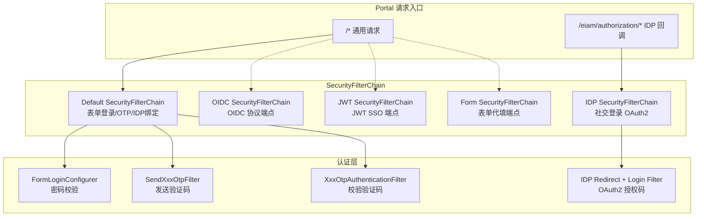
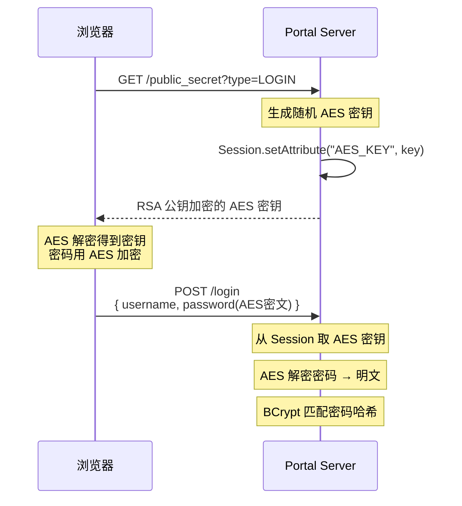
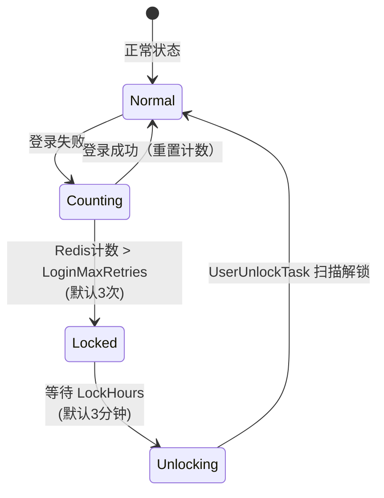
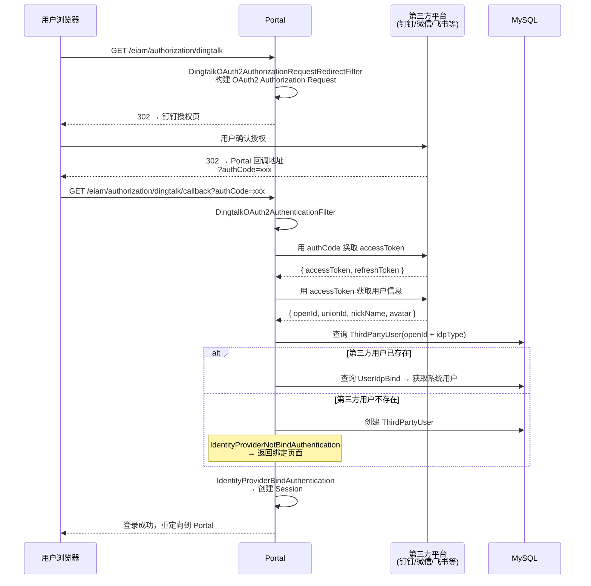
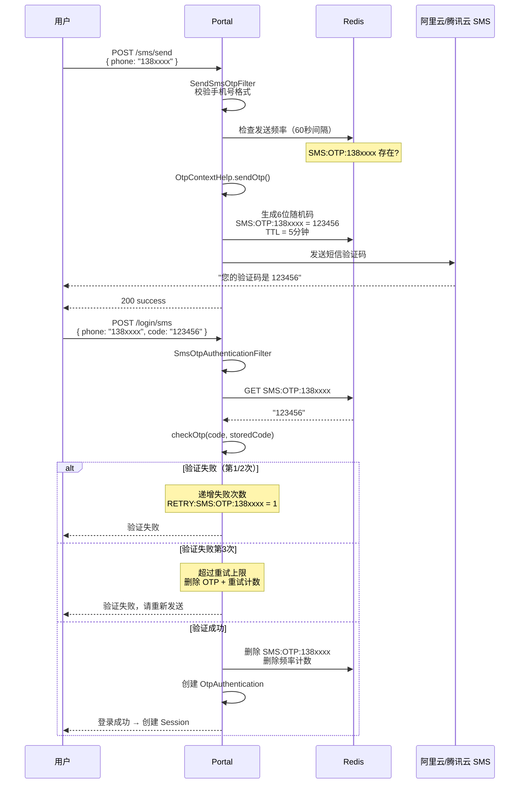
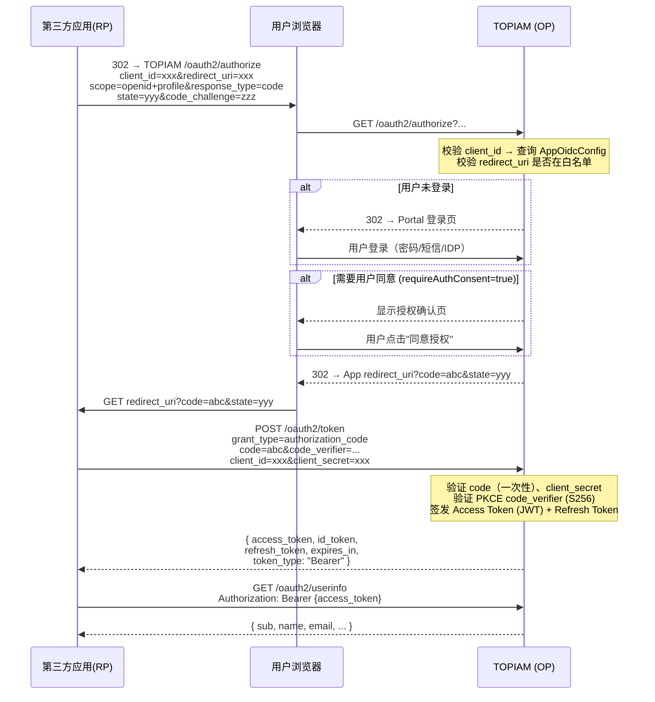
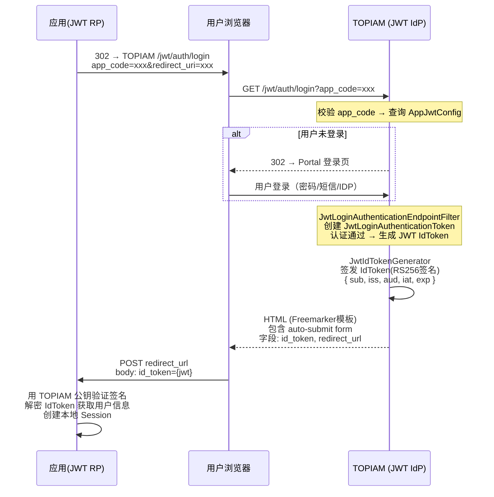
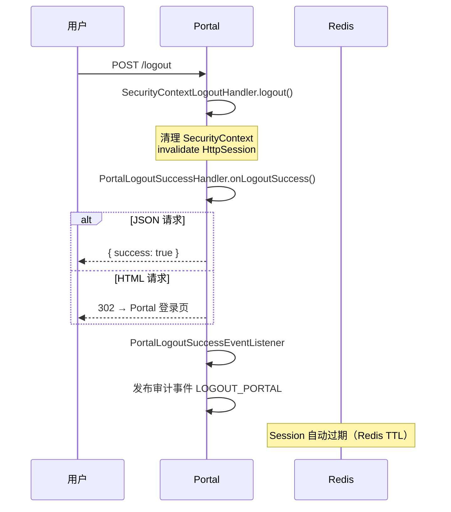
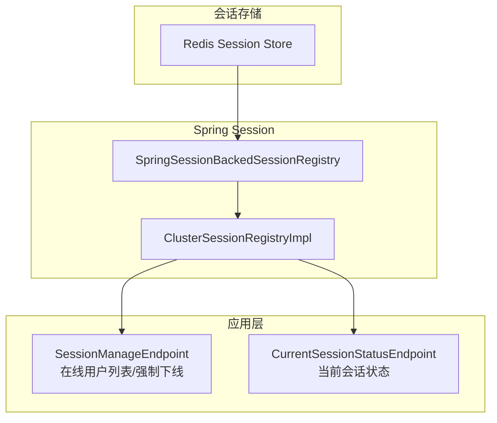
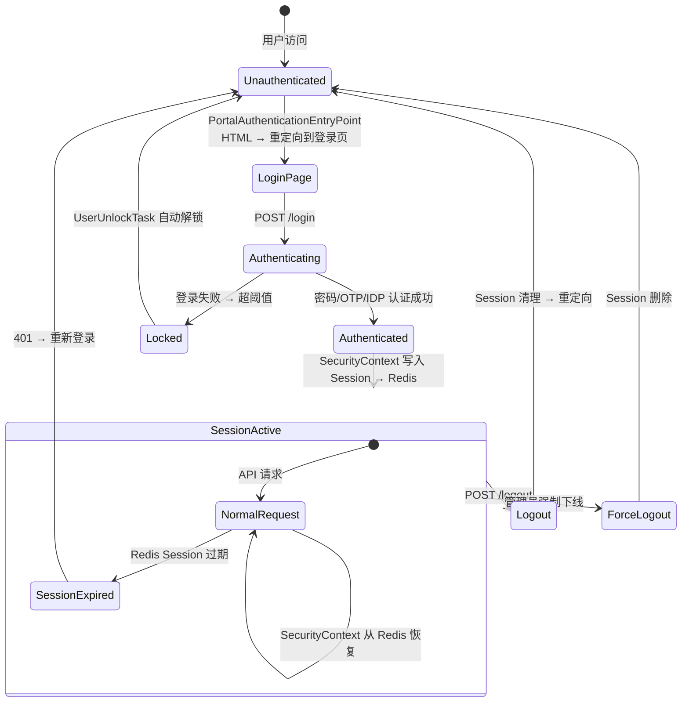

# TOPIAM 认证流程详解

> 本文档深入分析 TOPIAM 中所有登录、登出流程的内部实现，涵盖完整调用链路、核心代码逻辑和关键安全机制。
>
> 依赖阅读：建议先阅读 [项目主分析文档](README.md) 了解整体架构。

---

## 第一部分：认证架构总览

### SecurityFilterChain 分层设计

TOPIAM 在两套前端入口（Portal 用户门户、Console 管理后台）各自注册多条 SecurityFilterChain，实现不同认证方式的独立处理链路：



### 安全链注册代码

`PortalSecurityConfiguration.java` 中注册两条安全链：

```
idpAuthenticationSecurityFilterChain()   ← 匹配 /eiam/authorization/*
  → 注册 QQ/微信/钉钉/飞书/GitHub/Gitee/支付宝/企业微信 Configurer

securityFilterChain()                     ← 匹配所有请求
  → 表单登录、短信/邮箱 OTP、IDP 绑定用户
  → @DependsOn idpAuthenticationSecurityFilterChain + 协议链
```

Protocol 链各自独立注册（`SessionCreationPolicy.NEVER`）：
- `OidcProtocolSecurityConfiguration` → `/oauth2/**`
- `JwtProtocolSecurityConfiguration` → `/jwt/**`
- `FormProtocolSecurityConfiguration` → `/form/**`

---

## 第二部分：密码登录流程

### 2.1 完整调用链路

密码登录是系统最核心的认证方式，覆盖 Portal 和 Console 两套入口。以下是 Portal 端的完整流程：

```
客户端浏览器
  │
  ├─ GET /public_secret?type=LOGIN
  │   → PublicSecretEndpoint
  │   → 生成 AES 密钥 → 存入 HttpSession
  │   → 返回加密后的密钥（可选RSA加密保护）
  │
  ├─ POST /login
  │   请求体: { username, password(AES加密) }
  │
  │   → FormLoginConfigurer（Spring Security 内置扩展）
  │       ├─ 解析请求 → UsernamePasswordAuthenticationFilter
  │       ├─ 创建 UsernamePasswordAuthenticationToken
  │       └─ 委托 ProviderManager
  │
  │   → FormAuthenticationProvider
  │       ├─ 从 Session 获取 AES 密钥
  │       ├─ 解密 password
  │       ├─ 调用 UserDetailsService.loadUserByUsername()
  │       │   → 从 MySQL 加载 UserEntity
  │       │   → 检查账户状态（ENABLE/DISABLE/LOCKING）
  │       │   → 构建 UserDetails（含密码哈希）
  │       └─ BCryptPasswordEncoder.matches(明文, 哈希)
  │
  │   → 认证成功 → AuthenticationSuccessEvent 发布
  │       ├─ PortalAuthenticationSuccessHandler.onAuthenticationSuccess()
  │       │   ├─ fillPrincipal() → 写入 SecurityContext
  │       │   │   └─ WebAuthenticationDetails.authType = FORM
  │       │   ├─ updateAuthSuccessCount() → UserEntity.authTotal++
  │       │   ├─ 发布审计事件 LOGIN_PORTAL (成功)
  │       │   └─ HTML: 重定向 → HTML 返回
  │       ├─ PortalAuthenticationSuccessEventListener
  │       │   └─ 空实现
  │       └─ SecurityContext 持久化到 HttpSession → Redis
  │
  │   → 认证失败 → AuthenticationFailureEvent 发布
  │       ├─ PortalAuthenticationFailureHandler.onAuthenticationFailure()
  │       │   ├─ 清除 Session 中的 CAPTCHA_CODE
  │       │   ├─ JSON 请求 → 返回 EX000101 错误
  │       │   └─ HTML 请求 → forward 到 error 页面
  │       └─ PortalAuthenticationFailureEventListener
  │           ├─ updateLoginFailCount() → Redis AtomicLong
  │           │   └─ 超阈值 → lockUser() → UserStatus.LOCKED + lockExpiredTime
  │           └─ 发布审计事件 LOGIN_PORTAL (失败)
  │
  └─ 响应:
      ├─ JSON: { success: true/false, data: { url: "/" } }
      └─ HTML: 302 → /portal/jump
```

### 2.2 前端密码加密传输

TOPIAM 采用双重加密保护登录密码的传输安全：



**代码位置：** `PublicSecretEndpoint.java` (`eiam-core`)

```java
// GET /public_secret?type=LOGIN
@GetMapping("/public_secret")
public ApiRestResult<String> getPublicSecret(@RequestParam String type, 
                                              HttpSession session) {
    if (ViewContentType.LOGIN.equals(contentType)) {
        byte[] key = AesUtils.generateKey();
        session.setAttribute(contentType.getKey(), key);
        return ApiRestResult.ok(Base64.getEncoder().encodeToString(key));
    }
}
```

关键点：
- 密钥存储在 **HttpSession** 中（非 Redis），仅当前会话可见
- 登录成功后 `PortalAuthenticationSuccessHandler.clearAuthenticationAttributes()` 会从 Session 中移除密钥
- 登录失败后 `PortalAuthenticationFailureHandler` 中也做了密钥清除
- 密钥为一次性使用，每次登录页面加载时重新生成

### 2.3 Portal 登录成功处理流程

`PortalAuthenticationSuccessHandler.java:100-215`

```java
onAuthenticationSuccess(request, response, authentication) {
    // 1. 处理 IDP 绑定认证
    if (authentication instanceof IdentityProviderNotBindAuthentication) {
        // 返回绑定页面，不创建 Session
        session.setAttribute(IDENTITY_PROVIDER_AUTHENTICATION, authentication);
        return redirectToIdpBindPage(...)
    }

    // 2. 清除旧 Session → 创建新 Session（防 Session Fixation）
    request.getSession().invalidate()
    request.getSession(true)

    // 3. 清理认证属性（验证码、AES 密钥等）
    session.removeAttribute(CAPTCHA_CODE_SESSION)

    // 4. 刷新 SecurityContext 中的 Principal 信息
    fillPrincipal(request, authentication)

    // 5. 更新用户认证统计
    userService.updateUserAuthSuccessInfo(userId)

    // 6. 发布审计事件
    auditService.audit(LOGIN_PORTAL, SUCCESS, ...)

    // 7. 响应
    if (isJsonRequest) return 200
    else redirectTo("/portal/jump")
}
```

**`fillPrincipal()` 方法：** 将认证类型写入 `WebAuthenticationDetails`，确保后续模块可通过 `SecurityContext` 获取用户使用的认证方式：

```
authenticationType:
  UsernamePasswordAuthenticationToken         → "FORM"
  OtpAuthentication (sms)                    → "SMS"
  OtpAuthentication (mail)                   → "MAIL"
  IdentityProviderBindAuthentication         → "IDP_XXX"
```

### 2.4 Console 登录成功处理差异

Console 与 Portal 的登录成功处理有两个关键差异：

**1. 密码修改强制：**

```java
// ConsoleAuthenticationSuccessHandler.java:157
if (needChangePassword) {
    SecurityContextHolder.getContext()
        .setAuthentication(new NeedChangePasswordAuthenticationToken(user));
    // 客户端收到 REQUIRE_RESET_PASSWORD 状态码 → 跳转改密页
    return ApiRestResult.fail(REQUIRE_RESET_PASSWORD, ...)
}
```

Portal 没有此逻辑——Portal 用户的密码修改是自助行为，不强制拦截。

**2. 数据源不同：** Console 使用 `AdministratorRepository`（管理员表），Portal 使用 `UserRepository`（用户表）。两张表完全独立，管理员不能登录 Portal，用户不能登录 Console。

### 2.5 登录失败锁定机制

`PortalAuthenticationFailureEventListener.java:80-134`



**核心实现：**

```java
// PortalAuthenticationFailureEventListener.java
onApplicationEvent(AuthenticationFailureBadCredentialsEvent event) {
    // 1. Redis AtomicLong 计数
    String key = "login:fail:" + username
    Long count = redisTemplate.opsForValue().increment(key, 1)
    
    // 2. 设置滑动窗口过期时间
    if (count == 1) {
        redisTemplate.expire(key, LoginFailPeriodMinutes, MINUTES)  // 默认5分钟
    }
    
    // 3. 判断是否超阈值
    if (count >= LoginMaxRetries) {  // 默认3次
        user.setStatus(UserStatus.LOCKED)
        user.setLockExpiredTime(now + LockHours, HOURS)  // 默认3分钟
        userRepository.save(user)
        redisTemplate.delete(key)
    }
    
    // 4. 发布审计事件
    auditService.audit(LOGIN_PORTAL, FAIL, username)
}
```

**自动解锁任务：** `UserUnlockTask` 每分钟扫描 `status=LOCKING AND lockExpiredTime < now` 的用户，自动重置为 `status=ENABLE`。

**关键差异：** Console 管理员锁定直接在 `UserDetailsServiceImpl` 中查询 `AdministratorEntity` 的 `LOCKING` 状态判断，而非 Redis 计数。Console 没有与 Portal 完全对等的"失败计数→锁定"机制（`ConsoleAuthenticationFailureEventListener` 只记录审计日志）。

---

## 第三部分：社交登录流程（IDP OAuth2）

### 3.1 通用 OAuth2 认证模式

TOPIAM 支持 9 种社交/企业 IDP 登录，所有 IDP 遵循统一的 OAuth2 授权码流程：

```
用户点击登录 → IDP 授权页 → 用户授权 → 回调 → 获取Token → 获取用户信息 → 匹配/创建用户
```



### 3.2 钉钉登录实现示例

以钉钉为例，展示 IDP 模块的核心代码结构：

**重定向 Filter（`DingtalkOAuth2AuthorizationRequestRedirectFilter.java:152`）：**

```java
// 匹配 GET /eiam/authorization/dingtalk
protected void doFilterInternal(request, response, chain) {
    // 1. 查询已启用的钉钉 IDP 配置
    IdentityProvider idp = identityProviderRepository.findByCode("dingtalk")
    
    // 2. 构建 OAuth2 AuthorizationRequest
    //    client_id: idp.config.appId
    //    redirect_uri: /eiam/authorization/dingtalk/callback
    //    response_type: code
    //    scope: openid corpid
    
    // 3. 重定向到钉钉授权页
    response.sendRedirect(dingtalkAuthorizationUri)
}
```

**回调认证 Filter（`DingtalkOAuth2AuthenticationFilter.java:224`）：**

```java
// 匹配 GET /eiam/authorization/dingtalk/callback?authCode=xxx
protected void doFilterInternal(request, response, chain) {
    // 1. 获取 authCode
    String authCode = request.getParameter("authCode")
    
    // 2. code → 换取 accessToken
    OAuth2AccessToken token = dingtalkClient.getAccessToken(authCode)
    
    // 3. accessToken → 获取用户信息
    DingtalkUserInfo userInfo = dingtalkClient.getUserInfo(token)
    // userInfo: { openId, unionId, nick, avatarUrl, mobile, email }
    
    // 4. 查询/创建 ThirdPartyUser
    ThirdPartyUser thirdUser = thirdPartyUserRepository
        .findByOpenIdAndIdpType(userInfo.openId, "DINGTALK")
    if (thirdUser == null) {
        thirdUser = createThirdPartyUser(userInfo)
    }
    
    // 5. 查询是否已绑定系统用户
    UserIdpBind bind = userIdpBindRepository
        .findByThirdPartyUserId(thirdUser.id)
    if (bind == null) {
        // 未绑定 → 触发绑定流程
        authentication = new IdentityProviderNotBindAuthentication(thirdUser)
    } else {
        // 已绑定 → 直接登录
        User user = userRepository.findById(bind.userId)
        authentication = new IdentityProviderBindAuthentication(user)
    }
    
    // 6. 发布认证事件 → 走 PortalAuthenticationSuccessHandler
    SecurityContextHolder.getContext().setAuthentication(authentication)
}
```

### 3.3 IDP 绑定流程

当第三方用户首次登录（系统内没有对应的账号）时，触发绑定流程：

```
DingtalkOAuth2AuthenticationFilter 返回 IdentityProviderNotBindAuthentication
  ↓
PortalAuthenticationSuccessHandler 检测到该类型
  ↓
session.setAttribute(IDENTITY_PROVIDER_AUTHENTICATION, authentication)
  ↓
重定向到绑定页面
  ↓
用户选择：绑定已有账号 / 注册新账号
  ↓
POST /idp/bind → IdentityProviderBindUserAuthenticationFilter
  ↓
根据选择进行绑定或创建新用户 → IdentityProviderBindAuthentication
  ↓
正常登录流程 → PortalAuthenticationSuccessHandler → 创建 Session
```

**绑定页面需要的信息**（存储在 Session 中）：
- `openId` / `unionId` — 第三方用户标识
- `idpType` — 提供商类型（DINGTALK/WECHAT 等）
- `nickName` / `avatarUrl` — 显示名称和头像
- `mobile` / `email` — 用于辅助匹配已有用户

### 3.4 9 种 IDP 模块结构

所有 IDP 模块代码结构高度一致，仅在 OAuth2 交互细节上有差异：

| IDP | 模块 | 用户标识 | 回调参数 |
|-----|------|----------|----------|
| 钉钉 | eiam-auth-dingtalk | openId + unionId | authCode |
| 企业微信 | eiam-auth-wechatwork | UserId + CorpId | code |
| 飞书 | eiam-auth-feishu | openId + unionId | code |
| 微信 | eiam-auth-wechat | openId + unionId | code |
| QQ | eiam-auth-qq | openId | code |
| GitHub | eiam-auth-github | id | code |
| Gitee | eiam-auth-gitee | id | code |
| 支付宝 | eiam-auth-alipay | userId | authCode |
| 短信 OTP | eiam-auth-sms | - | 手机号+验证码 |
| 邮箱 OTP | eiam-auth-mail | - | 邮箱+验证码 |

---

## 第四部分：OTP 验证码登录流程

### 4.1 短信验证码登录

短信验证码登录使用两步流程：先发送验证码，再提交校验。



**OTP 核心实现（`OtpContextHelp.java`）：**

```
sendOtp(phone/email, type):
  1. 频率检查: Redis GET FREQ:{type}:{target}
     - 存在 → 拒绝（60秒内重复发送）
  2. 生成6位随机码
  3. Redis SETEX {type}:OTP:{target} 300 ← code（5分钟有效期）
  4. Redis SETEX FREQ:{type}:{target} 60 ← "1"（60秒频率限制）
  5. 调用短信/邮件 Provider 发送

checkOtp(phone/email, type, code):
  1. Redis GET {type}:OTP:{target}
  2. 比较 code == storedCode
  3. 成功 → 删除 OTP key + 频率 key + 重试 key
  4. 失败:
     a. Redis INCR RETRY:{type}:OTP:{target}
     b. 超 3 次 → 删除 OTP + 重试计数 → 返回"已失效，请重新发送"
     c. 返回"验证码错误"
```

### 4.2 邮箱验证码登录

流程与短信完全相同，差异仅在于：
- 使用 `SendMailOtpFilter` / `MailOtpAuthenticationFilter`
- OTP 通过邮件 SMTP 发送而非短信
- OTP key 前缀为 `MAIL:OTP:{email}`
- 支持自定义邮件模板（`eiam_mail_template` 表）

---

## 第五部分：单点登录（SSO）协议流程

### 5.1 OIDC 授权码流程

TOPIAM 作为 OIDC Provider，处理第三方应用的认证授权。



**OIDC 端点矩阵：**

| 端点 | 说明 | 认证要求 |
|------|------|----------|
| `/oauth2/authorize` | 授权端点 | 需要用户登录 |
| `/oauth2/token` | Token 端点 | client_id + secret |
| `/oauth2/revoke` | Token 撤销 | client_id + secret |
| `/oauth2/introspect` | Token 自省 | client_id + secret |
| `/oauth2/userinfo` | 用户信息 | Bearer Token |
| `/.well-known/openid-configuration` | 发现文档 | 无 |
| `/.well-known/jwks.json` | JWK Set | 无 |

**Security 配置：** `OidcProtocolSecurityConfiguration.java` 使用 `OAuth2AuthorizationServerConfigurer` 配置上述端点，Session 策略为 `NEVER`（无状态，每个请求独立验证）。

**Token 持久化：** OAuth2 授权码和 Token 存入 Redis，支持多实例共享。`OAuth2TokenCustomizer` 在签发 JWT Access Token 时注入自定义声明（`userId`、`username`、`authType`）。

### 5.2 JWT SSO 流程

JWT SSO 是 TOPIAM 自研的轻量级单点登录协议，适合不需要完整 OIDC 的简单场景。



**JWT IdToken 结构：**

```json
{
    "sub": "user123",        // 用户标识（可配置：userId/username/自定义属性）
    "iss": "https://topiam.example.com",
    "aud": "app_code_xxx",
    "iat": 1718000000,
    "exp": 1718003600,
    "name": "张三",
    "email": "zhangsan@example.com"
}
```

**代码位置：**
- `JwtLoginAuthenticationEndpointFilter.java` — 入口过滤器，匹配 `/jwt/auth/login`
- `JwtIdTokenGenerator.java` — IdToken 生成器
- `JwtLogoutAuthenticationEndpointFilter.java` — 单点登出，匹配 `/jwt/auth/logout`

### 5.3 表单代填流程

为不支持标准协议的传统应用提供 SSO：

```
用户点击应用 → TOPIAM 校验权限
  ↓
查询 AppFormConfig → 获取 loginUrl/usernameField/passwordField 等
  ↓
查询 AppAccount → 获取该用户在此应用中的账号密码（AES256 解密）
  ↓
生成中间页面（HTML Form）
  - action: loginUrl
  - username: 解密后的账号
  - password: 解密后的密码
  - 其他自定义字段
  ↓
自动提交表单 → 目标应用登录
```

## 第六部分：登出流程

### 6.1 Portal 登出



### 6.2 Console 登出

与 Portal 流程一致，差异在于：
- 使用 `ConsoleLogoutSuccessHandler` / `ConsoleLogoutSuccessEventListener`
- 全 JSON 响应，无 HTML 重定向
- 审计事件类型为 `LOGOUT_CONSOLE`

### 6.3 OIDC 单点登出

OIDC 协议的登出由 Spring Authorization Server 的标准端点处理：

```
RP 发起: GET /oauth2/logout?id_token_hint=xxx&post_logout_redirect_uri=xxx
  ↓
验证 id_token → 清理 OAuth2Authorization → 清理用户 Session
  ↓
302 → post_logout_redirect_uri
```

### 6.4 JWT 单点登出

```
应用发起: GET /jwt/auth/logout?post_logout_redirect_uri=xxx
  ↓
JwtLogoutAuthenticationEndpointFilter
  ↓
SecurityContextLogoutHandler.logout() → 清理 Session
  ↓
重定向到 post_logout_redirect_uri
```

---

## 第七部分：会话管理

### 7.1 会话架构



### 7.2 会话查询

`ClusterSessionRegistryImpl.java:312` 实现了自定义的集群会话查询：

```
getAllPrincipals():
  1. Redis SCAN → 获取所有 Session 索引
  2. 遍历索引池 → 获取每个用户的 Session ID 集合
  3. Pipeline 批量 hGetAll → 加载 Session 数据
  4. 反序列化为 MapSession
  5. 提取 SecurityContext → UserDetails
  6. 构建 Session 对象:
     { sessionId, username, geoLocation, userAgent,
       authenticationProvider, authenticationTime, lastRequestTime }
  7. 过滤已过期的 Session
```

**会话并发控制：**

```
AbstractSecurityConfiguration.withSessionManagementConfigurerDefaults():
  maximumSessions(contextService.getSessionMaxConcurrentCount())  // 默认 1
  maxSessionsPreventsLogin(true)  // 达到上限时阻止新登录
```

当用户在新设备登录且并发数达上限时：阻止新登录，提示"已有活跃会话"。

### 7.3 会话过期

```
默认过期时间: 18000 秒（5小时）— SecuritySettingConstants.DEFAULT_SESSION_EXPIRY_TIME
配置读取: ContextService.getSessionValidTime() → SettingRepository → Redis

过期处理:
  PortalSessionInformationExpiredStrategy.onExpiredSessionDetected()
  → 返回 401 + EX000203 ("会话已过期，请重新登录")
```

### 7.4 强制下线

```java
// SessionManageEndpoint.java
@DeleteMapping("/{sessionId}")
removeSession(@PathVariable String sessionId) {
    clusterSessionRegistry.removeSessionInformation(sessionId)
    // → 从 Redis 删除 Session → 用户下次请求被拦截 → 返回 401
}
```

---

## 第八部分：安全上下文的完整生命周期



---

## 第九部分：关键参数常量参考

所有默认值和配置键定义在 `SecuritySettingConstants.java` 中：

| 参数 | 配置键 | 默认值 | 说明 |
|------|--------|--------|------|
| 会话有效时间 | `security.session.valid_time` | 18000 秒 | Session Redis TTL |
| 最大会话数 | `security.session.maximum_count` | 1 | 同用户并发 Session 上限 |
| 验证码有效期 | `security.basic.verify_code_valid_time` | 300 秒 | 图形/短信/邮箱验证码 TTL |
| 登录失败窗口 | `security.basic.login_fail_period` | 300 秒 | 失败计数 Redis key TTL |
| 最大失败次数 | `security.basic.login_max_retries` | 3 | 窗口内失败次数阈值 |
| 锁定时间 | `security.basic.login_lock_hours` | 3 分钟 | 超出阈值后锁定时长 |
| 密码最小长度 | `security.password_policy.min_length` | 6 | - |
| 密码最大长度 | `security.password_policy.max_length` | 20 | - |
| 密码过期天数 | `security.password_policy.expire_days` | 120 | 过期后强制修改 |
| 密码过期提醒 | `security.password_policy.remind_before_days` | 7 | 提前提醒天数 |
| 历史密码重复 | `security.password_policy.history_count` | 无限制 | 禁止与最近 N 次密码重复 |

---

## 附录：认证方式快速对比

| 认证方式 | 传输层加密 | 存储层加密 | Session | 多因素 | 审计 |
|----------|------------|------------|---------|--------|------|
| 用户名密码 | RSA保护AES密钥 + AES加密密码 | BCrypt | ✅ | 可叠加验证码 | ✅ |
| 短信验证码 | HTTPS | 无(6位随机码 Redis) | ✅ | 验证码即第二因素 | ✅ |
| 邮箱验证码 | HTTPS | 无(6位随机码 Redis) | ✅ | 验证码即第二因素 | ✅ |
| 钉钉/飞书等 | OAuth2 HTTPS | 无 | ✅ | IDP平台侧MFA | ✅ |
| OIDC 授权码 | HTTPS + PKCE | JWT签名RS256 | ❌(无状态) | 取决于登录方式 | ✅ |
| JWT SSO | HTTPS | JWT签名RS256 | ❌(无状态) | 取决于登录方式 | ✅ |
| 表单代填 | HTTPS | AES256(可逆) | ❌(一次性) | ❌ | ✅ |

---

> 此文档基于 TOPIAM 源码分析编写，代码版本为当前工作区最新提交。认证流程的细节可能随项目版本迭代而变化，请以官方文档和最新源码为准。
