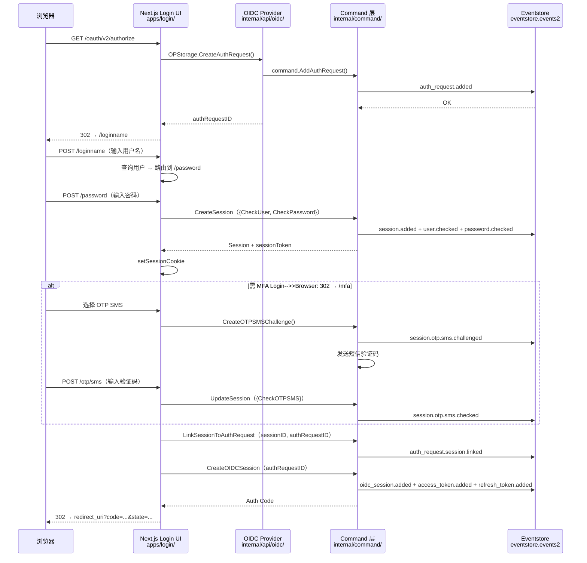
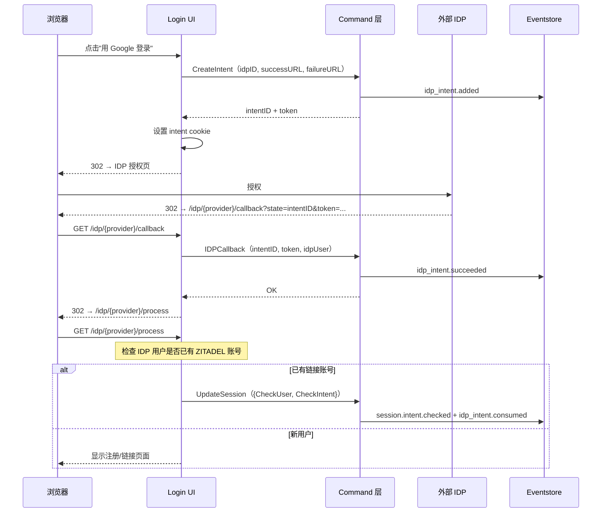
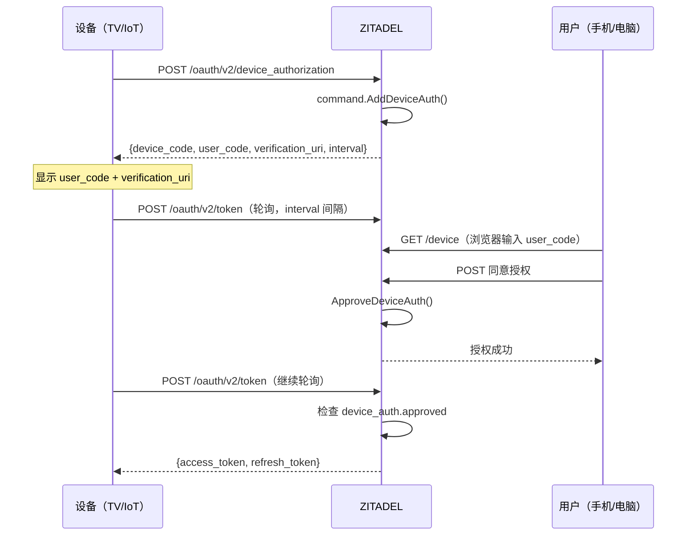
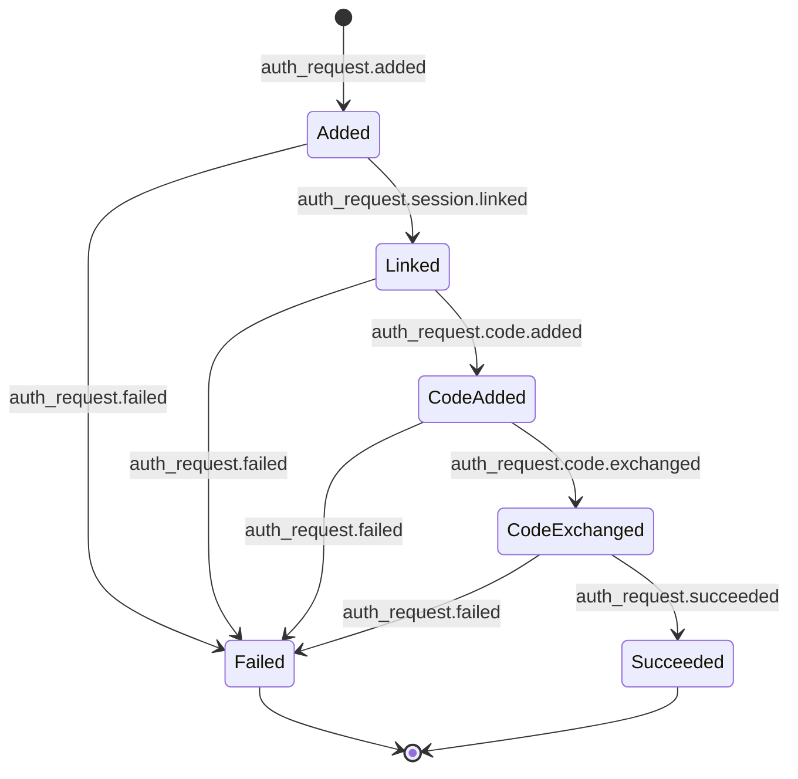

# ZITADEL 认证流程全解

> 本文是 ZITADEL 项目解读的独立流程文档，覆盖登录、退出、MFA、OIDC Token、Session 管理、AuthRequest 生命周期等全部认证流程。

---

## 一、流程概览：从入口到回调

ZITADEL 的一次完整 OIDC 登录涉及三层协作：Next.js Login UI（前端路由）→ OIDC Provider（协议层）→ Command Layer（业务逻辑层）→ Eventstore（持久化）。



整个流程的入口在 Next.js Login UI 的 `apps/login/src/lib/server/flow-initiation.ts:handleOIDCFlowInitiation()`，它解析 OIDC 参数、检查现有 Session、根据 prompt 参数决定路由。

---

## 二、OIDC Authorization Code Flow 详解

### 2.1 AuthRequest 创建

当第三方应用发起 `GET /oauth/v2/authorize?client_id=...&redirect_uri=...&response_type=code&scope=openid profile&state=...&code_challenge=...` 时：

**第一步：ZITADEL OIDC Provider 接收请求**

`internal/api/oidc/auth_request.go:45` 的 `OPStorage.CreateAuthRequest()` 方法：

1. 解析请求参数（client_id、redirect_uri、scope、response_type、code_challenge 等）
2. 校验 client_id 对应的 Application 是否存在且激活
3. 校验 redirect_uri 是否在 Application 的允许列表中
4. 创建 AuthRequest 模型

**第二步：Command 层创建 AuthRequest**

`internal/command/auth_request.go:14` 定义了 AuthRequest 结构体：

```go
type AuthRequest struct {
    ID               string
    LoginClient      string
    ClientID         string
    RedirectURI      string
    State            string
    Nonce            string
    Scope            []string
    Audience         []string
    ResponseType     domain.OIDCResponseType
    ResponseMode     domain.OIDCResponseMode
    CodeChallenge    *domain.OIDCCodeChallenge
    Prompt           []domain.Prompt
    MaxAge           *time.Duration
    LoginHint        *string
    NeedRefreshToken bool
    OrganizationID   string
}
```

`AddAuthRequest()` 方法产生 `auth_request.added` 事件，将请求持久化到 Eventstore。

**第三步：重定向到 Login UI**

OIDC Provider 返回 `authRequestID`，Login UI 中间件将浏览器 302 重定向到 `/loginname?requestId=oidc_{authRequestID}`。

### 2.2 Prompt 参数路由

`handleOIDCFlowInitiation()` 根据 OIDC `prompt` 参数决定初始路由：

| prompt 值 | 路由 | 行为 |
|-----------|------|------|
| `create` | `/register` | 强制注册新用户 |
| `select_account` | `/accounts` | 显示已登录账号列表供用户选择 |
| `login` | `/loginname` | 强制重新登录，带 loginHint |
| `none` | 静默认证 | 使用已存在的 session 创建 callback，不显示 UI |
| 无/其他 | 自动检测 | 有 session 则自动完成，无则 `/loginname` |

### 2.3 PKCE 强制使用

ZITADEL 强制使用 PKCE（S256），在 `cmd/defaults.yaml` 中通过 `OIDC.CodeMethodS256: true` 配置。AuthRequest 创建时存储 `code_challenge` 和 `code_challenge_method`，在 Token 端点交换时验证 `code_verifier`。

---

## 三、密码登录流程

### 3.1 登录名输入（/loginname）

用户访问 `/loginname` 后，前端调用 gRPC API `ListUsers` 查询输入的用户名：

1. 如果查到唯一用户 → 根据用户状态和策略路由到下一步
2. 如果查到多个用户 → 显示列表让用户选择
3. 如果未查到 → 显示错误提示

路由逻辑（`apps/login/src/lib/server/loginname.ts`）：

```
用户存在且有密码 → /password
用户存在且仅 IDP → /idp/{provider}
用户不存在且允许注册 → /register
用户被锁定 → 显示锁定提示
```

### 3.2 密码验证（/password）

密码验证是 ZITADEL 最核心的单因子认证流程。完整调用链：

```
POST /password
  → apps/login/src/lib/server/password.ts 处理表单
  → zitadel.ts 调用 CreateSession gRPC API
    → internal/api/grpc/session/v2/session.go:CreateSession()
      → internal/command/session.go:CreateSession()
        → SessionCommands.Exec()
          → CheckUser → session.user.checked
          → CheckPassword → session.password.checked
          → commands() → SetToken → session.token.set
          → eventstore.Push(commands)
```

关键代码（`internal/command/session.go:67-88`）：

```go
func CheckUser(id string, resourceOwner string, preferredLanguage *language.Tag) SessionCommand {
    return func(ctx context.Context, cmd *SessionCommands) ([]eventstore.Command, error) {
        if cmd.sessionWriteModel.UserID != "" && id != "" && cmd.sessionWriteModel.UserID != id {
            return nil, zerrors.ThrowInvalidArgument(nil, "", "user change not possible")
        }
        return nil, cmd.UserChecked(ctx, id, resourceOwner, cmd.now(), preferredLanguage)
    }
}

func CheckPassword(password string) SessionCommand {
    return func(ctx context.Context, cmd *SessionCommands) ([]eventstore.Command, error) {
        commands, err := checkPassword(ctx, cmd.sessionWriteModel.UserID, password,
            cmd.eventstore, cmd.hasher, nil, cmd.tarpit)
        if err != nil { return commands, err }
        cmd.eventCommands = append(cmd.eventCommands, commands...)
        cmd.PasswordChecked(ctx, cmd.now())
        return nil, nil
    }
}
```

安全设计要点：
- **bcrypt 哈希**：密码使用 `golang.org/x/crypto/bcrypt` 哈希，不存储明文
- **Tarpit 防暴力**：失败尝试通过 `tarpit` 函数引入逐渐增加的延迟
- **密码检查事件**：即使验证失败也产生事件（用于审计），但区分成功/失败事件

### 3.3 Session Token 生成

认证因子全部通过后，`SessionCommands.commands()` 方法生成 Session Token：

```go
// internal/command/session.go:281
func (s *SessionCommands) commands(ctx context.Context) (string, []eventstore.Command, error) {
    if len(s.eventCommands) == 0 {
        return "", nil, nil
    }
    tokenID, token, err := s.createToken(s.sessionWriteModel.AggregateID)
    if err != nil {
        return "", nil, err
    }
    s.SetToken(ctx, tokenID)
    return token, s.eventCommands, nil
}
```

Token 格式为 `{sessionID}:{tokenID}`，使用 `crypto.AuthAlgorithm` 加密后返回给 Login UI，存储为 HttpOnly Secure Cookie。

### 3.4 Cookie 管理

Login UI 通过 `apps/login/src/lib/server/cookie.ts` 管理 Session Cookie：

- Cookie 名：`zitadel-session`（可配置）
- 属性：`HttpOnly` + `Secure`（HTTPS 下启用）+ `SameSite=Lax`
- 域：可配置 `session.cookie.domain` 支持子域共享

---

## 四、IDP 联合认证流程

### 4.1 Intent 模式设计

ZITADEL 的 IDP 认证使用独特的 Intent 模式。IDP 回调不直接修改 Session，而是通过一个中间状态（IDPIntent）连接：



### 4.2 Intent Token 安全

Intent 使用 AES 加密的 Token 进行二次验证：

```go
// internal/command/session.go:91
func CheckIntent(intentID, token string) SessionCommand {
    return func(ctx context.Context, cmd *SessionCommands) ([]eventstore.Command, error) {
        if err := crypto.CheckToken(cmd.intentAlg, token, intentID); err != nil {
            return nil, err
        }
        cmd.intentWriteModel = NewIDPIntentWriteModel(intentID, "", cmd.maxIdPIntentLifetime)
        err := cmd.eventstore.FilterToQueryReducer(ctx, cmd.intentWriteModel)
        // 验证 Intent 状态必须是 Succeeded
        if cmd.intentWriteModel.State != domain.IDPIntentStateSucceeded {
            return nil, zerrors.ThrowPreconditionFailed(...)
        }
        // 验证用户匹配
        if cmd.intentWriteModel.UserID != "" {
            if cmd.intentWriteModel.UserID != cmd.sessionWriteModel.UserID {
                return nil, zerrors.ThrowPreconditionFailed(...)
            }
        }
        // Intent 一旦消费就标记为 consumed，防止重复使用
        cmd.IntentChecked(ctx, cmd.now())
        return nil, nil
    }
}
```

安全措施：
1. **Token 加密签名**：防止伪造 Intent 验证请求
2. **状态检查**：Intent 必须是 `Succeeded` 状态
3. **用户绑定**：Intent 用户必须匹配 Session 用户
4. **一次性消费**：`IntentChecked` 同时产生 `session.intent.checked` 和 `idp_intent.consumed`，防止重放

### 4.3 LDAP 两步认证

LDAP 是 IDP 的一种特殊处理方式，直接在 Login UI 中完成，不走外部跳转：

1. **服务账户绑定**：使用配置的 BindDN + BindPassword 连接 LDAP 服务器
2. **用户搜索**：使用 searchFilter（默认 `(uid=%s)`）查找用户 DN
3. **密码验证**：使用用户 DN + 输入的密码进行第二次 Bind
4. **成功**：创建 Intent（`IDPIntentStateSucceeded`），后续流程同 IDP 认证


---

## 五、MFA 多因子认证流程

### 5.1 MFA 触发条件

密码验证完成后，ZITADEL 检查以下条件判断是否需要 MFA：

1. **登录策略要求**：Instance 的登录策略中配置了 MFA 强制
2. **用户 MFA 设置**：用户已配置了第二因子
3. **应用要求**：OIDC 请求中 `acr_values` 要求 MFA 级别

Login UI 的 `/password` 页面在密码验证成功后：
1. 调用 `getMFAFactors()` 查询用户已配置的 MFA 因子
2. 如果只有一个因子 → 直接跳转到对应页面
3. 如果有多个因子 → 跳转到 `/mfa` 让用户选择

### 5.2 TOTP 验证

TOTP 是同步验证模式（无需挑战），用户输入 6 位时间码：

```
POST /authenticator
  → UpdateSession（{CheckTOTP}）
    → checkTOTP()：从事件存储加载用户 TOTP 种子（AES 加密）
      → 使用 totpAlg（crypto.EncryptionAlgorithm）解密
        → 验证当前时间窗口内的多个 TOTP 值
          → 成功 → TOTPChecked(ctx, now)
            → session.totp.checked 事件
```

关键代码（`internal/command/session.go:129-148`）：

```go
func CheckTOTP(code string) SessionCommand {
    return func(ctx context.Context, cmd *SessionCommands) (_ []eventstore.Command, err error) {
        commands, err := checkTOTP(ctx, cmd.sessionWriteModel.UserID, "", code,
            cmd.eventstore.FilterToQueryReducer, cmd.totpAlg, nil, cmd.tarpit)
        if err != nil { return commands, err }
        cmd.eventCommands = append(cmd.eventCommands, commands...)
        cmd.TOTPChecked(ctx, cmd.now())
        return nil, nil
    }
}
```

TOTP 种子使用专门的 `otpKey` 加密存储，解密后计算 HMAC-SHA1 验证码。

### 5.3 OTP SMS 验证（挑战-验证模式）

OTP SMS 是挑战-验证模式，分两步完成：

**步骤 1：发起挑战（/otp/sms 页面加载时）**

```
POST CreateOTPSMSChallenge
  → internal/command/session.go:CreateOTPSMSChallenge()
    → 生成 6 位随机码
    → OTP 算法加密（otpAlg）
    → OTPSMSChallenged(ctx, code, expiry, returnCode)
      → session.otp.sms.challenged 事件
    → sendPhoneVerificationCode()
      → session.otp.sms.sent 事件
```

**步骤 2：验证（用户输入验证码）**

```
POST CheckOTPSMS
  → UpdateSession（{CheckOTPSMS}）
    → 从 SessionWriteModel 读取 OTPSMSCodeChallenge
      → 比较加密的验证码
        → 成功 → OTPSMSChecked(ctx, now)
          → session.otp.sms.checked 事件
```

SessionWriteModel 中存储挑战状态：

```go
// internal/command/session_model.go:22
type OTPCode struct {
    Code           *crypto.CryptoValue
    Expiry         time.Duration
    CreationDate   time.Time
    GeneratorID    string
    VerificationID string
}
```

验证码的加密值存储在事件中，验证时重新加密用户输入的验证码后比对。`Expiry` 控制验证码有效期。

### 5.4 OTP Email 验证

与 OTP SMS 流程相同，区别在于使用邮件模板发送验证码，支持自定义邮件 URL 模板（`urlTmpl` 参数）：

```go
// internal/domain/session.go:17
type OTPEmailURLData struct {
    Code              string
    UserID            string
    LoginName         string
    DisplayName       string
    PreferredLanguage language.Tag
    SessionID         string
}
```

模板通过 `RenderOTPEmailURLTemplate(w, tmpl, code, userID, loginName, displayName, sessionID, lang)` 渲染。

### 5.5 WebAuthN / Passkey 验证

WebAuthN 包含两种模式：

| 模式 | `UserVerification` | AMR 类型 | 说明 |
|------|-------------------|----------|------|
| Passkey | `Required` | `Passwordless` | 无密码登录，要求用户验证（生物识别/PIN） |
| U2F | `Discouraged` | `U2F` | 双因子，不需要用户验证 |

**步骤 1：发起挑战**

```go
// internal/command/session_webauhtn.go:CreateWebAuthNChallenge()
func (s *SessionCommands) WebAuthNChallenged(ctx context.Context, challenge string,
    allowedCrentialIDs [][]byte, userVerification domain.UserVerificationRequirement, rpid string) {
    s.eventCommands = append(s.eventCommands,
        session.NewWebAuthNChallengedEvent(ctx, s.sessionWriteModel.aggregate, challenge,
            allowedCrentialIDs, userVerification, rpid))
}
```

**步骤 2：验证**

```go
// internal/command/session.go:186
func (s *SessionCommands) WebAuthNChecked(ctx context.Context, checkedAt time.Time,
    tokenID string, signCount uint32, userVerified bool) {
    s.eventCommands = append(s.eventCommands,
        session.NewWebAuthNCheckedEvent(ctx, s.sessionWriteModel.aggregate, checkedAt, userVerified),
    )
    // 根据 UserVerification 区分 Passkey 和 U2F
    if s.sessionWriteModel.WebAuthNChallenge.UserVerification == domain.UserVerificationRequirementRequired {
        s.eventCommands = append(s.eventCommands,
            user.NewHumanPasswordlessSignCountChangedEvent(ctx, ..., tokenID, signCount))
    } else {
        s.eventCommands = append(s.eventCommands,
            user.NewHumanU2FSignCountChangedEvent(ctx, ..., tokenID, signCount))
    }
}
```

关键设计：WebAuthN 验证成功后同时更新 Session 事件（`webAuthN.checked`）和 User 事件（`passwordless.sign_count.changed` 或 `u2f.sign_count.changed`），确保签名计数器同步。`SessionWriteModel.WebAuthNUserVerified` 标志决定 AMR 类型是 `Passwordless` 还是 `U2F`。

### 5.6 Recovery Code 验证

Recovery Code 是用户在设置 MFA 时获得的一次性备用代码。验证逻辑：

```go
func CheckRecoveryCode(code string) SessionCommand {
    return func(ctx context.Context, cmd *SessionCommands) ([]eventstore.Command, error) {
        commands, err := checkRecoveryCode(ctx, ...)
        cmd.eventCommands = append(cmd.eventCommands, commands...)
        cmd.RecoveryCodeChecked(ctx, cmd.now())
        return nil, nil
    }
}
```

Recovery Code 验证成功后，对应的恢复代码被标记为已消耗，不可再次使用。

### 5.7 MFA 累加流程

Session 的 MFA 流程是累加式的——每个 MFA 因子通过 `UpdateSession` 逐个添加到同一个 Session 中：

```
CreateSession（{CheckUser, CheckPassword}）
  → Session 事件: [added, user.checked, password.checked, token.set]
  → AMR: [Password]

Login UI 检测到 MFA 需要 → 重定向到 /mfa

UpdateSession（{CheckTOTP}）
  → Session 事件: [..., totp.checked, token.set（新 token）]
  → AMR: [Password, TOTP]

SessionWriteModel.AuthMethodTypes() 返回 [Password, TOTP]
OIDC ID Token 中 amr 声明为 ["pwd", "mfa"]
```

每次 UpdateSession 后都会生成新的 Session Token，旧 Token 失效。这保证了 Session Token 始终反映最新的认证状态。

---

## 六、Session 生命周期管理

### 6.1 Session 状态机

Session 通过事件驱动状态转换，`SessionWriteModel.Reduce()` 方法重放事件还原状态：

```go
// internal/command/session_model.go:78
func (wm *SessionWriteModel) Reduce() error {
    for _, event := range wm.Events {
        switch e := event.(type) {
        case *session.AddedEvent:
            wm.reduceAdded(e)          // State = Active
        case *session.UserCheckedEvent:
            wm.reduceUserChecked(e)    // UserID, UserResourceOwner, UserCheckedAt
        case *session.PasswordCheckedEvent:
            wm.reducePasswordChecked(e)// PasswordCheckedAt
        case *session.TOTPCheckedEvent:
            wm.reduceTOTPChecked(e)    // TOTPCheckedAt
        // ... 15+ 事件处理
        case *session.TerminateEvent:
            wm.reduceTerminate()       // State = Terminated
        }
    }
    return wm.WriteModel.Reduce()
}
```

三种状态：
| 状态 | 值 | 说明 |
|------|---|------|
| `SessionStateUnspecified` | 0 | 初始状态（Session 不存在） |
| `SessionStateActive` | 1 | 活跃（`session.added` 事件后） |
| `SessionStateTerminated` | 2 | 已终止（`session.terminated` 事件后） |

### 6.2 Session 有效性检查

```go
// internal/command/session_model.go:288
func (wm *SessionWriteModel) CheckNotInvalidated() error {
    if wm.State == domain.SessionStateTerminated {
        return zerrors.ThrowPreconditionFailed(nil, "COMMAND-Hewfq", "Errors.Session.Terminated")
    }
    if !wm.Expiration.IsZero() && wm.Expiration.Before(time.Now()) {
        return zerrors.ThrowPreconditionFailed(nil, "COMMAND-Hkl3d", "Errors.Session.Expired")
    }
    return nil
}
```

有效性检查包括：
- **手动终止**：State == Terminated
- **自动过期**：Expiration 时间在当前时间之前
- **未创建**：State == Unspecified

### 6.3 Authentication Time 计算

```go
// internal/command/session_model.go:238
func (wm *SessionWriteModel) AuthenticationTime() time.Time {
    var authTime time.Time
    for _, check := range []time.Time{
        wm.PasswordCheckedAt, wm.WebAuthNCheckedAt, wm.TOTPCheckedAt,
        wm.IntentCheckedAt, wm.OTPSMSCheckedAt, wm.OTPEmailCheckedAt,
    } {
        if check.After(authTime) { authTime = check }
    }
    return authTime
}
```

认证时间取所有已完成检查的最新时间戳，用于 OIDC ID Token 的 `auth_time` 声明。

### 6.4 认证方法类型推导

```go
// internal/command/session_model.go:256
func (wm *SessionWriteModel) AuthMethodTypes() []domain.UserAuthMethodType {
    types := make([]domain.UserAuthMethodType, 0, domain.UserAuthMethodTypeIDP)
    if !wm.PasswordCheckedAt.IsZero()    { types = append(types, UserAuthMethodTypePassword) }
    if !wm.WebAuthNCheckedAt.IsZero()     {
        if wm.WebAuthNUserVerified { types = append(types, UserAuthMethodTypePasswordless)
        } else                       { types = append(types, UserAuthMethodTypeU2F) }
    }
    if !wm.IntentCheckedAt.IsZero()      { types = append(types, UserAuthMethodTypeIDP) }
    if !wm.TOTPCheckedAt.IsZero()        { types = append(types, UserAuthMethodTypeTOTP) }
    if !wm.OTPSMSCheckedAt.IsZero()      { types = append(types, UserAuthMethodTypeOTPSMS) }
    if !wm.OTPEmailCheckedAt.IsZero()     { types = append(types, UserAuthMethodTypeOTPEmail) }
    if !wm.RecoveryCodeCheckedAt.IsZero() { types = append(types, UserAuthMethodTypeRecoveryCode) }
    return types
}
```

用时间戳零值判断替代显式状态位，简洁且不易出错。`WebAuthNUserVerified` 标志区分 Passkey（`Passwordless`）和 U2F。

### 6.5 Session 查询

SessionWriteModel 查询时通过 `Query()` 方法构造事件查询：

```go
// internal/command/session_model.go:118
func (wm *SessionWriteModel) Query() *eventstore.SearchQueryBuilder {
    return eventstore.NewSearchQueryBuilder(eventstore.ColumnsEvent).
        AddQuery().
        AggregateTypes(session.AggregateType).   // "session"
        AggregateIDs(wm.AggregateID).
        EventTypes(                                // 全部 18 种事件类型
            session.AddedType, session.UserCheckedType, session.PasswordCheckedType,
            session.IntentCheckedType, session.WebAuthNChallengedType,
            session.WebAuthNCheckedType, session.TOTPCheckedType,
            session.OTPSMSChallengedType, session.OTPSMSSentType, session.OTPSMSCheckedType,
            session.OTPEmailChallengedType, session.OTPEmailCheckedType,
            session.RecoveryCodeCheckedType, session.TokenSetType,
            session.MetadataSetType, session.LifetimeSetType, session.TerminateType,
        ).Builder()
}
```

---

## 七、OIDC Token 交换与刷新

### 7.1 Auth Code 交换为 Token

AuthRequest 完成后，ZITADEL 通过 `CreateOIDCSessionFromAuthRequest()` 创建 OIDC Session 并生成 Token：

```go
// internal/command/oidc_session.go:57
func (c *Commands) CreateOIDCSessionFromAuthRequest(ctx context.Context,
    authRequestID string, scope []string, audience []string,
    authMethods []domain.UserAuthMethodType, authTime time.Time,
) (*OIDCSession, error)
```

流程：
1. 加载 AuthRequest → 校验状态
2. 加载 Session → 校验活跃
3. 创建 OIDC Session → `oidc_session.added` 事件
4. 如果是 Auth Code Flow，标记 code 已交换 → `auth_request.code.exchanged`
5. 添加 Access Token → `oidc_session.access_token.added`
6. 如需要，添加 Refresh Token → `oidc_session.refresh_token.added`
7. 注册 Back-Channel Logout → `session_logout.back_channel.registered`
8. 标记 AuthRequest 成功 → `auth_request.succeeded`

Token ID 格式：
- Access Token ID: `{oidcSessionID}-at_{tokenID}`
- Refresh Token ID: `{oidcSessionID}-rt_{tokenID}`

### 7.2 Refresh Token 交换

```go
// internal/command/oidc_session.go:199
func (c *Commands) ExchangeOIDCSessionRefreshAndAccessToken(ctx context.Context,
    oidcSessionID, refreshTokenID string, scope []string, audience []string,
) (*OIDCSession, error)
```

流程：
1. 加载 OIDC Session → 校验 Refresh Token 有效
2. 续期 Refresh Token → `oidc_session.refresh_token.renewed`
3. 添加新的 Access Token → `oidc_session.access_token.added`

支持 Refresh Token Rotation：每次交换时旧的 Refresh Token 被标记为 renewed，生成新的 Refresh Token。

### 7.3 Token 生命周期配置

在 `cmd/defaults.yaml` 中配置：
- `OIDC.DefaultAccessTokenLifetime: 12h`
- `OIDC.DefaultIdTokenLifetime: 12h`
- `OIDC.DefaultRefreshTokenExpiration: 2160h`（90 天）
- `OIDC.DefaultRefreshTokenIdleExpiration: 720h`（30 天）

每个 Instance 可以独立覆盖这些默认值。

### 7.4 Token 撤销

```
RevokeOIDCSessionToken(oidcSessionID, tokenID)
  → 如果是 access_token:
    → oidc_session.access_token.revoked
  → 如果是 refresh_token:
    → oidc_session.refresh_token.revoked
```

撤销后 Token 立即失效，后续验证请求会被拒绝。

---

## 八、登出与销毁

### 8.1 前端登出（RP-Initiated Logout）

用户在前端点击登出时，Login UI 处理登出流程：

**路由：** `/logout`

1. **获取登出参数**：从 URL 参数中提取 `id_token_hint`、`post_logout_redirect_uri`、`state`
2. **验证 ID Token**：如果提供了 `id_token_hint`，验证签名和过期时间
3. **清理 Session**：调用 DeleteSession gRPC API
4. **生成 Logout Token**：创建 `session_logout.back_channel.sent` 事件
5. **重定向**：302 → `post_logout_redirect_uri` 或 `/logout/done`

Login UI 代码（`apps/login/src/app/(login)/logout/page.tsx`）处理登出页面渲染。

### 8.2 Back-Channel Logout

ZITADEL 支持 OIDC Back-Channel Logout——当用户在 ZITADEL 注销时，主动向所有已注册的客户端发送登出通知：

```go
// internal/repository/sessionlogout/events.go
// session_logout.back_channel.registered  → 注册客户端登出 URL
// session_logout.back_channel.sent        → 发送登出通知
```

流程：
1. OIDC Session 创建时注册客户端的 `back_channel_logout_uri`
2. Session 被终止时，遍历所有已注册的 URL
3. 生成 Logout Token（JWT）
4. 向每个 URL 发送 HTTP POST（携带 `logout_token` 参数）
5. 客户端收到后清理自己的 Session

### 8.3 Session Terminate

Session 终止通过 `TerminateSession` 命令完成：

```go
// internal/command/session.go:TerminateSession()
// 产生 session.terminated 事件
```

终止后：
- SessionWriteModel.State 变为 `SessionStateTerminated`
- 所有后续请求被 `CheckNotInvalidated()` 拦截
- Back-Channel Logout 被触发
- Cookie 在 Login UI 端被清除

### 8.4 登出完成页面

`/logout/done` 页面（`apps/login/src/app/(login)/logout/done/page.tsx`）显示登出成功信息，提供重新登录的链接。

---

## 九、设备授权流程（Device Authorization Grant）

### 9.1 流程概述

ZITADEL 实现了 RFC 8628 Device Authorization Grant，用于输入受限设备（如智能电视、IoT 设备）：



### 9.2 设备端

设备调用 `POST /oauth/v2/device_authorization` 时：

```go
// internal/command/device_auth.go:AddDeviceAuth()
// 创建 DeviceAuth 模型
// 产生 device_auth.added 事件
```

返回：
- `device_code`：设备使用的长时效标识码
- `user_code`：用户在浏览器中输入的短码（8 位）
- `verification_uri`：用户验证的完整 URL
- `verification_uri_complete`：预填 user_code 的 URL
- `expires_in`：有效期（默认 600 秒）
- `interval`：轮询间隔（默认 5 秒）

### 9.3 用户端

用户访问 `/device` 页面（`apps/login/src/app/(login)/device/page.tsx`）：

1. 输入设备上显示的 user_code
2. Login UI 调用 `GetDeviceAuthorizationRequest` gRPC API
3. 显示设备信息和请求的权限范围
4. 用户确认授权

### 9.4 授权处理

```go
// internal/command/device_auth.go:ApproveDeviceAuth()
// 产生 device_auth.approved 事件
```

设备轮询时：
1. Token 端点检查 DeviceAuth 状态
2. 如果 `approved` → 生成 access_token 和 refresh_token
3. 如果 `pending` → 返回 `authorization_pending` 错误
4. 如果 `denied` → 返回 `access_denied` 错误
5. 如果 `expired` → 返回 `expired_token` 错误

### 9.5 设备授权同意页面

`/device/consent` 页面（`apps/login/src/app/(login)/device/consent/page.tsx`）在用户确认授权后显示授权同意信息，列出设备将获得的权限范围。

---

## 十、AuthRequest 生命周期

### 10.1 完整状态机

AuthRequest 是 OIDC/SAML 认证请求的聚合根，通过 6 种事件类型驱动状态转换：



### 10.2 各阶段详细说明

| 事件 | 触发条件 | 说明 |
|------|---------|------|
| `auth_request.added` | OIDC 客户端发起 authorize 请求 | 存储 client_id、redirect_uri、scope、code_challenge 等 |
| `auth_request.session.linked` | 用户完成登录 | Session 关联到 AuthRequest，认证信息跨 Session 传递 |
| `auth_request.code.added` | Auth Code Flow 中生成授权码 | 授权码用于后续 Token 交换，一次性使用 |
| `auth_request.code.exchanged` | 客户端用授权码交换 Token | 标记授权码已使用，防止重放 |
| `auth_request.succeeded` | 认证流程完成 | 最终状态，Token 已发放 |
| `auth_request.failed` | 任何阶段出错 | 记录失败原因 |

### 10.3 AuthRequest 模型

```go
// internal/command/auth_request.go:14
type AuthRequest struct {
    ID               string
    LoginClient      string
    ClientID         string
    RedirectURI      string
    State            string
    Nonce            string
    Scope            []string
    Audience         []string
    ResponseType     domain.OIDCResponseType
    ResponseMode     domain.OIDCResponseMode
    CodeChallenge    *domain.OIDCCodeChallenge
    Prompt           []domain.Prompt
    UILocales        []string
    MaxAge           *time.Duration
    LoginHint        *string
    HintUserID       *string
    NeedRefreshToken bool
    Issuer           string
    OrganizationID   string
}
```

### 10.4 Session 与 AuthRequest 的关联

`LinkSessionToAuthRequest` 是将用户登录 Session 与 OIDC 认证请求关联的关键步骤：

```
LinkSessionToAuthRequest(sessionID, authRequestID)
  → 加载 Session（验证活跃、验证认证因子）
    → 加载 AuthRequest（验证未过期、未完成）
      → auth_request.session.linked 事件
        → AuthRequest 状态: Added → Linked
```

关联后：
- AuthRequest 获取 Session 的认证信息（用户 ID、认证方法、认证时间）
- Session 的 `AuthMethodTypes()` 结果用于 OIDC `amr` 声明
- Session 的 `AuthenticationTime()` 用于 `auth_time` 声明

### 10.5 Auth Code 安全性

Auth Code 的一次性使用保证通过事件驱动实现：

1. `code.added` 事件创建授权码
2. `code.exchanged` 事件标记已交换
3. 任何重复的交换请求检测到 `code.exchanged` 已达 → 拒绝并可能产生 `auth_request.failed`

Auth Code 有较短有效期，过期后自动失效。

---

> 本文覆盖了 ZITADEL 认证系统的完整流程：从 OIDC 入口到密码登录、IDP 联合、MFA 多因子、Session 管理、Token 交换、登出销毁和设备授权。配合 [ZITADEL 核心解读](../zitadel/) 中的架构和 Event Sourcing 设计，可以形成对 ZITADEL 认证系统的全面理解。

> **仓库：** [github.com/zitadel/zitadel](https://github.com/zitadel/zitadel) | **网站：** [zitadel.com](https://zitadel.com)
