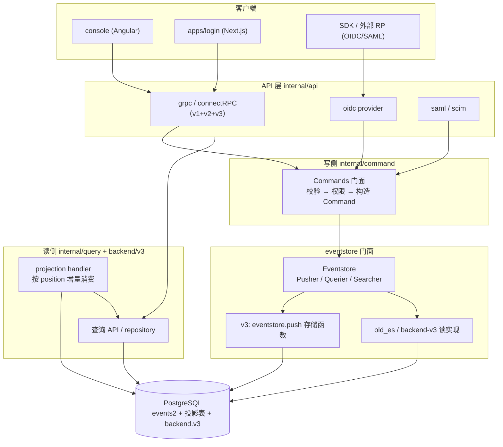
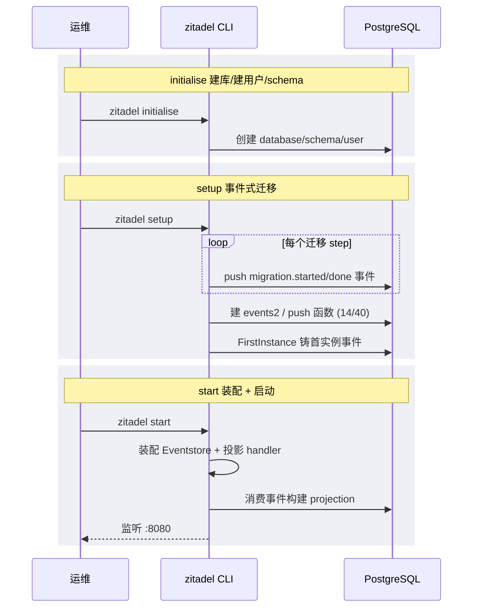

# ZITADEL — 企业级 IAM 平台的「关系型核心 + 事件溯源灵魂」

> **仓库:** [github.com/zitadel/zitadel](https://github.com/zitadel/zitadel) · **目录:** [auth/zitadel](.) · **版本基线:** v5.0.0 (`2bd42e8fc`)
>
> 本解读按 **admin（IAM 平台）类规格**产出；ZITADEL 同时是「可部署服务」+「有数据存储」关注面，故额外拆分部署与数据模型子文档。正文所有 `文件:行号` 引用均以本地源码 `/Users/morehao/Documents/study/auth/zitadel` 为根，经程序重定位校验。

## 一句根因

需要一个身份平台同时压住两类需求——**可审计到每一次状态变迁（审计/合规）**与**多租户隔离到基础设施粒度（规模化 SaaS）**。ZITADEL 的答案是：把每个业务变更铸造为一条**不可变事件**（写侧唯一真相源），再用**投影**把事件折算成可直接查询的关系表（读侧物化视图）；并以 **Instance** 为租户单元，用贯穿事件表与所有投影的 `instance_id` 做行级隔离。代价是「一份数据两种存储」，换来的是南向（可扩展、零停机、生产可用）与北向（完整审计、多协议、可编程扩展）的同时成立。SaaS 云与自托管跑同一套代码库。

## 项目概览

**是什么**：开源的 Identity & Access Management（IAM）平台，提供 SSO、MFA、Passkeys/FIDO2、OIDC（官方认证 OP）、SAML、SCIM、RBAC 与多租户能力；既是 SaaS 云服务，也可自托管。

**解决的痛点**：自建认证成本高（Session 管理、MFA、OIDC/SAML 协议实现、合规审计），而现成方案要么过重（Keycloak 的 Java 栈与 realm 扩展上限）、要么封闭（Auth0/Okta 闭源、多租户即多账号）、要么职责单一。ZITADEL 在开源、自托管、生产级多租户三者之间取得平衡。

**适用场景**：

- 多租户 SaaS 的统一身份基座（每个客户一个 Instance）
- 企业内部 SSO 与身份联邦（OIDC + SAML + LDAP + SCIM）
- B2B 场景下「客户组织互相隔离、数据边界清晰」的认证方案
- 需要完整可对外审计 / 流式导出（Webhook、Event）事件溯源的合规场景
- 需要自定义登录品牌、可编程扩展认证流的产品

## 核心能力清单

| 能力 | 说明 |
|------|------|
| OIDC Provider | Authorization Code + PKCE / Implicit / Device Auth / Refresh Rotation / Client Credentials，官方 OP 认证 |
| SAML 2.0 / SCIM | **SAML Identity Provider** 角色（对下游应用签发断言，暴露 `/saml/v2/metadata`、`/certificate`、`/SSO`）；同时在 `internal/idp/providers/saml/` 以 Service Provider 角色接入外部上游 IdP；SCIM 2.0 server（当前仅 User 资源，无 Group 接口） |
| 认证因子 | 密码（passwap 多算法）、Passkey/WebAuthN、TOTP、OTP SMS/Email、RecoveryCode、LDAP / IdP 联邦、Token Exchange / Impersonation；统一由 Session V2 API 承载 |
| 多租户隔离 | System → Instance → Organization → Project → Application，`instance_id` 贯穿写读（[`multi-tenancy.md`](multi-tenancy.md)） |
| 事件溯源 + CQRS | 每次变更作为不可变事件入 `events2`，投影折算关系表，完整审计与历史重建（[`architecture.md`](architecture.md)、[`data-model.md`](data-model.md)） |
| Actions / Execution | 认证流可编程扩展：`条件(condition) × 节点(intercept/function/event) → 目标(webhook/call/async)`（[`actions-execution.md`](actions-execution.md)） |
| API-first | 同一份 Protobuf 同时暴露 gRPC / connectRPC / REST，三态同源（[`oauth-saml-scim-api.md`](oauth-saml-scim-api.md)） |
| 认证流 | Session 状态机驱动，一次 OIDC 登录 = 因子逐步投递到 Session（[`auth-flow.md`](auth-flow.md)） |
| RBAC / 授权 | 成员关系 × 角色 × 上下文 ID（`perm:ctxID`），project grant 跨组织授权 |
| 部署运维 | Zero-downtime 升级、横向扩展（无需外部会话存储）、Postgres 单库（[`deployment.md`](deployment.md)） |

## 技术栈一览

| 层面 | 技术 |
|------|------|
| 语言 | Go（后端单体）、TypeScript/Next.js（Login V2）、Angular（console） |
| 传输/API | gRPC、connectRPC、HTTP/JSON（REST），同一 Protobuf 三形态暴露 |
| 数据库 | PostgreSQL ≥ 14；事件表 `eventstore.events2` + 投影关系表（`zitadel.*` schema） |
| 事件引擎 | 自研 `internal/eventstore`（门面 Pusher/Querier/Searcher）+ v3 Postgres 存储函数批量写；另有新 `backend/v3` 关系存储 |
| 迁移 | `cmd/setup`（命令式，01–74 步骤）+ `internal/migration` 事件式迁移 + `backend/v3` tern 版本化迁移 |
| 认证/会话 | go-jose（JWT/JWE）、passwap（密码）、webauthn（FIDO2） |
| 脚本扩展 | goja（V1 内嵌 JS）、HTTP 派发（V3 Execution） |
| 异步 | river（Postgres 队列，Event/Target 投递） |
| 多租户隔离 | `instance_id` 主键首列 + `ensureInstanceID` 隐式过滤 + pg advisory lock |
| 前端编排 | Nx + pnpm monorepo（`apps/login`、`console`） |

## 架构总览

核心是**写读分离 + 事件解耦**：命令无论来自 gRPC 还是 OIDC provider，都先折算成不可变事件经 `Eventstore` 原子落库；读侧由投影 handler 按 `position` 增量消费，实化成关系表后被查询 API 直读。`instance_id` 在这条写读链路上自动注入/过滤。v5.0 起新增 `backend/v3` 关系存储层，与旧的 `internal/` 事件存储并存演进。

## 启动流程

ZITADEL 分阶段启动：`initialise`（建库建表建用户）→ `setup`（事件式迁移 + 铸首实例）→ `start`（装配运行态）。详见 [`deployment.md`](deployment.md)。

## 核心模块导读

| 模块 | 定位 | 深读 |
|------|------|------|
| 事件存储 / CQRS | Eventstore 门面 + v3 存储函数批量写 + 重放命令模式 | [`architecture.md`](architecture.md) |
| 认证流程 | Session 状态机、因子逐步投递、amr 投影 | [`auth-flow.md`](auth-flow.md) |
| Actions / Execution | 条件×节点→目标 可编程扩展机制 | [`actions-execution.md`](actions-execution.md) |
| 数据模型 | `events2` + 投影表双轨、迁移双轨 | [`data-model.md`](data-model.md) |
| 多租户隔离 | `instance_id` 行级隔离、四层模型、授权本质 | [`multi-tenancy.md`](multi-tenancy.md) |
| 部署运维 | 三态部署、零停机升级、横向扩展 | [`deployment.md`](deployment.md) |
| 协议与 API | API-first 三态、OIDC/SAML/SCIM 实现 | [`oauth-saml-scim-api.md`](oauth-saml-scim-api.md) |

## 子文档索引

- [`architecture.md`](architecture.md) — 架构总览与事件溯源核心（Eventstore 门面、v3 存储函数、重放命令模式）
- [`auth-flow.md`](auth-flow.md) — 认证流程与认证因子（Session 状态机、密码/Passkey/TOTP/OTP/Recovery/IDP、amr）
- [`actions-execution.md`](actions-execution.md) — Actions/Execution 可编程扩展机制
- [`data-model.md`](data-model.md) — 数据模型（事件表 + 投影表、迁移双轨、读写路径）
- [`multi-tenancy.md`](multi-tenancy.md) — 多租户隔离（instance_id、四层模型、授权本质）
- [`deployment.md`](deployment.md) — 部署与运维（零停机、横向扩展、配置与密钥）
- [`oauth-saml-scim-api.md`](oauth-saml-scim-api.md) — 协议层与 API（三态 API、OIDC/SAML/SCIM）

## 同类定位对比

| | ZITADEL | Keycloak | FusionAuth |
|---|---|---|---|
| 语言/栈 | Go 单体 | Java + Quarkus | Java 单体 |
| 协议覆盖 | OIDC(OP) / SAML / SCIM / LDAP | OIDC/ SAML/ SCIM / SSF | OIDC / SAML / SCIM |
| 多租户隔离粒度 | **Infrastructure 级**（单 schema + `instance_id` 行级，Instance 独立配置） | 单库共享 schema + `REALM_ID` 行级隔离（**非** per-realm schema；`USER_ENTITY` 无任何外键） | Schema 级（tenant 独立 schema） |
| 事件溯源 | ✅ 完整事件流 + 审计，可流式导出 | ❌ 仅审计日志 | ❌ 审计日志 |
| 可编程扩展 | Actions/Execution（条件×目标→ webhook/函数） | 认证流程 SPI / 自定义 | 自定义插件 | 
| API | gRPC + connectRPC + REST 三态 | REST 为主 | REST 为主 |
| SaaS/自托管同码 | ✅ | ➖ | ➖ |

## 设计亮点速览

- **事件溯源换来「审计即业务」**：写日志就是写业务，无需额外审计表；投影可重建（删 `current_states` 重放即恢复）。
- **`instance_id` 作为隔离范式**：写入从 context 自动注、读取由 `ensureInstanceID` 自动滤，租户隔离从「人为责任」变成「框架默认」——但隔离强度依赖 SQL 纪律，漏一处即越权风险（详见 [`multi-tenancy.md`](multi-tenancy.md) 的权衡）。
- **双轨 schema 演进**：命令式迁移（可跑任意逻辑）+ 版本化 tern 迁移（可回退 DDL），各管不可回滚/可回滚两类变更。
- **零停机 + 横向扩展**：会话/配置/队列全落 Postgres，副本间用 pg advisory lock 协调，无需外部会话存储。

## 不足 / 风险

- **版本命名漂移严重**：`internal/eventstore/v3`、`internal/eventstore/repository/sql`（old）、`internal/v2/eventstore`（es_v4）、表名 `events2`、step 自称 v4，彼此无稳定对应，理解成本高。
- **读路径最终一致**：投影异步折算，写后即读存在滞后，强一致场景需额外 await 机制。
- **事件模型难改**：一旦发布难以重构，靠 `revision` + 多事件类型共享 reducer 兼容，复杂度随版本累积。
- **多套读实现并存**：old_es 与 es_v4 双份维护，是迁移期技术债。

## 可借鉴的设计

1. **写侧统一收敛**：所有变更对象都收敛到 `push(cmds...) + AppendAndReduce` 一个命令模式，业务方法只负责校验与构造，天然支持批量原子与审计。
2. **读自动隔离钩子**：`ensureInstanceID` 在查询构造器内置，把「漏过滤」从开发者责任变成框架默认行为（`internal/eventstore/search_query.go`）。
3. **迁移状态事件化**：迁移进度写成 `system.migration.*` 事件 + 全局唯一约束，多副本并发变串行、可中断续跑，支撑零停机（详见 [`deployment.md`](deployment.md)）。

## 总结

ZITADEL 用一个很难的架构回答了一个很具体的根因问题：**在不放弃「可审计、可追溯的不可变真相」的前提下，做到现代 SaaS 所需的多租户与可扩展性**。它的全部设计都围绕这枚「事件溯源 + 投影」的锚展开——写侧事件、读侧物化、`instance_id` 串联、双轨迁移护航。对想在身份/多租户域建系统的团队，它的存储分层、鉴权链路和多租户隔离是最值得抽走的三个杠杆。
