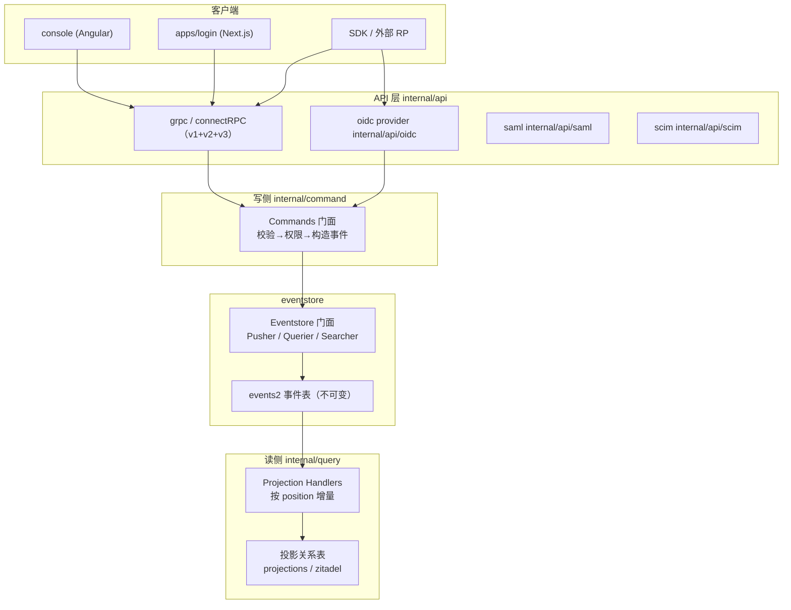
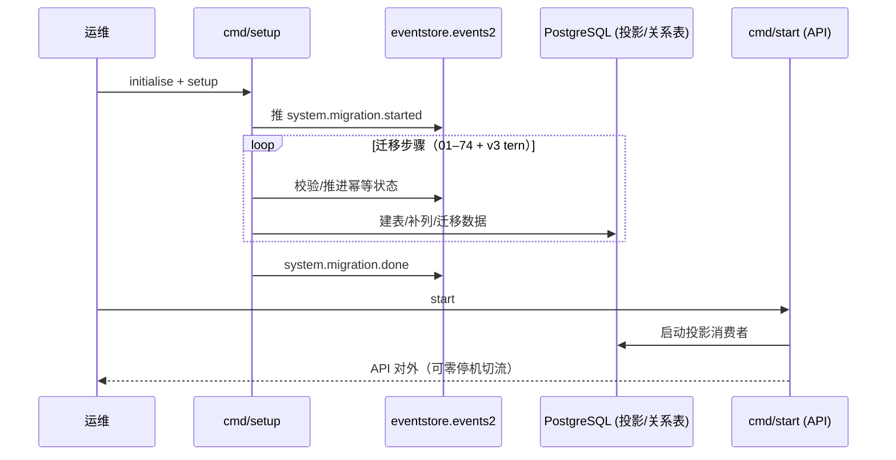

# ZITADEL — 企业级 IAM 平台解读

> **GitHub:** [github.com/zitadel/zitadel](https://github.com/zitadel/zitadel) | **网站:** [zitadel.com](https://zitadel.com) | **OpenID Connect Certifieed**（OP）
>
> 本解读按 **admin（IAM 平台）** 类规格产出；Zitadel 兼有可部署服务 + 数据存储关注面，故另拆部署与数据模型子文档。

## 一句话根因

Zitadel 想同时解决两件事：身份平台**可审计到每一次状态变迁**、以及**多租户隔离到基础设施粒度**。它的答案是「关系型核心 + 事件溯源灵魂」——写侧把每个变更铸造为一条不可变事件（`eventstore.events2`）保留完整事实，读侧用投影把事件折算成可直接查询的关系表；并以 Instance 为标准租户单元，用贯穿所有表与事件的 `instance_id` 做物理级隔离，从而在南（可扩展、零停机、生产可用）与北（完整审计、多协议、可编程）之间取得平衡。SaaS 云与自托管跑同一套代码库。

## 项目概览

**是什么**：开源的 Identity & Access Management（IAM）平台，提供 SSO、MFA、Passkeys、OIDC、SAML、SCIM 与多租户能力；既有 SaaS 云服务，也可自托管。

**解决的痛点**：技术团队自建认证系统成本高（Session 管理、MFA、OIDC/SAML 协议实现、合规审计），而现成方案要么过重（Keycloak 的 Java 栈与 realm 扩展上限）、要么封闭（Auth0/Okta 闭源、多租户即多账号）、要么职责单一（OAuth2-proxy 仅做代理认证）。Zitadel 在开源、自托管、与生产级多租户能力之间取得平衡。

**适用场景**：

- 多租户 SaaS 平台的统一身份基座（每个客户一个 Instance）
- 企业内部 SSO 与身份联邦（OIDC + SAML + LDAP + SCIM）
- B2B 场景中"客户组织互相隔离且数据边界清晰"的认证方案
- 需要完整、可对外审计/流式导出（Webhook/Actions）的事件溯源的合规场景
- 需要自定义登录品牌、可编程扩展认证流的产品

## 核心能力清单

| 能力 | 说明 |
|------|------|
| OIDC 完整实现 | Authorization Code + PKCE、Implicit、Device Auth、Refresh Token Rotation、Back-Channel Logout、Client Credentials，官方 OP 认证 |
| SAML 2.0 | Service Provider 角色，元数据管理 |
| SCIM | 用户与组的跨域身份管理（v2 SCIM 服务） |
| 认证因子 | 密码、Passkey（WebAuthN）、TOTP、OTP SMS/Email、Recovery Code、LDAP、IDP 联邦；Session V2 API 统一承载 |
| Hosted Login V2 | Next.js 独立登录应用，动态品牌化（颜色/Logo/文案/多语言），Passkey 默认 |
| Actions / Execution | 认证流可编程扩展点：webhook / call / async 目标 × request/response/function/event 节点 |
| 多租户隔离 | System → Instance → Organization → Project → Application 层级，`instance_id` 贯穿写读 | 
| 事件溯源 | 每个状态变更作为不可变事件入 `events2`，完整审计与历史重建 |
| RBAC/授权 | 细粒度 permission × 对象上下文（`perm:ctxID`），project grant 跨 org 授权 |
| 可观测与运维 | OpenTelemetry、Prometheus、零停机升级、横向扩展（无需外部会话存储） |

## 技术栈一览

| 层面 | 技术 |
|------|------|
| 语言 | Go 1.25（后端单体）、TypeScript/Next.js（登录 UI）、Angular（console） |
| 传输/API | gRPC、connectRPC、HTTP/JSON（REST），同一 Protobuf 三形态暴露 |
| 数据库 | PostgreSQL（≥14）；事件表 `events2` + 投影关系表（`projections` / `zitadel` schema） |
| 事件引擎 | 自研 `eventstore`（门面接口 Pusher/Querier/Searcher + v3 Postgres 存储函数批量写） |
| 迁移 | `cmd/setup`（命令式 01–74）+ tern（v3 关系表 001–018+），基于事件流幂等 |
| 认证库 | go-jose（JWT/JWE）、passwap（密码）、virtualwebauthn（WebAuthN）、crewjam/saml |
| 脚本扩展 | goja（V1 内嵌 JS）、HTTP 派发（V3 Execution） |
| 队列 | river（异步 worker，Event/Target 投递） |
| 多租户隔离 | `instance_id` 主键首列 + `ensureInstanceID` 隐式过滤 + pg_advisory_lock 分片 |
| 前端编排 | Nx + pnpm monorepo |

## 架构总览

核心是**写读分离 + 事件解耦**：命令无论来自 gRPC 还是 OIDC provider，都先折算成不可变事件通过 `Eventstore` 原子落库；读侧由投影处理器按 `position` 增量消费，实化成关系表后再被查询 API 直读。多租户的 `instance_id` 在这一整条写读链路上自动注入/过滤。

- **写路径**（命令 → 事件）：聚合校验 → 构造不可变事件 → `eventstore.Push` 原子写 `events2`，数据库侧生成 `position` 作为投影消费的全局时钟。详见 [`architecture.md`](architecture.md)。
- **读路径**（投影 → 查询）：投影处理器按 `position` 增量消费事件、reduce 进关系表，查询 API 与 OIDC userinfo 都直接读投影关系表，无需重放。逻辑与存储细节见 [`data-model.md`](data-model.md)。

## 启动流程要点

生产启动为 **initialise → setup → start** 三段式：先建库建 schema 与权限，再按版本顺序执行迁移（含创建首个 Instance / 建事件表），最后才拉起 API。setup 与 start 可分离、可重复，为**零停机升级**提供工程基础。详细时序见 [`architecture.md`](architecture.md) 的「启动管线」。

## 核心模块导读

| 模块 | 关注面 | 深读 |
|------|--------|------|
| 事件存储 + 写读 CQRS | Eventstore 门面、命令→事件→投影主线、事件溯源 vs 关系记录的迁移 | [`architecture.md`](architecture.md) |
| 数据库 schema / events2 / 投影 / 迁移 | 存储选型、ER 关系、核心表字段、Schema 演进、读写路径 | [`data-model.md`](data-model.md) |
| 认证因子 + 统一登录登出 | Session 状态机、OIDC 旅程、Passkey/MFA、RP/Back-Channel Logout | [`auth-flow.md`](auth-flow.md) |
| 多租户 + 授权 | Instance 隔离、instance_id 注入、System/Instance API、project grant 授权 | [`multi-tenancy.md`](multi-tenancy.md) |
| Actions/Execution 扩展 | 条件×节点→目标、webhook/call/async、token enrichment 与可否决 | [`actions-scripting.md`](actions-scripting.md) |

## 子文档索引

- [`architecture.md`](architecture.md) — CQRS + Event Sourcing 核心架构、写读主链路、启动三段式管线
- [`data-model.md`](data-model.md) — 数据模型五要素：events2 事件表 + 投影关系表 + 双迁移机制 + 读写路径
- [`auth-flow.md`](auth-flow.md) — 认证因子与 Session 状态机 + 统一登录/登出旅程（OIDC/Passkey/MFA/Session V2/Logout）
- [`multi-tenancy.md`](multi-tenancy.md) — 多租户层级、instance_id 隔离、鉴权时序、授权模型本质
- [`actions-scripting.md`](actions-scripting.md) — Actions/Execution V3 扩展点：条件×节点→目标派发与可否决语义

## 设计亮点

- **把多租户隔离写进存储门面，而非外挂在业务调用点**：`ensureInstanceID` 在查询未显式限定 instance 时自动补 ctx 里的 instance，写侧聚合创建时也默认从 context 注入 `instance_id`——"漏加租户条件"在框架层就不可能发生。这是共享库 + 共享 schema 仍敢扛高规模的关键。见 [`multi-tenancy.md`](multi-tenancy.md)。
- **事件溯源 + 投影关系表的双视图解耦**：写只追加不可变事件（完整审计、可重建任意历史），读用投影折算成关系表（高效查询）。最终一致性用全局 `position` 游标 + 投影按位消费闭环。见 [`architecture.md`](architecture.md)。
- **认证 = 可叠加的因子检查，而非固定顺序代码**：每个因子（密码/Passkey/TOTP/…）都是一份往 Session 追加 `*CheckedEvent` 的命令，Session 状态机只沉淀"哪些检查已完成"，签发令牌时由 `AuthMethodTypes()`/`AuthenticationTime()` 投影决定 `amr`/`auth_time`。见 [`auth-flow.md`](auth-flow.md)。
- **Actions 用「条件×节点→目标」三层正交抽象**：不在 Execution 里内嵌脚本，只按条件绑定目标引用；webhook/call/async 三种语义把"通知"与"可否决拦截"干净分开，同时收紧 SSRF 面、提升可审计性。见 [`actions-scripting.md`](actions-scripting.md)。
- **权限 = 细粒度 permission × 对象上下文**：`perm:ctxID` 后缀让同一套静态角色映射天然支持数据级（resource-scoped）授权，B2B 跨 org 授权无需为每个对象新建角色。见 [`multi-tenancy.md`](multi-tenancy.md)。

## 不足 / 风险

- **共享 schema 的物理隔离强度最弱**：任一查询漏了 `instance_id` 即串租户，依赖 `ensureInstanceID` 的应用层兜底，无法抵御刻意构造的跨实例误用（见 [`multi-tenancy.md`](multi-tenancy.md)）。
- **读可能落后于写（最终一致）**：命令返回成功但投影尚未追上时，紧接的读可能取到旧值，需要调用方接受这种时序。
- **事件表不断膨胀**：全量事件留存带来审计红利，也带来存储与重放成本，索引与 `position` 游标只能缓解不能消除。
- **Actions V3 表达能力收敛**：从 V1 内嵌 JS 退化为纯 HTTP 派发后，"进程内拿用户数据做复杂判断再放行"失去对应能力（见 [`actions-scripting.md`](actions-scripting.md)）。

## 可借鉴的设计

1. **事件溯源读模型的独立演进**：投影关系表可任意丢弃重建、可各自独立改版，读模型不冻结历史——迁移工具的职责因此从"改数据"变成"改投影解释逻辑"（`cmd/setup` + `backend/v3` 双迁移，见 [`data-model.md`](data-model.md)）。
2. **迁移幂等用事件流状态记录**：`system.migration.started/done` 事件 + `checkExec` 轮询，保证并发启动时同一步骤只执行一次、可安全续跑（`internal/migration/migration.go`）。
3. **`position` 全局单调游标**：给事件溯源提供一条读侧可增量消费的明确顺序，投影用 advisory lock 按 `(projection, instance_id)` 互斥，实现并发安全的多消费者。
4. **认证因子可叠加的 Command 组合**：`SessionCommands` 用函数式命令把"检查因子"组装成一次 `UpdateSession` 的若干事件，新增因子无需改状态机结构（见 [`auth-flow.md`](auth-flow.md)）。
5. **SSRF 与脚本扩展的取舍**：用「条件 + HTTP 目标」替代万能脚本引擎，换来可枚举的安全边界（`AddTarget` 对 endpoint 过 deny list），是"扩展性 vs 安全性"的正面决策模板（见 [`actions-scripting.md`](actions-scripting.md)）。

## 总结

Zitadel 的独特之处不是某一项功能的堆叠，而是**用事件溯源统一了"可审计"与"可扩展"，用 Instance 统一了"多租户"与"数据隔离"**。它证明一个敢于把事件表当作唯一事实来源、把投影当作可随时重建视图的系统，能在工程上同时支撑完整合规审计、多协议接入与高规模化多租户，而不需要在"开源/自托管""可审计/可查询""隔离/伸缩"之间做非此即彼的选择。返回目录：[`auth/README.md`](../README.md)。
