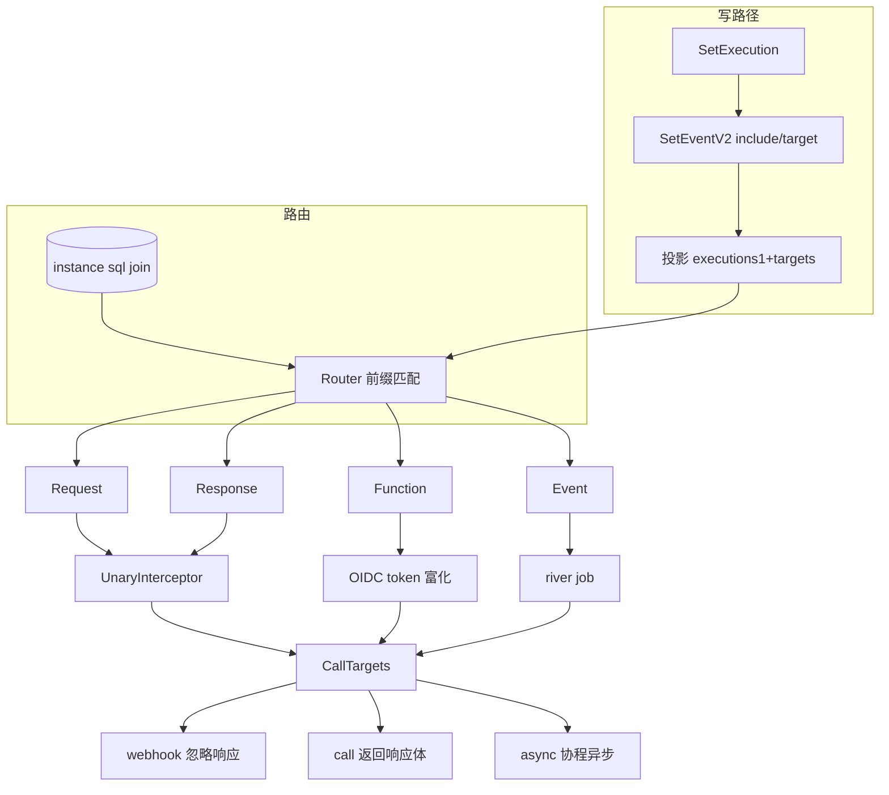

# ZITADEL Actions / Execution 可编程扩展机制

> 关注面：`条件(condition) × 节点(intercept/function/event) → 目标(target)` 的声明式扩展模型。
> 所有 `文件:行号` 以本地源码 `/Users/morehao/Documents/study/auth/zitadel` 为根，经程序重定位校验。

## 根因

ZITADEL 是身份网关，但产品无法覆盖所有客户的定制认证逻辑——有的要改 token claims、有的想在登录前后插风控校验、有的要让领域事件驱动外部系统。把这些硬编码进产品会污染核心路径；于是把「客户业务逻辑」放回认证流，需要**受控、可审计、与核心解耦**的扩展点。README 主打的卖点正是把「条件 × 节点 → 目标」的声明式模型作为扩展机制。

V1 时代用的是 goja 内嵌 JavaScript（`internal/actions/`）——用户在控制台写脚本，由 Go 加载进 goja VM 在请求内执行。它的代价可见于脚本与产品同进程、受全局超时配额约束、一个用户写的 JS 能阻塞整条认证链路。

V3（Execution）模型则把「条件（什么样的请求）」和「目标（做什么）」显式化、落库并投影成路由，脚本权限放大问题被剥离，代之以受控的 HTTP webhook/call，execution 数据变成 instance 级路由表，派发由 river 队列承担，不阻塞请求主链路。

## 概览与核心能力

- **4 类条件（ExecutionType）**：`request` / `response` / `function` / `event`，各映射不同扩展节点。
- **目标（Target）**：三类语义 `webhook` / `call` / `async`，4 种载荷 `unspecified/json/jwt/jwe`，可配签名、加密、超时、出错是否中断。
- **路由解算**：条件 ID（如 `request/caas.zitadel.io.v1.ZITADELService/GetUser`）投影成 instance 上的 `execution_targets` 路由表，`GetEventBestMatch` 支持精确匹配 + 最长前缀（通配 `.*`）。
- **Include 复用**：execution 可 include 另一 execution（最大嵌套 3 层），带环检测。
- **V1/V3 并存**：goja V1 引擎仍保留，function 节点与 V1 `PreAccessToken`/`PreUserinfo` 触发点对接。

| 能力 | 说明 |
|------|------|
| 请求拦截 Request | gRPC/Connect 请求前调用目标，可改写请求 |
| 响应拦截 Response | handler 返回后调用目标，可改写响应 |
| Token 富化 Function | PreAccessToken/PreUserinfo 触发，webhook 回填 claims/元数据 |
| 事件派发 Event | 领域事件触发，打包成 river job 异步投递 |
| 载荷安全 | JWT 签名 / JWE 加密 / SSRF deny list |
| 目标 include 组合 | 条件间复用，环 + 层级检测 |

## 条件 x 节点 → 目标的模型如何落库与解算

### 条件如何变成一个 ExecutionID

命令侧把用户声明式条件（method/service/all）规约成唯一 `ExecutionID`。`ExecutionType` 决定前缀，`ID()` 把类型和取值拼成 `类型/取值`：

[internal/repository/execution/aggregate.go:25-33]() 类型与取值拼成聚合 ID
<!-- anchor: func ID(executionType domain.ExecutionType, value string) string { ... return executionType.String() -->

四种条件在 `domain/execution.go` 定义，String 分别输出 `request`/`response`/`function`/`event`：

[internal/domain/execution.go:9-33]() 4 类 ExecutionType 及字符串标识
<!-- anchor: const ( ... return "" -->

### 条件校验：必须指向真实存在的 API / 事件

`ExecutionAPICondition` 做**三选一**校验——method、service、all 只能设一个，且 method/service 必须能在产品声明中找到：

[internal/command/action_v2_execution.go:23-34]() 三选一条件，杜绝 method/service/all 混用
<!-- anchor: func (e *ExecutionAPICondition) IsValid() error { ... return nil -->

事件条件同理，event/group 存在性都要经已申报事件集校验：

[internal/command/action_v2_execution.go:144-182]() 事件条件三选一 + 必须存在
<!-- anchor: func (e *ExecutionEventCondition) IsValid() error { ... return nil -->

### 落库：Execution 是聚合，Target 是引用

execution 作为 `execution.Aggregate` 存储，`SetEventV2` 携带的是**目标引用列表**（`{type, target}`，type 区分 Include/Target）。引用而非内嵌，是为了 target 独立成聚合、可共享可复用：

[internal/repository/execution/execution.go:55-65]() SetEventV2 的 payload 是 Target 引用对
<!-- anchor: type Target struct { ... return nil -->

`setExecution` 是命令入口：取写模型、比对等价目标（幂等）、校验 include 环、push 事件：

[internal/command/action_v2_execution.go:242-265]() 命令：加载写模型 → 幂等判断 → replace 式写回
<!-- anchor: func (c *Commands) setExecution(ctx context.Context, set *SetExecution, resource ... return writeModelToObjectDetails(&wm.WriteModel), nil -->

### 投影与路由：重组成 instance 级路由表

`SetEventV2` 投到投影 `executions1`，目标引用拆到 `executions1_targets` 子表（每次 Set 先删旧行再插新行，整组替换），并监听 `target` 聚合删除做级联：

[internal/query/projection/execution.go:103-141]() reduceExecutionSet：先清理旧 targets 再逐条插新
<!-- anchor: func (p *executionProjection) reduceExecutionSet(event eventstore.Event) (*handl ... case domain.ExecutionTargetTypeUnspecified: -->

真正的路由表在**加载 instance** 时用一条 SQL 组装：`execution_targets` CTE 把 `executions1 → executions1_targets → targets2` 三表 join，把 target 配置展开成 JSON，按 `position` 排序——这就是运行时 `ExecutionRouter()` 拿到 `Router` 的数据来源：

[internal/query/instance_by_id.sql:20-48]() 三表 join 展开 target 配置，authn_keys2 带出签名 key
<!-- anchor: ), execution_targets as ( ... ) as x -->

instance 带路由表后，`ExecutionRouter()` 直接返回：

[internal/api/authz/instance.go:119-121]() instance 直接暴露预构建 Router
<!-- anchor: func (i *instance) ExecutionRouter() target.Router { ... return i.executionTargets -->

### 解算：Router 的「best-match 前缀」查找

`Router` 由 `NewRouter` 从目标列表按 executionID 分组、排序构建成有序切片；查找分两层——先精确二分，再退化为遍历找最长公共前缀，`.*` 表示事件「全部」通配：

[internal/execution/target/router.go:44-66]() GetEventBestMatch：精确优先，否则最长前缀
<!-- anchor: // GetEventBestMatch returns the best matching execution targets for an event. ... return bestMatch.Targets, ok -->

## 执行时机：三类节点的引擎接入

### Request / Response：gRPC / Connect 拦截器

gRPC 侧 `ExecutionHandler` 是 `UnaryServerInterceptor`：先查 request 条件目标并调用，把可能被改写请求交给 handler，返回后再查 response 条件目标调用，最终返回（可能被改写）响应，整条链包在 span 里：

[internal/api/grpc/server/middleware/execution_interceptor.go:21-38]() 拦截器：request 目标 → handler → response 目标
<!-- anchor: func ExecutionHandler(alg crypto.EncryptionAlgorithm, activeSigningKey execution ... return executeTargetsForResponse(ctx, responseTargets, info.FullMethod, handledR -->

`ContextInfo*` 把 gRPC 调用包装成给 webhook 的 JSON（fullMethod、instance/org/user、原始请求 proto），`SetHTTPResponseBody` 把目标返回 JSON 反填回请求/响应实现「改写」：

[internal/api/grpc/server/middleware/execution_interceptor.go:50-61]() 请求体构造：fullMethod + 身份 + proto → CallTargets
<!-- anchor: ctxData := authz.GetCtxData(ctx) ... return execution.CallTargets(ctx, targets, info, alg, activeSigningKey, httpClie -->

Connect 协议独立实现，且**只转发白名单请求头**，避免任意头泄给外部 webhook：

[internal/api/grpc/server/connect_middleware/execution_interceptor.go:27-32]() 只转发白名单头
<!-- anchor: func ExecutionHandler(alg crypto.EncryptionAlgorithm, activeSigningKey execution ... return func(ctx context.Context, req connect.AnyRequest) (_ connect.AnyResponse, -->

### Function：Token 富化

OIDC userinfo/access-token 出口根据触发类型（`PreUserinfo`/`PreAccessToken`）拼出 `function/<key>` 的 executionID 查目标调用；返回体里的 `SetUserMetadata`/`AppendClaims` 会被回填到用户元数据或追加进 token claims：

[internal/api/oidc/userinfo.go:529-548]() function 节点：按触发类型查目标 → CallTargets 富化 token
<!-- anchor: executionTargets := execution.QueryExecutionTargetsForFunction(ctx, function) ... resp, err := execution.CallTargets(ctx, executionTargets, info, s.target -->

[internal/api/oidc/userinfo.go:562-574]() 把 webhook 返回的 set_user_metadata / append_claims 落地（已抽为 `applyContextInfoResponse`）
<!-- anchor: func (s *Server) applyContextInfoResponse(ctx context.Context, qu ... userInfo.AppendClaims(fmt.Sprintf(ClaimActionLogFormat, function), claimLogs) -->

### Event：随写库事务把 river job 投递

事件条件不走拦截器，而是在**写事件的同一事务里**（`writeCommands → queueExecutions`）判断 `Router.GetEventBestMatch("event/<eventType>")` 是否命中，命中则把事件快照 + 目标列表封成 `Request` job 插进 river 队列——同一 pg 事务保证事件与投递一致性：

[internal/eventstore/v3/push.go:107-132]() queueExecutions 在写命令事务内插入 river job
<!-- anchor: func (es *Eventstore) queueExecutions(ctx context.Context, tx database.Transacti ... queue.WithQueueName(exec_repo.QueueName), -->

`Request` job 携带聚合、事件内容、目标数据；事件负载手动 unmarshal（BaseEvent 序列化会丢 data）：

[internal/repository/execution/queue.go:25-45]() Request job 封装：事件内容 + 目标列表
<!-- anchor: func NewRequest(e eventstore.Event, targets []target.Target) (*Request, error) { ... }, nil -->

## 派发：CallTargets 如何履行三种目标语义

`CallTargets` 遍历目标列表逐个调用；目标 `InterruptOnError` 为真时出错立即中断，否则吞错继续；webhook 响应非空则写回响应体：

[internal/execution/execution.go:39-72]() 依次调用目标；InterruptOnError 决定中断；响应写回
<!-- anchor: // CallTargets call a list of targets in order with handling of error and respon ... return info.GetContent(), nil -->

**三种目标类型**：
- `Webhook`：发请求、忽略响应体、只返错误（只通知不回流）。
- `Call`：发请求并返回响应体（改写请求/响应或 token 富化）。
- `Async`：`go` 协程在 `context.WithoutCancel` 下异步发出、立即返回成功（fire-and-forget）。

[internal/execution/execution.go:101-118]() switch 三目标类型；Async 脱离父 context 异步
<!-- anchor: switch target.GetTargetType() { ... return nil, zerrors.ThrowInternal(nil, "EXEC-auqnansr2m", "Errors.Execution.Unkn -->

载荷可签可密：按 `PayloadType` 分派，JWT 用活动签名 key 签名，JWE 先 JWT 再公钥加密：

[internal/execution/execution.go:120-131]() 载荷分派：JSON/JWT/JWE
<!-- anchor: func payload(ctx context.Context, payload []byte, target target_domain.Target, s ... return payload, nil -->

HTTP 调用带超时、签名头，非 2xx 视为失败：

[internal/execution/execution.go:234-258]() Post + 超时 + 签名头；非 2xx 失败
<!-- anchor: func Call(ctx context.Context, url string, timeout time.Duration, body []byte, s ... return HandleResponse(resp) -->

### river worker 投递 event

`internal/execution/projections.go.Register` 把 execution worker 注册进 river 的 `execution` 队列；`worker.Work` 处理 job：过期事件直接 cancel，`TargetsData` 解组目标后 `CallTargets`，任一目标 InterruptOnError 错误则 cancel job：

[internal/execution/projections.go:17-27]() Register：向全局 queue 注册 execution worker
<!-- anchor: func Register( ... queue.AddWorkers(ctx, NewWorker(workerConfig, targetEncAlg, activeSigningKey, ti -->

[internal/execution/worker.go:38-58]() 事件 worker：过期即取消；目标出错即取消 job
<!-- anchor: func (w *Worker) Work(ctx context.Context, job *river.Job[*exec_repo.Request]) e ... return nil -->

核心链路图解算与派发：

## 设计决策：Why / 权衡

### 为什么「条件 + 目标分离」而非「条件内嵌脚本」

- **安全边界**：V1 goja 脚本与产品进程共享内存，难以隔离审计；V3 把「执行什么」抽象成外部 HTTP 目标，落在进程外，payload 支持 JWT 签名 / JWE 加密，信任边界明显外移。目标配置在 target 聚合独立管理、可被多个 execution 引用（复用而非复制）。
- **可观测/外置**：条件只负责「命中」，目标外置后由运维独立维护 endpoint 与加解密凭证。
- **三选一条件约束**：`IsValid` 强制 method/service/all 互斥，杜绝语义重叠与路由二义，是前缀匹配可靠的前提。

### 为什么 request/response 走拦截器内联、event 走 river 异步

- **Request/Response 必须同步**：它们要改写请求/响应、要阻断 RPC，所以必须内联执行。
- **Event 不能同步**：事件发生在任意领域命令事务内，同步调用外部会拉长写路径、让「写入成功」依赖外部网络——因此同事务只**排队**，HTTP 由 river worker 异步执行，`MaxTtl` + `Timeout` 双保险防僵尸 job。这牺牲实时性换写路径稳定性，是 event 节点区别于前两者的核心权衡。

### 为什么保留 V1 goja 并存

V1 引擎仍存在，function 节点与 V1 触发点对接，形成**双轨过渡**——老脚本仍可跑，新逻辑引导到 webhook。不是更优，而是兼容约束下的现实选择。

### include 环形防护

include 允许条件组合，但命令侧用 `checkForIncludeCircular*` 写时做环检测，并硬编码最大嵌套 3 层，防无限引用或深层展开拖垮路由构建：

[internal/command/action_v2_execution.go:228-240]() SetExecution.Existing：校验存在性 + 层级=3 环检测
<!-- anchor: func (e *SetExecution) Existing(c *Commands, ctx context.Context, resourceOwner  ... return checkForIncludeCircular(ctx, e.AggregateID, resourceOwner, includes, c.ge -->

## 不足与风险

- **event 节点最终一致**：事件投递与 HTTP 调用被 river 异步解耦，`MaxTtl` 意味着事件触发的 webhook 可能晚到甚至被 cancel 丢弃。
- **同步目标成单点**：request/response 拦截器同步调用外部，外部慢/挂会直接拖慢每次 RPC；`InterruptOnError` 默认吞错可能让环节静默失败。
- **前缀匹配歧义**：`GetEventBestMatch` 对 `.*` 通配做遍历，多个通配条件并存时「最长前缀」仲裁较隐晦。
- **include 写入期校验 vs 运行时解算割裂**：环与层级只在命令写时校验，运行时 Router 是 SQL 三表 join 拍平的结果，跨 instance 边界 include 语义不清。
- **固定 3 层 include**：`maxLevels=3` 写死，缺乏可配置弹性。

## 结语

Execution 机制把「在认证流里注入客户逻辑」从 V1 的「进程内执行不可信 JS」重塑为 V3 的「**声明式条件 → 路由表 → 进程外受控目标**」。精妙处是把扩展面收敛成三类节点（同步改请求/响应、同步富化 token、异步投递事件）+ 两类派发（拦截器同步 / river 异步），并有签名/加密/deny-list 把信任边界外推。这种「事件化存储 + 投影成路由 + 事务内排队异步派发」的组合，是身份网关这类写路径敏感系统上可迁移性很高的扩展范式。
