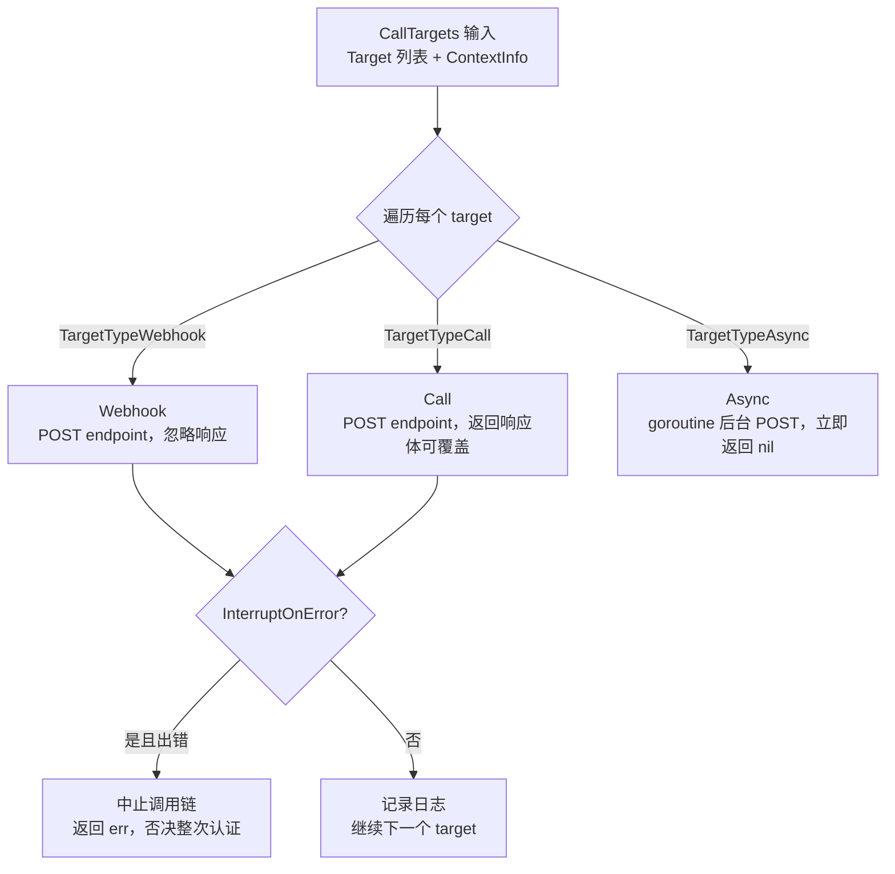
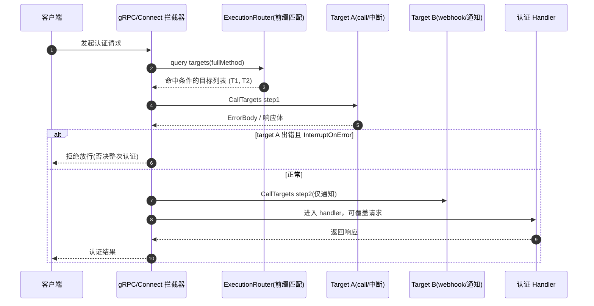

# Zitadel Actions / Execution V3 编程扩展点深读

> 定位：Zitadel 认证流上「条件 x 流程节点 → 目标的 webhook/脚本分发」扩展引擎，是 [`README.md`](README.md) 中 "Actions" 卖点的工程落点。

## 根因

Zitadel 提供 IAM/认证服务，但组织总有"标准认证之外的自定义诉求"：往 token 里塞私有 claim、在放行前做额外风险校验、把认证事件透传给内部审计系统。做成写死在代码里的分支无法维护，做成只能连固定 webhook 又不够灵活。Actions 要解决的根因是：**在不改 Zitadel 源码的前提下，把一个"可声明的条件"绑到"认证流的某个节点"，在节点触发时按需调用外部 webhook 或执行内置脚本，并允许结果去改写请求/响应/最终 token。**

## 概览与核心能力

Actions/V3 把"扩展"拆成三个正交的抽象，而不是"配置了脚本就万事大吉"的大杂烩：条件（Condition，锁定到哪个节点）决定**何时触发**，Execution（聚合体）决定**触发后调谁**，Target 决定**怎么调**。三者解耦是贯穿全篇的主线。

| 能力 | 说明 | 触发位置 |
|------|------|----------|
| **Request / Response 执行** | 对任意 gRPC/Connect 方法，在进入 handler 前（Request）与返回后（Response）调目标 | `internal/api/grpc/server/middleware/execution_interceptor.go` |
| **Function 执行** | 在认证流程的关键函数节点（PreUserinfo / PreAccessToken / PreSAMLResponse）插桩 | `internal/api/oidc/userinfo.go`、`internal/api/saml/storage.go` |
| **Event 执行** | 任意领域事件落库时异步投递给目标（事件流透传） | `internal/eventstore/v3/push.go` |
| **Target** | 抽象"目的地"：Webhook（忽略响应）/ Call（返回值）/ Async（异步 fire-and-forget） | `internal/execution/execution.go` |

技术栈：Go（gRPC/Connect）、river 队列（异步 worker）、go-jose（JWT/JWE 签名加密）。执行引擎对**外**统一收敛为"调 HTTP 目标"，不再内嵌全能 JS 解释器——这与 V1 Actions（内嵌 goja JS 引擎）的本质分野见「设计决策」。

## Actions 在认证流哪个环节插桩

三类插桩点：**请求边界（gRPC 拦截器）** + **认证函数节点（OIDC/SAML 流程内）** + **事件落库（eventstore）**。

### gRPC 拦截器：Request / Response

拦截器在 gRPC handler 前后各查一次目标，保证"同一个方法可以有前置 call 和后置 call"。查询输入是方法全名（`info.FullMethod`）。

[internal/api/grpc/server/middleware/execution_interceptor.go:21-38]() 前置查 Request 目标、handler 出错即返回，后置查 Response 目标、把原始 req 一并交给 response 目标——请求是否被"劫持"取决于前置目标返回体是否覆盖回请求对象。

<!-- snippet: 
func ExecutionHandler(alg crypto.EncryptionAlgorithm, activeSigningKey execution.GetActiveSigningWebKey, httpClient *http.Client) grpc.UnaryServerInterceptor {
	return func(ctx context.Context, req interface{}, info *grpc.UnaryServerInfo, handler grpc.UnaryHandler) (interface{}, error) {
		requestTargets := execution.QueryExecutionTargetsForRequest(ctx, info.FullMethod)
		// call targets otherwise return req
		handledReq, err := executeTargetsForRequest(ctx, requestTargets, info.FullMethod, req, alg, activeSigningKey, httpClient)
		if err != nil {
			return nil, err
		}

		response, err := handler(ctx, handledReq)
		if err != nil {
			return nil, err
		}

		responseTargets := execution.QueryExecutionTargetsForResponse(ctx, info.FullMethod)
		return executeTargetsForResponse(ctx, responseTargets, info.FullMethod, handledReq, response, alg, activeSigningKey, httpClient)
	}
}
-->

目标返回的响应体若非空，会反序列化**覆盖回原请求对象**，这样 webhook 才能真正改写进 handler 的入参——《actions-scripting》里"内容回写"即 token enrichment 的机制，在 request 层就已通用化（`SetHTTPResponseBody` 反填 `Request`）。

[internal/api/grpc/server/middleware/execution_interceptor.go:125-127]() `ContextInfoRequest.SetHTTPResponseBody` 把目标响应体 `json.Unmarshal` 覆盖回 `c.Request`。Response 目标同理反填 `Response` 后再交给上层（同为 `json.Unmarshal`，见 154-156 行）。

<!-- snippet: 
func (c *ContextInfoRequest) SetHTTPResponseBody(resp []byte) error {
	return json.Unmarshal(resp, &c.Request)
}
-->

### 认证函数节点：Function（OIDC token 富化 / SAML 属性）

OIDC 的 `getUserInfo` 是 token/userinfo 富化的核心入口。它**先**跑 V1 的 legacy Actions 脚本（`actions.Run`，内嵌 goja JS），**再**跑 V3 的 function 执行——两者并存。function 名由「ExecutionType + 函数名」拼成 deterministic ID：`function/preuserinfo`、`function/preaccesstoken`、`function/presamlresponse`。

[internal/api/oidc/userinfo.go:439-443]() 根据 triggerType 算 function ID；`QueryExecutionTargetsForFunction` 返回匹配的目标后交给 `CallTargets`（line 464），其返回值须是 `ContextInfoResponse`，`AppendClaims` / `SetUserMetadata` 会被逐条写回 userinfo——这就是 token/claim 富化的落点。

<!-- snippet: 
	switch triggerType {
	case domain.TriggerTypePreUserinfoCreation:
		function = exec_repo.ID(domain.ExecutionTypeFunction, domain.ActionFunctionPreUserinfo.LocalizationKey())
	case domain.TriggerTypePreAccessTokenCreation:
		function = exec_repo.ID(domain.ExecutionTypeFunction, domain.ActionFunctionPreAccessToken.LocalizationKey())
-->

这些 function 的合法名称是受限枚举，写 Execution 时用 `ActionFunctionExisting` 校验，防止管理员拼出任意名触发未定义行为。

[internal/domain/action.go:64-67]() 三个内置认证函数节点的 LocalizationKey 白名单 `preuserinfo` / `preaccesstoken` / `presamlresponse`；`AllActionFunctions` + `ActionFunctionExists` 支撑上面的校验。

<!-- snippet: 
func (s ActionFunction) LocalizationKey() string {
	if !s.Valid() {
		return ActionFunctionUnspecified.LocalizationKey()
	}
-->

SAML 侧对称：`getCustomAttributes` 里先跑 V1 脚本填 `customAttribute`，再执行 V3 的 `function/presamlresponse` 目标。

[internal/api/saml/storage.go:393-394]() SAML 响应的自定义属性扩展走同一条 Function 执行通道，`QueryExecutionTargetsForFunction` 后 `CallTargets` 派发。

<!-- snippet: 
	function := exec_repo.ID(domain.ExecutionTypeFunction, domain.ActionFunctionPreSAMLResponse.LocalizationKey())
	executionTargets := execution.QueryExecutionTargetsForFunction(ctx, function)
-->

### 事件落库：Event

与前两类"认证流内的同步调用"不同，Event 执行**异步**：把 eventstore 要 push 的事件序列化为 job 投进 river 队列，由 worker 后台跑。这让"整个领域事件流透传给外部系统"成为可能，且不阻塞主请求。

[internal/eventstore/v3/push.go:138-141]() push 时用 `ExecutionRouter().GetEventBestMatch("event/<EventType>")` 按前缀匹配目标，命中则 `NewRequest` 打包成 job args。

<!-- snippet: 
	router := authz.GetInstance(ctx).ExecutionRouter()
	if router.IsZero() {
		return nil, nil
	}
-->

异步 worker 收到 job 后先校验事件新鲜度（MaxTtl），解出目标列表再同步调目标。

[internal/execution/worker.go:41-46]() 过期事件直接 `JobCancel`；目标解算失败 `JobCancel`；目标调用出错则中断返回。

<!-- snippet: 
	// if the event is too old, we can directly return as it will be removed anyway
	if job.CreatedAt.Add(w.config.MaxTtl).Before(w.now()) {
		return river.JobCancel(errors.New("event is too old"))
	}

	targets, err := TargetsFromRequest(job.Args)
-->

## 条件 x 节点 → 目标 的模型

这是 Actions V3 执行模型的心脏：**一份 Execution 聚合体 = 一个条件（锁定节点/方法/事件）绑定一组目标引用（target 或 include）**。不在 Execution 里内联目标细节，只存引用，因此"同一批 webhook 复用到多个节点"靠 include 复用。

### 条件（condition）

条件对应 `domain.ExecutionType` 四态（request / response / function / event）。

[internal/domain/execution.go:9-14]() 四种执行类型 `request` / `response` / `function` / `event`；`ExecutionTargetType` 区分 `include`（引用另一份 Execution）与 `target`（引用具体 Target）。

<!-- snippet: 
const (
	ExecutionTypeUnspecified ExecutionType = iota
	ExecutionTypeRequest
	ExecutionTypeResponse
	ExecutionTypeFunction
	ExecutionTypeEvent
-->

条件校验强制"三选一"：method / service / all 任一即可但绝不同设。粒度从 `all`（整类全开）到 `service`（某服务）到 `method`（单方法）逐级细分；`Existing` 校验该 method/service/event 真实存在，防配置出无效方法。

[internal/command/action_v2_execution.go:27-32]() `ExecutionAPICondition` 三选一校验；`ID` 把条件折叠成聚合体 ID；`Existing` 用 `GrpcMethodExisting` / `GrpcServiceExisting` 校验方法/服务真实存在。

<!-- snippet: 
	// never set two conditions
	if e.Method != "" && (e.Service != "" || e.All) ||
		e.Service != "" && (e.Method != "" || e.All) ||
		e.All && (e.Method != "" || e.Service != "") {
		return zerrors.ThrowInvalidArgument(nil, "COMMAND-nee5q8aszq", "Errors.Execution.Invalid")
	}
-->

### 目标列表（SetExecution）

`SetExecution` 只存两类引用：`targets`（指向 Target 聚合）与 `includes`（引用其他 Execution 批量复用）。写之前校验引用存在，且 include 不能成环、深度限 3。

[internal/command/action_v2_execution.go:208-216]() `SetExecution` 的 targets 与 includes 分列；`GetTargets` / `GetIncludes` 按 `ExecutionTargetType` 提取；`Existing` 校验目标/执行存在并做 include 成环检测。

<!-- snippet: 
func (t SetExecution) GetIncludes() []string {
	includes := make([]string, 0)
	for i := range t.Targets {
		if t.Targets[i].Type == domain.ExecutionTargetTypeInclude {
			includes = append(includes, t.Targets[i].Target)
		}
	}
	return includes
}
-->

[internal/command/action_v2_execution.go:302-306]() include 环检测：遍历 includes 若遇到自身则报 `CircularInclude`，再递归逐级向下（`checkForIncludeCircularRecur` 深度受 `maxLevels` 约束）。

<!-- snippet: 
	for _, include := range includes {
		if id == include {
			return zerrors.ThrowPreconditionFailed(nil, "COMMAND-mo1cmjp5k7", "Errors.Execution.CircularInclude")
		}
		if err := checkForIncludeCircularRecur(ctx, []string{id}, resourceOwner, include, cache, maxLevels, level); err != nil {
-->

### 执行时的目标解算

条件被触发时真正展开的是 `target.Target`（带 endpoint/timeout/签名/payload 类型）。Router 在内存里按 ExecutionID 索引目标列表。

[internal/execution/target/target.go:26-32]() `Target` 净模型：`ExecutionID` + 目标类型 + endpoint + timeout + `InterruptOnError` + 签名/负载类型/加密密钥，是派发前唯一关心的对象。

<!-- snippet: 
type Target struct {
	ExecutionID      string              `json:"execution_id,omitempty"`
	TargetID         string              `json:"target_id,omitempty"`
	TargetType       TargetType          `json:"target_type,omitempty"`
	Endpoint         string              `json:"endpoint,omitempty"`
	Timeout          time.Duration       `json:"timeout,omitempty"`
	InterruptOnError bool                `json:"interrupt_on_error,omitempty"`
-->

[internal/execution/target/router.go:49-64]() `GetEventBestMatch` 匹配优先级：先精确命中，无则取最长前缀，`.*` 后缀表示"前缀下所有"（事件 group 通配）。

<!-- snippet: 
	t, ok := r.Get(executionID)
	if ok {
		return t, true
	}
	var bestMatch element
	for _, e := range r {
		if strings.HasPrefix(executionID, e.ID) {
			bestMatch, ok = e, true
		}

		// .* is suffixed for "all" condition on events
		cut, has := strings.CutSuffix(e.ID, ".*")
		if has && strings.HasPrefix(executionID, cut) {
			bestMatch, ok = e, true
		}
	}
-->

条件聚合体 ID 拼法在 `execution.ID`：前置 `ExecutionType.String()`，`/` 开头的方法名直接拼接成 `request/zitadel.session.v1...`，否则用 `/` 连接；`IDAll` 返回裸类型名「request」。

[internal/repository/execution/aggregate.go:25-30]() ID 方案：`executionType.String() + "/" + value`，`IDAll` 返回类型名，是 Execution 聚合体 ID 与 Router 查询 key 的唯一契约。

<!-- snippet: 
func ID(executionType domain.ExecutionType, value string) string {
	if strings.HasPrefix(value, "/") {
		return strings.Join([]string{executionType.String(), value}, "")
	}
	return strings.Join([]string{executionType.String(), value}, "/")
}
-->

## 派发：CallTargets 的三种目标语义

目标类型决定"派发后怎么处理响应/错误"——这是 webhook vs call vs async 的真正分界。

[internal/execution/execution.go:101-114]() `CallTarget` 按 `TargetType` 分发：webhook 丢弃响应、call 返回响应、async `go func` 在 `context.WithoutCancel` 下后台调且立刻返回 nil。

<!-- snippet: 
	switch target.GetTargetType() {
	// get request, ignore response and return request and error for handling in list of targets
	case target_domain.TargetTypeWebhook:
		return nil, webhook(ctx, target.GetEndpoint(), target.GetTimeout(), body, signingKey, client)
	// get request, return response and error
	case target_domain.TargetTypeCall:
		return Call(ctx, target.GetEndpoint(), target.GetTimeout(), body, signingKey, client)
	case target_domain.TargetTypeAsync:
		go func(ctx context.Context, target target_domain.Target, info []byte) {
			if _, err := Call(ctx, target.GetEndpoint(), target.GetTimeout(), info, signingKey, client); err != nil {
				logging.WithFields("target", target.GetTargetID()).OnError(err).Info(err)
			}
		}(context.WithoutCancel(ctx), target, body)
		return nil, nil
-->

`CallTargets` 对列表整体做错误聚合：任一个 target 出错且其 `InterruptOnError` 为真，整条链立刻中止（错误沿拦截器上抛，从而**否决整次认证/请求**）；否则记日志继续。

[internal/execution/execution.go:56-63]() `CallTargets` 循环：`err != nil && target.IsInterruptOnError()` 则 return 错误否决链；非空响应体反填 `SetHTTPResponseBody`（同样受 interrupt 保护）。

<!-- snippet: 
	for _, target := range targets {
		// call the type of target
		resp, err := CallTarget(ctx, target, info, alg, signerOnce, encrypters, client)
		// handle error if interrupt is set
		logging.WithFields("instanceID", authz.GetInstance(ctx).InstanceID(), "target", target.GetTargetID()).OnError(err).Error("error calling target")
		if err != nil && target.IsInterruptOnError() {
			return nil, err
		}
-->

这里的 `InterruptOnError` 是"**能否决**"的全部来源：call 目标若设置 interrupt，其返回的 4xx 或带 `forwardedStatusCode` 的错误会让 Zitadel 拒绝放行认证——这是"自定义风控拦截"的抓手。webhook 忽略响应故无法否决，天然只做通知。

在认证流里，同一节点的多个目标被顺序派发，任一目标否决整**条链**而不只是自己；响应体若带可写回内容还会反填请求/返回对象。

## 传输安全与负载

目标 payload 支持 JSON / JWT / JWE。JWT 用当前活跃签名密钥对请求体签名（写入 `SigningHeader` 请求头），JWE 再叠加目标公钥加密，保证"出去的数据改不了、也只有指定的接收方能解"。签名密钥每轮调用只取一次并缓存（`signerOnce`）。

[internal/execution/execution.go:121-128]() `payload` 按 `PayloadType` 分派：JSON 原样透传，JWT 用签名器产出 Compact JWT，JWE 先签再加密封装；签名密钥只取一次。

<!-- snippet: 
	switch target.GetPayloadType() {
	case target_domain.PayloadTypeUnspecified,
		target_domain.PayloadTypeJSON:
		return payload, nil
	case target_domain.PayloadTypeJWT:
		return payloadJWT(ctx, payload, signerOnce)
	case target_domain.PayloadTypeJWE:
		return payloadJWE(ctx, payload, target, signerOnce, encrypters)
-->

JWE 需要目标上传公钥，`publicKeyFromBytes` 解析 PEM；RSA 用 `RSA_OAEP_256`、ECDSA 用 `ECDH_ES_A256KW`。加密器按 keyID 缓存进 `sync.Map` 避免重复重建。

[internal/execution/execution.go:151-153]() JWE 加密器按 `GetEncryptionKeyID` 缓存；依赖 `crypto.EncryptionAlgorithm` 解出目标私钥。

<!-- snippet: 
	if encrypter, ok := encrypters.Load(target.GetEncryptionKeyID()); ok {
		return encrypter.(jose.Encrypter), nil
	}
-->

每次 HTTP 调用都有目标级 timeout（`Call` 内 `context.WithTimeout`），响应方拦截器与异步 worker 各有整体时限（`TransactionDuration`），防止任一 target 拖垮认证链路。

[internal/execution/worker.go:32-35]() worker 整体 `Timeout` 为 `TransactionDuration`，注释明示"可短于各 target timeout 之和，为的是不无限期阻塞请求"。

<!-- snippet: 
	// The time can be shorter than the sum of target timeouts, this is expected behavior to not block the request indefinitely.
func (w *Worker) Timeout(*river.Job[*exec_repo.Request]) time.Duration {
	return w.config.TransactionDuration
}
-->

## 设计决策（Why / 权衡）

### 为何是「条件 + 目标」分离而非「条件嵌脚本」

V1 Actions 是"给触发器绑一段 JS 脚本"（`actions.Run(goja)`），脚本内可调 HTTP、可写 user metadata。V3 改为「Execution（条件→目标引用）」+「Target（纯 HTTP 目的地）」两层：

- **关注点分离**：条件决定*在哪触发*，目标决定*怎么处理*。同一批目标（一台内网校验服务）可 include 复用到 request `zitadel.session.v1...` 与 function `preaccesstoken` 两处，不必复制两份配置。
- **确定性优于图灵完备**：嵌 goja 的通用脚本越强，越难审计"这段脚本会不会把你全库数据拉走"。V3 收敛为既定的三类语义（webhook 通知 / call 可回写能否决 / async 异步），安全边界可枚举——这是 `AddTarget` 对 endpoint 做 SSRF 防护（deny list）的根因。

[internal/command/action_v2_target.go:44-46]() `AddTarget` 对 URL 解析后过 `denylist.IsURLBlocked`，拦截指向内网/受限地址的端点——通用脚本越强，这种 SSRF 面就越难封，V3 用"只准连白名单外端点"收紧。

<!-- snippet: 
	if err := denylist.IsURLBlocked(inputDenyList, parsedURL, lookupFunc); err != nil {
		return zerrors.ThrowInvalidArgument(err, "COMMAND-NcJUKo", "Errors.Target.DeniedURL")
	}
-->

**代价**：V3 放弃"进程内任意改状态"（V1 脚本能调 command API），只保留"通过响应体重写请求/响应/claims"这一受控通道——更安全、更好审计，但表达能力收敛到 HTTP 语义。

### 为何保留 V1 JS 引擎并存

OIDC/SAML 节点里 V1 `actions.Run` 与 V3 `QueryExecutionTargetsForFunction` **并列先后执行**（userinfo.go 先跑 JS 再派发 HTTPS）。代码库同时维护两套扩展机器：V1 在进程内跑 JS（可直调 domain 状态），V3 在进程外向 HTTP 派发。这是迁移期共存——V1 深度耦合的既有客户不破坏，V3 逐步接管新扩展点。

### 为何 Request/Response 用拦截器而非塞进每个 command

把执行从业务逻辑抽离，用 gRPC/Connect 拦截器统一挡在最外层，业务 command 完全不感知 Actions。收益是"任何 API 方法都能无侵入扩展"，一个方法前置/后置各一次；代价是所有拦截都发生在 API 边界，进程内更深的内部调用（如后台任务 push）要经 Event 通道才能被 Actions 触达——这是"请求边界"与"事件"两条通道并存的原因。

### 为何 Event 用「打包成 river job」而非同步回调

异步 job 让事件派发**不阻塞、可重试、可限并发**（`MaxWorkers`），且天然复用 eventstore 事务。若做成同步回调，任一卡死的 webhook 都会拖垮认证写路径。代价是 Event 无法否决主流程（fire-and-forget）。**同一框架用同步/异步把"可否决的拦截"和"只通知的旁路"彻底分开**，是整套设计最精妙的一致性边界——Request/Function 走同步调度具备否决语义，Event 走异步只做通知。

## 全局关联：回扣 README 卖点

README 把 Actions/V3 当作"webhooks、custom code、token enrichment"卖点，落到代码是三层：

- **webhooks / custom code** → `Target`（webhook/call/async）+ `execution.CallTargets`（`internal/execution/execution.go`）。
- **token enrichment** → Function 通道在 `internal/api/oidc/userinfo.go` 把 `ContextInfoResponse` 的 `AppendClaims` / `SetUserMetadata` 写回 userinfo。
- **拒绝/放行** → `InterruptOnError` 沿 gRPC 拦截器上抛否决请求（`execution_interceptor.go`）。

这三件事被统一的「条件→目标」模型承载，正是 Zitadel "IAM 不只是现成认证，还能按你的流程扩展"的产品叙事在工程上的支撑点。

## 不足与风险

- **脚本能力退化**：V3 收敛为 HTTP 派发后，V1 脚本"进程内拿用户数据做复杂判断再放行"强项无对应能力，只能靠外部服务回传。
- **Event 通道缺更细降级**：异步 job 若目标长期不可达会积压，只靠 MaxTtl 丢弃旧事件，缺乏更细的降级/告警策略。
- **拦截器全量匹配开销**：每个 gRPC 方法都查一次 Router 的前缀匹配，方法量级大时 `GetEventBestMatch` 是线性扫描，较大实例下查询成本值得注意。

## 附录：关键源码文件

| 关注点 | 文件 |
|--------|------|
| V3 执行引擎派发 | `internal/execution/execution.go` |
| 异步 worker | `internal/execution/worker.go` |
| Target 净模型 / Router 索引 | `internal/execution/target/target.go`、`router.go` |
| gRPC 拦截器 | `internal/api/grpc/server/middleware/execution_interceptor.go`、`internal/api/grpc/server/connect_middleware/execution_interceptor.go` |
| 认证函数节点富化 | `internal/api/oidc/userinfo.go`、`internal/api/saml/storage.go` |
| 事件异步投递 | `internal/eventstore/v3/push.go` |
| Execution / Target 写模型与条件 | `internal/command/action_v2_execution.go`、`action_v2_target.go` |
| 领域枚举 | `internal/domain/execution.go`、`internal/domain/action.go` |
| Repository 事件模型 | `internal/repository/execution/execution.go`、`aggregate.go`、`queue.go` |
