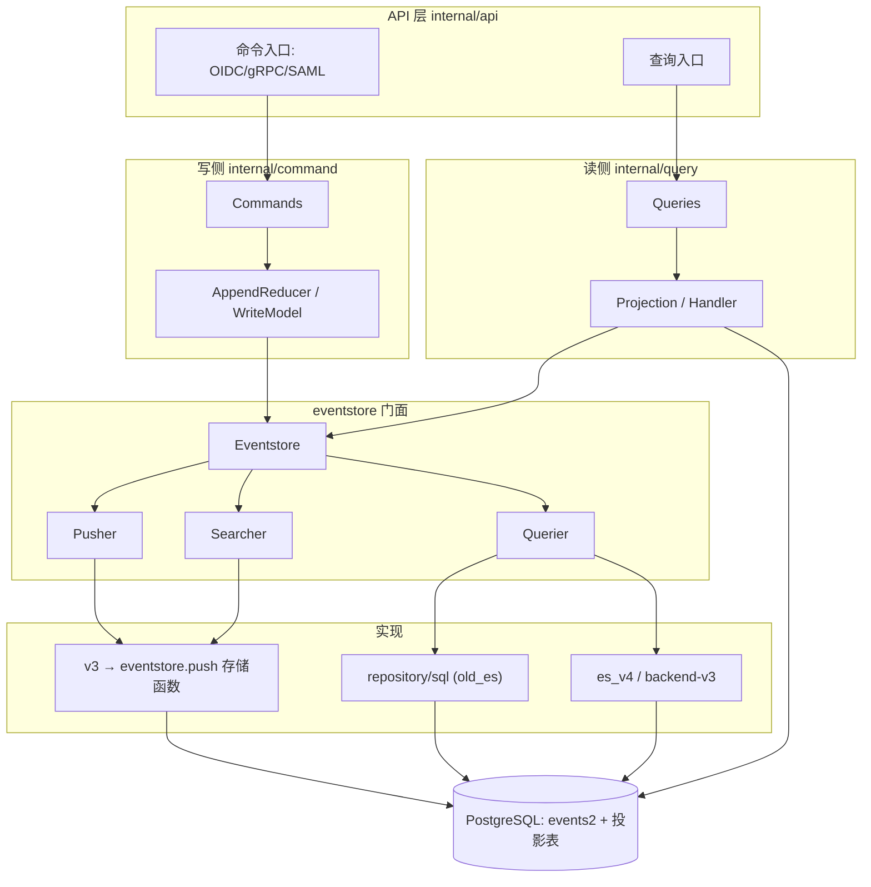

# ZITADEL 架构与事件溯源核心

> 关注面：架构分层、Eventstore 门面、v3 事件写实现、写侧命令模式、启动管线。
> 所有 `文件:行号` 以本地源码 `/Users/morehao/Documents/study/auth/zitadel` 为根，经程序重定位校验。

## 一句话根因

企业级 IAM 要同时满足「合规审计所需的不可变变更记录」与「高并发下可扩展的快速查询」，而直接写业务表无法在不引入双写的前提下同时达成。事件溯源 + CQRS 把每个变更铸造成不可变事件（写侧唯一真相），再用投影折算成关系表服务查询（读侧物化视图），两者解耦。

## 根因锚定：为什么是事件溯源 + CQRS

`Command` 是「存储一个事件的意图」、`Event` 是「已存储的不可变活动」，两者分离正是事件溯源「命令 → 事件」的两层模型；事件带 `Sequence`（聚合内序号）与 `Position`（全局序号），构成「不可变审计日志」的基本单元。

[internal/eventstore/event.go:27-41]() Command 接口：描述「要存储的事件意图」及其 UniqueConstraints/Fields
<!-- anchor: // Command is the intent to store an event into the eventstore ... Fields() []*FieldOperation -->
[internal/eventstore/event.go:54-72]() Event 接口：序列/创建时间/全局位置 + Unmarshal
<!-- anchor: // Event is a stored activity ... DataAsBytes() []byte -->

读侧完全不同：查询走 `internal/query/`，数据来自 projection 折算出的关系表，而不是直接扫事件表：

[internal/eventstore/eventstore.go:28-40]() 门面抽象「存储合法事件 + 过滤已存事件」，持有三种能力
<!-- anchor: // Eventstore abstracts all functions needed to store valid events ... logger *slog.Logger -->

## 架构总览：写读两条通路的统一分层

上层是统一门面（`internal/command` 写、`internal/query` 读），底层是多个可插拔的 eventstore 实现。门面把三种能力各委托给独立实现，实现可插拔、可并存。



门面与实现解耦的结构基础是 `Config` 用接口注入三种能力：

[internal/eventstore/config.go:7-14]() Eventstore 配置用接口注入 Pusher/Querier/Searcher/Queue
<!-- anchor: type Config struct { ... Queue    ExecutionQueue -->

## 启动管线：initialise → setup → start 三段式

`main.go` 构造根命令并执行；根命令把 `initialise/setup/start/ready/...` 注册进 cobra。

```go
func main() {
	args := os.Args[1:]
	rootCmd := cmd.New(os.Stdout, os.Stdin, args, nil)
	ctx := logging.NewCtx(context.Background(), logging.StreamRuntime)
	if err := rootCmd.ExecuteContext(ctx); err != nil {
		os.Exit(1)
	}
}
```
[main.go:11-19]() 入口只构造根命令并执行
<!-- anchor: func main() { ... os.Exit(1) -->

```go
	cmd.AddCommand(
		admin.New(), //is now deprecated, remove later on
		initialise.New(),
		setup.New(),
		start.New(server),
		start.NewStartFromInit(server),
		start.NewStartFromSetup(server),
		mirror.New(&configFiles),
		key.New(),
		ready.New(),
	)
```
[cmd/zitadel.go:58-68]() 子命令装配
<!-- anchor: cmd.AddCommand( ... ready.New(), -->

`setup` 显式顺序执行迁移步骤：`s14NewEventsTable`（建 events2）、`s40InitPushFunc`（建存储函数）排最前，随后 `FirstInstance` 铸首实例事件，最后建投影表——先有事件表与写函数，投影才有数据可折算：

[cmd/setup/setup.go:266-275]() 迁移步骤顺序编排：先建 events2/push 函数再铸首实例
<!-- anchor: for _, step := range []migration.Migration{ ... steps.s5LastFailed, -->

`setup` 与 `start` 都在跑迁移/启动前装配事件存储，注入 `Config.Eventstore`：

[cmd/setup/setup.go:162-166]() setup 装配 Querier=old_es、Pusher/Searcher=v3
<!-- anchor: config.Eventstore.Querier = old_es.NewPostgres(dbClient) ... eventstoreClient := eventstore.NewEventstore(config.Eventstore) -->

```go
	config.Eventstore.Pusher = new_es.NewEventstore(dbClient, new_es.WithExecutionQueueOption(q))
	config.Eventstore.Searcher = new_es.NewEventstore(dbClient, new_es.WithExecutionQueueOption(q))
	config.Eventstore.Querier = old_es.NewPostgres(dbClient)
	eventstoreClient := eventstore.NewEventstore(config.Eventstore)
```
[cmd/start/start.go:202-207]() start 装配：Pusher/Searcher=v3、Querier=old_es
<!-- anchor: config.Eventstore.Pusher = new_es.NewEventstore(dbClient, new_es.WithExecutionQueueOption(q)) ... eventstoreClient := eventstore.NewEventstore(config.Eventstore) -->

## 核心结构一：统一事件存储门面 Eventstore

门面持有三种独立能力，对外暴露统一的 `Push / Filter / Search` 等方法：

[internal/eventstore/eventstore.go:28-40]() 门面持有 pusher/querier/searcher
<!-- anchor: type Eventstore struct { ... logger *slog.Logger -->

**Pusher**（写事件，唯一写入口）是独立接口：

[internal/eventstore/eventstore.go:309-314]() Pusher 接口：Health + Push
<!-- anchor: type Pusher interface { ... Push(ctx context.Context, client new_db.QueryExecutor, commands ...Command) (_ []Event, err error) -->

`Push` 带**重试 + 超时 + 冲突处理**——PK 冲突（`events2_pkey` 23505）与可串行化/读已提交冲突（`CR000`/`40001`）会自动重试，这是写路径健壮性的核心：

[internal/eventstore/eventstore.go:133-152]() 重试循环：识别特定 SQLSTATE 后 continue 重试
<!-- anchor: retry: ... break retry -->

`FilterToReducer` 是读侧核心——把事件喂给 reducer 逐条 reduce，门面负责先做 event→struct 映射，并在执行前 `ensureInstanceID` 自动注入租户过滤：

[internal/eventstore/eventstore.go:252-263]() FilterToReducer：确保 instance 过滤 + 逐条 reduce
<!-- anchor: func (es *Eventstore) FilterToReducer(ctx context.Context, searchQuery *SearchQueryBuilder, r reducer) error { ... return r.Reduce() -->

## 核心结构二：写侧 Commands 门面与「重放 + Push」命令模式

`Command` 是写侧核心抽象——一个命令代表「一个尚未落库的事件意图」。业务方法构造若干命令后统一调用 `pushAppendAndReduce`：先一次事务 `Push(cmds...)` 落库返回 `[]Event`，再把返回事件 `AppendEvents` 进 ReadModel 并 `Reduce()`：

[internal/command/command.go:255-264]() 重放+Push：Push 落库 → AppendAndReduce 折算
<!-- anchor: func (c *Commands) pushAppendAndReduce(ctx context.Context, object AppendReducer, cmds ...eventstore.Command) error { ... return AppendAndReduce(object, events...) -->

`AppendReducer` 接口定义两段协约——`AppendEvents` 加事件、`Reduce` 折算：

[internal/command/command.go:249-253]() AppendReducer：追加事件 + 折算成对象状态
<!-- anchor: type AppendReducer interface { ... Reduce() error -->

## 核心结构三：V3 事件写实现——Postgres 存储函数批量写 events2

`internal/eventstore/v3` 的 `Push` 把一批 command 打包，调用 Postgres 存储函数 `eventstore.push`，函数内部先算 sequence/position/owner 再一次性 INSERT 进 `events2`，并通过 `RETURNING` 回读落库后的 owner/createdAt/sequence/position：

[internal/eventstore/v3/push.go:83-88]() 调存储函数 eventstore.push 并回读落库结果
<!-- anchor: commandMapping := "eventstore.command2" ... rows, err := tx.Query(ctx, fmt.Sprintf(`select owner, created_at, "sequence", position from eventstore.push($1::%s[])`, commandMapping), cmds) -->

调用前包一层**事务 + 实例级 advisory 锁**，保证同一 instance 内并发写事件时读-读一致：

[internal/eventstore/v3/push.go:32-48]() pushTx 事务 + instance 级共享 advisory 锁
<!-- anchor: func (es *Eventstore) writeCommands(ctx context.Context, client database.QueryExecutor, commands []eventstore.Command) (_ []eventstore.Event, err error) { -->

实际的存储函数由 setup step 40 创建。核心函数 `eventstore.commands_to_events`：对每个聚合取上一事件 sequence，用窗口函数 `ROW_NUMBER()` 原子地逐条 +1，保证聚合内 sequence 严格单调；owner 默认沿用上一次：

```sql
        LEFT JOIN LATERAL (
            SELECT
                e.owner,
                e.sequence
            FROM eventstore.events2 AS e
            WHERE e.instance_id = c.instance_id
                AND e.aggregate_type = c.aggregate_type
                AND e.aggregate_id = c.aggregate_id
            ORDER BY e.sequence DESC
            LIMIT 1
        ) AS e ON TRUE
```
[cmd/setup/40/02_func.sql:53-63]() 取各聚合上一序列（SQL 侧「重放最近事件」）
<!-- anchor: LEFT JOIN LATERAL ( ... ) AS e ON TRUE -->

```sql
        , COALESCE(e.sequence, 0) + ROW_NUMBER() OVER (PARTITION BY c.instance_id, c.aggregate_type, c.aggregate_id ORDER BY c.in_tx_order) AS sequence
```
[cmd/setup/40/02_func.sql:88-95]() 窗口函数原子递增聚合内 sequence
<!-- anchor: RETURN QUERY SELECT -->

setup step 40 在跑完建表 step 14 后执行，创建类型 `command2` 与存储函数，并强制重置连接池让新类型生效：

[cmd/setup/40.go:45-59]() 执行存储函数 SQL 并重置空闲连接
<!-- anchor: statements, err := mig.prepareStatements(ctx) ... conn.Release() -->

## 设计决策：Why / 权衡 / 对比

### 为什么事件溯源而非直接写关系表

传统方案把业务对象当前状态直接存表，会丢失「它怎么变成这样」的过程；IAM 的合规审计、账号找回、误操作回滚都依赖这段过程。事件溯源把「状态」降级为「事件的 reduce 副产物」，真相永远是可重放的事件流，任何投影随时可从头重放。

权衡代价：
- 一次读当前状态需重放历史事件（除非有投影缓存），延迟高——这是读侧必须引入 projection 的根本原因（事件溯源与 CQRS 是配套关系）。
- 事件模型已发布难修改，需 revision/迁移策略；ZITADEL 让事件携带 `revision`，并让存储函数向后兼容 `eventstore.command` 与 `eventstore.command2` 两种结构：

[internal/eventstore/v3/push.go:83-86]() 兼容新旧 command 类型结构
<!-- anchor: commandMapping := "eventstore.command2" ... commandMapping = "eventstore.command" -->

### 为何兼容多套事件写实现

因为事件溯源落地难、演进快，不同阶段采用不同方案。ZITADEL 用接口化门面把实现决策推迟到装配期，使「写用什么、读用什么、搜用什么」可独立演进、甚至并存——同一进程同时注入 old_es、v3、es_v4 三个实现。

权衡代价：三套实现 = 三套 SQL、三套类型注册、三套事务语义，主成本是维护与测试；门面层为平滑迁移保留了不少兼容分支（重试、events2 不存在回退）。

### 重放命令模式的利与弊

**利**：写侧代码极简统一，所有「变更域对象」收敛到 `push + AppendAndReduce` 一个模式；天然支持批量/原子（多命令一次 Push 单事务，全成或全不成）；事件即审计，无需额外审计表。

**弊**：顺序强约束——同一聚合并发写会因 sequence 冲突而频繁重试；重放成本——长历史对象 reduce 开销大，需投影与缓存兜底；并发安全依赖事务与锁——V3 把逻辑推进 Postgres 存储函数内保证原子性，正说明「应用层重放不可靠、需下推到 DB」。

## 不足 / 风险

1. **版本命名漂移严重**：`internal/eventstore/v3`、`repository/sql`（old）、`internal/v2/eventstore`（es_v4）、表名 `events2`、step 40 自称 v4，彼此无法对应。
2. **多套读实现并存**：old_es 与 es_v4 同时装配，查询语义/测试双份维护，是迁移期技术债。
3. **主键冲突重试依赖 SQLSTATE 字符串匹配**：`events2_pkey`/`CR000`/`40001` 魔术值散落，换存储或 Postgres 行为变化时重试逻辑会静默失效。
4. **读路径延迟来自重放 + 投影追尾**：写后读侧关系表靠投影异步折算，存在一致性滞后（最终一致）。
5. **owner 推断依赖约定而非类型强制**：`commands_to_events` 默认继承上一事件 owner，只有 `enforce_owner` 时才强制覆盖；忘记设置即可能写入错误 resource owner。

## 参考注记（命名澄清）

`internal/eventstore/v3/`（包名 `eventstore`）承担 Pusher + Searcher；`internal/eventstore/repository/sql`（别名 `old_es`）承担 Querier；另有 `internal/v2/eventstore`（别名 `es_v4`）与新增 `backend/v3/` 关系存储作为新读实现。`events2` 是 PostgreSQL 中事件表实际表名，与「V2/V3」版本编号无稳定对应。
