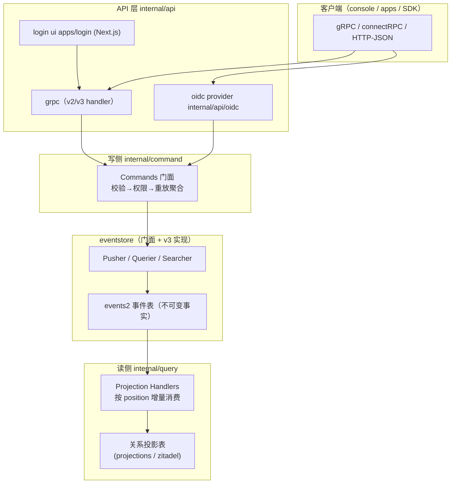
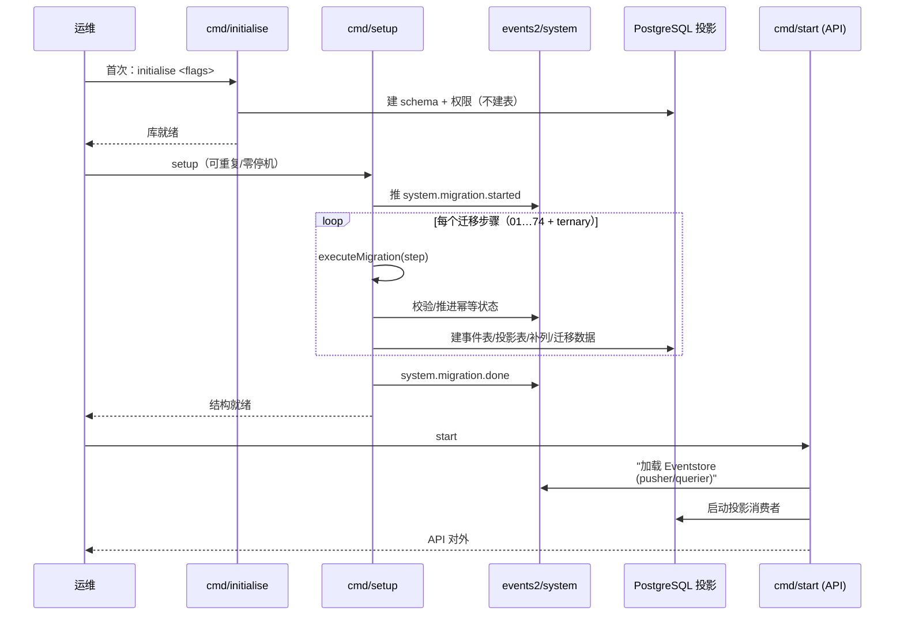

# Zitadel 核心架构：CQRS + Event Sourcing 与启动管线

> 事件存储、写侧、投影、启动迁移为本篇主轴。所有论断后的 `[路径:起-止]()` 引用均可点开在 Zitadel 源码仓库（`github.com/zitadel/zitadel`）下重定位验证。

## 一句话根因

Zitadel 是一套「单 PostgreSQL 内建的身份治理 / IAM 平台」，其全部业务状态都可被还原为不可变事件流：写侧只追加事件，读侧由投影把事件异步折算成可直接查询的关系表。因此它要在**事件存储（事实来源）** 与**关系投影（查询视图）** 之间做持续的拉锯与迁移，架构的演进几乎等同于事件表与投影表的演进。

## 根因锚定：为什么是事件溯源 + CQRS

身份与权限平台最棘手的不是「读写顺手」，而是**可审计、可追溯、可跨组织地理解状态为何变成这样**。传统 CRUD 直接覆盖字段，丢失了「为什么会变成这样」的过程。Zitadel 在写侧只铸造不可变事件（如 `user.added`、`group.changed`），把每次状态变迁留档，再由读侧投影把所有事件折算成关系行，供各 API 快速查询。V1/V2/V3 三版事件存储、以及「重放还原」与「关系表投影」两条读路，都是围绕这一核心取舍展开的。

关键权衡：事件追踪带来**完全可审计**与**可重建任何历史快照**的能力，代价是——事件不是当前状态的即时视图，读侧必须靠异步投影追赶，因此有「读可能落后于写」的最终一致性；同时事件表不断膨胀，需要全局单调的 `position` 给投影一条明确的消费顺序。

## 架构总览：写读两条通路的统一分层

整套系统围绕「写只铸造不可变事件、读从关系投影取数」这条主线分层。`Eventstore` 是写读共用的门面，写侧由 `internal/command` 把命令折算成事件交给它，读侧由 `internal/query` + 投影处理器把事件折算成关系表再供各 API 查询：

命令侧构造事件、`Eventstore.Push` 原子落盘后，读侧投影独立异步追赶，写读路径在物理上解耦——「写可审计、读可查询」两全的核心就在此处。图中 `Q2`（关系投影表）是读模型的主 sink：gRPC v2/v3 查询与 OIDC 的 userinfo 都直接从这些投影关系表取数，不再经事件重放。「构造事件」「按 position 增量消费」的语义由图中写读两侧在 `E1→E2` 与 `E2→Q1` 的方向上承载（不经边标签）。

> 现有部署把登录 UI 从内嵌 Go 模板逐步迁到独立 Next.js `apps/login`，但 API 面（`internal/api/grpc`、`internal/api/oidc`）仍是登入发生的地方，前端只做编排，不持有身份状态。

## 启动管线：initialise → setup → start 三段式

生产部署的典型启动分三步，均由 `cmd` 下的 cobra 子命令承载：先 `initialise` 建库建 schema 与权限，再 `setup` 顺序执行迁移步骤（含创建首个 instance / 建事件表），最后 `start` 才真正拉起 API 服务。setup 与 start 可分开、可重复用于零停机升级（先跑新版本 setup 再平滑切换 start）。

[cmd/start/start.go:124-134]() 启动由 cobra 命令 `startZitadel` 收口，实际业务加载在 `startZitadel` 的上下文里完成，迁移/初始化由子命令先行完成。
<!-- snippet: func New(server chan<- *Server) *cobra.Command {
	return &cobra.Command{
		Use:   "start",
		Short: "Start ZITADEL",
		Long:  "Start the ZITADEL server with all dependencies",
		RunE: func(cmd *cobra.Command, args []string) (err error) {
			// ...
			return startZitadel(cmd.Context(), config, masterKey, server)
		},
	}
} -->

[cmd/start/start_from_setup.go:55-57]() `start --setup` 或分离的 setup 子命令先构造迁移步骤并在 startBeforeBackend 阶段执行，保证服务起来前表已就绪。
<!-- snippet: 			setupSteps, err := setup.NewSteps(cmd.Context(), viper.New())
			// ...
			err = setup.Setup(cmd.Context(), setupConfig, setupSteps, masterKey) -->

这三段式把「数据库结构的演进」与「服务进程的业务启动」在时间上解耦：setup 阶段就能用版本化迁移安全落地新表，start 阶段无需执行任何 DDL——这是零停机升级的工程基础。

## 核心结构一：统一事件存储门面 Eventstore

`internal/eventstore/eventstore.go` 里 `Eventstore` 是所有写读的枢纽，它不直接碰 SQL，而是把三件能力抽象为三个可替换接口：`Pusher`（写事件）、`Querier`（过滤事件到 reducer）、`Searcher`（按字段搜索）。`Eventstore` 本身只做跨切面的事：push 超时与失败重试、事件类型映射、push 后通知执行队列。这使得「用什么存储实现」能在启动或 setup 时注入，也是它能在 V3/V4 之间切换、甚至同进程混用的前提。

[internal/eventstore/eventstore.go:30-39]() `Eventstore` 把 Pusher/Querier/Searcher 三个存储接口打包在一起，自身只处理超时、重试、映射等横切逻辑。
<!-- snippet: type Eventstore struct {
	PushTimeout time.Duration
	maxRetries  int

	pusher   Pusher
	querier  Querier
	searcher Searcher

	logger *slog.Logger
} -->

写入口 `PushWithNewClient` 是整套写模型的核心：它给整个 push 挂 `PushTimeout` 超时，针对 `events2_pkey` 主键冲突（SQLSTATE 23505）做有限重试——因为 `position` 并发分配可能撞牌——再把 push 发出的事件做类型映射并 notify 订阅方。重试逻辑只在非事务调用下生效（传入事务时调用方自行重试）。

[internal/eventstore/eventstore.go:133-153]() 写侧统一入口：超时 + 主键冲突重试 + 事件映射 + 通知，业务层的并发冲突在 push 层兜底。
<!-- snippet: retry:
	for ; retries <= es.maxRetries; retries++ {
		events, err = es.pusher.Push(ctx, client, cmds...)
		// if there is a transaction passed the calling function needs to retry
		if _, ok := client.(new_db.Transaction); ok {
			break retry
		}
		var pgErr *pgconn.PgError
		if !errors.As(err, &pgErr) {
			break retry
		}
		if pgErr.ConstraintName == "events2_pkey" && pgErr.SQLState() == "23505" {
			logging.WithError(ctx, err).Info("eventstore push retry")
			continue
		}
		if pgErr.SQLState() == "CR000" || pgErr.SQLState() == "40001" {
			logging.WithError(ctx, err).Info("eventstore push retry")
			continue
		}
		break retry
	} -->

读入口 `FilterToReducer` 不假设存储层：它把 searchQuery 交给 querier，逐事件调用 `mapEvent` 还原成强类型事件后再喂给 reducer。reducer 是写侧 WriteModel / 读侧投影共用的抽象——同一套「append 事件、再 reduce」的流式协议。

[internal/eventstore/eventstore.go:253-263]() 读侧流式接口 `FilterToReducer`：逐事件映射后 append 到 reducer 并触发其 Reduce，内存友好。
<!-- snippet: func (es *Eventstore) FilterToReducer(ctx context.Context, searchQuery *SearchQueryBuilder, r reducer) error {
	searchQuery.ensureInstanceID(ctx)
	return es.querier.FilterToReducer(ctx, searchQuery, func(event Event) error {
		event, err := es.mapEvent(event)
		if err != nil {
			return err
		}
		r.AppendEvents(event)
		return r.Reduce()
	})
} -->

`Querier` 接口定义了读侧需要的最小能力：流式过滤、最新 position、实例 ID 列表。写侧用自己的 `Pusher` 实现，旧 `Postgres` 与 V3 各实现其一，门面据此在启动时组合出统一读写入口。

[internal/eventstore/eventstore.go:296-307]() `Querier`（读）与 `Pusher`（写）是两条对称接口，门面持有两者构成统一 Eventstore。
<!-- snippet: type Querier interface {
	// Health checks if the connection to the storage is available
	Health(ctx context.Context) error
	// FilterToReducer calls r for every event returned from the storage
	FilterToReducer(ctx context.Context, searchQuery *SearchQueryBuilder, r Reducer) error
	// LatestPosition returns the latest position found by the search query
	LatestPosition(ctx context.Context, queryFactory *SearchQueryBuilder) (decimal.Decimal, error)
	// InstanceIDs returns the instance ids found by the search query
	InstanceIDs(ctx context.Context, queryFactory *SearchQueryBuilder) ([]string, error)
	// Client returns the underlying database connection
	Client() *database.DB
} -->

`write_model.go` 与 `read_model.go` 定义了两种 reducer 的最小行为：`WriteModel` 服务命令侧（记录 `ProcessedSequence` 做乐观并发版本判断），`ReadModel` 服务读查询。二者都遵循「`AppendEvents` 只管收集、`Reduce` 一次性折算最新状态并清空事件列表」的约定，事件消费完即释放。

[internal/eventstore/write_model.go:10-17]() WriteModel 是命令侧最小状态：靠 ProcessedSequence 标记推进到的事件，供写命令判断并发版本。
<!-- snippet: type WriteModel struct {
	AggregateID       string    `json:"-"`
	ProcessedSequence uint64    `json:"-"`
	Events            []Event   `json:"-"`
	ResourceOwner     string    `json:"-"`
	InstanceID        string    `json:"-"`
	ChangeDate        time.Time `json:"-"`
} -->

[internal/eventstore/read_model.go:12-21]() ReadModel 是最小读模型，额外带全局 Position，是投影按事件流顺序消费的锚点。
<!-- snippet: type ReadModel struct {
	AggregateID       string          `json:"-"`
	ProcessedSequence uint64          `json:"-"`
	CreationDate      time.Time       `json:"-"`
	ChangeDate        time.Time       `json:"-"`
	Events            []Event         `json:"-"`
	ResourceOwner     string          `json:"-"`
	InstanceID        string          `json:"-"`
	Position          decimal.Decimal `json:"-"`
} -->

## 核心结构二：写侧 Commands 门面与「重放 + Push」命令模式

`internal/command/command.go` 的 `Commands` 是命令门面：持有 eventstore、若干加密密钥、权限检查等依赖，但**核心只有一件事——把命令折算成不可变事件并 push**。绝大多数业务写方法遵循同一模板：校验参数（`IsValid`）→ 权限检查（`checkPermissionXxx`）→ 用 `getXxxWriteModelByID` 重放该聚合当前状态判断存在性 / 字段 → 构造事件 → `pushAppendAndReduce` 落盘。

模板最核心的收口是 `pushAppendAndReduce`：先 `eventstore.Push` 落盘，再把 push 返回的事件本地 reduce 回写模型，保证命令返回值拿到最新状态。

[internal/command/command.go:255-264]() 命令侧写模板收口：Push 落盘后对对象 reduce，命令行拿到的对象即最新事件折算结果。
<!-- snippet: func (c *Commands) pushAppendAndReduce(ctx context.Context, object AppendReducer, cmds ...eventstore.Command) error {
	if len(cmds) == 0 {
		return nil
	}
	events, err := c.eventstore.Push(ctx, cmds...)
	if err != nil {
		return err
	}
	return AppendAndReduce(object, events...)
} -->

以 `CreateGroup` 为例看完整写主线：生成 ID（`idGenerator.Next`）→ `IsValid` → 校验 resource_owner → `checkPermissionCreateGroup` → `checkOrgExists` → `getGroupWriteModelByID` 重放判断「同 ID 已存在」→ `repo.NewGroupAddedEvent` 构造不可变事件 → `pushAppendAndReduce` 落盘 → 返回 `ObjectDetails`。

[internal/command/group.go:67-77]() 写命令典型形态：校验 → 权限 → 重放判断 → 构造事件 → push，返回最新 details。
<!-- snippet: 	err = c.pushAppendAndReduce(ctx,
		groupWriteModel,
		repo.NewGroupAddedEvent(ctx,
			GroupAggregateFromWriteModel(ctx, &groupWriteModel.WriteModel),
			group.Name,
			group.Description,
		))
	if err != nil {
		return nil, err
	}
	return writeModelToObjectDetails(&groupWriteModel.WriteModel), nil -->

[internal/command/group.go:163-170]() 写命令用 FilterToQueryReducer 从事件流重放聚合当前状态，这是「命令侧读」的标准姿势。
<!-- snippet: func (c *Commands) getGroupWriteModelByID(ctx context.Context, groupID, orgID string, userIDs []string) (*GroupWriteModel, error) {
	groupWriteModel := NewGroupWriteModel(groupID, orgID, userIDs)
	err := c.eventstore.FilterToQueryReducer(ctx, groupWriteModel)
	if err != nil {
		return nil, err
	}
	return groupWriteModel, nil
} -->

值得留意 `Commands` 还暴露后台入口：`asyncPush` 对纯日志类事件在 goroutine 里异步 push（用 `context.WithoutCancel` 规避请求取消，且不等结果），`Close` 等待所有异步作业收尾。这体现了「某些事件的落盘不影响业务结果、可后置」的权衡。

[internal/command/command.go:378-400]() 异步 push：把纯日志事件放到后台 goroutine 落盘、请求不等它；Close 负责统一收尾。
<!-- snippet: func (c *Commands) asyncPush(ctx context.Context, cmds ...eventstore.Command) {
	// Create a new context, as the request scoped context might get
	// canceled before we where able to push.
	// The eventstore has its own PushTimeout setting,
	// so we don't need to have a context with timeout here.
	ctx = context.WithoutCancel(ctx)

	c.jobs.Add(1)

	go func() {
		defer c.jobs.Done()
		localCtx, span := tracing.NewSpan(ctx)

		_, err := c.eventstore.Push(localCtx, cmds...)
		if err != nil {
			for _, cmd := range cmds {
				logging.WithError(err).Warnf("could not push event %q", cmd.Type())
			}
		}

		span.EndWithError(err)
	}()
} -->

## 核心结构三：V3 事件写实现——Postgres 存储函数批量写 events2

经典 `Eventstore` 只是门面，真正落盘的在 `internal/eventstore/v3`。它实现 `eventstore.Pusher`，核心 `writeCommands` 在单个事务里依次做四件事：对实例加 `pg_advisory_xact_lock_shared` 提供读写隔离；调用 PG 存储函数 `eventstore.push` 批量插入 `eventstore.events2`；用 `handleUniqueConstraints` 处理唯一约束；用 `queueExecutions` 把命中的事件入执行（river）队列。这把「锁 → 批量插 → 约束 → 队列」的事件溯源事务完整性一次性打包。

[internal/eventstore/v3/push.go:32-72]() V3 写实现的四步事务：实例共享锁、批量写事件、唯一约束、执行队列。setup 未执行时降级到 pushWithoutFunc。
<!-- snippet: func (es *Eventstore) writeCommands(ctx context.Context, client database.QueryExecutor, commands []eventstore.Command) (_ []eventstore.Event, err error) {
	if client == nil {
		client = es.client
	}

	tx, close, err := es.pushTx(ctx, client)
	if err != nil {
		return nil, err
	}
	if close != nil {
		defer func() {
			err = close(err)
		}()
	}

	// lock the instance for reading events if await events is set for the duration of the transaction.
	_, err = tx.Exec(ctx, "SELECT pg_advisory_xact_lock_shared('eventstore.events2'::REGCLASS::OID::INTEGER, hashtext($1))", authz.GetInstance(ctx).InstanceID())
	if err != nil {
		return nil, err
	}

	events, err := writeEvents(ctx, tx, commands)
	if err != nil {
		return nil, err
	}
	if err = handleUniqueConstraints(ctx, tx, commands); err != nil {
		return nil, err
	}

	err = es.handleFieldCommands(ctx, tx, commands)
	if err != nil {
		return nil, err
	}

	err = es.queueExecutions(ctx, tx, events)
	if err != nil {
		return nil, err
	}

	return events, nil
} -->

push.sql 底部就是落盘用的 INSERT：写入 `instance_id / owner / aggregate_type / aggregate_id / revision / creator / event_type / payload / sequence / created_at / position / in_tx_order`，并 `RETURNING created_at, position` 把存储层分配的创建时间与全局位置读回来写进事件对象。`position` 是投影消费顺序的全局时钟。

[internal/eventstore/v3/push.sql:1-18]() 写事件的目标表与返回列：position 由数据库侧生成，作为投影消费顺序的全局时钟。
<!-- snippet: INSERT INTO eventstore.events2 (
    instance_id
    , "owner"
    , aggregate_type
    , aggregate_id
    , revision

    , creator
    , event_type
    , payload
    , "sequence"
    , created_at

    , "position"
    , in_tx_order
) VALUES
    %s
RETURNING created_at, "position"; -->

