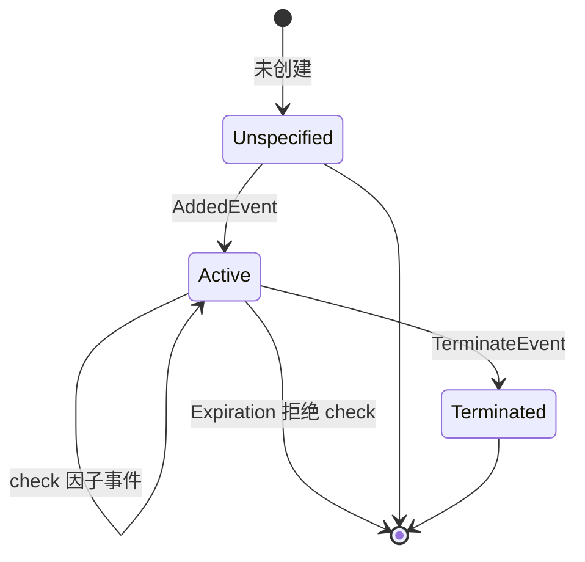
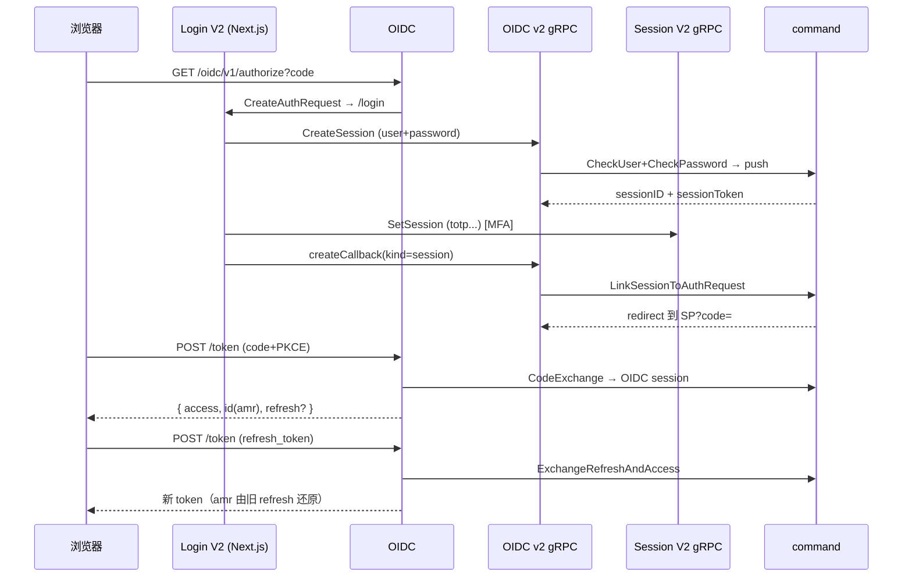

# ZITADEL 认证流程与认证因子

> 关注面：认证核心在「事件溯源的 Session 状态机」而非协议层、各因子逐一拆解、amr 投影、一次完整 OIDC 登录。
> 所有 `文件:行号` 以本地源码 `/Users/morehao/Documents/study/auth/zitadel` 为根，经程序重定位校验。

## 根因 / 核心论断

**认证核心不在协议层，而在事件溯源的 Session 状态机。**

「登录成功」不是一次单向验证的结束，而是一条基于事件溯源的 `session` 指令流。每个认证因子（密码/Passkey/TOTP/OTP/RecoveryCode/IDP Intent）本质上都是**对同一 Session 的一次指令投递**——它只把 Session 状态机向前推进一步，把 `AuthMethodStates` / AMR 集合向「满足」方向扩展一点。协议层（OIDC/OAuth2）只是把这条 Session 状态映射成协议所需 claim 的薄壳。

**为什么核心在事件溯源**：
1. 认证可中断、可复用、可并行——因子不绑定单个 HTTP 请求。
2. 每次因子提交都是带 metadata 的命令（command），而非简单断言。
3. Session 的有效性（amr、lifespan、active）由事件投影得出，可审计、可重放。
4. 认证方法可动态聚合——多因子叠加由「满足哪些」决定，而非「固定一种流程」。

##  Session 状态机：生命周期与有效性

`Session` 聚合同时承载两类信息：**是谁**（`User`/`Identity`，来自 `set` 指令或 IDP intent 落账）+ **通过什么验证过**（`AuthMethodStates<方法,状态>` 映射，来自 `check_*` 指令）。两者组合 + lifespan 时间戳构成「此刻会话对协议层的有效性」。

要点：
- **追加式**：同一 Session 可跨多个 HTTP 请求逐步完成 User→Password→TOTP 等检查，每次都把 `SessionWriteModel` 重放一遍、追加新事件。
- `CheckNotInvalidated` 在每次 `updateSession` 开头强制检查，把已终止/已过期 Session 挡在命令执行前。

## 认证因子逐一拆解

### 密码

密码验证委托给 `passwap`（多哈希算法切换工具），`password.Check` 可按算法列表尝试。关键在**失败计数链路**：验密出错时把「第 N+1 次失败」作为事件写入推进计数，再用 lockout policy 决定是否追加 `UserLockedEvent`，失败时触发 tarpit 延迟。

**权衡**：失败计数是事件溯源的一部分（`HumanPasswordCheckFailedEvent` 持久化，锁定可审计可重放），而非内存计数器；recheck 两次（先查锁定态、验完再重查）捕获并发导致的锁变。

### Passkey（challenge → assertion 两步）

Passkey 是唯一「两阶段」因子：先 `CreateWebAuthNChallenge`（BeginLogin，把随机 challenge 存进 Session 聚合），用户回来后 `CheckWebAuthN`（FinishLogin）以 challenge 校验 assertion：

[internal/command/session_webauhtn.go:44-61]() Begin：生成 challenge 存进 session + 限定 allowed credentials
<!-- anchor: func (c *Commands) CreateWebAuthNChallenge(userVerification domain.UserVerificat ... return nil, nil -->

**权衡**：challenge 是有状态的（存于 Session 聚合），Checked 时销毁防重放；`userVerified` 决定后续 amr 是 `u2f` 还是 `passwordless`。

### TOTP

基于时间的口令，密钥存于用户聚合，Session 只记 `TOTPCheckedAt`。校验走 `VerifyTOTP(code, secret, alg)`，失败按 `MaxOTPAttempts` 锁定并 tarpit。与密码不同，TOTP 无独立会话内失败计数，靠 lockoutPolicy 全局防爆破；无 challenge 首阶段，一条命令即完成。

### OTP SMS / Email

OTP 是**可挑战**因子，challenge 密文（code）放进 Session 事件流（`OTPSMSCodeChallenge` / `OTPEmailCodeChallenge`）：

- SMS：`CreateOTPSMSChallenge` 生成一次性 code 加密存进 session 聚合；发送分离成 `*SentEvent`。
- Email：生成加密 code 存进 session，支持 URL 模板渲染。
- 校验：`CheckOTPSMS` 把 session 里 code challenge 注入 otp write model，用用户事件做 per-attempt 统计，产出同一 `*CheckedEvent`。

**权衡**：发送（delivery）与挑战（challenge）分离——`*SentEvent` 记录已投递，`*ChallengedEvent` 只存加密 code；code 密文带过期时间、generatorID、verificationID。

### RecoveryCode

恢复码是「一次性、有状态消耗」因子：校验成功后写回**新的 hash 集合**（消耗一个码）并记录成功事件。不可重放；失败复用 `MaxOTPAttempts` 锁定——这是设计中**值得注意的语义混用点**（恢复码与 TOTP 共用同一 lockout 阈值）。

### IDP Intent

IDP 登录把「外部 IdP 认证结果」包成一个 `idpintent` 聚合；Session 侧的 `CheckIntent` 只是校验 intent 是否 `Succeeded` 且未过期、核对归属用户后追加 `IntentCheckedEvent`——即便真正的认证发生在外部 IdP：

[internal/command/session.go:91-127]() CheckIntent：前置条件 + token 解密 + intent 状态/过期/归属校验 → IntentChecked
<!-- anchor: func CheckIntent(intentID, token string) SessionCommand { ... return nil, nil -->

**权衡**：IDP intent 有独立生命周期（`maxIdPIntentLifetime`），被 session 消费后标记 Consumed 防重放；它是会话**身份的供给者**而非密码式验证者，能作为第一个因子（外部已验证）。

## 认证方法集如何投影成 OIDC 的 amr

Session 的 `AuthMethodTypes()` 依据各因子 `CheckedAt` 非零推导出已通过方法类型列表：

[internal/command/session_model.go:255-284]() AuthMethodTypes 依据各因子 CheckedAt 推导方法列表
<!-- anchor: // AuthMethodTypes returns a list of UserAuthMethodTypes based on succeeded chec ... return types -->

OIDC 生成 id_token 时用 `AuthMethodTypesToAMR` 把它映射成标准 `amr` claim：

[internal/api/oidc/amr.go:27-40]() 方法→amr：Password→pwd、Passwordless(UV)→pwd 用户在场、各 OTP→otp，factor 计数
<!-- anchor: func AuthMethodTypesToAMR(methodTypes []domain.UserAuthMethodType) []string { ... factors += 2 -->

映射概要：

| `UserAuthMethodType` | amr 输出 | factor 计数 |
|---|---|---|
| Password | `pwd` | +1 |
| Passwordless（UV verified） | `pwd`（+用户在场） | +2 |
| U2F | （用户在场） | +1 |
| TOTP / SMS / Email / Recovery | `otp`（合并为一条） | +1 每个 |
| IDP | 无 | +1 |
| 合计 factors ≥ 2 | 追加 `mfa` | — |

## 一次完整 OIDC 登录旅程

`authorize` 入口依据 client 配置走 v1 或 Login V2；Login V2（Next.js）收集因子，经由 Session V2 gRPC 把 check 命令投递到 command → 事件溯源累加；最终 `LinkSessionToAuthRequest` 把已通过方法固化，生成授权码，随后 code 换 token：

**refresh 的权衡**：`ExchangeOIDCSessionRefreshAndAccessToken` 复用原 OIDC session，amr 由 refreshToken 里存的引用经反向映射还原——反映「刷新不重签因子」的权衡，长生命周期 refresh token 泄露会一直继承当时的方法集，需靠外部 `prompt`/`max_age` 兜底。

## 端点到命令层契约表

| 入口 | 命令层动作 |
|---|---|
| POST `/session/v2/session` (CreateSession) | `CreateSession` → CheckUser/CheckPassword |
| POST `/session/v2/session/{id}` (SetSession) | `UpdateSession` 逐个执行对应 check 命令 |
| Session V2 challenge (WebAuthN/OTP) | `CreateWebAuthNChallenge` / `CreateOTPSMSChallenge*` / `CreateOTPEmailChallenge*` |
| DELETE `/session/v2/{id}` | `TerminateSession`（校验 token） |
| GET OIDC `/authorize` | `CreateAuthRequest` |
| POST OIDC `/token` (code) | `CodeExchange` → 创建 OIDC session |
| POST OIDC `/token` (refresh) | `ExchangeOIDCSessionRefreshAndAccessToken` |
| IDP (oidc/saml/ldap) | `CreateIntent` → `CheckIntent` |

## 不足 / 风险

1. **恢复码与 TOTP 共用 `MaxOTPAttempts` 锁定**：若同时配 TOTP 与恢复码，攻击者可把两者失败叠加到同一锁定计数，语义上不应同等宽带。
2. **Passkey 文件名命名 typo**：命令文件叫 `session_webauhtn.go` 而非 `session_webauthn.go`，历史遗留命名不一致。
3. **OTP 密文持久化进事件流**：`OTPSMSCodeChallenge`/`OTPEmailCodeChallenge` 把加密 code 作为聚合字段落库，增加聚合内容敏感表面积。
4. **refresh 不重验因子**：复用原 session 的 amr，长生命周期 refresh token 泄露会持续继承当时方法集。
5. **sessionToken 是核心挂锁**：任何持有正确 sessionToken 者都能把 session 固化为 OIDC 凭证；token 用加密算法生成，密钥轮换/泄露即全局风险。
