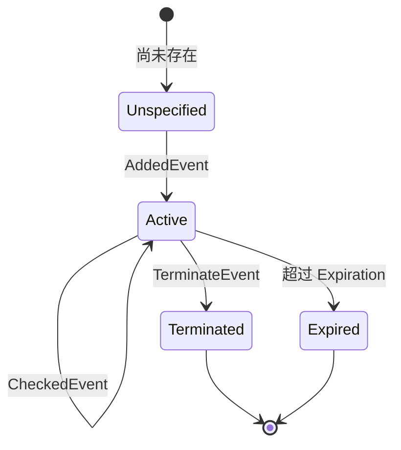
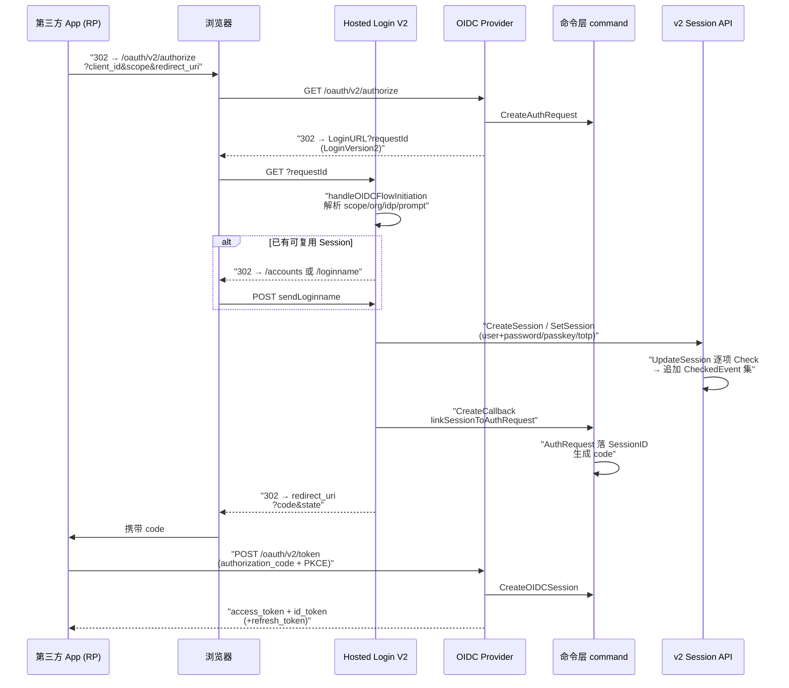
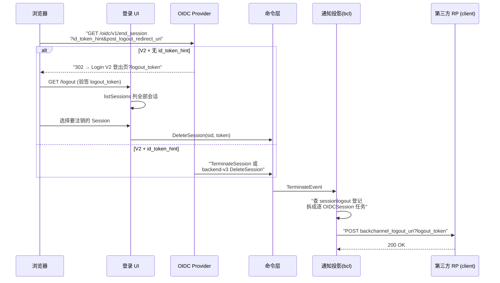
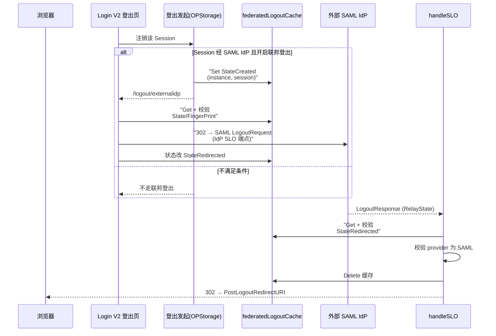

# ZITADEL 认证与统一登录/登出全流程

本文从两条视角交叉拆解 ZITADEL 的认证协议层：**A) 认证因子与 Session 状态机**（密码/Passkey/TOTP/OTP/RecoveryCode/IDP Intent 如何在事件流上沉淀成 Session）与 **B) 统一登录/登出旅程**（一次完整 OIDC 登录前端如何编排、Session 如何创建/续期/注销、RP-Initiated 与 Back-Channel Logout 如何联动）。所有源码定位以当前 Zitadel main 分支（HEAD `2bd42e8fc`）实测为准，并覆盖 Hosted Login V2（Next.js `apps/login`）与 backend/v3 关系表迁移后的实现。

> **根因锚点**：ZITADEL 把"多因子认证"重新定义成**同一抽象、可叠加的认证因子检查**。任何因子（密码、Passkey、TOTP…）都是一份往 Session 事件流里追加的 `*CheckedEvent`，Session 本身只负责把"哪些检查已完成、各自何时完成"沉淀成只读状态，再由 `AuthenticationTime()`/`AuthMethodTypes()`/`AuthMethodTypesToAMR()` 在签发令牌时投影出去。这套模型让"认证"不再是一段脆弱的顺序代码，而是**可任意排列组合、可续期、可多会话复用的状态**——所有登录入口最终收敛到同一张 Session。

## 认证核心并不在协议层，而在事件溯源

ZITADEL 的认证真正的心智模型是**事件溯源（Event Sourcing）+ 读写分离**：浏览器/前端不直接"登录"，而是调用 v2 Session API 追加**检查指令**（Check 命令），命令层把每次成功的检查写成一个 `*CheckedEvent` 事件，Session 的当前状态由命令侧 WriteModel 逐事件 `Reduce()` 出来。

命令侧的核心状态机在 `internal/command/session_model.go`，它把每种认证因子都建模成**「CheckedAt 时间戳 + 相关子状态」**：`PasswordCheckedAt`、`IntentCheckedAt`、`WebAuthNCheckedAt`、`TOTPCheckedAt`、`OTPSMSCheckedAt`、`OTPEmailCheckedAt`、`RecoveryCodeCheckedAt` 各占一个字段，而 `State`（`SessionActive`↔`SessionTerminated`）才是状态机的"状态"本身（session_model.go:41-66）。

`Reduce()` 决定一个 Session **能发生哪些状态迁移**、以及**哪些事件被允许投影**（session_model.go:78-116）。它把每一个 `*CheckedEvent` 落到对应字段，而 `AuthMethodTypes()` 与 `AuthenticationTime()` 则是这两个"可叠加断言"的**查询投影**——认证方法多寡、认证发生时间都从这些已完成的检查字段推导，不额外存冗余标志。

```go
// AuthenticationTime returns the time the user authenticated using the latest time of all checks
func (wm *SessionWriteModel) AuthenticationTime() time.Time {
	var authTime time.Time
	for _, check := range []time.Time{
		wm.PasswordCheckedAt, wm.WebAuthNCheckedAt, wm.TOTPCheckedAt,
		wm.IntentCheckedAt, wm.OTPSMSCheckedAt, wm.OTPEmailCheckedAt,
	} {
		if check.After(authTime) {
			authTime = check
		}
	}
	return authTime
}
```
<!-- snippet: AuthenticationTime 取最新一次认证检查时间 - internal/command/session_model.go:237-253 -->

```go
func (wm *SessionWriteModel) AuthMethodTypes() []domain.UserAuthMethodType {
	types := make([]domain.UserAuthMethodType, 0, domain.UserAuthMethodTypeIDP)
	if !wm.PasswordCheckedAt.IsZero() {
		types = append(types, domain.UserAuthMethodTypePassword)
	}
	if !wm.WebAuthNCheckedAt.IsZero() {
		if wm.WebAuthNUserVerified {
			types = append(types, domain.UserAuthMethodTypePasswordless)
		} else {
			types = append(types, domain.UserAuthMethodTypeU2F)
		}
	}
	if !wm.IntentCheckedAt.IsZero() {
		types = append(types, domain.UserAuthMethodTypeIDP)
	}
	// ... TOTP / OTPSMS / OTPEmail / RecoveryCode ...
	return types
}
```
<!-- snippet: AuthMethodTypes 依据成功 checks 推导方法集 - internal/command/session_model.go:267-283 -->

> 一个值得品味的设计取舍：**WebAuthN 把 two-factor 语义带进了状态机**。`U2F`（仅验证者存在）vs `Passwordless`（验证者存在 + 用户验证）的分野只在 `WebAuthNUserVerified` 一个 bool 上（session_model.go:179-183）；而 OTP/TOTP 家族（SMS/Email/TOTP）在 `AuthMethodTypes()` 里各是不同因子，却在 AMR 里统一折叠成单个 `otp`。这说明 Session 内部的"严格类型"与对外输出 OIDC 的"语义折叠"是两套正交的投影视图（见下文 `AuthMethodTypesToAMR`）。

### 认证通过并不等于会话永久有效

Session 的有效性由 **terminate（显式注销）与 expiration（过期）** 两个维度共同决定。`CheckNotInvalidated` 先判断手工注销（`State == Terminated`），再判过期；`CheckIsActive` 在其上叠加"Session 必须真实存在"（`State != Unspecified`）。注意一个极精细的取舍：**过期判断用的是 `!Expiration.IsZero() && Expiration.Before(time.Now())` 守卫**，零值（无过期）Session 不会被误判为 Expired（session_model.go:288-304）。

### Session 指令的调度骨架

所有因子共享同一套命令调度骨架 `SessionCommands.Exec()`（session.go:152-159）：顺序执行可组合的 `SessionCommand`，任一失败即中止，但**失败事件照样推入存储**（用于失败计数/锁定）。这是"命令式触发、事件式记账"的核心。命令执行完毕后 `commands()` 统一生成 sessionToken 并把事件批量 `Push`（session.go:281-292, 389-406）。

## 认证因子逐一拆解

下面按"每种因子往 Session 事件流里追加什么检查"拆开，附核心决策与权衡。

### 密码：passwap 验证 + 失败 tarpit

密码验证在 `internal/command/user_human_password.go` 的 `checkPassword` 中先构造 `HumanPasswordWriteModel`（含哈希与失败计数），再走 `verifyPasswordWithLockoutPolicy`：

- **哈希用 passwap**，一次 `wm.GetEncodedHash()` 取出旧哈希、`verify(hash, password)` 返回可能升级后的新哈希，实现**透明的重哈希升级**（upgrade on login），并追加 `NewHumanPasswordHashUpdatedEvent`（user_human_password.go:426-450）。
- **失败计数 + 锁定**：哈希不匹配时追加 `NewHumanPasswordCheckFailedEvent`，达到 `MaxPasswordAttempts` 时追加 `NewUserLockedEvent`，并把 `WrongPasswordError.FailedAttempts` 带出供前端展示"剩余次数"（user_human_password.go:453-465）。
- **tarpit 防枚举**：仅在失败时按 `failedAttempts` 触发 `tarpit` 慢速化；注释明确：`in case the login policy ignores unknown usernames, we do not slow down ... since this would leak the user existence`——**只有当"未知用户名可能泄露用户存在"时才需要慢速**（user_human_password.go:460-465）。

```go
	commands = append(commands, user.NewHumanPasswordCheckFailedEvent(ctx, userAgg, optionalAuthRequestInfo))

	lockoutPolicy, lockoutErr := getLockoutPolicy(ctx, wm.GetResourceOwner(), es.FilterToQueryReducer)
	if lockoutPolicy != nil && lockoutPolicy.MaxPasswordAttempts > 0 && wm.GetPasswordCheckFailedCount()+1 >= lockoutPolicy.MaxPasswordAttempts {
		commands = append(commands, user.NewUserLockedEvent(ctx, userAgg))
	}
	// in case the login policy ignores unknown usernames,
	// we do not slow down the response time with a tarpit
	// since this would leak the user existence
	if tarpit != nil {
		tarpit(wm.GetPasswordCheckFailedCount() + 1)
	}
```
<!-- snippet: 密码失败事件 + 锁定 + tarpit - internal/command/user_human_password.go:453-465 -->

前端侧，`sendLoginname` 只有当 `ignoreUnknownUsernames`（前端枚举保护）开关关闭时才真正 `createSessionAndUpdateCookie` 建会话（loginname.ts:276-291），密码页则在失败数达上限后展示锁定文案（password.ts:281-301）——**服务端不泄露用户存在、前端也不泄露**的双保险。

```go
	if err == nil {
		commands = append(commands, user.NewHumanPasswordCheckSucceededEvent(ctx, userAgg, optionalAuthRequestInfo))
		if updated != "" {
			commands = append(commands, user.NewHumanPasswordHashUpdatedEvent(ctx, userAgg, updated))
		}
		return commands, updated, nil
	}
```
<!-- snippet: 密码成功路径追加成功事件 + 哈希升级 - internal/command/user_human_password.go:445-451 -->

### Passkey / U2F：一次 challenge -> assertion 的两步提交

WebAuthN 是**唯二需要两阶段（challenge + assertion）**的因子（另一个是 OTP 类的挑战-发送-校验），也是 ZITADEL 卖点中默认优先的登录方式。它分为两条指令（`internal/command/session_webauhtn.go`）：

1. `CreateWebAuthNChallenge`：根据 `userVerification`（Required -> passkey，否则 -> U2F）从 `NewHumanPasswordlessTokensReadModel`/`NewHumanU2FTokensReadModel` 拉起用户的凭据列表，`BeginLogin` 生成 challenge，并落 `WebAuthNChallengedEvent`，**供第二步在事件流上重取**（session_webauhtn.go:54-63）。
2. `CheckWebAuthN`：`FinishLogin` 校验 assertion，成功后 `WebAuthNChecked(ctx, ..., signCount)`；若 challenge 要求 `UserVerificationRequirementRequired` 则更新 passkey 的 sign count，否则更新 U2F 的 sign count（session_webauhtn.go:66-88）。

会话侧，`reduceWebAuthNChallenged` 把 challenge 存进内存状态的 `WebAuthNChallenge`；`reduceWebAuthNChecked` 把它**清空**并落 `WebAuthNCheckedAt`/`WebAuthNUserVerified`（session_model.go:170-183）。这一"挑战即吞"的设计保证 session 上的 challenge 一次性使用，防重放。

```go
	challenge := cmd.sessionWriteModel.WebAuthNChallenge
	if challenge == nil {
		return nil, zerrors.ThrowPreconditionFailed(nil, "COMMAND-Ioqu5", "Errors.Session.WebAuthN.NoChallenge")
	}
```
<!-- snippet: WebAuthN 无 challenge 即拒绝 - internal/command/session_webauhtn.go:59-62 -->

> **前端默认 Passkey**：`sendLoginname` 在多方法并存时**优先跳 `/passkey`**（即便用户有密码），只有 passkey 不可用才降级到密码（loginname.ts:466-486）。以"多方法并行分支 + 无方法时发邀请码"的方式编排登录步骤（loginname.ts:341-517）。这是 ZITADEL 把 Passwordless 作为登录体验第一公民的直接体现。

### TOTP：与密码结构完全对称的单步检查

TOTP 的 `CheckTOTP` 与 `CheckPassword` **共用同一参数骨架**——都接收 `userID + code + filter + tarpit`，失败同样追加失败事件、同样触发 tarpit（session.go:129-148）。它的会话侧只是 `reduceTOTPChecked` 落一个 `TOTPCheckedAt`（session_model.go:185-187）。

这种**对称性**是理解整个命令层的关键：ZITADEL 刻意让每种 one-factor 检查在结构上同构，从而让"前端可以按任意顺序叠加因子"成为可能（先密码后 TOTP / 先 TOTP 后再补密码都可）。

### OTP SMS / Email：挑战-发送-校验三步

OTP 类因子比 TOTP 多出**发送渠道**步骤。命令侧有三类事件：`OTPSMS(A)ChallengedEvent`（生成/加密 code，若 `returnCode` 则直接返回明文给调用方）、`OTPSMSSentEvent`（发送渠道回填 `GeneratorInfo`）、`OTPSMSCheckedEvent`（验证）。

v2 API 层 `createOTPSMSChallengeCommand`/`createOTPEmailChallengeCommand` 把"生成"与"发送"通过 `RequestChallenges` 动态拼进命令列表——`ReturnCode` 时把明文 code 带回响应（用于测试/展示），否则只触发挑战-发送（session.go:209-235）。

```go
func (s *Server) createOTPSMSChallengeCommand(req *session.RequestChallenges_OTPSMS) (*string, command.SessionCommand) {
	if req.GetReturnCode() {
		challenge := new(string)
		return challenge, s.command.CreateOTPSMSChallengeReturnCode(challenge)
	}
	return nil, s.command.CreateOTPSMSChallenge()
}
```
<!-- snippet: OTP SMS 挑战的 ReturnCode 分支 - internal/api/grpc/session/v2/session.go:209-217 -->

会话侧 `reduceOTPSMSChecked`/`reduceOTPEmailChecked` 在验证通过后**清空 `OTP*CodeChallenge`**，与 WebAuthN challenge 一样保证一次性（session_model.go:198-219）。

### RecoveryCode：兜底因子的"平行身份"

`CheckRecoveryCode`/`RecoveryCodeChecked` 在命令与事件两条入径上都独立存在（session.go:221-223），在 `AuthMethodTypes()` 里被识别为 `UserAuthMethodTypeRecoveryCode`（session_model.go:280-282）。它**不参与 `AuthenticationTime()` 的时间推导**——recovery code 是兜底、不推进认证时间，但会被计入声明的 amr。这是一个刻意的**"认证方法集里有它、但时间线不因它更新"的非对称设计**（对照 session_model.go:238 vs 280）。

### IDP Intent：把第三方登录挂到同一 Session 上的桥

当用户走外部 IdP（OIDC/Google…）登录时，**不新建一套身份体系，而是走 IDP Intent**。命令侧 `internal/command/idp_intent.go` 的 `CreateIntent`/`SucceedIDPIntent` 用一个独立 `IDPIntent` 聚合暂存 IdP 回调结果；之后 `CheckIntent`（session.go:91-127）把这个已成功的 intent **链接进 Session**：

- 校验 intent 携带的 token（`crypto.CheckToken(cmd.intentAlg, token, intentID)`）；
- 校验 intent 处于 `IDPIntentStateSucceeded` 且未过期（`ExpiresAt()`）；
- 校验 `intent.UserID`（若回填）与 Session 用户一致，或此 Session 用户存在到该 IdP 的**链接**（`UserIDPLinkWriteModel` 的 `State == Active`），否则拒绝 `Errors.Intent.OtherUser`；
- 通过后追加 `IntentCheckedEvent` 与 `idpintent.ConsumedEvent`（intent 一次性消费，防重放）。

```go
		if cmd.intentWriteModel.State != domain.IDPIntentStateSucceeded {
			return nil, zerrors.ThrowPreconditionFailed(nil, "COMMAND-Df4bw", "Errors.Intent.NotSucceeded")
		}
		if time.Now().After(cmd.intentWriteModel.ExpiresAt()) {
			return nil, zerrors.ThrowPreconditionFailed(nil, "COMMAND-SAf42", "Errors.Intent.Expired")
		}
```
<!-- snippet: IDP Intent 成功态 + 未过期校验 - internal/command/session.go:104-109 -->

会话侧把 `CheckIntent` 产生的 `IntentCheckedAt` 计入 `AuthenticationTime()` 与 `AuthMethodTypes()` 的 `IDP` 因子（session_model.go:166-168, 268-270）。于是**一个 Session 可以同时含"本地密码 + 外部 IdP intent"**，二者在 `AuthMethodTypes()` 里共存——这正是"统一登录"能跨本地/IdP 复用的根本。

### 认证方法集如何投影成 OIDC 的 `amr`

`internal/api/oidc/amr.go` 的 `AuthMethodTypesToAMR` 是"内部严格类型 → 外部 OIDC 语义"的投影层：`Passwordless` 与 `U2F` 都输出 `user`（存在性），但 `Passwordless` 计 2 个因子（存在 + 验证）；全部 OTP 家族折叠成一个 `otp`；汇总后按因子数追加 `mfa`。

```go
	switch methodType {
	case domain.UserAuthMethodTypePassword:
		amr = append(amr, PWD)
		factors++
	case domain.UserAuthMethodTypePasswordless:
		amr = append(amr, UserPresence)
		factors += 2
	case domain.UserAuthMethodTypeU2F:
		amr = append(amr, UserPresence)
		factors++
	case domain.UserAuthMethodTypeOTP,
		domain.UserAuthMethodTypeTOTP,
		domain.UserAuthMethodTypeOTPSMS,
		domain.UserAuthMethodTypeOTPEmail,
		domain.UserAuthMethodTypeRecoveryCode:
		otp++
		factors++
```
<!-- snippet: amr 折叠规则 - internal/api/oidc/amr.go:40-57 -->

## Session 状态机：生命周期与有效性

这是 A 视角的落点：Session 只是**一组认证事件的投影**，状态机里真正"会变"的只有状态（Active / Terminated／从未存在）与各项 `CheckedAt`，所有因子累积都被表达为状态里的**时间戳字段**。


<!-- snippet: 状态机转移概述（无源码对应，语义表达） -->

> **状态机刻意极简，复杂度全在因子投影里。** ZITADEL 不在状态机里搞"登录中/已部分认证"这样的中间态——只要 Session 未 Terminated 即可继续追加因子，前端通过 `factors`/`AuthMethodTypes` 的表现来判断"还需哪些因子"。这一设计消除了认证流程的**顺序耦合**：用户可以先做 TOTP 再回来补密码，只要生命周期未结束。

| 转移 | 触发事件 | 命令入口 | 源码 |
|------|----------|----------|------|
| 创建 | `AddedEvent` + `Start()` | `CreateSession` | session.go:294-316 |
| 追加因子 | 各类 `*CheckedEvent` | `UpdateSession` | session.go:318-335 |
| 续期 | `LifetimeSetEvent`（`Expiration = CreationDate + Lifetime`） | `SetLifetime` | session.go:255-264 (events), session_model.go:225-227 |
| 注销 | `TerminateEvent` | `TerminateSession` | session.go:337-370 |
| 过期 | 无事件（时间判断） | `CheckNotInvalidated` | session_model.go:288-296 |

v2 Session API 的命令入口三层分离清晰：

- `CreateSession`/`SetSession`（更新）在 `internal/api/grpc/session/v2/session.go:23-79`：把 gRPC 的 `Checks`/`Challenges` 翻译成 `command.SessionCommand` 后调用 `command.CreateSession`/`UpdateSession`；`checksToCommand` 逐个把 user/password/intent/webauthn/totp/otp/recovery 映射成命令（session.go:115-158）。
- `DeleteSession` 在 `EnableRelationalTables` 特性开启时转发到 backend/v3 的关系表实现 `backend/v3/api/session/v2/session.go:40-58`，否则走命令层 `TerminateSession`（session.go:67-79）。
- `ListSessions`/`GetSession` 在 `internal/api/grpc/session/v2/query.go:31-57`，同样在特性开关下二选一；查询条件覆盖 user/ids/creator/agent/creation/expiration（query.go:87-154），并把内部 session 投影成 `Factors`（query.go:220-303）。

这是 ZITADEL 正把 Session 从纯事件溯源迁移到**关系表投影**的技术演进信号（backend/v3），`authz.GetFeatures(ctx).EnableRelationalTables` 是迁移期的双写开关。

```go
func (c *Commands) CreateSession(
	ctx context.Context,
	cmds []SessionCommand,
	metadata map[string][]byte,
	userAgent *domain.UserAgent,
	lifetime time.Duration,
) (set *SessionChanged, err error) {
	sessionID, err := c.idGenerator.Next()
	if err != nil {
		return nil, err
	}
	sessionWriteModel := NewSessionWriteModel(sessionID, authz.GetInstance(ctx).InstanceID())
	err = c.eventstore.FilterToQueryReducer(ctx, sessionWriteModel)
	if err != nil {
		return nil, err
	}
	cmd := c.NewSessionCommands(cmds, sessionWriteModel)
	cmd.Start(ctx, userAgent)
	return c.updateSession(ctx, cmd, metadata, lifetime)
}
```
<!-- snippet: CreateSession 组装模型 + Start 事件 + updateSession - internal/command/session.go:294-316 -->

## 统一登录旅程：一次完整 OIDC 登录

B 视角的核心是：**OIDC Authorization 与前端登录是两个异步交互，靠 `AuthRequest` 这个"状态票据"连接**。`AuthRequest` 把"第三方 App 想要的认证语义"（scope/prompt/response_type/PKCE）固化成一次可追踪的状态机，前端登录完成后把 Session **链接**进 AuthRequest，产出一串 code，再由 code 换令牌。


<!-- snippet: 统一登录时序图（无源码对应） -->

### 入口两段式：`authorize` -> Login V2 编排

关键实现是 OIDC Provider 的 `Authorize`（`internal/api/oidc/server.go:140-155`）：它只验证 AuthRequest 参数、`CreateAuthRequest` 存下票据，然后**302 到登录页**，不产生 code、不做任何破坏性动作。

```go
	req, err := s.Provider().Storage().CreateAuthRequest(ctx, r.Data, userID)
	if err != nil {
		return op.TryErrorRedirect(ctx, r.Data, oidc.DefaultToServerError(err, "unable to save auth request"), s.Provider().Encoder(), s.Provider().Logger())
	}
	return op.NewRedirect(r.Client.LoginURL(req.GetID())), nil
```
<!-- snippet: authorize 只建票据并重定向登录页 - internal/api/oidc/server.go:150-154 -->

`LoginURL` 由客户端登录版本决定。storage 的 `CreateAuthRequest`（`internal/api/oidc/auth_request.go:45-82`）按优先级分流：请求带 `x-zitadel-login-client` 头 -> V2；实例 `LoginV2.Required` 特性 -> V2；否则查客户端 `LoginVersion`（v1 / v2 / unspecified）。这解释了为什么 **Hosted Login V2 与旧 v1 登录**可以共存于一个实例——以客户端粒度灰度。

V2 的票据存进命令层 `AddAuthRequest`（`internal/command/auth_request.go:46-85`），ID 以 `V2_` 前缀标记（`IDPrefixV2`），`AuthRequestByID` 据此判断走命令层还是 v1 storage（auth_request.go:176-200）。

### Login V2 的编排心智：`handleOIDCFlowInitiation`

Next.js 登录页的核心是 `apps/login/src/lib/server/flow-initiation.ts` 的 `handleOIDCFlowInitiation`（flow-initiation.ts:180-512）。它扮演"前台路由"，按优先级决定下一步：

1. 解析 authRequest 的 scope：从 `urn:zitadel:iam:org:id:/domain:primary:/idp:id:` 正则提取组织/IdP，命中则直接跳转对应 IdP 流程或 `/register`（flow-initiation.ts:193-314）；
2. `prompt=select_account` -> 有可复用 Session 跳 `/accounts`，否则 `/loginname`（:322-337）；
3. `prompt=login` -> 若 `login_hint` 存在尝试 `resolveLoginHint` 直接跳到密码/Passkey 步，跳过登录名页（:338-356）；
4. `prompt=none` -> 要求已有有效 Session，直接用 cookie 里的 sessionToken 建回调（:357-403）；
5. 默认：`findValidSession` 在已有 Session 里匹配，找不到则 `resolveLoginHint` -> `/accounts` / `/loginname`（:404-490）。

```ts
		const { callbackUrl } = await createCallback({
			serviceConfig,
			req: create(CreateCallbackRequestSchema, {
				authRequestId: requestId.replace("oidc_", ""),
				callbackKind: { case: "session", value: create(SessionSchema, session) },
			}),
		});
		if (!isSafeRedirectUri(callbackUrl)) { ... }
		return NextResponse.redirect(callbackUrl);
```
<!-- snippet: prompt=none/已有会话 直接建回调 - apps/login/src/lib/server/flow-initiation.ts:386-403 -->

`continueWithSession` 在真正完成流程前先调用 `isSessionValid`（检查用户因子、MFA 是否满足），不满足就 `sendLoginname` 重走认证以补足因子（session.ts:99-114）。`createSession` 负责 Cookie 落盘与 sessionToken 保存（cookie.ts，经 `createSessionAndUpdateCookie`）。

### 登录名解析的编排：`sendLoginname`

`apps/login/src/lib/server/loginname.ts` 的 `sendLoginname` 是登录名入口，决定去哪个因子页面：

- 先按请求上下文取 `LoginSettings`，**枚举保护的单一事实来源** `ignoreUnknownUsernames` 在这里由服务端推导（loginname.ts:49-60）；
- `searchUsers` 探得用户后，按用户状态的认证方法分派：唯一密码 -> `/password`、唯一 passkey -> `/passkey`、多方法 -> **优先 passkey**（loginname.ts:341-517）；
- 无方法 / 初态用户 -> 走 `/verify`（邀请码）；
- 用户不存在且本地认证被禁或发现组织 -> 尝试重定向外部 IdP（loginname.ts:558-604）。

```ts
    // Only create a session (and its cookie) when enumeration protection does not
    // apply: with protection on, known and unknown users must be indistinguishable,
    // and the /password page must not be able to tell the difference either.
    let session;
    if (!ignoreUnknownUsernames) {
      const checks = create(ChecksSchema, {
        user: { search: { case: "userId", value: userId } },
      });
```
<!-- snippet: 枚举保护开启时不建会话 - apps/login/src/lib/server/loginname.ts:274-281 -->

### 回调三合一：Session -> AuthRequest -> code -> callback

前端拿到有效 Session 后，调用 OIDC v2 的 `CreateCallback`（`internal/api/grpc/oidc/v2/oidc.go:32-41`）。`linkSessionToAuthRequest` 是承上启下的关键节点（oidc.go:155-179）：

- 调命令层 `LinkSessionToAuthRequest`（`internal/command/auth_request.go:87-135`）——校验 AuthRequest 存在且处于 `Added`、校验 Session 有效 + **sessionToken 校验**、校验用户/组织绑定一致（`OrganizationID` 与 Session 用户资源所有者一致）；
- 成功后用 `sessionWriteModel.AuthenticationTime()` 与 `AuthMethodTypes()` **回填 AuthRequest** 的 `AuthTime`/`AuthMethods`（auth_request.go:125-131）——这正是 A 视角的推导结果被 B 视角消费之处；
- 然后按 response_type 产生回调：`code` 用 `CreateCodeCallbackURL`（生成一次性 code，`internal/api/oidc/auth_request.go:625-638`），implicit 走 `CreateTokenCallbackURL`。

```go
func (s *Server) linkSessionToAuthRequest(ctx context.Context, authRequestID string, session *oidc_pb.Session) (*connect.Response[oidc_pb.CreateCallbackResponse], error) {
	details, aar, err := s.command.LinkSessionToAuthRequest(ctx, authRequestID, session.GetSessionId(), session.GetSessionToken(), true, s.checkPermission)
	...
	if aar.ResponseType == domain.OIDCResponseTypeCode {
		callback, err = oidc.CreateCodeCallbackURL(ctx, authReq, s.op.Provider())
	} else {
		callback, err = s.op.CreateTokenCallbackURL(ctx, authReq)
	}
	...
}
```
<!-- snippet: 回调把 Session 链接进 AuthRequest 并按 response_type 出回调 - internal/api/grpc/oidc/v2/oidc.go:155-178 -->

```go
	if err := c.pushAppendAndReduce(ctx, writeModel, authrequest.NewSessionLinkedEvent(
		ctx, &authrequest.NewAggregate(id, authz.GetInstance(ctx).InstanceID()).Aggregate,
		sessionID,
		sessionWriteModel.UserID,
		sessionWriteModel.AuthenticationTime(),
		sessionWriteModel.AuthMethodTypes(),
	)); err != nil {
```
<!-- snippet: Session 链接事件回填 AuthTime/AuthMethods - internal/command/auth_request.go:125-131 -->

### Token 交换：Code 换 Token，落 `OIDCSession` 层

`/oauth/v2/token` 的 CodeExchange（`internal/api/oidc/token_code.go:18-60`）把 code 解密后交给命令层 `CreateOIDCSessionFromAuthRequest`，构建 OIDC Session（内含 access/refresh token 与登出注册）。`CodeExchange` 优先处理 `V2_` 前缀的 code（走命令层），否则回落 v1 的 `codeExchangeV1`。自此出现**第二层会话**：v2 Session（认证态）-> OIDCSession（令牌态）。

`accessTokenResponseFromSession`（`internal/api/oidc/token.go:30-57`）按客户端 `AccessTokenType` 生成 JWT 或 bearer，并按 scope 是否含 `openid` 决定是否签发 ID Token——ID Token 的 `amr`、`auth_time`、`sub`、`nonce` 全部来自 OIDCSession 里先前由 `AuthenticationTime`/`AuthMethodTypes` 投影出的值（token.go:53-55, 75-113）。

```go
	if slices.Contains(session.Scope, oidc.ScopeOpenID) {
		resp.IDToken, _, err = s.createIDToken(ctx, client, getUserInfo, idTokenRoleAssertion, getSigner, session.SessionID, resp.AccessToken, session.Audience, session.AuthMethods, session.AuthTime, session.Nonce, session.Actor)
	}
```
<!-- snippet: 仅 openid scope 签发 ID Token, 注入 AuthMethods/AuthTime - internal/api/oidc/token.go:53-55 -->

OIDCSession 在命令侧 `internal/command/oidc_session.go` 里由 `newOIDCSessionAddEvents` 组装：`AddSession` 建聚合、`AddAccessToken`/`AddRefreshToken` 建令牌、`RegisterLogout` 注册登出（见登出节）。

### Refresh Token：续命而非重新认证

Refresh 由 `ExchangeOIDCSessionRefreshAndAccessToken`（`internal/command/oidc_session.go:199-224`）处理：`newOIDCSessionUpdateEvents` 用旧 refresh token 定位 OIDCSession 并校验有效性/过期（含 idle expiration），随后 `AddAccessToken`（reason=Refresh）并 `RenewRefreshToken`（**滚动轮换** refresh token，:480-488）。rolling refresh token 是安全取舍：即使 refresh token 泄露，其效用窗口被压缩到一轮。

```go
	err = cmd.AddAccessToken(ctx, scope,
		cmd.oidcSessionWriteModel.UserID,
		cmd.oidcSessionWriteModel.UserResourceOwner,
		domain.TokenReasonRefresh,
		cmd.oidcSessionWriteModel.AccessTokenActor,
	)
	if err != nil { return nil, err }
	if err = cmd.RenewRefreshToken(ctx); err != nil { return nil, err }
	return cmd.PushEvents(ctx)
```
<!-- snippet: RefreshToken 交换 = AddAccessToken + RenewRefreshToken - internal/command/oidc_session.go:211-223 -->

## 端点到命令层：契约表

| 端点 / 方法 | 请求要点 | 响应要点 | 关键源码 |
|-------------|----------|----------|----------|
| `GET/POST /oauth/v2/authorize` | OIDC AuthRequest（client_id/scope/redirect_uri/response_type/state/PKCE/prompt） | 302 -> LoginURL（不在此发码） | server.go:140-155 |
| `POST CreateSession (session/v2)` | Checks 中含 user/password/intent/webauthn/totp/otp/recovery；UserAgent / Lifetime / Metadata | SessionId + SessionToken + Challenges | session.go:23-44; 115-158 |
| `POST SetSession (session/v2)` | SessionId + SessionToken + 增量 checks + Challenges + Lifetime | 新 SessionToken + Challenges | session.go:46-65; 160-183 |
| `POST DeleteSession (session/v2)` | SessionId + SessionToken | Details | session.go:67-79; backend/v3/session.go:40-58 |
| `POST GetSession / ListSessions (session/v2)` | SessionId(+Token) / 查询条件（user/ids/creator/agent/creation/expiration） | Session（factors/userAgent/expiration）| query.go:31-57; 87-154; 220-303 |
| `POST CreateCallback (oidc/v2)` | authRequestId + callbackKind.session{id,token} 或 error | callbackUrl（redirect_uri?code / 错误） | oidc.go:32-41; 155-179 |
| `POST /oauth/v2/token` | grant_type=authorization_code 或 refresh_token + PKCE / client 凭证 | access_token + id_token + refresh_token + expires_in | token_code.go:18-60; token.go:30-57 |
| `GET/POST /oidc/v1/userinfo` | `Authorization: Bearer <access_token>` 或 body access_token | scope 过滤的声明（sub/profile/email/org/roles） | userinfo.go:86-160 |
| `GET /oidc/v1/end_session` | id_token_hint + post_logout_redirect_uri | 302 -> 登录 UI 登出页 或 直接 redirect | server.go:171-176; auth_request.go:276-360 |
| `GET /oauth/v2/keys` (JWKS) | - | 用于验签 id_token / logout_token 的公钥 | server.go:52-63 |

> **契约表维度说明**："关键源码"列给的是**当前 Zitadel main 分支（HEAD `2bd42e8fc`）实测行号**。表内行号以当前源码为准（例如命令侧 `LinkSessionToAuthRequest` 位于 `internal/command/auth_request.go`），语义以本表叙述为准。

## 统一登出：一条用户操作、两路清理

统一登出有两条线同时推进：**前端可见的 RP-Initiated Logout**（浏览器重定向），与**对第三方 RP 的 Back-Channel Logout**（服务器直连、用户不可见）。ZITADEL 用 `sessionlogout` 聚合 + 通知投影把两线接起来——一旦 v2 Session 或用户被注销，投影自动把"该 Session 登记过的 OIDCSession"逐一向每个客户端的 `backchannel_logout_uri` 发登出通知。


<!-- snippet: 统一登出时序图（无源码对应） -->

### RP-Initiated Logout：按会话粒度选择注销目标

Provider 的 `EndSession`（`internal/api/oidc/server.go:171-176`）把请求交给 storage 的 `TerminateSessionFromRequest`（`internal/api/oidc/auth_request.go:276-360`）。它按 id_token_hint 与登录版本分四路：

1. **V2 + 无 hint**：无 `IDTokenHintClaims` 且 LoginV2 生效 -> 构造**签名后的 logout token**（`buildLoginV2LogoutURL` 用 JWKS 的 signer 签名，含 `post_logout_redirect_uri`/`logout_hint`/`ui_locales`），302 到 Login V2 登出页，由前端 `SessionsClearList` 列出所有 Session 让用户勾选注销（auth_request.go:292-309; 401-425; `apps/login/src/app/(login)/logout/page.tsx:92-99`）。

```go
	// V2:
	// ... we'll redirect to the UI (V2) and let it decide which session to terminate
	if endSessionRequest.IDTokenHintClaims == nil && (authz.GetFeatures(ctx).LoginV2.Required || headers.Get(LoginClientHeader) != "") {
		redirectURI := v2PostLogoutRedirectURI(endSessionRequest.RedirectURI)
		logoutURI := authz.GetFeatures(ctx).LoginV2.BaseURI
		...
		signer, _, err := sign.GetSignerOnce(o.query.GetActiveSigningWebKey)(ctx)
		...
		return buildLoginV2LogoutURL(logoutURI, redirectURI, endSessionRequest.LogoutHint, endSessionRequest.UILocales, signer)
	}
```
<!-- snippet: V2 无 hint 时转到 Login V2 登出页并签发 logout token - internal/api/oidc/auth_request.go:292-308 -->

2. **V1 无/空 hint**：`terminateSession` 按 userAgent cookie 终止该 user agent 的全部 session，做 federated logout 检查（auth_request.go:316-327）。
3. **V1 会话 hint**：`terminateV1Session` 按 `OIDCSingleV1SessionTermination` 特性决定终止单个还是该 user agent 全部（auth_request.go:439-459）。
4. **V2 会话 hint**：直接从 id_token_hint 取 SessionID，删除该 v2 Session（关系表实现时走 backend/v3 的 `DeleteSession`，否则 `TerminateSessionWithoutTokenCheck`）（auth_request.go:343-360）。

```go
	// V2:
	// Terminate the v2 session of the id_token_hint
	if authz.GetFeatures(ctx).EnableRelationalTables {
		if err := zdomain.Invoke(ctx, zdomain.NewDeleteSessionCommand(endSessionRequest.IDTokenHintClaims.SessionID, "", false), ...); err != nil {
			return "", err
		}
		return v2PostLogoutRedirectURI(endSessionRequest.RedirectURI), nil
	}
	_, err = o.command.TerminateSessionWithoutTokenCheck(ctx, endSessionRequest.IDTokenHintClaims.SessionID)
```
<!-- snippet: V2 会话按 id_token_hint 的 SessionID 注销 - internal/api/oidc/auth_request.go:343-359 -->

### Login V2 登出页：串联 RP-Initiated 与前端注销

登出页 `apps/login/src/app/(login)/logout/page.tsx` 验证 `logout_token`（用 `/oauth/v2/keys` 的 JWKS），取出 `post_logout_redirect_uri` 与 `logout_hint`，再 `listSessions` 列出当前浏览器所有 Session（page.tsx:30-61, 18-28）。`SessionsClearList` 让用户勾选要注销的 Session，随后逐条 `deleteSession`（server/session.ts:291-316，`clearSession`）。

```ts
	if (logoutToken) {
		try {
			const payload = await verifyJwt<{ post_logout_redirect_uri?: string; logoutHint?: string }>(
				logoutToken, `${serviceConfig.baseUrl}/oauth/v2/keys`, {...});
			...
		} catch (error) { ... }
	}
```
<!-- snippet: 用 JWKS 验签登出 token - apps/login/src/app/(login)/logout/page.tsx:40-61 -->

### Back-Channel Logout：事件驱动 + River 队列

ZITADEL 不为登出发 HTTP 请求去轮询，**事件驱动**。发布令牌时 OIDCSession 若带 SSO 会话且客户端注册了 `backchannel_logout_uri`，就写 `sessionlogout.NewBackChannelLogoutRegisteredEvent`，建立"该 SessionID ↔ {OIDCSessionID, user, client, URI}"的登记关系（`RegisterLogout`，oidc_session.go:444-459）；此处 SSO 会话（`sessionID`）为空或未注册 backchannel uri 时直接跳过——服务账号等无语义不发（`:445-449`）。

```go
func (c *OIDCSessionEvents) RegisterLogout(ctx context.Context, sessionID, userID, clientID, backChannelLogoutURI string) {
	// If there's no SSO session (e.g. service accounts) we do not need to register a logout handler.
	if sessionID == "" || backChannelLogoutURI == "" {
		return
	}
	c.events = append(c.events, sessionlogout.NewBackChannelLogoutRegisteredEvent(...))
}
```
<!-- snippet: 只有 SSO 会话 + 客户端注册了 backchannel uri 才登记登出 - internal/command/oidc_session.go:444-459 -->

投影侧 `internal/notification/handlers/back_channel_logout.go` 监听两类事件：`session.TerminateType`（会话注销）与 `user.HumanSignedOutType`（用户登出），任一命中就把 `backchannel.LogoutRequest` 塞进 River 队列（back_channel_logout.go:48-119）。

```go
	return handler.NewStatement(event, func(ctx context.Context, ex handler.Executer, projectionName string) error {
		...
		return u.queue.Insert(ctx, &backchannel.LogoutRequest{Aggregate: e.Aggregate(), SessionID: e.Aggregate().ID, ...},
			queue.WithQueueName(backchannel.QueueName), queue.WithMaxAttempts(u.maxAttempts))
	}), nil
```
<!-- snippet: 会话终止事件 -> 队列入登出请求 - internal/notification/handlers/back_channel_logout.go:97-118 -->

worker `internal/notification/handlers/back_channel_logout_worker.go` 消费队列：无 `OIDCSessionID` 的粗粒度任务先 `createNotificationJobs` 展开成逐 OIDCSession 的细粒度任务（读 `sessionlogout` 投影聚合，back_channel_logout.go:140-172），然后 `sendLogoutRequest` 构造 `logout_token` JWT（含 sub/sid/aud/iss/exp）POST 到客户端 URI，成功后写 `BackChannelLogoutSentEvent` 注销登记；带背向超时/重试/最大 TTL 语义（back_channel_logout_worker.go:44-124）。

```go
func (w *BackChannelLogoutWorker) sendLogoutRequest(ctx context.Context, request *backchannel.LogoutRequest) error {
	getSigner := sign.GetSignerOnce(w.queries.GetActiveSigningWebKey)
	token, err := w.logoutToken(ctx, request, getSigner)
	...
	if err = types.SendSecurityTokenEvent(ctx, backchannelNotifCfg, w.channels, &LogoutTokenMessage{LogoutToken: token}, request.TriggeringEventType).WithoutTemplate(); err != nil { ... }
	return w.commands.BackChannelLogoutSent(ctx, request.SessionID, request.OIDCSessionID, request.Aggregate.InstanceID)
}
```
<!-- snippet: worker 构造 logout_token 并 POST 到 RP - internal/notification/handlers/back_channel_logout_worker.go:96-107 -->

### OIDCSession 层的登出注册与令牌撤销

除 Back-Channel 外，撤销入口也在 OIDCSession 层：`RevokeToken`（`/oauth/v2/revoke`）对 `V2_` 前缀令牌走 `command.RevokeOIDCSessionToken`（auth_request.go:461-484），而 `GetRefreshTokenInfo` 定位 refresh token 所属 OIDCSession（auth_request.go:515-541）供刷新使用。这层会话不暴露给浏览器，是纯服务端令牌账本。

### 联邦登出（federated logout）：外部 IdP 登出如何回传

与前两条"ZITADEL 对下游 RP 广播登出"不同，联邦登出是**反向**的：ZITADEL 作为 SAML SP / OIDC 客户端，把用户的登出**转发给上游外部 IdP**（如 Azure AD 企业 SSO），让用户在那个 IdP 的全局会话也随之失效。它由 `FederatedLogoutEnabled` 这个 SAML IdP 模板开关控制——不是所有 IdP 都参与这条链。

[internal/repository/idp/saml.go:21-23]() SAML IdP 模板带 `FederatedLogoutEnabled` 开关，只有开启的 IdP 才会在注销时进入联邦登出分支。
<!-- snippet-base64:CU5hbWVJREZvcm1hdCAgICAgICAgICAgICAgICAgICpkb21haW4uU0FNTE5hbWVJREZvcm1hdCBganNvbjoibmFtZUlERm9ybWF0LG9taXRlbXB0eSJgCglUcmFuc2llbnRNYXBwaW5nQXR0cmlidXRlTmFtZSBzdHJpbmcgICAgICAgICAgICAgICAgICAgYGpzb246InRyYW5zaWVudE1hcHBpbmdBdHRyaWJ1dGVOYW1lLG9taXRlbXB0eSJgCglGZWRlcmF0ZWRMb2dvdXRFbmFibGVkICAgICAgICBib29sICAgICAgICAgICAgICAgICAgICAgYGpzb246ImZlZGVyYXRlZExvZ291dEVuYWJsZWQsb21pdGVtcHR5ImAK -->

触发点在 OIDC 的登出 storage：`federatedLogout` 检查被注销的会话是否带 `SelectedIDPConfigID`（即曾经由 IdP 登录），且该 IdP 模板是 SAML 类型并开启联邦登出；命中则把一条 `StateCreated` 的 `FederatedLogout` 记录写进缓存（键为 `instanceID-sessionID`），并返回 Login V2 的外部登出路径 `/logout/externalidp`。

[internal/api/oidc/auth_request.go:364-393]() 若会话经 SAML IdP 登录且开启联邦登出，写 `StateCreated` 缓存并落到 Login V2 外部登出路径。
<!-- snippet-base64:ZnVuYyAobyAqT1BTdG9yYWdlKSBmZWRlcmF0ZWRMb2dvdXQoY3R4IGNvbnRleHQuQ29udGV4dCwgc2Vzc2lvbklEIHN0cmluZywgcG9zdExvZ291dFJlZGlyZWN0VVJJIHN0cmluZykgc3RyaW5nIHsKCXNlc3Npb24sIGVyciA6PSBvLnJlcG8uVXNlclNlc3Npb25CeUlEKGN0eCwgc2Vzc2lvbklEKQoJaWYgZXJyICE9IG5pbCB7CgkJbG9nZ2luZy5XaXRoRmllbGRzKCJpbnN0YW5jZUlEIiwgYXV0aHouR2V0SW5zdGFuY2UoY3R4KS5JbnN0YW5jZUlEKCksICJzZXNzaW9uSUQiLCBzZXNzaW9uSUQpLgoJCQlXaXRoRXJyb3IoZXJyKS5FcnJvcigiZXJyb3IgcmV0cmlldmluZyB1c2VyIHNlc3Npb24iKQoJCXJldHVybiAiIgoJfQoJaWYgc2Vzc2lvbi5TZWxlY3RlZElEUENvbmZpZ0lELlN0cmluZyA9PSAiIiB7CgkJcmV0dXJuICIiCgl9CglpZGVudGl0eVByb3ZpZGVyLCBlcnIgOj0gby5xdWVyeS5JRFBUZW1wbGF0ZUJ5SUQoY3R4LCBmYWxzZSwgc2Vzc2lvbi5TZWxlY3RlZElEUENvbmZpZ0lELlN0cmluZywgZmFsc2UsIG5pbCkKCWlmIGVyciAhPSBuaWwgewoJCWxvZ2dpbmcuV2l0aEZpZWxkcygiaW5zdGFuY2VJRCIsIGF1dGh6LkdldEluc3RhbmNlKGN0eCkuSW5zdGFuY2VJRCgpLCAiaWRwSUQiLCBzZXNzaW9uLlNlbGVjdGVkSURQQ29uZmlnSUQuU3RyaW5nLCAic2Vzc2lvbklEIiwgc2Vzc2lvbklEKS4KCQkJV2l0aEVycm9yKGVycikuRXJyb3IoImVycm9yIHJldHJpZXZpbmcgaWRwIHRlbXBsYXRlIikKCQlyZXR1cm4gIiIKCX0KCWlmIGlkZW50aXR5UHJvdmlkZXIuU0FNTElEUFRlbXBsYXRlID09IG5pbCB8fCAhaWRlbnRpdHlQcm92aWRlci5GZWRlcmF0ZWRMb2dvdXRFbmFibGVkIHsKCQlyZXR1cm4gIiIKCX0KCW8uZmVkZXJhdGVMb2dvdXRDYWNoZS5TZXQoY3R4LCAmZmVkZXJhdGVkbG9nb3V0LkZlZGVyYXRlZExvZ291dHsKCQlJbnN0YW5jZUlEOiAgICAgICAgICAgIGF1dGh6LkdldEluc3RhbmNlKGN0eCkuSW5zdGFuY2VJRCgpLAoJCUZpbmdlclByaW50SUQ6ICAgICAgICAgYXV0aHouR2V0Q3R4RGF0YShjdHgpLkFnZW50SUQsCgkJU2Vzc2lvbklEOiAgICAgICAgICAgICBzZXNzaW9uSUQsCgkJSURQSUQ6ICAgICAgICAgICAgICAgICBzZXNzaW9uLlNlbGVjdGVkSURQQ29uZmlnSUQuU3RyaW5nLAoJCVVzZXJJRDogICAgICAgICAgICAgICAgc2Vzc2lvbi5Vc2VySUQsCgkJUG9zdExvZ291dFJlZGlyZWN0VVJJOiBwb3N0TG9nb3V0UmVkaXJlY3RVUkksCgkJU3RhdGU6ICAgICAgICAgICAgICAgICBmZWRlcmF0ZWRsb2dvdXQuU3RhdGVDcmVhdGVkLAoJfSkKCXJldHVybiBsb2dpbi5FeHRlcm5hbExvZ291dFBhdGgoc2Vzc2lvbklEKQp9Cg== -->

缓存的 `FederatedLogout` 记录承载起这次外部登出往返的中间状态（`StateCreated → StateRedirected`），键按 `instanceID-sessionID` 组合，`FingerPrintID` 记录发起该请求的浏览器/agent 指纹。

[internal/api/oidc/op.go:91]() Provider 持有一个 `federateLogoutCache`（索引 `federatedlogout.IndexRequestID`），是这次跨端往返的临时状态存储。
<!-- snippet-base64:CWZlZGVyYXRlTG9nb3V0Q2FjaGUgICAgICAgICAgICAgICBjYWNoZS5DYWNoZVtmZWRlcmF0ZWRsb2dvdXQuSW5kZXgsIHN0cmluZywgKmZlZGVyYXRlZGxvZ291dC5GZWRlcmF0ZWRMb2dvdXRdCg== -->



Login V2 的 `handleExternalLogout` 把这条状态从 `StateCreated` 推向 `StateRedirected`：从缓存取 `FederatedLogout`，校验 State 仍是 `StateCreated` 且 `FingerPrintID` 与当前 agent 一致（防止他人伪造登出请求），然后取 provider、解析外部用户 nameID，构造 `samlLogoutRequest` 重定向到外部 IdP 的 SLO 端点，随即把状态更新回缓存。

[internal/api/ui/login/external_provider_handler.go:1661-1692]() 校验缓存中 State 为 `StateCreated` 且 agent 指纹匹配，发送 `samlLogoutRequest` 后把状态置为 `StateRedirected`。
<!-- snippet-base64:ZnVuYyAobCAqTG9naW4pIGhhbmRsZUV4dGVybmFsTG9nb3V0KHcgaHR0cC5SZXNwb25zZVdyaXRlciwgciAqaHR0cC5SZXF1ZXN0KSB7CglkYXRhIDo9IG5ldyhmZWRlcmF0ZWRMb2dvdXREYXRhKQoJZXJyIDo9IGwucGFyc2VyLlBhcnNlKHIsIGRhdGEpCglpZiBlcnIgIT0gbmlsIHsKCQlsLnJlbmRlckVycm9yKHcsIHIsIG5pbCwgZXJyKQoJCXJldHVybgoJfQoKCWxvZ291dFJlcXVlc3QsIG9rIDo9IGwuY2FjaGVzLmZlZGVyYXRlZExvZ291dHMuR2V0KHIuQ29udGV4dCgpLCBmZWRlcmF0ZWRsb2dvdXQuSW5kZXhSZXF1ZXN0SUQsIGZlZGVyYXRlZGxvZ291dC5LZXkoYXV0aHouR2V0SW5zdGFuY2Uoci5Db250ZXh0KCkpLkluc3RhbmNlSUQoKSwgZGF0YS5TZXNzaW9uSUQpKQoJaWYgIW9rIHx8IGxvZ291dFJlcXVlc3QuU3RhdGUgIT0gZmVkZXJhdGVkbG9nb3V0LlN0YXRlQ3JlYXRlZCB8fCBsb2dvdXRSZXF1ZXN0LkZpbmdlclByaW50SUQgIT0gYXV0aHouR2V0Q3R4RGF0YShyLkNvbnRleHQoKSkuQWdlbnRJRCB7CgkJbC5yZW5kZXJFcnJvcih3LCByLCBuaWwsIHplcnJvcnMuVGhyb3dOb3RGb3VuZChuaWwsICJMT0dJTi1BREsyMSIsICJFcnJvcnMuRXh0ZXJuYWxJRFAuTG9nb3V0UmVxdWVzdE5vdEZvdW5kIikpCgkJcmV0dXJuCgl9CgoJcHJvdmlkZXIsIGVyciA6PSBsLmV4dGVybmFsTG9nb3V0UHJvdmlkZXIociwgbG9nb3V0UmVxdWVzdC5JRFBJRCkKCWlmIGVyciAhPSBuaWwgewoJCWwucmVuZGVyRXJyb3IodywgciwgbmlsLCBlcnIpCgkJcmV0dXJuCgl9CgoJbmFtZUlELCBlcnIgOj0gbC5leHRlcm5hbFVzZXJJRChyLkNvbnRleHQoKSwgbG9nb3V0UmVxdWVzdC5Vc2VySUQsIGxvZ291dFJlcXVlc3QuSURQSUQpCglpZiBlcnIgIT0gbmlsIHsKCQlsLnJlbmRlckVycm9yKHcsIHIsIG5pbCwgZXJyKQoJCXJldHVybgoJfQoKCWVyciA9IHNhbWxMb2dvdXRSZXF1ZXN0KHcsIHIsIHByb3ZpZGVyLCBuYW1lSUQsIGxvZ291dFJlcXVlc3QuU2Vzc2lvbklEKQoJaWYgZXJyICE9IG5pbCB7CgkJbC5yZW5kZXJFcnJvcih3LCByLCBuaWwsIGVycikKCQlyZXR1cm4KCX0KCWxvZ291dFJlcXVlc3QuU3RhdGUgPSBmZWRlcmF0ZWRsb2dvdXQuU3RhdGVSZWRpcmVjdGVkCg== -->

外部 IdP 登出后回调 ZITADEL 的 SAML SLO 端点，`handleSLO` 按 `RelayState` 从缓存取回 `StateRedirected` 的记录，校验 provider 确为 SAML 类型后，**不解析验证 LogoutResponse 响应体**（源码注释明示：如 Azure 的登出响应不签名，验证反而会失败），随后删除该缓存条目并 302 回 `PostLogoutRedirectURI`——至此本次外部登出往返收尾。

[internal/api/idp/idp.go:457-462]() 回调按 RelayState 从缓存取 `StateRedirected` 记录，找不到或状态不符即 400。
<!-- snippet-base64:CWxvZ291dFN0YXRlLCBvayA6PSBoLmNhY2hlcy5mZWRlcmF0ZWRMb2dvdXRzLkdldChjdHgsIGZlZGVyYXRlZGxvZ291dC5JbmRleFJlcXVlc3RJRCwgZmVkZXJhdGVkbG9nb3V0LktleShhdXRoei5HZXRJbnN0YW5jZShjdHgpLkluc3RhbmNlSUQoKSwgZGF0YS5SZWxheVN0YXRlKSkKCWlmICFvayB8fCBsb2dvdXRTdGF0ZS5TdGF0ZSAhPSBmZWRlcmF0ZWRsb2dvdXQuU3RhdGVSZWRpcmVjdGVkIHsKCQllcnIgOj0gemVycm9ycy5UaHJvd05vdEZvdW5kKG5pbCwgIlNBTUwtM3VvcjIiLCAiRXJyb3JzLkludGVudC5Ob3RGb3VuZCIpCgkJaHR0cC5FcnJvcih3LCBlcnIuRXJyb3IoKSwgaHR0cC5TdGF0dXNCYWRSZXF1ZXN0KQoJCXJldHVybgoJfQo= -->

## 跨视角小结：两套会话、一层胶水

把 A、B 两视角合起来，ZITADEL 的认证架构本质是**两层会话 + 一层投影**：

- **v2 Session（认证态）**：事件溯源，存"哪些认证检查已完成、达成多高"。CreateSession/UpdateSession/DeleteSession/ListSessions 四元 API 对称，生命周期极简（Active/Terminated/过期），因子全部投影成 `factors`。
- **OIDCSession（令牌态）**：签发 access/id_token/refresh_token 的账本，承载登出注册与令牌撤销，不暴露给浏览器。
- **投影层（amr / auth_time / factors / back-channel）**：把认证态的严格类型翻译成对外的 OIDC 语义，或驱动登出通知。

**四要素回顾**：

- **核心结构**：Command（`internal/command/session*.go`）持有写模型并 `Reduce` 事件；API（`internal/api/grpc/session/v2`、`internal/api/oidc`）把网络请求翻成语义指令；backend/v3 提供关系表投影作迁移目标。
- **执行流程**：CreateSession/UpdateSession 走 `updateSession`（session.go:373-407）——先 `CheckNotInvalidated`、逐项 `Exec` 追加事件、`ChangeMetadata`/`SetLifetime`、`commands()` 生成令牌并 `Push`；OIDC 旅程则是 authorize -> 前端 -> CreateCallback -> code -> token 的异步接力。
- **设计决策**：① 事件溯源统一因子（多因子=可叠加检查）；② 两段式授权（authorize 只建票据、回调才发码）让"同意页与代码生成解耦"；③ Session 与 OIDCSession 分层（认证态与令牌态分离）；④ Rolling refresh token + Intent 一次性消费 + challenge 即吞——三层防重放；⑤ `EnableRelationalTables` 特性做事件溯源->关系表的平滑迁移。
- **依赖**：自研 `zitadel/oidc`（op 库 + LegacyServer）、`passwap`（哈希升级）、`go-webauthn`（WebAuthN）、`riverqueue`（Back-Channel 队列）、`connectrpc.com/connect`（v2 gRPC）。

## 值得借鉴的设计

1. **认证因子的"同性化"抽象**：把每个因子建模成一次可叠加的 `CheckedEvent`，让认证从"顺序代码"变成"状态累加"。这套思路对任何"多因子 + 无条件顺序"场景（登录、授权、审批链）都可迁移。
2. **授权端点两段式**：`authorize` 只做校验建票据，真正发码放回调，解耦同意页与代码生成、支持可重入。避免了"参数校验到一半不得不销毁会话"的僵局。
3. **事件驱动的 Back-Channel Logout**：不轮询、发 HTTP 请求交给队列 worker，登出登记（`sessionlogout` 聚合）天然可查询、可重试、带过期。把"登出"从 HTTP 同步调用变成"异步事件任务"。

## 局限与风险（如实说明）

- **双会话心智负担**：v2 Session 与 OIDCSession 概念易混，外部调试者需先建立"认证态 vs 令牌态"映射，文档成本高。
- **特性开关式迁移**：`EnableRelationalTables` 在 Session 与登出路径上到处 `if` 分叉（session.go:67, query.go:42, auth_request.go:345），增加了阅读分支，属过渡期技术债。
- **行号时效**：本文行号基于当前 HEAD，ZITADEL 迭代快，仓库更新后个别引用会漂移，建议结合 `<!-- snippet -->` 指纹定位复核。
