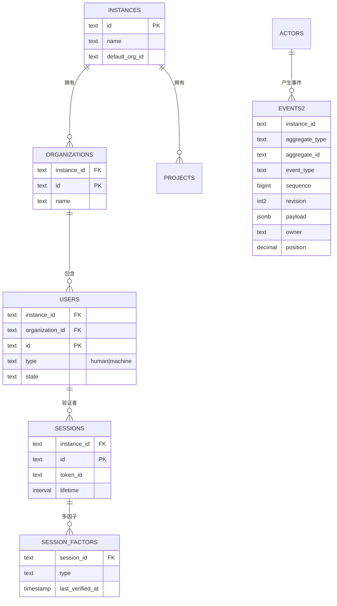
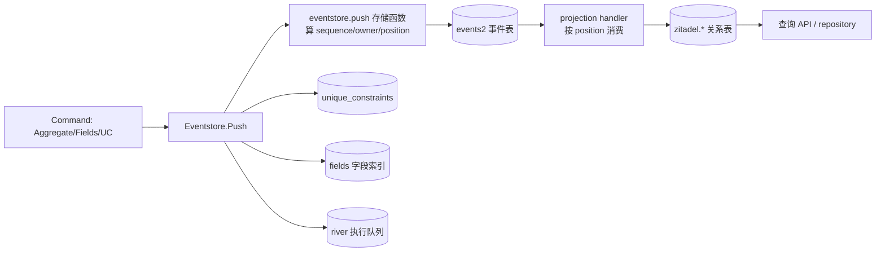

# ZITADEL 数据模型

> 关注面：事件表 + 投影关系表双轨、迁移双轨、字段索引、读写路径。
> 所有 `文件:行号` 以本地源码 `/Users/morehao/Documents/study/auth/zitadel` 为根，经程序重定位校验。

## 存储选型与理由

ZITADEL 的身份域对「审计、可追溯、多租户隔离、聚合一致性」要求极高。内核是**事件溯源（Event Sourcing）存储**：所有业务变更以不可变事件 append-only 写入 `eventstore.events2`，作为系统唯一真相源；查询性能与多租户索引则交给由事件**异步物化**的关系投影表（`zitadel.*` 读模型）。这正是 CQRS「命令侧写事件、查询侧读物化读模型」。

**为什么选 PostgreSQL 而非专用事件库（EventStore/NATS）**：ZITADEL 要「一个数据库走天下」——事件源、投影读模型、配置、账户都收敛到同一份 PostgreSQL，靠**同一事务**保证命令写入与投影的一致性，无需跨系统事务与网络一致性补偿。代价是必须在 PG 上跑（明确 PostgreSQL ≥ 14）。

## 实体关系总览

| 实体 | 对应表 | 角色 |
|---|---|---|
| Instance（租户） | `zitadel.instances` | 顶层租户边界，所有表以 `instance_id` 隔离 |
| Organization | `zitadel.organizations` | 次级租户容器 |
| Project | `zitadel.projects` | 业务资源所有者，含角色 |
| User | `zitadel.users` | 身份主体（human/machine 双态宽表） |
| Session | `zitadel.sessions` | 认证会话（因子/元数据子表） |
| Event | `eventstore.events2` | 系统真相源（写模型） |
| 投影游标 | `projections.current_states` | 记录每个投影消费到的 position |

三层表分属不同 schema：`eventstore.` 写模型（事件/字段/唯一约束）、`zitadel.` 读模型（关系投影表）、`projections.` 投影调度与游标。

## 核心表 · 字段表

### 事件表 `eventstore.events2`

权威 DDL 定义如下（复合主键 + 三索引），迁移时由 setup step 14 从旧 `events_old` 物化：

[cmd/initialise/sql/08_events_table.sql:1-14]() events2 核心列：聚合定位 + position/owner/in_tx_order
<!-- anchor: CREATE TABLE IF NOT EXISTS eventstore.events2 ( ... , "position" DECIMAL NOT NULL -->

| 列 | 类型 | 说明 |
|---|---|---|
| `instance_id` | TEXT | 租户隔离键（复合主键首位） |
| `aggregate_type` / `aggregate_id` | TEXT | 聚合类型与 ID |
| `event_type` | TEXT | 命令/事件名，如 `user.human.added` |
| `sequence` | BIGINT | 聚合内单调递增版本号 |
| `revision` | SMALLINT | 事件结构修订号（兼容） |
| `created_at` | TIMESTAMPTZ | 写入时间 |
| `payload` | JSONB | 事件数据负载 |
| `creator` / `owner` | TEXT | 触发者 / resource_owner（归属租户） |
| `position` | DECIMAL | **跨聚合全局排序号**，投影消费顺序依据 |
| `in_tx_order` | INTEGER | 同事务内多事件写入顺序 |
| PK | `(instance_id, aggregate_type, aggregate_id, sequence)` | 聚合内有序、租户内唯一 |

索引专为三类访问优化：

[cmd/initialise/sql/08_events_table.sql:15-26]() 三索引：活跃租户 / 写模型 / 投影消费
<!-- anchor: , in_tx_order INTEGER NOT NULL ... CREATE TYPE eventstore.command2 AS ( -->

- `es_active_instances`（created_at DESC, instance_id）——活跃租户扫描
- `es_wm`（aggregate_id, instance_id, aggregate_type, event_type）——写模型按聚合查询
- `es_projection`（instance_id, aggregate_type, event_type, position）——投影按 position 顺序消费

**owner 继承**：`commands_to_events` 在数据库函数内自动把新事件 owner 继承为同一聚合上一条事件的 owner，除非 `enforce_owner=true` 覆盖：

[cmd/setup/40/02_func.sql:98-101]() owner 默认继承上一事件，enforce_owner 才覆盖
<!-- anchor: , CASE WHEN c.enforce_owner ... END AS owner -->

### `eventstore.unique_constraints`（事件侧唯一约束）

[cmd/initialise/sql/10_unique_constraints_table.sql:1-6]() 三元组唯一约束表
<!-- anchor: CREATE TABLE IF NOT EXISTS eventstore.unique_constraints ( ... PRIMARY KEY (instance_id, unique_type, unique_field) -->

写入逻辑在 push 事务内与事件同时提交，冲突靠数据库约束报错（乐观并发）：

[internal/eventstore/v3/unique_constraints.go:47-51]() push 事务内为 add 约束构造插入占位
<!-- anchor: case eventstore.UniqueConstraintAdd: ... addConstraints[fmt.Sprintf(uniqueConstraintPlaceholderFmt, instanceID, constrain -->

### `eventstore.fields`（v3 通用可搜索字段）

v3 引入「可插拔字段索引」：事件负载里可查询字段被拆出来单独存一行，值同时存 JSONB 原始值 + 类型化生成列（number/text/bool），便于按类型索引与搜索：

| 列 | 类型 | 说明 |
|---|---|---|
| `id` / `field_name` | TEXT | 主键 / 字段名 |
| `instance_id` / `resource_owner` / `aggregate_*` / `object_*` | TEXT | 归属上下文 |
| `value` | JSONB | 原始值 |
| `number_value`/`text_value`/`bool_value` | 生成列 | 类型化投影 |
| `value_must_be_unique` / `should_index` | BOOLEAN | 唯一/索引开关 |

### 投影关系表 `zitadel.instances` / `zitadel.organizations`

`zitadel.instances`（租户主表）：

[backend/v3/storage/database/dialect/postgres/migration/001_instance_table/up.sql:1-11]() instances 表：id/name + 默认关联，触发器维护 updated_at
<!-- anchor: CREATE TABLE IF NOT EXISTS zitadel.instances( ... updated_at TIMESTAMPTZ DEFAULT NOW() NOT NULL -->

`zitadel.organizations`（隶属实例，FK→instances ON DELETE CASCADE）：

[backend/v3/storage/database/dialect/postgres/migration/002_organization_table/up.sql:6-15]() organizations：instance_id FK + 复合主键 (instance_id, id)
<!-- anchor: CREATE TABLE zitadel.organizations( ... PRIMARY KEY (instance_id, id) -->

### 投影关系表 `zitadel.users`（human+machine 复合宽表）

以 `type` 枚举（human/machine）做**宽表**：不同子类型共用一表，靠 `CHECK` 约束保证字段与类型匹配，避免两张近重复表：

[backend/v3/storage/database/dialect/postgres/migration/013_user_table/up.sql:14-28]() users 宽表：type 分区 human/machine + 复合主键 + FK
<!-- anchor: CREATE TABLE zitadel.users( ... , FOREIGN KEY (instance_id, organization_id) REFERENCES zitadel.organizations(in -->

关键约束/触发器：登录名唯一（org 级 + 实例级部分索引）、`username_org_unique` 由触发器根据 settings 动态算、密码/邮箱/电话的验证 ID 各自部分唯一索引防重。子表（FK→users CASCADE）：`user_metadata`、`user_passkeys`、`user_identity_provider_links` 等。

### 投影关系表 `zitadel.sessions`

主表 + 因子/元数据子表：

[backend/v3/storage/database/dialect/postgres/migration/011_session_table/up.sql:11-24]() sessions：token/lifetime/expiration + 复合主键
<!-- anchor: CREATE TABLE zitadel.sessions ( ... , FOREIGN KEY (instance_id) REFERENCES zitadel.instances(id) -->

配套子表：`session_user_agents`（指纹/IP/headers）、`session_factors`（多因子，PK `(instance_id, session_id, type)`）、`session_metadata`（KV，sha256 索引）、`archived_sessions`（删除归档，靠触发器把删除行搬到归档表保证可审计）。

## Schema 演进策略

### 命令式迁移 `cmd/setup`（01–74 单次有序步骤）

`cmd/setup/` 用数字编号命令式步骤，由 `setup.go` 按依赖顺序执行；每个步骤实现 `Check/Execute/String`，`Check` 判断上次运行记录避免重复。示例投影表重建按版本号判断：

[cmd/setup/projections.go:16-19]() Check 按版本号决定是否需要重建投影
<!-- anchor: func (mig *projectionTables) Check(lastRun map[string]interface{}) bool { ... return currentVersion != mig.Version -->

关键历史步骤：`14_new_events_table`（events_old→events2）、`15_current_projection_state`（建投影游标表）、`40_init_push_func_v4`（部署 push/commands_to_events 数据库函数与 `command2` 类型）。命令式步骤可运行任意 Go 逻辑（遍历实例、数据修复），比纯 SQL 灵活。

### 版本化 v3 关系迁移（tern，带 up/down）

`backend/v3/.../migration` 用 tern 跑版本化迁移，迁移记录表 `zitadel.migrations`；每个版本 = 一个目录（up.sql/down.sql）+ `NN_table.go` 的 `init()` 里用 `//go:embed` 登记 `registerSQLMigration(N, up, down)`。

**为何分两套**：命令式步骤可跑复杂迁移 + 依赖运行时（eventstore、DB 连接），负责事件表/数据库函数等**不可回滚**变更；tern 专注纯 schema DDL、带 down 脚本可回退，适合投影表这类**可回滚**变更。

### 事件与读模型的向前兼容

- **事件结构兼容（revision）**：`events2.revision` + 事件类型断言，同一「添加用户」语义新老事件类型打同一个 reducer，保证旧事件也能喂给新读模型。
- **字段回填（backfill）**：新增 field 索引用异步 handler 按 `position` 游标增量补齐，不要求重放所有事件。
- **断点续跑**：`projections.current_states` 记录每个投影消费到的 position，重启可追上；切换新增投影时先删游标再重建。
- **投影可重建**：投影从事件重放而来，读模型损坏时删 `current_states` 重放即可恢复（幂等）。

## 读写路径

### 写路径：命令 → push → 存储函数 → 事件表

`Push` 是写侧唯一入口，先尝试走数据库函数路径，若 setup 40 未执行则回退旧的 `pushWithoutFunc`：

[internal/eventstore/v3/push.go:24-27]() 优先数据库函数，setup 未执行则回退
<!-- anchor: events, err = es.writeCommands(ctx, client, commands) ... return es.pushWithoutFunc(ctx, client, commands...) -->

事务内顺序：写事件 → 写唯一约束 → 写字段索引 → 入执行队列，全在一个事务：

[internal/eventstore/v3/push.go:53-69]() writeCommands 事务内依序处理 events/constraints/fields/executions
<!-- anchor: events, err := writeEvents(ctx, tx, commands) ... return nil, err -->

事件写入调用存储函数并回读 `RETURNING`：

[`internal/eventstore/v3/push.go:88`]() 调 eventstore.push 一次 INSERT 回读 owner/created_at/sequence/position
<!-- anchor: rows, err := tx.Query(ctx, fmt.Sprintf(`select owner, created_at, "sequence", position from eventstore.push(...)`), cmds) -->

### 投影消费 → 关系表

投影 handler 按 `es_projection` 索引顺序拉取事件→reducer→同一投影事务里写入关系表 → 更新 `current_states` 游标。查询层直接 JOIN 读关系表，不再读事件流。

## 摘要

ZITADEL 的数据模型是清晰的两层 CQRS：

1. **写模型（command source）**：`eventstore.events2` 唯一真相源，append-only；一次 push 在一个 ReadCommitted 事务里同时写事件、唯一约束、通用可搜索字段，用 `eventstore.push()` 存储函数在服务端计算 sequence/owner/position/in_tx_order，保证聚合内有序、租户内唯一、跨聚合有全局位置。
2. **读模型（materialized projection）**：`zitadel.*` 关系表由投影 handler 异步从事件重放水合，用 `position` 游标断点续跑；查询层直接 JOIN 读关系表，绝不再读事件流。
3. **演进双轨**：`cmd/setup`（命令式，逻辑复杂/不可回滚）+ `backend/v3` tern（纯 DDL/可回滚）各司其职；事件向前兼容靠 `revision` + 多事件类型共享 reducer。

**权衡总结**：用事件溯源换审计与可溯源真相、用关系投影换读性能与多租户索引，代价是「一份数据两种存储」+ 维护两套 schema 演进 + 一套投影调度——这恰好也是 ZITADEL 最复杂的部分。
