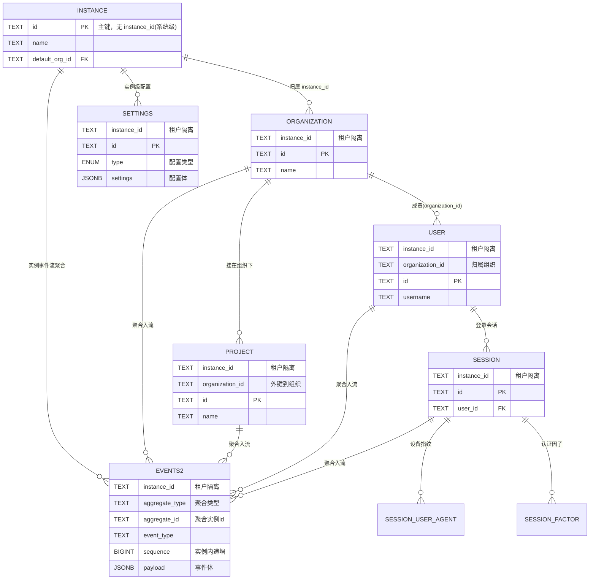
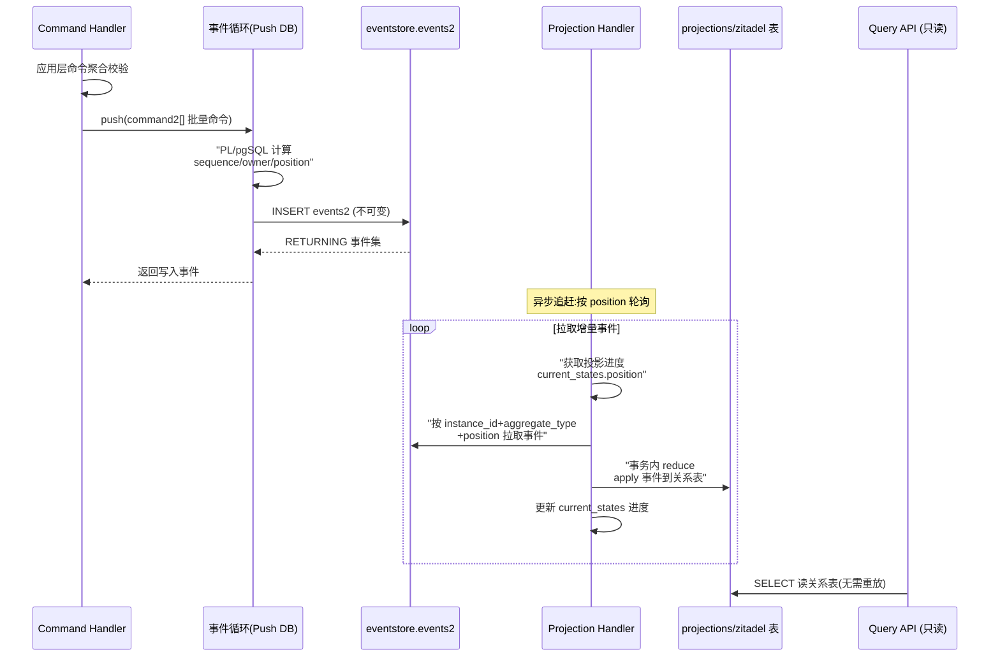

# Zitadel 数据模型设计

> 基于 PostgreSQL 的 Go IAM，采用「事件溯源（Event Sourcing）+ 投影关系表（Projection）」的双层数据模型。本文将焦点放在**设计**上——为什么这样存、如何保证一致性与演进安全，而非字段罗列。全部论断均可点开在 Zitadel 源码仓库下重定位验证。

---

## 一、存储选型与理由

Zitadel 把数据分为两套互补的存储：**事件流**（`eventstore` / `zitadel` schema 合并归属）与**投影关系表**（`projections` / `zitadel` schema）。它们不是「主存储 + 缓存」的简单关系，而是同一领域的两种视图。

**为什么是 PostgreSQL 单一数据库？**

Zitadel 把事件日志和读模型都放进同一个 PostgreSQL 实例，而不是引入独立的消息队列或 KV 存储。好处是运维心智单一、事务语义统一、备份/恢复只需针对一个库。数据库的初始化被拆成 schema、权限、建表三个层次：`eventstore`、`projections`、`system` 三个 schema 都由 `cmd/initialise` 统一创建，只建 schema、不建表，真正的表 DDL 交由后续 setup 阶段或运行时迁移去补。

[cmd/initialise/sql/04_eventstore.sql:1-2]() 事件 schema 只负责建 `eventstore` schema 并授权。
<!-- snippet:
CREATE SCHEMA IF NOT EXISTS eventstore;
GRANT ALL ON ALL TABLES IN SCHEMA eventstore TO "%[1]s";
-->

[cmd/initialise/sql/05_projections.sql:1-2]() 投影 schema 同样独立命名，为读模型划出专属空间。
<!-- snippet:
CREATE SCHEMA IF NOT EXISTS projections;
GRANT ALL ON ALL TABLES IN SCHEMA projections TO "%[1]s";
-->

**为什么「关系核心 + 事件溯源灵魂」并存？**

事件溯源负责**不可篡改、可重放的历史**：每一次状态变更都追加为一条事件（`events2`），它是对「事实」的唯一来源（source of truth）。但纯粹的事件流无法高效做范围查询（"这个组织的活跃用户有哪些"），所以投影层把事件 reapply 成**面向查询的关系表**。二者通过 `aggregate_id` / `instance_id` / `position` 关联起来。

这一设计接受一个显式权衡：**写路径多一跳**（命令先写事件，投影再异步消费），但换来**读模型可随时丢弃重建、历史可审计、多读模型可各自独立演进**。一致性是「最终一致」的：命令发起时立即返回，投影在后台事务中追赶。

---

## 二、实体关系总览

核心领域实体在运行时被实化为主流的**关系表**（schema `zitadel`，由 v3 tern 迁移编号 001-018 建立），同时每个实体的状态变更又源源不断地沉淀到 `eventstore.events2` 事件流。多租户隔离通过每表的 `instance_id` + 复合主键实现。

关键设计点：**每张关系表都以前导 `instance_id` 为复合主键的第一列**（除 `zitadel.instances` 自身），从而把多租户隔离变成主键的一部分，索引天然按实例切片，杜绝跨实例扫描。这个模式贯穿 `organizations`、`projects`、`users`、`sessions` 等所有表。

[backend/v3/storage/database/dialect/postgres/migration/002_organization_table/up.sql:6-15]() 组织以其 instance + id 复合主键实现租户内隔离。
<!-- snippet:
CREATE TABLE zitadel.organizations(
  id TEXT NOT NULL CHECK (id <> ''),
  name TEXT NOT NULL CHECK (name <> ''),
  instance_id TEXT NOT NULL REFERENCES zitadel.instances (id) ON DELETE CASCADE,
  state zitadel.organization_state NOT NULL,
  created_at TIMESTAMPTZ DEFAULT NOW() NOT NULL,
  updated_at TIMESTAMPTZ DEFAULT NOW() NOT NULL,

  PRIMARY KEY (instance_id, id)
);
-->

[backend/v3/storage/database/dialect/postgres/migration/006_projects_table/up.sql:6-17]() 项目表挂到组织，`instance_id` 亦作为主键第一列。
<!-- snippet:
CREATE TABLE zitadel.projects(
    instance_id TEXT NOT NULL
    , organization_id TEXT NOT NULL
    , id TEXT NOT NULL CHECK (id <> '')

    , name TEXT NOT NULL CHECK (name <> '')
    , state zitadel.project_state NOT NULL

    , PRIMARY KEY (instance_id, id)
    , UNIQUE (instance_id, organization_id, id)
    , FOREIGN KEY (instance_id, organization_id) REFERENCES zitadel.organizations(instance_id, id) ON DELETE CASCADE
);
-->

OIDC 会话（`OIDCSession`）不是独立关系表，而是以**事件聚合（AggregateType `oidc.session` 类）**的形式活在事件流里，并被实化为 `zitadel` schema 的 `sessions` 关系表承载其会话主体。这样既保留认证过程的完整事件历史，又提供查询层的快速读取。

---

## 三、核心表设计

### 3.1 事件表 `eventstore.events2`

**职责**：系统唯一的「事实来源」。任何业务状态变更都以追加式事件落库，天然不可变、可重放。主键 `(instance_id, aggregate_type, aggregate_id, sequence)` 保证同一聚合实例的事件顺序；`position` 提供全局单调递增的重放游标（投影据此做增量读取）。

[cmd/initialise/sql/08_events_table.sql:1-18]() events2 权威 DDL。
<!-- snippet:
CREATE TABLE IF NOT EXISTS eventstore.events2 (
    instance_id TEXT NOT NULL
    , aggregate_type TEXT NOT NULL
    , aggregate_id TEXT NOT NULL

    , event_type TEXT NOT NULL
    , "sequence" BIGINT NOT NULL
    , revision SMALLINT NOT NULL
    , created_at TIMESTAMPTZ NOT NULL
    , payload JSONB
    , creator TEXT NOT NULL
    , "owner" TEXT NOT NULL

    , "position" DECIMAL NOT NULL
    , in_tx_order INTEGER NOT NULL

    , PRIMARY KEY (instance_id, aggregate_type, aggregate_id, "sequence")
);
-->

| 字段 | 类型 | 约束 | 设计说明 |
|---|---|---|---|
| `instance_id` | TEXT | NOT NULL | 租户隔离，主键第一列 |
| `aggregate_type` | TEXT | NOT NULL | 聚合类型（如 `user`、`instance`），决定事件归属 |
| `aggregate_id` | TEXT | NOT NULL | 聚合实例 ID（领域对象 ID） |
| `event_type` | TEXT | NOT NULL | 事件名，如 `user.human.added` |
| `sequence` | BIGINT | NOT NULL | **聚合实例内**递增序号，唯一顺序锚点 |
| `revision` | SMALLINT | NOT NULL | 事件结构版本，向后兼容的关键（见演进策略） |
| `created_at` | TIMESTAMPTZ | NOT NULL | 入库时间 |
| `payload` | JSONB | 可空 | 事件体，JSONB 保证结构灵活且可建索引 |
| `creator` | TEXT | NOT NULL | 写入者（触发命令的 actor） |
| `owner` | TEXT | NOT NULL | 资源所有者（所属组织/实例） |
| `position` | DECIMAL | NOT NULL | 全局单调递增游标，投影重放依据 |
| `in_tx_order` | INTEGER | NOT NULL | 单事务内批量写入的次序 |

事件被写入是**通过存储过程而非应用侧拼 SQL**：应用把一组命令（`command2[]`）交给 `push` 函数，由 PostgreSQL 的 PL/pgSQL 原子地计算 `sequence`、补全 `owner`、统一写盘并 `RETURNING`，避免并发下的竞态。

[cmd/initialise/sql/08_events_table.sql:157-162]() push 存储过程是事件落库的唯一入口。
<!-- snippet:
CREATE OR REPLACE FUNCTION eventstore.push(commands eventstore.command2[]) RETURNS SETOF eventstore.events2 VOLATILE AS $$
INSERT INTO eventstore.events2
SELECT * FROM eventstore.commands_to_events(commands)
ORDER BY in_tx_order
RETURNING *
$$ LANGUAGE SQL;
-->

[cmd/initialise/sql/08_events_table.sql:133-143]() 序列号在数据库内用 ROW_NUMBER 按聚合分区计算，保证并发安全。
<!-- snippet:
        , COALESCE(e.sequence, 0) + ROW_NUMBER() OVER (PARTITION BY c.instance_id, c.aggregate_type, c.aggregate_id ORDER BY c.in_tx_order) AS sequence
        , c.revision
        , NOW() AS created_at
        , c.payload
        , c.creator
        , CASE WHEN c.enforce_owner
            THEN c.owner
            ELSE COALESCE(e.owner, c.owner)
        END AS owner
        , EXTRACT(EPOCH FROM NOW()) AS position
        , c.in_tx_order
-->

事件表的索引也围绕「按实例切片 + 按 position 增量」设计：`es_projection` 复合索引 `(instance_id, aggregate_type, event_type, "position")` 直接服务投影按类型追读；`es_active_instances` 支撑 `instance.added/removed` 的活跃实例探测。

[cmd/initialise/sql/08_events_table.sql:20-22]() 三个索引覆盖实例切片、聚合定位与投影重放。
<!-- snippet:
CREATE INDEX IF NOT EXISTS es_active_instances ON eventstore.events2 (created_at DESC, instance_id);
CREATE INDEX IF NOT EXISTS es_wm ON eventstore.events2 (aggregate_id, instance_id, aggregate_type, event_type);
CREATE INDEX IF NOT EXISTS es_projection ON eventstore.events2 (instance_id, aggregate_type, event_type, "position");
-->

### 3.2 投影关系表 `zitadel.users`

**职责**：把用户聚合的事故（创建、改密、验证手机/邮箱、TOTP、邀请等）reapply 成可直接查询的用户主表。它是事件溯源读模型的典型代表——表结构是一棵宽表，冗余了大量从事件推导出的字段，但查询路径无需重放任何事件。实现采用**单表覆盖 human+ machine 两种类型**，用 `type` 枚举 + `CHECK` 约束让同一行的可空列随类型互斥，减少联表。

[backend/v3/storage/database/dialect/postgres/migration/013_user_table/up.sql:14-28]() users 主键、外键到组织、双枚举类型。
<!-- snippet-base64:Q1JFQVRFIFRBQkxFIHppdGFkZWwudXNlcnMoCiAgICBpbnN0YW5jZV9pZCBURVhUIE5PVCBOVUxMCiAgICAsIG9yZ2FuaXphdGlvbl9pZCBURVhUIE5PVCBOVUxMCiAgICAsIGlkIFRFWFQgTk9UIE5VTEwgQ0hFQ0sgKGlkIDw+ICcnKQoKICAgICwgdXNlcm5hbWUgVEVYVCBOT1QgTlVMTCBDSEVDSyAodXNlcm5hbWUgPD4gJycpCiAgICAsIHVzZXJuYW1lX29yZ191bmlxdWUgQk9PTEVBTiBERUZBVUxUIEZBTFNFIE5PVCBOVUxMIC0tIHRoaXMgZmllbGQgTVVTVCBiZSBmaWxsZWQgaWYgdGhlIHVzZXJuYW1lIG11c3QgYmUgdW5pcXVlIG9uIG9yZ2FuaXphdGlvbiBsZXZlbAogICAgLCBzdGF0ZSB6aXRhZGVsLnVzZXJfc3RhdGUgTk9UIE5VTEwgREVGQVVMVCAnYWN0aXZlJwogICAgLCB0eXBlIHppdGFkZWwudXNlcl90eXBlIE5PVCBOVUxMCgogICAgLCBjcmVhdGVkX2F0IFRJTUVTVEFNUFRaIE5PVCBOVUxMIERFRkFVTFQgbm93KCkKICAgICwgdXBkYXRlZF9hdCBUSU1FU1RBTVBUWiBOT1QgTlVMTCBERUZBVUxUIG5vdygpCgogICAgLCBQUklNQVJZIEtFWSAoaW5zdGFuY2VfaWQsIGlkKQogICAgLCBGT1JFSUdOIEtFWSAoaW5zdGFuY2VfaWQsIG9yZ2FuaXphdGlvbl9pZCkgUkVGRVJFTkNFUyB6aXRhZGVsLm9yZ2FuaXphdGlvbnMoaW5zdGFuY2VfaWQsIGlkKSBPTiBERUxFVEUgQ0FTQ0FERQo= -->

| 字段 | 类型 | 约束 | 设计说明 |
|---|---|---|---|
| `instance_id` | TEXT | NOT NULL | 租户隔离，主键第一列 |
| `organization_id` | TEXT | NOT NULL | 归属组织，外键到 organizations |
| `id` | TEXT | NOT NULL, CHK `<>''` | 全局用户 ID（与事件聚合 ID 一致） |
| `username` | TEXT | NOT NULL, CHK `<>''` | 登录名；唯一性由后续部分唯一索引决定 |
| `username_org_unique` | BOOLEAN | NOT NULL DEF false | 标记用户名是否按组织级别唯一 |
| `state` | ENUM(user_state) | NOT NULL DEF active | `initial/active/inactive/locked/suspended` |
| `type` | ENUM(user_type) | NOT NULL | `human` / `machine`，决定下面互斥列组 |
| `created_at` / `updated_at` | TIMESTAMPTZ | NOT NULL | 时间戳；trigger 自动刷新 updated_at |
| `password_hash` 等 `password_*` | TEXT/… | CHECK 按 type 互斥 | 仅 human 生效的认证字段 |
| `email_*` / `phone_*` / `totp_*` | TEXT/TIMESTAMPTZ | CHECK 按 type 互斥 | 验证类字段，含验证 ID 与尝试计数 |
| `first_name`/`last_name`/`name`/`secret` 等 | TEXT | CHECK 按 type 互斥 | human 资料 vs machine 密钥 |

用 `CHECK` 惰性约束区分 human/machine 字段，是设计上「宽表单写、查询零联表」的体现：每列都带形如 `(type = 'machine' AND col IS NULL) OR (type = 'human' AND col <> '')` 的约束，从数据库层面杜绝类型字段串位。

[backend/v3/storage/database/dialect/postgres/migration/013_user_table/up.sql:92-106]() 部分唯一索引实现两种登录名唯一策略 + 验证 ID 唯一。
<!-- snippet-base64:LS0gdXNlcgpDUkVBVEUgVU5JUVVFIElOREVYIE9OIHppdGFkZWwudXNlcnMoaW5zdGFuY2VfaWQsIG9yZ2FuaXphdGlvbl9pZCwgdXNlcm5hbWUpIFdIRVJFIHVzZXJuYW1lX29yZ191bmlxdWUgSVMgVFJVRTsKQ1JFQVRFIFVOSVFVRSBJTkRFWCBPTiB6aXRhZGVsLnVzZXJzKGluc3RhbmNlX2lkLCB1c2VybmFtZSkgV0hFUkUgdXNlcm5hbWVfb3JnX3VuaXF1ZSBJUyBGQUxTRTsKQ1JFQVRFIElOREVYIGlkeF91c2VyX3VzZXJuYW1lIE9OIHppdGFkZWwudXNlcnMgKHVzZXJuYW1lKTsKQ1JFQVRFIElOREVYIGlkeF91c2VyX3VzZXJuYW1lX2xvd2VyIE9OIHppdGFkZWwudXNlcnMgKGxvd2VyKHVzZXJuYW1lKSk7CkNSRUFURSBJTkRFWCBpZHhfbWFjaGluZV9uYW1lIE9OIHppdGFkZWwudXNlcnMgKG5hbWUpOwpDUkVBVEUgSU5ERVggaWR4X2h1bWFuX2VtYWlsIE9OIHppdGFkZWwudXNlcnMgKGVtYWlsKTsKQ1JFQVRFIElOREVYIGlkeF9odW1hbl9lbWFpbF9sb3dlciBPTiB6aXRhZGVsLnVzZXJzIChsb3dlcihlbWFpbCkpOwpDUkVBVEUgSU5ERVggaWR4X2h1bWFuX3Bob25lIE9OIHppdGFkZWwudXNlcnMgKHBob25lKTsKQ1JFQVRFIElOREVYIGlkeF9odW1hbl9waG9uZV9sb3dlciBPTiB6aXRhZGVsLnVzZXJzIChsb3dlcihwaG9uZSkpOwoKLS0gaHVtYW4KQ1JFQVRFIFVOSVFVRSBJTkRFWCBPTiB6aXRhZGVsLnVzZXJzKHBhc3N3b3JkX3ZlcmlmaWNhdGlvbl9pZCkgV0hFUkUgcGFzc3dvcmRfdmVyaWZpY2F0aW9uX2lkIElTIE5PVCBOVUxMOwpDUkVBVEUgVU5JUVVFIElOREVYIE9OIHppdGFkZWwudXNlcnMoZW1haWxfdmVyaWZpY2F0aW9uX2lkKSBXSEVSRSBlbWFpbF92ZXJpZmljYXRpb25faWQgSVMgTk9UIE5VTEw7CkNSRUFURSBVTklRVUUgSU5ERVggT04geml0YWRlbC51c2VycyhwaG9uZV92ZXJpZmljYXRpb25faWQpIFdIRVJFIHBob25lX3ZlcmlmaWNhdGlvbl9pZCBJUyBOT1QgTlVMTDsK -->

### 3.3 投影关系表 `zitadel.sessions`

**职责**：用户登录会话的读模型，承载会话主体及认证因子。会话被拆成三张表——`sessions`（主会话）、`session_factors`（已完成的认证因子如密码/passkey/TOTP）、`session_user_agents`（设备指纹）——把「一次登录的多个认证因子」建模成一对多，因子各自记录 `last_verified_at`。会话过期时间由触发器用 `lifetime + updated_at` 自动推进。

[backend/v3/storage/database/dialect/postgres/migration/011_session_table/up.sql:11-26]() sessions 主表：外键若设备、若用户，过期由触发器维护。
<!-- snippet-base64:Q1JFQVRFIFRBQkxFIHppdGFkZWwuc2Vzc2lvbnMgKAogICAgaW5zdGFuY2VfaWQgVEVYVCBOT1QgTlVMTAogICAgLCBpZCBURVhUIE5PVCBOVUxMIENIRUNLIChpZCA8PiAnJykKICAgICwgdG9rZW5faWQgVEVYVAogICAgLCB1c2VyX2FnZW50X2lkIFRFWFQKICAgICwgbGlmZXRpbWUgSU5URVJWQUwKICAgICwgZXhwaXJhdGlvbiBUSU1FU1RBTVBUWgogICAgLCB1c2VyX2lkIFRFWFQgLS0gdGhpcyBjb2x1bW4gaXMgdXNlZCBmb3IgcmVmZXJlbnRpYWwgaW50ZWdyaXR5CiAgICAsIGNyZWF0b3JfaWQgVEVYVAogICAgLCBjcmVhdGVkX2F0IFRJTUVTVEFNUFRaIERFRkFVTFQgTk9XKCkgTk9UIE5VTEwKICAgICwgdXBkYXRlZF9hdCBUSU1FU1RBTVBUWiBERUZBVUxUIE5PVygpIE5PVCBOVUxMCgogICAgLCBQUklNQVJZIEtFWSAoaW5zdGFuY2VfaWQsIGlkKQogICAgLCBGT1JFSUdOIEtFWSAoaW5zdGFuY2VfaWQpIFJFRkVSRU5DRVMgeml0YWRlbC5pbnN0YW5jZXMoaWQpCiAgICAsIEZPUkVJR04gS0VZIChpbnN0YW5jZV9pZCwgdXNlcl9hZ2VudF9pZCkgUkVGRVJFTkNFUyB6aXRhZGVsLnNlc3Npb25fdXNlcl9hZ2VudHMoaW5zdGFuY2VfaWQsIGZpbmdlcnByaW50X2lkKSBPTiBERUxFVEUgU0VUIE5VTEwgKHVzZXJfYWdlbnRfaWQpCik7Cg== -->

| 字段 | 类型 | 约束 | 设计说明 |
|---|---|---|---|
| `instance_id` | TEXT | NOT NULL | 租户隔离，主键第一列 |
| `id` | TEXT | NOT NULL, CHK `<>''` | 会话 ID |
| `token_id` | TEXT | 可空 | 绑定的 refresh/access token 标识 |
| `user_agent_id` | TEXT | 可空 FK→ session_user_agents | 设备指纹；设备删除时置 NULL |
| `lifetime` | INTERVAL | 可空 | 会话生存期 |
| `expiration` | TIMESTAMPTZ | 可空 | 过期时刻；由触发器计算 |
| `user_id` | TEXT | 可空 | 会话归属用户（引用完整性用） |
| `creator_id` | TEXT | 可空 | 会话创建者 |
| `created_at`/`updated_at` | TIMESTAMPTZ | NOT NULL | 时间戳 |

[backend/v3/storage/database/dialect/postgres/migration/011_session_table/up.sql:28-40]() 触发器把 lifetime 的变化自动换算成 expiration。
<!-- snippet:
CREATE OR REPLACE FUNCTION zitadel.update_expiration()
    RETURNS TRIGGER AS $$
BEGIN
    NEW.expiration := NEW.updated_at + NEW.lifetime;
    RETURN NEW;
END;
$$ LANGUAGE plpgsql;

CREATE TRIGGER set_expiration_on_insert
    BEFORE INSERT ON zitadel.sessions
    FOR EACH ROW
    WHEN (NEW.lifetime <> '0'::interval)
EXECUTE FUNCTION zitadel.update_expiration();
-->

**投影控制元数据**：投影的进度与并发安全由 `projections` schema 里的 `locks`、`current_states`、`failed_events` 表记录，这些都含 `instance_id`，确保多实例、多租户下投影处理器互不抢占。

[cmd/setup/01_sql/projections.sql:1-18]() 投影控制表包含 projection_name + instance_id 组合主键。
<!-- snippet:
CREATE TABLE projections.locks (
    locker_id TEXT,
    locked_until TIMESTAMPTZ(3),
    projection_name TEXT,
    instance_id TEXT NOT NULL,

    PRIMARY KEY (projection_name, instance_id)
);

CREATE TABLE projections.current_sequences (
    projection_name TEXT,
    aggregate_type TEXT,
    current_sequence BIGINT,
    instance_id TEXT NOT NULL,
    timestamp TIMESTAMPTZ,

    PRIMARY KEY (projection_name, aggregate_type, instance_id)
);
-->

---

## 四、Schema 演进策略

Zitadel 的 schema 演进分**两套迁移机制**，各自保证顺序、幂等与再入安全：

### 4.1 命令式迁移（01–74 步骤，setup 阶段执行）

`schema` 层面的 DDL（建事件表、补列、建索引、迁移数据）由 `cmd/setup` 的一批 `*.go` 迁移步骤执行。每个步骤按编号顺序排列在固定的切片中，**版本与执行顺序都在代码里显式声明**，而非依赖文件名排序。

[cmd/setup/setup.go:266-283]() setup 以显式切片声明步骤顺序（01~74），并逐个 executeMigration 执行。
<!-- snippet:
	for _, step := range []migration.Migration{
		steps.s14NewEventsTable,
		steps.s40InitPushFunc,
		steps.s1ProjectionTable,
		steps.s2AssetsTable,
		steps.s28AddFieldTable,
		steps.s31AddAggregateIndexToFields,
		steps.s46InitPermissionFunctions,
		steps.FirstInstance,
		steps.s5LastFailed,
		steps.s6OwnerRemoveColumns,
		...
	} {
		setupErr = executeMigration(ctx, eventstoreClient, step, "migration failed")
		if setupErr != nil {
			return
		}
	}
-->

**幂等/再入机制**：每个迁移步骤的执行状态被记录在事件流里——开始时推 `system.migration.started`，结束推 `system.migration.done`。`checkExec` 用这个状态判断该步骤是否需要执行，且**用事件流本身的锁机制保证同一时刻只有一个 setup 并发执行同一步骤**；若发现某步骤已被别的进程 started，会等待轮询而不是重复执行。

[internal/migration/migration.go:13-20]() 迁移状态类型以系统事件形式记录在事件流中。
<!-- snippet:
	const (
		StartedType  = eventstore.EventType("system.migration.started")
		DoneType     = eventstore.EventType("system.migration.done")
		failedType   = eventstore.EventType("system.migration.failed")
		repeatableDoneType = eventstore.EventType("system.migration.repeatable.done")
		SystemAggregate = eventstore.AggregateType("system")
		SystemAggregateID = "SYSTEM"
	)
-->

[internal/migration/migration.go:44-62]() Migrate 先校验是否已执行，再发 started/done 事件编排。
<!-- snippet:
func Migrate(ctx context.Context, es *eventstore.Eventstore, migration Migration) (err error) {
	ctx = logging.With(ctx, "name", migration.String())
	logging.Info(ctx, "verify migration")

	continueOnErr := func(err error) bool {
		return false
	}
	errChecker, ok := migration.(errCheckerMigration)
	if ok {
		continueOnErr = errChecker.ContinueOnErr
	}

	should, err := checkExec(ctx, es, migration)
	if err != nil && !continueOnErr(err) {
		return err
	}
	if !should {
		return nil
	}
-->
[internal/migration/migration.go:120-123]() checkExec 轮询判断是否已 started，保证并发下幂等。
<!-- snippet:
func checkExec(ctx context.Context, es *eventstore.Eventstore, migration Migration) (bool, error) {
	timer := time.NewTimer(0)
	for {
		select {
	-->

**可容错迁移**：部分迁移（如涉及已存在表的 `NewEventsTable`）实现了 `ContinueOnErr`，在遇到「表已存在」的特定错误码（Postgres `42P01`）时跳过而非中止，从而支持**重入/续跑**，允许在中断后安全重启。

[cmd/setup/14.go:61-67]() NewEventsTable 对表已存在错误码继续而非失败。
<!-- snippet:
func (mig *NewEventsTable) ContinueOnErr(err error) bool {
	pgErr := new(pgconn.PgError)
	if errors.As(err, &pgErr) {
		return pgErr.Code == "42P01"
	}
	return false
}
-->

### 4.2 版本化语义迁移（v3 关系表，001–018+）

面向查询的 `zitadel` schema 关系表使用 tern 迁移框架，DDL 以 `Sequence`（001…018…）编号、配 up/down SQL，执行记录保存在 `zitadel.migrations` 版本表，**天然保证每个编号只执行一次且按序应用**，并支持 down 回滚。

[backend/v3/storage/database/dialect/postgres/migration/migrations.go:12-31]() 用 tern migrator 管理编号版本，up/down 成对。
<!-- snippet:
func Migrate(ctx context.Context, conn *pgx.Conn) error {
	_, err := conn.Exec(ctx, "CREATE SCHEMA IF NOT EXISTS zitadel")
	if err != nil {
		return err
	}
	migrator, err := migrate.NewMigrator(ctx, conn, "zitadel.migrations")
	if err != nil {
		return err
	}
	migrator.Migrations = migrations
	return migrator.Migrate(ctx)
}

func registerSQLMigration(sequence int32, up, down string) {
	migrations = append(migrations, &migrate.Migration{
		Sequence: sequence,
		UpSQL:    up,
		DownSQL:  down,
	})
}
-->

每张表的迁移在独立 `.go` 文件的 `init()` 里注册，`//go:embed` 内嵌 up/down SQL，参数用 init 里的字符串拼接，保证编译期可见、运行时才有具体 DDL。

[backend/v3/storage/database/dialect/postgres/migration/013_user_table.go:8-15]() 每个表迁移通过 go:embed + init 序列号注册。
<!-- snippet:
	//go:embed 013_user_table/up.sql
	up013UserTable string
	//go:embed 013_user_table/down.sql
	down013UserTable string
)

func init() {
	registerSQLMigration(13, up013UserTable, down013UserTable)
-->

该迁移作为「repeatable」步骤运行在命令式迁移**之后**（因为它要建的是运行时关系表），由 `TransactionalTables` 触发；`Check` 恒返回 true，表示每次 setup 都会校验迁移是否已应用。

[cmd/setup/transactional_tables.go:19-33]() 关系表迁移作为 repeatable 步骤，可整体重建 schema。
<!-- snippet:
func (mig *TransactionalTables) Execute(ctx context.Context, _ eventstore.Event) error {
	if mig.ShouldRecreateSchema {
		logging.Info(ctx, "dropping schema of relational tables")
		if err := mig.dropSchema(ctx); err != nil {
			return err
		}
	}

	config := &postgres.Config{Pool: mig.dbClient.Pool}
	pool, err := config.Connect(ctx)
	if err != nil {
		return err
	}
	return pool.Migrate(ctx)
}
-->

### 4.3 事件结构的向后兼容

事件表本身有 `revision` 列：每次事件 schema 变更（新增字段、改语义）都会提升 revision，投影在重放时按 revision 识别事件新旧格式。同时 `payload` 用 JSONB 承载，业务字段的新增不做迁移、不改表，老事件天然可被新代码读取——这是事件溯源里「Additive 变更是默认安全」的精髓：**历史事件永远不改写，只有读模型的解释逻辑会演进**。

---

## 五、读写路径

写请求与读请求走完全不同的两条路径：命令侧最终落一条不可变事件，读侧从投影读已实化的关系表。二者通过事件流的 `position` 游标异步解耦。

**写路径（命令 → 事件）**：Command Handler 组装多个命令交给 `push` 存储过程，PostgreSQL 在数据库内完成 sequence 分配与 owner 继承，一次性原子写入并返回事件，随后触发投影消费。

[cmd/initialise/sql/08_events_table.sql:66-83]() commands_to_events 计算聚合内最新 sequence/owner，是写路径的中枢。
<!-- snippet:
    SELECT array_agg(res) INTO _latest_events
    FROM (
        SELECT
            ROW(
                c.instance_id,
                c.aggregate_type,
                c.aggregate_id,
                COALESCE(e.owner, c.owner),
                COALESCE(e.sequence, 0)
            )::eventstore.latest_command AS res
        FROM (
            SELECT DISTINCT ON (c.instance_id, c.aggregate_type, c.aggregate_id) ... ) AS c
        LEFT JOIN LATERAL (
            SELECT e.owner, e.sequence FROM eventstore.events2 AS e
            WHERE e.instance_id = c.instance_id AND e.aggregate_type = c.aggregate_type AND e.aggregate_id = c.aggregate_id
            ORDER BY e.sequence DESC LIMIT 1
        ) AS e ON TRUE
    ) AS latest;
-->

**读路径（投影 → 查询）**：Projection Handler 在事务内用 advisory lock（`hashtext(projection_name, instance_id)`）互斥，从 `current_states` 读 `position`，从事件流按 position 增量拉取事件 reduce 进关系表，再回写进度——整个过程一事务保证「读了哪批事件、写到哪、进度记到哪」三者一致。

[internal/eventstore/handler/v2/handler.go:569-579]() 投影先取 advisory lock 再启动事务，保证并发唯一消费者。
<!-- snippet:
	_, err = tx.ExecContext(ctx, "SELECT pg_advisory_xact_lock(hashtext($1), hashtext($2))", h.ProjectionName(), authz.GetInstance(ctx).InstanceID())
	hasLocked = true
	...
	currentState, err := h.currentState(ctx, tx)
	if err != nil {
		return additionalIteration, err
	}
	// stop execution if currentState.position >= config.maxPosition
	if !config.maxPosition.IsZero() && currentState.position.GreaterThanOrEqual(config.maxPosition) {
		return false, nil
	}
-->

---

## 摘要

- **存储选型**：单 PostgreSQL 实例，事件流（不可变事实）+ 投影关系表（可查读模型）双视图，`eventstore`/`projections`/`zitadel` 多 schema 分层。
- **多租户**：所有表以 `instance_id` 为复合主键首列，索引按实例切片隔离。
- **写**：`push` 存储过程原子写 `events2`，提供全局 `position` 游标。
- **读**：投影处理器按 position 增量消费、advisory lock 互斥，reduce 到关系表后由只读 API 查询。
- **演进**：命令式迁移（01–74，事件编排 + started/done 幂等）+ tern 语义迁移（001–018，up/down + 版本表）；事件 `revision` + JSONB payload 保证向后兼容。
