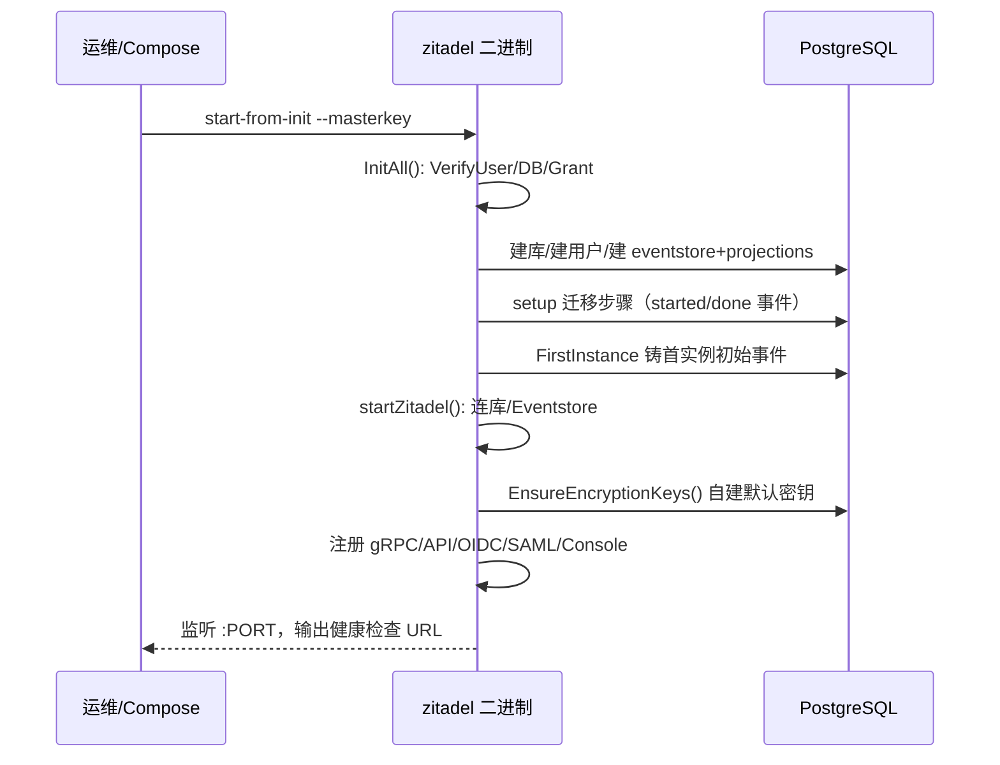

# ZITADEL 部署与运维

> 关注面：三态部署形态、启动与初始化、配置与密钥、Schema 迁移时机、横向扩展、可观测。
> 所有 `文件:行号` 以本地源码 `/Users/morehao/Documents/study/auth/zitadel` 为根，经程序重定位校验。
> 核心机制一句话概括：**一切状态（会话、配置、迁移进度）都落在 Postgres，用事件溯源 + pg advisory lock 让多副本零状态、可横向扩展、可零停机升级**。

## 部署形态

### 单一代码库，三种部署，运行时只依赖 Postgres

SaaS 云与自托管跑完全相同的二进制，部署形态差异只在外层编排。CLI 入口是 cobra 根命令，`start`/`init`/`setup`/`ready` 等都是子命令，用 viper/`--config` 配置。运行时核心依赖只有 PostgreSQL，Redis 为可选缓存。

### docker-compose 参考形态

`deploy/compose/docker-compose.yml`：Traefik（反代）+ `zitadel-api`（主进程，`start-from-init`）+ `zitadel-login`（Login V2 Node 前端）+ postgres + 可选的 redis/otel-collector（用 `profiles` 控制）。主服务用健康检查 + `service_healthy` 依赖保证 Postgres 就绪：

[deploy/compose/docker-compose.yml:17-20]() zitadel-api 服务：start-from-init 冷启动
<!-- anchor-base64:LSAtLWxvZy5sZXZlbD0ke1RSQUVGSUtfTE9HX0xFVkVMfSAuLi4gLSAke1BST1hZX0hUVFBfUFVCTElTSEVEX1BPUlR9Ojgw -->

健康检查直接调用二进制子命令 `ready`；Redis 只在 `cache` profile 下启动（缓存而非会话）：

[deploy/compose/docker-compose.yml:100-104]() 健康检查调 /app/zitadel ready
<!-- anchor: - traefik.http.routers.zitadel-api-alias-web.entrypoints=web ... - traefik.http.routers.zitadel-api-alias-web.priority=200 -->

`.env.example` 是升级入口——bump `ZITADEL_VERSION` 即触发升级动作：

[deploy/compose/.env.example:4-5]() 升级只需改 ZITADEL_VERSION
<!-- anchor: # See: https://zitadel.com/docs/self-hosting/deploy/compose#homelab -->

## 启动与初始化流程

### 命令入口命令树

| 子命令 | 文件 | 职责 |
|---|---|---|
| `start` | `cmd/start/start.go` | 直接启动（假设 DB 已初始化） |
| `start-from-init` | `cmd/start/start_from_init.go` | 冷启动：init → setup → start |
| `start-from-setup` | `cmd/start/start_from_setup.go` | 冷启动：setup → start（假设 DB 已 init） |
| `init` | `cmd/initialise/init.go` | 超级用户建库/建用户/授限/建 schema |
| `init schema` | `cmd/initialise/verify_schema.go` | 免管理员，服务用户引导 schema（托管 DB 场景） |
| `setup` | `cmd/setup/setup.go` | 事件溯源式迁移：建投影表、写初始事件、跑迁移 |
| `setup cleanup` | `cmd/setup/cleanup.go` | 中断恢复残留清理 |
| `ready` | `cmd/ready/ready.go` | 探活，轮询 `/debug/ready` |

`init` 需要管理员/超级用户权限（建库、建用户、授权），并且明确支持托管 PG 场景下用 `init schema` 免管理员引导：

[cmd/initialise/init.go:40-42]() init 前置：建库/建用户需特权
<!-- anchor: Prerequisites: ... - PostgreSql database -->
[cmd/initialise/init.go:48-51]() 托管 PG 用 init schema 免超级用户引导
<!-- anchor: If you don't have admin/superuser credentials (e.g. on a managed PostgreSQL ... using the service user credentials. No admin privileges are needed for that -->

### 一次从零部署到起来的时序

三个冷启动路径的区别在**从哪一步接手**：`start-from-init` = init+setup+start 一次跑完（Compose 默认）；`start-from-setup` 只 setup+start；生产惯例是只跑一次 `setup` 再横向起多个纯 `start`，避免多副本并发跑迁移（迁移本身有锁保护）。

## 配置管理

### 三层配置：内嵌默认 + env 覆盖 + 文件覆盖

配置是 viper：编译期 `//go:embed` 嵌入 `defaults.yaml` 第一层；环境变量（`ZITADEL_` 前缀，`.`→`_`）第二层；`--config` 文件合并覆盖最外层：

[cmd/zitadel.go:56-58]() 根命令启用 ZITADEL_ 前缀环境变量映射
<!-- anchor: cmd.PersistentFlags().StringArrayVar(&configFiles, "config", nil, "path to confi ... cmd.AddCommand( -->

顶层键覆盖外部地址（`ExternalDomain`/`ExternalSecure`）、Port、TLS、加密、事件存储、缓存、可观测等。

### 密钥加密：masterkey 分包所有密钥，密钥落库

加密密钥不直接放配置，而是存在 DB 表 `system.encryption_keys`，整张表用 32 字节 master key AES 加密。master key 可从 `--masterkey` / 环境变量 `ZITADEL_MASTERKEY` / 文件读入，且严格校验恰好 32 字节：

[internal/crypto/database/database.go:88-93]() master key 必为 32 字节
<!-- anchor: return zerrors.ThrowInternal(err, "", "unable to decrypt key") ... return nil, zerrors.ThrowInternal(err, "", "unable to read key") -->

`start` 与 `setup` 启动时会自动创建缺失的默认密钥（domainVerificationKey/oidcKey 等），保证冷启动可用；支持多 `DecryptionKeyIDs` 做密钥轮换。升级时 OIDC 兼容有专门开关 `EncryptionKeys.OIDC.LegacyToken`（旧 token 兼容，升级后用 AEAD）。

## Schema 迁移时机与零停机

### `setup` 是唯一跑迁移的命令，且迁移进度本身是事件

与很多系统不同，ZITADEL 没有独立「迁移表」文件——**迁移状态直接作为事件写进 eventstore**。每个迁移步骤用 `system` aggregate 的事件流标记 `started`/`done`/`failed`/`repeatable.done`。迁移进度在 DB 事件流里，任何副本都能读到、且全局唯一：

[internal/migration/migration.go:24-27]() 迁移状态即事件类型
<!-- anchor: type Migration interface { ... String() string -->

`Migrate` 流程：查状态 → 未跑则 push `started` 事件 → 执行 `Execute` → push `done/failed` 事件：

[internal/migration/migration.go:65-74]() 迁移执行 + 写 done/failed 事件
<!-- anchor: if err != nil && !continueOnErr(err) { ... logging.OnError(ctx, pushErr).Error("migration finish failed") -->

### 多进程并发执行：事件唯一约束 + 轮询自旋

关键：迁移步骤 push `started` 事件时带**全局唯一约束** `migration_started:<name>`，相同约束冲突即视为「另一进程正在跑同一迁移」。`setup` 支持多副本同时启动，靠这个约束 + 5 秒轮询让并发变串行且不死锁：

[internal/migration/migration.go:118-120]() 保证同一 setup step 只被一个进程执行
<!-- anchor: // checkExec ensures that only one setup step is done concurrently ... func checkExec(ctx context.Context, es *eventstore.Eventstore, migration Migrati -->

### 为什么能零停机

1. **迁移与读路径解耦**：`setup` 跑 DDL/迁移；`start` 启动的投影 handler 增量消费事件、容忍 schema 渐进变更，两者可不同时点跑、互不阻塞——这正解释了 `start-from-setup` 的意义：可在流量外先跑 setup，再滚动替换 start 副本。
2. **repeatable 迁移**：部分步骤（投影表、外键、autovacuum 配置）设计为可重复执行，运行时安全重放，`RepeatableMigration.Check` 决定是否重跑。

### 中断恢复：`setup cleanup`

`setup` 被信号中断时，defer 里跑 `Cleanup`，把已 started 未 done 的「卡住」步骤标记为可重试，保证重启后可干净续跑（配合 K8s 30s kill 的容器机制）：

[cmd/setup/setup.go:58-69]() 中断时 defer 跑 cleanup 可续跑
<!-- anchor: cmd := &cobra.Command{ ... err = tls.ModeFromFlag(cmd) -->

`setup` 可带 `--init-projections` beta 标志，让迁移跑完投影也建好，`start` 后投影「开箱即用」免追事件：

[`cmd/setup/setup.go:114`]() --init-projections beta 标志
<!-- anchor: cmd.Flags().Bool("init-projections", viper.GetBool("InitProjections"), "beta f... -->

## 横向扩展：为什么无需外部会话存储

### 会话是事件，不是服务端内存

session 是聚合根，状态通过事件溯源产生、持久化在 Postgres；查询层用投影落库为可查询表。会话在 DB、不在副本内存，所以**任意副本都能处理同一会话**，无需 sticky session / Redis 会话存储。

### 副本间协调靠 pg advisory lock

事件写入层：多副本写同一 instance 事件时用 `pg_advisory_xact_lock_shared` 共享锁保护读一致性：

[`internal/eventstore/v3/push.go:48`]() 实例级共享 advisory 锁
<!-- anchor: _, err = tx.Exec(ctx, "SELECT pg_advisory_xact_lock_shared('eventstore.events2'::REGCLASS::OID::INTEGER, hashtext($1))", authz.GetInstance(ctx).InstanceID()) -->

投影消费用**互斥 advisory lock** 确保同一投影同一 instance 只被一个副本处理（`pg_try_advisory_xact_lock` 非阻塞，拿不到即「已有副本在处理」并跳过）：

[internal/eventstore/handler/v2/field_handler.go:130-136]() 投影消费用互斥 advisory lock 抢占
<!-- anchor: err = tx.QueryRowContext(ctx, "SELECT pg_try_advisory_xact_lock(hashtext($1), ha ... return false, zerrors.ThrowInternal(nil, "V2-xRffO", "projection already locked" -->

行级冲突 `55P03` 也被识别为「他副本正在处理」而非致命错误：

[internal/eventstore/handler/v2/field_handler.go:93-96]() 55P03 识别为他副本处理中
<!-- anchor: if errors.As(err, &pgErr) { ... logging.WithError(ctx, err).Info("another handler is already updating this proje -->

### 后台任务也是 Postgres 驱动

后台 job（通知、执行、serviceping 调度）基于 **river**（Postgres 队列）而非内存定时器，多副本消费同一队列天然去重：

[internal/queue/queue.go:33-37]() river Postgres 队列抽象
<!-- anchor: func NewQueue(config *Config) (_ *Queue, err error) { ... DurationUnit:  "ms", -->

**横向扩展小结**：会话、配置、迁移进度、后台任务全部持久化于 Postgres（事件溯源 + 投影 + River 队列）；副本间用 pg advisory lock 协调——因此任意副本可服务任意会话，副本数可自由伸缩，无需外部会话存储。这也是「SaaS 与自托管跑同一代码库」的前提。

## 可观测与运维要点

OpenTelemetry 导出器可插拔（`none/stdOut/stdErr/grpc/http/google/prometheus/auto`）。`ready` 命令强制关闭 metrics/tracing 只做最小探活：

[cmd/ready/config.go:41-43]() ready 关闭 metrics/tracing 只做探活
<!-- anchor: // Force-disable metrics and tracing for ready command ... config.Instrumentation.Trace.Exporter.Type = instrumentation.ExporterTypeNone -->

## 不足 / 风险

- **单 Postgres 依赖**：一切状态落 PG，DB 成为唯一真相与唯一瓶颈，主从/高可用是运维核心。
- **advisory lock 按 instance 粒度**：热租户写入受单实例串行约束。
- **迁移复杂度高**：事件式迁移 + 唯一约束 + cleanup 恢复，理解门槛高，误操作可能卡在中间态。
- **master key 管理**：密钥轮换与 master key 丢失处理需严格流程，失态即全局风险。
