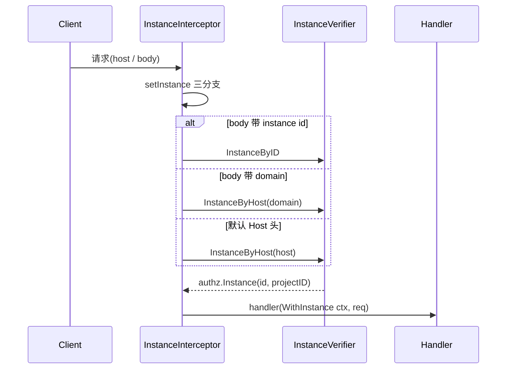
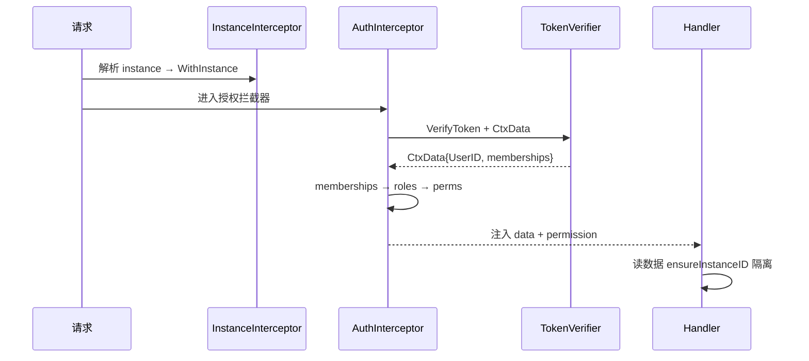

# ZITADEL 多租户隔离（Multi-Tenancy）

> 关注面：Instance 做租户单元、`instance_id` 行级隔离、四层模型、授权模型本质。
> 所有 `文件:行号` 以本地源码 `/Users/morehao/Documents/study/auth/zitadel` 为根，经程序重定位校验。

## 一句话根因 / 根因锚定

ZITADEL 选择「**单数据库 + 单 schema + 贯穿一切的 `instance_id` 数据列**」隔离租户，而非为每个租户开独立 schema / 独立数据库。因为事件溯源架构里每个 Aggregate 都天然带 InstanceID，租户隔离不再是「数据库对象层面」的问题，而是「每一行事件、每一条投影记录都必须带 instance_id 且查询时自动过滤」的数据模型约定——这让租户单元能上移到基础设施粒度，同时只维护一套 schema、零 DDL 加租户。

每个 Aggregate 创建时从 context 注入当前实例 id：

[internal/eventstore/aggregate.go:18-27]() 所有 Aggregate 创建时从 ctx 写入 InstanceID
<!-- anchor: opts ...aggregateOpt, ... Version:       version, -->

## 四层模型的语义边界

`System → Instance → Organization → Project → Application`

- **System**：唯一全局边界，ZITADEL 主进程本身、系统级 feature/权限映射属于这里，也是启动时唯一「无 instance」的上下文。
- **Instance**：租户单元，也是所有投影表与事件表共享 `instance_id` 的第一层。instance 聚合落库后由投影物化，作为 `InstanceByHost`/`InstanceByID` 的查询依据。
- **Organization → Project → Application**：通常的 IAM 三层业务语义，但**同样隶属于某个 instance**。instance 到默认 org / IAM project 的关系通过 `default_org_id`、`iam_project_id` 固化在实例投影里。

## instance 如何从每次请求中被解析

入口是 gRPC/HTTP 的 `InstanceInterceptor`，它把请求（URL host 或 body 里的 instance id/domain）解析成 `authz.Instance`，再用 `WithInstance` 写进 context；后续所有层（command、eventstore、query）只认 `authz.GetInstance(ctx)`。

context 写入与读取的核心对：

[internal/api/authz/instance.go:134-138]() WithInstance 写入 context 并埋点 instance id
<!-- anchor: func WithInstance(ctx context.Context, instance Instance) context.Context { ... return context.WithValue(ctx, instanceKey, instance) -->
[internal/api/authz/instance.go:123-129]() GetInstance 从 context 取当前实例（无则空）
<!-- anchor: func GetInstance(ctx context.Context) Instance { ... return instance -->

## instance_id 写读两侧隔离

### 写侧：创建 Aggregate 时从 context 取 instance

写事件时，事务带**实例级 advisory 共享锁**（同实例并发写串行读、不同实例并行），并把含 instance_id 的 command 交给 `eventstore.push()`：

[internal/eventstore/v3/push.go:48-50]() 实例级共享 advisory 锁保护读一致性
<!-- anchor: _, err = tx.Exec(ctx, "SELECT pg_advisory_xact_lock_shared('eventstore.events2': ... return nil, err -->

### 读侧：eventstore 自动补 instance 过滤

`SearchQueryBuilder` 在真正执行 SQL 前调用 `ensureInstanceID`，把当前 ctx 实例 id 注入查询条件——把「漏过滤」从开发者责任变成框架默认行为：

[internal/eventstore/search_query.go:99-104]() 查询构造器内置 ensureInstanceID 自动补租户过滤
<!-- anchor: // ensureInstanceID makes sure that the instance id is always set ... b.InstanceID(authz.GetInstance(ctx).InstanceID()) -->

### 关系投影同样的 instance_id 原则

投影 handler 读事件时同样先取当前 instance，投影表每行以 `instance_id` 参与主键，保证「一层 instance 写」→「所有投影按 instance 聚合」。

## per-instance 配置边界

Instance 不只是数据分区，还承载整套**租户级配置**：默认语言、管理控制台 client/app、可用语言、安全策略 allowed origins、限额、审计保留、feature 开关、执行路由。`authz.Instance` 接口把这些作为请求可用的「实例快照」暴露：

[internal/api/authz/instance.go:19-39]() Instance 接口：InstanceID/ProjectID/DefaultLanguage/Features 等快照
<!-- anchor: type Instance interface { ... ExecutionRouter() target.Router -->

查询侧解析实例时把各类投影按 instance 横向联结（features/security_policies/limits 全部以 instance_id 关联）；instance 域名也是租户级配置，`SetPrimaryInstanceDomain` 决定该租户域名入口。

## 授权模型本质：project grant + 角色，而非传统菜单 RBAC

ZITADEL 的授权核心不是「菜单/操作列表 + 全局角色」，而是**成员关系(membership) × 角色(role) × 上下文ID(ctxID)** 三要素：

1. 用户通过成员关系获得角色列表，角色再映射成权限——**关键技巧**：权限会附带上下文 id（`project.write:123`），表示「这个权限只在 org/project 123 内生效」：

[internal/api/authz/permissions.go:120-125]() 权限追加上下文 id 形成作用域化权限
<!-- anchor: func addRoleContextIDToPerm(perm, roleContextID string) string { ... return perm -->

2. 只有 project / project grant 成员才把角色上下文收敛到具体对象 id（跨组织授权靠此实现）。
3. **Project Grant 是跨组织授权的主要载体**：一个 org 把含某 project 的访问权（含角色列表）授给另一 org，且**禁止授给自己**：

[internal/command/project_grant.go:72-76]() project grant 落新事件
<!-- anchor: project.NewGrantAddedEvent(ctx, ... grant.RoleKeys), -->

**为什么非「传统菜单 RBAC」**：权限断言发生在**权限字符串与上下文 id** 的匹配，而非「用户→角色写死在 DB 的权限位」。角色→权限映射盘可随 instance 增减，成员角色滚雪球成带作用域的权限集合，粒度可精确到单个 project/org 资源——这正是多租户下授权不该全局化的原因。

## 请求鉴权时序

## 权衡与对照：隔离粒度对比

| 维度 | ZITADEL Instance | Keycloak Realm | FusionAuth Tenant | Auth0 Tenant |
|---|---|---|---|---|
| 隔离机制 | 单 schema + `instance_id` 行级 | 单库多 schema（realm 独立表） | schema 随 tenant 独立 | 全局多租户表 + auth 层过滤 |
| 隔离强度 | 行级（漏过滤即越权，靠纪律） | schema 硬隔离 | schema 硬隔离 | 依赖查询层过滤 |
| 跨租户配置 | 极强（branding/policy/feature 独立） | realm 内丰富 | tenant schema 独立 | tenant 参数丰富 |
| 迁移/运维 | **一套 schema，新租户零 DDL** | realm 分散易漂移 | DDL 随租户线性增长 | 应用层映射 |
| 最适合 | 规模化多租户 SaaS | 共享实体化边界账号系统 | 强隔离合规、租户少 | 快速接入统一默认值 |

**结论**：ZITADEL 用「全局一套 schema + 每行 instance_id」换**运维极廉 + 配置边界极深**，代价是**数据隔离靠纪律**（每个读路径都要保证 instance 过滤），强隔离合规场景需额外审计。

## 可借鉴的设计杠杆

1. **把租户 id 灌进 Aggregate 构建器**（`NewAggregate` 从 ctx 取 instance）——租户上下文在写层零渗透，业务命令无需感知 instance。
2. **查询构造器内置 `ensureInstanceID` 钩子**——所有读自动带租户过滤，把「漏过滤」从人为责任变框架默认。
3. **权限字符串带作用域 id（`perm:ctxID`）+ role-mapping 配置**——授权从「全局角色位」升级为「角色 × 作用域」，天然支撑跨组织 grant。
4. **instance 元数据投影 + 缓存**（`instances` 投影 + `InstanceVerifier` 缓存）——租户解析不打事件表，用读模型 + 缓存扛高并发首跳。

## 不足 / 风险

1. **隔离强度依赖 SQL 纪律，无硬约束**：任何新查询漏 `ensureInstanceID` 即有跨租户泄露风险，需评审 + 静态检查兜底。
2. **advisory lock 按 instance 粒度**：热租户写入受单实例串行约束，可能成瓶颈。
3. **单表全局化**：所有租户共享 `instances` 投影与 `events2` 事件表，单表膨胀与索引压力随租户数/事件量线性增长。
4. **domain 是租户入口唯一权威**：host→instance 解析失败即 404，多域名/fronting 的 host 归一化边界需小心。
5. **授权落在 ctx context 值里**：内部直接调用绕过拦截器时需自行取 `GetCtxData`/`GetPermission`，易产生授权遗漏。
