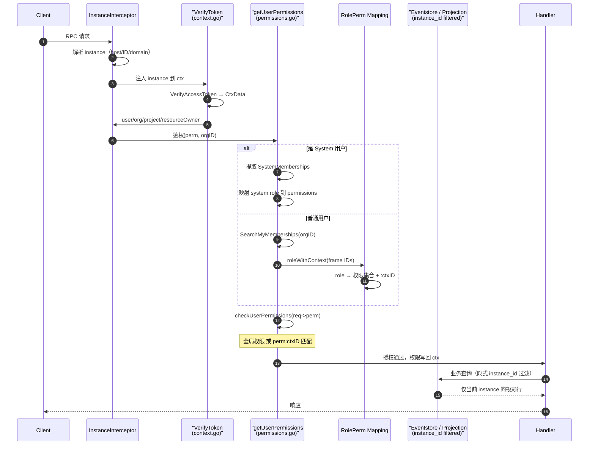

# Zitadel 多租户：System → Instance → Organization → Project → Application 的隔离设计

> 多租户层次、instance_id 数据隔离、token 解析与权限断言、System 级 vs Instance 级 API 边界、授权模型的本质（project grant + 角色，而非传统菜单 RBAC）为本篇主轴。所有论断后的 `[路径:起-止]()` 引用均可点开在 Zitadel 源码仓库下重定位验证。

## 一句话根因

IAM 平台服务的是 SaaS / B2B / 自托管多种客户，它们共享同一套代码库，却必须**互不看见、互不干扰**。Keycloak 用 realm、Auth0 用 account/tenant、Zitadel 选择把"租户"做成一等公民 **Instance**：一个 Instance 是一个**独立运行、独立配置、独立权限体系**的完整最小 IAM 系统，用统一的主键维度 `instance_id` 贯穿所有表与事件，从数据分布到请求鉴权层层隔离。

## 根因锚定：为什么是"Instance"而非"多 schema / 多数据库"

同样是多租户，实现路径差异巨大，Zitadel 选的是**共享库（shared-database / shared-schema）+ 逐行 `instance_id` 打标**，而不是每租户一张 schema 或一个库。这一取舍直接决定后面所有的事：单库意味着能在一处做全局单调的事件序（`position`）、一套迁移、一套投影，运维只面对一个 PostgreSQL；代价是**隔离的物理强度弱于分库**，必须靠应用层在每条查询里强制注入 instance_id，否则就串租户。

这个"应用层强制"不是靠开发者自觉，而是靠 eventstore 读写在**组织切片**上自动补齐。这也是本项目"规则内建、而非约定俗成"的典型体现——隔离策略写进了存储门面，而不是散布在每个业务调用点。

## 核心结构一：四层模型的语义边界

顶层的租户层次是 `System → Instance → Organization → Project → Application`，但它们的角色完全不同，Zitadel 真正的一等租户只有 **Instance**：

- **System**：不是"最大的租户"，而是"运行平台本身"。System API 是**跨所有 Instance** 的管理平面，由独立签名密钥授权（见下）。System 不属于任何 instance 的数据域。
- **Instance**：租户隔离的基本单位，拥有独立的登录策略、品牌、SMTP、OIDC 设定、feature 开关等整套策略栈。一次请求解析出的 instance 决定你"身在哪个系统"。
- **Organization**：Instance 内的组织边界，是**用户、项目、授权等业务对象的资源所有者（resource owner）**。一个 Instance 里可有无限多个 Organization（B2B 客户即一个 Org）。
- **Project**：一个 Org 内的应用集合，Application 挂在 Project 下，token 的签发以 Project 为语义归属。
- **Application**：实际可登录的客户端（OIDC app / machine），绑定 Project。

Instance 是"平台级租户"，Organization 是"业务级租户"——两者的隔离性质不同，但复用同一套 `instance_id` 机制，因为 Organization 本身也带 `instance_id`，其数据必然归属某个 Instance。

```mermaid
graph TB
  subgraph SYSTEM["System（运行平台，跨实例管理平面）"]
    SA["System API<br>独立签名密钥授权"]
  end

  subgraph INST1["Instance A (instance_id = iA)"]
    O1["Org a (resourceOwner)"]
    O2["Org b（B2B 客户）"]
    P1["Project · App1<br>App2"]
    P2["Project · App3"]
    O1 --> P1
    O2 --> P2
    INPOL["登录策略 / 品牌 / SMTP<br>OIDC settings / features<br>per-instance 独立配置"]
  end

  subgraph INST2["Instance B (instance_id = iB)"]
    O3["Org c"]
    P3["Project"]
    O3 --> P3
    INPOL2["另一套独立策略栈"]
  end

  SYSTEM --> INST1
  SYSTEM --> INST2

  style SYSTEM fill:#3a3a5c
  style INST1 fill:#2b3a2b
  style INST2 fill:#2b3a2b
```



**隔离域**：所有在 `INST1` 下的对象（Org/Project/App/用户/事件/投影行）都带 `instance_id = iA`，所有在 `INST2` 下的都带 `instance_id = iB`。System 的 API 在解析出明确 instance 前不落任何 instance 数据域。

## 核心结构二：instance 如何从每次请求中被解析

多租户的隔离前提是"每个请求抵达时，系统先知道你要访问哪个 Instance"。这个解析发生在 gRPC 中间件链**最靠前**的位置——`InstanceInterceptor` 在鉴权之前执行（见下时序），因为后面的 token 校验和 membership 搜索都要以 instance 为准。

`instance_interceptor.go` 的 `setInstance` 有三种解析路径：

1. **请求体的实例参数**：若请求本身就带 `instance.id` 或 `instance.domain`（如 v3 的对象请求、`GetInstance`/`ListInstances` 类），直接按参数解析。
2. **显式 Instance ID 服务白名单**：`idFromRequestsServices` 里列明的服务（`system_pb.SystemService`、`HealthService`）不走 host 推断，而是从请求的 `GetInstanceId()` 取值——这正是 System API "不依赖域名、显式指定 instance" 的设计。
3. **host / domain 推断**（默认分支）：从 HTTP 请求的 hostname/domain 反查 Instance。这也是 SaaS 模式的体验——不同租户访问各自域名，路由到对应 Instance。

[internal/api/grpc/server/middleware/instance_interceptor.go:37-48]() `setInstance` 先尝试请求体实例参数与白名单服务，最后回落到 host 推断，三种路径收敛为把解析出的 instance 注入 ctx。
<!-- snippet: 	for _, service := range idFromRequestsServices {
		if !strings.HasPrefix(service, "/") {
			service = "/" + service
		}
		if strings.HasPrefix(info.FullMethod, service) {
			withInstanceIDProperty, ok := req.(interface {
				GetInstanceId() string
			})
			if !ok {
				return handler(ctx, req)
			}
			return addInstanceByID(interceptorCtx, req, handler, verifier, translator, withInstanceIDProperty.GetInstanceId()) -->

[internal/api/grpc/server/middleware/instance_interceptor.go:93-98]() 默认分支用请求头里的 instanceDomain/requestedDomain 反查 instance，兜不住就 404——多租户路径的第一道关卡。
<!-- snippet: 	requestContext := zitadel_http.DomainContext(ctx)
	if requestContext.InstanceDomain() == "" {
		logging.WithFields("origin", requestContext.Origin(), "externalDomain", externalDomain).Error("unable to set instance")
		return nil, status.Error(codes.NotFound, "no instanceHost specified")
	}
	instance, err := verifier.InstanceByHost(ctx, requestContext.InstanceDomain(), requestContext.RequestedDomain()) -->

解析出的 Instance 以 `WithInstance` 存入 context，后续所有读取（token 校验、membership 搜索）都能用它锁定数据域。

[internal/api/authz/instance.go:123-129]() `GetInstance` 从 ctx 取出 Instance（含 id、feature、management console 配置），供下游做数据域限定。
<!-- snippet: func GetInstance(ctx context.Context) Instance {
	instance, ok := ctx.Value(instanceKey).(Instance)
	if !ok {
		return emptyInstance
	}
	return instance
} -->

## 核心结构三：instance_id 如何在写与读两侧做数据隔离

隔离落实到底，靠的是**每个对象都归属于某个 instance，且读写路径自动带上这个 instance_id**。这是"物理打标 + 应用层强制"的组合。

### 写侧：创建 Aggregate 时从 context 取 instance

事件溯源里，一切状态的源头是 aggregate 上铸造的事件。聚合自带 `InstanceID` 字段，而创建聚合时这个值**默认从当前 context 的 instance 注入**——业务代码无需手动传 instance，写错租户的通道被直接封死。

[internal/eventstore/aggregate.go:23-24]() NewAggregate 同时用 ctx 的 `ResourceOwner`（取 `CtxData.OrgID`）和 `InstanceID`（取 `GetInstance(ctx)`）双标识一个聚合归属；`WithInstanceID`（`internal/eventstore/aggregate.go:45-48`）显式覆盖只留给 System 级这类"明知要跨租户写"的场景。
<!-- snippet: 		ResourceOwner: authz.GetCtxData(ctx).OrgID,
		InstanceID:    authz.GetInstance(ctx).InstanceID(), -->

对应地，`events2` 事件表本身就含 `instance_id` 列，事件与投影都以它为分片键。

[internal/eventstore/repository/sql/postgres.go:114-126]() events2 查询显式带出 `instance_id` 列，事件行天然带租户标记。
<!-- snippet: 	return "SELECT" +
		" created_at" +
		", event_type" +
		`, "sequence"` +
		`, "position"` +
		", payload" +
		", creator" +
		`, "owner"` +
		", instance_id" +
		", aggregate_type" +
		", aggregate_id" +
		", revision" +
		" FROM eventstore.events2" -->

### 读侧：eventstore 自动补 instance 过滤

读路径的隔离更彻底——`ensureInstanceID` 会在**查询本身没指定 instance 时**，自动把 ctx 里的 instance 塞进查询条件 `InstanceID()`。也就是说每个业务查询私下都藏了一个"只读我所在实例"的隐式条件；只有显式查询多个实例（如 System 的 ListInstances）才不受此约束。

[internal/eventstore/search_query.go:100-104]() 兜底注入：查询未显式限定 instance 时，用 ctx 的 instance 补齐，实现"默认只读本实例"。
<!-- snippet: func (b *SearchQueryBuilder) ensureInstanceID(ctx context.Context) {
	if b.instanceID == nil && len(b.instanceIDs) == 0 && authz.GetInstance(ctx).InstanceID() != "" {
		b.InstanceID(authz.GetInstance(ctx).InstanceID())
	}
} -->

连事件并发控制也是按 instance 分片的——`query.go` 在等待未提交事务时，用 `pg_advisory_lock` 的哈希参数锁定 `instance_id`，把并发窗口缩小到单实例，避免跨租户互相阻塞。

[internal/eventstore/repository/sql/query.go:79-88]() 按 instance_id 加 advisory lock：同一 instance 的事件在给定 position 上互斥，不同 instance 互不牵连。
<!-- snippet: 	if q.AwaitOpenTransactions && q.Columns == eventstore.ColumnsEvent {
		instanceID := authz.GetInstance(ctx).InstanceID()
		if q.InstanceID != nil {
			instanceID = q.InstanceID.Value.(string)
		}

		_, err = contextQuerier.ExecContext(ctx,
			"select pg_advisory_lock('eventstore.events2'::REGCLASS::OID::INTEGER, hashtext($1)), pg_advisory_unlock('eventstore.events2'::REGCLASS::OID::INTEGER, hashtext($1))",
			instanceID,
		) -->

### V3 关系投影：同样的 instance_id 原则

双架构迁移后，v3 用面向业务的关系投影表（`organizations`、`administrator_role_permissions` 等）取代部分事件重放。这些关系表同样以 `instance_id` 打标，查询用 `PrimaryKeyCondition(instanceID, orgID)` 组合条件——instance 依然是首要分片键，且 `administrator_role_permissions` 就是"角色 → 权限"的持久化桥梁。

[backend/v3/storage/database/repository/org.go:176-181]() v3 org 主键条件 = instance_id + orgID 组合，instance 领先于 org 过滤，投影层依旧按实例分片。
<!-- snippet: func (o org) PrimaryKeyCondition(instanceID, orgID string) database.Condition {
	return database.And(
		o.InstanceIDCondition(instanceID),
		o.IDCondition(orgID),
	)
} -->

## 核心结构四：per-instance 配置边界

"独立策略 / 独立配置"是多租户的体验层隔离。一个 Instance 不只隔离数据，还隔离整套配置栈。`Instance` 接口把这些 per-instance 配置全部挂在解析出的 instance 上通过 ctx 透传——语言、feature 开关、管理控制台应用、execution 路由都在里面。

[internal/api/authz/instance.go:19-28]() `Instance` 接口把 defaultLanguage / features / management console clientID / execution router 等 per-instance 配置统一暴露给下游。
<!-- snippet: type Instance interface {
	InstanceID() string
	ProjectID() string
	ManagementConsoleClientID() string
	ManagementConsoleApplicationID() string
	DefaultLanguage() language.Tag
	AllowedLanguages() []language.Tag
	DefaultOrganisationID() string
	SecurityPolicyAllowedOrigins() []string
	EnableImpersonation() bool -->

这组"独立策略"从 instance 的**创建**就已经注入：`SetUpInstance` 在造出 instance 的那一刻，连同默认 Org、全套密码/登录/隐私策略、SMTP、OIDC settings、feature、limits 一并初始化。租户一出生就带着自己完整的最小 IAM 配置，而不是后续慢慢补。

[internal/command/instance.go:299-304]() setUpInstance 在 instance aggregate 上挂默认 Org，并初始化 secret generator、密码策略、domain、OIDC settings、features、limits 等整套 per-instance 配置。
<!-- snippet: 	instanceAgg := instance.NewAggregate(setup.zitadel.instanceID)

	validations = setupInstanceElements(instanceAgg, setup)

	// default organization on setup'd instance
	pat, machineKey, loginClientPat, err = setupDefaultOrg(ctx, c, &validations, instanceAgg, setup.Org.Name, setup.Org.Machine, setup.Org.Human, setup.Org.LoginClient, setup.zitadel) -->

## 核心结构五：请求鉴权时序（instance 解析 → 用户校验 → 权限断言 → 数据过滤）

多租户的鉴权链路是一条清晰的**先定"身在哪个世界"、再问"你是谁、你能做什么"** 的管道。中间件链的顺序是关键：`InstanceInterceptor` 必须排在 `AuthorizationInterceptor` 之前。

```
InstanceInterceptor → AccessStorage → ErrorHandler → Limits → AuthorizationInterceptor → Execution → Validation → Service
```

- **InstanceInterceptor**：先解析 instance 注入 ctx（见核心结构二）。
- **AuthorizationInterceptor**：`authorize` 校验 token，解析出请求级身份 `CtxData`（用户、org、project、resource owner），再据此和 instance 里的 membership 判定权限。

[internal/api/grpc/server/server.go:82-86]() 中间件链常数：InstanceInterceptor 在 AuthorizationInterceptor 之前，instance 决议先于鉴权。
<!-- snippet: 				middleware.InstanceInterceptor(queries, externalDomain, translator, system_pb.SystemService_ServiceDesc.ServiceName, healthpb.Health_ServiceDesc.ServiceName),
				middleware.AccessStorageInterceptor(accessSvc),
				middleware.ErrorHandler(),
				middleware.LimitsInterceptor(system_pb.SystemService_ServiceDesc.ServiceName),
				middleware.AuthorizationInterceptor(verifier, systemAuthz, authConfig), -->

`CtxData` 是请求级身份快照：一个 token 解出来后，`UserID / OrgID / ProjectID / ResourceOwner / SystemMemberships` 全塞进 ctx，供后续 API 用它做资源级过滤。

[internal/api/authz/context.go:27-36]() CtxData 承载请求身份：用户、org、project、resourceOwner，以及 System 用户的 memberships，是请求鉴权的数据快照。
<!-- snippet: type CtxData struct {
	UserID                string
	OrgID                 string
	ProjectID             string
	AgentID               string
	PreferredLanguage     string
	ResourceOwner         string
	SystemMemberships     Memberships
	SystemUserPermissions []SystemUserPermissions
} -->



## 核心结构六：授权模型的本质——project grant + 角色，而非传统菜单 RBAC

这是 Zitadel 多租户授权与"普通后台 admin RBAC"最根本的差异，值得单独拆开。

**传统 menu-button RBAC**（多数企业系统）：用户 → 若干固定角色（如"管理员""编辑"），角色 → 一组按钮/菜单可见性，权限判定就是"这个人有没有这个 role 对应的 flag"。角色是**全局固定集合**，不随数据对象变化。

**Zitadel 的授权模型**：权限不是角色名，而是**细粒度 `permission`（如 `project.write`、`user.read`），再叠加 resource 维度**。`roleMappings` 在启动时把"角色"翻译成权限集合，但这个映射只是静态的，真正的动态是**角色作用在哪个对象上**。

关键在 `Membership`：一个用户对某个对象（Org / Project / ProjectGrant / Instance）**持有若干角色**，角色经映射展开成权限后，会带上该对象的 ID 作为上下文后缀——形如 `project.write:` + `ObjectID`。这样：

- 全局权限 `project.write`（无后缀）→ 作用于整个 instance。
- 资源权限 `project.write:123` → 只作用于 project 123。

[internal/api/authz/permissions.go:120-125]() `addRoleContextIDToPerm` 把权限拼成 `perm:ctxID`；而 `roleWithContext`（`internal/api/authz/permissions.go:136-141`）对 Project / ProjectGrant 成员把 ObjectID 作为角色上下文。两者合力实现"同一角色，不同对象，不同生效范围"。
<!-- snippet: func addRoleContextIDToPerm(perm, roleContextID string) string {
	if roleContextID != "" {
		perm = perm + ":" + roleContextID
	}
	return perm
} -->

权限判定时，"有全局权限，或你的某个 `perm:ctxID` 匹配了目标资源"就放行。这就是为什么 Zitadel 授权天然**数据级（resource-scoped）**，而不只是"能进某个页面"。

[internal/api/authz/permissions.go:63-75]() 资源授权：无目标资源放行；有全局权限放行；否则必须存在 `perm:目标资源ID` 才算通过——数据级授权的落地判定。
<!-- snippet: 	if resourceID == "" {
		return nil
	}

	if HasGlobalPermission(userPerms) {
		return nil
	}

	if hasContextResourcePermission(userPerms, resourceID) {
		return nil
	}

	return zerrors.ThrowPermissionDenied(nil, "AUTH-Swrgg2", "No matching permissions found") -->

而"授权"的载体是 **Project Grant**：一个 Org 的成员要对某 Project 有权限，会被授予 (project, grant, role)；`MemberTypeProjectGrant` 正是权限上下文来自 grant 对象而非 project 本身的成员形态。这是跨 org 授权（B2B 场景，客户 org 访问供应商 project）的实现基础。

`Membership` 的类型枚举完整覆盖了按对象授权的全部形态——Org / Project / ProjectGrant / Instance(IAM) / System，每种都决定角色作用在哪个 aggregate 上。

[internal/api/authz/context.go:51-59]() Membership 结构：MemberType 决定角色作用对象（Organization/Project/ProjectGrant/IAM/System），ObjectID 承载子对象上下文，Roles 承载角色集。
<!-- snippet: type Membership struct {
	MemberType  MemberType
	AggregateID string
	InstanceID  string
	// ObjectID differs from aggregate id if object is sub of an aggregate
	ObjectID string

	Roles []string
} -->

**对比结论**：传统 RBAC 是"角色 → 页面按钮"的二维静态授权；Zitadel 是"角色 → 权限集合 × 对象上下文"的三维授权。前者管"能不能点这个按钮"，后者管"能不能动**这个**项目 / 这个 org 的数据"。后者天然支撑多租户里的 B2B 数据边界，但代价是判定更重——每次请求都要查 membership、展开权限、做对象匹配，这也是它需要专门的事件溯源审计与投影缓存的原因之一。

## Instance 级 vs System 级管理 API 的边界

管理能力按"作用域"分成两层，各自的鉴权路径也不同：

- **Instance 级 API**（admin / auth / management）：按 host/domain 解析 instance，用普通 access token 授权，权限在**该 instance 及其 org** 内生效。
- **System 级 API**（`grpc/system`）：`ListInstances` / `AddInstance` / `GetInstance` / `RemoveInstance` / `ListIAMMembers` 等，作用是**跨所有 instance**。它不走 host 推断（前端白名单决定显式 ID），授权用**独立签名的 System token**，且只认 `SYSTEM_OWNER` 等系统级 membership。

System token 的匹配规则严格限制跨租户能力：一个 System 用户只在三种 membership 下匹配当前目标——System 级（全站）、IAM 级且 aggregate == 当前 instance、或 Organization 级且 orgID 匹配。换句话说，**System token 既允许跨 instance 的全站操作，也保留了对特定 instance / org 的定点授权**。

[internal/api/authz/system_token.go:70-76]() System token 验证：仅 System 成员全站匹配；IAM 成员需 aggregateId == 当前 instance；Organization 成员需 orgID 匹配——跨租户与定点授权并存。
<!-- snippet: 	for _, membership := range systemUserMemberships {
		if membership.MemberType == MemberTypeSystem ||
			membership.MemberType == MemberTypeIAM && GetInstance(ctx).InstanceID() == membership.AggregateID ||
			membership.MemberType == MemberTypeOrganization && orgID == membership.AggregateID {
			matchingMemberships = append(matchingMemberships, membership)
		}
	} -->

System 层的实例管理操作集中在 `grpc/system/instance.go`，其 `ListInstance` 等查询直接以 instance 为顶层维度，并在 instance 内部再委托出 org/domain 管理。

[internal/api/grpc/system/instance.go:14-30]() System API 是跨实例管理平面：List/Get/Add/Update/RemoveInstance、ListIAMMembers、域管理，作用域是全站所有 instance。
<!-- snippet: func (s *Server) ListInstances(ctx context.Context, req *system_pb.ListInstancesRequest) (*system_pb.ListInstancesResponse, error) {
	queries, err := ListInstancesRequestToModel(req)
	if err != nil {
		return nil, err
	}

	result, err := s.query.SearchInstances(ctx, queries)
	if err != nil {
		return nil, err
	}
	return &system_pb.ListInstancesResponse{
		Result: instance_grpc.InstancesToPb(result.Instances),
		Details: &object_pb.ListDetails{
			TotalResult: result.Count,
		},
	}, nil
} -->

## 权衡与对照：instance_id 与 Keycloak realm / Auth0 tenant / FusionAuth tenant 的隔离粒度

| 方案 | 隔离单元 | 数据隔离手段 | 配置隔离 | 授权模型 | 典型规模 |
|------|----------|--------------|----------|----------|----------|
| Zitadel | Instance | 单库共享 schema + 逐行 `instance_id` | 独立策略栈（登录/品牌/SMTP/feature） | Project grant + 角色，数据级授权 | 高，README 声称"Infrastructure-level"/High scale |
| Keycloak | Realm | 单库，realm_id 前缀隔离 | 每个 realm 有独立配置 | realm 内角色，跨 realm 弱 | README 标注"Scaling limits" |
| FusionAuth | Tenant | 共享 schema + tenant id | 每 tenant 独立 | 每 tenant 管理员 | 中 |
| Auth0/Okta | Account/Tenant | 平台级分租户，租户即账号 | 每 account 独立 | 平台级 | 中，且闭源 |

**为什么 Zitadel 敢用"单库 + 共享 schema"扛高规模？** 因为它的隔离不只是 SQL WHERE，而是把 instance 作为**贯穿写读的事件/投影分片**：写侧聚合自带 instance，读侧查询自动补 instance 条件，连并发锁都按 instance 分片。这让"隔离"从"别忘了加条件"变成"不写条件也隔离"。反观 Keycloak 的 realm 更多停留在逻辑命名空间 + 部分前缀，物理到查询构造层没有这么强的统一强制，容易在复杂查询里漏。

**但共享 schema 是代价清晰的取舍**：单库扛不住个别租户的极端写入放大、审计与重放的隔离是逻辑而非物理、租户间无法共用独立的连接/缓存/扩容单元。若未来要物理隔离，`instance_id` 的分片键设计让"把某几个 instance 挪到独立库/独立 schema"成为可演进的迁移，而不是推倒重来。

## 可借鉴的设计杠杆

1. **把租户隔离写进存储门面，而非外挂在业务调用点**：`ensureInstanceID` 与聚合默认 instance 注入，让"漏加租户条件"在编译器/框架层就不可能发生（`eventstore/search_query.go:100`、`eventstore/aggregate.go:24`）。
2. **权限 = 细粒度 permission × 对象上下文**：`perm:ctxID` 后缀让一套静态角色映射天然支持数据级授权，B2B 跨 org 授权不需为每个 object 新建角色（`permissions.go:120-125`）。
3. **解析 instance 的三种路径（显式 ID / 白名单 / host）收敛到一个 ctx**：多协议（gRPC 显式 ID + HTTP host）统一身份，System 与 Instance 两套入口共用同一注入点（`instance_interceptor.go:37-48`）。
4. **System 层与 Instance 层鉴权分离**：跨租户管理用独立签名 token + 严格 membership 匹配，既给全站能力又保留定点授权，安全边界清晰（`system_token.go:70-76`）。

## 不足与风险

- **隔离物理强度最弱**：共享库 + 共享 schema，任一 bug 漏了 instance 条件即串租户；依赖 `ensureInstanceID` 的应用层兜底，无法抵御"刻意构造了跨实例查询"的误用。
- **member 类型与 role 映射的二维爆炸**：权限判定需实时查 membership + 展开 roleMappings，高频请求依赖投影缓存，内存/时延成本随 org × project 规模上升。
- **v3 投影仍逐表 instance_id**：迁移路径上需保证每张新关系表都带实例列，新增业务表若忽略 this 约束会静默破坏隔离。
