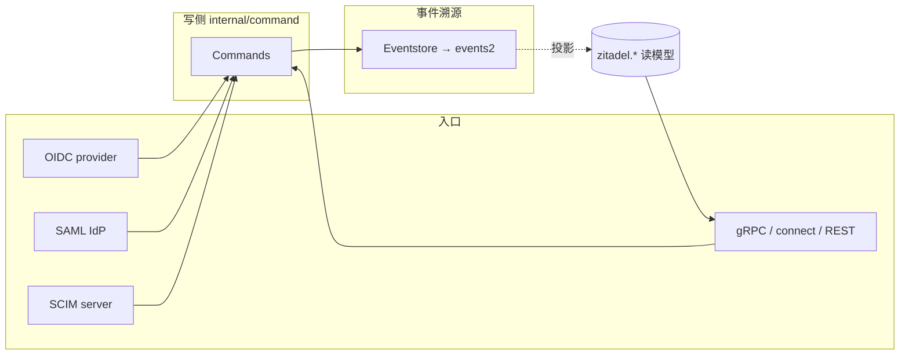

# ZITADEL 协议层与 API 面

> 关注面：API-first 三态架构（gRPC/connectRPC/REST 同源）、OIDC Provider、SAML/SCIM 形态、事件溯源写侧契约。
> 所有 `文件:行号` 以本地源码 `/Users/morehao/Documents/study/auth/zitadel` 为根，经程序重定位校验。

## 根因

ZITADEL 想做的不是「一套 gRPC API + 一个网页登录」，而是让**同一份领域协议在 gRPC、connectRPC、HTTP/JSON 三个形态下可访问**，同时把 OIDC/SAML/SCIM 三种标准接口统一接到同一套事件溯源写侧——这样「API 用户」与「协议用户」看到的是同一份资源与操作。

## API-first 三态架构：一份 Protobuf，三种形态

**协议定义只有一份，但代码生成同时产出 gRPC stub、connect-go stub、grpc-gateway REST 映射**。`buf.gen.yaml` 是所有形态同源的根：

- `plugin: go` → message 类型
- `plugin: go-grpc` → 传统 gRPC 服务 stub
- `plugin: connect-go` → connectRPC 服务 stub
- `plugin: grpc-gateway` → REST ↔ gRPC 的 HTTP 代理路由
- `plugin: openapiv2` → OpenAPI 文档

[buf.gen.yaml:5-6]() go-grpc 生成传统 gRPC stub
<!-- anchor: - plugin: go-grpc ... out: .artifacts/grpc -->
[buf.gen.yaml:7-9]() grpc-gateway 生成 REST 路由 + grpc 代理
<!-- anchor: - plugin: grpc-gateway ... out: .artifacts/grpc -->
[buf.gen.yaml:22-23]() connect-go 生成 connectRPC stub
<!-- anchor: - plugin: connect-go ... out: .artifacts/grpc -->

### 三态如何在一个进程里装起来

`internal/api/api.go` 的 `API` 结构同时持有：传统 gRPC server（`grpcServer`）、grpc-gateway 客户端连接（`grpcGateway`）、connect 处理器登记表（`connectServices`）：

[internal/api/api.go:41-61]() API 结构同时持有 gRPC server、gateway 连接、connect 服务表
<!-- anchor: type API struct { ... httpClient                *http.Client -->

connect 处理器经 `RegisterService` 判断实现类型：若实现了 `server.ConnectServer` 则调 `registerConnectServer`，把 connect 中间件链（instance 解析、auth、metrics、otel 等）挂到一个 `connect.NewHandler` 上、注册到路由前缀：

[internal/api/api.go:193-211]() RegisterService 分派：ConnectServer 则走 connect 注册
<!-- anchor: func (a *API) RegisterService(ctx context.Context, srv server.Server) error { ... func (a *API) registerConnectServer(service server.ConnectServer) { -->

connect 中间件链与 gRPC 拦截器地位对等，独立实现 HTTP 形态的鉴权/实例解析：

[internal/api/grpc/server/connect_middleware/instance_interceptor.go:86-107]() connect 独立 instance/host 解析中间件
<!-- anchor: return nil, connect.NewError(connect.Code(code), fmt.Errorf("unable to set insta -->

### 三态同源的工程取舍

**利**：一份 `.proto` 一份业务语义，三形态零漂移；gRPC 给服务端、connectRPC 给浏览器/现代客户端、REST 给通用 HTTP 生态。
**弊**：一套语义三套运行时 + 三套中间件（gRPC 拦截器 vs connect 中间件），需双份测试与行为对齐；connect 中间件与 gRPC 拦截器演进需同步。

## OIDC Provider 实现要点

`internal/api/oidc/` 是 OIDC OP 核心，含 `server.go`/`op.go` 装配与各端点文件（`authorize`/`token_code`/`token_refresh`/`token_device`/`introspect`/`client_credentials`/`userinfo`/`jwks`）：

- **Authorize**：兼容 handler 分发到 v1 / Login V2，创建 AuthRequest 后重定向登录 UI。
- **Token 端点**：`token_code.go`（Authorization Code + PKCE）、`token_refresh.go`（refresh rotation）、`token_client_credentials.go`（客户端凭据）、`token_device.go`（Device Flow）。
- **userinfo / jwks**：`userinfo.go` 也承接 Execution function 节点做 token 富化。

OIDC Session 分 v1/v2 两代演进（`internal/api/oidc` 与 `internal/api/grpc/oidc/v2`），v2 统一承载 Session 状态机，v1 兼容旧流程。

**认证核心承接**：OIDC 端只做「把已通过因子集合翻译成 token」，真正认证在 Session 状态机（见 [`auth-flow.md`](auth-flow.md)）。

## SAML / SCIM 形态

- **SAML**（`internal/api/saml/`）：**Identity Provider** 角色——暴露 `/saml/v2/metadata`、`/saml/v2/certificate`、`/saml/v2/SSO`，对下游应用签发断言（依赖 `github.com/zitadel/saml/pkg/provider`），元数据与受信 ServiceProvider 登记在此管理，认证结果同样经 AuthRequest/Session 落到写侧。**另一角色同时存在**：`internal/idp/providers/saml/` 让 ZITADEL 以 **Service Provider** 身份接入外部的上游 SAML IdP。两者是不同目录、不同方向。
- **SCIM**（`internal/api/scim/`）：SCIM 2.0 server，用户跨域身份管理（当前仅 User 资源，无 Group 接口），写侧同样走 command。

## 协议端如何连接事件溯源写侧

所有协议端（OIDC/SAML/SCIM）与 API（gRPC/connect/REST）最终都收敛到 `internal/command` 的 Commands 门面，构造 Command → `Eventstore.Push` → 事件。读侧由投影折算关系表给 API 直读。这是「write side everything is event, read side everything is projection」的统一契约（见 [`architecture.md`](architecture.md)）。

## 设计决策：Why / 权衡

- **为何三态同源**：保证 gRPC 与 REST 行为完全一致，降低「API 用户与协议用户看到不同行为」的风险；用代码生成替代手写翻译。
- **为何 connectRPC**：浏览器友好（原生 HTTP/1.1 + JSON/Protobuf 双编码）、TypeScript 一等公民，与 gRPC HTTP/2 三态互补。
- **版本化 API 策略**：`proto/zitadel/<api>/v[N]` 目录，v2/v3 并存，向后兼容演进（Session V1/V2 即一例）。

## 不足 / 风险

- **三套中间件双份维护**：gRPC 拦截器 + connect 中间件行为需对齐，是持续成本。
- **协议复杂度高**：OIDC 各 flow（implicit/device/refresh rotation）+ SAML 元数据 + SCIM 全量实现，测试面大、回归风险高。

## 结语

ZITADEL 的 API 面是「一套领域模型、三态暴露、多标准协议统一写侧」的工程示范。它把「协议翻译」下沉为薄壳，把「身份真相」收敛到事件溯源写侧，从而让 gRPC 用户、OIDC RP、SAML SP、SCIM 客户看到的都是同一份、可审计、可投影的身份事实——这与 README 主打的「API-first」卖点完全吻合。
