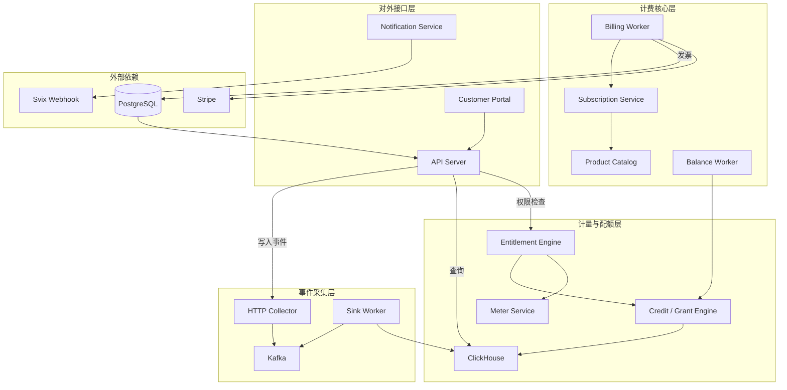
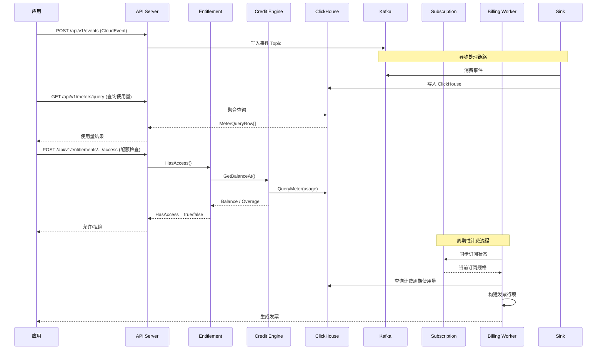

# OpenMeter — 使用量计量与计费平台深度解读

> 项目地址：[openmeterio/openmeter](https://github.com/openmeterio/openmeter) | 协议：Apache-2.0 | 语言：Go
>
> 官网：[https://openmeter.io](https://openmeter.io)

## 第一部分：快速概览

### 是什么

OpenMeter 是一个面向 AI 和 DevTool 公司的**开源使用量计量与计费平台**（Usage Metering & Billing）。它从事件流中实时聚合使用量数据，驱动基于计量的定价、预付积分消耗、配额限制执行和自动化发票生成。

核心能力覆盖了从**事件采集 → 使用量计量 → 配额执行 → 积分管理 → 产品目录 → 订阅管理 → 发票生成 → 支付**的完整商业化闭环。

### 解决什么根本问题

SaaS 和 AI 产品的商业化面临一个根本性难题：**基于使用量的计费（Usage-Based Billing, UBB）在工程上极其复杂**。构建一套 UBB 系统需要解决：

- **事件管道** — 接收海量使用事件（API 调用、token 消耗、GPU 时长），做去重、缓冲、持久化
- **实时聚合** — 对不同维度（时间窗口、客户、模型）做 SUM/COUNT/AVG/MIN/MAX 等聚合
- **配额执行** — 在 API 调用路径上做实时余额检查，决定允许/拒绝
- **积分管理** — 支持付费积分、促销积分的多优先级消耗、过期、按比例回滚
- **定价引擎** — 层级定价、阶梯定价、固定费用、按比例分配、中期变更
- **订阅与产品目录** — 套餐定义、附加组件、变更管理、计费锚点
- **发票生命周期** — 从草稿到收款、逾期、核销的全状态机管理
- **多服务编排** — 多个 Worker 协同工作（计费、余额、通知、事件下沉）

OpenMeter 的价值在于**将这些能力打包为一个可自托管的平台**，让产品团队无需从零构建 UBB 基础设施。

### 适用场景

- AI API 供应商 — 按 token 计费，按模型定价，实时配额检查
- DevTool / PaaS 平台 — 按 API 调用量、存储量、计算资源计费
- SaaS 产品 — 层级套餐 + 使用量超额计费
- 内部成本核算 — 跨团队按使用量分摊云成本

### 核心能力一览

| 能力 | 说明 |
|---|---|
| **事件采集** | CloudEvents 格式，通过 Kafka / HTTP 摄入，内置去重 |
| **实时计量** | SUM / COUNT / AVG / MIN / MAX / UNIQUE_COUNT / LATEST 聚合，ClickHouse 查询 |
| **配额执行** | Metered / Boolean / Static 三类 Entitlement，硬限制/软限制 |
| **预付积分** | 多优先级消耗、过期、按周期滚存、透支管理 |
| **产品目录** | Plan / Phase / RateCard 模型，支持套餐和附加组件 |
| **订阅管理** | 创建/变更/取消/续期，Patch 系统处理中期变更，同步算法保持一致性 |
| **发票引擎** | 完整状态机：草稿→收集→验证→同步→审批→发出→支付→逾期/核销 |
| **多 Worker** | billing-worker / balance-worker / sink-worker / notification-service |

### 技术栈

| 层级 | 技术 |
|------|------|
| **语言** | Go 1.25 |
| **主数据库** | PostgreSQL（Ent ORM + Atlas 迁移） |
| **分析引擎** | ClickHouse（实时聚合查询） |
| **消息队列** | Kafka（confluent-kafka-go + Watermill） |
| **API 定义** | TypeSpec → OpenAPI（codegen） |
| **HTTP 框架** | Chi v5 + oapi-codegen |
| **依赖注入** | Google Wire |
| **发票格式** | GOBL（通用商业语言） |
| **Webhook** | Svix |
| **观测性** | OpenTelemetry（logs, metrics, traces） |
| **支付** | Stripe |
| **测试** | Testify + pgtestdb |

---

## 第二部分：架构深读

### 架构总览

OpenMeter 采用**多服务 + 事件驱动**架构。核心是 6 个独立可执行的服务，围绕 Kafka 和 ClickHouse 协同工作：



### 核心请求链路：一次 API 调用的计费流程



### 服务职责划分

| 服务 | 入口 | 职责 |
|------|------|------|
| **server** | `cmd/server/main.go` | HTTP API 网关，处理所有用户请求 |
| **sink-worker** | `cmd/sink-worker/` | 消费 Kafka 事件写入 ClickHouse |
| **balance-worker** | `cmd/balance-worker/` | 周期性重置余额快照、处理积分过期 |
| **billing-worker** | `cmd/billing-worker/` | 发票生命周期管理、订阅同步 |
| **notification-service** | `cmd/notification-service/` | 通知分发、Webhook 投递 |
| **jobs** | `cmd/jobs/` | 批处理任务 |

### 模块职责划分

核心业务逻辑集中在 `openmeter/` 目录，按领域分包：

| 包 | 职责 |
|-----|--------|
| `billing/` | 计费引擎：发票生命周期、费用计算、折扣、信用授予 |
| `credit/` | 预付积分管理：Grant 的多优先级消耗、过期、滚存 |
| `entitlement/` | 授权引擎：Metered / Boolean / Static 三种类型 |
| `meter/` | 指标定义：聚合方式、时间窗口、分组 |
| `meterevent/` | 计量事件处理 |
| `subscription/` | 订阅管理：同步算法、Patch 系统、附加组件 |
| `productcatalog/` | 产品目录：Plan、Phase、RateCard 定义 |
| `customer/` | 客户管理 |
| `notification/` | 通知管道：Kafka → Svix |
| `ledger/` | 账本系统：账户、交易、条目 |

### 应用启动流程

`cmd/server/main.go` 的启动流程是理解整个项目如何组装的关键（简化）：

```
main()
  ├── 解析配置 (Viper)
  ├── 初始化 Logger (slog)
  ├── 初始化 OTel (OpenTelemetry)
  ├── 连接 PostgreSQL
  │   ├── autoMigrate = "ent" → 运行 Ent 迁移
  │   └── autoMigrate = "migration" → 运行 golang-migrate
  ├── 连接 Kafka (confluent-kafka-go)
  ├── 连接 ClickHouse
  ├── Wire 编译 → 注入所有依赖 (app/common/wire.go)
  │   ├── 注册 Repository (Ent adapter)
  │   ├── 注册 Service (业务逻辑层)
  │   ├── 注册 HTTP Handler (Chi router)
  │   └── 注册 Worker (后台任务)
  ├── 初始化默认命名空间 (initNamespace)
  └── 启动 HTTP 服务器
```

依赖注入使用 Google Wire，在 `app/common/wire.go` 中定义 provider 集合，通过 `wire_gen.go` 生成实际的组装代码。

---

## 第三部分：核心实现详解

### 3.1 事件采集与实时计量

OpenMeter 以 **CloudEvents** 格式接收使用事件。事件通过 HTTP API 接收后写入 Kafka Topic，然后由 `sink-worker` 消费并写入 ClickHouse。

**计量定义** (`openmeter/meter/meter.go:162-173`)：

```go
type Meter struct {
    models.ManagedResource
    Key           string            // 唯一标识
    Aggregation   MeterAggregation  // SUM / COUNT / AVG / MIN / MAX / UNIQUE_COUNT / LATEST
    EventType     string            // 监听的事件类型
    ValueProperty *string           // JSONPath 到数值字段（如 "$.duration"）
    GroupBy       map[string]string // GroupBy key → JSONPath 映射
}
```

ClickHouse 的聚合查询在 `openmeter/streaming/clickhouse/` 中实现。Meter 定义会被翻译为 ClickHouse SQL，支持 `WindowSize`（SECOND / MINUTE / HOUR / DAY / MONTH）的时间窗口分组。

### 3.2 Entitlement 系统：配额检查的核心

Entitlement 是 OpenMeter 中控制**谁可以用多少**的关键机制，定义了三种类型（`openmeter/entitlement/entitlement.go:322-329`）：

| 类型 | 说明 | HasAccess |
|------|------|-----------|
| **Boolean** | 功能开关，有/无 | 总是 true |
| **Static** | 静态配置，应用自行解释 JSON Config | 总是 true |
| **Metered** | 基于使用量和余额的配额控制 | Balance > 0（硬限制）或 always true（软限制） |

Metered Entitlement 是核心。它的 `HasAccess()` 逻辑（`openmeter/entitlement/metered/connector.go:60-65`）：

```go
func (m *MeteredEntitlementValue) HasAccess() bool {
    if m.isSoftLimit {
        return true
    }
    return m.Balance > 0
}
```

Balance 的计算委托给 **Credit Engine**，后者从 ClickHouse 查询使用量，按照 Grant 优先级逐层消耗。

### 3.3 Credit Engine：多优先级积分消耗引擎

Credit Engine 是 OpenMeter 中最精妙的部分，实现了一个**基于事件的 grant 消耗模拟器**。

**Grant 模型**（`openmeter/credit/grant/grant.go:14-60`）：

| 字段 | 说明 |
|------|------|
| `Amount` | 积分数量 |
| `Priority` | 消耗优先级（数值越小优先级越高） |
| `EffectiveAt` | 生效时间 |
| `Expiration` | 过期配置（HOUR/DAY/WEEK/MONTH/YEAR + 数量） |
| `ResetMaxRollover` / `ResetMinRollover` | 周期重置时的滚存上下限 |
| `Recurrence` | 周期性自动充值 |

**消耗逻辑**（`openmeter/credit/engine/run.go:273-311`）在 `burnDownGrants()` 中实现：

1. 将时间线按 grant 变动事件分为多个 **Burn Phase**
2. 在每个 phase 内，按优先级排序 grants（数值小优先，同优先级先到期的优先）
3. 从最高优先级的 grant 开始消耗，消耗完则进入下一个
4. 所有 grant 消耗完后的用量变为 **Overage**

详细的 Grant Burn Down History 记录每个 phase 内每个 grant 的消耗明细（`openmeter/credit/engine/history.go:54-62`）。

### 3.4 订阅管理：Sync 算法与 Patch 系统

订阅管理是 OpenMeter 中复杂度最高的模块之一。核心挑战是：**Plan 变更时如何增量同步订阅状态**。

**Sync 算法**（`openmeter/subscription/service/sync.go:28-349`）分三步：


三步算法保证了订阅状态与规格（`SubscriptionSpec`）始终一致，同时支持审计追踪（依赖 `SpecPath` 追踪哪些路径被修改）。

**Patch 系统**定义了 5 种变更操作：

| Patch | 说明 |
|-------|------|
| `AddItem` | 向阶段添加费率卡 |
| `RemoveItem` | 移除指定费率卡 |
| `AddPhase` | 添加新阶段，自动推移后续阶段 |
| `RemovePhase` | 移除阶段，支持上移或下移填补空隙 |
| `StretchPhase` | 拉伸/压缩阶段持续时间 |

中期变更（upgrade/downgrade）通过 `Cancel + Create` 模式实现：使用 `SpecPath` 携带"延续引用"，将旧订阅的超期信息传递给新订阅，实现按比例计费。

### 3.5 发票生命周期状态机

发票状态机是 OpenMeter 中最详细的状态实现，使用 `stateless` 库编排（`openmeter/billing/service/stdinvoicestate.go:42-345`）。

**完整状态流转**：

```
gathering (收集行项，每个客户每种货币一个)
  ↓ [创建标准发票]
draft.created → draft.waiting_for_collection → draft.collecting
  → draft.validating → draft.syncing
  → draft.manual_approval_needed / draft.waiting_auto_approval
  → draft.ready_to_issue
  ↓
issuing.syncing → issuing.charge_booking → issued
  ↓
payment_processing.pending → ... 多种支付状态 ...
  → paid
  → overdue / uncollectible / voided
```

每个状态都有对应的回调函数（`standinvoicestate.go` 中的 callbacks）：

| 回调 | 触发时机 | 行为 |
|------|----------|------|
| `calculateInvoice` | 所有 draft 状态入口 | 重新计算费用明细 |
| `validateDraftInvoice` | validating | 运行验证规则 |
| `onCollectionCompleted` | collecting | 标记费用为"已收集" |
| `onInvoiceIssued` | issuing.charge_booking | 记入总账 |
| `onPaymentAuthorized` | booking_authorized | 确认支付授权 |
| `onPaymentSettled` | booking_settled | 确认支付完成 |

**设计关键**：状态机通过 `AdvanceUntilStateStable` 方法循环触发 `TriggerNext`，直到到达一个不能自动推进的状态（如需要人工审批、等待同步完成）。这种设计使得状态推进对调用方透明。

### 3.6 Line Engine 体系

Line Engine 是 OpenMeter 计费体系中的**可插拔费用计算引擎**（`openmeter/billing/lineengine.go:48-81`）：

```go
type LineEngineType string
const (
    LineEngineTypeInvoice              = "invoicing"           // 默认发票引擎
    LineEngineTypeChargeFlatFee        = "charge_flatfee"      // 固定费用
    LineEngineTypeChargeUsageBased     = "charge_usagebased"   // 按使用量计费
    LineEngineTypeChargeCreditPurchase = "charge_creditpurchase" // 积分购买
)
```

每个引擎实现 `LineEngine` 接口，提供完整的生命周期回调：

- `BuildStandardInvoiceLines` — 将 gathering lines 物化为标准发票行
- `IsLineBillableAsOf` — 判断行项是否可计入当前发票
- `SplitGatheringLine` — 按比例拆分（progressive billing）
- `OnInvoiceIssued` / `OnPaymentAuthorized` / `OnPaymentSettled` — 生命周期事件

这种设计将**费用类型**与**发票管理**解耦，新增费用类型只需注册新的 Line Engine。

---

## 第四部分：设计模式与工程实践

### 4.1 Union Type 模式

OpenMeter 大量使用 **Union Type**（或称为"内部联合"）模式来处理多态实体。例如 `Invoice` 和 `InvoiceLine`：

```go
// openmeter/billing/invoice.go:96-100
type Invoice struct {
    t                InvoiceType
    standardInvoice  *StandardInvoice
    gatheringInvoice *GatheringInvoice
}
```

每个 Union Type 通过一个类型标识符和方法将操作分发给具体的实现。这种模式在 Go 中替代了继承/接口多态，类型安全且便于序列化。

### 4.2 事件驱动 + 领域事件

系统各模块之间通过**领域事件**（domain events）通信，而非直接调用。每个领域包都定义了事件类型：

- `customer/event.go` — `CustomerCreateEvent`, `CustomerUpdateEvent`, `CustomerDeleteEvent`
- `entitlement/metered/events.go` — `EntitlementResetEventV3`
- `credit/grant/events.go` — `GrantCreatedEvent`, `GrantVoidedEvent`
- `subscription/events.go` — `CreatedEvent`, `UpdatedEvent`, `CancelledEvent`

事件通过 Watermill 发布到 Kafka，实现服务间的松耦合。例如 `balance-worker` 监听 Grant 变更事件来更新余额快照，`billing-worker` 监听 Entitlement 重置事件来驱动计费周期。

### 4.3 Service + Adapter 分层

每个领域包遵循清晰的 `service` + `adapter` 分层：

```
openmeter/billing/
├── service.go          # Service 接口定义
├── adapter.go          # Adapter 接口定义
├── service/            # Service 实现（业务逻辑 + 编排）
├── adapter/            # Adapter 实现（Ent ORM 数据访问）
└── ...                 # 领域模型
```

Service 层只依赖接口，Adapter 层实现数据持久化。依赖通过 Google Wire 注入。这种模式使得业务逻辑可测试（mock adapter）且持久化层可替换。

### 4.4 乐观并发控制

计费操作使用客户级别的乐观锁（`openmeter/billing/service/service.go:168`）：

```go
func transactionForInvoiceManipulation(...) {
    // 1. Upsert 客户锁记录
    // 2. SELECT ... FOR UPDATE 锁定客户行
    // 3. 在事务内执行业务逻辑
}
```

这种设计避免了多 Worker 同时处理同一客户的发票时产生竞态条件，同时粒度比表级锁更细。

### 4.5 按时间线的数据结构

Credit Engine 和 Subscription Addon 都使用 `timeutil.Timeline[T]` 这种**时间线数据结构**来表示随时间变化的状态：

- Grant 变更按时间分割为 Burn Phases
- Addon 数量变更按时间记录在 Timeline 中
- 余额快照按时间点缓存，从最近快照往前计算

这种数据结构非常适合于需要**审计追溯**和**按时间点查询**的计费场景。

---

## 第五部分：部署与可观测

### 部署方式

OpenMeter 通过 Docker Compose 本地开发和 Helm Chart 生产部署。核心依赖：

```
必备: PostgreSQL + Kafka + ClickHouse
可选: Redis (Svix 用于 Webhook 去重)
```

### 配置管理

使用 **Viper** 加载配置，默认从 `config.yaml` 读取。关键配置项：

| 配置 | 说明 |
|------|------|
| `postgres.url` | PostgreSQL 连接串 |
| `postgres.autoMigrate` | 自动迁移模式（ent / migration / none） |
| `ingest.kafka.brokers` | Kafka 地址 |
| `aggregation.clickhouse` | ClickHouse 连接 |

### 可观测性

- **日志**：slog（Go 1.21 结构化日志）
- **指标**：OpenTelemetry metrics
- **追踪**：OpenTelemetry traces
- **健康检查**：HTTP `/healthz` 端点

---

## 第六部分：测试策略

### 测试层级

| 层级 | 方式 | 工具 |
|------|------|------|
| 单元测试 | Mock adapter，测试 service 逻辑 | testify |
| 集成测试 | 启动 PostgreSQL 容器，测试 adapter | pgtestdb |
| E2E 测试 | 启动完整服务栈，HTTP 接口测试 | test suite |
| 生命周期测试 | 测试完整的计费生命周期 | BaseSuite |

### 测试原则

- 测试需要 `POSTGRES_HOST=127.0.0.1` 环境变量
- 使用 `-tags=dynamic` 编译标签（confluent-kafka-go 需要）
- 测试辅助函数与业务逻辑独立，避免 import cycle

---

## 第七部分：同类对比

### vs. Stripe / Chargebee（商业 SaaS）

| 维度 | OpenMeter | Stripe Billing |
|------|-----------|----------------|
| **使用量计量** | 原生支持，ClickHouse 实时聚合 | 不直接支持，需外部系统配合 |
| **配额执行** | 内嵌 Entitlement Engine | 不支持 |
| **部署方式** | 自托管 | SaaS |
| **发票状态机** | 20+ 子状态，完整生命周期 | 较简化的状态模型 |
| **UI 面板** | 无，仅 API | 管理后台完备 |

### vs. Lago（开源竞品）

| 维度 | OpenMeter | Lago |
|------|-----------|------|
| **架构** | Go + ClickHouse + Kafka | Ruby on Rails + PostgreSQL |
| **配额执行** | ✅ 内置 | ❌ 不提供 |
| **实时性** | ClickHouse 物化视图 | 定时聚合 |
| **AI 成本** | 原生 LLM cost tracking | 通用计费 |
| **事件吞吐** | Kafka + ClickHouse，高吞吐 | 单数据库，受限于 Postgres |

### 差异化定位

OpenMeter 的核心差异化在于**将计量（Metering）和计费（Billing）有机整合**，使配额检查、积分消耗、订阅管理、发票生成共用同一套使用量数据。对于需要**实时配额控制**和**复杂积分管理**的 AI / DevTool 产品，这是一个绕不开的能力组合。

---

## 总结

OpenMeter 是一个工程质量极高的 UBB 平台。它的架构设计体现了几个值得学习的理念：

1. **事件驱动的领域分解** — 每个领域独立发布和消费事件，模块间通过 Kafka 解耦
2. **可插拔的计费引擎** — Line Engine 模式让新增费用类型不影响核心状态机
3. **精密的积分消耗算法** — Grant Burn Down 模型支持多优先级、过期、滚存等现实需求
4. **完整的状态机管理** — 发票的 20+ 子状态确保了计费流程的可控性和审计性
5. **TypeSpec 驱动的 API 治理** — API 规范作为唯一真相来源，自动生成 SDK

主要局限：缺乏开箱即用的管理 UI（仅提供客户门户），运维复杂度较高（需要 Kafka + ClickHouse + PostgreSQL 三件套）。
