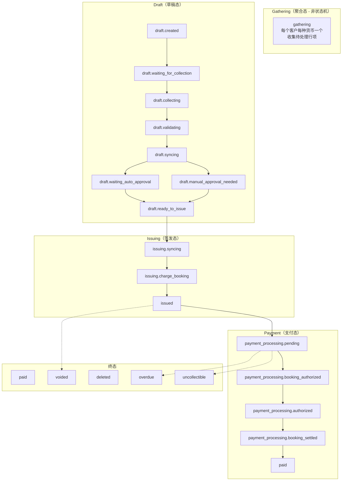
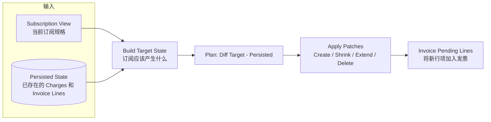
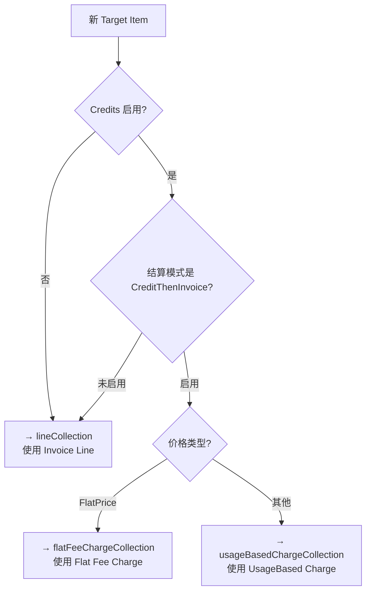

# OpenMeter 计费系统深度解析：内部实现细节

> 本文聚焦于 OpenMeter 计费系统的内部实现原理，包含发票状态机、Credit Engine 消耗算法、订阅同步机制、计价管线、账本系统等核心模块的详细解读。适合需要深入理解计费系统设计与实现的读者。

---

## 目录

1. [概述：三大核心流程](#1-概述三大核心流程)
2. [发票状态机：完整的 Invoice 生命周期](#2-发票状态机完整的-invoice-生命周期)
3. [Credit Engine：多优先级 Grant 消耗算法](#3-credit-engine多优先级-grant-消耗算法)
4. [订阅同步：从 Subscription 到 Invoice 的精确映射](#4-订阅同步从-subscription-到-invoice-的精确映射)
5. [计价管线：从 Price 到 DetailedLine](#5-计价管线从-price-到-detailedline)
6. [账本系统：双重记账的信用追踪](#6-账本系统双重记账的信用追踪)
7. [Worker 架构：事件驱动的异步处理](#7-worker-架构事件驱动的异步处理)
8. [并发控制：防止重复计费](#8-并发控制防止重复计费)
9. [Progressive Billing：中期分割计费](#9-progressive-billing中期分割计费)
10. [FAQ：常见设计问题](#10-faq常见设计问题)

---

## 1. 概述：三大核心流程

OpenMeter 计费系统由三个协同工作的核心流程组成：

### 流程一：事件 → 使用量计量（实时）

```
API Event → Kafka → sink-worker → ClickHouse → Meter Query
```

事件通路是异步的，但 Meter Query（用量查询）是同步的。API 路径上调用 `HasAccess()` 时，会查询 ClickHouse 中的用量数据来做配额判断。

### 流程二：使用量 → 积分消耗（近实时）

```
ClickHouse (用量) + Grant (积分) → Credit Engine (消耗算法) → Balance Snapshot
```

Credit Engine 是一个**确定性的时间线引擎**，将时间线按 Grant 活动事件（生效/过期/递归/删除）分割为 Burn Phase，在每个 Phase 内按优先级逐层消耗 Grant。

### 流程三：积分/费用 → 发票（异步 Worker）

```
Subscription Change → billing-worker → Charges/Gathering Lines → Standard Invoice
                     ↓
               Invoice State Machine (draft → ... → paid/voided)
```

发票从 `gathering` 状态开始收集行项，通过状态机自动推进，直到 `paid` 或 `voided` 终态。

---

## 2. 发票状态机：完整的 Invoice 生命周期

**源码位置：** `openmeter/billing/service/stdinvoicestate.go`（1122 行，完整的状态机实现）

这是整个计费系统中最复杂的状态机，使用 `github.com/qmuntal/stateless` 库实现。

### 2.1 状态分类

发票状态分为 7 个大类，共 20+ 子状态：



### 2.2 状态机的工作机制

状态机通过两个核心方法运作：

#### `AdvanceUntilStateStable()` — 自动推进循环

**源码位置：** `openmeter/billing/service/stdinvoicestate.go:490-542`

```go
func (s *InvoiceStateMachine) AdvanceUntilStateStable(ctx context.Context) error {
    for {
        preAdvanceState := s.Invoice.Status
        canFire, _ := s.StateMachine.CanFire(ctx, TriggerNext)
        if !canFire {
            // 到达稳定状态
            return nil
        }
        // 触发 TriggerNext 推进
        _, err := s.StateMachine.Fire(ctx, TriggerNext)
        // 持久化状态变更
        // 发布 StandardInvoiceUpdatedEvent
        // 继续循环
    }
}
```

**关键设计点：**
- 循环触发 `TriggerNext` 直到抵达一个不能自动推进的状态
- 每次推进后立即持久化（通过 `NeedsDBSave` 标记）
- 推进失败时自动转入 `failed` 子状态

#### `FireAndActivate()` — 单次状态转换

**源码位置：** `openmeter/billing/service/stdinvoicestate.go:564-632`

每次状态转换经历：
1. **Fire** — 执行 trigger，状态机转移到下一状态
2. **OnEntry** — 进入新状态的入口动作（如设置时间戳）
3. **Activate** — 执行状态的激活回调（核心业务逻辑）
4. **OnActive guard** — 守卫条件检查（如"是否已收集完成"）
5. **持久化** — 如果 `NeedsDBSave`，写入数据库

### 2.3 各回调函数详解

每个状态激活时执行的回调函数是发票计算的核心：

| 回调 | 触发状态 | 功能 | 源码行号 |
|------|----------|------|----------|
| `calculateInvoice` | 所有 draft 入口 | 解析 FeatureMeters → 调用 Calculator.Calculate() | `:757-778` |
| `validateDraftInvoice` | validating, updating | 通过 InvoicingApp 验证发票 | `:742-755` |
| `onCollectionCompleted` | collecting | 调用各 LineEngine 的 `OnCollectionCompleted`，快照用量 | `:964-1011` |
| `syncDraftInvoice` | draft.syncing | 通过 InvoicingApp 同步到外部系统 | `:781-804` |
| `finalizeInvoice` | issuing.syncing | 设置 IssuedAt/DueAt，完成签发 | `:807-858` |
| `onInvoiceIssued` | issuing.charge_booking | 通知各 LineEngine 发票已签发 | `:1013-1034` |
| `onPaymentAuthorized` | booking_authorized | 通知 LineEngine 支付已授权 | `:1036-1057` |
| `onPaymentSettled` | booking_settled | 通知 LineEngine 支付已结算 | `:1067-1088` |
| `deleteInvoice` | delete.in_progress | 级联删除，通知 LineEngine | `:880-933` |
| `syncDeletedInvoice` | delete.syncing | 同步删除到外部系统 | `:861-874` |

### 2.4 时间字段的计算规则

发票的关键时间字段由 Calculator 计算：

**CollectionAt**（收集时间）— `openmeter/billing/service/invoicecalc/collectionat.go:73-99`

```
每行的 CollectionAt = InvoiceAt + collectionPeriod
整张发票的 CollectionAt = max(所有依赖用量行的 CollectionAt)
如果行有 OverrideCollectionPeriodEnd，直接使用该值
```

**DraftUntil**（草稿到期）— `openmeter/billing/service/invoicecalc/draftuntil.go:10-23`

```
如果 autoAdvance=false → nil（需要人工推进）
如果 autoAdvance=true → draftUntil = max(CollectionAt, CreatedAt) + DraftPeriod
```

**DueAt**（付款到期）— `openmeter/billing/service/invoicecalc/dueat.go:11-40`

```
如果 autoAdvance=true: DueAt = DraftUntil + DueAfter
如果 autoAdvance=false: DueAt = IssuedAt + DueAfter
```

### 2.5 删除生命周期

发票在大多数 draft/issuing 状态下都可以触发删除：

```
任何非终态 → delete.in_progress → delete.syncing → deleted
```

删除时，`deleteInvoice` 回调（`:880-933`）根据删除来源（API 删除 / 系统删除）分配不同处理：
- API 删除：通知 LineEngine 做手动编辑清理
- 系统删除：通知 LineEngine 做系统删除清理

---

## 3. Credit Engine：多优先级 Grant 消耗算法

**源码位置：** `openmeter/credit/engine/run.go`（311 行）

Credit Engine 实现了 OpenMeter 最核心的算法：**确定性地计算一组 Grant 在给定时间范围内的消耗情况**。

### 3.1 算法总览

```mermaid
graph TB
    Start([输入: Grants + Usage + 时间范围]) --> BuildTimeline[构建时间线<br/>收集所有 Grant 活动事件<br/>和周期重置时间]
    BuildTimeline --> Loop{遍历每个 period}
    Loop --> FilterGrant[过滤有效 Grant<br/>排除过期/作废]
    FilterGrant --> Phases[计算 Burn Phases<br/>分割时间线使每个 Phase 内<br/>Grant 状态不变]
    Phases --> Sort[按优先级排序 Grant<br/>Priority(升) → Expiration(升)<br/>→ CreatedAt(升)]
    Sort --> Burn[Burn Down<br/>从最高优先级 Grant 开始消耗<br/>用尽则进入下一个]
    Burn --> RecordHistory[记录消耗历史<br/>每个 Phase 每个 Grant 消耗了多少]
    RecordHistory --> Loop
    
    Loop --> Reset{是否周期重置?}
    Reset --> |是| Rollover[Rollover Grant<br/>Overage 处理]
    Reset --> |否| Final[返回最终 Snapshot<br/>+ GrantBurnDownHistory]
    Rollover --> Final
```

### 3.2 Run() — 顶层入口

**源码位置：** `openmeter/credit/engine/run.go:17-101`

```
1. 构建时间线（Snapshot 时间 + Reset 时间 + Until 时间）
2. 遍历每两个时间点之间的 closed period：
   a. 在周期边界重置 Usage = 0
   b. 调用 filterRelevantGrants() 过滤有效 Grant
   c. 调用 runBetweenResets() 执行一个完整周期内的消耗
   d. 如果不是最后一个 period，调用 reset() 做 Rollover
3. 组装 GrantBurnDownHistory
4. 返回最终 Snapshot
```

### 3.3 runBetweenResets() — 核心消耗循环

**源码位置：** `openmeter/credit/engine/run.go:118-268`

```go
func runBetweenResets(params RunParams, period ClosedPeriod, snapshot Snapshot) (RunResult, error) {
    // 1. 计算 Burn Phases（按 Grant 活动事件分割时间线）
    phases := getPhases(period, grants)
    
    // 2. 按优先级排序 Grant
    sortedGrants := PrioritizeGrants(grants)
    
    // 3. 遍历每个 Phase，逐段消耗
    for _, phase := range phases {
        // 重新排序（如果优先级变更）
        // 处理 Grant 递归
        // 处理新生效的 Grant
        // 查询 ClickHouse 获取 [phase.from, phase.to) 的用量
        usage := queryUsage(phase)
        
        // 核心消耗：按优先级消耗 Grant
        remainingUsage, grantUsages := burnDownGrants(
            startingBalances, sortedGrants, phase, usage+overage,
        )
        // remainingUsage → 新的 overage
        // grantUsages → 记录到历史
    }
    
    // 4. 构建最终 Snapshot
    return Snapshot{Balances, Overage, Usage}
}
```

### 3.4 burnDownGrants() — 逐 Grant 消耗

**源码位置：** `openmeter/credit/engine/run.go:270-311`

这是消耗算法的核心：

```go
func burnDownGrants(startingBalances, grants, usage) {
    remainingUsage := usage
    for _, grant := range grants {
        balance := startingBalances[grant.ID]
        if balance <= 0 { continue }
        
        if balance <= remainingUsage {
            // Grant 余额不足，消耗全部
            grantUsages[grant.ID] = balance    // 消耗量 = 全部余额
            remainingUsage -= balance
            balance = 0
            terminationReason = EXHAUSTED      // 标记为"耗尽"
        } else {
            // Grant 余额充足，消耗所需量
            grantUsages[grant.ID] = remainingUsage  // 消耗量 = 剩余用量
            balance -= remainingUsage
            remainingUsage = 0
            terminationReason = SEGMENT_TERMINATION // 标记为"阶段结束"
            break
        }
    }
    return remainingUsage, grantUsages  // remainingUsage > 0 → Overage
}
```

### 3.5 Burn Phase 的计算

**源码位置：** `openmeter/credit/engine/burnphase.go:1-160`

Burn Phase 是时间线上最小的分割单元，在一个 Phase 内以下条件不变：
1. Grant 优先级顺序不变
2. 没有 Grant 发生递归
3. 没有用量重置

**什么会触发生成新的 Phase：**
- Grant 生效/过期/删除/作废 → `getGrantActivityChanges()`
- Grant 递归时间 → `getGrantRecurrenceTimes()`

**Grant 被过滤（不相关）的条件（`filterRelevantGrants()` `:157-168`）：**
- 其生效周期与当前 period 没有重叠，并且不在 balance map 中

### 3.6 Grant 优先级排序

**源码位置：** `openmeter/credit/engine/grant.go:170-229`

排序规则（先消耗谁）：

| 排序键 | 规则 | 说明 |
|--------|------|------|
| 1. Priority | 数字越小优先级越高 | 商业上：付费积分 > 促销积分 |
| 2. Expiration | 先到期的先消耗 | Use-it-or-lose-it 原则 |
| 3. CreatedAt + ID | 先创建的先消耗 | 确定性排序 |

### 3.7 Reset 逻辑

**源码位置：** `openmeter/credit/engine/reset.go:1-57`

周期重置时：

```
1. Rollover Grant 余额
   - 每个有效 Grant: new_balance = clamp(balance, ResetMinRollover, ResetMaxRollover)
   - 到期/作废的 Grant: 余额丢弃

2. 处理 Overage
   - 如果 PreserveOverage=true → 将 overage 带入新周期
   - 用带入的 overage 重新消耗 Rollover 后的 Grant
   - 剩余 overage 带入下一 Phase
```

### 3.8 与计量结果的关系

Credit Engine 查询用量时考虑 Meter 的聚合方式：

| 聚合方式 | 查询策略 |
|----------|----------|
| SUM / COUNT / LATEST | 直接查询 `[from, to)` 区间 |
| UNIQUE_COUNT | 两次查询取差值：`Δ = query(to) - query(from)` |

**特殊处理：** `MeterAggregationLatest` 的 Grant Amount 被视为"limit"而非"budget"——每个 Phase 开始时余额重置为 Grant 全额。这在 LLM Token 等"先使用后结算"的场景中很常见。

---

## 4. 订阅同步：从 Subscription 到 Invoice 的精确映射

### 4.1 同步算法

**源码位置：** `openmeter/billing/worker/subscriptionsync/service/sync.go:57-251`

订阅同步是三路 diff 算法：



### 4.2 Target State vs Persisted State

**Target State 构建** — `openmeter/billing/worker/subscriptionsync/service/targetstate/targetstate.go:66-131`

将 `SubscriptionView` 展开为每个费率卡条目在每个计费周期的期望状态，包含：
- 服务周期（Service Period）— 精确到纳秒
- 计费周期（Billing Period）— 与订阅锚点对齐
- 定价信息 — FlatFee / UsageBased Price
- 折扣和附加信息

**Persisted State 加载** — 通过 `persistedstate.NewLoader()` 加载数据库中已有的：
- 该订阅的 Charges（flat_fee / usage_based）
- 该订阅的 Gathering Lines
- 该订阅的标准发票行项

### 4.3 Diff 与 Patch 生成

**源码位置：** `openmeter/billing/worker/subscriptionsync/service/reconciler/reconciler.go:214-323`

Diff 的核心逻辑：

```go
for each uniqueID in target ∪ persisted {
    if in persisted but not target:
        patches.AddDelete(uniqueID)       // 订阅移除了某个条目
    else if in target but not persisted:
        patches.AddCreate(uniqueID)       // 新的订阅条目
    else if in both:
        if target.To < persisted.To:
            patches.AddShrink(chargeID)   // 周期缩短
        else if target.To > persisted.To:
            patches.AddExtend(chargeID)   // 周期延长
        else:
            NoChange                       // 周期一致
}
```

**Patch 类型：**

| Patch | 适用场景 | 对 Charge 的影响 |
|-------|----------|------------------|
| `AddCreate` | 新条目 | 创建新的 Charge + Gathering Line |
| `AddDelete` | 条目被移除 | 根据 CreditRefundPolicy/InvoiceRefundPolicy 处理 |
| `AddShrink` | 周期缩短 | 缩小 Charge 的 Service Period |
| `AddExtend` | 周期延长 | 扩展 Charge 的 Service Period |
| `AddProrate` | 价格变化 | 仅用于 Invoice Line，Charge 不使用（返回错误） |

### 4.4 Patch 的路由逻辑

**源码位置：** `openmeter/billing/worker/subscriptionsync/service/reconciler/patch.go:136-163`

新增的 target item 路由到哪个集合（Collection），取决于以下条件：



### 4.5 ApplyPatches — 执行变更

**源码位置：** `openmeter/billing/charges/service/patch.go:15-97`

```go
func (s *Service) ApplyPatches(ctx, input ApplyPatchesInput) error {
    // 1. 设置默认税务
    // 2. 事务内执行：
    //    a. applyPatches: 逐个加载 Charge → TriggerPatch(shrink/extend/delete)
    //    b. 收集 Invoice Patches → invoiceUpdater.ApplyPatches
    //    c. 创建新的 Charges (Creates)
    // 3. 自动推进满足条件的 Charges
}
```

**关键设计：** 先处理 Patch，再处理 Create。这确保了 `delete + create` 替换场景的正确性。

### 4.6 订阅删除时的处理

当订阅被删除，`HandleDeletedEvent`（`handlers.go:80-83`）调用 `synchronizeSubscription`（不会立刻生成发票）。`HandleCancelledEvent`（`:18-41`）：
- 如果 `ActiveTo` 已设置：同步至该时间点，然后生成发票
- 如果 `ActiveTo` 为 nil（软删除回调）：同步一次，然后返回错误（触发重试）

---

## 5. 计价管线：从 Price 到 DetailedLine

**源码位置：** `openmeter/billing/rating/service/pricer.go:14-130`

OpenMeter 将计价过程设计为**管线（Pipeline）模式**，每个 Price 类型走不同的管线。

### 5.1 管线结构

**Flat Price 管线：**

```
RateCard Price → {PaymentTerm}
  → in_advance & first_in_period → 生成 Flat Amount
  → in_arrears & last_in_period → 生成 Flat Amount
  → 其他 → 不生成
  ↓
后处理: DiscountPercentage → Credits
```

**Non-Flat Price 管线：**

```
RateCard Price → 前处理
  → UnitConfig 单位转换
  → DiscountUsage 用量折扣
  ↓
{Pricer 核心计算}
  → Unit: 量 × 单价
  → Tiered: Volume/Graduated Tier
  → Package: 包量价格
  → Dynamic: 动态定价
  ↓
后处理（按序执行）
  → DiscountPercentage
  → MaxAmountCommitment
  → MinAmountCommitment
  → Credits
  ↓
DetailedLines
```

### 5.2 各定价策略的实现

**Flat（固定费用）** — 只根据 PaymentTerm 决定生成时机：
- `InAdvance`：只在周期内的第一条时生成
- `InArrears`：只在周期内的最后一条时生成

**Unit（按量计费）** — 获取 Meter 用量，计算 `量 × 单价`

**VolumeTiered（数量分层）** — 定位用量所在的 tier，提取该 tier 的 `flat_price` + `unit_price`

### 5.3 后处理 Mutator

后处理是整个计价管线中最灵活的部分，每个 Mutator 按顺序执行：

**DiscountPercentage** — `mutator/discountpercentage.go:20-80`
```
读取 line 上的 RateCardDiscounts.Percentage
对每个 DetailedLine: discount = lineTotal × percentage
追加为 AmountLineDiscount
```

**MinAmountCommitment** — `mutator/commitments.go:18-58`
```
只在 IsLastInPeriod() 时生效
已开具金额 = 之前已开 + 本次金额
如果 total < minAmount, 补充 commitment 行表示差额
```

**MaxAmountCommitment** — `mutator/commitments.go:64-94`
```
对每个 DetailedLine，检查累计是否超过 maxAmount
超过部分添加 discount
```

**Credits（信用应用）** — `mutator/credits.go:17-52`

```go
for each creditToApply:
    for each detailedLine:
        if lineAmount <= creditRemaining:
            creditRemaining -= lineAmount
        else:
            detailedLine.CreditsApplied += creditRemaining
            creditRemaining = 0
            break
    if creditRemaining > 0:
        return ErrInvoiceLineCreditsNotConsumedFully
```

### 5.4 Line Engine 体系

**源码位置：** `openmeter/billing/lineengine.go:240-279`（接口定义）、`openmeter/billing/service/lineengine.go:13-186`（注册表实现）

Line Engine 是"计价策略"和"发票状态机"之间的桥梁：

```go
type LineEngine interface {
    GetLineEngineType() LineEngineType
    
    // Gathering 阶段
    IsLineBillableAsOf(ctx, input) (bool, error)
    SplitGatheringLine(ctx, input) (SplitGatheringLineResult, error)
    
    // 物化为 Standard Line
    BuildStandardInvoiceLines(ctx, input) (StandardLines, error)
    BuildStandardLinesForGatheringPreview(ctx, input) (StandardLines, error)
    
    // 生命周期事件
    OnCollectionCompleted(ctx, input) (StandardLines, error)
    OnInvoiceIssued(ctx, input) error
    OnPaymentAuthorized(ctx, input) error
    OnPaymentSettled(ctx, input) error
    // ...
}
```

四种注册的 Line Engine：

| Engine | 类型 | 说明 |
|--------|------|------|
| `invoicing` | 默认 | 标准发票引擎，处理用量快照和行分割 |
| `charge_flatfee` | Charge 系统 | 固定费用的 Charge 生命周期 |
| `charge_usagebased` | Charge 系统 | 使用量费用的 Charge 生命周期 |
| `charge_creditpurchase` | Charge 系统 | 积分购买的 Charge 生命周期 |

---

## 6. 账本系统：双重记账的信用追踪

**源码位置：** `openmeter/ledger/`

账本系统用**双重记账（Double-Entry）**来追踪每一笔信用的流向，与 Credit Engine 的关系：
- Credit Engine 做**模拟计算**（"如果按当前 Grant，余额应该是多少"）
- 账本研究**实际记账**（"谁欠谁？哪笔 Grant 被哪个 Charge 消耗了？"）

### 6.1 账户体系

```
客户账户
├── FBO (For-Bearing-Owner)       — 客户实际可消费的信用余额
├── Receivable                    — 客户应付金额（负值 = 已消费未支付）
└── Accrued                       — 待确认的已用量（暂记）

平台账户
├── Wash                          — 支付过渡暂记
├── Earnings                      — 收入确认
├── Brokerage                     — 平台费用
└── Breakage                      — 过期未使用的信用
```

每个账户下有多个**子账户**，由 Route（路由）区分：

| Route 维度 | 说明 |
|-----------|------|
| Currency | 币种 |
| TaxCode | 税务代码 |
| Features | 限制可使用的 Feature |
| CostBasis | 成本基准（用于收入归属） |
| CreditPriority | FBO 账户中按优先级分账户 |
| TransactionAuthStatus | Receivable 账户：open / authorized |

### 6.2 交易原语

**源码位置：** `openmeter/ledger/primitives.go:1-353`

```go
type Transaction struct {
    ID       string
    BookedAt time.Time
    Entries  []Entry  // 借贷归零
}

type Entry struct {
    PostingAddress  string    // 账户路由
    Amount          alpacadecimal.Decimal
    SourceChargeID  string    // 来源
    SpendChargeID   string    // 去向
}
```

### 6.3 常见交易模板

| 模板 | 动作 | 账本影响 |
|------|------|----------|
| 发放信用 | 借记 Receivable，贷记 FBO | FBO 增加，Receivable 增加 |
| 授权支付 | Receivable: open → authorized | 状态变更，金额不变 |
| 结算支付 | 借记 Wash，贷记 Receivable | Receivable 减少，经 Wash 过渡 |
| 消耗信用 | 借记 Receivable，贷记 FBO | FBO 减少 |
| 逾期/作废 | 借记 FBO，贷记 Breakage | FBO 减少，Breakage 增加 |

### 6.4 余额查询

**源码位置：** `openmeter/ledger/balance.go:1-71`

`customerbalance.Service`（`openmeter/ledger/customerbalance/service.go:1-799`）提供三个维度的余额：

```
Settled = FBO余额 + Receivable余额（已记入账本的部分）
Live    = Settled - 未结算 Charge 的影响（近实时）
Pending = 尚未生效的未来 Grant（将来可用）
```

---

## 7. Worker 架构：事件驱动的异步处理

OpenMeter 的所有 Worker 都是**纯事件驱动的**——没有传统的 Cron 定时器，而是订阅 Kafka Topic 处理事件。

### 7.1 Billing Worker

**入口：** `cmd/billing-worker/main.go:17-100`

订阅的事件：

| 事件 | Handler | 行为 |
|------|---------|------|
| `subscription.CreatedEvent` | SyncByViewAndInvoiceCustomer | 新订阅 → 同步 Charge + 立刻开票 |
| `subscription.UpdatedEvent` | SyncByViewAndInvoiceCustomer | 订阅变更 → 重新同步 |
| `subscription.CancelledEvent` | HandleCancelledEvent | 同步至取消时间点 |
| `subscription.DeletedEvent` | HandleDeletedEvent | 只同步，不开票 |
| `subscription.SubscriptionSyncEvent` | HandleSubscriptionSyncEvent | 显式触发重新同步 |
| `billing.AdvanceStandardInvoiceEvent` | asyncAdvanceHandler.Handle | 异步推进发票状态机 |
| `charges.AdvanceChargesEvent` | asyncAdvanceChargesHandler.Handle | 异步推进 Charge |
| `billing.StandardInvoiceCreatedEvent` | HandleInvoiceCreation | 新发票影响订阅，回写修正 |

### 7.2 Balance Worker

**入口：** `cmd/balance-worker/main.go:17-88`

订阅的事件：

| 事件 | 行为 |
|------|------|
| `EntitlementCreatedEventV2` | 重新计算余额 |
| `grant.CreatedEventV2` | Grant 创建 → 重新计算 |
| `grant.VoidedEventV2` | Grant 作废 → 重新计算 |
| `EntitlementResetEventV3` | 周期重置 → 执行重置逻辑 |
| `EventBatchedIngest` | 批量用量事件 → 更新受影响 Entitlement 的余额 |

### 7.3 推进调度（Auto-Advance）

虽然整体是事件驱动的，但有两个场景需要**可调度的推进**：

**AutoAdvancer** — `openmeter/billing/worker/advance/advance.go:1-197`

```go
// 列出需要推进的发票
ListInvoicesPendingAutoAdvance()  // DraftWaitingAutoApproval + DraftUntil <= now
ListInvoicesPendingCollection()   // DraftWaitingForCollection + CollectionAt <= now
ListStuckInvoicesNeedingAdvance() // 保险：任何可 Advance 的发票

// 批量推进
All()  // 并发批量推进
```

**Charge Auto-Advance** — 在 Charge 创建后，对满足条件的（AdvanceAfter 已到期的 CreditOnly 模式）立即推进。

---

## 8. 并发控制：防止重复计费

### 8.1 客户级别的悲观锁

**源码位置：** `openmeter/billing/service/lock.go:1-24`，`openmeter/billing/service/service.go:168-173`

```go
func transactionForInvoiceManipulation(...) {
    // 1. Upsert 客户锁记录（INSERT ON CONFLICT）
    // 2. SELECT ... FOR UPDATE 锁定客户记录
    // 3. 在事务内执行所有计费操作
}
```

锁的粒度是**客户级别**（Customer ID）：
- 同一客户的多个操作串行执行
- 不同客户的操作可以并行
- 锁在事务提交时释放

### 8.2 Sync State 乐观并发

订阅同步通过 `SyncState` 记录（`subscriptionsync/adapter.go:30-35`）：

```go
type SyncState struct {
    SubscriptionID models.NamespacedID
    HasBillables   bool
    SyncedAt       time.Time
    NextSyncAfter  *time.Time
}
```

同步后记录 `NextSyncAfter`，避免重复同步。

### 8.3 幂等性设计

- **ChargeID** 贯穿始终：Invoice Line 通过 `ChargeID` 引用对应的 Charge
- **Invoice Patches** 通过 `UniqueReferenceID` 保证幂等

---

## 9. Progressive Billing：中期分割计费

当用量计费行可以在周期中期提前开票时，OpenMeter 会将一行分割为多行。

**源码位置：** `openmeter/billing/lineengine/splitlinegroup.go:21-114`

### 9.1 分割流程

```
原始行: ServicePeriod = [Jan 1 ~ Jan 31], Fee = $100
     ↓ splitAt = Jan 15
原始行: ServicePeriod = [Jan 1 ~ Jan 15], Fee = $48.39 (按比例)
新行1: ServicePeriod = [Jan 15 ~ Jan 31], Fee = $51.61 (按比例)
```

分割拍平存储：

```
SplitLineGroup
├── Parent Line (status=split, 仅用于分组)
├── Split Line 1 (status=active, ServicePeriod=[Jan 1, Jan 15])
└── Split Line 2 (status=active, ServicePeriod=[Jan 15, Jan 31])
```

### 9.2 计费条件检查

`IsLineBillableAsOf()` 判断某行是否可以在某个时间点开票：
- Flat Fee InAdvance：周期开始时立即开票
- UsageBased：用量数据已经可以获取时才可开票
- Flat Fee InArrears：仅在周期结束时开票

---

## 10. FAQ：常见设计问题

### Q1：为什么用 Event-Driven 而不是定时任务？

OpenMeter 选择了事件驱动，是因为计费动作几乎总是由**事件**触发的（订阅变更、用量到达、Grant 创建），而不是需要周期性全量扫描。但在两个场景使用了可调度推进（`AutoAdvancer`）：
- 等待收集时间到期的发票（`DraftWaitingForCollection`）
- 等待自动审批的发票（`DraftWaitingAutoApproval`）

### Q2：如何防止同步风暴？

当大量事件同时到达时，订阅同步的并发控制由 Kafka 的分区机制和客户级别锁共同保障：
- 同一客户的计费操作串行执行
- 不同客户的事件可以并行
- `NextSyncAfter` 避免重复无用同步

### Q3：Grant 消耗顺序是否能自定义？

目前只支持基于 Priority + Expiration + CreatedAt 的默认排序。商业逻辑上，这等价于：
- 付费积分（Priority=0）始终优先于促销积分（Priority=1）
- 同优先级的 Grant 中，先到期的先消耗
- 同优先级同到期时间的，先创建的消耗

### Q4：如果支付失败会发生什么？

状态机会转移到对应的失败状态（`payment_processing.failed`、`issuing_sync_failed` 等）。每个失败状态都有 `TriggerRetry` 路径，允许重试推进。删除操作也可以在任何非终态触发。

### Q5：发票的 Gathering 状态为什么不在状态机中？

`gathering` 是一个跨发票的聚合态——每个客户每种货币只有一个 Gathering Invoice，它不断累积行项，直到条件满足后物化为 Standard Invoice。它不是 Standard Invoice 状态机的一部分，而是一个独立的数据结构。

### Q6：信用（Credits）在计费管线中的作用？

Credits Mutator 在计价管线最末尾执行。这意味着所有金额计算（单位价格、层级定价、折扣、承诺）完成后，再用信用覆盖。如果信用不足以覆盖整张发票，剩余金额正常收费。如果信用超过发票总金额，这是一致性错误（不应该发生，因为信用应该是按需发放的）。
