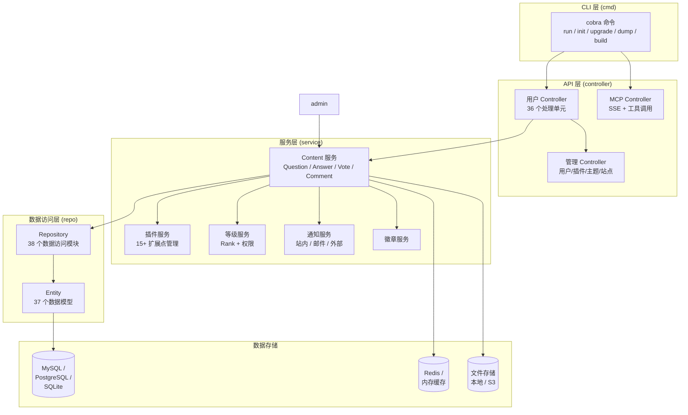
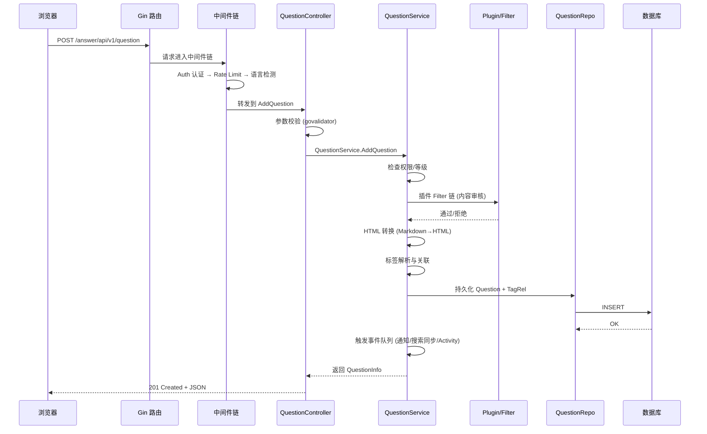

# Apache Answer — 开源 Q&A 知识管理平台解读

> **GitHub:** [github.com/apache/answer](https://github.com/apache/answer) | **网站:** [answer.apache.org](https://answer.apache.org)

## 第一部分：快速概览

### 这是什么

Apache Answer 是一个现代化的开源问答（Q&A）平台软件，由 Apache 基金会孵化。它提供了社区论坛、帮助中心、知识管理平台的核心能力，支持从单机部署到企业级多用户场景。

### 解决的痛点

知识管理系统长期被商业软件主导（Stack Overflow for Teams、Confluence），开源方案要么功能残缺，要么架构沉重。Answer 在"开箱即用"和"灵活扩展"之间找到了平衡点——**单二进制部署、可插拔插件、多数据库支持、内置 AI 能力**。

### 适用场景

- 企业内部的帮助中心 / 知识库
- 开源社区的问答论坛
- 技术团队的内部知识管理
- 作为 AI 知识库的数据源（通过 MCP 协议暴露）

### 核心能力清单

| 能力 | 说明 |
|------|------|
| Q&A 全流程 | 提问、回答、评论、投票、采纳答案 |
| 标签系统 | 内容分类与检索，支持标签管理 |
| 权限模型 | 基于角色（Role）的权限管理 + 用户等级（Rank）限制 |
| 插件系统 | 15+ 扩展点：认证、存储、搜索、过滤、渲染、Agent 等 |
| 多语言 | i18n 多语言支持，社区贡献翻译 |
| AI 集成 | MCP 协议支持，向量搜索，AI 会话 |
| 部署方式 | 二进制 / Docker / Docker Compose / Helm |
| 数据库 | MySQL / PostgreSQL / SQLite |
| 管理后台 | 独立管理界面：用户、内容、插件、站点配置 |
| 主题与 SEO | 模板渲染、自定义页面、SEO 优化 |
| 通知系统 | 站内通知 / 邮件通知 / 外部通知 |
| 徽章系统 | 用户成就与积分体系 |

### 技术栈一览

| 层面 | 技术 |
|------|------|
| 后端语言 | Go 1.24 |
| HTTP 框架 | Gin |
| 数据库 | XORM (ORM)，支持 MySQL / PostgreSQL / SQLite |
| 依赖注入 | Google Wire |
| 配置 | Viper (文件 + 环境变量) |
| 前端 | React + TypeScript + Vite |
| 日志 | segmentfault/pacman (适配 Zap) |
| 缓存 | 内置 Cache 接口，支持 Redis / 内存 |
| 插件引擎 | 自研插件框架，纯 Go 接口 |
| AI/向量 | MCP (mark3labs/mcp-go)，向量搜索插件接口 |
| 定时任务 | 内置 cron 调度器 |
| 构建 | Makefile，前端内嵌到二进制 |

---

## 第二部分：架构深读

### 架构总览



### 启动流程

```
CLI 入口 (main → cobra)
  │
  ▼
配置加载 (viper: 文件 → 环境变量)
  │
  ▼
log 初始化 (Zap 适配)
  │
  ▼
路径初始化 (data/ 目录、config 文件路径)
  │
  ▼
Wire 依赖注入 (initApplication)
  ├── repo 层初始化 (数据库连接 + 缓存)
  ├── service 层初始化 (全部 60+ 服务)
  ├── controller 层初始化
  └── router 层初始化 (路由注册 + 中间件)
  │
  ▼
中间件注册:
  ├── 语言检测 (Accept-Language)
  ├── API Key 认证
  ├── 认证 (Session / JWT)
  ├── 速率限制
  ├── MCP 认证
  └── 安全头
  │
  ▼
定时任务启动 (cron manager)
  │
  ▼
HTTP 服务器启动 (Gin → pacman → ListenAndServe)
```

### 目录结构与模块映射

```
answer/
├── cmd/                     # CLI 入口 + Wire 组装
│   ├── command.go          # cobra 命令定义
│   ├── main.go             # 应用主入口
│   ├── wire.go             # Wire ProviderSet 声明
│   └── wire_gen.go         # Wire 代码生成
├── internal/
│   ├── base/               # 基础设施
│   │   ├── conf/           # 配置加载 (YAML 结构体)
│   │   ├── constant/       # 全局常量
│   │   ├── handler/        # HTTP 请求处理基类
│   │   ├── middleware/     # 11 个 Gin 中间件
│   │   ├── translator/     # i18n 翻译引擎
│   │   ├── server/         # 服务配置
│   │   └── data/           # 数据库/缓存配置
│   ├── controller/         # 36 个 API Controller
│   ├── controller_admin/   # 9 个管理 Controller
│   ├── entity/             # 37 个数据模型 (XORM)
│   ├── repo/               # 38 个数据访问模块
│   ├── router/             # 路由注册
│   ├── schema/             # 48 个请求/响应 Schema
│   └── service/            # 60+ 业务服务
├── plugin/                 # 插件框架 (15+ 接口)
├── pkg/                    # 工具包 (uid/token/加密等)
├── ui/                     # React 前端
├── i18n/                   # 多语言翻译文件
├── configs/                # 配置示例
├── build/                  # 构建脚本
├── charts/                 # Helm Charts
└── script/                 # 运维脚本
```

### 核心请求链路 — 提问流程

一次完整的"用户提问"请求经历了 Answer 的分层架构：



### 目录代码规模（关键模块）

| 模块 | 文件数 | 核心代码行 | 职责 |
|------|--------|-----------|------|
| `internal/service/content` | 7 | ~4,600 | Q&A 核心业务 (question/answer/vote/search) |
| `internal/repo` | 38 个包 | ~5,000+ | 数据访问层 |
| `plugin/` | 23 个文件 | ~1,800 | 插件框架 |
| `internal/schema` | 48 个文件 | ~3,000+ | 请求/响应定义 |
| `internal/controller` | 36 个文件 | ~2,500+ | HTTP 处理 |

---

## 第三部分：插件系统设计

### 设计理念

Answer 的插件系统是其最核心的架构设计之一。与常见的 Go 插件方案（plugin 包、wasm、grpc）不同，Answer 采用**编译时插件注册**模式——插件通过 `init()` 自注册到全局栈中，通过 `MakePlugin[T]` 泛型工厂统一管理。

### 插件注册机制

```go
// plugin/plugin.go:55
func Register(p Base) {
    registerBase(p)
    if _, ok := p.(Config); ok { registerConfig(p.(Config)) }
    if _, ok := p.(Connector); ok { registerConnector(p.(Connector)) }
    if _, ok := p.(Filter); ok { registerFilter(p.(Filter)) }
    if _, ok := p.(Storage); ok { registerStorage(p.(Storage)) }
    if _, ok := p.(Agent); ok { registerAgent(p.(Agent)) }
    // ... 15+ 接口类型检查
}
```

每个插件只需实现 `Base` 接口（返回 `Info`），然后选择性实现一个或多个功能接口。`Register` 函数通过类型断言检测插件实现了哪些接口，将其注册到对应的全局栈中。

### MakePlugin 泛型栈管理

```go
// plugin/plugin.go:152
func MakePlugin[T Base](super bool) (CallFn[T], RegisterFn[T]) {
    stack := Stack[T]{}
    call := func(fn Caller[T]) error {
        for _, p := range stack.plugins {
            if !super && !StatusManager.IsEnabled(p.Info().SlugName) {
                continue  // 可禁用插件跳过
            }
            if err := fn(p); err != nil { return err }
        }
        return nil
    }
    register := func(p T) {
        stack.plugins = append(stack.plugins, p)
    }
    return call, register
}
```

设计亮点：
- **泛型类型安全**：每个扩展点有独立的泛型栈（`Stack[Filter]`、`Stack[Storage]`），编译期保证接口匹配
- **超级标志 `super`**：部分插件（如 Base）标记为 `super=true`，不可禁用；功能插件标记为 `false`，可由管理员开关
- **`CallAll` 语义**：`CallFn[T]` 遍历所有已注册插件并执行回调，任何插件返回错误则终止

### 15+ 扩展点一览

| 接口 | 用途 | 示例 |
|------|------|------|
| `Base` | 基本信息（名称/版本/作者） | 所有插件必须实现 |
| `Config` | 插件配置项 | 配置 OAuth 客户端密钥 |
| `Connector` | 第三方登录连接器 | GitHub / Google OAuth |
| `Filter` | 内容过滤/审核 | 敏感词过滤、AI 审核 |
| `Storage` | 文件存储后端 | S3、阿里云 OSS |
| `Cache` | 缓存后端 | Redis、内存 |
| `Search` | 搜索引擎 | Elasticsearch、Meilisearch |
| `Agent` | AI Agent 能力 | 接入 LLM API |
| `Render` | 内容渲染 | 自定义 Markdown 渲染器 |
| `Reviewer` | 人工审核接口 | 接入第三方审核系统 |
| `Captcha` | 验证码 | reCAPTCHA、hCaptcha |
| `Notification` | 通知渠道 | 飞书、Slack、钉钉 |
| `CDN` | CDN 加速 | 云存储 CDN |
| `Sidebar` | 侧边栏组件 | 自定义 UI 组件 |
| `Importer` | 数据导入 | 从其他平台迁移内容 |
| `VectorSearch` | 向量搜索 | 接入 Embedding 模型 |
| `KVStorage` | KV 持久化存储 | 插件私有的配置存储 |

### 插件构建工具

Answer 提供 `answer build` 命令，通过**重新编译二进制**的方式打包插件：

```go
// cmd/command.go:224
buildCmd = &cobra.Command{
    Run: func(_ *cobra.Command, _ []string) {
        cli.BuildNewAnswer(buildDir, buildOutput, buildWithPlugins, ...)
    },
}
```

这种"编译时 + init 注册"模式与 Go 生态中常见的 `database/sql` 驱动注册模式一脉相承，优点是简单可靠，缺点是需要重新编译才能增删插件。

---

## 第四部分：权限与等级模型

Answer 采用**角色 (Role) + 等级 (Rank)** 双重权限体系。

### 角色权限 (RBAC)

管理员通过管理后台创建角色，为角色赋予操作权限，再将角色分配给用户。权限定义在 `internal/schema/permission.go` 中：

```go
// schema/permission.go
type PermissionMemberAction struct {
    Action string `json:"action"`
    Name   string `json:"name"`
    Type   string `json:"type"`
}
```

核心权限实体在 `internal/entity/role_power_rel_entity.go` 和 `role_entity.go` 中定义，通过 `internal/service/role` 包实现 CRUD。

### 用户等级 (Rank)

等级系统基于**积分**（Reputation）机制。每个用户有积分值，执行不同操作受等级限制：

```go
// internal/service/rank/rank_service.go
const PermissionPrefix = "rank."
```

等级校验逻辑：
1. 请求到达时，`RankService.CheckOperationPermission` 检查用户等级是否满足操作要求
2. 不满足时，返回翻译后的友好错误信息（通过 `translator.TrWithData`）
3. 操作完成后，通过 `TriggerUserRank` 触发积分变更

等级系统与 Activity 系统挂钩，用户的每一个操作（提问、回答、采纳、投票）都会被记录为 Activity，汇总后影响积分变化。

---

## 第五部分：MCP 协议与 AI 集成

Answer 在 v2.0 中引入了 MCP（Model Context Protocol）支持，通过 `mark3labs/mcp-go` 库实现。

### MCP Server 实现

```go
// internal/router/mcp_router.go:28
func (a *AnswerAPIRouter) RegisterMCPRouter(r *gin.RouterGroup) {
    s := server.NewMCPServer("Answer Enterprise MCP Server", "1.0.0")
    s.AddTool(mcp_tools.NewQuestionsTool(), a.mcpController.MCPQuestionsHandler())
    s.AddTool(mcp_tools.NewAnswersTool(), a.mcpController.MCPAnswersHandler())
    s.AddTool(mcp_tools.NewCommentsTool(), a.mcpController.MCPCommentsHandler())
    s.AddTool(mcp_tools.NewTagsTool(), a.mcpController.MCPTagsHandler())
    s.AddTool(mcp_tools.NewTagDetailTool(), a.mcpController.MCPTagDetailsHandler())
    s.AddTool(mcp_tools.NewUserTool(), a.mcpController.MCPUserDetailsHandler())

    sseServer := server.NewSSEServer(s,
        server.WithSSEEndpoint("/answer/api/v1/mcp/see"),
        server.WithMessageEndpoint("/answer/api/v1/mcp/message"),
    )
}
```

支持的 MCP 工具（以 SSE 传输）：

| 工具 | 功能 | 参数 |
|------|------|------|
| `questions` | 搜索问题 | keyword, username, score, tags |
| `answers` | 按问题 ID 查答案 | question_id |
| `comments` | 按对象 ID 查评论 | object_id |
| `tags` | 搜索标签 | tag_name |
| `user` | 查询用户信息 | username |

### 向量搜索集成

插件系统中定义了 `VectorSearch` 接口，允许接入 Embedding 模型进行语义搜索：

```go
// plugin/vector_search.go
type VectorSearch interface {
    Search(ctx *GinContext, cond VectorSearchCond) ([]VectorSearchResult, error)
}
```

配合 `internal/service/vector_sync` 和 `internal/service/embedding`，实现文档的向量化索引与语义检索。

---

## 第六部分：多语言与国际化

Answer 内置完整的 i18n 框架。翻译文件存储在 `i18n/` 目录下，包含 10+ 种语言的翻译。

### 翻译引擎

```go
// internal/base/translator
```
使用自定义翻译引擎 + 社区贡献的翻译文件，支持动态参数插值和复数形式。

### 插件 i18n 合并

Answer 提供 `answer i18n` 命令，将插件的翻译文件合并到主项目的 i18n 文件中：

```go
// cmd/command.go:294
i18nCmd = &cobra.Command{
    Run: func(...) {
        cli.MergeI18nFilesLocal(i18nTargetPath, i18nSourcePath)
    },
}
```

插件开发者只需提供翻译文件，系统自动合并，无需修改核心代码。

---

## 第七部分：设计与模式

### Google Wire 依赖注入

整个应用的依赖关系通过 Google Wire 管理。`cmd/wire.go` 定义了 `ProviderSet` 组合：

```go
// cmd/wire.go
var ProviderSetService = wire.NewSet(
    comment.NewCommentService,
    report.NewReportService,
    content.NewQuestionService,
    content.NewAnswerService,
    // ... 60+ 服务构造器
)
```

`ProviderSet` 的分层设计：
1. `repo.ProviderSetRepo` → 数据访问层
2. `service.ProviderSetService` → 业务逻辑层
3. `controller.ProviderSetController` → HTTP 处理层
4. `router.ProviderSetRouter` → 路由注册层

这种设计让 Wire 在编译期生成 `wire_gen.go`，自动解析整个依赖树。依赖关系变更时只需修改 `wire.go`，重新生成即可。

### 队列驱动的异步处理

Answer 使用了多个消息队列来解耦同步操作与异步处理：

```go
// internal/service/activityqueue
// internal/service/noticequeue
// internal/service/eventqueue
```

典型场景：用户提问后，同步请求完成 Question 写入，然后通过队列异步触发：
- 通知（关注者/订阅者）
- Activity 记录（影响 Rank 积分）
- 搜索索引同步
- 向量嵌入同步

### 内容渲染管线

用户输入的 Markdown 内容经过多级处理：

1. **Parser 插件**（`plugin.Parser`）：预处理原始内容
2. **Filter 插件**（`plugin.Filter`）：内容审核
3. **Markdown→HTML 转换**（`pkg/converter/markdown.go`）
4. **Render 插件**（`plugin.Render`）：自定义渲染后处理
5. **XSS 安全过滤**（`pkg/htmltext`）

这种管线设计允许插件在内容处理的任何阶段介入。

---

## 第八部分：同行对比

| 方面 | Apache Answer | Stack Overflow for Teams | Discourse | Flarum |
|------|--------------|------------------------|-----------|--------|
| **语言** | Go + React | C# + JavaScript | Ruby + Ember.js | PHP + React |
| **开源** | ✅ Apache 2.0 | ❌ 商业 | ✅ GPL | ✅ MIT |
| **部署** | 单二进制 / Docker | SaaS | Docker / 自托管 | PHP 环境 |
| **数据库** | MySQL/PG/SQLite | 商业 | PostgreSQL | MySQL |
| **插件系统** | 15+ 扩展点，编译时注册 | 有限 API | 社区插件丰富 | 扩展机制 |
| **AI 能力** | MCP 协议、向量搜索 | 无 | 有限 | 无 |
| **管理面板** | 内嵌 | Web UI | Web UI | Web UI |
| **单二进制** | ✅ | ❌ | ❌ | ❌ |
| **多语言** | 10+ 语言，插件可扩展 | 有限 | 社区翻译 | 社区翻译 |
| **性能** | Go，高并发 | 商业级 | Ruby，中等 | PHP，中等 |

**Answer 的差异化优势：**

1. **Go 单二进制** — 部署极简，资源占用低，适合自托管
2. **MCP + 向量搜索** — 原生 AI 集成，可做 RAG 知识库底座
3. **插件系统设计** — 15+ 扩展点覆盖面广，接口定义清晰，编译器保障类型安全
4. **多数据库支持** — 从 SQLite（开发）到 MySQL/PostgreSQL（生产），适配灵活
5. **Apache 基金会治理** — 中立、透明的社区治理模式

**Answer 的局限性：**

1. **插件热加载** — 编译时注册模式需要重新编译才能增删插件，不如 Discourse 的运行时插件灵活
2. **生态规模** — 相比 Discourse 和 Flarum，插件和主题数量较少
3. **高级功能** — 缺乏原生的 CMS 页面管理、富文本编辑器（仅 Markdown）
4. **搜索能力** — 默认基于数据库 LIKE 搜索，需要插件才能实现全文搜索

---

## 第九部分：总结与评价

Apache Answer 是一个在"简洁"和"能力"之间取得了良好平衡的开源 Q&A 平台。它最大的设计亮点不在某个炫技的技术点上，而在于**清晰的分层架构和精心设计的扩展点**。

**最值得学习的设计决策：**

1. **插件系统的泛型栈设计** — `MakePlugin[T]` 用 Go 泛型实现了类型安全的扩展点管理，既保证了编译期类型检查，又保持了运行时的灵活性
2. **Wire 分层注入** — 4 层 `ProviderSet` 的划分让依赖关系清晰可见，新增模块只需添加构造器并注册到对应的 Set 中
3. **队列解耦** — 核心同步操作与通知/索引/Activity 异步分离，保持了 API 响应速度
4. **MCP 原生支持** — 在 AI 时代抢先布局，将 Q&A 内容转化为 AI 可消费的上下文
5. **内容处理管线** — Parser → Filter → 渲染 → 安全过滤，多阶段可插拔设计

对于希望学习 Go Web 工程实践、插件系统设计、或为团队搭建私有知识管理平台的开发者，Apache Answer 是一个值得深入研究的最佳参考项目。

> **仓库：** [github.com/apache/answer](https://github.com/apache/answer) | **网站：** [answer.apache.org](https://answer.apache.org)

---

*本项目解读目录下后续可扩展各维度的独立分析文档，例如：[首次访问安装向导 — 页面流程与 API 清单](api/01-install-api.md)。*
