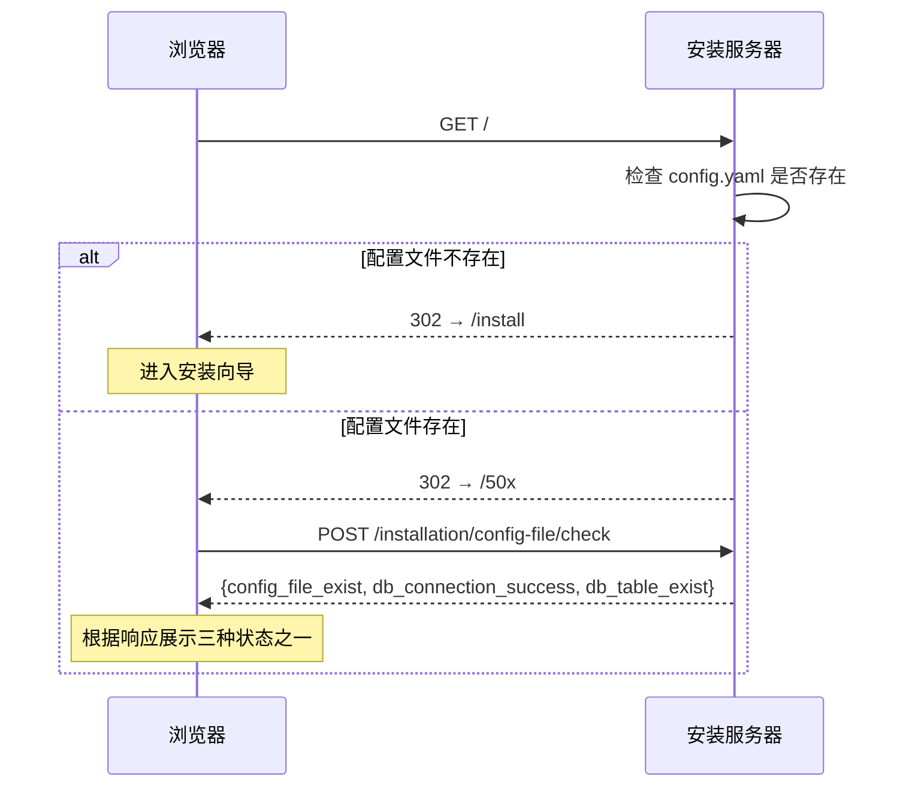
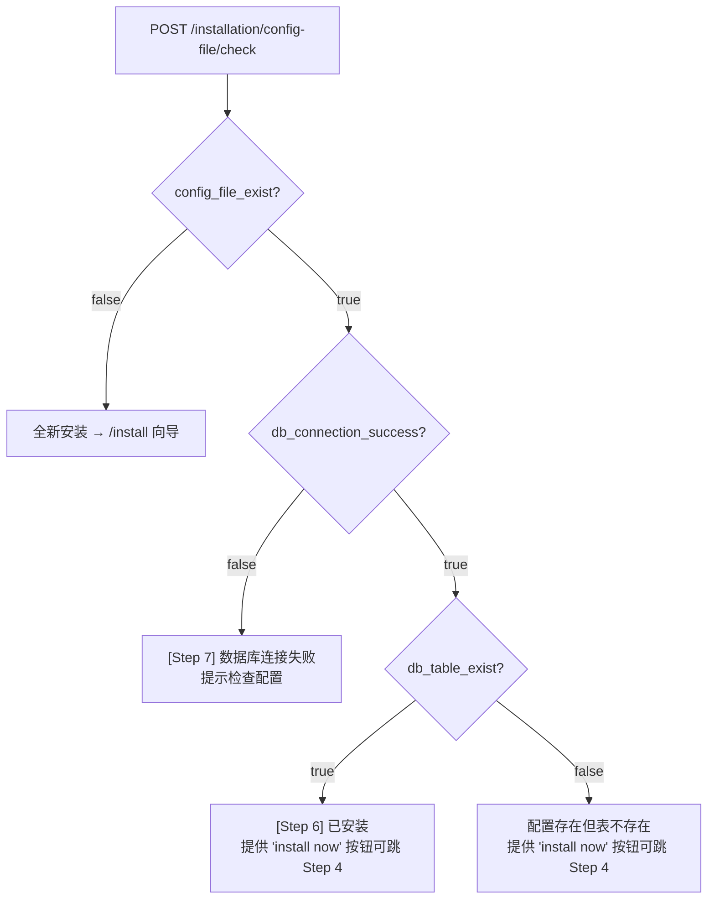
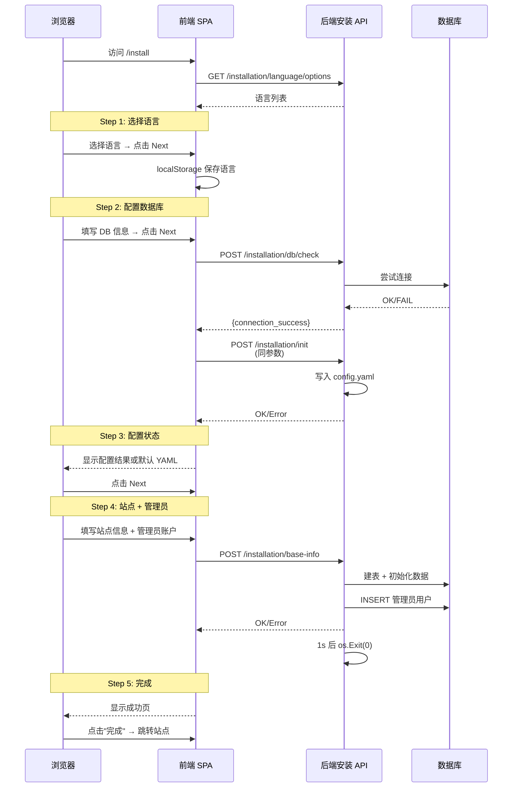
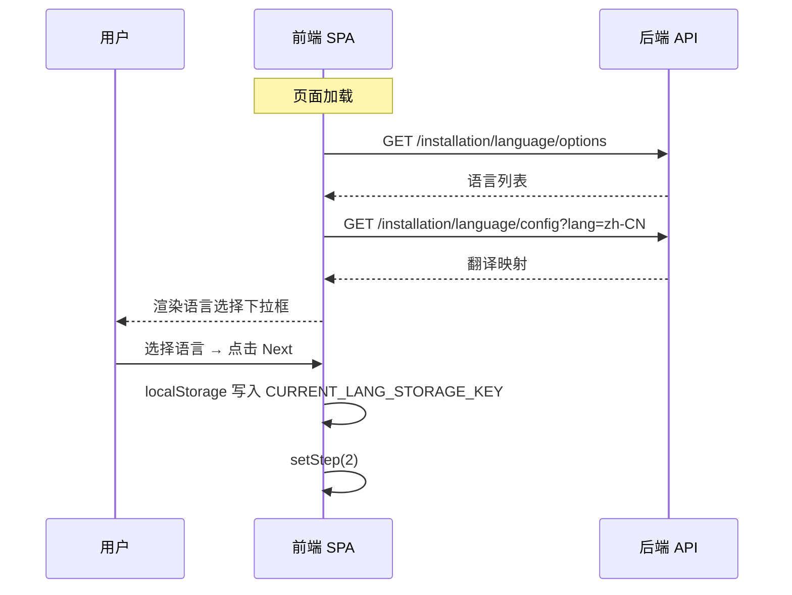
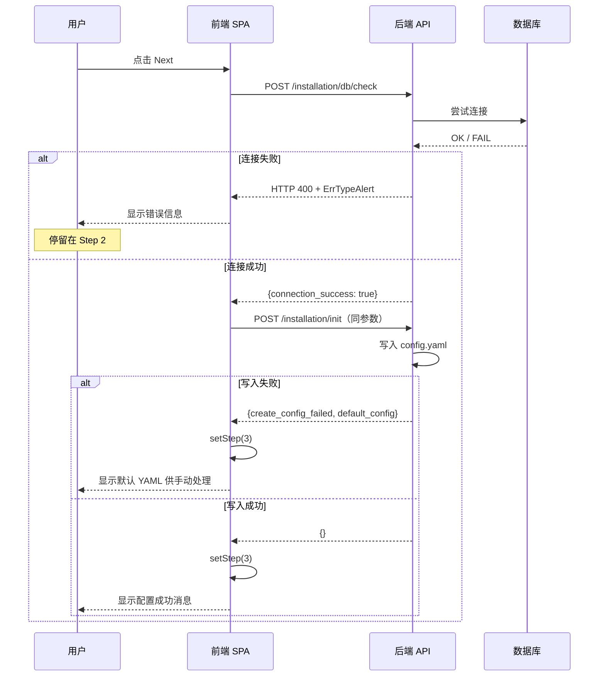
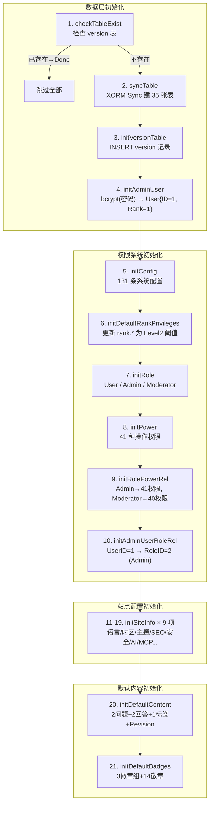
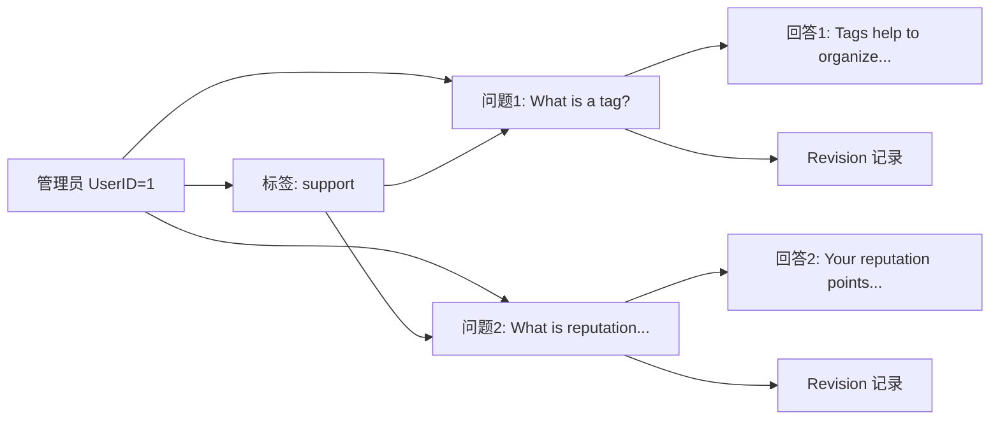

# 首次访问安装向导 — 页面流程与 API 清单

## 概述

Apache Answer 首次部署后，启动一个独立于主应用的**安装服务器**（端口 80），通过 Web 向导引导用户完成配置。安装完成后进程自动退出，由主应用接管。

## 一、入口检测

用户访问 `http://host:80/` 时，安装服务器根据配置文件存在状态决定跳转：



`/50x` 页面的状态判断逻辑：



---

## 二、安装向导 5 步交互



### Step 1 — 选择语言（FirstStep）

**前端组件：** `ui/src/pages/Install/components/FirstStep/index.tsx:37`

进入页面后自动调用：



> 本步骤**不调用后端 API 提交**，仅本地状态更新。

### Step 2 — 配置数据库（SecondStep）

**前端组件：** `ui/src/pages/Install/components/SecondStep/index.tsx:61`

用户选择数据库类型（MySQL / PostgreSQL / SQLite）并填写连接信息：

| 数据库 | 需要填写的字段 |
|--------|--------------|
| MySQL | db_host, db_username, db_password, db_name |
| PostgreSQL | db_host, db_username, db_password, db_name, ssl 相关（可选） |
| SQLite | db_file（文件路径） |

点击 Next 后，**连续调用两个 API**：



**前端代码中的调用链**（`ui/src/pages/Install/index.tsx:242-263`）：

```typescript
const submitDatabaseForm = () => {
  dbCheck(params)          // POST /installation/db/check
    .then(() => {
      checkInstall();      // POST /installation/init
    })
    .catch((err) => {
      handleErr(err);      // 显示错误
    });
};

const checkInstall = () => {
  installInit(params)      // POST /installation/init
    .then(() => {
      handleNext();        // setStep(3)
    })
    .catch((err) => {
      handleErr(err);
    });
};
```

### Step 3 — 配置状态展示（ThirdStep）

**前端组件：** `ui/src/pages/Install/components/ThirdStep/index.tsx:32`

- 如果前一步成功 → 显示 "Config file has been created"
- 如果前一步失败 → 显示默认 YAML 文本，提示用户手动修改配置文件

用户确认后点击 Next → `setStep(4)`。

### Step 4 — 站点与管理员信息（FourthStep）

**前端组件：** `ui/src/pages/Install/components/FourthStep/index.tsx:34`

包含两部分表单：

**站点信息：**
| 字段 | 校验规则 |
|------|---------|
| site_name | 必填，≤30 字符 |
| site_url | 必填，以 `http://` 或 `https://` 开头，≤512 字符 |
| contact_email | 必填，邮箱格式 |
| login_required | 开关，是否要求登录才能浏览 |
| external_content_display | 下拉：always_display / ask_before_display |

**管理员账户：**
| 字段 | 校验规则 |
|------|---------|
| name | 必填，2-30 字符，仅允许 `[\w.-\s]` |
| password | 必填，4-32 字符 |
| confirm_password | 必填，必须与 password 一致 |
| email | 必填，邮箱格式 |

点击提交：

```
POST /installation/base-info
  → 成功后自动 setStep(5)
  → 失败后显示字段级错误或全局错误
```

后端处理完成后 1 秒调用 `os.Exit(0)` 退出进程。

### Step 5 — 完成（FifthStep）

**前端组件：** `ui/src/pages/Install/components/FifthStep/index.tsx:30`

显示成功信息，提供"Done"按钮跳转到站点 URL。

---

## 三、API 接口清单

| # | 方法 | 路径 | 用途 | 请求参数 | 响应 |
|---|------|------|------|---------|------|
| 1 | GET | `/` | 首页重定向 | - | 302 → `/install` 或 `/50x` |
| 2 | GET | `/install` | 返回安装页 SPA | - | `text/html` index.html |
| 3 | GET | `/installation/language/options` | 获取可选语言 | - | `[{value, label}]` |
| 4 | GET | `/installation/language/config` | 获取翻译映射 | `?lang=zh-CN` | `{翻译键值对}` |
| 5 | POST | `/installation/config-file/check` | 检查配置状态 | 空 | `{config_file_exist, db_connection_success, db_table_exist}` |
| 6 | POST | `/installation/db/check` | 测试数据库连接 | `CheckDatabaseReq` | `{connection_success}` |
| 7 | POST | `/installation/init` | 写入配置文件 | `CheckDatabaseReq` | `{}` / 错误 |
| 8 | POST | `/installation/base-info` | 建表+初始化数据 | `InitBaseInfoReq` | `{}` / 错误 |

---

## 四、API 详述

### 1. `GET /` — 首页重定向

`install_controller.go:85` `CheckConfigFileAndRedirectToInstallPage`

| 条件 | 行为 |
|------|------|
| config.yaml 不存在 | 302 → `/install` |
| config.yaml 存在 | 302 → `/50x` |

### 2. `GET /install` — 安装页 SPA

`install_server.go:80` `WebPage`

返回内嵌的 React SPA（`build/index.html`）。

### 3. `GET /installation/language/options` — 获取语言列表

`install_controller.go:53` `LangOptions`

**响应示例：**

```json
[
  { "value": "zh-CN", "label": "简体中文" },
  { "value": "en_US", "label": "English (US)" }
]
```

### 4. `GET /installation/language/config` — 获取翻译映射

`install_controller.go:65` `GetLangMapping`

**请求参数：**

| 参数 | 类型 | 必填 | 说明 |
|------|------|------|------|
| lang | string | 是 | 语言代码，如 `zh-CN` |

**响应：** 整个翻译文件的 key-value 映射对象。

### 5. `POST /installation/config-file/check` — 检查配置状态

`install_controller.go:101` `CheckConfigFile`

**请求体：** 空

**响应：**

```json
{
  "config_file_exist": false,
  "db_connection_success": false,
  "db_table_exist": false
}
```

| 字段 | 说明 |
|------|------|
| `config_file_exist` | config.yaml 是否存在 |
| `db_connection_success` | 能否连接数据库（仅当配置文件存在时） |
| `db_table_exist` | 数据库中是否已存在表（仅当连接成功时） |

此接口用于前端判断进入哪种状态（全新安装 / 已安装 / 配置错误）。

### 6. `POST /installation/db/check` — 测试数据库连接

`install_controller.go:131` `CheckDatabase`

**请求体（`CheckDatabaseReq`）：**

```json
{
  "db_type": "mysql",
  "db_username": "root",
  "db_password": "root",
  "db_host": "db:3306",
  "db_name": "answer",
  "db_file": "/data/answer.db",
  "ssl_enabled": false,
  "ssl_mode": "",
  "ssl_root_cert": "",
  "ssl_key": "",
  "ssl_cert": ""
}
```

**连接串拼装逻辑**（`install_req.go:58` `GetConnection`）：

| 数据库 | 连接串格式 |
|--------|-----------|
| SQLite | 直接使用 `db_file` 路径 |
| MySQL | `user:pass@tcp(host)/dbname` |
| PostgreSQL (无 SSL) | `host= port= user= password= dbname= sslmode=disable` |
| PostgreSQL (SSL require) | `host= port= user= password= dbname= sslmode=require` |
| PostgreSQL (SSL verify-ca/full) | 追加 `sslrootcert=` / `sslcert=` / `sslkey=` |

**响应：**

```json
{ "connection_success": true }
```

失败时返回 HTTP 400 + `ErrTypeAlert`。

### 7. `POST /installation/init` — 写入配置文件

`install_controller.go:159` `InitEnvironment`

**请求体：** 同 `CheckDatabaseReq`

**处理流程：**

1. 检查 config.yaml 是否已存在 → 已存在则跳过
2. 调用 `InstallConfigFile` 写入默认配置（`install.go:42`）
3. 读取刚写入的配置
4. 覆盖数据库连接信息、缓存路径、i18n 路径、上传路径
5. 调用 `RewriteConfig` 写回

**响应：** 成功返回 `{}`

失败时返回详细错误：

```json
{
  "success": false,
  "create_config_failed": true,
  "default_config": "... YAML 内容 ...",
  "err_type": "alert"
}
```

### 8. `POST /installation/base-info` — 建表与管理员初始化

`install_controller.go:211` `InitBaseInfo`

**请求体（`InitBaseInfoReq`）：**

```json
{
  "lang": "zh-CN",
  "site_name": "My Knowledge Base",
  "site_url": "https://answer.example.com",
  "contact_email": "admin@example.com",
  "login_required": false,
  "external_content_display": "always_display",
  "name": "admin",
  "password": "securepass123",
  "email": "admin@example.com"
}
```

**处理流程**（核心在 `migrations/init.go:65` `Mentor.InitDB`）：

`Mentor.InitDB()` 采用链式编排模式——通过 `m.do()` 串联 20 个步骤，任一步骤失败则中断。`Done` 标志在 `checkTableExist` 中设置，若 `version` 表已存在，整个初始化跳过（幂等保护）。

```go
// init.go:95
func (m *Mentor) do(taskName string, fn func()) {
    if m.err != nil || m.Done { return }
    fn()
    if m.err != nil {
        m.err = fmt.Errorf("%s failed: %s", taskName, m.err)
    }
}
```

完整执行流程：



**逐步骤详解：**

**① checkTableExist**（`init.go:105`）

```go
func (m *Mentor) checkTableExist() {
    m.Done, m.err = m.engine.Context(m.ctx).IsTableExist(&entity.Version{})
}
```

通过检查 `version` 表是否存在来判断数据库是否已初始化。已存在则设 `Done=true`，跳过后续所有步骤。**这是幂等保护的核心机制。**

**② syncTable**（`init.go:112`）

使用 XORM 的 `Sync()` 方法，执行 **CREATE TABLE IF NOT EXISTS**。35 张表定义在 `init_data.go:46`，涵盖所有业务实体。`Sync()` 会自动补充缺失列，但不处理列删除或类型变更——这些留给 migration 机制处理。

**③ initVersionTable**（`init.go:116`）

```go
_, m.err = m.engine.Context(m.ctx).Insert(
    &entity.Version{ID: 1, VersionNumber: ExpectedVersion()})
```

`ExpectedVersion()` 返回 `1 + len(migrations)`，标记当前数据库版本为最新。后续的 `answer upgrade` 命令通过 `version` 表判断需要执行哪些迁移。

**④ initAdminUser**（`init.go:120`）

```go
generateFromPassword, _ := bcrypt.GenerateFromPassword(
    []byte(m.userData.AdminPassword), bcrypt.DefaultCost)
_, m.err = m.engine.Context(m.ctx).Insert(&entity.User{
    ID:           "1",       // 固定 ID=1
    Username:     m.userData.AdminName,
    Pass:         string(generateFromPassword),  // bcrypt 哈希
    EMail:        m.userData.AdminEmail,
    MailStatus:   1,         // 邮箱已验证
    NoticeStatus: 1,         // 通知已启用
    Status:       1,         // 正常状态
    Rank:         1,         // 最高等级（满足所有操作门槛）
    DisplayName:  m.userData.AdminName,
})
```

管理员 ID 硬编码为 `"1"`，Rank 为 1（最高等级）。密码使用 `golang.org/x/crypto/bcrypt` 哈希。

**⑤ initConfig**（`init.go:135`）

```go
_, m.err = m.engine.Context(m.ctx).Insert(defaultConfigTable)
```

131 条配置项一次批量 INSERT。按功能分类：

| 配置分类 | ID 范围 | 条数 | 作用 |
|---------|---------|------|------|
| **声望规则** | 1-22 | 22 | 操作对应的声望增/减值（如 answer.accepted=15） |
| **无变动配置** | 24-32, 35 | 10 | 声望影响为零的操作 |
| **等级门槛** | 36-56, 107-130 | 45 | 各操作所需的最低 Rank 值 |
| **举报/关闭/状态理由** | 57-64, 76-86 | 19 | 理由的 JSON 定义 |
| **邮件模板** | 33 | 1 | 注册/密码重置/通知的 HTML 模板 |
| **AI 提供商** | 131 | 1 | OpenAI/Gemini/Anthropic 默认配置 |

理由配置采用 JSON 字符串存储在 `config` 表中，通过 `key` 前缀区分用途（`reason.*` / `question.flag.reasons` / `answer.review.reasons` 等），灵活且无需新表。

**⑥ initDefaultRankPrivileges**（`init.go:139`）

```go
chooseOption := schema.DefaultPrivilegeOptions.Choose(schema.PrivilegeLevel2)
for _, privilege := range chooseOption.Privileges {
    m.engine.Update(&entity.Config{Value: fmt.Sprintf("%d", privilege.Value)},
        &entity.Config{Key: privilege.Key})
}
```

将上一步插入的 `rank.*` 配置更新为 Level2 等级的阈值。Level2 比 Level1 门槛更高，适用于生产环境。

**⑦～⑩ 角色与权限系统**

3 个角色：

| ID | 名称 | 权限范围 |
|----|------|---------|
| 1 | User | 由 Rank（等级）控制，不依赖角色 |
| 2 | Admin | 全部 41 种权限（含 admin_access） |
| 3 | Moderator | 40 种（排除 admin_access） |

41 种权限覆盖所有操作维度（`init_data.go:90`）：
- CRUD：question/answer/comment/tag 的增删改
- 管理：admin_access（唯一区分 Admin 和 Moderator）
- 审查：answer_audit / question_audit / tag_audit
- 特殊：pin/unpin/hide/show、invite_to_answer、vote_detail、recover

角色-权限关联使用**双列表**：Admin（RoleID=2）41 条 + Moderator（RoleID=3）40 条。User 角色的权限不由角色控制，而是由 **Rank（等级）** 决定。

**⑪～⑲ SiteInfo 站点配置（9 项）**

每项以 `Type` 字段区分，`Content` 为 JSON 字符串：

| 方法 | Type | 关键内容 |
|------|------|---------|
| `initSiteInfoInterface` | `interface_settings` | 语言（用户输入）+ 时区（自动检测本地时区） |
| `initSiteInfoUsersSettings` | `users_settings` | 默认头像: gravatar |
| `initSiteInfoGeneralData` | `general` | 站点名称/URL/联系邮箱（用户输入） |
| `initSiteInfoLoginConfig` | `login` | 允许新注册/邮箱注册/密码登录 |
| `initSiteInfoThemeConfig` | `theme` | 默认主题、导航栏色 `#0033ff`、全宽布局 |
| `initSiteInfoSEOConfig` | `seo` | 永久链接格式 `question_id`、robots.txt |
| `initSiteInfoUsersConfig` | `users` | 允许用户更新显示名/用户名/头像/BIO 等 |
| `initSiteInfoPrivilegeRank` | `privileges` | 权限等级 Level2 |
| `initSiteInfoAdvanced` | `advanced` | 图片 4MB、附件 8MB、允许 jpg/png/gif/webp |
| `initSiteInfoQuestions` | `questions` | 最少 1 个标签、最少 6 字符、限制回答 |
| `initSiteInfoTags` | `tags` | 不强制标签、推荐标签空、保留标签空 |
| `initSiteInfoSecurityConfig` | `security` | login_required（用户输入）、外部内容显示策略 |
| `initSiteInfoAI` | `ai` | AI 默认提示词（中英文） |
| `initSiteInfoMCP` | `mcp` | MCP 功能启用 |

**⑳ initDefaultContent**（`init.go:352`）

创建示例内容，ID 通过 `uniqueIDRepo.GenUniqueIDStr` 基于 `uniqid` 表生成：



每个问题和回答插入后立即创建对应的 Revision（状态为 `RevisionReviewPassStatus`，即已通过审核）。这个步骤也验证了 Answer 的 Revision 历史机制在初始状态下正常工作。

**㉑ initDefaultBadges**（`init.go:594`）

3 个徽章组（Getting Started / Community / Posting）+ 14 个徽章：

| 徽章 | 等级 | 触发 Handler | 条件 |
|------|------|-------------|------|
| Autobiographer | 铜 | `FirstUpdateUserProfile` | 首次更新个人资料 |
| Editor | 铜 | `FirstPostEdit` | 首次编辑帖子 |
| First Flag | 铜 | `FirstFlaggedPost` | 首次标记举报 |
| First Upvote | 铜 | `FirstVotedPost` | 首次被赞 |
| Scholar | 铜 | `FirstAcceptAnswer` | 首次接受答案 |
| Solved | 铜 | `ReachAnswerAcceptedAmount(1)` | 1 个回答被采纳 |
| Nice Answer | 铜 | `ReachAnswerVote(10)` | 回答 10 票 |
| Good Answer | 银 | `ReachAnswerVote(25)` | 回答 25 票 |
| Great Answer | 金 | `ReachAnswerVote(50)` | 回答 50 票 |
| Nice Question | 铜 | `ReachQuestionVote(10)` | 问题 10 票 |
| Good Question | 银 | `ReachQuestionVote(25)` | 问题 25 票 |
| Great Question | 金 | `ReachQuestionVote(50)` | 问题 50 票 |

徽章的 `Handler` 字段是**策略模式**的轻量实现——事件发生时系统根据 Handler 名称查找对应的处理函数，判断是否达到颁发条件。`Single` 字段区分单次/多次颁发。

**完成后：**

```go
// 1s 后退出进程
go func() {
    time.Sleep(1 * time.Second)
    os.Exit(0)
}()
```

Docker 环境下 entrypoint 脚本随后执行 `answer run`，主应用使用新配置启动。

---

## 五、状态对照速查

| UI 步骤 | 前端状态 `step` | 含义 |
|---------|-----------------|------|
| Step 1 | 1 | 选择语言 |
| Step 2 | 2 | 配置数据库（调用 db/check + init） |
| Step 3 | 3 | 配置结果展示 |
| Step 4 | 4 | 站点信息 + 管理员账户（调用 base-info） |
| Step 5 | 5 | 安装完成 |
| Step 6 | 6 | 已安装（配置+DB+表均存在） |
| Step 7 | 7 | 数据库连接失败 |
| Step 8 | 8 | Step 6 中点击 "install now" 后直接跳到 Step 4 |

---

## 六、参考文件

| 文件 | 说明 |
|------|------|
| `internal/install/install_main.go:41` | `Run()` 安装服务器入口 |
| `internal/install/install_server.go:50` | `NewInstallHTTPServer()` 路由注册 |
| `internal/install/install_controller.go` | 全部安装接口 Handler |
| `internal/install/install_req.go` | 请求/响应结构体定义 |
| `internal/install/install_from_env.go:55` | 环境变量静默安装 |
| `internal/migrations/init.go:65` | `Mentor.InitDB()` 建表与数据初始化 |
| `internal/cli/install.go:42` | `InstallConfigFile()` 配置文件写入 |
| `internal/cli/install_check.go` | DB 连接/表存在检查 |
| `ui/src/pages/Install/index.tsx:51` | 安装页主组件 |
| `ui/src/services/install/index.ts` | 安装 API 请求封装 |
