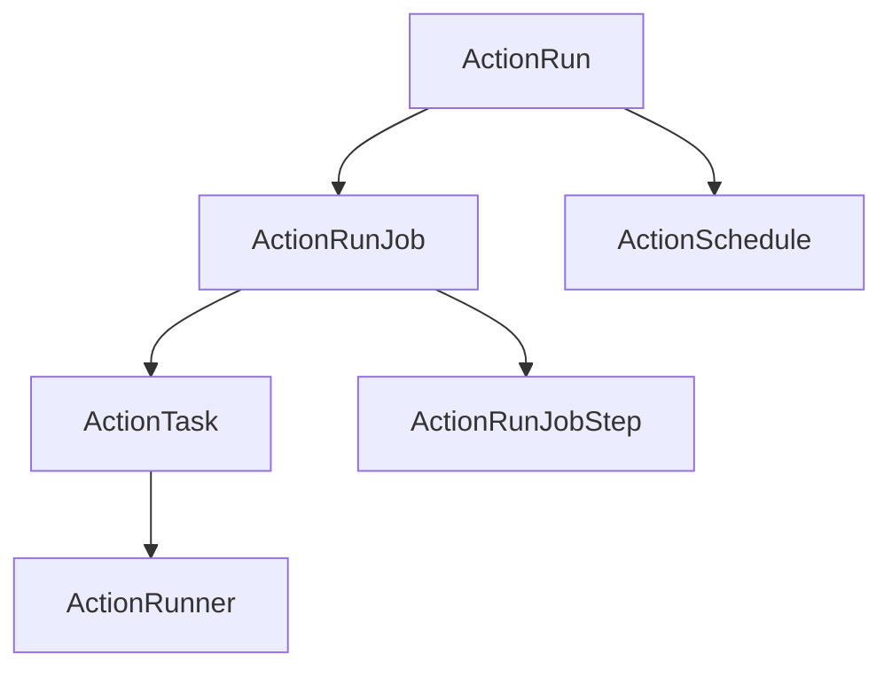
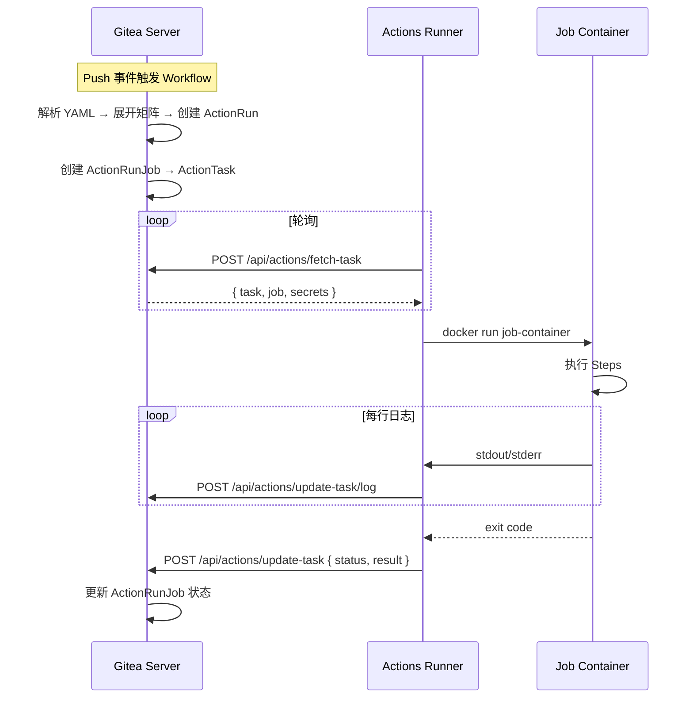

# Gitea Actions CI/CD 实现分析

> **关联文档:** [Gitea 主解读](./README.md) · [系统架构设计详解](./system-arch.md) · [设计模式与工程亮点](./design-patterns.md)

---

## 1. 设计动机

Gitea 在 v1.19 之前没有内置 CI/CD 功能，用户需要配合 Drone、Jenkins 等外部工具。这带来了两个问题：一是多系统集成成本高（Webhook 配置、Token 管理、状态同步），二是无法获得 GitLab CI/CD 或 GitHub Actions 那样的原生体验。

Gitea Actions 的目标是：**兼容 GitHub Actions 的 Workflow 格式，让用户直接复用 GitHub Actions 社区的 2 万 + Action，零学习成本迁移。**

实现的根本挑战在于：GitHub Actions 是一个庞大的系统（Workflow 解析、Job 调度、Runner 通信、日志流、制品管理、缓存、自托管 Runner 等），Gitea 需要用有限的 Go 代码实现核心子集。

## 2. 整体架构

```
┌────────────────────────┐     HTTP API      ┌─────────────────────┐
│   Gitea Server         │ ◄──────────────►  │   Actions Runner     │
│                        │   (actions 协议)    │   (gitea/runner)     │
│  routers/api/actions/  │                    │                      │
│  services/actions/     │                    │  Docker / K8s / 本地 │
│  models/actions/       │                    │  ┌────────────────┐  │
│  modules/actions/      │                    │  │  Job Container  │  │
└────────────────────────┘                    │  └────────────────┘  │
                                              └─────────────────────┘
```

Gitea Server 负责：
- Workflow YAML 解析与调度
- Runner 注册与管理
- Job 状态追踪
- 日志流汇聚
- 制品上传下载

Actions Runner（独立二进制，`gitea.com/gitea/runner`）负责：
- 接收 Gitea 分发的 Job
- 创建执行环境（Docker/K8s/本地）
- 执行 Job Steps
- 回传日志和状态

## 3. Workflow YAML 解析

Gitea Actions 完全兼容 GitHub Actions 的 Workflow YAML 格式。

```yaml
name: CI
on:
  push:
    branches: [main]
  pull_request:
jobs:
  test:
    runs-on: ubuntu-latest
    steps:
      - uses: actions/checkout@v4
      - uses: actions/setup-go@v5
        with:
          go-version: '1.26'
      - run: go test ./...
```

解析实现在 `modules/actions/workflows.go`，核心逻辑：

1. **YAML 解析**：读取仓库中 `.gitea/workflows/*.yml`（兼容 `.github/workflows/*.yml`）
2. **事件匹配**：根据触发事件（push / pull_request / schedule 等）筛选符合条件的 Workflow
3. **Job Graph**：构建 Job 依赖 DAG，解析 `needs` 依赖关系确定执行顺序
4. **矩阵展开**：展开 `strategy.matrix` 生成多维 Job 实例

**支持的触发事件：**

| 事件类型 | 说明 | 实现位置 |
|----------|------|----------|
| `push` | 分支/标签推送 | `modules/actions/workflows.go` |
| `pull_request` | PR 创建/同步/关闭 | 同上 |
| `release` | Release 发布 | 同上 |
| `schedule` | 定时触发 (cron) | 同上 |
| `workflow_dispatch` | 手动触发 | 同上 |
| `workflow_call` | 可复用 Workflow | 同上 |

## 4. 数据模型

`models/actions/` 定义了 Actions 的完整数据模型：



| 模型 | 职责 | 关键字段 |
|------|------|----------|
| `ActionRun` | Workflow 的一次运行 | RepoID, WorkflowID, TriggerEvent, Status, Started |
| `ActionRunJob` | 单个 Job 的执行 | RunID, JobID, Status, Started, Stopped |
| `ActionRunJobStep` | Job 内单个 Step | JobID, StepIndex, Status, Started, LogLength |
| `ActionTask` | 分发给 Runner 的任务 | JobID, RunnerID, Status, Deadline |
| `ActionRunner` | 注册的 Runner 实例 | RunnerUUID, Name, Status, Version, Labels |
| `ActionSchedule` | 定时触发规则 | RepoID, WorkflowID, CronExpr, Next |

## 5. Runner 注册与通信

### 5.1 Runner 注册流程

Runner 通过以下步骤注册到 Gitea 实例：

1. 管理员在 Gitea 页面生成注册令牌
2. Runner 启动时携带令牌调用注册 API
3. Gitea 验证令牌，生成 Runner UUID 和 Token
4. Runner 定期发送心跳保持活跃

### 5.2 Task 调度流程



### 5.3 通信协议

Runner 与 Gitea 之间通过 REST API 通信，协议实现在 `routers/api/actions/`：

| API | 方向 | 用途 |
|-----|------|------|
| `POST /api/actions/register` | Runner → Gitea | Runner 注册 |
| `POST /api/actions/fetch-task` | Runner → Gitea | 拉取待执行任务 |
| `POST /api/actions/update-task` | Runner → Gitea | 更新任务状态 |
| `POST /api/actions/update-task/log` | Runner → Gitea | 上传日志行 |
| `POST /api/actions/upload-artifact` | Runner → Gitea | 上传制品 |
| `GET /api/actions/download-artifact` | Runner → Gitea | 下载制品 |

## 6. 制品管理

Gitea Actions 实现了 **Artifacts v4 协议兼容**，与 GitHub Actions 的 upload-artifact / download-artifact Action 兼容。

```
modules/actions/artifacts.go
  ├── ArtifactUpload()     ── 分块上传
  ├── ArtifactDownload()   ── 分块下载
  ├── ArtifactList()       ── 列出制品
  ├── ArtifactDelete()     ── 删除制品
  └── ArtifactRetention()  ── 保留策略
```

制品存储复用 `modules/storage.ActionsArtifacts`，底层可以是本地文件系统、S3 或 Azure Blob。保留策略可在 Gitea 管理页面配置（默认 90 天）。

**分块上传协议：**

1. Runner 创建制品条目（上传 URL）
2. Runner 将文件分割为 4MB 块，逐块上传
3. 所有块上传完成后，Runner 提交完成请求
4. Gitea 组装文件并更新元数据

## 7. 局限与取舍

与 GitHub Actions 相比，Gitea Actions 有一些已知局限：

| 特性 | GitHub Actions | Gitea Actions | 影响 |
|------|---------------|---------------|------|
| Marketplace | 官方 Action 市场 | 无，直接 Git 引用 | 需手动填写 Action 仓库地址 |
| 托管 Runner | GitHub 托管 | 需自建 Runner | 增加运维成本 |
| 缓存服务 | 内置缓存 Action | 暂不支持 | 构建速度受影响 |
| 环境保护规则 | 评审+审批+等待 | 部分支持 | 企业治理能力稍弱 |
| 自托管 Runner | 有限免费额度 | 无限制 | 私有部署优势 |
| 存储限制 | 按套餐限制 | 无限制（自管存储） | 大项目更友好 |
| 费用 | 按分钟计费 | 零成本 | 适合预算敏感团队 |

## 8. 配置示例

Gitea 部署 Actions 的最小配置：

```ini
[actions]
ENABLED = true
DEFAULT_ACTIONS_URL = https://github.com
```

启动 Runner：

```bash
# 下载 Runner
wget -O /usr/local/bin/act_runner https://dl.gitea.com/act_runner/latest/act_runner-linux-amd64

# 注册 Runner（使用管理员生成的令牌）
act_runner register --instance https://gitea.example.com --token <registration_token>

# 启动 Runner
act_runner daemon
```

Runner 配置文件 `~/.act_runner/config.yaml`：

```yaml
runner:
  instance: https://gitea.example.com
  token: <registered_token>
  labels:
    - "ubuntu-latest:docker://node:20-bookworm"
    - "ubuntu-22.04:docker://node:20-bookworm"
    - "ubuntu-24.04:docker://node:24-bookworm"
container:
  network_mode: bridge
  privileged: false
```

---

> **GitHub:** [github.com/go-gitea/gitea](https://github.com/go-gitea/gitea) — `models/actions/` | `modules/actions/` | `routers/api/actions/` | `services/actions/`
