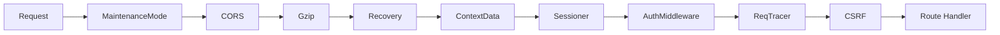

# Gitea 系统架构设计详解

> **关联文档:** [Gitea 主解读](./README.md) · [设计模式与工程亮点](./design-patterns.md) · [Actions CI/CD 实现分析](./actions.md)

---

## 1. 架构总览

Gitea 采用**经典的三层架构**：路由层 (routers) → 业务逻辑层 (services) → 数据模型层 (models)，辅以基础设施模块层 (modules) 提供跨层复用能力。

```
main.go
  └─ cmd/                    [CLI 入口：serve、admin、dump、migrate]
       └─ cmd/web.go        [HTTP 服务启动]
            └─ routers/      [HTTP 路由层]
                 ├─ routers/web/          [Web 页面 (SSR)]
                 ├─ routers/api/v1/       [RESTful API]
                 ├─ routers/api/actions/  [Actions 专用 API]
                 ├─ routers/api/packages/ [Package Registry API]
                 └─ routers/private/      [内部通信接口]
                      │
                      ├─→ services/       [业务逻辑层]
                      │    ├─ pull/     [PR 合并逻辑]
                      │    ├─ issue/    [Issue 业务]
                      │    ├─ webhook/  [Webhook 调度]
                      │    ├─ actions/  [Actions 执行]
                      │    ├─ mailer/   [邮件发送]
                      │    ├─ notify/   [事件通知总线]
                      │    ├─ auth/     [认证插件框架]
                      │    └─ indexer/  [搜索索引]
                      │
                      ├─→ models/        [数据模型层]
                      │    ├─ db/       [ORM 引擎封装 + 泛型 DAO]
                      │    ├─ user/     [用户模型]
                      │    ├─ repo/     [仓库模型]
                      │    ├─ issues/   [Issue/PR/Comment]
                      │    ├─ perm/     [权限模型]
                      │    ├─ actions/  [Actions 数据模型]
                      │    └─ migrations/ [数据库迁移]
                      │
                      └─→ modules/       [基础设施层]
                           ├─ web/       [路由框架封装 (chi)]
                           ├─ git/       [Git 操作抽象]
                           ├─ queue/     [泛型队列系统]
                           ├─ storage/   [文件存储抽象层]
                           ├─ setting/   [配置系统]
                           ├─ graceful/  [优雅关闭]
                           └─ ...        [85+ 子包]
```

Gitea 的前端采用**SSR + Islands Architecture**：Go html/template 负责主导渲染（574 个 .tmpl 模板，约 9.6 万行），Vue 3 组件作为 IIFE 包嵌入需要复杂交互的页面（代码编辑器、图表、包管理器等）。Vite 以 `appType: 'custom'` 模式运行，只处理 JS/CSS 构建，HTML 响应由 Go 服务器提供。

## 2. 启动流水线

Gitea 的启动流程在 `cmd/web.go` 中定义，分为以下几个阶段：

```
cmd/web.go:runWeb()
  │
  ├── 1. setting.PrepareConfig()         加载 app.ini + 环境变量
  │     ├── 合并默认配置
  │     ├── 解析数据库/缓存/队列/存储等配置
  │     └── 自定义配置覆盖
  │
  ├── 2. db.InitEngine()                 初始化数据库连接
  │     ├── 根据配置选择 SQLite/MySQL/PostgreSQL/MSSQL
  │     ├── 自动 Sync 所有注册模型
  │     └── 执行版本化迁移 (models/migrations/)
  │
  ├── 3. 基础设施初始化
  │     ├── cache.NewContext()           缓存系统
  │     ├── storage.Init()               文件存储 (Local/S3/Azure)
  │     ├── queue.GetManager()           队列系统
  │     ├── indexer.Init()               搜索索引 (Bleve/ES)
  │     └── oauth2.Init()                OAuth2 服务
  │
  ├── 4. services 层初始化
  │     ├── mailer.Init()                邮件服务
  │     ├── cron.Init()                  定时任务
  │     ├── mirror.Init()                镜像同步
  │     └── actions.Init()               Actions 引擎
  │
  ├── 5. routers.NormalRoutes()          注册 HTTP 路由
  │     ├── 全局 BeforeRouting 中间件
  │     ├── /web/*  Web 页面路由
  │     ├── /api/v1/*  REST API
  │     ├── /api/actions/*  Actions
  │     └── /api/packages/*  包注册表
  │
  └── 6. graceful.ListenAndServe()       启动 HTTP 服务
        ├── HTTP/HTTPS 监听
        ├── HTTP/2 支持
        └── 优雅关闭 (socket 继承支持零停机)
```

## 3. 路由框架：chi 的二次封装

Gitea 使用 `go-chi/chi/v5` 作为底层路由引擎，但在 `modules/web/router.go` 中做了深度封装：

```go
type Router struct {
    chiRouter       *chi.Mux
    afterRouting    []any
    curGroupPrefix  string
    curMiddlewares  []any
}
```

关键增强特性：

| 特性 | 说明 | 实现位置 |
|------|------|----------|
| `BeforeRouting` | 路由匹配前执行（协议处理、重定向） | `modules/web/router.go` |
| `AfterRouting` | 路由匹配后执行（可访问路由参数） | `modules/web/router.go` |
| `Combo` | 链式 HTTP 方法注册：`.Get().Post().Delete()` | `modules/web/router.go` |
| `Bind[T]` | 泛型请求绑定，反射绑定到结构体 | `modules/web/middleware/` |

路由注册示例（`routers/init.go`）：

```go
func NormalRoutes() *web.Router {
    r := web.NewRouter()
    r.BeforeRouting(common.ProtocolMiddlewares()...)
    r.AfterRouting(common.MaintenanceModeHandler())
    r.Mount("/", web_routers.Routes())
    r.Mount("/api/v1", apiv1.Routes())
    r.Mount("/api/internal", private.Routes())
    // ...
}
```

## 4. 中间件栈

Gitea 的路由中间件分层设计清晰，按执行顺序：

**BeforeRouting（路由前全局中间件）：**

| 中间件 | 职责 |
|--------|------|
| `ProtocolMiddlewares()` | HTTP→HTTPS 重定向、HSTS 头、子路径重写 |
| 压缩中间件 | gzip 响应压缩 (`klauspost/compress/gzhttp`) |
| Access Log | 请求日志记录 |

**AfterRouting（路由后中间件）：**



认证中间件 (`AuthMiddleware`) 按以下优先级尝试认证：OAuth2 → Basic → ReverseProxy → Session → SSPI。认证通过后，`verifyAuthWithOptions()` 检查用户状态（是否激活、是否禁止登录、是否需要改密码）。

**路由级中间件**（`routers/web/web.go`）进一步做细粒度控制：

| 中间件 | 作用对象 | 功能 |
|--------|----------|------|
| `repo.Middlewares()` | `/owner/repo/*` 路由 | 解析仓库、加载仓库元数据 |
| `RequireRepoAdmin()` | 仓库管理页面 | 管理员权限校验 |
| `RequireUnitWriter(unitType)` | 特定功能页面 | 单元级别写权限 |
| `CanWriteToBranch()` | 分支操作 | 检查分支保护规则 |

## 5. 核心模块分层详解

### 5.1 models/（数据模型层）

**ORM 封装：** Gitea 在 xorm 之上封装了泛型 DAO 方法，业务代码不直接操作 xorm.Engine：

```go
// models/db/engine.go
func Get[T any](ctx context.Context, cond builder.Cond) (T, bool, error)
func Find[T any](ctx context.Context, cond builder.Cond) ([]T, error)
func WithTx(ctx context.Context, f func(ctx context.Context) error) error
```

**模型自注册机制：** 每个模型在其 `init()` 中调用 `db.RegisterModel()`，启动时统一 `Sync()` 到数据库。这种方式避免了中央注册列表的维护问题。

```go
// models/user/user.go
func init() {
    db.RegisterModel(new(User))
}
```

**数据模型细分：**

| 子包 | 核心模型 | 功能 |
|------|----------|------|
| `user/` | User, EmailAddress, Following | 用户管理、关注关系 |
| `repo/` | Repository, Branch, CommitStatus | 仓库元数据、分支、提交状态 |
| `issues/` | Issue, PullRequest, Comment, Review | Issue/PR/Code Review |
| `perm/` | Access, AccessMode | 五级访问权限 |
| `auth/` | AccessToken, OAuth2 | 认证凭据 |
| `actions/` | ActionRun, ActionRunner | CI/CD 执行模型 |
| `packages/` | Package, PackageVersion, PackageFile | 包注册表 |

### 5.2 services/（业务逻辑层）

业务逻辑层封装了完整的业务操作，调用 models 完成数据持久化。

| 子包 | 核心职责 | 关键实现 |
|------|----------|----------|
| `pull/` | PR 生命周期管理 | 合并策略、自动合并、冲突检测 |
| `issue/` | Issue 业务 | 创建、更新、状态流转、看板 |
| `webhook/` | Webhook 异步调度 | 队列投递、多平台格式、重试 |
| `actions/` | Actions 执行引擎 | Job 调度、日志流、制品管理 |
| `notify/` | 事件通知总线 | Observer 模式（详见 design-patterns） |
| `auth/` | 认证插件框架 | 插件式认证链 |
| `indexer/` | 搜索索引更新 | Bleve / ES 索引维护 |
| `mailer/` | 邮件发送 | SMTP / Sendmail |
| `mirror/` | 仓库镜像 | 定时同步、冲突处理 |
| `cron/` | 定时任务 | gocron 任务注册 |

### 5.3 modules/（基础设施层）

基础设施层包含 85 个子包，是 Gitea 工程质量的集中体现。以下是关键模块：

| 模块 | 设计模式 | 功能 |
|------|----------|------|
| `modules/web` | 适配器 | chi 路由框架封装 |
| `modules/git` | 双实现 | Git CLI + go-git 编译时切换 |
| `modules/queue` | 泛型工厂 | Channel/LevelDB/Redis 三种后端 |
| `modules/storage` | 策略模式 | Local/S3/Azure 统一接口 |
| `modules/setting` | 配置中心 | ini + 环境变量覆盖 |
| `modules/graceful` | 状态机 | 优雅关闭 + 零停机重启 |
| `modules/secret` | 加密工具 | AES/Argon2/Base32 等 |
| `modules/markup` | 渲染引擎 | Markdown/CSV/Jupyter/OrgMode/AsciiDoc |

---

## 6. API 能力全景

Gitea 部署后提供三大 API 入口：**REST API v1**（`/api/v1`，核心业务）、**Package API**（`/api/packages`，包注册表兼容协议）、**Actions API**（内部通信协议）。以下聚焦 REST API v1 的能力全景。

### 6.1 API 入口与鉴权

| 入口 | 路径 | 鉴权方式 |
|------|------|----------|
| REST API v1 | `/api/v1` | Token (Authorization Header) / Basic Auth / Session |
| Package API | `/api/packages/*` | 各协议自有鉴权（Basic Auth / Token） |
| Actions Runner | `/api/actions/*` | Runner Token |
| Swagger UI | `/api/swagger` | 公开访问 |

Token 支持细粒度 Scope，分为 9 个 Category，每个分 Read/Write 级别：

| Scope Category | 常量值 | 覆盖的 API 范围 |
|----------------|--------|-----------------|
| `ActivityPub` | 0 | ActivityPub 联邦协议 |
| `Admin` | 1 | 管理后台操作 |
| `Misc` | 2 | 杂项（版本、Markdown 渲染等） |
| `Notification` | 3 | 通知读取与标记 |
| `Organization` | 4 | 组织管理 |
| `Package` | 5 | 包管理 |
| `Issue` | 6 | Issue / PR / Milestone |
| `Repository` | 7 | 仓库、文件、分支、Release |
| `User` | 8 | 用户信息、密钥、社交关系 |

### 6.2 API 分类一览

Gitea REST API v1 共覆盖 **15 个功能域**、约 **200+ 端点**：

#### A. 通用与工具（Misc）— 无需鉴权

| 端点 | 功能 |
|------|------|
| `GET /version` | 获取 Gitea 版本 |
| `GET /signing-key.gpg` | GPG 签名公钥 |
| `GET /signing-key.pub` | SSH 签名公钥 |
| `POST /markdown` / `/markdown/raw` | Markdown 渲染 |
| `POST /markup` | 多格式渲染（Markdown/CSV/Jupyter 等） |
| `GET /gitignore/templates` | .gitignore 模板列表 |
| `GET /licenses` | 开源许可证模板 |
| `GET /label/templates` | 标签模板 |
| `GET /settings/*` | UI / API / 附件 / 仓库全局设置 |

#### B. 用户管理（User）— 80+ 端点

**用户信息与搜索：**

| 端点 | 功能 |
|------|------|
| `GET /users/search` | 搜索用户 |
| `GET /users/{username}` | 用户公开信息 |
| `GET /users/{username}/heatmap` | 贡献热力图 |
| `GET /users/{username}/repos` | 用户仓库列表 |
| `GET /users/{username}/activities/feeds` | 用户活动流 |
| `GET /user` | 当前登录用户信息 |

**认证凭据：**

| 端点 | 功能 |
|------|------|
| `GET /user/keys` / `POST /user/keys` | SSH 公钥管理（CRUD） |
| `GET /user/gpg_keys` / `POST /user/gpg_keys` | GPG 密钥管理（CRUD + 验证） |
| `GET /users/{username}/tokens` / `POST ...` | Access Token 管理 |
| `GET /user/applications/oauth2` | OAuth2 应用管理 |

**社交关系：**

| 端点 | 功能 |
|------|------|
| `GET /user/followers` / `/following` | 粉丝/关注列表 |
| `PUT /user/following/{username}` / `DELETE ...` | 关注/取消关注 |
| `GET /user/starred` / `PUT .../star` | 星标管理 |
| `GET /user/subscriptions` | Watch 的仓库 |
| `GET /user/teams` | 所属团队 |
| `GET /user/blocks` / `PUT ...` | 用户屏蔽管理 |

**用户级 Webhook：**

| 端点 | 功能 |
|------|------|
| `GET /user/hooks` / `POST /user/hooks` | 用户级 Webhook 管理（CRUD） |

**用户级 Actions：**

| 端点 | 功能 |
|------|------|
| `GET /user/actions/secrets/{name}` | 用户级 Actions Secrets |
| `GET /user/actions/variables` | 用户级 Actions 变量 |
| `GET /user/actions/runners` | 用户级 Runner 管理 |
| `GET /user/actions/runs` / `/jobs` | 工作流运行历史 |

#### C. 仓库管理（Repository）— 100+ 端点

**仓库基础操作：**

| 端点 | 功能 |
|------|------|
| `GET /repos/search` | 搜索仓库 |
| `POST /repos/migrate` | 从外部迁移仓库 |
| `POST /user/repos` | 创建仓库 |
| `POST /org/{org}/repos` | 在组织中创建仓库 |
| `POST /repos/{owner}/{name}/generate` | 从模板生成仓库 |
| `GET /repos/{owner}/{name}` / `PATCH ...` / `DELETE ...` | 仓库 CRUD |
| `POST .../transfer` / `/transfer/accept` / `/transfer/reject` | 仓库转让 |
| `POST .../mirror-sync` | 触发镜像同步 |

**文件内容操作：**

| 端点 | 功能 |
|------|------|
| `GET .../raw/*` | 获取原始文件 |
| `GET .../media/*` | 获取媒体文件（含 LFS） |
| `GET .../archive/*` | 下载仓库归档 |
| `GET .../contents` / `.../contents/*` | 列出/获取文件内容 |
| `POST .../contents` | 批量更改文件 |
| `POST .../contents/*` / `PUT / DELETE` | 单文件 CRUD |
| `POST .../diffpatch` | 应用 diff/patch |
| `GET .../editorconfig/{path}` | EditorConfig 规则 |

**Git 数据访问：**

| 端点 | 功能 |
|------|------|
| `GET .../git/commits/{sha}` | 获取单个 Commit |
| `GET .../git/refs` / `.../git/refs/*` | 列出/获取 Refs |
| `GET .../git/trees/{sha}` | 获取 Tree |
| `GET .../git/blobs/{sha}` | 获取 Blob |
| `GET .../git/tags/{sha}` | Annotated Tag |
| `GET .../git/notes/{sha}` | Git Note |
| `GET .../commits` | 提交历史列表 |
| `GET .../commits/{sha}/status` / `/statuses` | Commit 状态 |

**分支与标签：**

| 端点 | 功能 |
|------|------|
| `GET .../branches` / `POST / DELETE` | 分支 CRUD |
| `PATCH .../branches/*` | 重命名分支 |
| `GET .../branch_protections` | 分支保护规则管理 |
| `GET .../tags` / `POST .../ DELETE ...` | 标签 CRUD |
| `GET .../tag_protections` | 标签保护管理 |

**Release 管理：**

| 端点 | 功能 |
|------|------|
| `GET .../releases` / `POST ...` / `GET .../{id}` / `PATCH ...` / `DELETE ...` | Release CRUD |
| `GET .../releases/latest` | 最新 Release |
| `GET .../releases/{id}/assets` | Release 附件管理 |
| `GET .../compare/*` | 分支/标签对比 |

#### D. Issue / PR / 看板（Issue）— 40+ 端点

**Issue：**

| 端点 | 功能 |
|------|------|
| `GET /repos/{owner}/{name}/issues` | Issue 列表（支持过滤/排序/分页） |
| `POST /repos/{owner}/{name}/issues` | 创建 Issue |
| `GET /repos/{owner}/{name}/issues/{index}` | 获取 Issue |
| `PATCH .../issues/{index}` | 更新 Issue |
| `GET .../issues/{index}/comments` | Issue 评论管理 |
| `GET .../issues/{index}/reactions` | Issue/评论 表情反应 |
| `GET .../issues/{index}/timeline` | 时间线 |
| `GET .../issues/{index}/blocks` | Issue 依赖/阻塞关系 |
| `GET .../issues/pinned` | 置顶 Issue |
| `POST .../issues/{index}/move` | 看板列间移动 |
| `GET /user/issues` | 全局 Issue 搜索（跨仓库） |

**Pull Request：**

| 端点 | 功能 |
|------|------|
| `GET .../pulls` / `POST ...` | PR 列表/创建 |
| `GET .../pulls/{index}` | 获取 PR |
| `PATCH .../pulls/{index}` | 更新 PR |
| `GET .../pulls/{index}/commits` / `.../files` | PR Commits/文件变更 |
| `GET .../pulls/{index}.diff` / `...patch` | 下载 PR diff/patch |
| `POST .../pulls/{index}/merge` | 合并 PR |
| `GET .../pulls/{index}/merge` | 检查是否已合并 |
| `POST .../pulls/{index}/update` | 更新 PR（Rebase） |
| `POST .../pulls/{index}/requested_reviewers` | 请求 Review |
| `GET .../pulls/{index}/reviews` | Review 管理 |

**标签 / 里程碑：**

| 端点 | 功能 |
|------|------|
| `GET /repos/{owner}/{name}/labels` | 标签管理 |
| `GET /repos/{owner}/{name}/milestones` | 里程碑管理 |

#### E. 代码审查（Code Review）

| 端点 | 功能 |
|------|------|
| `POST .../pulls/{index}/reviews` | 提交 Review（Approve/RequestChanges/Comment） |
| `POST .../pulls/{index}/reviews/{id}/dismissals` | 驳回 Review |
| `GET .../pulls/{index}/reviews/{id}/comments` | Review 内评论 |
| `POST .../pulls/comments/{id}/resolve` | 解决/取消解决评论 |
| `POST .../pulls/{index}/comments/{id}/replies` | 回复评论 |

#### F. 组织管理（Organization）— 30+ 端点

| 端点 | 功能 |
|------|------|
| `GET /user/orgs` | 我的组织列表 |
| `GET /orgs/{org}` / `PATCH ...` / `DELETE ...` | 组织 CRUD |
| `GET /orgs/{org}/repos` / `POST ...` | 组织仓库管理 |
| `GET /orgs/{org}/teams` / `POST ...` | 团队管理 |
| `GET /orgs/{org}/teams/{team}/members` | 团队成员 |
| `GET /orgs/{org}/teams/{team}/repos` | 团队仓库权限 |
| `GET /orgs/{org}/labels` / `.../hooks` | 组织级标签/Webhook |
| `GET /orgs/{org}/blocks` | 组织屏蔽管理 |
| `GET /orgs/{org}/actions/runners` | 组织级 Runner |
| `GET /orgs/{org}/actions/secrets` | 组织级 Secrets |

#### G. 管理后台（Admin）— 20+ 端点

| 端点 | 功能 |
|------|------|
| `GET /admin/users` / `PATCH ...` | 用户管理（创建/封禁/提权） |
| `DELETE /admin/users/{username}` | 删除用户 |
| `GET /admin/orgs` | 所有组织列表 |
| `GET /admin/runners` | 全局 Runner |
| `GET /admin/unadopted` | 未入库仓库 |
| `POST /admin/cron/{task}` | 手动触发定时任务 |
| `GET /admin/system` | 系统状态 |
| `POST /admin/signing-key/generate` | 生成签名密钥 |
| `GET /admin/badger/keys` / `.../items` | Badger 内部数据查看 |

#### H. 通知（Notification）— 8 端点

| 端点 | 功能 |
|------|------|
| `GET /notifications` | 通知列表 |
| `PUT /notifications` | 全部标记已读 |
| `GET /notifications/new` | 检查新通知 |
| `GET /notifications/threads/{id}` | 通知线程操作 |
| `GET /repos/{owner}/{name}/notifications` | 仓库级通知 |

#### I. 包管理（Package）— 多协议兼容

| 协议 | 访问路径 | 说明 |
|------|----------|------|
| **OCI** | `/v2/{owner}/{image}/manifests/*` | Docker 容器镜像 |
| **Composer** | `/api/packages/{owner}/composer/*` | PHP |
| **Conan** | `/api/packages/{owner}/conan/*` | C/C++ |
| **Conda** | `/api/packages/{owner}/conda/*` | Python |
| **Container** | `/api/packages/{owner}/container/*` | OCI 容器（同上层） |
| **Cran** | `/api/packages/{owner}/cran/*` | R |
| **Debian** | `/api/packages/{owner}/debian/*` | Debian/Ubuntu |
| **Go** | `/api/packages/{owner}/go/*` | Go Proxy |
| **Helm** | `/api/packages/{owner}/helm/*` | Kubernetes |
| **Maven** | `/api/packages/{owner}/maven/*` | Java |
| **npm** | `/api/packages/{owner}/npm/*` | Node.js |
| **NuGet** | `/api/packages/{owner}/nuget/*` | .NET |
| **PyPI** | `/api/packages/{owner}/pypi/*` | Python |
| **RPM** | `/api/packages/{owner}/rpm/*` | RedHat/CentOS |
| **RubyGems** | `/api/packages/{owner}/rubygems/*` | Ruby |
| **Swift** | `/api/packages/{owner}/swift/*` | Swift |
| **Vagrant** | `/api/packages/{owner}/vagrant/*` | HashiCorp |
| **Generic** | `/api/packages/{owner}/generic/*` | 通用二进制 |

包管理通用 API（`/api/v1/packages`）：

| 端点 | 功能 |
|------|------|
| `GET /packages/{owner}` | 列出包 |
| `GET /packages/{owner}/{type}/{name}/{version}` | 获取包版本 |
| `DELETE /packages/{owner}/{type}/{name}/{version}` | 删除包版本 |
| `GET /packages/{owner}/{type}/{name}/{version}/files` | 包文件列表 |

#### J. 仓库协作与权限

| 端点 | 功能 |
|------|------|
| `GET .../collaborators` | 协作者列表 |
| `PUT .../collaborators/{user}` | 添加/更新协作者权限 |
| `DELETE .../collaborators/{user}` | 移除协作者 |
| `GET .../collaborators/{user}/permission` | 权限详情 |
| `GET .../assignees` | 可指派人 |
| `GET .../reviewers` | 可审查人 |
| `GET .../teams` | 关联团队 |

#### K. 管理类端点

| 类别 | 端点 | 功能 |
|------|------|------|
| **Webhook** | `.../hooks` | 仓库/组织/用户级 Webhook CRUD，支持 17+ 平台格式 |
| **Actions** | `.../actions/runners` / `.../secrets` / `.../variables` | Runner 管理、Secret/变量管理 |
| **审计** | `GET /repos/{owner}/{name}/activities/feeds` | 活动流 |
| **话题** | `.../topics` | 仓库话题标签 |
| **License** | `.../licenses` | 仓库许可证信息 |

### 6.3 API 权限模型

API 端点通过中间件链实现**四级权限校验**：

```
Token Scope 检查 → 登录状态 → 仓库可见性 → 细粒度单元权限
```

| 层级 | 检查方式 | 作用 |
|------|----------|------|
| Token Scope | `tokenRequiresScopes(categories...)` | API Token 的 Category 级 Scope |
| 登录状态 | `reqToken()` / `reqBasicOrRevProxyAuth()` | 要求已认证 |
| 仓库可见性 | `reqAnyRepoReader()` / 公开仓库免登录 | 公开/私有/受限仓库 |
| 单元权限 | `RequireUnitWriter(unitType)` | 按功能单元（Code/Issues/PRs/Wiki 等）校验读/写 |

### 6.5 不同路径的鉴权策略差异

Web 路由和 API 路由的鉴权策略存在显著差异。以文件操作为例：

| 路径 | 场景 | 支持的鉴权方式 | Token Scope 要求 |
|------|------|----------------|-----------------|
| **Web `/src/*`** | 文件预览/目录浏览 | Session (Cookie) 仅 | —（Web 页面不走 Token） |
| **Web `/raw/*`** | 原始文件下载 | Session + Basic Auth + OAuth2 | — |
| **Web `/media/*`** | 媒体/LFS 文件 | Session + Basic Auth + OAuth2 | — |
| **Web `/archive/*`** | 归档下载 | Session + Basic Auth + OAuth2 | — |
| **API `/repos/*/raw/*`** | 原始文件下载 | Basic Auth + OAuth2 + HTTP Sign | `read:repository` |
| **API `/repos/*/media/*`** | 媒体/LFS 文件 | Basic Auth + OAuth2 + HTTP Sign | `read:repository` |
| **API `/repos/*/archive/*`** | 归档下载 | Basic Auth + OAuth2 + HTTP Sign | `read:repository` |
| **API `/repos/*/contents*`** | 文件内容获取 | Basic Auth + OAuth2 + HTTP Sign | `read:repository` |

**Web 路由中 `/src` 只支持 Session 的设计原因**：`/src` 返回 HTML 页面（需要模板渲染），预期由浏览器访问，通过 Cookie 维持登录态。而 `/raw`/`/media`/`/archive` 返回的是原始文件内容，需要通过 curl/wget 等工具直连，因此额外支持 Basic Auth 和 OAuth2 Token。

### 6.6 认证方式一览

Gitea 支持 7 种认证方式，各自适用于不同场景：

| 认证方式 | Web 路由 | API 路由 | 实现位置 |
|----------|---------|---------|----------|
| **Session (Cookie)** | 全部支持 | ❌ 不支持 | `services/auth/session.go` |
| **Basic Auth** | `/raw`/`/media`/`/archive` 支持 | 支持 | `services/auth/basic.go` |
| **OAuth2 Token (JWT)** | 同 Basic Auth | 支持 | `services/auth/oauth2.go` |
| **HTTP Sign** | ❌ 不支持 | 支持（Actions） | `services/auth/httpsign.go` |
| **ReverseProxy** | 全部（需配置） | 全部（需配置） | `services/auth/reverseproxy.go` |
| **SSPI (Windows 域)** | 全部 | ❌ 不支持 | `services/auth/sspi.go` |
| **Auth Token (记住我)** | 全部（Cookie） | ❌ 不支持 | `services/auth/auth_token.go` |

Token 支持 `public-only` 修饰符，限制只能访问公开资源。此修饰符不能单独使用，需与其他 scope 组合（如 `public-only,read:repository`）。

### 6.7 Token 获取方式

| 凭证类型 | 获取入口 | 获取方式 | Token 格式与存储 |
|----------|---------|---------|-----------------|
| **Personal Access Token** | Web: `/user/settings/applications`<br>API: `POST /api/v1/users/{username}/tokens` | 用户在 UI 填名称+勾选 Scope 后创建 | 32 字节随机数 hex 编码（40 字符）。PBKDF2(10000, SHA256) 加盐哈希后存库，明文仅创建时返回一次 |
| **OAuth2 Access Token** | `POST /login/oauth/access_token` | 标准授权码流程（`/authorize` → 用户确认 → 兑换 code → 获取 token） | JWT 格式 RS256 签名，含 GrantID、过期时间。默认 1h 过期，支持 Refresh Token（30 天） |
| **OAuth2 Client Secret** | Web: `/user/settings/applications`<br>API: `POST /api/v1/user/applications/oauth2` | 创建 OAuth2 应用时生成 | 前缀 `gto_` + 32 字节随机数 base32 编码。bcrypt 哈希存库，明文仅创建时返回一次 |
| **Session Cookie** | `POST /user/login` | 用户名+密码登录后自动设置 | Cookie 名 `i_like_gitea`，Session ID 存储在 `session` 表（支持 memory/redis/db/file 多种后端） |
| **记住我 Token** | 登录时勾选"记住我" | 登录成功后自动下发 | Cookie 名 `gitea_incredible`，值格式 `<ID>:<token>`（ID 查库 + SHA256 验证）。支持防重放（每次验证后自动轮换） |
| **Actions Runner Token** | Web: 站点/组织/仓库管理 → Runners<br>API: `GET .../runners/registration-token` | 管理员手动生成或重置 | 40 字符随机字符串，明文存 `action_runner_token` 表。生成新 token 时自动失效旧 token |
| **ReverseProxy** | Nginx/Apache 转发请求时设置 Header | 管理员配置反向代理，由代理注入 Header | Gitea 从 `X-WEBAUTH-USER` Header 读取用户名，不涉及持久化 Token |
| **SSPI (Windows)** | 浏览器自动协商 | 用户登录 Windows 域控后浏览器自动携带 | Kerberos/NTLM 票据，无需手动获取 |

**各凭证在请求中的携带方式：**

| 凭证 | 携带方式 |
|------|---------|
| Personal Access Token | `Authorization: token <value>` / `Authorization: Bearer <value>` / `?token=<value>` |
| OAuth2 Access Token | `Authorization: Bearer <jwt>`（JWT 格式） |
| Session | Cookie: `i_like_gitea=<session_id>` |
| 记住我 | Cookie: `gitea_incredible=<ID>:<token>`（每次验证后自动轮换） |
| Basic Auth | `Authorization: Basic base64(token:)` 或 `base64(user:token)` |
| ReverseProxy | Header: `X-WEBAUTH-USER: <username>` |
| SSPI | `Authorization: Negotiate <base64_kerberos_ticket>` |

**请求认证链优先级**（每个请求到达时，Gitea 的认证中间件按序尝试）：

```
1. Session Cookie    → 检查 session 中的 uid
2. Authorization Header → 解析 Basic / Bearer / Token
3. URL 参数          → ?token=xxx / ?access_token=xxx
4. 记住我 Cookie     → gitea_incredible
5. ReverseProxy Header → X-WEBAUTH-USER
6. SSPI              → Windows 域票据
```

### 6.8 API 请求规范

- **基础路径**: `/api/v1`
- **认证**: `Authorization: token {token}` 或 `Authorization: Basic {base64}`
- **分页**: 支持 `page`、`limit` 参数，响应头包含 `X-Total-Count`、`X-Page`、`X-PerPage`
- **格式**: 请求体 JSON `Content-Type: application/json`，响应 JSON
- **时间**: ISO 8601 格式
- **错误**: 统一 `{ "message": "...", "url": "...", "documentation_url": "..." }` 结构

---

> **GitHub:** [github.com/go-gitea/gitea](https://github.com/go-gitea/gitea) — `routers/api/v1/api.go` | `models/auth/access_token_scope.go`
