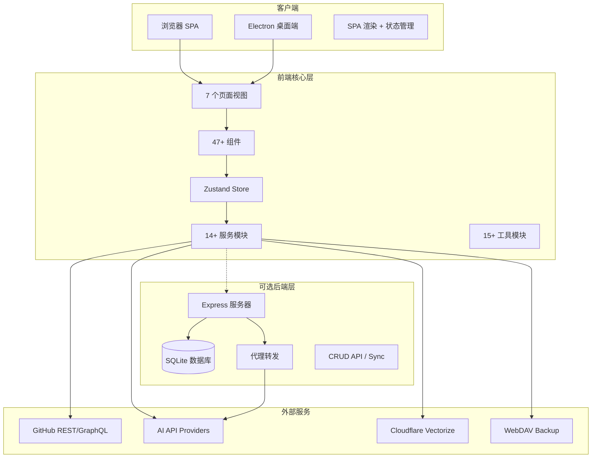

# GithubStarsManager — AI 驱动的 GitHub Stars 管理工具深度解读

> **GitHub:** [AmintaCCCP/GithubStarsManager](https://github.com/AmintaCCCP/GithubStarsManager)
>
> **版本:** v0.6.8 | **协议:** MIT | **语言:** TypeScript | **Star:** —

## 第一部分：快速概览

### 这是什么

GithubStarsManager 是一个 AI 驱动的 GitHub 星标仓库（Starred Repositories）管理工具，由 React 前端 + 可选 Express 后端组成。它的核心定位是解决"收藏上百个仓库后找不到、无法分类、无法追踪更新"的问题。数据 100% 存储在本地（前端 IndexedDB / 后端 SQLite），支持全平台桌面客户端（Electron）。

### 解决的痛点

- **Stars 堆积后无法检索** — 仓库数量超过几百个后，GitHub 本身提供的搜索和过滤能力有限，难以快速找到目标仓库
- **缺乏智能分类** — GitHub 没有自动分类机制，手动维护标签耗时。项目使用 AI 批量生成描述、标签和分类建议
- **Release 跟踪缺失** — 用户 star 了仓库但不一定及时关注 release，项目提供统一的 release 时间线订阅和已读管理
- **Fork 管理复杂** — 跟踪上游变更、触发同步和 CI 需要多个步骤，项目提供 fork 健康度检查和一键同步
- **语义搜索门槛** — GitHub 仅支持关键词匹配搜索，项目提供 AI 模糊搜索和向量语义搜索（Cloudflare Vectorize）

### 适用场景

- 开发者整理个人 GitHub 收藏清单
- 追踪关注项目的最新 Release 和变化
- 管理个人 Fork 仓库的上游同步
- Gist 笔记管理和智能摘要
- 发现技术趋势和热门项目

### 核心能力清单

| 能力 | 说明 |
|------|------|
| Stars 自动同步 | 连接 GitHub Token 自动拉取所有 Starred 仓库，支持增量同步 |
| AI 智能分析 | 批量调用多模型（OpenAI/Claude/Ollama）生成描述、标签和分类建议 |
| 语义搜索 | AI 驱动的模糊搜索，支持按意图而非精确名称查找仓库 |
| 向量搜索 | Cloudflare Vectorize 索引 + 自然语言查询（可选） |
| Release 跟踪 | 订阅仓库 Release，统一时间线查看，已读/未读管理，一键下载链接复制 |
| 智能资产过滤 | 按操作系统（macOS/Windows/Linux）和格式（dmg/zip/deb）过滤 Release 资产 |
| Fork 管理 | 上游变更检测、一键同步、GitHub Actions 触发 |
| Gist 管理 | 浏览/创建/编辑/删除，AI 摘要 + 语义搜索 |
| 发现/趋势 | 5 个发现频道：Trending / Hot Release / Most Popular / Topic / Search |
| 多分类系统 | 14 个默认分类 + 自定义，拖拽排序、颜色标记、锁定 |
| 全量离线可用 | 纯前端模式，所有数据在浏览器本地 IndexedDB，无后端依赖 |
| WebDAV 备份 | 支持坚果云、Nextcloud、ownCloud 等 WebDAV 兼容服务 |
| 桌面客户端 | Electron 构建，Windows/macOS/Linux 三平台 |
| Docker 部署 | 前端 nginx + 后端 Express 容器化一键启动 |
| 网络代理 | HTTP/SOCKS5 代理支持 |
| aria2 集成 | 通过 JSON-RPC 将下载任务发送到 aria2 |

### 技术栈一览

| 层面 | 技术 |
|------|------|
| **前端框架** | React 18 + TypeScript |
| **构建工具** | Vite 8 |
| **UI 样式** | Tailwind CSS 3 |
| **状态管理** | Zustand 4 + persist（IndexedDB） |
| **图标** | Lucide React |
| **Markdown** | react-markdown + remark-gfm + rehype-raw |
| **代码高亮** | highlight.js |
| **日期** | date-fns |
| **测试** | Vitest + @testing-library/react |
| **桌面端** | Electron + electron-builder |
| **后端框架** | Express 4 |
| **数据库** | better-sqlite3（SQLite） |
| **AI 服务** | OpenAI / Anthropic / Ollama / 兼容 API |
| **嵌入模型** | OpenAI / Gemini / Cohere / Ollama / SiliconFlow |
| **向量搜索** | Cloudflare Vectorize（Worker 代理） |
| **CI/CD** | GitHub Actions（桌面构建 + Docker 发布） |

## 第二部分：架构深读

### 架构总览图



### 两种运行模式

项目支持两种运行模式，用户可按需选择：

```
纯前端模式（推荐起步）：
  [浏览器] → localStorage/IndexedDB（全部本地）
           → GitHub API（直连，需无 CORS 限制）
           → AI API（需无 CORS 限制，桌面端/后端代理不受限）

前后端模式（推荐生产）：
  [前端 SPA] → Express 后端 → SQLite 持久化
                              → GitHub API（后端代理）
                              → AI API（后端代理，解决 CORS）
                              → WebDAV 备份
```

### 数据流

```
[GitHub API]           [AI API]           [Cloudflare Vectorize]
     ↓                     ↓                     ↓
  githubApi.ts          aiService.ts         vectorSearchService.ts
     ↓                     ↓                     ↓
  Zustand Store (内存) ← 回写分析结果
     ↓
  IndexedDB (持久化) ← persist 中间件自动快照
     ↓ (可选)
  Express 后端 → SQLite 数据库
```

### 核心模块职责

| 模块 | 位置 | 行数 | 职责 |
|------|------|------|------|
| 全局状态 | `src/store/useAppStore.ts` | ~800+ | 所有应用状态（仓库/分类/设置/AI 分析状态等），persist 到 IndexedDB |
| GitHub API | `src/services/githubApi.ts` | — | GitHub REST API 封装，限流/重试/分页 |
| AI 服务 | `src/services/aiService.ts` | — | 多模型 AI 调用（OpenAI/Claude/Ollama），流式/批处理 |
| 向量搜索 | `src/services/vectorSearchService.ts` | — | Cloudflare Vectorize 索引查询 |
| 自动同步 | `src/services/autoSync.ts` | — | 定时/手动同步 stars 数据 |
| 后端适配 | `src/services/backendAdapter.ts` | — | 前后端通信桥接 |
| 后端入口 | `server/src/index.ts` | — | Express 应用启动，路由挂载 |
| 后端路由 | `server/src/routes/` | 8 个路由 | repositories/releases/categories/configs/sync/proxy/logs |
| 后端 DB | `server/src/db/schema.ts` | — | SQLite 表定义 + migration |

## 第三部分：核心功能详解

### 3.1 GitHub Stars 同步

项目通过 GitHub REST API 分页拉取用户所有 Starred 仓库，支持增量同步（只拉取新增和变更的仓库）：

- **同步触发**：手动点击 / 自动定时 / GitHub Token 登录自动同步
- **全量同步**：拉取所有页面，重建本地数据
- **增量同步**：仅拉取新增/变更，合并到本地
- **冲突处理**：本地编辑优先，可通过后端模式实现多设备数据合并

同步的仓库字段包括：名称、描述、URL、Star 数、语言、Owner、Topic、Fork 状态、Star 时间等。

### 3.2 AI 智能分析

项目的 AI 分析是核心差异化功能，支持多模型并行批处理：

- **分析内容**：为每个仓库生成中文描述摘要（AI Summary）、技术标签（AI Tags）、适用平台（AI Platforms）
- **多模型支持**：OpenAI（GPT-3.5/4）、Anthropic（Claude）、Ollama（本地模型）、OpenAI 兼容 API
- **批处理**：支持并发控制（可配置 concurrency）、暂停/恢复、进度显示
- **分析优化**：`aiAnalysisOptimizer.ts` 跳过已分析和分析失败的仓库，避免重复 API 调用
- **故障处理**：分析失败标记 `analysis_failed: true`，重试时跳过

### 3.3 语义搜索

提供三个层次的搜索能力：

| 层次 | 实现 | 特点 |
|------|------|------|
| 基础搜索 | 前端过滤（名称/描述/标签关键词匹配） | 即时响应，离线可用 |
| AI 语义搜索 | 调用 AI API 将自然语言转为搜索条件 | 理解意图（如"找前端的 UI 组件库"） |
| 向量搜索 | Cloudflare Vectorize 嵌入索引 + 相似度查询 | 语义级匹配，无需 AI API 实时调用 |

向量搜索的流程：

```
1. 同步仓库 → 提取 README 内容 → 生成嵌入向量 → 写入 Cloudflare Vectorize
2. 用户输入自然语言查询 → 生成查询向量 → Vectorize 相似度搜索 → 返回 TopK 结果
3. 支持 HyDE（假设文档嵌入） + 语义重排序提升搜索质量
```

### 3.4 Release 跟踪与资产管理

用户可订阅特定仓库的 Release，在统一时间线上查看：

- **订阅管理**：仓库维度订阅开关，可配置 Release 源（GitHub Releases / 自定义）
- **已读/未读**：每个 Release 独立标记，支持批量标记已读
- **资产过滤**：按操作系统（macOS/Windows/Linux/ARM）和文件类型智能匹配
- **快捷操作**：一键复制下载链接、展开所有资产、批量操作
- **一键下载**：配合 aria2 RPC 实现远程下载任务推送

### 3.5 分类系统

| 分类 | 说明 |
|------|------|
| 默认分类 | 14 个预设（Frontend、Backend、AI、DevOps、Database 等） |
| 自定义分类 | 用户可创建，支持名称、颜色、图标、关键字匹配规则 |
| 分类锁定 | 锁定后 AI 分析不会修改该分类 |
| 拖拽排序 | 侧边栏拖拽自定义分类顺序 |
| 批量操作 | 多选仓库批量移动分类、批量恢复默认分类 |

### 3.6 Fork 管理

- **上游变更检测**：定期检查上游仓库是否有新提交，标记需要同步的 Fork
- **一键同步**：通过 GitHub API 触发同步操作
- **GitHub Actions 触发**：可配置同步后自动触发 Fork 仓库的 CI 流水线
- **状态看板**：Fork 列表 + 上游状态 + 同步历史

### 3.7 发现/趋势模块

5 个发现频道，无需事先 Star 即可发现新项目：

| 频道 | 数据源 | 说明 |
|------|--------|------|
| Trending | GitHub Trending API | 按语言/时间范围筛选趋势项目 |
| Hot Release | 已 Star 仓库的热门 Release | 关注度最高的 Release 排序 |
| Most Popular | 按 Star 数排序 | 筛选指定语言/类别的高 Star 项目 |
| Topic | 按 Topic 浏览 | 通过 Topic 标签发现相关项目 |
| Search | GitHub 搜索 | 自定义搜索条件发现新项目 |

## 第四部分：前后端架构详解

### 前端架构 \[`src/`\]

```
src/
├── App.tsx                # 主应用路由（7 个页面视图）
├── components/            # 47+ React 组件
│   ├── settings/          # 13 个设置面板子组件
│   ├── Repository*.tsx    # 仓库相关组件（列表/卡片/编辑弹窗）
│   ├── Release*.tsx       # Release 时间线/卡片
│   ├── Fork*.tsx          # Fork 管理视图/卡片
│   ├── Gist*.tsx          # Gist 管理/卡片/详情/编辑器
│   └── ...                # 搜索、分类、弹窗、工具类组件
├── store/
│   └── useAppStore.ts     # 全局 Zustand store（persist → IndexedDB）
├── services/              # 14+ 服务模块
│   ├── githubApi.ts       # GitHub API 封装
│   ├── aiService.ts       # AI 调用
│   ├── vectorSearchService.ts
│   ├── autoSync.ts
│   ├── backendAdapter.ts
│   └── ...
├── types/index.ts         # 所有 TypeScript 类型定义（656 行）
├── utils/                 # 15+ 工具函数模块
├── constants/             # 预设过滤器和项目常量
└── hooks/                 # 3 个自定义 Hook
```

### 后端架构 \[`server/`\]

```
server/src/
├── index.ts               # Express 入口，路由挂载 + 中间件注册
├── config.ts              # 配置加载（端口/密钥/数据库路径）
├── db/
│   ├── connection.ts      # SQLite 连接管理
│   ├── schema.ts          # 10+ 张表定义
│   └── migrations.ts      # 数据迁移
├── routes/                # 8 个 API 路由
│   ├── repositories.ts    # CRUD /api/repositories
│   ├── releases.ts        # CRUD /api/releases
│   ├── categories.ts      # CRUD /api/categories
│   ├── configs.ts         # CRUD /api/configs（AI/WebDAV/代理配置）
│   ├── sync.ts            # POST /api/sync（全量数据同步）
│   ├── proxy.ts           # POST /api/proxy/*（代理转发，解决 CORS）
│   ├── logs.ts            # GET /api/logs（日志查询）
│   └── health.ts          # GET /api/health（健康检查）
├── services/
│   ├── crypto.ts          # AES-256-GCM 加密（API Key 加密存储）
│   ├── logger.ts          # 日志服务
│   └── proxyService.ts   # HTTP/SOCKS5 代理服务
├── middleware/
│   ├── auth.ts            # Bearer Token 认证
│   └── errorHandler.ts    # 全局错误处理
└── types/api.ts           # API 类型定义
```

### 数据库设计

#### 前端 IndexedDB（Zustand persist）

所有前端状态通过 Zustand `persist` 中间件自动保存到 IndexedDB，存储为完整 JSON 快照。包含仓库列表、分类、AI 配置、UI 状态等。

#### 后端 SQLite 表（10+ 张表）

| 表名 | 主要字段 |
|------|---------|
| **repositories** | id, full_name, description, html_url, stargazers_count, language, owner_login, topics(JSON), ai_summary, ai_tags(JSON), ai_platforms(JSON), analyzed_at, analysis_failed, custom_*, category_locked, subscribed_to_releases, vector_indexed_at |
| **releases** | id, tag_name, name, body, published_at, assets(JSON), repo_id, repo_full_name, prerelease, is_read |
| **categories** | id, name, description, icon, keywords(JSON), color, sort_order, is_custom |
| **ai_configs** | id, name, api_type, base_url, api_key_encrypted(AES-256), model, concurrency, reasoning_effort |
| **embedding_configs** | id, name, api_type, base_url, api_key_encrypted, model, dimensions |
| **vector_search_configs** | id, enabled, worker_url, auth_token_encrypted, index_mode, readme_max_chars |
| **webdav_configs** | id, name, url, username, password_encrypted, path |
| **asset_filters** | id, name, keywords(JSON), platform, sort_order |
| **settings** | key-value 通用键值对 |
| **schema_version** | 数据库版本跟踪 |

## 第五部分：部署方式

| 部署方式 | 说明 | 适用场景 |
|---------|------|---------|
| **桌面客户端** | Electron 打包，GitHub CI 自动构建 .exe/.dmg/.AppImage | 个人日常使用，推荐方式 |
| **Docker Compose** | nginx 前端 + Express 后端，`docker-compose up -d` | 服务端部署，多设备共享 |
| **纯静态托管** | Vite build 产物，部署到 Netlify/Vercel/Cloudflare Pages | 快速体验，无需后端 |
| **手动开发** | `npm run dev` + `npm run dev:server` | 开发调试 |

桌面端优势：无 CORS 限制，可直连 GitHub API 和 AI API，是推荐的使用方式。

## 第六部分：同类对比

| 维度 | GithubStarsManager | Astral | Starred |
|------|-------------------|--------|---------|
| **语言** | TypeScript (React+Express) | Rust | Python |
| **定位** | 全功能 Stars 管理平台 | CLI Stars 列表生成 | CLI Stars 列表生成 |
| **UI** | ✅ 图形界面 SPA | ❌ CLI | ❌ CLI |
| **AI 智能分类** | ✅ 多模型支持 | ❌ | ❌ |
| **语义搜索** | ✅ 支持 | ❌ | ❌ |
| **Release 跟踪** | ✅ | ❌ | ❌ |
| **Fork 管理** | ✅ | ❌ | ❌ |
| **Gist 管理** | ✅ | ❌ | ❌ |
| **桌面客户端** | ✅ Electron | ❌ | ❌ |
| **后端** | ✅ 可选 Express+SQLite | ❌ | ❌ |
| **数据存储** | 本地 IndexedDB / SQLite | 无 | 无 |
| **部署复杂度** | 中 | 低（二进制） | 低（pip） |
| **功能丰富度** | ⭐⭐⭐⭐⭐ | ⭐⭐ | ⭐⭐⭐ |

### 选择建议

- **需要可视化 Stars 管理平台** → GithubStarsManager（唯一的全功能 UI 方案）
- **需要 CLI 生成 Awesome 列表** → Starred（Python，极简 220 行）或 Astral（Rust，高性能）
- **需要 AI 智能分类和搜索** → GithubStarsManager（唯一内置 AI 的方案）
- **需要跟踪 Release 和 Fork** → GithubStarsManager（独有功能）
- **追求极简和轻量** → Starred / Astral

## 第七部分：设计亮点与改进空间

### 设计亮点

1. **离线优先** — 纯前端 + IndexedDB 架构，不依赖后端即可完整使用
2. **渐进增强** — 从纯前端 → 后端 → Docker → 桌面端，随需求切换，无迁移成本
3. **AI 批处理** — 并发控制 + 进度追踪 + 失败跳过 + 暂停恢复，工程化完善的 AI 调用方案
4. **多模型抽象** — 统一接口适配 OpenAI/Claude/Ollama/兼容 API，灵活切换
5. **数据加密** — API Key 使用 AES-256-GCM 加密存储，而非明文
6. **解耦架构** — 前端状态管理（Zustand）独立于 UI 组件，服务层独立于视图层
7. **丰富的自定义** — 分类自定义、资产过滤器自定义、菜单自定义

### 改进空间

| 问题 | 说明 |
|------|------|
| 后端功能较弱 | 当前后端主要做数据持久化和代理转发，缺少用户认证、多用户支持、高级查询 |
| 无数据冲突策略 | 多设备使用同一后端时，没有明确的冲突解决策略（最后写入覆盖） |
| 无单元测试覆盖 | 前端服务层和后端都有一定测试，但对核心 AI 分析和同步逻辑缺乏测试 |
| 国际化不完整 | 虽然有中文翻译，但 UI 组件的 i18n 覆盖不全面 |
| 状态类型过大 | `useAppStore.ts` 的 AppState 类型超过 800 行，可拆分为多个独立 store |

---

> **GitHub:** [AmintaCCCP/GithubStarsManager](https://github.com/AmintaCCCP/GithubStarsManager)
>
> *本目录下还有独立深度文档：*
