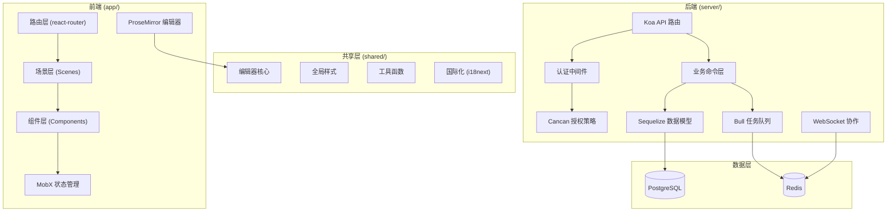
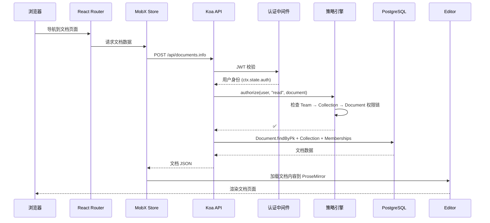

# Outline — 团队协作知识库深度解读

> **GitHub:** [outline/outline](https://github.com/outline/outline)
>
> **版本:** v1.8.1 | **协议:** BSL 1.1 | **语言:** TypeScript | **Star:** 30k+

## 第一部分：快速概览

### 这是什么

Outline 是一个面向团队的现代化知识库与文档协作平台，以**实时协作编辑、API 优先设计、极致的编辑体验**为核心特色。与传统的 Wiki 系统不同，Outline 的体验更接近 Notion 或 Google Docs，但定位为**开源且可自托管**的团队知识管理工具。

它的设计哲学是：团队文档工具应该像消费级产品一样流畅，同时保持企业级的权限和部署控制。

### 解决的痛点

- **团队知识碎片化** — 文档散落在 Google Docs、Notion、Confluence、本地文件中，缺乏统一的知识管理入口
- **协作体验落后** — 传统 Wiki（MediaWiki、DokuWiki）编辑体验停留在十年前，不支持实时协作
- **自托管平台体验代差** — 可自托管的文档平台（BookStack、Wiki.js）在 UI 和交互上难以匹敌 SaaS 产品
- **权限模型两极分化** — 要么太简单（全局角色），要么太复杂（ACL 矩阵），Outline 的层级继承方案找到中间路线

### 适用场景

- 技术团队内部 Wiki 和研发文档
- 产品手册和 API 文档
- 公司内部知识库
- 开源项目文档站点

### 核心能力清单

| 能力 | 说明 |
|------|------|
| 实时协作编辑 | 基于 Y.js + Hocuspocus 的 CRDT 协作，多人同时编辑无冲突 |
| 富文本编辑器 | ProseMirror 引擎，支持 Markdown / Slash 命令 / 拖拽 / 嵌入 Mermaid 图表 |
| 层级权限继承 | Team → Collection → Document 三级继承，支持用户/组成员资格 + 分享链接 |
| 版本历史 | 每次变更自动创建 Revision 全量快照，支持版本浏览、Diff 对比、恢复到任意版本 |
| API 优先设计 | 完整 REST API，支持 API 密钥认证和 OAuth2，生态集成丰富 |
| 多认证集成 | OIDC / OAuth2 / SAML / LDAP / Slack / Google / Azure AD |
| 全文搜索 | 基于 PostgreSQL 的全文索引，支持搜索结果高亮和筛选 |
| 集成生态 | Slack 深度集成（搜索/通知/快捷创建）、Zapier、MCP 协议 |
| 分享链接 | 支持文档级/集合级分享，可控制是否包含子文档、索引、订阅 |
| 自托管 | 单 Docker Compose 文件即可部署（PostgreSQL + Redis） |

### 技术栈一览

| 层面 | 技术 |
|------|------|
| **前端框架** | React 17 + React Router 5 |
| **状态管理** | MobX 4 + mobx-react 6 |
| **构建工具** | Vite (rolldown-vite) |
| **UI 样式** | styled-components 5 |
| **编辑器** | ProseMirror (14+ 扩展包) + y-prosemirror |
| **实时协作** | Y.js + Hocuspocus + Socket.io |
| **后端框架** | Koa 3 |
| **ORM** | Sequelize 6 + sequelize-typescript |
| **数据库** | PostgreSQL |
| **缓存/队列** | Redis + Bull (任务队列) |
| **认证** | Passport (Google/OIDC/Slack/AzureAD/OAuth2) + JWT + WebAuthn |
| **授权** | Cancan 风格策略文件 |
| **文件存储** | AWS S3 SDK |
| **测试** | Vitest + MSW |

## 第二部分：架构深读

### 架构总览图



### 启动流程

```
1.  基础设施初始化
    ├── 建立 PostgreSQL 连接 → 运行 Sequelize 迁移
    └── 建立 Redis 连接

2.  核心模块加载
    ├── 加载 Sequelize 模型（40+ 模型）→ 定义关联关系
    ├── 注册 Koa 中间件链：安全 → CORS → 限流 → 国际化 → 认证
    ├── 注册 Passport 认证策略
    ├── 注册 API 路由 → 校验 Schema（zod/class-validator）
    └── 注册 Cancan 策略文件 → 执行 allow() 注册能力规则

3.  服务启动
    ├── 启动 HTTP 服务（监听端口）
    ├── 启动 Hocuspocus WebSocket（实时协作）
    ├── 启动 Socket.io（实时通知）
    └── 注册 Bull 任务队列处理器
```

### 核心请求链路 — 文档读取流程



### 目录结构与模块映射

**核心目录结构：**

```
outline/
├── app/                          # React 前端
│   ├── components/               # 通用组件
│   ├── scenes/                   # 页面级场景组件
│   │   └── Document/             # 文档编辑/浏览场景
│   │       ├── components/       # 历史、权限、分享等子组件
│   │       └── hooks/            # useDocumentSave 等自定义 Hook
│   ├── stores/                   # MobX Store 和 Model
│   ├── actions/                  # 可复用的命令式操作
│   └── menus/                    # 右键/操作菜单
├── server/                       # Koa 后端
│   ├── routes/api/               # REST API 路由
│   │   ├── documents/            # 文档 CRUD API
│   │   ├── collections/          # 集合 API
│   │   ├── revisions/            # 版本历史 API
│   │   └── attachments/          # 附件上传/访问 API
│   ├── models/                   # Sequelize 数据模型
│   ├── policies/                 # Cancan 授权策略
│   │   ├── cancan.ts             # 授权引擎核心
│   │   ├── document.ts           # 文档级权限规则
│   │   └── collection.ts         # 集合级权限规则
│   ├── commands/                 # 无状态业务命令
│   └── queues/                   # Bull 任务队列处理器
├── shared/                       # 前后端共享
│   ├── editor/                   # ProseMirror 扩展和工具
│   │   ├── extensions/           # 编辑器扩展插件
│   │   └── lib/                  # ChangesetHelper 等工具
│   └── types.ts                  # 共享类型定义
└── public/                       # 静态资源
```

| 模块 | 职责 |
|------|------|
| `app/scenes/Document/` | 文档编辑与浏览页面，包含历史、权限、分享面板等子组件 |
| `app/stores/` | MobX 数据层，管理文档、集合、用户等客户端状态 |
| `server/policies/` | Cancan 授权引擎 + 各资源的权限规则定义 |
| `server/commands/` | 无状态业务逻辑（文档创建、更新、恢复、删除等） |
| `server/queues/` | 异步任务处理（Revision 创建、附件清理、邮件） |
| `shared/editor/` | ProseMirror 编辑器核心扩展和 diff 工具 |

## 第三部分：核心实现亮点

### 3.1 实时协作引擎

Outline 的实时协作基于 **Y.js + Hocuspocus** 实现，这是当前最成熟的 CRDT（无冲突数据类型）协作方案。

**架构链路：**

```
用户 A (ProseMirror) → y-prosemirror 绑定 → Y.Doc → Hocuspocus WebSocket
用户 B (ProseMirror) → y-prosemirror 绑定 → Y.Doc → Hocuspocus WebSocket
                                            ↓
                                     Redis Pub/Sub (跨进程广播)
                                            ↓
                                     Y.Doc 状态持久化
```

**关键设计：**

- 使用 Y.js 的 `PermanentUserData` 标记每个用户的编辑归属
- 通过 Redis 的 `doc-collaborators:{documentId}` 键跟踪活跃协作者
- 最后一位用户离开时触发 `done: true` 的更新事件，立即创建 Revision
- 多人编辑时的协作内容通过 `documentCollaborativeUpdater.ts` 写入数据库

```typescript
// server/commands/documentCollaborativeUpdater.ts
// 当最后一个协作者断开连接时，触发 Revision 创建
if (isLastConnection) {
  await EventBus.emit("documents.update", {
    modelId: documentId,
    data: { multiplayer: true, done: true },
  });
}
```

### 3.2 ProseMirror 富文本编辑器

Outline 没有使用 Slate 或 Quill，而是选择了 ProseMirror—一个以灵活性著称的编辑器框架。

**扩展生态（14+ 核心扩展）：**

| 扩展类型 | 功能 |
|---------|------|
| `Diff` | 版本对比时高亮新增（绿色）/删除（红色）/修改（黄色） |
| `Keys` | 键盘快捷键映射 |
| `Markdown` | Markdown 序列化/反序列化 |
| `Mermaid` | 支持嵌入 Mermaid 图表 |
| `Commands` | Slash 命令菜单 |
| `DragDrop` | 拖拽排序和嵌入 |
| `CodeFences` | 代码块和高亮 |

**Diff 扩展**（`shared/editor/extensions/Diff.ts`）使用 `prosemirror-changeset` 将两次 Prosemirror 文档状态转换成插入/删除/修改集合，通过 CSS 装饰类渲染差异。

### 3.3 Cancan 式权限授权引擎

Outline 实现了一个声明式权限引擎，灵感来自 Ruby 社区的 CanCanCan 库。

**核心机制**（`server/policies/cancan.ts`）：

```typescript
// 注册一条能力规则
allow(User, "read", Document, (actor, document) => {
  return isTeamModel(actor, document) && (
    includesMembership(document, [Read, ReadWrite, Admin]) ||
    (document.isDraft && actor.id === document.createdById) ||
    can(actor, "readDocument", document?.collection)
  );
});
```

**策略文件即模块注册：** 所有 `allow()` 调用在导入时执行。`server/policies/index.ts` 导入所有策略文件，完成能力注册。执行授权时，`can(actor, action, target)` 遍历匹配的能力规则，执行条件函数。

> **深入分析参见:** [文档资源权限管理](./permission.md)

## 第四部分：多版本能力

Outline 的版本管理基于**全量快照（Full Snapshot）** 模式，每次值得记录的变更都会创建一个完整的 Revision 快照。

**触发时机：**
- 文档发布（`documents.publish`）
- 文档编辑后经 5 分钟去抖的自动保存（`documents.update.debounced`）
- 用户主动关闭/导航离开（`documents.update` with `done: true`）

**核心能力：**
- 任意版本之间进行 Diff 对比（新增/删除/修改高亮）
- 恢复到任意历史版本
- 版本列表与文档事件（发布/归档/删除）交织展示
- 版本导出（Markdown / HTML / PDF）

> **详细分析参见:** [文档多版本机制](./versioning.md)

## 第五部分：资源权限模型

Outline 的权限体系以**层级继承**为核心设计理念：

```
Team
 └── Collection (公开/私有)
      └── Document
           ├── 分享链接（公开/内部）
           └── Attachment（团队级 ACL）
```

每个层级可以设置独立的成员资格，下层默认继承上层权限，但可以通过直接成员资格覆盖。

> **详细分析参见:** [文档资源权限管理](./permission.md)

## 第六部分：同类对比

| 维度 | Outline | Wiki.js | BookStack | Notion |
|------|---------|---------|-----------|--------|
| **开源协议** | BSL 1.1 | AGPL-3.0 | MIT | 闭源 |
| **自托管** | ✅ Docker Compose | ✅ Docker / K8s | ✅ PHP 传统部署 | ❌ |
| **实时协作** | ✅ CRDT (Y.js) | ❌ | ❌ | ✅ |
| **编辑器** | ProseMirror 富文本 | 7 种编辑器可选 | Markdown + WYSIWYG | 自有引擎 |
| **版本管理** | Revision 全量快照 | PageHistory + Git 双轨 | 基础历史 | 30 天历史 |
| **权限模型** | 层级继承（3 级） | 页面级 PageRule | 角色 + 页面层级 | 角色 + 共享 |
| **权限粒度** | 集合/文档级 | 页面级（路径/正则） | 角色 + 页面 | 页面级 |
| **插件生态** | 集成（Slack/MCP） | 40+ 官方插件 | 社区插件 | App 集成 |
| **API** | REST API | GraphQL + REST | REST API | REST API |
| **认证** | OIDC/OAuth/SAML | 20+ 策略 | LDAP/OAuth | SSO |
| **搜索** | PostgreSQL 全文 | 6 种引擎可选 | 内置 + Elastic | 内置 |
| **部署复杂度** | 中 | 低~中 | 低 | N/A |
| **社区活跃度** | ⭐⭐⭐⭐⭐ | ⭐⭐⭐⭐ | ⭐⭐⭐ | N/A |

### 选择建议

- **追求团队协作体验** → Outline（实时协作、UI 现代化、Slack 深度集成）
- **需要高度定制和自托管** → Wiki.js（插件丰富、存储灵活、权限精细）
- **传统 PHP 环境** → BookStack（上手快、有层级目录）
- **不介意 SaaS** → Notion（功能最全、生态最大）

---

> **GitHub:** [outline/outline](https://github.com/outline/outline)
>
> *本目录下还有独立深度文档：[文档资源权限管理](./permission.md) · [文档多版本机制](./versioning.md)*
