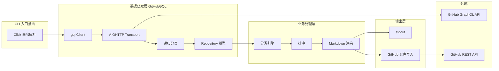
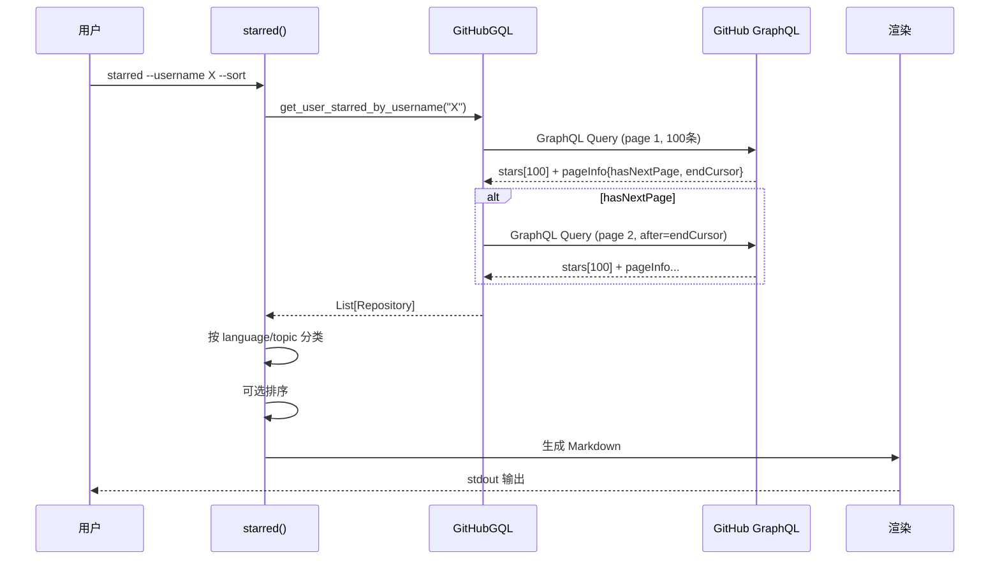

# Starred — GitHub Stars 转 Awesome 列表 CLI 工具深度解读

> **GitHub:** [maguowei/starred](https://github.com/maguowei/starred)
>
> **版本:** v4.3.0 | **协议:** MIT | **语言:** Python | **Star:** 1k+

> **深度文档:** [CLI 设计与命令详解](./cli-design.md)

## 第一部分：快速概览

### 这是什么

Starred 是一个轻量级 Python CLI 工具，通过 GitHub GraphQL API v4 拉取用户的 starred 仓库，按编程语言或 topic 分组，生成标准 Awesome 风格的 Markdown 列表。整个项目仅约 220 行 Python 代码，核心逻辑集中在两个文件中。

### 解决的痛点

- **个人 GitHub Stars 缺乏整理** — starred 仓库累积后难以浏览和检索，生成分类列表方便回顾
- **手动维护 Awesome 列表费时** — 每次 star 新仓库后要手动更新列表，starred 可一键重新生成
- **缺乏自动化机制** — 与 GitHub Actions 配合可实现定时自动更新，生成自维护的 awesome-stars 页面
- **语言/topic 双维度浏览** — 提供按语言和按 topic 两种分类视角，适应不同检索需求

### 适用场景

- 开发者整理个人 GitHub 收藏清单
- 技术博客附带的资源推荐列表
- 团队维护技术选型参考库
- 自动生成并托管在 GitHub Pages 上的 Awesome 页面

### 核心能力清单

| 能力 | 说明 |
|------|------|
| Stars 拉取 | 通过 GraphQL API 分页拉取用户所有 starred 仓库（每页 100 条） |
| 语言分类 | 默认按仓库主语言分组，语言为空归入 Others |
| Topic 分类 | `--topic` 切换为按仓库 topic 分组，支持热度阈值过滤 |
| 排序输出 | `--sort` 按分类名称字母顺序排列 |
| 直接写仓库 | `--repository` 将生成结果自动提交到 GitHub 仓库，不存在则自动创建 |
| 私有仓库支持 | `--private` 包含私有仓库 |
| Awesome 格式 | 输出符合 Awesome 标准，含 TOC、分类列表、CC0 License 声明 |

### 技术栈一览

| 层面 | 技术 |
|------|------|
| **语言** | Python >= 3.10 |
| **CLI 框架** | Click |
| **API 协议** | GitHub GraphQL API v4 |
| **GraphQL 客户端** | gql + aiohttp |
| **REST 客户端** | github3.py（仅用于写入仓库场景） |
| **包管理** | uv |
| **构建** | hatchling |
| **CI** | pycodestyle + 集成测试 |

## 第二部分：架构深读

> **详细分析参见:** [CLI 设计与命令详解](./cli-design.md)

### 架构总览图



### 数据流

```
[GitHub GraphQL API]           [GitHub REST API]
        ↓                             ↑
  GitHubGQL                          github3.py
  (递归分页 100 条/次)                  (仅写入仓库时使用)
        ↓
  List[Repository]
  (name, description, language,
   url, stargazer_count,             github3.py
   is_private, topics)                  (仅写入仓库时使用)
        ↓
  分类处理: language/topic
        ↓
  可选排序: sort
        ↓
  Markdown 渲染
    → stdout（默认）
    → GitHub 仓库（--repository 时）
```

### 文件结构与模块映射

```
starred/
├── __init__.py          # 版本号 VERSION = '4.3.0'
├── starred.py           # CLI 入口、分类逻辑、Markdown 渲染、仓库写入
└── githubgql.py         # GitHub GraphQL 客户端、分页、数据模型
```

| 文件 | 行数 | 职责 |
|------|------|------|
| `starred.py` | 136 | Click 命令定义、数据分类、排序、Markdown 模板、GitHub 仓库读写 |
| `githubgql.py` | 86 | GraphQL 查询定义、GitHubGQL 客户端、Repository 数据模型、递归分页 |

### 核心请求链路 — Stars 生成流程



## 第三部分：CLI 设计

### 命令模板

```bash
starred --username <user> --token <token> [选项] [> README.md]
```

### 九大选项

| 选项 | 环境变量 | 必填 | 默认值 | 说明 |
|------|---------|------|--------|------|
| `--username` | `USER` | 是 | - | GitHub 用户名 |
| `--token` | `GITHUB_TOKEN` | 是 | - | Personal Access Token |
| `--sort` | - | 否 | False | 分类名按字母顺序排列 |
| `--topic` | - | 否 | False | 按 topic 而非语言分类 |
| `--topic_limit` | - | 否 | 500 | topic star 数阈值 |
| `--repository` | - | 否 | '' | 写入目标仓库名 |
| `--filename` | - | 否 | README.md | 写入文件名 |
| `--message` | - | 否 | (固定消息) | 提交信息 |
| `--private` | - | 否 | False | 包含私有仓库 |

### 典型用法

```bash
# 生成到 stdout，重定向到文件
starred --username maguowei --token ${GITHUB_TOKEN} --sort > README.md

# 直接推送到 GitHub 仓库
starred --username maguowei --token ${GITHUB_TOKEN} --repository awesome-stars --sort

# 按 topic 分类，阈值调高减少分类数
starred --username maguowei --token ${GITHUB_TOKEN} --topic --topic_limit 1000

# 包含私有仓库
starred --username maguowei --token ${GITHUB_TOKEN} --private
```

> **详细分析参见:** [CLI 设计与命令详解](./cli-design.md)

## 第四部分：数据获取与分页

### GraphQL 查询

单次查询获取仓库完整信息，使用 GitHub GraphQL API v4：

```graphql
query ($username: String!, $after: String) {
  user(login: $username) {
    starredRepositories(first: 100, after: $after, orderBy: {direction: DESC, field: STARRED_AT}) {
      nodes {
        name, nameWithOwner, description, url
        stargazerCount, forkCount, isPrivate, pushedAt, updatedAt
        languages(first: 1, orderBy: {field: SIZE, direction: DESC}) { edges { node { id name } } }
        repositoryTopics(first: 100) { nodes { topic { name stargazerCount } } }
      }
      pageInfo { endCursor hasNextPage }
    }
  }
}
```

关键设计：
- **first: 100** — 每页 100 条，按 starred 时间降序（最新优先）
- **languages first:1** — 只取主语言（按代码量最大）
- **repositoryTopics first:100** — topic 全部拉取，客户端侧按 `stargazerCount > topic_limit` 过滤
- **递归分页** — `hasNextPage` 为 true 时递归调用自身，直到拉取完毕

### Repository 数据模型

```python
class Repository:
    def __init__(self, name, description, language, url,
                 stargazer_count, is_private, topics):
```

纯数据容器，6 个字段，无方法。

## 第五部分：分类与输出

### 两种分类模式

| 模式 | 触发 | 映射关系 | 特点 |
|------|------|----------|------|
| 按语言 | 默认 | 一对一（一个仓库一个分类） | 确定性，按仓库主要语言归类 |
| 按 topic | `--topic` | 多对多（一个仓库多个分类） | 灵活，同一仓库可出现在多个 topic 下 |

### 输出格式

标准 Awesome 风格 Markdown：

```markdown
<!--lint disable awesome-contributing ...-->
# Awesome Stars [](...)

> A curated list of my GitHub stars! Generated by starred.

## Contents

- [Python](#python)
- [JavaScript](#javascript)

## Python

- [owner/repo](url) - description

## License

[](...)

To the extent possible under law, {username} has waived all copyright...
```

输出包含：
1. **文件头** — lint-disable 注释（兼容 awesome-lint）+ Awesome 徽章 + 生成声明
2. **目录** — 按分类名生成锚点链接列表
3. **分类列表** — 每个分类下仓库列表（名称链接 + 描述）
4. **License** — CC0 协议声明

### 输出写入仓库

`--repository` 模式下：
1. 拦截 stdout 到 BytesIO
2. `github3.py` REST 客户端查询目标仓库
3. 对比现有文件内容，不一致则更新
4. 仓库不存在则自动创建并初始化提交
5. 完成后自动打开浏览器

## 第六部分：同类对比

| 维度 | Starred | awesome-list-generator | Astral |
|------|---------|----------------------|--------|
| **语言** | Python | Python | Rust |
| **API** | GraphQL v4 | REST API v3 | GraphQL v4 |
| **输出** | Awesome Markdown | Markdown | Markdown / JSON |
| **分类** | 语言 / Topic | 语言 | 语言 / Topic |
| **直接写仓库** | ✅ | ❌ | ❌ |
| **排序** | ✅ (分类名排序) | ✅ | ✅ |
| **私有仓库** | ✅ | ❌ | ❌ |
| **包大小** | ~220 行 | ~500 行 | N/A |
| **依赖数** | 5 个 | 多个 | N/A |

### 选择建议

- **需要轻量 Python 工具** → Starred（极简，220 行代码，5 个依赖）
- **需要直接推送到 GitHub** → Starred（唯一内置该功能）
- **追求高性能** → Astral（Rust 编写，大规模 stars 拉取更快）
- **需要更多自定义输出格式** → awesome-list-generator

---

> **GitHub:** [maguowei/starred](https://github.com/maguowei/starred)
>
> **深度文档:** [CLI 设计与命令详解](./cli-design.md)
