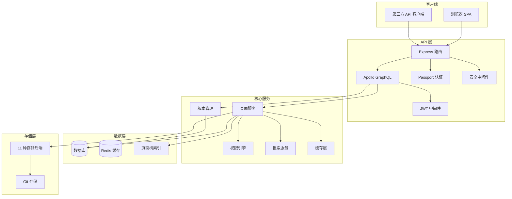
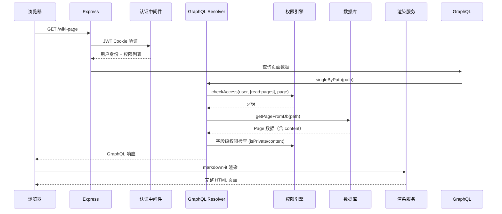

# Wiki.js - 现代化 Wiki 引擎深度解读

> **GitHub:** [requarks/wiki](https://github.com/requarks/wiki)
>
> **版本:** v2.0.0 | **协议:** AGPL-3.0 | **语言:** Node.js | **Star:** 25k+
>
> **深度文档:** [系统架构](./system-arch.md) · [数据库设计](./db-design.md) · [多版本文档机制](./version-management.md) · [文档资源权限管理](./permission-model.md) · [Git 存储集成](./git-storage.md)

## 第一部分：快速概览

### 这是什么

Wiki.js 是一个基于 Node.js 构建的现代化 Wiki 引擎，提供了丰富的文档创作、版本管理和权限控制能力。与传统的 Wiki 系统（如 MediaWiki）不同，Wiki.js 的设计更接近现代文档工具（如 Notion、Confluence），强调**可视化编辑、Git 原生集成、细粒度权限控制和模块化扩展**。

### 解决的痛点

- **自建 Wiki 的部署复杂度** — 单机可运行，也支持 Docker/K8s 化部署，降低运维成本
- **文档版本管理缺失** — 内置 PageHistory 快照机制 + Git 存储双轨，支持任意版本恢复
- **权限粒度不够** — 支持页面级别（路径/标签/正则）的 allow/deny 规则，而非粗粒度的角色划分
- **编辑体验差** — 多种编辑器可选（WYSIWYG、Markdown、Code、API 编辑器）
- **多语言支持** — 原生多 locale 页面树，每页面可管理多语言版本
- **存储可扩展** — 支持 11 种存储后端（磁盘/Git/S3/SFTP/Dropbox 等）

### 适用场景

- 企业内部知识库
- 技术团队文档平台
- 个人笔记/知识管理
- 产品文档站点

### 核心能力清单

| 能力 | 说明 |
|------|------|
| 多编辑器 | Markdown / WYSIWYG / Code / API / AsciiDoc 编辑器可选 |
| 多版本管理 | 每次变更自动创建快照，支持历史查看、版本恢复、Git 持久化 |
| 细粒度权限 | 用户+组+PageRule 三层，支持路径/标签/正则匹配、allow/deny 模式 |
| 多语言页面 | 每页面可管理多个 locale 版本，独立路径/内容/发布状态 |
| 标签系统 | 页面标签管理、按标签筛选、标签级权限规则 |
| 页面调度发布 | 支持发布开始/结束时间，定时上线下线 |
| 插件模块化 | 9 大模块类型、50+ 官方插件（认证/存储/搜索/渲染等） |
| 全文搜索 | 内置 DB 搜索 + 集成 Elasticsearch / Algolia / Sphinx 等 |
| 多数据库 | PostgreSQL / MySQL / MariaDB / MSSQL / SQLite |
| REST API | 完整的 API 密钥管理，支持第三方集成 |
| 导航管理 | 树形/静态/混合导航，支持按组控制可见性 |
| 评论系统 | 页面级评论，独立权限控制 |

### 技术栈一览

| 层面 | 技术 |
|------|------|
| **运行时** | Node.js >= 20 |
| **Web 框架** | Express |
| **API 层** | Apollo Server (GraphQL) |
| **前端框架** | Vue 2 + Vuetify 2 |
| **状态管理** | Vuex |
| **ORM** | Objection.js (基于 Knex) |
| **数据库** | PostgreSQL / MySQL / MariaDB / MSSQL / SQLite |
| **认证** | Passport.js + JWT (RS256) |
| **Markdown** | markdown-it |
| **模板引擎** | Pug (服务端) |
| **构建工具** | Webpack 4 + Babel |
| **测试** | Jest + Cypress |
| **存储** | 磁盘/Git/S3/SFTP/Dropbox/GDrive/OneDrive/Azure 等 11 种 |

## 第二部分：架构深读

> **详细分析参见:** [系统架构设计详解](./system-arch.md)

### 架构总览图



### 启动流程

Wiki.js 的启动分为三个阶段：

```
1.  加载配置
    ├── 读取 config.yml（磁盘配置）
    └── 从 DB 加载 settings（运行时配置）

2.  初始化核心模块
    ├── 建立数据库连接（Knex）
    ├── 初始化缓存层
    ├── 注册 Passport 认证策略
    ├── 加载 GraphQL schema
    ├── 注册权限引擎（@auth directive）
    └── 初始化插件系统（9 大模块类型）

3.  启动服务
    ├── 启动 Express 服务（端口 3000）
    ├── 运行首次设置向导（新安装时）
    └── 加载后台定时任务（历史清理/搜索重建）
```

### 核心请求链路 — 页面渲染流程



### 模块职责

| 模块 | 职责 |
|------|------|
| `server/models/` | 数据模型层（Objection.js ORM），定义 22 个模型 |
| `server/graph/schemas/` | GraphQL 类型定义（20 个 schema 文件） |
| `server/graph/resolvers/` | GraphQL 查询/变更解析器 |
| `server/core/auth.js` | 权限引擎核心 — `checkAccess` / `getEffectivePermissions` |
| `server/graph/directives/auth.js` | `@auth` 指令 — GraphQL 字段级权限拦截 |
| `server/modules/` | 9 大模块类型的插件注册与管理 |
| `server/controllers/` | Express 路由处理器（auth/common/ssl/upload） |
| `server/jobs/` | 后台定时任务队列 |
| `server/middlewares/` | Express 中间件（安全/SEO） |

## 第三部分：版本管理机制

Wiki.js 采用**双轨版本存储架构**：

1. **PageHistory 表** — 每次页面变更自动创建完整快照，支持任意版本恢复和历史审计
2. **Git 存储** — 通过 storage/git 模块将页面内容同步到 Git 仓库，实现外部持久化和变更日志

每次页面 `update` / `move` / `delete` / `restore` 操作，都会触发 `WIKI.models.pageHistory.addVersion()` 创建一次快照。版本恢复时，从 PageHistory 取出历史版本作为新内容更新当前页面。

> **详细分析参见:** [多版本文档机制](./version-management.md)

## 第四部分：权限模型架构

Wiki.js 的权限体系分为三层：

1. **GraphQL `@auth` 指令** — Schema 层全局权限拦截，检查 JWT 中的 `permissions` 数组
2. **`checkAccess()` 权限引擎** — 核心逻辑层，综合全局权限 + PageRule 页面级规则
3. **Model CRUD 方法** — 执行层，在数据操作前二次校验

`manage:system` 权限具有最高优先级，可绕过所有检查。PageRule 支持 START / END / EXACT / REGEX / TAG 五种匹配类型，按特异性优先级排序解决冲突。

> **详细分析参见:** [文档资源权限管理](./permission-model.md)

## 第五部分：插件系统

### 九大模块类别

| 模块类型 | 作用 | 官方插件数 |
|---------|------|-----------|
| `authentication` | 认证策略（OIDC/OAuth/SAML/LDAP 等） | 20+ |
| `storage` | 存储后端（磁盘/Git/S3/SFTP 等） | 11 |
| `search` | 搜索引擎（DB/Elasticsearch/Algolia 等） | 6 |
| `rendering` | 渲染引擎（markdown-it/代码高亮/Mermaid 等） | 10+ |
| `editor` | 编辑器（Markdown/WYSIWYG/Code/API 等） | 7 |
| `logging` | 日志输出 | 4 |
| `analytics` | 分析集成 | 4 |
| `comments` | 评论引擎 | 1 |
| `extensions` | 通用扩展 | 3 |

### 模块加载机制

模块通过 `config.yml` 中的 `modules` 配置启用，启动时 `server/modules/` 扫描注册。每个模块提供自己的 GraphQL schema、Resolver 和前端组件（可选），实现了核心与扩展的清晰隔离。

## 第六部分：部署与配置

### 部署方式

- **Docker** — 官方 Docker 镜像，支持 arm64/amd64
- **Kubernetes** — 官方 Helm Chart，支持 HA 模式
- **裸机部署** — Node.js >= 20，yarn install 后启动
- **Packer** — 云平台镜像（DO/EC2 等）

### 配置双源

Wiki.js 的配置分为两层：`config.yml` 文件（数据库连接、SSL、端口等基础设施配置）和 DB `settings` 表（运行时配置，通过管理界面修改），后者在启动时覆盖前者。

### 多数据库支持

通过 Knex 查询构建器抽象数据库差异，支持 PostgreSQL（推荐）、MySQL/MariaDB、MSSQL 和 SQLite（开发/小型部署）。

## 第七部分：同类对比

| 维度 | Wiki.js | Outline | BookStack | DokuWiki |
|------|---------|---------|-----------|----------|
| **语言** | Node.js | Node.js | PHP | PHP |
| **存储** | 11 种后端可选 | PostgreSQL | MySQL/SQLite | 文件系统 |
| **编辑器** | 7 种可选 | Markdown + 富文本 | Markdown + WYSIWYG | Markdown |
| **版本管理** | PageHistory + Git 双轨 | Git 基础版本 | 基础历史记录 | 基础差异比对 |
| **权限模型** | 页面级 PageRule（5 种匹配） | 文档层级 + 分享链接 | 角色 + 页面层级 | 命名空间 ACL |
| **多语言** | 原生多 locale 页面树 | 翻译文件夹 | 多语言内容 | 多语言插件 |
| **插件生态** | 9 大类 50+ 官方插件 | 集成（Slack/Zapier 等） | 社区插件 | 社区插件 1000+ |
| **认证** | 20+ 策略（OIDC/OAuth/SAML） | OIDC/OAuth/SAML | LDAP/OAuth | 基础认证 |
| **搜索** | 6 种引擎可选 | 内置全文搜索 | 内置搜索 + Elastic | 内置搜索 |
| **API** | GraphQL + REST API Keys | REST API | REST API | REST API |
| **部署复杂度** | 低~中（Docker 一键） | 中（偏 SaaS） | 低（PHP 传统） | 低（PHP 无 DB） |
| **社区活跃度** | ⭐⭐⭐⭐ | ⭐⭐⭐⭐⭐ | ⭐⭐⭐ | ⭐⭐⭐ |

### 选择建议

- **需要高度定制和自托管** → Wiki.js（插件丰富、存储灵活、权限精细）
- **追求团队协作体验** → Outline（UI 现代化、Slack 深度集成）
- **传统 PHP 环境、简单文档** → BookStack（上手快、有层级目录）
- **极度轻量、无数据库** → DokuWiki（纯文件、无需 DB）

---

> **GitHub:** [requarks/wiki](https://github.com/requarks/wiki)
>
> *本目录下还有独立深度文档：[系统架构](./system-arch.md) · [数据库设计](./db-design.md) · [多版本文档机制](./version-management.md) · [文档资源权限管理](./permission-model.md) · [Git 存储集成](./git-storage.md)*
