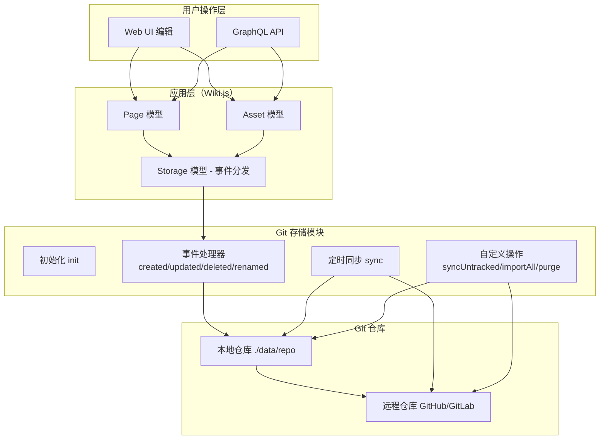
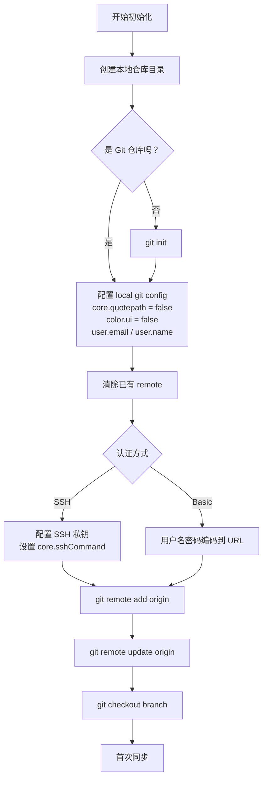
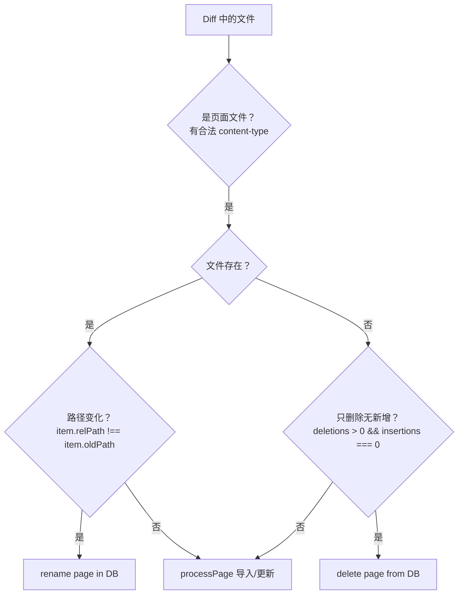

# Wiki.js Git 存储集成详解

> **关联文档:** [Wiki.js 主解读](./README.md) · [多版本文档机制](./version-management.md) · [文档资源权限管理](./permission-model.md) · [系统架构](./system-arch.md)

## 1. 设计动机与解决的问题

### 为什么要用 Git 作为存储后端

Wiki 系统本质上是一个内容管理系统（CMS），内容的持久化是最基础的需求。大多数 Wiki 系统把内容全部存在数据库里，这本身没有问题——但如果用户想要：

- **外部备份**：数据库挂了内容还在
- **版本历史**：想看谁在什么时候改了什么东西
- **外部协作**：让开发者在 GitHub/GitLab 上直接改文档内容
- **流程集成**：文档变更触发 CI/CD 流水线

这些需求超出了数据库的能力范围。Git 存储集成的设计初衷就是：**让 Wiki 内容同时具备数据库的快速访问和 Git 的版本控制、分发协作能力**。

核心设计决策——**不把数据库换成 Git，而是数据库和 Git 共存**：

| 层面 | 数据库 | Git 仓库 |
|------|--------|----------|
| **角色** | 主存储，支撑查询/渲染/管理操作 | 从存储，用于版本历史/备份/外部协作 |
| **数据结构** | 关系型表（pages/assets/history） | 文件系统中的 .md / 资源文件 |
| **访问方式** | GraphQL API → ORM → SQL | Git CLI → 文件系统 |
| **一致性** | 内容写入时同步写 Git（事件驱动） | Git 变更通过定时同步导入数据库 |

### 适用场景

- **团队协作的文档平台**：Wiki 内容与代码仓库同一处，开发者习惯的工作流
- **合规审计**：Git 的 commit 历史天然满足变更审计需求
- **多环境发布**：不同分支对应不同环境（staging/production）
- **离线编辑**：开发者 clone 仓库，本地编辑后 push 同步

## 2. 整体架构

### 架构总览



### 数据流方向

Wiki.js 的 Git 存储集成支持**双向数据流**，但两条路径的实现方式不同：

| 方向 | 触发方式 | 实时性 | 流程 |
|------|----------|--------|------|
| **Wiki → Git** | 事件驱动（页面/资源变更时同步写入） | 实时 | 用户在 UI 编辑 → `git add + commit` → 定时 `git push` |
| **Git → Wiki** | 定时轮询（对比 commit hash，找出变更文件） | 定时 | 定时 `git pull --rebase` → `git diff` 对比 → 导入数据库 |

## 3. 模块加载机制

### 存储后端抽象约定

Wiki.js 的存储后端没有使用类继承或接口（TypeScript 项目使用了鸭子类型而非接口），而是通过 JavaScript 对象的**方法名约定**实现多态：

```javascript
// server/modules/storage/git/storage.js
module.exports = {
  async init() { /* 初始化：创建目录、配置远程、首次同步 */ },
  async sync() { /* 定时同步：pull + push + diff 处理 */ },
  
  // 页面事件
  async created(page) { /* 写文件 → git add → git commit */ },
  async updated(page) { /* 写文件 → git add → git commit */ },
  async deleted(page) { /* git rm → git commit */ },
  async renamed(page) { /* fs.move → git rm → git add → git commit */ },
  
  // 资源事件
  async assetUploaded(asset) { /* 写文件 → git add → git commit */ },
  async assetDeleted(asset) { /* git rm → git commit */ },
  async assetRenamed(asset) { /* git mv → git commit */ },
  
  // 自定义操作
  async importAll() { /* 扫描 repo 全部导入 DB */ },
  async syncUntracked() { /* DB 全部写出到 repo */ },
  async purge() { /* 清空本地 repo 重新初始化 */ }
}
```

所有存储模块都必须实现这套方法签名，由 `storage.js` 模型通过动态属性访问统一调用：

```javascript
// server/models/storage.js:180
static async pageEvent({ event, page }) {
  for (let target of this.targets) {
    await target.fn[event](page)  // 鸭子类型：target.fn.created / updated / deleted / renamed
  }
}

static async assetEvent({ event, asset }) {
  for (let target of this.targets) {
    await target.fn[`asset${_.capitalize(event)}`](asset)  // assetUploaded / assetDeleted / assetRenamed
  }
}
```

### 启动加载链路

```
kernel.js:postBootMaster()
    ↓
storage.js:refreshTargetsFromDisk()    ← 扫描 server/modules/storage/，同步 definition.yml 到 DB
    ↓
storage.js:initTargets()               ← 动态 require() 启用的模块 → 调用 init()
    ↓
scheduler.start()                      ← 注册定时同步任务
```

关键步骤 `initTargets()` (`server/models/storage.js:117`):

1. 查询 `storage` 表，`isEnabled = true` 的记录
2. 动态 `require(../modules/storage/${target.key}/storage)`
3. 注入配置：`target.fn.config = target.config; target.fn.mode = target.mode`
4. 调用 `target.fn.init()`（Git 模块在此处克隆/检出仓库）
5. 注册定时同步任务（Git 默认 `PT5M`，每 5 分钟执行一次）

### 配置声明

每个存储模块的配置通过 `definition.yml` 声明 schema，存储在数据库 `storage` 表的 `config` JSON 字段中，而非 `config.yml` 文件。这意味着配置可以在运行时通过管理 UI 修改，修改后触发 `updateTargets` 重新初始化。

## 4. Git 存储核心实现

### 4.1 初始化流程

`init()` 是 Git 模块最复杂的部分（`server/modules/storage/git/storage.js:28`）：



SSH 认证支持两种私钥模式：

| 模式 | 说明 |
|------|------|
| **path** | 直接引用已有的 SSH 私钥文件路径 |
| **contents** | 将私钥内容写入 `data/secure/git-ssh.pem`，设置权限 `0o600` |

```javascript
// server/modules/storage/git/storage.js:72
if (this.config.sshPrivateKeyMode === 'contents') {
  this.config.sshPrivateKeyPath = path.resolve(WIKI.ROOTPATH, WIKI.config.dataPath, 'secure/git-ssh.pem')
  await fs.outputFile(this.config.sshPrivateKeyPath, this.config.sshPrivateKeyContent + os.EOL, {
    encoding: 'utf8',
    mode: 0o600
  })
}
await this.git.addConfig('core.sshCommand', `ssh -i "${this.config.sshPrivateKeyPath}" -o StrictHostKeyChecking=no`)
```

### 4.2 页面/资源变更 → Git commit

页面或资源的所有变更（增/删/改/移）都会触发对应的存储模块方法，执行 Git commit。

以 `created` 事件为例 (`storage.js:297`)：

```javascript
async created(page) {
  // 1. 构造文件名：支持 locale 命名空间
  let fileName = `${page.path}.${pageHelper.getFileExtension(page.contentType)}`
  if (this.config.alwaysNamespace || (WIKI.config.lang.namespacing && WIKI.config.lang.code !== page.localeCode)) {
    fileName = `${page.localeCode}/${fileName}`
  }
  
  // 2. 写入文件（含元数据）
  const filePath = path.join(this.repoPath, fileName)
  await fs.outputFile(filePath, page.injectMetadata(), 'utf8')
  
  // 3. Git add + commit
  const gitFilePath = `./${fileName}`
  if ((await this.git.checkIgnore(gitFilePath)).length === 0) {
    await this.git.add(gitFilePath)
    await this.git.commit(`docs: create ${page.path}`, fileName, {
      '--author': `"${page.authorName} <${page.authorEmail}>"`
    })
  }
}
```

关键设计点：

- **文件内容**调用 `page.injectMetadata()`，将页面的标题、描述、标签等元数据以 YAML front-matter 形式嵌入文件头部
- **跳过 `.gitignore`** 中匹配的文件，通过 `checkIgnore()` 检查
- **commit 作者**来自页面操作者，而非默认的配置作者（配置作者作为 fallback）
- **命名空间**控制多语言页面的目录结构

### 4.3 定时同步机制

#### 调度配置

通过 `definition.yml` 声明同步间隔：
- `schedule: PT5M` — 默认每 5 分钟同步一次
- `supportedModes: [sync, push, pull]` — 支持三种同步模式

#### 同步模式

| 模式 | 行为 |
|------|------|
| **sync**（默认） | 双向同步：`pull --rebase` + 处理变更 + `push` |
| **push** | 仅推送：`push --force`（适用于只写场景） |
| **pull** | 仅拉取：`pull --rebase` + 处理变更（适用于只读场景） |

#### sync() 核心流程 (`storage.js:120`)

```javascript
async sync() {
  // 1. 记录当前 commit hash
  const currentCommitLog = _.get(await this.git.log(['-n', '1', this.config.branch, '--']), 'latest', {})

  // 2. pull --rebase（sync/pull 模式）
  if (_.includes(['sync', 'pull'], this.mode)) {
    await this.git.pull('origin', this.config.branch, ['--rebase'])
  }

  // 3. push（sync/push 模式，push 模式下 force）
  if (_.includes(['sync', 'push'], this.mode)) {
    let pushOpts = ['--signed=if-asked']
    if (this.mode === 'push') { pushOpts.push('--force') }
    await this.git.push('origin', this.config.branch, pushOpts)
  }

  // 4. diff 对比，处理变更（sync/pull 模式）
  if (_.includes(['sync', 'pull'], this.mode)) {
    const latestCommitLog = _.get(await this.git.log(['-n', '1', ...]), 'latest', {})
    const diff = await this.git.diffSummary(['-M', currentCommitLog.hash, latestCommitLog.hash])
    if (_.get(diff, 'files', []).length > 0) {
      // 处理 diff 中的文件变更
      await this.processFiles(filesToProcess, rootUser)
    }
  }
}
```

关键设计点：

- **拉取使用 `--rebase`**：避免产生 merge commit，保持提交历史线性
- **增量处理**：通过对比两次 sync 之间的 commit hash，只处理差异文件（增量同步）
- **重命名检测**：使用 `git diff -M`（detect moves），识别文件重命名并在数据库中同步
- **push 模式下的 `--force`**：适合灾难恢复场景，但会重写远程历史

### 4.4 变更差分处理

`processFiles()` (`storage.js:195`) 处理 `git diff` 检测出的文件变更，根据文件类型（页面/资源）和变更类型（新增/删除/重命名/修改）执行不同的数据库操作。

#### 页面变更处理逻辑



#### 资源变更处理逻辑

资源（图片/附件等）的处理类似但不同：

- **重命名检测**：通过 `before === after` 或 `deletions === 0 && insertions === 0` 判断（二进制文件变更特征与文本文件不同）
- **删除检测**：通过 `before > 0 && after === 0` 判断
- **其他变更**：通过 `processAsset()` 导入

### 4.5 自定义操作

Git 模块通过 `definition.yml` 声明了 4 个管理员可触发的自定义操作：

| 操作 | handler | 用途 |
|------|---------|------|
| **Add Untracked Changes** | `syncUntracked` | 将数据库中所有页面/资源内容写出到 Git 仓库并 commit。适用于：启用 Git 前已有大量内容，或 Git 曾停用过 |
| **Force Sync** | `sync` | 立即执行一次同步，不等待定时器 |
| **Import Everything** | `importAll` | 扫描整个本地 Git 仓库，将所有文件导入数据库。适用于：从远程仓库首次导入内容 |
| **Purge Local Repository** | `purge` | 清空本地仓库后重新初始化。适用于：合并历史冲突时清理 |

#### syncUntracked 实现

将数据库内容全部写出到 Git 仓库（`storage.js:470`）：

```javascript
async syncUntracked() {
  // 1. 流式读取所有非私有页面，写出到文件
  await pipeline(
    WIKI.models.knex.column('id', 'path', 'localeCode', ...).select()
      .from('pages').where({ isPrivate: false }).stream(),
    new Transform({
      objectMode: true,
      transform: async (page, enc, cb) => {
        // 构造文件名 → 写出文件 → git add
        const filePath = path.join(this.repoPath, fileName)
        await fs.outputFile(filePath, pageHelper.injectPageMetadata(page), 'utf8')
        await this.git.add(`./${fileName}`)
        cb()
      }
    })
  )

  // 2. 流式读取所有资源，写出到文件
  // ... 类似逻辑 ...

  // 3. 统一 commit
  await this.git.commit('docs: add all untracked content')
}
```

这里使用了 Node.js 的 `stream/promises` 的 `pipeline` 处理大量数据，避免内存溢出，同时配合 `klaw` 进行文件遍历。

## 5. Git 工作流与仓库结构

### 5.1 仓库目录结构

Git 模块在本地维护一个完整的工作目录，目录结构与页面/资源的组织方式完全对应：

```
{localRepoPath}/
├── {localeCode}/              # 语言命名空间（可配置 alwaysNamespace）
│   ├── {page-path}.md         # Markdown 页面
│   ├── {page-path}.html       # HTML 页面
│   ├── {category}/
│   │   ├── {sub-page}.md
│   │   └── ...
│   └── ...
├── assets/                    # 资源文件
│   ├── {asset-folder}/
│   │   ├── {filename}.{ext}
│   │   └── ...
│   └── ...
└── .git/                      # Git 仓库元数据
```

**文件名规则：**
- 页面文件：`{path}.{extension}`，extension 根据 contentType 映射（markdown → md, html → html, asciidoc → adoc）
- 语言命名空间：当 `alwaysNamespace=true` 或语言代码与默认语言不同时，加 `{localeCode}/` 前缀
- 资源文件：按 `assetFolders` 的目录层级组织，文件名为原始文件名

**文件内容格式（markdown 页面示例）：**

```markdown
---
title: Getting Started
description: How to get started with Wiki.js
published: true
date: 2024-01-15T10:00:00.000Z
tags: guide, beginner
editor: markdown
dateCreated: 2024-01-10T08:00:00.000Z
---

# Getting Started

Welcome to Wiki.js! This guide will help you...
```

元数据以 YAML front-matter 形式嵌入文件头部，通过 `pageHelper.injectPageMetadata()` 生成。HTML 格式的页面使用 HTML 注释格式的元数据。

### 5.2 Commit 规范

每次页面变更生成一个独立的 commit，commit 信息遵循统一的格式：

| 操作 | Commit Message | 示例 |
|------|---------------|------|
| 创建 | `docs: create {path}` | `docs: create guide/getting-started` |
| 更新 | `docs: update {path}` | `docs: update guide/getting-started` |
| 删除 | `docs: delete {path}` | `docs: delete guide/getting-started` |
| 移动 | `docs: rename {oldPath} -> {newPath}` | `docs: rename guide/start -> guide/getting-started` |
| 资源上传 | `docs: upload asset {filename}` | `docs: upload asset diagram.png` |
| 资源删除 | `docs: delete asset {filename}` | `docs: delete asset diagram.png` |
| 批量同步 | `docs: add all untracked content` | syncUntracked 操作 |

**Commit 作者：** 使用实际页面操作者的 `authorName` 和 `authorEmail`。当无法获取时，回退到 `definition.yml` 中配置的 `defaultName` / `defaultEmail`。

**Commit 签名：** 支持 GPG 签名（`--signed=if-asked`），可通过仓库配置要求已验证签名。

### 5.3 三种同步模式对比

| 模式 | 方向 | 数据流 | 适用场景 |
|------|------|--------|----------|
| **sync**（默认） | 双向 | pull --rebase → 处理外部变更 → push 本地变更 | 团队协作，需要内外双向同步 |
| **push** | 单向 | push --force（覆盖远程） | Wiki 只写，远程仓库作为备份 |
| **pull** | 单向 | pull --rebase → 处理外部变更到 DB | Wiki 只读，从远程仓库导入内容 |

### 5.4 从 Git 回写到 DB 的变更处理

`processFiles()` 方法解析 `git diff` 输出的文件变更，按以下逻辑处理：

```
git diff 输出文件列表
  │
  ├── 判断文件类型
  │   ├── 页面文件（.md / .html / .adoc） → processPage()
  │   └── 资源文件（assets/下） → processAsset()
  │
  ├── 判断变更类型
  │   ├── 重命名（diff -M 检测到） → rename page/asset in DB
  │   ├── 删除（文件不存在） → delete page/asset from DB
  │   └── 新增/修改 → processPage() / processAsset()
  │
  └── processPage() 内部
        ├── 解析 YAML front-matter → 提取标题/标签/发布状态
        ├── 提取正文内容
        ├── 检查 DB 中是否存在同路径页面
        │   ├── 存在 → updatePage()
        │   └── 不存在 → createPage()
        └── 使用 root 用户身份执行（避免权限校验）
```

**关键设计：** 从 Git 回写操作统一使用 root 用户（管理员）身份，跳过权限校验，确保外部 Git 操作的内容能顺利导入。

### 5.5 完整工作流时序

```
┌──────────┐     ┌──────────────┐     ┌──────────────┐     ┌──────────┐
│ Web UI   │     │  Wiki.js     │     │  Git 本地仓库  │     │ 远程仓库  │
│ (用户)    │     │  应用层       │     │  data/repo    │     │ GitHub   │
└────┬─────┘     └──────┬───────┘     └──────┬───────┘     └────┬─────┘
     │                  │                    │                  │
     │  编辑页面保存     │                    │                  │
     │────────────────► │                    │                  │
     │                  │  git add + commit  │                  │
     │                  │──────────────────► │                  │
     │                  │                    │  git commit      │
     │                  │                    │    (本地)        │
     │                  │                    │                  │
     │                  │  定时 sync() 触发   │                  │
     │                  │──────────────────► │                  │
     │                  │                    │  git push        │
     │                  │                    │──────────────────►│
     │                  │                    │                  │
     │                  │                    │  git pull --rebase
     │                  │                    │◄─────────────────│
     │                  │  外部变更 diff 处理  │                  │
     │                  │◄────────────────── │                  │
     │                  │                    │                  │
     │                  │  开发者直接修改     │                  │
     │                  │                    │◄─────────────────│
     │                  │                    │   git clone      │
     │                  │                    │   edit → push    │
     │                  │                    │──────────────────►│
     │                  │                    │                  │
     │                  │  下次定时 sync()    │                  │
     │                  │   检测到远程变更     │                  │
     │                  │◄────────────────── │                  │
     │                  │                    │                  │
     │                  │   processFiles()   │                  │
     │                  │   更新数据库        │                  │
     │   变更可见        │                    │                  │
     │◄──────────────── │                    │                  │
```

## 6. 配置体系与认证

### 配置项清单

| 配置键 | 类型 | 默认值 | 说明 |
|--------|------|--------|------|
| `authType` | String | `ssh` | 认证类型：`basic` / `ssh` |
| `repoUrl` | String | — | Git 仓库 URI |
| `branch` | String | `master` | 分支名称 |
| `sshPrivateKeyMode` | String | `path` | SSH 私钥加载模式：`path` / `contents` |
| `sshPrivateKeyPath` | String | — | SSH 私钥文件路径 |
| `sshPrivateKeyContent` | String (sensitive) | — | SSH 私钥内容 |
| `verifySSL` | Boolean | `true` | 是否验证 SSL 证书 |
| `basicUsername` | String | — | Basic 认证用户名 |
| `basicPassword` | String (sensitive) | — | Basic 认证密码/PAT |
| `defaultEmail` | String | `name@company.com` | 默认提交者邮箱（fallback） |
| `defaultName` | String | `John Smith` | 默认提交者名称（fallback） |
| `localRepoPath` | String | `./data/repo` | 本地仓库路径 |
| `alwaysNamespace` | Boolean | `false` | 是否总是使用语言命名空间子目录 |
| `gitBinaryPath` | String | `''` | Git 二进制路径（PATH 不可用时） |

### 认证流程对比

| 认证方式 | 优点 | 缺点 | 适用场景 |
|----------|------|------|----------|
| **SSH** | 更安全，无需在 URL 中暴露凭证 | 需要管理私钥文件 | 生产环境推荐 |
| **Basic** | 配置简单，适合 PAT 访问 | 凭证编码在 URL 中，安全性依赖 HTTPS | 开发/测试环境 |

## 7. 技术选型与依赖

### 使用的 npm 包

| 包名 | 用途 | 关键 API |
|------|------|----------|
| `simple-git` | Git 命令行操作封装 | `git.add()` / `git.commit()` / `git.pull()` / `git.push()` / `git.diffSummary()` / `git.checkIsRepo()` |
| `fs-extra` | 文件系统操作 | `ensureDir()` / `outputFile()` / `move()` / `emptyDir()` / `pathExists()` |
| `klaw` | 递归遍历目录 | 配合 `pipeline` 流式处理文件导入 |
| `lodash` | 工具函数 | `_.includes()` / `_.get()` / `_.isEmpty()` / `_.startsWith()` |

### 使用 simple-git 而非 child_process

```javascript
this.git = sgit(this.repoPath, { maxConcurrentProcesses: 1 })
```

- `simple-git` 提供 Promise-based API，避免了手动管理 `child_process` 的 stdout/stderr 解析
- `maxConcurrentProcesses: 1` 限制并发数，防止大量文件操作时 Git 进程冲突

## 8. 设计模式与工程实践

### 7.1 插件化的存储模块架构

Wiki.js 的存储后端采用**发现式插件架构**：

```
server/modules/storage/
├── git/
│   ├── definition.yml    ← 声明式配置 schema
│   └── storage.js        ← 实现类（鸭子类型）
├── disk/                 ← 本地磁盘存储
├── s3/                   ← AWS S3 存储
└── ... (共 11 种)
```

- 无需硬编码注册，启动时扫描目录自动发现
- 通过 `definition.yml` 声明配置项、支持的动作、同步模式
- `refreshTargetsFromDisk()` 同步磁盘模块到数据库，自动处理新增/删除

### 7.2 事件驱动 + 定时轮询的双触发模式

| 模式 | 响应速度 | 可靠性 | 实现方式 |
|------|----------|--------|----------|
| **事件驱动** | 实时（毫秒级） | 弱（事件可能丢失） | 模型层操作末尾调用 `pageEvent()` |
| **定时轮询** | 延迟（5分钟级） | 强（最终一致性） | Scheduler 定时任务执行 `sync()` |

事件驱动保证了"用户保存立即有 commit"，定时轮询保证了"即使事件丢失，最终也会通过 diff 同步回来"。

### 7.3 流式处理大容量数据

`importAll` 和 `syncUntracked` 使用 Node.js Stream API 处理可能的数据量：

```javascript
// pipeline + Transform: 流式读取数据库 → 写出文件 → git add
await pipeline(
  WIKI.models.knex.column(...).select().from('pages').where(...).stream(),
  new Transform({
    objectMode: true,
    transform: async (page, enc, cb) => {
      // 逐条处理，不占内存
      cb()
    }
  })
)
```

避免了一次性加载所有数据到内存中，适用于大数据量的首次导入场景。

## 9. 潜在问题与局限

| 问题 | 说明 | 缓解措施 |
|------|------|----------|
| **事件丢失风险** | 如果 Git 模块初始化失败或进程崩溃，事件驱动写入可能丢失 | 定时同步机制兜底，保证最终一致性 |
| **commit 频率** | 每次页面保存一个 commit，高频编辑产生大量小 commit | 可通过 `skipStorage` 临时关闭，批量操作时有用 |
| **大文件处理** | Git 仓库不应存储大文件（如大图片），影响 clone 和性能 | 资源文件可通过其他存储后端处理 |
| **冲突处理** | 多人同时编辑同一页面通过 Web UI 和 Git 时，可能出现冲突 | `pull --rebase` 策略降低冲突概率 |
| **本地仓库膨胀** | `pull` 模式下本地仓库会包含完整历史 | 可在管理界面调整同步策略为 `push-only` |

## 10. 对比参考

### 与其他 Wiki.js 存储模块的对比

| 维度 | Git | Disk | S3 |
|------|-----|------|----|
| **版本历史** | ✅ 原生 | ❌ | ❌ |
| **外部访问** | ✅ clone/push | ❌ | ✅ S3 API |
| **离线编辑** | ✅ clone 到本地 | ❌ | ❌ |
| **部署依赖** | Git CLI | 无 | AWS SDK |
| **复杂度** | 中 | 低 | 低~中 |

---

> **GitHub:** [requarks/wiki](https://github.com/requarks/wiki) — `server/modules/storage/git/` | `server/models/storage.js`
