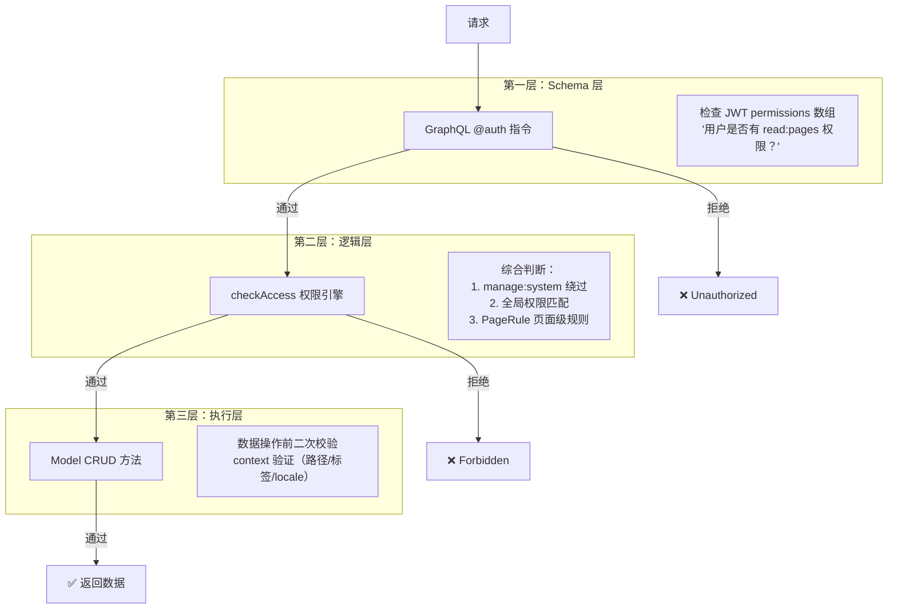
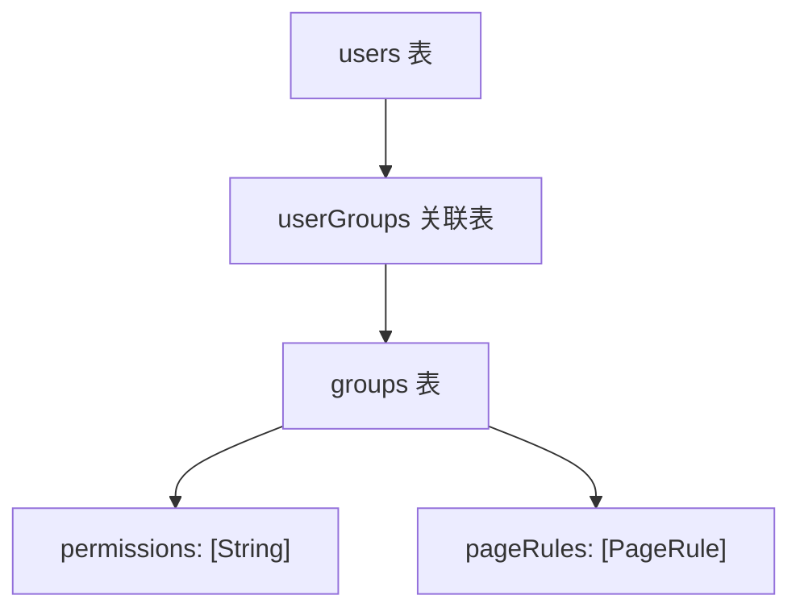
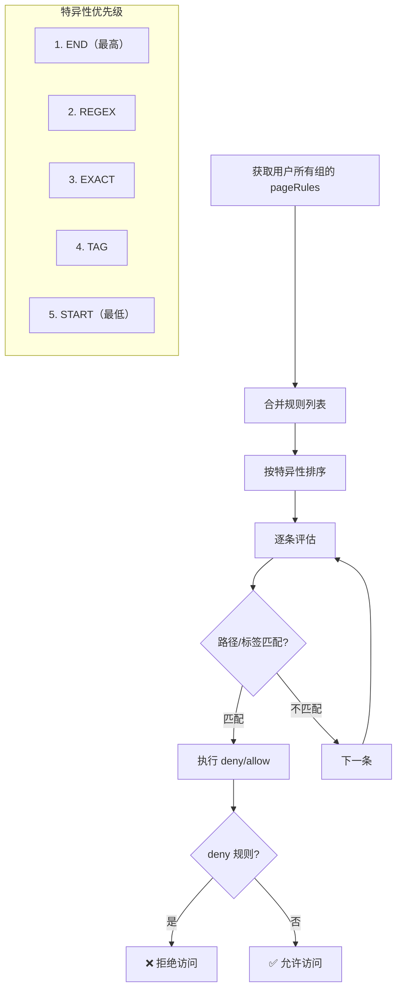
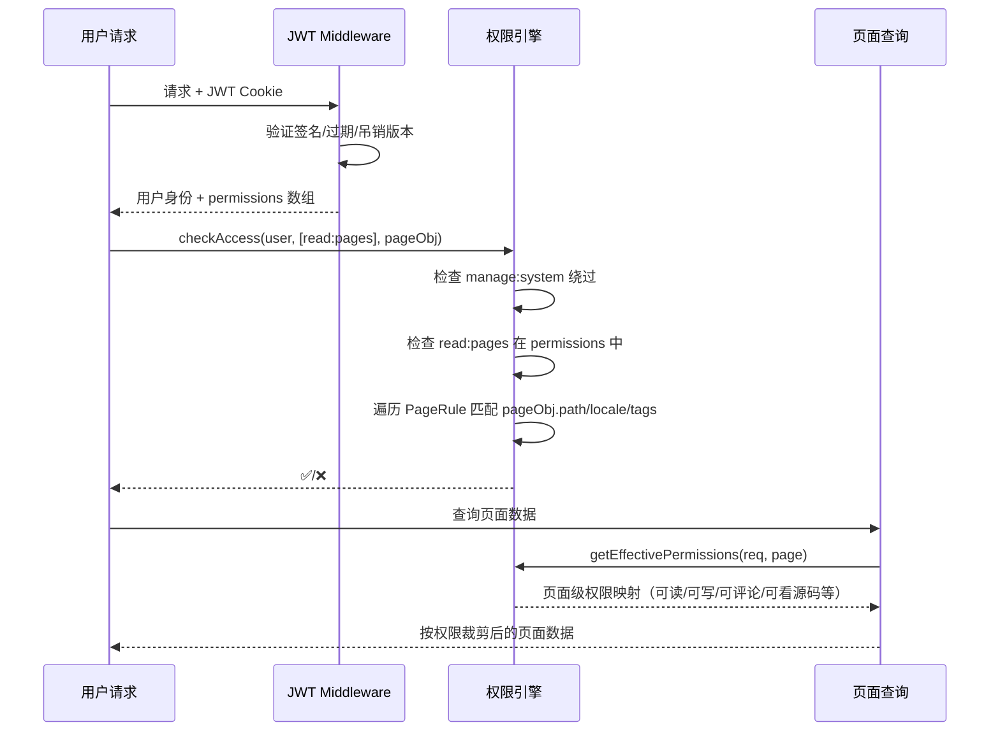

# Wiki.js 文档资源权限管理详解

> **关联文档:** [Wiki.js 主解读](./README.md) · [多版本文档机制](./version-management.md) · [系统架构](./system-arch.md)

## 1. 三层权限架构

Wiki.js 的权限体系分为三个层次，每一层拦截粒度不同：



### 第一层：GraphQL @auth 指令

定义在 `server/graph/directives/auth.js`，作为 GraphQL 的 Schema Directive：

```javascript
// server/graph/directives/auth.js
// @auth(requires: ["read:pages", "manage:system"])
// 检查 context.req.user.permissions 是否包含任一所需权限
// 无用户 -> Unauthorized
// 无匹配 -> Forbidden
```

在 schema 中使用：

```graphql
# server/graph/schemas/page.graphql
type Query {
    single(id: Int): Page @auth(requires: ["manage:pages", "delete:pages"])
    history(id: Int!): [PageVersion] @auth(requires: ["manage:system", "read:history"])
}
```

### 第二层：checkAccess 权限引擎

`server/core/auth.js:221` — 这是权限决策的核心函数：

```javascript
// server/core/auth.js:221
static checkAccess(user, permissions, page) {
    // 1. manage:system 绕过
    if (user.permissions.includes('manage:system')) return true

    // 2. 全局权限检查：用户是否拥有任一所需权限
    const hasGlobal = permissions.some(p => user.permissions.includes(p))
    if (!hasGlobal) return false

    // 3. 页面级规则检查（仅当提供 page 对象时）
    if (page) {
        return this._evaluatePageRules(user, permissions, page)
    }
    return true
}
```

### 第三层：Model CRUD

在 `server/models/pages.js` 的数据操作方法中，进一步校验操作上下文：

```javascript
// server/models/pages.js:56 (createPage)
if (!WIKI.auth.checkAccess(user, ['write:pages', 'manage:pages', 'manage:system'], { path })) {
    throw new Error('访问被拒绝')
}
// 还要校验目标路径是否冲突、contentType 是否合法等
```

## 2. 权限清单

Wiki.js 定义了 20+ 个权限字符串，按功能域分组：

| 权限 | 作用于 | 说明 |
|------|--------|------|
| `manage:system` | 全局 | **超管** — 绕过所有权限检查 |
| `read:pages` | 页面 | 查看页面内容 |
| `write:pages` | 页面 | 创建/编辑页面 |
| `manage:pages` | 页面 | 移动/重命名页面 |
| `delete:pages` | 页面 | 删除页面 |
| `read:source` | 页面 | 查看页面源码 |
| `write:styles` | 页面 | 注入自定义 CSS |
| `write:scripts` | 页面 | 注入自定义 JS |
| `read:history` | 版本 | 查看页面历史版本 |
| `read:comments` | 评论 | 查看评论 |
| `write:comments` | 评论 | 发表评论 |
| `manage:comments` | 评论 | 编辑/删除任何评论 |
| `read:assets` | 资源 | 查看/下载文件资源 |
| `write:assets` | 资源 | 上传文件资源 |
| `manage:assets` | 资源 | 重命名/删除文件资源 |
| `write:users` | 用户 | 创建用户 |
| `manage:users` | 用户 | 编辑/删除/激活用户 |
| `write:groups` | 组 | 创建/编辑用户组 |
| `manage:groups` | 组 | 管理高级组（含 admin 权限的组） |
| `manage:navigation` | 导航 | 管理侧边栏导航 |
| `manage:theme` | 主题 | 管理主题样式 |
| `manage:api` | API | 管理 API 密钥及开关 |

## 3. 用户与组模型

### 数据关系



### 内置用户

| ID | 用户 | 说明 |
|----|------|------|
| 1 | **Root** | 系统管理员，`permissions: ['manage:system']`，不可删除 |
| 2 | **Guest** | 匿名用户，权限来自 "guest" 组，可配置 |

### 权限继承

用户的最终权限 = 所属所有组的 permissions 并集 + PageRule 交集。JWT 令牌中包含聚合后的 `permissions` 数组和 `groups` 数组：

```javascript
// server/models/users.js:225
static async refreshToken(user) {
    const groups = await user.getGroups()
    const permissions = [
        ...new Set(groups.flatMap(g => g.permissions))
    ]
    // 生成 RS256 签名的 JWT
}
```

## 4. PageRule 规则引擎

PageRule 是 Wiki.js 权限体系的精髓，允许在**页面级别**精确控制访问。

### PageRule 数据结构

```graphql
# server/graph/schemas/group.graphql
type PageRule {
    id: Int
    deny: Boolean         # true=拒绝, false=允许
    match: PageRuleMatch  # 匹配类型
    path: String          # 匹配模式
    roles: [String]       # 此规则作用于哪些权限
    locales: [String]     # 可选语言过滤
}

enum PageRuleMatch {
    START   # 路径前缀匹配
    END     # 路径后缀匹配
    EXACT   # 精确路径匹配
    REGEX   # 正则匹配
    TAG     # 标签匹配
}
```

### 五种匹配类型

| 类型 | 示例 | 匹配范围 |
|------|------|---------|
| **START** | `path: "/engineering"` | 匹配 `/engineering/*` 所有子页面 |
| **END** | `path: "/draft"` | 匹配所有以 `/draft` 结尾的路径 |
| **EXACT** | `path: "/admin/settings"` | 仅匹配该精确路径 |
| **REGEX** | `path: "^/draft-\d+"` | 正则匹配路径（启用前安全校验） |
| **TAG** | `path: "confidential"` | 匹配所有打了 `confidential` 标签的页面 |

### 规则解析流程



### 特异性优先级

当多条 PageRule 冲突时（例如一条 allow 一条 deny 同时匹配），按类型的优先级裁决：

```javascript
// server/core/auth.js:368
static _applyPageRuleSpecificity() {
    // 优先级：END > REGEX > EXACT > TAG > START
    // 相同类型按路径长度降序（更具体的路径优先）
    // 相同优先级时 deny 优先于 allow
}
```

### 默认配置

新安装时，"guest" 组的默认 PageRule：

```
match: START, path: "", roles: [read:pages, read:assets, read:comments, write:comments], deny: false
```

即默认所有页面对已登录用户可读。

## 5. 权限校验的代码级分析

### 5.1 GraphQL @auth 指令实现

`server/graph/directives/auth.js` — 这是最外层的权限拦截点，作为 Schema Directive 自动包装每个标记了 `@auth` 的字段：

```javascript
// server/graph/directives/auth.js
const { SchemaDirectiveVisitor } = require('apollo-server-express')
const { defaultFieldResolver } = require('graphql')

class AuthDirective extends SchemaDirectiveVisitor {
  visitFieldDefinition(field) {
    const { resolve = defaultFieldResolver } = field
    const requiredScopes = this.args.requires

    field.resolve = async function (...args) {
      const [, , context] = args
      const { req } = context

      // 1. 无用户 → Unauthorized
      if (!req.user) {
        throw new Error('Unauthorized')
      }

      // 2. 无匹配权限 → Forbidden
      if (!requiredScopes.some(s => req.user.permissions.includes(s))) {
        throw new Error('Forbidden')
      }

      // 3. 通过 → 执行原始 resolver
      return resolve.apply(this, args)
    }
  }
}
```

**实现原理：** GraphQL 在执行 resolver 之前，先经过 `@auth` 指令包装的 resolver wrapper。这意味着权限检查发生在 resolver 逻辑之前，权限不足直接返回错误，不会执行任何数据查询。

### 5.2 checkAccess() 权限引擎实现

`server/core/auth.js:221` — 这是权限决策的核心，在 Express 路由和 Model 层中手动调用：

```javascript
static checkAccess(user, permissions = [], page = false) {
  // 获取用户权限列表（JWT 中已包含或从数据库实时查询）
  const userPermissions = user.permissions
    ? user.permissions
    : user.getGlobalPermissions()

  // 第1步：manage:system 绕过 — 超管直接放行
  if (userPermissions.includes('manage:system')) {
    return true
  }

  // 第2步：全局权限检查 — 用户是否拥有任一所需权限
  // permissions 是或的关系，满足其一即可
  if (!permissions.some(p => userPermissions.includes(p))) {
    return false
  }

  // 第3步：页面级规则检查 — 仅当提供了 page 上下文时执行
  if (page) {
    return this._evaluatePageRules(userPermissions, permissions, page)
  }

  return true
}
```

**关键设计：**
- `permissions` 数组是**或的关系** — 满足任一权限即通过
- `manage:system` 是最高权限，不检查任何其他条件
- 页面级规则仅在提供 `page` 上下文（含 path/locale/tags）时才执行评估

### 5.3 PageRule 特异性排序实现

当多条 PageRule 同时匹配时，按特异性优先级裁决冲突：

```javascript
// server/core/auth.js 内部
_evaluatePageRules(userPermissions, permissions, page) {
  const allRules = this._collectUserPageRules(user)  // 合并所有组的 pageRules
  const sortedRules = allRules.sort((a, b) => {
    // 优先级表：END(4) > REGEX(3) > EXACT(2) > TAG(1) > START(0)
    const priority = { END: 4, REGEX: 3, EXACT: 2, TAG: 1, START: 0 }
    const diff = priority[b.match] - priority[a.match]

    if (diff !== 0) return diff
    // 同类型按路径长度降序（更具体的路径优先）
    return b.path.length - a.path.length
  })

  for (const rule of sortedRules) {
    if (this._matchRule(rule, page)) {
      return !rule.deny  // deny=true → false, deny=false → true
    }
  }

  return true  // 没有匹配规则 → 默认允许
}
```

**特异性优先级链：** `END > REGEX > EXACT > TAG > START`

当多条同类型规则同时匹配时，按路径长度降序判优（更具体的路径优先）。例如：
- `START /engineering/backend` 优先于 `START /engineering`
- 如果仍然平级，**deny 优先于 allow**

### 5.4 令牌吊销实现

当组成员资格或组权限变更时，已签发的 JWT 需要标记为无效：

```javascript
// server/core/auth.js:526
static revokeUserTokens({ id, kind = 'u' }) {
  const key = `${kind}${id}`  // 如 "u1"（用户1）、"g2"（组2）
  WIKI.auth.revocationList.set(key, Date.now())
}
```

JWT 认证中间件在每个请求时检查：

```javascript
// server/core/auth.js JWT 验证逻辑
const tokenRevKey = `u${decoded.id}`
const groupRevKeys = decoded.groups.map(g => `g${g}`)
const allRevKeys = [tokenRevKey, ...groupRevKeys]

// 检查任一吊销版本号是否大于签发时间
const isRevoked = allRevKeys.some(key => {
  const revTime = WIKI.auth.revocationList.get(key)
  return revTime && revTime > decoded.iat * 1000
})

if (isRevoked) {
  // 强制刷新令牌
}
```

**工作机制：** 吊销列表只记录操作时间戳。JWT 的 `iat`（签发时间）与吊销时间对比，若签发时间早于吊销时间则需重新登录获取新令牌。

### 5.5 多级权限在业务操作中的实际应用

以"更新页面"操作为例，展示三层权限校验的实际调用链：

```
用户请求更新页面 /engineering/guide
  │
  ├── 第1层：GraphQL @auth 指令
  │   └── schema: update(...) @auth(requires: ["write:pages"])
  │   └── 检查 req.user.permissions 包含 write:pages
  │   └── 不通过 → Forbidden，不执行任何后续操作
  │
  ├── 第2层：checkAccess() 页面级权限
  │   └── Model: pages.updatePage()
  │   └── WIKI.auth.checkAccess(user, ['write:pages'], { path: '/engineering/guide', locale: 'en' })
  │   └── 遍历用户的 PageRule，匹配路径前缀 START /engineering
  │   └── 匹配到 allow 规则 → 通过
  │   └── 匹配到 deny 规则（如 /engineering/internal）→ 拒绝
  │
  └── 第3层：字段级权限
      └── 写入 extra.js → 需要 write:scripts 权限
      └── 写入 extra.css → 需要 write:styles 权限
      └── 写入 isPrivate → 需要 manage:system 权限
```

## 6. 页面发布控制

除了权限模型，Wiki.js 还提供**发布调度**机制，控制页面内容的可见性：

```javascript
// server/controllers/common.js:467
let pageIsPublished = page.isPublished
if (pageIsPublished && page.publishStartDate) {
    pageIsPublished = moment(page.publishStartDate).isBefore(moment.utc())
}
if (pageIsPublished && page.publishEndDate) {
    pageIsPublished = moment(page.publishEndDate).isAfter(moment.utc())
}
if (!pageIsPublished && !hasWritePermission) {
    // 403 Unauthorized
}
```

三个字段控制发布状态：

| 字段 | 类型 | 说明 |
|------|------|------|
| `isPublished` | boolean | 是否已发布 |
| `publishStartDate` | datetime | 定时上架时间 |
| `publishEndDate` | datetime | 定时下架时间 |

## 7. 导航可见性

导航树（侧边栏）支持独立的可见性控制：

```graphql
# server/graph/schemas/navigation.graphql
type NavigationItem {
    # ...
    visibilityMode: NavigationVisibilityMode  # all | groups
    visibilityGroups: [Int]                    # 可见的用户组 ID 列表
}

enum NavigationVisibilityMode {
    all     # 所有人可见
    groups  # 仅指定组可见
}
```

除了导航级别的控制，页面树（`pageTree`）中的每个节点也会通过 `checkAccess()` 进行 `read:pages` 权限检查，确保用户在树上只能看到自己有权限查看的页面。

## 8. JWT 令牌设计

### 令牌结构

Wiki.js 使用 RS256 签名的 JWT 来维持用户会话：

```javascript
// server/models/users.js:225
static async refreshToken(user) {
    const userGroups = await user.getGroups()

    const token = jwt.sign(
        {
            id: user.id,
            email: user.email,
            name: user.name,
            permissions: userGroups.flatMap(g => g.permissions),
            groups: userGroups.map(g => g.id)
        },
        privateKey,
        {
            algorithm: 'RS256',
            issuer: 'wiki.js',
            expiresIn: WIKI.config.auth.tokenExpiration
        }
    )
}
```

### 令牌吊销机制

JWT 令牌带有 `u`（用户级）和 `g`（组级）版本号。当用户被移除出某个组，或组的权限发生变化时，对应的版本号递增，已签发的令牌在下次请求时被判定为无效，需要刷新。

### 完整权限查询



---

> **GitHub:** [requarks/wiki](https://github.com/requarks/wiki)
