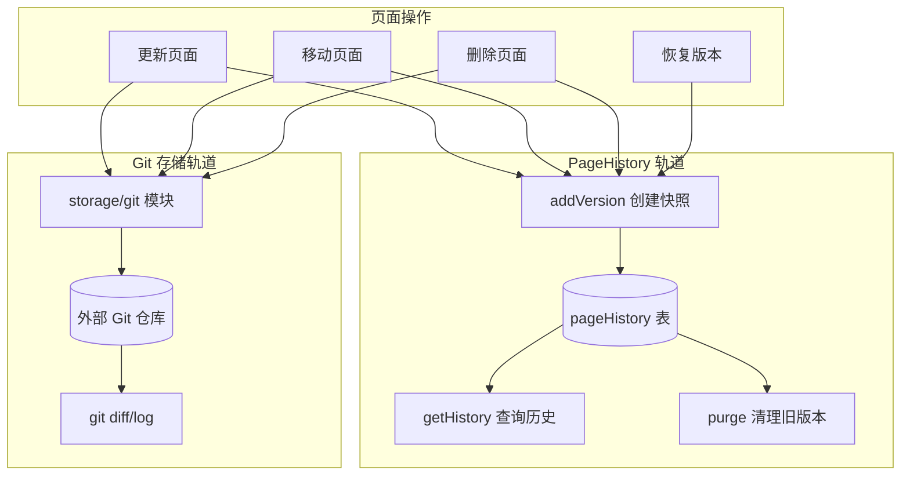
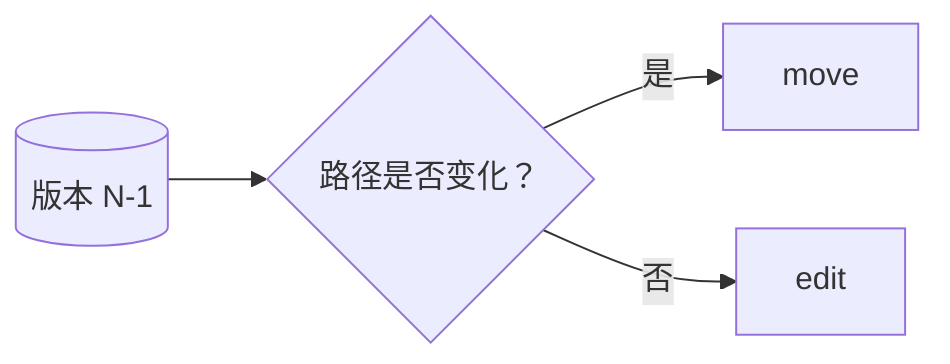
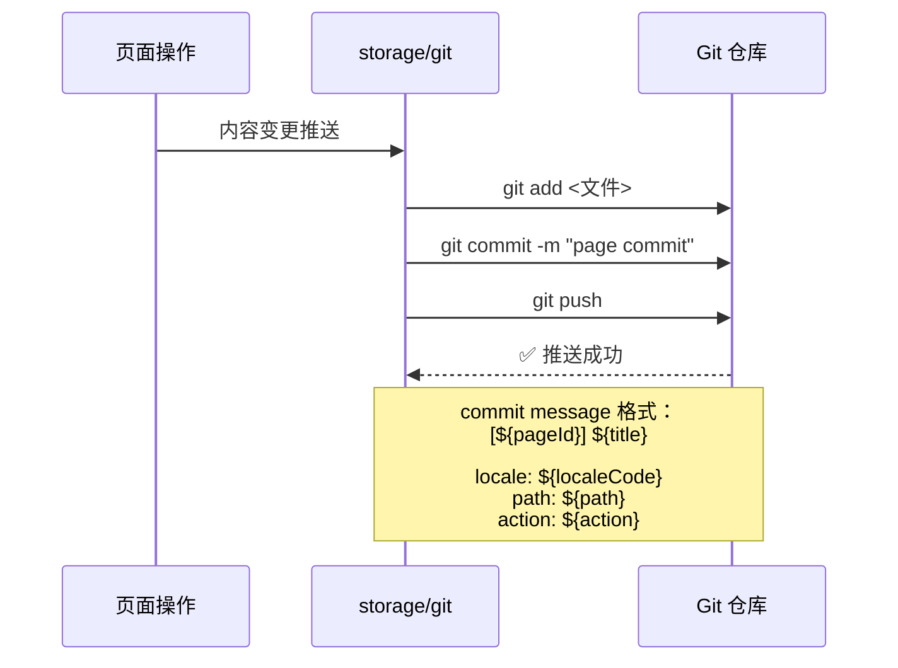
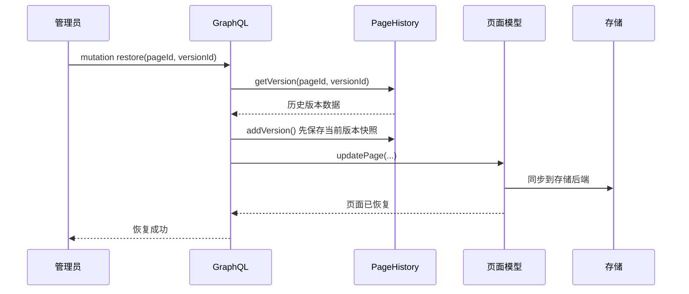

# Wiki.js 多版本文档机制详解

> **关联文档:** [Wiki.js 主解读](./README.md) · [文档资源权限管理](./permission-model.md)

## 1. 双轨版本存储架构

Wiki.js 的版本管理采用**双轨架构**，两条轨道各有侧重，协同工作：

| 维度 | PageHistory 表 | Git 存储 |
|------|---------------|----------|
| **定位** | 操作级快照，用于 Web 前端历史查看和版本恢复 | 外部持久化，用于备份、差异查看和外部协作 |
| **存储位置** | 主数据库 `pageHistory` 表 | 外部 Git 仓库（GitHub/GitLab 或自建） |
| **粒度** | 每次变更一条记录，含完整页面内容 | 每次变更一个 commit，含文件变更 |
| **触发时机** | update / move / delete / restore | 配置为 storage 后端后，每次页面保存 |
| **保留策略** | 按时间清理（`purge()`），可配置 | Git 仓库全量保留 |
| **访问方式** | GraphQL 查询 `history(id)` / `version(pageId, versionId)` | Git 原生工具（git log/diff/clone） |



## 2. PageHistory 快照机制

### 触发时机

`WIKI.models.pageHistory.addVersion()` 在以下操作中被调用：

- **`pages.updatePage()`** — 页面内容/标题/路径/标签变更前
- **`pages.movePage()`** — 页面移动至新路径前
- **`pages.deletePage()`** — 页面删除前
- **`PageMutation.restore()`** — 版本恢复前

```javascript
// server/models/pageHistory.js:50
static async addVersion(opts) {
    // 获取当前页面最新状态
    // 复制关键字段：path, hash, title, description,
    //   isPublished, publishStartDate, publishEndDate,
    //   content, contentType
    // 记录操作者和时间
    // 写入 pageHistory 表
}
```

### Action 类型检测

`getHistory()` 通过比较相邻版本的信息来推导操作类型：



- **`initial`** — 第一条历史记录（页面创建时的自动快照）
- **`edit`** — 路径未变，仅内容/标题等变更
- **`move`** — 路径发生变化

### 分页查询

```javascript
// server/models/pageHistory.js:142
static async getHistory({ pageId, offsetPage, offsetSize }) {
    // 按 pageId 查询该页面的所有版本
    // 按 createdAt 降序排列
    // 分页返回（offsetPage/offsetSize）
    // 每个版本附带 author 信息
    // 遍历推导 action 类型
}
```

### 快照存储字段

每次快照完整保存以下字段，确保恢复时能还原页面完整状态：

`pageHistory` 表字段：`id`, `pageId`, `path`, `hash`, `title`, `description`, `isPublished`, `publishStartDate`, `publishEndDate`, `content`, `contentType`, `authorId`, `editorKey`, `localeCode`, `action`, `versionDate`, `createdAt`

## 3. Git 存储集成

当配置 `storage/git` 作为存储后端时，每次页面变更会同步到 Git 仓库：



Git 存储的典型目录结构：

```
wiki-repo/
├── <locale>/
│   ├── <page-path>.md
│   └── ...
└── ...
```

## 4. 版本恢复流程



## 5. 历史清理策略

```javascript
// server/models/pageHistory.js:225
static async purge(olderThan) {
    // olderThan: ISO 8601 时长字符串，如 "P30D" (30天)
    // 删除 createdAt < (now - olderThan) 的历史记录
    await WIKI.models.pageHistory
        .query()
        .where('createdAt', '<', moment.utc().subtract(iso8601ToDuration(olderThan)).toDate())
        .del();
}
```

清理通过后台定时任务（`server/jobs/`）周期性执行，可在管理界面配置保留时长。

---

> **GitHub:** [requarks/wiki](https://github.com/requarks/wiki)
