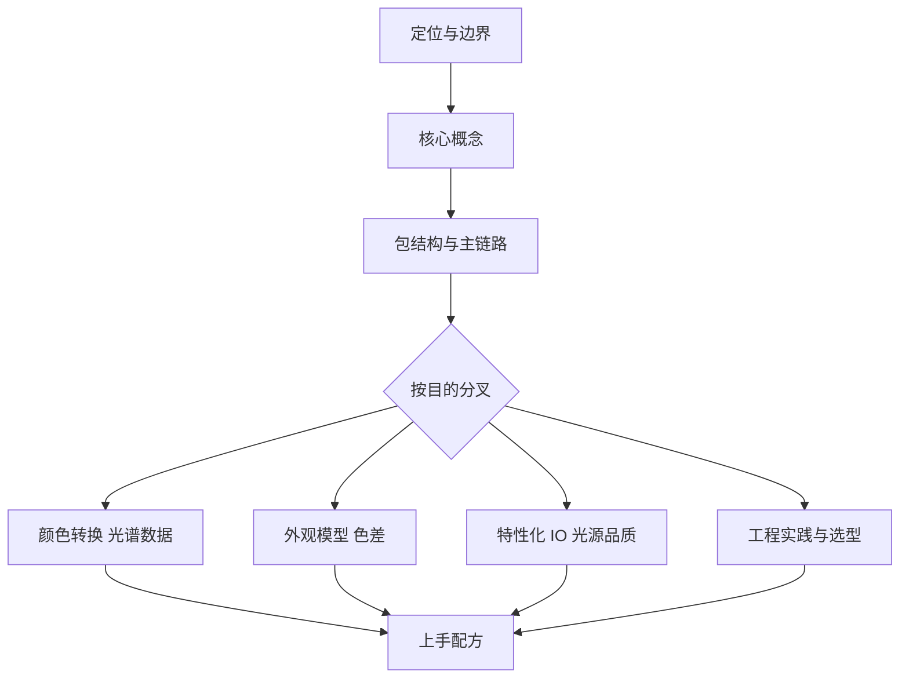

# Colour（colour-science）

Colour 是一个用 Python 实现色彩科学的开源库。它把论文、CIE 标准与厂商白皮书里的算法和数据集集中到一套 API 中：从光谱分布、CIE XYZ 三刺激值，到 RGB 色彩空间、外观模型与色差公式，都能在同一个包内完成。

**本文档依据**：`v0.4.7`（`a3bfe3496`，2025-12-06）

本文覆盖最新稳定发布版 `v0.4.7`。默认分支 `develop` 上晚于该版本的变更（例如 Array API 支持）不在本文范围内。

## 页面索引

| 页面 | 内容 | 重要度 |
|------|------|--------|
| [overview.md](overview.md) | 这是什么、解决什么问题、给谁用、核心能力与技术栈 | 高 |
| [concepts.md](concepts.md) | 读懂 Colour 必须先建立的几个概念：颜色表示、光谱、域-范围尺度、转换图 | 高 |
| [architecture.md](architecture.md) | 25 个子包怎么分层、公开命名空间如何组织、一次转换经过哪些环节 | 高 |
| [colour-conversion.md](colour-conversion.md) | 自动转换图、RGB 色彩空间对象、色适应与色域体积 | 高 |
| [spectral-data.md](spectral-data.md) | 光谱分布与多光谱数据、数据集注册表、从光谱到三刺激值 | 高 |
| [appearance-models.md](appearance-models.md) | 十二种颜色外观模型、共享的观看条件与 CAM16 的计算过程 | 中 |
| [colour-difference.md](colour-difference.md) | 色差公式家族、CIEDE2000、色差与视觉数据的一致性评估 | 中 |
| [characterisation-and-io.md](characterisation-and-io.md) | 相机/显示特性化、色彩校正矩阵、ACES IDT 与图像/LUT/光谱文件读写 | 中 |
| [light-quality-and-temperature.md](light-quality-and-temperature.md) | 色温与 Duv、显色指数、色彩质量量表、保真度指数 | 中 |
| [specialised-domains.md](specialised-domains.md) | 色域体积、光谱恢复、光学现象、色觉缺陷、对比敏感度等专门能力 | 低 |
| [engineering.md](engineering.md) | 只依赖 NumPy 的取舍、缓存、向量化、测试与发布流程 | 中 |
| [usage.md](usage.md) | 安装、常见任务配方、域缩放与绘图的正确用法 | 高 |

## 建议阅读顺序

这个 Wiki 不是线性手册，而是"先建立共同语言，再按目的分叉"的结构。下图给出主干与四个分叉；分叉之间可以跳读，但前两页建议按顺序看。

读这张图时注意两点：**概念页是分叉的前提**，跳过它直接看转换或外观模型，会反复遇到"域-范围尺度"与"光谱是连续函数"这两个未解释的前提；**上手配方是汇合点**，前面的分叉最终都要落到具体调用上，配方页负责把入口、参数与常见坑对上。

1. [overview.md](overview.md) —— 先判断它是否解决你的问题。
2. [concepts.md](concepts.md) —— 建立颜色表示与光谱数据的共同语言。
3. [architecture.md](architecture.md) —— 看清包的分层与主链路。
4. 按目的分叉：
   - 做色彩空间转换或图像处理 → [colour-conversion.md](colour-conversion.md)
   - 处理光谱仪数据、光源或材质 → [spectral-data.md](spectral-data.md)
   - 研究颜色外观或感知属性 → [appearance-models.md](appearance-models.md)、[colour-difference.md](colour-difference.md)
   - 做相机、显示或影视流程 → [characterisation-and-io.md](characterisation-and-io.md)
   - 评估光源质量 → [light-quality-and-temperature.md](light-quality-and-temperature.md)
   - 评估技术选型与维护成本 → [engineering.md](engineering.md)
5. 要直接上手 → [usage.md](usage.md)。

## 现状与边界

- 这是一个**算法与数据集库**，不是色彩管理流程或渲染器。它提供计算原语，图像流水线、色彩管理策略与 UI 需要使用者自己组织；OpenColorIO、CTL 只作为可选集成。
- 运行时只依赖 NumPy。绘图、图像读写、LUT 解析、NetworkX 转换图、SciPy 优化等能力由可选依赖提供，缺失时相应功能不可用或降级。
- `v0.4.7` 的数组后端**只有 NumPy**：不提供 Array API 标准兼容，也没有 JAX/PyTorch 后端与自动微分。这些能力出现在后续开发分支，但不在本文描述的发布版中。
- 部分外观模型（ATD95、Hunt、LLAB、Nayatani95、RLAB）只有正向计算，没有逆变换；CAM16 的色相组成 `HC` 字段尚未实现，返回 `None`。
- 文档的 API 参考以 Sphinx 自动生成，版本变更记录放在 GitHub Releases，仓库内的 `CHANGES.rst` 不逐版本记录。
