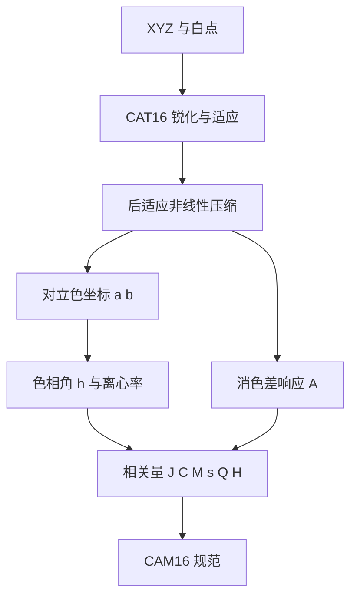

# 外观模型

## 这个能力解决什么

CIE XYZ 是物理测量量，不是感知量。两个 XYZ 相同的颜色，在不同亮度、不同背景、不同适应状态下看起来并不一样；反过来，两个 XYZ 不同的颜色，可能看起来相同。

颜色外观模型（Colour Appearance Model，CAM）就是描述这种差异的数学结构：输入刺激值与观看条件，输出亮度（lightness）、彩度（chroma）、色相（hue）、明度感（brightness）、色彩丰富度（colourfulness）等感知属性。

## 支持的模型

`v0.4.7` 提供 12 个外观模型入口，另有 1 个独立的光源显色效应（HKE）计算。

| 模型 | 前向 | 逆向 | 主要输出 | 备注 |
|------|------|------|---------|------|
| CAM16 | `XYZ_to_CAM16` | `CAM16_to_XYZ` | J C h s Q M H | 当前主推，CAT16 适应 |
| CIECAM02 | `XYZ_to_CIECAM02` | `CIECAM02_to_XYZ` | J C h s Q M H | 经典模型，CAM16 的前身 |
| CIECAM16 | `XYZ_to_CIECAM16` | `CIECAM16_to_XYZ` | J C h s Q M H | CIECAM02 的修订版 |
| Hellwig2022 | `XYZ_to_Hellwig2022` | `Hellwig2022_to_XYZ` | J C h s Q M H + J_HK Q_HK | 加入 Helmholtz–Kohlrausch 修正 |
| ZCAM | `XYZ_to_ZCAM` | `ZCAM_to_XYZ` | J C h s Q M H V K W | 使用 0–1 域 |
| sCAM | `XYZ_to_sCAM` | `sCAM_to_XYZ` | J C h Q M V K W D | 简化模型 |
| Kim2009 | `XYZ_to_Kim2009` | `Kim2009_to_XYZ` | J C h s Q M H | 面向显示媒体 |
| Hunt | `XYZ_to_Hunt` | 无 | J C h s Q M | 参数最多，仅正向 |
| LLAB | `XYZ_to_LLAB` | 无 | J C h s M a b | 仅正向 |
| Nayatani95 | `XYZ_to_Nayatani95` | 无 | L* C h s Q M | 仅正向 |
| RLAB | `XYZ_to_RLAB` | 无 | J C h s a b | 仅正向 |
| ATD95 | `XYZ_to_ATD95` | 无 | h C Q A T D | 仅正向，色相可超过 360° |

只有 7 个模型提供逆变换。这不是遗漏，而是原模型没有给出可靠的逆解：Hunt、LLAB、Nayatani95、RLAB、ATD95 的文献只定义了正向计算。需要往返转换时，应选 CAM16、CIECAM02、CIECAM16、Hellwig2022、ZCAM、sCAM 或 Kim2009。

## 共享结构

所有模型共享两组输入约定：观看条件（viewing conditions）与输出规范（specification）。

**观看条件**包括适应亮度 `L_A`、背景亮度因子 `Y_b`、白点 `XYZ_w`、周围环境 `surround`。多数模型复用 CIECAM02 的三档预设：

| 预设 | 含义 | 典型场景 |
|------|------|---------|
| `Average` | 平均环境 | 一般室内观看 |
| `Dim` | 昏暗环境 | 电视、投影 |
| `Dark` | 暗环境 | 暗室、影院 |

**输出规范**是 dataclass，字段名在各模型间尽量统一：`J` 亮度、`C` 彩度、`h` 色相角、`s` 饱和度、`Q` 明度感、`M` 色彩丰富度、`H` 色相四分区、`HC` 色相组成。不同模型会追加自己的字段，例如 ZCAM 的 `V/K/W`、Hellwig2022 的 `J_HK/Q_HK`。

## CAM16 的计算过程

CAM16 是当前最常用的模型，也是理解其他模型的良好样本。它的前向计算可以分成四段：适应、压缩、对立色、相关量。



图中最容易被低估的是第一步：CAM16 不直接在 XYZ 上做通道缩放，而是先用 CAT16 矩阵把 XYZ 转到锐化锥体响应空间，再按适应度 `D` 混合"完全适应"与"不适应"两种状态。适应度由周围环境与适应亮度共同决定；`discount_illuminant=True` 时直接取完全适应。

第二段非线性压缩把线性锥体响应压成感知响应，指数由 `F_L` 决定。第三段用对立色公式得到 `a`、`b`，再由 `atan2` 得到色相角。最后一段把消色差响应归一化为亮度 `J`，把色度归一化为 `C`，再由 `C` 与 `F_L` 得到 `M`。

逆向计算按相反顺序解方程。有一个必须注意的约束：`C` 与 `M` 至少要有一个存在，否则无法确定彩度；两者都缺失时函数抛 `ValueError`。

```python
import colour

XYZ = [0.20654008 * 100, 0.12197225 * 100, 0.05136952 * 100]
XYZ_w = [95.05, 100.00, 108.88]
spec = colour.XYZ_to_CAM16(XYZ, XYZ_w, L_A=318.31, Y_b=20.0,
                           surround=colour.VIEWING_CONDITIONS_CAM16["Average"])
print(spec.J, spec.C, spec.h)
```

## 接入转换图

外观模型也注册在自动转换图中，节点名是模型名，另有 `JMh` 投影节点。以 CAM16 为例，图中有四条边：`CIE XYZ` 到 `CAM16`、`CAM16` 回到 `CIE XYZ`、`CAM16` 到 `CAM16 JMh`、`CAM16 JMh` 回到 `CAM16`。

这让 `convert(xyz, "CIE XYZ", "CAM16 JMh")` 可以直接得到三维感知坐标，适合把外观模型当作颜色空间使用。代价是路径上的默认观看条件来自 sRGB 的参考环境；如果实际观看条件不同，必须显式传参，否则得到的是"标准环境下的外观"，不是"你的环境下的外观"。

同一条路径也用于 CAM02-UCS、CAM16-UCS 等均匀空间：先算 JMh，再按 UCS 系数变换。色差页会用到这些空间。

## 边界与限制

- **输入条件比公式更容易出错**。`L_A` 是绝对适应亮度（cd/m²），`Y_b` 是相对背景亮度，两者不能混用；周围环境选错会让 `J` 与 `C` 同时偏移。
- **模型之间不可直接比较数值**。CAM16 的 `J=50` 与 CIECAM02 的 `J=50` 含义相近但不相等；跨模型比较应先统一到同一模型。
- **部分字段未实现**。CAM16、Hunt、LLAB、Nayatani95、RLAB、ZCAM、sCAM 的 `HC`（色相组成）返回 `None`；源码中标注为待实现。
- **仅正向模型不能做往返校验**。需要逆变换时选有 `*_to_XYZ` 的模型。
- **不处理空间效应**。模型是单刺激、单背景的；对比度、锐度、眩光、纹理等空间现象不在范围内。

> 依据：`colour/appearance/__init__.py:1-165`、`colour/appearance/cam16.py:129-177`、`colour/appearance/cam16.py:180-355`、`colour/appearance/cam16.py:358-530`、`colour/appearance/ciecam02.py:123-176`、`colour/appearance/ciecam02.py:230-391`、`colour/appearance/hellwig2022.py:133-200`、`colour/appearance/zcam.py:84-126`、`colour/appearance/zcam.py:333-535`、`colour/appearance/hke.py:55-130`、`colour/graph/conversion.py:1583-1689`
