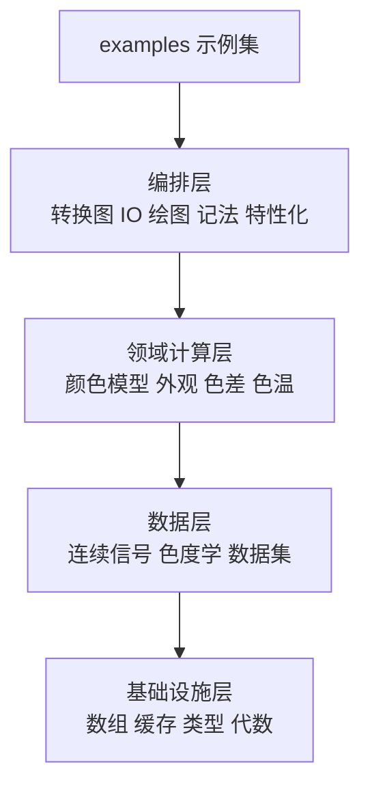
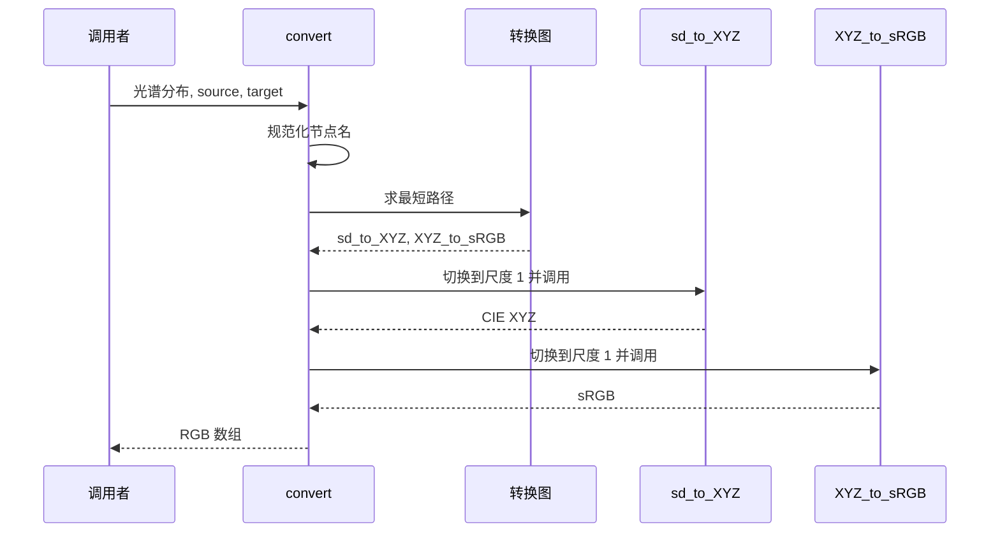

# 系统架构

## 整体形态

Colour 是单包多子包的结构，没有服务端、数据库或运行时进程。它的"架构"主要回答两个问题：二十多个子包如何分工，以及一次计算如何从入口走到结果。

下图按职责把子包分成四层。越往下越基础，越往上越接近使用者的任务；箭头表示依赖方向，反过来不成立。

这张图要看的不是包的数量，而是**依赖只向下**：底层不知道上层存在。`utilities` 与 `algebra` 不导入任何颜色模型，`colorimetry` 不导入 `appearance`。这条纪律让包可以在不循环导入的前提下，把 25 个子包组装进同一个命名空间。

## 分层与职责

**基础设施层**负责所有领域都能用的东西：数组构造与类型转换、域-范围缩放、插值与外推、缓存注册、警告与日志、类型别名、物理常数。它不含任何颜色语义。

**数据层**负责"颜色是什么"的表示与标准数据。`continuous` 提供连续函数抽象；`colorimetry` 在其上实现光谱分布、三刺激值积分、光源与观察者；数据集注册表放在 `colorimetry/datasets`、`characterisation/datasets`、`quality/datasets` 等位置，由各自的 `__init__` 汇总。

**领域计算层**按色彩科学的分支划分：颜色模型、色适应、外观模型、色差、色温、光源品质、光谱恢复、色域体积、光学现象、色觉缺陷、对比敏感度、生化模型、对应色、几何。它们共享数据层的表示，彼此之间只在确有需要时依赖。

**编排层**把领域能力包装成使用者直接调用的入口：`graph` 把转换函数连成图，`io` 负责文件进出，`notation` 处理 Munsell/CSS/十六进制等记法，`characterisation` 把相机与显示数据变成校正矩阵，`plotting` 把结果画成图。

## 模块地图

| 子包 | 职责 | 关键概念与入口 |
|------|------|---------------|
| `adaptation` | 色适应模型与变换矩阵 | Von Kries、Bradford、CAT02、CAT16、CMCCAT2000 |
| `algebra` | 插值、外推、矩阵、回归等通用代数 | Sprague、Lanczos、`vecmul`、`sdiv`、`spow` |
| `appearance` | 颜色外观模型 | CAM16、CIECAM02、ZCAM、Hellwig2022 |
| `biochemistry` | Michaelis–Menten 酶动力学 | 反应速率与底物浓度互算 |
| `blindness` | 色觉缺陷模拟 | Machado 2009 矩阵 |
| `characterisation` | 相机、显示、色卡特性化 | 色彩校正矩阵、ACES IDT |
| `colorimetry` | 色度学核心对象与积分 | `SpectralDistribution`、`sd_to_XYZ`、CMFS |
| `constants` | CIE 与 CODATA 常数 | 光速、普朗克常数、标准观察者常数 |
| `continuous` | 连续函数抽象 | `Signal`、`MultiSignals` |
| `contrast` | 对比敏感度函数 | Barten 1999 |
| `corresponding` | 对应色预测 | Breneman 数据、五种预测模型 |
| `difference` | 色差与 STRESS | `delta_E`、CIEDE2000 |
| `examples` | 可运行的示例脚本（脚本目录，不是包） | 各子包用法演示 |
| `geometry` | 几何图元与椭圆拟合 | 凸包截面、网格、球体 |
| `graph` | 自动转换图 | `convert`、`conversion_path` |
| `hints` | 类型别名与 `Annotated` 元数据 | `Domain1`、`Range100` |
| `io` | 图像、LUT、光谱文件读写 | `read_image`、`read_LUT`、OCIO、CTL |
| `models` | 颜色模型与 RGB 色彩空间 | `RGB_Colourspace`、`XYZ_to_Lab` |
| `notation` | 颜色记法系统 | Munsell、CSS Color 3、十六进制 |
| `phenomena` | 光学现象 | 薄膜干涉、瑞利散射、折射率 |
| `plotting` | 图表绘制 | 66 个可直接调用的 `plot_*` 入口 |
| `quality` | 光源显色与色彩质量 | CRI、CQS、TM-30、CFI、SSI |
| `recovery` | 从三刺激值恢复光谱 | Otsu 2018、Jakob 2019、Mallett 2019 |
| `temperature` | 色温与相关色温 | CCT、Duv、Planckian locus |
| `utilities` | 数组、缓存、警告、结构 | `CACHE_REGISTRY`、`domain_range_scale` |
| `volume` | 色域体积与包含判断 | MacAdam 极限、Pointer 色域、可见光谱体 |

## 主链路：从光谱到 sRGB

一次 `convert` 调用最能说明各层如何协作。下图是一条最短路径的时序：调用者只给出起点、终点与数据，路由与尺度换算由中间层完成。

这条链路的三个关键点在图中没有展开：`sd_to_XYZ` 需要选择光源与标准观察者，`XYZ_to_sRGB` 需要白点与色适应变换，`convert` 需要在首尾做尺度换算。它们分别属于数据层、领域计算层与编排层，这正是分层的目的——每层只回答自己的问题。

## 公开命名空间

顶层 `colour` 命名空间把常用对象全部导出，所以多数代码只写 `import colour` 就够了。子包仍然可以单独导入，适合只需要一小块能力的场景。

公开 API 的命名有一套前缀约定，熟悉之后可以用自动补全探索：

| 前缀 | 含义 | 例子 |
|------|------|------|
| `SD`/`SDS`/`MSDS` | 单个光谱分布、多个光谱分布、多光谱数据 | `SDS_ILLUMINANTS`、`MSDS_CMFS` |
| `CCS`/`TVS` | 色度坐标、三刺激值 | `CCS_ILLUMINANTS` |
| `XYZ_to_*` / `*_to_XYZ` | 以 CIE XYZ 为中枢的正/逆变换 | `XYZ_to_Lab`、`Lab_to_XYZ` |
| `*_METHODS` | 方法调度表 | `DELTA_E_METHODS`、`SD_TO_XYZ_METHODS` |
| `RGB_COLOURSPACES` | RGB 色彩空间注册表 | `RGB_COLOURSPACES["sRGB"]`、`RGB_COLOURSPACES["ITU-R BT.2020"]` |
| `CAT_*` | 色适应变换矩阵 | `CAT_BRADFORD`、`CAT_CAT16` |

方法调度表是项目的一个统一模式：同一个任务有多种算法时，不写 `if/elif`，而是注册到 `CanonicalMapping`，调用者用字符串选择，找不到时给出候选列表。色差、色温、光谱到 XYZ、外观模型、绘图都采用这个模式。

## 关键设计取舍

**函数式 API 而非类层次。** 绝大多数操作是纯函数，输入数组、输出数组。只有确实需要携带状态的对象才用类：`SpectralDistribution`、`RGB_Colourspace`、`Signal`。代价是调用者需要自己管理参数与尺度；收益是容易向量化、组合与测试。

**转换图而非两两转换函数。** 如果为每一对颜色表示都写一个函数，复杂度是平方级；用图只需为相邻表示写边，路径由算法组合。代价是运行时依赖 NetworkX，且路径可能经过调用者没有预期的中间表示。

**懒加载数据集而非一次性构造。** 导入 `colour` 时不会构造全部光谱对象；数据集的值是工厂函数，首次访问才实例化并缓存。代价是第一次访问有额外开销，收益是导入速度与内存占用可控。

**可选依赖而非全家桶。** 核心只依赖 NumPy；绘图、图像、图算法、优化各自声明为可选依赖，缺失时对应模块降级或抛出带安装提示的错误。代价是使用者需要按任务选择 extras，收益是核心安装足够轻。

> 依据：`colour/__init__.py:15-60`、`colour/__init__.py:252-260`、`docs/tutorial.rst:33-80`、`colour/graph/conversion.py:1745-1790`、`colour/graph/conversion.py:1798-1835`、`colour/graph/conversion.py:1987-2040`、`colour/utilities/requirements.py:536-580`、`colour/utilities/structures.py:711-774`
