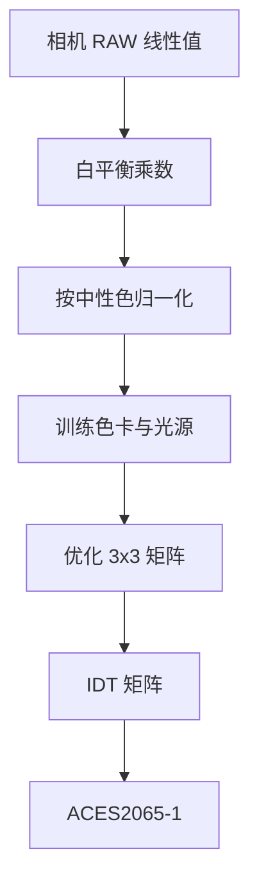

# 特性化与 IO

## 这个能力解决什么

特性化（characterisation）回答"这台设备怎么把颜色记错"，IO 回答"这些数据怎么进出"。两者经常一起出现：先读入色卡测量值与参考值，拟合校正矩阵，再把矩阵应用到相机图像上。

项目把特性化拆成两个层次：通用的色彩校正（给定两组色块值，求矩阵），以及面向 ACES 流程的专用输入变换（IDT）。

## 色彩校正

色彩校正的核心是一个最小二乘问题：给定测试色块数组 `M_T` 与参考色块数组 `M_R`，求一个矩阵，使 `M_T × M` 尽量接近 `M_R`。

Colour 支持三种多项式展开方式，它们决定"用什么特征拟合"：

| 方法 | 特征 | 特点 |
|------|------|------|
| Cheung 2004 | 一次到高阶项的完全展开 | 经典方法，项数随阶数快速增长 |
| Finlayson 2015 | 带根号的多项式项 | 改善某些相机响应的非线性 |
| Vandermonde | 范德蒙德矩阵 | 结构简单，适合低阶 |

流程分三步，可以分开调用，也可以一次完成：

| 步骤 | 函数 | 输入输出 |
|------|------|---------|
| 展开特征 | `polynomial_expansion` | 色块 RGB → 多项式特征 |
| 求校正矩阵 | `matrix_colour_correction` | 测试特征 + 参考值 → 矩阵 |
| 应用矩阵 | `apply_matrix_colour_correction` | 图像 RGB + 矩阵 → 校正 RGB |
| 端到端 | `colour_correction` | 测试色块 + 参考色块 + 图像 → 校正图像 |

多项式阶数越高，拟合误差通常越小，但过拟合与噪声放大的风险也越高；工业上常用二阶，并用独立色卡验证而不是只看训练误差。

## ACES 输入变换

ACES 流程要求把相机 RAW 转成 ACES2065-1。这个变换不是简单矩阵，而是一条带白平衡、曝光归一化与优化目标的流水线。

图中的"优化"是这条流水线与普通色彩校正的区别：它不是对单组色块做最小二乘，而是对多组训练光源与色卡、在特定目标空间里最小化误差。项目在 `colour.characterisation` 下提供 `optimisation_factory_rawtoaces_v1`、`optimisation_factory_Jzazbz`、`optimisation_factory_Oklab_15` 三种目标函数。

相关入口包括 `sd_to_aces_relative_exposure_values`（光谱到 ACES 相对曝光值）、`matrix_idt`（生成 IDT 矩阵）、`camera_RGB_to_ACES2065_1`（应用矩阵）。`matrix_idt` 依赖 SciPy 做优化，未安装 SciPy 时该函数不可用。

## 相机与显示数据

特性化子包还提供数据集容器，而不是拟合算法：

| 数据集 | 内容 | 用途 |
|--------|------|------|
| `colour.characterisation.MSDS_CAMERA_SENSITIVITIES` | DSLR 相机光谱灵敏度 | 相机仿真、光谱响应分析 |
| `colour.characterisation.MSDS_ACES_RICD` | ACES 参考输入捕获设备 | ACES IDT 训练 |
| `colour.characterisation.MSDS_DISPLAY_PRIMARIES` | CRT 与 LCD 显示基色 | 显示仿真 |
| `colour.CCS_COLOURCHECKERS` / `colour.SDS_COLOURCHECKERS` | 色卡色度坐标与光谱 | 校正与验证 |
| `colour.characterisation.SDS_FILTERS` / `colour.characterisation.SDS_LENSES` | 滤光片与镜头光谱 | 成像链路建模 |

这些容器只是数据；拟合相机响应曲线、估计显示 gamma 等任务需要使用者基于这些数据自行实现。项目不提供通用的"相机特性化 API"。

## IO 能力

IO 子包按数据形态分派，不追求统一抽象。每个入口都有默认后端，并在缺少可选依赖时给出明确错误。

| 数据形态 | 入口 | 支持格式/后端 |
|---------|------|--------------|
| 图像 | `read_image` / `write_image` | OpenImageIO（默认）、imageio；uint8/uint16/float16/32/64 |
| LUT | `read_LUT` / `write_LUT` | Iridas `.cube`、Resolve `.cube`、Cinespace `.csp`、Sony `.spi1d/.spi3d/.spimtx` |
| OCIO 处理 | `colour.io.process_image_OpenColorIO` | 从 `$OCIO` 或配置文件加载，CPU 处理 |
| CTL | `colour.io.ctl_render` / `colour.io.process_image_ctl` | 调用外部 `ctlrender` 可执行文件 |
| 光谱图像 | `read_spectral_image_Fichet2021` / `write_spectral_image_Fichet2021` | OpenEXR 布局，按 Fichet et al. 2021 |
| 光谱文本 | `read_sds_from_csv_file`、`SpectralDistribution_IESTM2714`、UPRTek/Sekonic/X-Rite | CSV、IES TM-27-14 XML、厂商文件 |

LUT 的读写不是简单的文本解析：`LUT1D`、`LUT3x1D`、`LUT3D`、`LUTSequence` 是不同的数据结构，Resolve `.cube` 还支持 1D shaper + 3D 组合。读取器会根据格式返回对应类型，写入器负责反向序列化。

## 边界与限制

- **没有视频 IO**。`read_image` 与 `write_image` 处理单帧数组；视频帧序列、时间码、编码格式不在范围内。
- **OCIO 是集成而非替代**。只提供"按配置处理图像"的入口，不提供配置编辑、显示校准或色彩管理策略。
- **OpenColorIO 在 Python 3.14 上不可用**。`pyproject.toml` 将 `opencolorio` 限制在 `<3.14`；这是依赖侧的限制，不是 Colour 的 API 限制。
- **相机特性化不是通用拟合器**。项目提供 ACES IDT 与数据集，不提供"上传 RAW 自动生成相机配置文件"的端到端工具。
- **CTL 需要外部程序**。`ctlrender` 不在 Python 依赖里，缺失时对应函数抛错。

> 依据：`colour/characterisation/correction.py:659-733`、`colour/characterisation/correction.py:876-1015`、`colour/characterisation/correction.py:1173-1262`、`colour/characterisation/correction.py:1408-1542`、`colour/characterisation/aces_it.py:159-283`、`colour/characterisation/aces_it.py:754-959`、`colour/characterisation/aces_it.py:1004-1230`、`colour/characterisation/cameras.py:53-113`、`colour/characterisation/displays.py:54-119`、`colour/io/image.py:547-640`、`colour/io/image.py:858-965`、`colour/io/luts/__init__.py:95-372`、`colour/io/ocio.py:35-168`、`colour/io/ctl.py:52-322`、`colour/io/fichet2021.py:466-891`、`colour/io/tabular.py:45-366`、`colour/io/tm2714.py:1660-1820`
